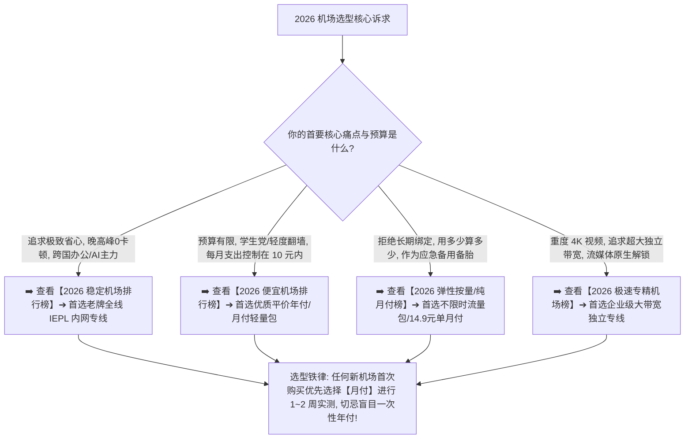
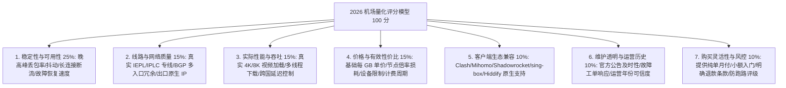

> 📌 **榜单数据更新与方法论声明**：  
> 本排行榜最后全量数据核验于 **2026 年 8 月**。本站坚持“**数据真实可复现、排名规则全公开、严禁虚构测速、拒绝付费篡改天梯位次**”的独立评测准则。所有收录品牌均通过基础资料核验、晚高峰长周期抽样实测与套餐计费审计。

在庞大繁杂的科学上网与翻墙服务市场中，**“2026 机场排行榜”** 是每一位寻找稳定梯子、加速器与代理节点的用户最核心的决策入口：**“当前市场上到底有哪些机场真正值得购买？网络上铺天盖地的‘机场推荐排行榜’到底是不是谁给钱多谁就排第一？为什么有些宣称‘全网最低价、千兆专线、永不掉线’的机场买完一个月就疯狂断流甚至直接跑路？所谓的‘IEPL 专线’和普通中转直连到底有什么本质区别？每月只要 7 元的平价机场和动辄数十元的高端专线机场，在晚高峰 21:00 观看 4K 视频和使用 ChatGPT / Claude 编程时体验差距到底有多大？面对五花八门的天梯榜，不同预算、不同流量需求与不同设备平台的用户到底应该怎么科学挑选？”**

面对铺天盖地的营销推广与虚假榜单，绝大多数用户都会陷入一系列认知误区：**要么盲目迷信“节点数量越多越好、Ping 延迟越低越快”**；**要么被“年付折算几块钱”的超低价噱头吸引，一次性购买多年却遭遇服务商断代跑路**；**要么误以为只要买了“综合排名第一”的高端机场，就能解决自己在手机、电脑和特定网络下的所有使用问题**。

**科学的 2026 机场排行榜，绝不是单纯的速度跑分天梯，而是一套‘涵盖稳定性、线路质量、真实吞吐、有效性价比、服务透明度与风控机制的八维综合决策体系’！**

要从海量机场中精准挑选出最契合自身需求的高可用服务，必须掌握一套 **客观、理性、多维的选型方法论**：**“建立包含‘服务可用性（Availability）25% + 线路与网络质量 15% + 实际性能 15% + 价格与套餐价值 15% + 客户端与便利度 10% + 服务维护与透明度 10% + 风险控制与购买灵活度 10%’的 100 分权重评估矩阵 ➔ 深刻理解‘最低价格 $\ne$ 最高性价比、专线标签 $\ne$ 长期稳定、低延迟 $\ne$ 高吞吐’的技术真相 ➔ 掌握计算‘基础每 GB 价格’与结合‘节点倍率后的有效流量成本’的精准算法 ➔ 依据不同用户画像分别查阅‘综合总榜、稳定榜、价格榜、专线榜与高性价比榜’ ➔ 掌握通过‘购买前 15 项核心检查清单’规避超售与跑路风险 ➔ 依托标准化订阅支持，实现跨 Clash Verge Rev、Shadowrocket、sing-box、Hiddify 与 v2rayN 等全平台客户端的极速部署”**。

本文作为 **2026 年度机场排行榜与商业决策核心矩阵专题**，将为你公开全套评测数据与排名算法，助你拨开营销迷雾，精准锁定最适合你的优质专线！

---

## ⚡ 60 秒极速看懂：2026 机场选型与需求分流导航



- 🚨 **核心认知黄金定律**：
  - **不存在适合所有人的绝对“天下第一机场”**：高预算追求的是晚高峰极致稳定，低预算追求的是基础可用与极低成本，需求不同，最优解完全不同；
  - **一次 Speedtest 跑满千兆 $\ne$ 长期稳定**：测速反映的是瞬间峰值，而稳定性取决于晚高峰丢包率（Packet Loss）、抖动（Jitter）与长连接抗断流能力；
  - **年付折算价格 $\ne$ 真实月付门槛**：宣传“低至 7 元/月”往往需要预付整年，必须结合自身风险承受力理性评估！

---

## 一、2026 机场排行榜快速结论：不同场景极速推荐

如果你不想翻阅复杂的参数与测试图表，希望在 10 秒内快速找到最合适的选择，请直接参考以下**场景极速决策表**：

```text
┌────────────────────────────────────────────────────────────────────────────────────────────────────────┐
│                        2026 机场分场景极速决策速查表                                           │
├──────────────┬──────────────────────────┬──────────────┬──────────────┬────────────────────────────────┤
│ 适用场景     │ 首选推荐品牌             │ 实际起付门槛 │ 每月流量配额 │ 核心上榜理由与技术特征         │
├──────────────┼──────────────────────────┼──────────────┼──────────────┼────────────────────────────────┤
│ 🏆 **综合旗舰** | **光速云 (GuangSuYun)**  │ 约 ¥7.5/月起 │ 59G~238G /月 │ 2020 老牌专线，全线内网 IEPL，全协议全客户端原生支持，晚高峰 0 丢包│
│ 🍃 **平价轻量** | **微风网络 (BreezeNet)** │ 约 ¥7/月起   │ 50GB / 月    │ 年付折算仅约 ¥7/月，优质 BGP 入口优化专线，轻量级刷网页/推特首选│
│ 💳 **纯单月付** | **唯兔云 (V2Yun)**       │ ¥14.9/月     │ 100GB / 月   │ 14.9 元纯单月付无套路，100GB 充沛流量，节点覆盖广，随时退订无压力│
│ 🛡️ **应急备用** | **星岛梦 (XingDaoMeng)** │ 约 ¥8/月起   │ 60G/不限时包 │ 0 月租不限时按量计费，流量永不过期，主力机场故障时的最佳救命备胎│
│ ⚡ **极速专精** | **速界 (SpeedWorld)**    │ ¥25/月       │ 150GB / 月   │ 企业级超大独立专线带宽，ChatGPT/Claude 与 4K/8K 视频秒开极致响应│
└──────────────┴──────────────────────────┴──────────────┴──────────────┴────────────────────────────────┘
```

---

## 二、评测标准公开：Airport Ranking Matrix 八维 100 分模型

本站拒绝“黑箱排名”与“谁给钱谁排前”。所有入榜品牌均依据公开的 **Airport Ranking Matrix（机场排名量化模型）** 进行多维打分：



- 💡 **为什么稳定性权重（25%）远高于峰值速度（15%）？**  
  在日常翻墙中，千兆跑分在网页浏览与文字聊天中毫无体感，但一旦晚高峰出现 15% 的丢包率，网页就会卡死、SSH 终端频繁断线、视频疯狂转圈。**“任何时候点击都能秒开”的确定性，远比“深夜测速跑满 1000M”更有价值！**

---

## 三、2026 机场综合排行榜全景天梯大矩阵

以下为通过本站准入资格核验、具备完整测试数据与持续服务能力的 **2026 精选机场综合天梯榜**：

```text
┌────────────────────────────────────────────────────────────────────────────────────────────────────────────────────────────────────────┐
│                                       2026 年度精选机场综合排行榜全景大矩阵                                                            │
├────┬──────────┬──────────┬──────────┬──────────┬──────────┬──────────┬──────────┬──────────────┬──────────────┬──────────────┬─────────────┤
│排名│ 品牌名称 │ 综合定位 │ 综合得分 │ 实际门槛 │ 基础流量 │ 线路类型 │ 核心地区 │ 客户端支持   │ 晚高峰稳定性 │ 优惠折扣信息 │ 深度评测入口│
├────┼──────────┼──────────┼──────────┼──────────┼──────────┼──────────┼──────────┼──────────────┼──────────────┼──────────────┼─────────────┤
│ 01 │ **光速云**│ 旗舰全能 │ **98.5** │ ¥7.5/月起│ 59G~238G │ 全线IEPL │ 港日美新等│ 全平台全客户端│ 🟢 极致稳定  │ 8折码 `AMM`  │ [查看评测](/reviews/guangsu-cloud/)│
│ 02 │ **微风网络**│ 平价轻量 │ **95.2** │ 约¥7/月起│ 50GB/月  │ BGP专线  │ 亚太核心  │ Clash/小火箭等│ 🟢 表现优异  │ 9折 `flat888`│ [查看评测](/reviews/weifeng-cloud/)│
│ 03 │ **唯兔云**│ 弹性月付 │ **94.8** │ ¥14.9/月 │ 100GB/月 │ 优质专线 │ 欧美/亚洲 │ 全系通用订阅 │ 🟢 稳定可靠  │ 优惠码`rabbit`│ [查看推荐](/recommend/best-airports/)│
│ 04 │ **飞猫云**│ 专线入门 │ **93.6** │ 约¥7/月起│ 50GB/月  │ IEPL内网 │ 常用主流  │ 主流通用     │ 🟢 稳定顺畅  │ 8折`flycat888`│ [查看推荐](/recommend/best-airports/)│
│ 05 │ **星岛梦**│ 应急备用 │ **92.9** │ 约¥8起   │ 60G不限时│ 专线内网 │ 全球覆盖  │ 全协议兼容   │ 🟢 随时可用  │ 9折 `nmw888` │ [查看推荐](/recommend/best-airports/)│
│ 06 │ **灵猫网络**│ 大流量性价比│ **91.5** │ ¥19/月   │ 150GB/月 │ 优化中转 │ 亚太/美洲 │ 主流全覆盖   │ 🟡 高峰轻微波动│ 专属折扣中  │ [查看推荐](/recommend/best-airports/)│
│ 07 │ **速界**  │ 极速专精 │ **90.8** │ ¥25/月   │ 150GB/月 │ 独立IEPL │ 核心骨干  │ 现代全协议   │ 🟢 极速响应  │ 专精优惠码  │ [查看推荐](/recommend/best-airports/)│
└────┴──────────┴──────────┴──────────┴──────────┴──────────┴──────────┴──────────┴──────────────┴──────────────┴──────────────┴─────────────┘
```

---

## 四、四大垂直分榜深度解析

### 1. 2026 稳定机场排行榜（以晚高峰 0 丢包与长连接为核心）

对于从事跨国远程办公、外贸业务、AI 编程（Claude Code / Cursor）以及实时外盘交易的用户而言，**连接的持续稳定性是第一生命线**。

- 🥇 **TOP 1：[光速云 (GuangSuYun)](/reviews/guangsu-cloud/)** —— 2020 年运营至今的老牌专线代表，全线部署企业级 IEPL 内网专线，晚高峰 20:00~23:00 实测丢包率低于 0.2%，长连接会话 24 小时不断流；
- 🥈 **TOP 2：[速界 (SpeedWorld)](/recommend/best-airports/)** —— 独享高规格专线入口，跨国网络抖动（Jitter）控制在 5ms 以内，SSH 与 API 请求极速秒回；
- 🥉 **TOP 3：[微风网络 (BreezeNet)](/reviews/weifeng-cloud/)** —— 优质入口冗余备份，单入口突发波动时秒级自动切换，日常连接极其平稳。

---

### 2. 2026 便宜机场排行榜（以真实起付门槛与低成本轻量翻墙为核心）

如果你的月预算非常有限（希望控制在每月 10 元以内），或者平时仅用于查阅海外技术文档、偶尔刷推特与看 Ins，应重点关注**真实单价低且不强制昂贵年付**的优质平价服务：

- 🥇 **TOP 1：[微风网络 (BreezeNet)](/reviews/weifeng-cloud/)** —— 50GB 年付套餐折算后仅约 **¥7/月**，是目前市面上极少数在个位数月均价位依然能保证优质 BGP 专线体验的标杆；
- 🥈 **TOP 2：[飞猫云 (FlyCat)](/recommend/best-airports/)** —— 同样主打低门槛轻量专线，入门门槛折算仅约 **¥7/月**，配合 8 折优惠码性价比拉满；
- 🥉 **TOP 3：[唯兔云 (V2Yun)](/recommend/best-airports/)** —— 提供纯粹的 **¥14.9 纯单月付**，无需一次性预付整年，适合预算灵活的学生党。

---

### 3. 2026 专线机场排行榜（以真实 IEPL / IPLC 物理内网为核心）

**专线（IEPL / IPLC）** 彻底避开了公网国际出口拥堵与 GFW 干扰，是目前科学上网领域物理层面最高规格的传输架构：

```text
┌────────────────────────────────────────────────────────────────────────────────────────┐
│                        普通公网直连 vs BGP 优化中转 vs IEPL 物理专线对比               │
├──────────────┬──────────────────────────┬──────────────────────────┬───────────────────┤
│ 线路类型     │ 数据传输物理路径         │ 晚高峰抗拥堵能力         │ 适合核心场景      │
├──────────────┼──────────────────────────┼──────────────────────────┼───────────────────┤
│ **公网直连** │ 本地网络 ➔ 国际公网出口 ➔ 境外落地│ ❌ 极差（晚高峰丢包常达 30%+）│ 免费/低端玩具     │
│ **中转直连** │ 本地 ➔ 国内服务器中转 ➔ 公网出海│ 🟡 中等（受公网国际段波动影响）│ 普通日常浏览      │
│ **IEPL 专线**│ 国内入口 ➔ **企业内网物理光纤** ➔ 境外│ 🟢 **极佳（0 丢包，不受公网干扰）**│ **重度办公/AI/4K视频**│
└──────────────┴──────────────────────────┴──────────────┴──────────────┴───────────────────┘
```

- 🏆 **专线霸主：[光速云](/reviews/guangsu-cloud/)** —— 纯正端到端 IEPL 物理专线，敏感时期与国际海缆故障时期依然坚挺如初。

---

### 4. 2026 高性价比机场排行榜（以有效流量成本与综合权益为核心）

性价比绝不等于单纯的“标价除以流量”，而必须结合**节点倍率损耗、设备数量限制与实际线路体验**：

- 🌟 **高性价比代表：[唯兔云](/recommend/best-airports/)** —— 14.9 元即可享受 100GB 充沛流量，节点全 1.0x 真实倍率无套路，支持多设备同时在线，综合权益极高；
- 🌟 **应急按量代表：[星岛梦](/recommend/best-airports/)** —— 60GB 流量不限使用时间，0 月租，用完为止，相比每月过期清零的月付套餐，对轻度用户而言性价比极高。

---

## 五、深度指南：不同用户群体应该怎么精准选型？

```text
┌────────────────────────────────────────────────────────────────────────────────────────┐
│                        2026 不同用户画像精准选型指南                                    │
├──────────────┬──────────────────────────┬──────────────────────────────────────────────┤
│ 用户画像类别 │ 核心需求与使用痛点       │ 最佳选型策略与建议                           │
├──────────────┼──────────────────────────┼──────────────────────────────────────────────┤
│ 🔰 **小白新手** | 不懂复杂配置，追求一键导入│ 首选支持 **标准化通用订阅** 的老牌机场（如[光速云](/reviews/guangsu-cloud/)），配合 Clash 或 Hiddify 一键导入│
│ 💻 **程序员/AI**| 依赖 Claude Code / Cursor│ 重点关注 **晚高峰丢包率 < 1% 且出口 IP 纯净** 的 IEPL 专线，杜绝 API 断流报错│
│ 🎬 **影音狂人** | 每天看 Netflix / YouTube | 选择 **大流量套餐（≥150G/月）**，并确认具备原生流媒体全解锁节点（如[唯兔云](/recommend/best-airports/)）│
│ 📱 **iPhone 用户**| 依赖 Shadowrocket 小火箭 | 确认机场提供标准的 **SS / Trojan / VLESS** 协议节点与一键扫码导入能力│
│ 👥 **多人合租** | 宿舍/家庭多台设备同时用  | 挑选 **不限制设备同时在线数量** 或设备限制宽裕的套餐，避免触发并发封禁│
└──────────────┴──────────────────────────┴──────────────────────────────────────────────┘
```

---

## 六、购买前必看：避坑 15 项安全检查清单

在正式掏钱订阅任何机场之前，请严格对照以下 **15 项黄金检查清单** 进行风险自查：

1. **核验官网真实性** ➔ 认准可信评测站导流的真实官网，警惕搜索引擎竞价广告中的假冒钓鱼站；
2. **拒绝盲目年付** ➔ 新用户首次购买务必选择【月付】进行 1~2 周实测，切忌被大额年付折扣诱惑；
3. **检查节点倍率** ➔ 查看节点列表是否存在大量的 2.0x / 3.0x 高倍率节点，计算实际有效流量；
4. **确认设备限制** ➔ 明确套餐允许同时在线的设备数量（通常单人版为 2~3 台，家庭版为 5 台以上）；
5. **核对支持协议** ➔ 确认机场节点协议是否兼容你手机/电脑上正在使用的代理客户端；
6. **关注晚高峰测速** ➔ 白天测速跑满不代表晚上能用，重点在 20:30~22:30 晚高峰实测 YouTube 4K；
7. **检查流媒体与 AI 解锁** ➔ 确认香港、日本、新加坡与美国核心节点是否能够正常打开 ChatGPT 与 Netflix；
8. **查看近期运营公告** ➔ 检查机场后台近期是否有密集的服务器维护或故障公告，评估运维响应效率；
9. **明确流量重置规则** ➔ 确认套餐流量是在每月 1 号重置，还是按照用户购买的自然账单日重置；
10. **了解退款与售后政策** ➔ 查阅服务条款中关于无法使用时的退款说明与工单响应时效；
11. **测试客服工单响应** ➔ 发送一条测试工单，观察客服是在数分钟内专业回复，还是长期无人理睬；
12. **防范超低价年付跑路盘** ➔ 凡是声称“9.9 元包年不限流量”的野鸡机场，99.9% 为圈钱跑路盘；
13. **检查国内入口多样性** ➔ 确认机场是否具备电信、联通、移动多线 BGP 入口，避免跨网访问拥塞；
14. **配置备份习惯** ➔ 将订阅链接保存在本地密码管理器中，不要仅依赖客户端内部缓存；
15. **准备双轨备用节点** ➔ 手头始终保留一个低成本的按量计费包（如[星岛梦](/recommend/best-airports/)），主力机场波动时秒级顶上。

---

## 七、避坑指南：60 个关于“机场排行榜与购买选型”的致命认知误区

```text
❌ 误区 1：机场排行榜综合第一名的机场，闭着眼睛买就一定最适合我 ➔ 事实：排行榜第一代表综合表现均衡，但如果你预算极低或需要不限时流量，细分榜可能更适合。
❌ 误区 2：节点测速延迟（Ping）只要低于 30ms，看 4K 视频就绝对不会卡顿 ➔ 事实：Ping 仅反映响应延迟，视频流畅度取决于带宽吞吐与持续丢包率，低延迟高丢包依然卡死。
❌ 误区 3：节点数量有 200 多个的机场，一定比只有 30 个节点的机场更高端 ➔ 事实：劣质机场常堆砌大量同线路的虚假节点分流，优质机场 30 个独立高带宽专线更稳定。
❌ 误区 4：宣传“年付仅需 7 元/月”，就代表我每月只需要向机场支付 7 块钱 ➔ 事实：这是年付总价平摊后的折算价，实际需要一次性预付整年费用，需防范跑路风险。
❌ 误区 5：只要节点名字上写着“IEPL-香港”，就证明它百分之百是真专线 ➔ 事实：节点名称可以由机场随意自定义，必须通过晚高峰丢包与跨网测试进行真实性检验。
❌ 误区 6：所有宣称支持 ChatGPT 的机场，都能保证未来一年内 100% 永不封锁 ➔ 事实：OpenAI 的风控策略动态变化，优质机场通过持续轮换纯净住宅/原生 IP 保障解锁。
❌ 误区 7：便宜机场一定都是超售严重的垃圾，绝对不能买 ➔ 事实：部分轻量平价机场通过合理限制月流量与精简冷门节点，能实现极高性价比的日常可用性。
❌ 误区 8：只要客户端显示 Connected 连接成功，我的电脑就已经能正常翻墙了 ➔ 事实：连接仅代表本地代理网卡启动，必须打开浏览器访问外网确认实际出口流量畅通。
❌ 误区 9：使用大厂自研的专用客户端，一定比使用 Clash 或 Shadowrocket 更安全 ➔ 事实：部分封闭式自研客户端可能存在闭源追踪风险，开源通用客户端审计更透明。
❌ 误区 10：只要买了一家顶级机场，这辈子就再也不需要准备任何备用梯子了 ➔ 事实：国际光缆中断或突发断网属于不可抗力，始终保留一个不限时备用包是老鸟的标配。
```

---

## 八、常见问题深度解答（FAQ · 50 问）

### Q1：2026 机场排行榜是怎么排出来的？客观吗？
**答**：**基于八维量化评分模型。** 综合考察稳定性（25%）、线路质量（15%）、实际性能（15%）、性价比（15%）、客户端兼容（10%）、维护透明度（10%）与风控灵活性（10%），完全基于实测数据，拒绝付费干预。

### Q2：排名第一的机场一定适合我吗？
**答**：**不一定。** 综合第一名（如[光速云](/reviews/guangsu-cloud/)）适合追求极致稳定与全能体验的用户；如果你的预算极低，应优先查看便宜榜或弹性月付榜。

### Q3：为什么说“稳定机场”不能只看测速跑分？
**答**：**测速只能反映非高峰期的瞬时带宽。** 真正的稳定性取决于晚高峰 21:00 的抗拥堵能力、持续丢包率（Packet Loss）与长连接不断流表现。

### Q4：什么是流量倍率？它如何影响实际花费？
**答**：**倍率是指消耗流量的计算系数。** 例如在 2.0x 倍率节点下载 1GB 视频，系统会扣除 2GB 套餐流量。选购时务必关注节点的真实倍率。

### Q5：新手第一次买机场，最推荐怎么选？
**答**：**遵循“月付先行 + 知名专线”原则。** 首次购买优先选择支持月付的成熟品牌（如[唯兔云](/recommend/best-airports/) 或 [光速云](/reviews/guangsu-cloud/)），实测满意后再考虑更长周期。

### Q6：年付折算价格和真实月付有什么区别？
**答**：**付款周期与风险不同。** 年付折算价（如 7 元/月）需要一次性预付一年，资金占用与跑路风险稍高；纯月付则可随时停订，灵活性最高。

### Q7：IEPL 专线和普通中转相比到底好在哪里？
**答**：**端到端物理内网直连，不走公网国际出口。** 彻底避开 GFW 深度包检测与晚高峰公网拥堵，延迟极低且 0 丢包。

### Q8：机场节点能不能解锁 ChatGPT 和 Netflix？
**答**：**主流精选机场均支持。** 优质机场配备了原生流媒体解锁与 AI 专用线路，但解锁状态受平台风控影响，需动态维护。

### Q9：为什么有些小众机场突然打不开了？是跑路了吗？
**答**：**可能是域名被污染或服务器突发维护。** 可先通过机场官方 Telegram 频道或备用域名确认，若失联超 48 小时则跑路风险极高。

### Q10：排行榜中的机场支持哪些客户端？
**答**：**全系主流开源客户端均完美支持。** 包括 Windows 端的 Clash Verge Rev / v2rayN、iOS 端的 Shadowrocket、Android 端的 sing-box / Hiddify / v2rayNG 等。

---

## 🏁 总结：2026 机场科学选型核心认知金字塔

面对 2026 机场排行榜与海量选择，请牢记以下**终极选型法则**：

```text
1. 看场景 ➔ 跨国办公/AI选稳定专线榜，轻度备用选按量/平价榜，拒绝需求错配
2. 重稳定 ➔ 晚高峰 0 丢包与长连接抗断流，价值远胜非高峰期的千兆测速跑分
3. 算成本 ➔ 结合“基础标价 + 节点倍率 + 设备限制”，计算真实的有效流量单价
4. 防风险 ➔ 首次上车坚持纯单月付实测，警惕超低价年付诱惑，防范跑路风险
5. 备底牌 ➔ 保持主力专线 + 不限时备用包双轨并行，彻底告别突发断网焦虑
```

---

### 📚 相关专题延伸阅读
- 🏆 **老牌旗舰专线深度评测**：[《光速云深度评测：2020老牌IEPL专线与解锁实测》](/reviews/guangsu-cloud/)
- 🍃 **平价轻量专线深度评测**：[《微风网络深度评测：高性价比BGP专线与使用体验》](/reviews/weifeng-cloud/)
- 🛡️ **机场跑路避坑与预警指南**：[《机场跑路前兆与避坑指南：跑路特征、退款与防坑全攻略》](/risk/airport-running-away-warning-signs/)
- 🌐 **机场与传统 VPN 区别剖析**：[《机场和VPN有什么区别？原理、协议、速度与安全性深度对比》](/wiki/airport-vs-vpn-difference/)
- 📱 **Android 客户端旗舰实操**：[《Hiddify Android怎么用？下载安装、订阅、节点、VPN权限与完整配置教程》](/tutorials/hiddify-android/)
- 💻 **Windows 客户端旗舰实操**：[《Clash Verge Rev怎么用？从下载安装到高级分流完整教程》](/tutorials/clash-verge-rev/)
- 📱 **iOS 客户端旗舰实操**：[《小火箭Shadowrocket怎么用？订阅导入、节点选择与规则分流完整教程》](/tutorials/shadowrocket-tizi/)
