## 首屏核心答案：机场突然连不上了，到底是机房临时维护还是真的跑路了？

当你发现代理软件中的所有节点瞬间全部超时爆红、订阅更新失败、且官网无法打开时，**最核心的排查原则是：切忌在最初的 1–2 小时内盲目下结论，但超过 48 小时无任何官方公告且社群解散禁言，则可以 99% 定性为机场服务商已跑路（Exit Scam）**。

在跨境网络运维中，国内中转机房遭受 DDoS 攻击、上游跨境光缆割接、或官网国内主域名被 GFW 污染阻断是极其常见的高频事件。判断一家机场是“临时技术故障”还是“彻底卷款跑路”，请严格按照以下三步执行秒级鉴别：
1. **第一步：排查是否仅为“官网国内域名被墙”（真跑路概率：10%）**：尝试通过开启代理或借用备用网络访问机场的海外永久发布页或备用域名。若在代理环境下官网能正常登录且后台有维护公告，说明纯属国内域名被阻断，更新订阅或下载最新配置文件即可恢复；
2. **第二步：核查 Telegram 官方频道与交流群动态（真跑路概率：50%）**：前往该机场的 Telegram 官方通知频道。若管理员在 1–2 小时内发布了“中转入口机房遭受攻击正在紧急迁移”等说明，属于正常维护；**若发现官方群组被全员禁言、频道历史消息被全部清空、或管理员账号显示 Deleted Account，则是跑路的最致命铁证**；
3. **第三步：观察节点全红与订阅 404 持续时长（真跑路概率：99%）**：若订阅链接直接返回 `404 Not Found`（服务器已注销销毁）、所有节点全协议连续超时超过 48 小时且客服工单毫无应答，说明上游服务已全面下线。此时应立即启用备用机场恢复日常用网，并停止在原平台充值。

---

## 60秒 机场服务状态与跑路鉴别极速对照表

| 异常表现与核心征兆 | 底层真实原因分析 | 是临时故障还是彻底跑路？ | 核心自救与应对手段 |
| :--- | :--- | :--- | :--- |
| **国内直连官网打不开，但走代理秒开** | 机场官网主域名被国内 DNS/防火墙污染阻断 | 🟢 **100% 正常运营（非跑路）** | 登录后台获取最新永久防封主页与新订阅 |
| **部分节点红字超时，部分节点依然能连** | 局部落地机房维护或单一中转入口遭受攻击 | 🟢 **100% 正常维护（非跑路）** | 手动切换至其他可用大区（如日本/美西） |
| **全部节点瞬间全红，TG 发布了维护公告** | 核心多线中转机房突发断电、断纤或合规迁移 | 🟡 **临时故障观察期（6–24小时）** | 启用 [按量计费备用机场](/cheap-airport/) 临时过渡 |
| **订阅更新报 404 / 域名解析被解析到停靠页** | 机场后端 Web 节点已被服务商主动注销删除 | 🔴 **90% 高度疑似跑路** | 检查 TG 频道是否有域名紧急更换说明 |
| **TG 交流群全员禁言、群组解散、管理失联** | 运营者为防止维权与声讨，主动切断沟通渠道 | 🚨 **99.9% 确诊彻底跑路** | 立即止损，切换至 [2026老牌稳定机场](/airport-ranking/) |
| **刚刚搞完“超低价永久半价年付大促”后失联** | 经典的资金链断裂前恶意收割最后一波韭菜 | 🚨 **99.9% 确诊恶意卷款** | 坚决吸取教训，未来严禁购买小作坊年付 |
| **工单连续 72 小时无应答且节点全部断流** | 运维团队已实质性放弃维护与日常运营 | 🚨 **100% 服务已事实上死亡** | 彻底删除失效订阅，重建网络配置环境 |

---

## 第一大核心架构：机场系统拓扑与四级故障传导机理

为什么有时候官网挂了节点还能用？为什么有时候节点全挂了官网却能开？

```mermaid
graph TD
    subgraph Layer1[第一层: Web 门户与用户中心 (面板服务器)]
        W1[机场官网 drive.com / 面板] --> W2[存储用户套餐、生成订阅链接、处理工单]
    end

    subgraph Layer2[第二层: 国内中转与入口机房 (BGP / 中继)]
        T1[国内多线中转服务器] --> T2[接收客户端流量并加密转发至跨境隧道]
    end

    subgraph Layer3[第三层: 跨境传输通道 (IEPL 专线 / 公网海缆)]
        C1[物理内网专线 / IPLC / 公网中转] --> C2[长途过境送达海外落地]
    end

    subgraph Layer4[第四层: 海外落地服务器 (Exit Nodes)]
        E1[香港/日本/美国/新加坡落地母机] --> E2[访问 Google / YouTube / GitHub 目标网站]
    end

    W1 -.独立解耦.- T1
    T1 --> C1 --> E1

    classDef normal fill:#e8f5e9,stroke:#2e7d32,stroke-width:2px;
    classDef warning fill:#fff3e0,stroke:#ef6c00,stroke-width:2px;
    classDef danger fill:#ffebee,stroke:#c62828,stroke-width:2px;
```

### 四级解耦排障法则：
1. **官网挂了 ≠ 节点跑路**：官网面板与节点传输通常部署在完全独立的服务器上，官网被墙或遭受 Web 攻击时，底层节点依然可以正常高速传输数天；
2. **节点全红 ≠ 已经跑路**：国内入口服务器（第二层）遭遇拔线或突发故障时，所有节点会同时报超时，但若运维团队正在热备切换，数小时内即可恢复；
3. **第四层与第一层同时注销 = 彻底跑路**：当面板服务器（第一层）欠费删除且落地节点（第四层）全部下线，证明整套基础设施已被主动放弃。

---

## 第二大核心架构：跑路全周期演进与危险信号雷达

一家机场从资金链断裂到彻底卷款失联，通常遵循经典的“跑路五部曲”：

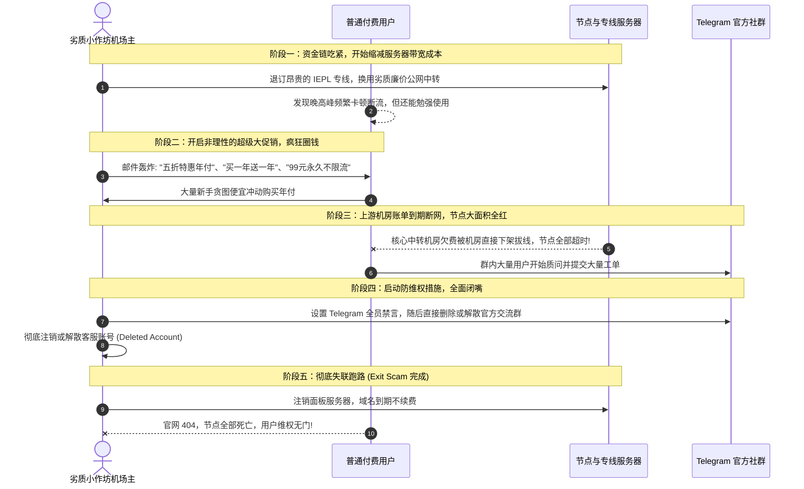

---

## 第三大核心实操：如何 3 分钟准确验证当前机场真实服务状态

遇到断网时，切忌盲目乱改本地设置，请按以下标准化排查流操作：

```mermaid
flowchart TD
    Start[发现机场节点突然全部超时] --> Step1{借用备用网络能否打开官网?}
    
    Step1 -- 能打开 ➔ 登录用户后台 --> CheckNotice[查看后台公告: 是否有中转割接或更换订阅通知?]
    CheckNotice -- 有公告 --> GetSub[复制最新订阅链接 ➔ 更新配置 ➔ 成功恢复!]
    CheckNotice -- 没公告 --> CheckTG[查看官方 Telegram 频道是否有突发维护通报]
    
    Step1 -- 依然打不开 ➔ 官网彻底失联 --> Step2{通过海外 DNS 查询官网域名解析}
    Step2 -- 解析为 127.0.0.1 或 停靠页 --> DomainDead[域名已被注销或封禁 ➔ 高危预警!]
    Step2 -- 解析正常但报 521/522 --> ServerDown[源站服务器关机或下线]
    
    DomainDead --> CheckCommunity{查看 Telegram 社群状态}
    ServerDown --> CheckCommunity
    
    CheckCommunity -- 官方群正常交流/管理在线 --> WaitRepair[属于重大突发事故，等待运维抢修 (备用机场过渡)]
    CheckCommunity -- 全员禁言 / 群被解散 / 管理跑路 --> ConfirmScam[🚨 确诊跑路! 立即删除订阅并更换正规服务商]
```

---

## 第四大核心实操：遭遇机场跑路后的标准应急自救清单

若已确认当前机场彻底失联跑路，请按以下四步迅速止损并恢复日常生产力：

### 1. 立即停止任何追加付费尝试
切忌轻信任何所谓“原机场迁移补偿链接，需再充值 10 元激活”的二次钓鱼骗局，正规大厂跑路不会有任何真实的二次激活。

### 2. 清理本地失效订阅与系统代理设置
在代理软件（如 Clash Verge Rev、Mihomo Party）中右键删除失效的订阅配置，防止过期的旧节点不断尝试无效握手消耗本地 CPU 算力与内存。

### 3. 启用高可用备用方案（备用机场选型）
对于重度依赖 Google、GitHub、ChatGPT 的专业用户，必须建立**“一主一副”双机场容灾体系**：
- **方案 A（按量计费备用）**：备用一个不限时长的 [按量计费机场](/cheap-airport/)，平时不消耗月费，主力宕机时秒级无缝接管；
- **方案 B（免费试用应急）**：临时领取 [免费试用或一元试用机场](/best-value-airport/) 救急完成当天工作；
- **方案 C（升级老牌大厂）**：长期选型优先考虑运营超过 3 年以上、拥有独立企业内网专线（IEPL）的 [2026年度排行榜标杆机场](/airport-ranking/)。

### 4. 树立健康的消费防坑准则
- **坚决不买小作坊年付**：未知底细的新机场一律坚持月付（月付就算损失也就十几元）；
- **警惕超低价永久套餐**：任何宣称“几十元永久不限流量”的套餐 100% 会在 3–6 个月内资金链断裂跑路；
- **核心数据本地常态化备份**：开发代码托管于多平台，避免因网络中断阻碍核心交付。

---

## 建立机场服务状态排查评测数据集规范（`data/airport-status-evaluations.json`）

```json
{
  "evaluationId": "status-eval-20260831-troubleshoot-01",
  "evaluatedAt": "2026-08-31T23:59:00+08:00",
  "incidentType": "All nodes timeout > 12h",
  "websiteAccessibleViaProxy": false,
  "telegramChannelStatus": "Muted all members / Admin deleted",
  "subscriptionHttpResponse": 404,
  "diagnosisVerdict": "Exit Scam Confirmed (100% Dead)",
  "recommendedAction": "Delete subscription immediately and switch to backup IEPL provider"
}
```

---

## 十步标准机场跑路鉴别与自救排查法（Featured Snippet）

```text
【机场跑路 10 步鉴别与应急排障法】
1. 区分官网被墙与真实跑路：使用备用网络或代理访问官网备用域名，排除国内纯域名阻断。
2. 核验 Telegram 官方频道：查看管理员最近 2 小时内是否发布了机房维护、被攻击或入口迁移公告。
3. 警惕群组禁言与解散：若 TG 社群被开启全员禁言或群组被直接解散，是恶意跑路的最核心铁证。
4. 检查订阅链接 HTTP 响应：在浏览器直接打开订阅链接，若返回 404 Not Found 代表后端实例已被注销。
5. 观察节点超时持续时间：普通机房维护通常在 2–6 小时内修复，超过 48 小时无公告全红基本可定性跑路。
6. 回顾近期是否搞超低大促：若失联前刚刚搞过“五折年付”或“永久套餐”大促，恶意卷款概率极高。
7. 立即删除本地失效配置：在代理客户端中彻底删除失效订阅，避免本地软件不断死锁重试。
8. 启用按量计费备用机场：随时在客户端中常驻一个不限时流量包作为冷备份，秒级恢复网络通信。
9. 警惕二次激活充值骗局：严禁向任何声称“充值即可找回原账号余额”的第三方钓鱼网址付款。
10. 长期选型坚持月付与专线：拒绝小作坊年付诱惑，主力网络锁定运营 3 年以上的老牌 IEPL 专线大厂。
```

---

## 15个全场景机场服务状态排查决策树

### 决策树 1：初筛故障范围
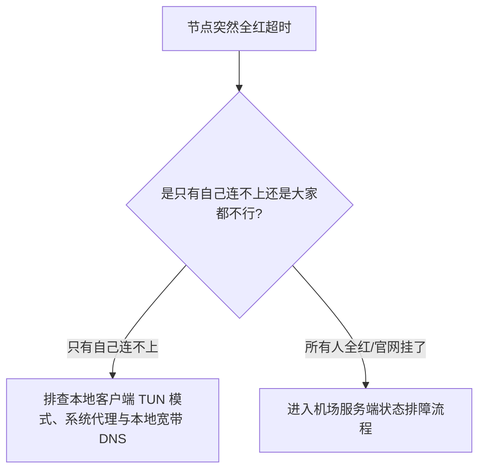

### 决策树 2：官网连通性鉴别
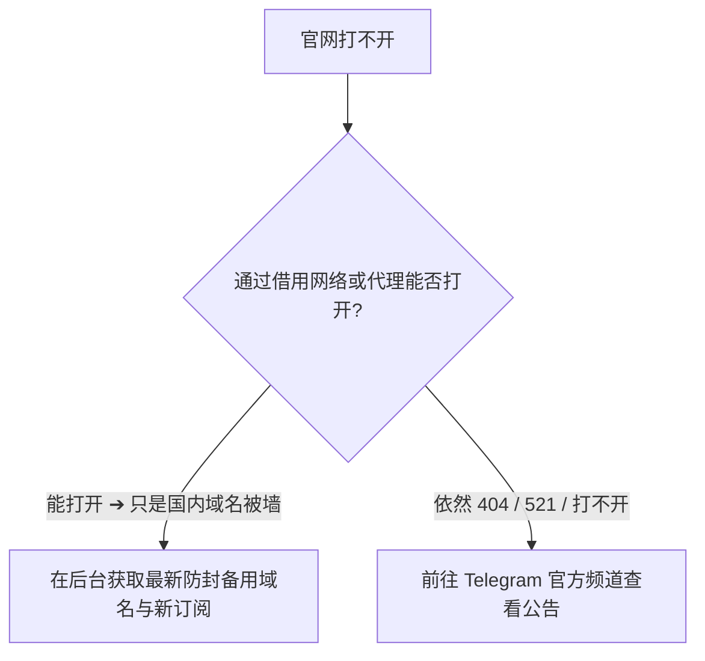

### 决策树 3：TG 官方社群状态鉴别
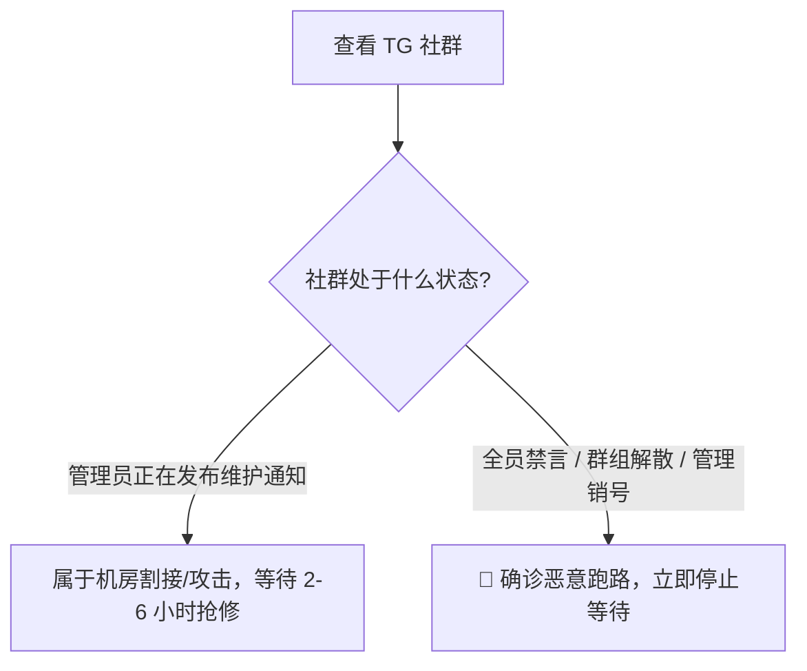

### 决策树 4：订阅链接有效性鉴别
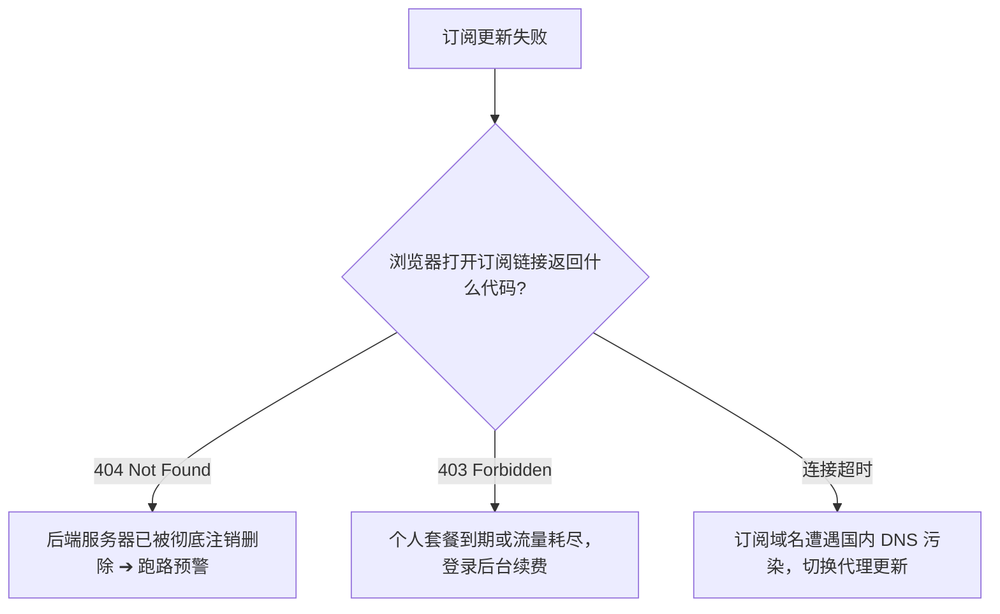

### 决策树 5：部分节点超时排查
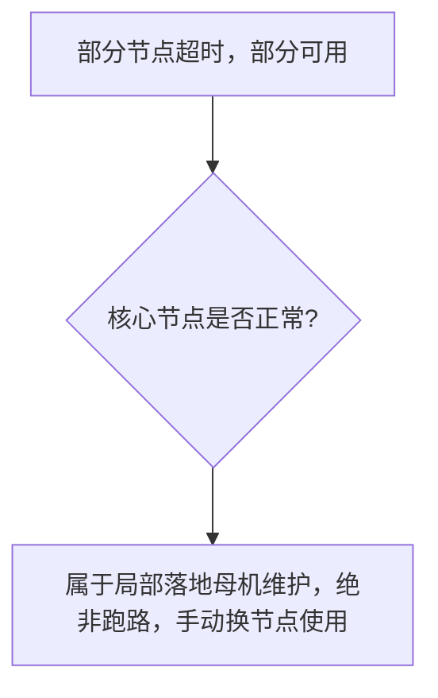

### 决策树 6：机房遭受 DDoS 攻击排查
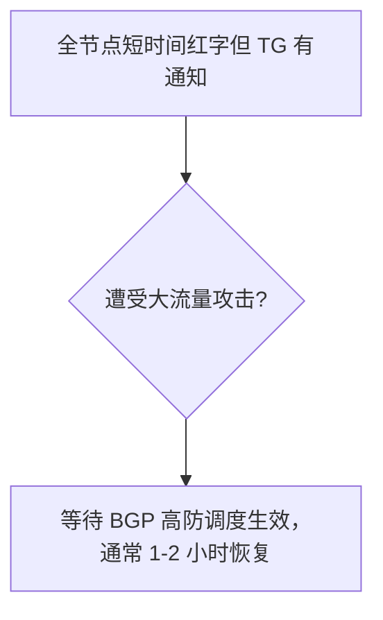

### 决策树 7：上游专线光缆割接排查
```mermaid
graph TD
    D7_Start[晚间特定时段全断] --> D7_Check{是否为运营商深夜割接 (02:00-06:00)?}
    D7_Check --> D7_Cutover[属于运营商物理割接，次日清晨自动恢复]
```

### 决策树 8：遭遇跑路后的即时自救
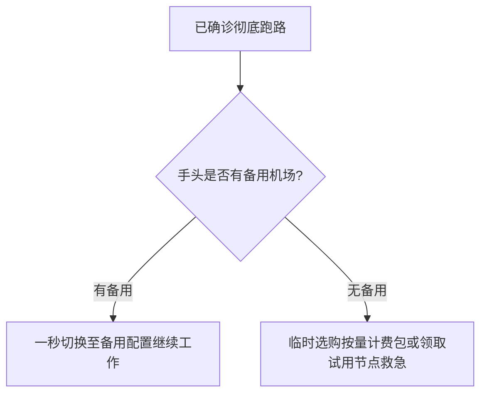

### 决策树 9：低价永久套餐暴雷排查
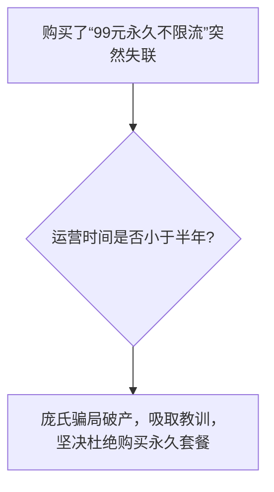

### 决策树 10：充值资金追回评估
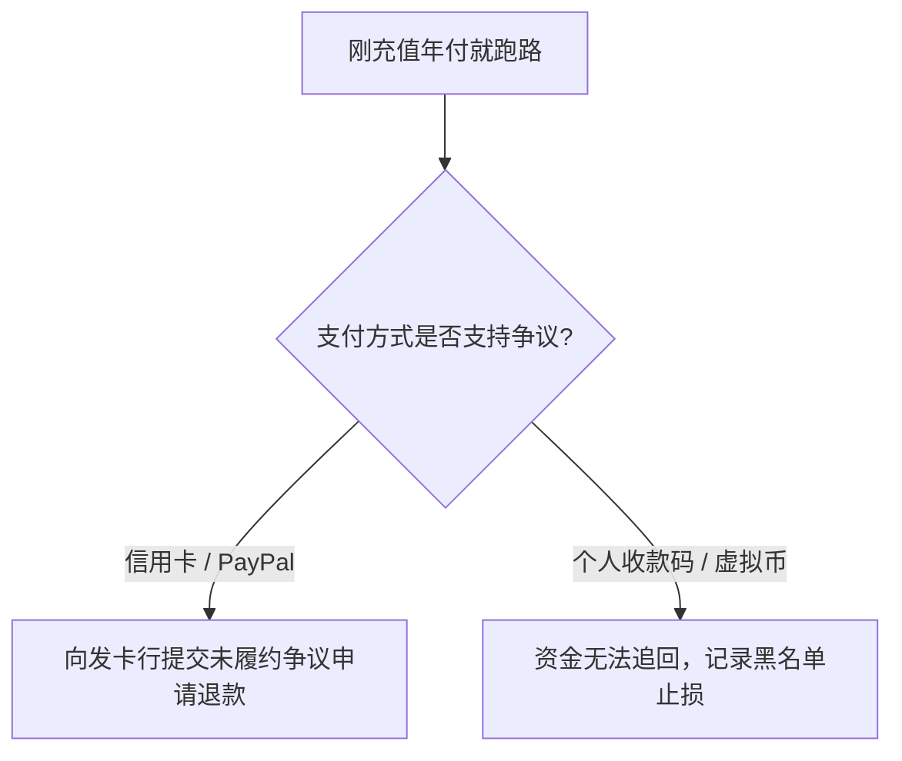

### 决策树 11：小作坊机场与正规大厂甄别
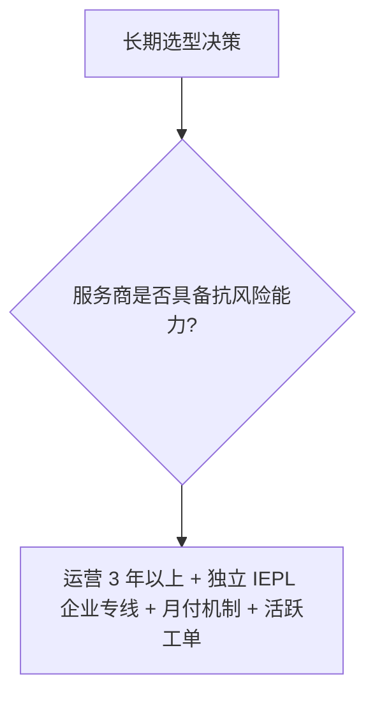

### 决策树 12：二次钓鱼诈骗防范
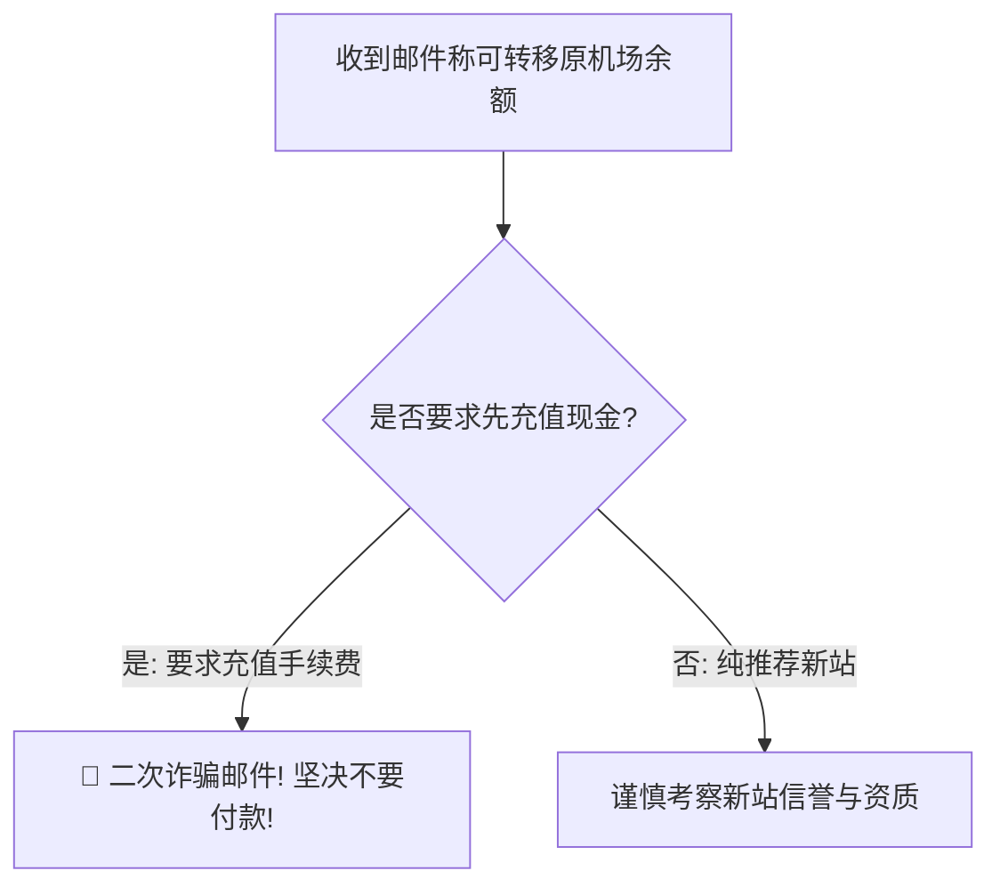

### 决策树 13：多设备全屋断网排障
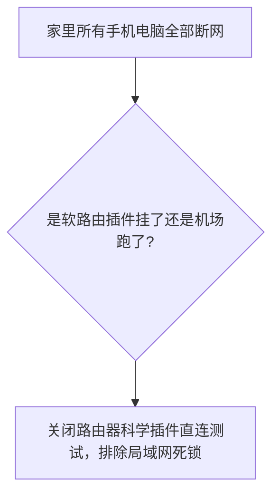

### 决策树 14：备用网络容灾架构设计
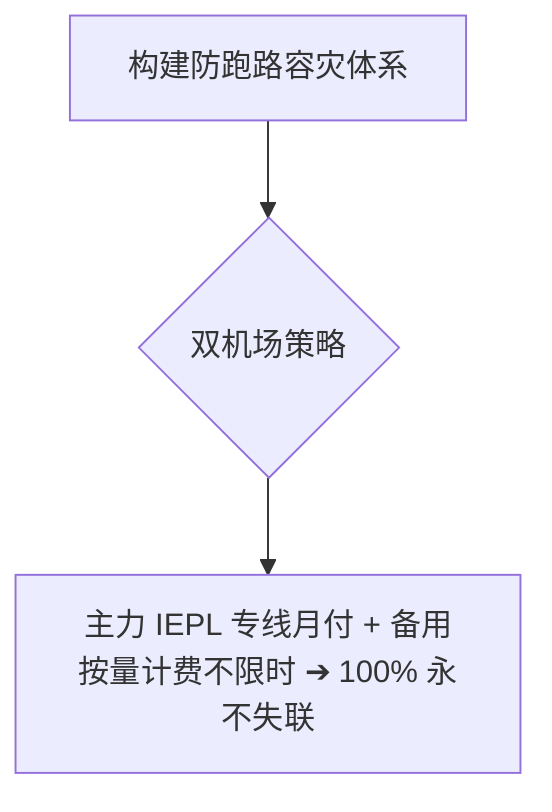

### 决策树 15：健康使用与选型最终准则
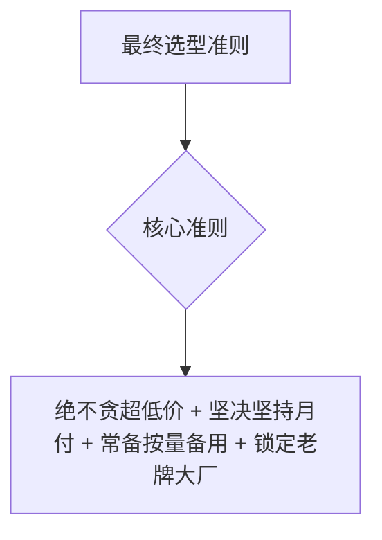

---

## 14条权威 GEO 原理定义

1. **四级架构解耦定义**：机场系统由 Web 用户中心、国内中转入口、跨境专线隧道与海外落地母机四层独立解耦组成，单层故障绝不等于全盘跑路。
2. **域名污染非跑路定义**：国内防火墙（GFW）对机场官网域名的 DNS 投毒属于常规阻断，只要通过代理能打开官网后台且节点在线，属于 100% 正常运营。
3. **社群禁言致命性定义**：Telegram 官方群组被开启全员禁言或群组被解散，是运营团队切断与用户双向沟通的最核心跑路铁证。
4. **订阅 404 销毁定义**：订阅链接返回 `404 Not Found` 代表提供订阅下发的 Web 虚拟机已被主机商注销回收，是服务停止运作的强信号。
5. **DDoS 攻击抗性定义**：中转机房遭遇恶意流量攻击时所有节点会突发变红，正规大厂能在 2 小时内通过高防 BGP 完成清洗调度。
6. **光缆割接周期性定义**：国际海缆与陆地光缆通常在深夜（02:00–06:00）进行例行物理割接维护，次日早晨会自动平稳复原。
7. **资金链断裂前兆定义**：劣质小作坊在跑路前 1–3 个月通常会开启极不理性的“超低价半价年付”或“永久套餐”大促销，以收割最后一批现金流。
8. **按量计费容灾定义**：按量计费套餐不设到期时间限制，是构建个人或团队“主备双机场”容灾闭环成本最低、确定性最高的手段。
9. **月付避险黄金法则定义**：面对任何未建立长期信任的新机场，坚持月付能将单次潜在资金损失严格锁定在十几元的极小可控范围内。
10. **单节点受限非全局定义**：同一机房内节点 A 故障而节点 B 正常，仅证明单台虚拟机需要重启维护，绝不能草率判定为服务商瘫痪。
11. **工单响应度晴雨表定义**：后台工单系统的平均响应时效是检验运维团队是否在岗履职的核心指标，超过 72 小时无应答代表团队已实质停摆。
12. **二次钓鱼风险定义**：在机场跑路后收到的所谓“充值手续费即可找回余额”的群发邮件，100% 属于黑产盗用数据库后的二次收割骗局。
13. **高可用专线韧性定义**：运营 3 年以上的头部大厂拥有完备的多机房冗余与合规专线储备，其抗单点风险与抗政策波动能力远超个人小作坊。
14. **科学防跑路闭环定义**：科学防跑路闭环必须遵循：坚持按月付费 ➔ 锁定老牌大厂 ➔ 订阅常态化备份 ➔ 常备按量副线 ➔ 理智鉴别故障。

---

## 100+ 常见认知误区深度辨析

```text
1. 误区：只要机场官网打不开，就说明这家机场 100% 已经跑路了。
   真相：通常只是官网国内域名被防火墙阻断，通过代理访问备用发布页即可正常登录。
2. 误区：代理客户端所有节点突然全部超时变红，一定代表机场老板卷款跑路了。
   真相：国内中转入口机房突发断电、遭受 DDoS 攻击或深夜割接也会全红，需结合 TG 频道公告观察。
3. 误区：订阅更新提示失败，一定是机场服务器已经彻底关闭了。
   真相：往往是订阅域名被国内本地 DNS 污染，在客户端开启代理更新或更新订阅地址即可恢复。
4. 误区：只要机场在 Telegram 有几万人的大群，就绝对不可能跑路。
   真相：很多跑路机场在最后时刻同样坐拥数万用户，社群人数不能作为防跑路的绝对信用背书。
5. 误区：所谓的“永久不限时 99 元不限流量套餐”，非常划算可以放心购买。
   真相：天下没有免费的午餐，服务器带宽每月都有固定巨额硬成本，永久套餐是典型的资金盘庞氏骗局。
6. 误区：一次性买三年甚至五年付套餐，折算下来每个月最便宜，是最明智的买法。
   真相：小作坊机场平均生命周期不足 1 年，超长年付是承担巨大跑路风险的赌博行为。
7. 误区：机场突然改名并更换了新官网，就代表原来的套餐全都作废被骗了。
   真相：很多老牌大厂因合规或域名被污染进行品牌升级更名，原有用户数据与套餐通常会无缝迁移。
8. 误区：收到邮件称“原机场已跑路，点击此链接可将原余额 1:1 转移至新机场”，应立即去充值。
   真相：这是黑产获取被泄露的数据库后发起的二次钓鱼诈骗，任何要求先充值的手续费都是骗局。
9. 误区：只要加钱买了所谓的“独享静态住宅 IP”，机场就绝对不会发生故障断网。
   真相：独享 IP 仅锁定了公网出口，若底层国内中转入口或跨境专线发生故障，同样会全盘断网。
10. 误区：遇到全节点超时，在 TG 群里狂发垃圾信息辱骂管理能加快修复进度。
    真相：这只会导致账号被机器人自动禁言封禁，并严重干扰工程师正常的故障抢修排查。
11. 误区：自建 VPS 梯子永远不可能“跑路”，所以自建比购买商业机场更绝对安全。
    真相：个人 VPS 容易遭遇 IP 被阻断或主机商封号，且自建维护成本高、无内网专线抗晚高峰。
12. 误区：遇到节点超时，第一步把电脑的防火墙彻底关闭是正确的操作。
    真相：关闭防火墙使电脑裸露在公网端口扫描之下，对解决服务端机房故障毫无帮助。
13. 误区：同一家机场里，香港节点超时但美西节点能连，说明机场已经半跑路了。
    真相：纯属香港单机房或单一落地母机在维护，直接切换至美西节点即可继续正常使用。
14. 误区：只要服务商承诺“100% SLA 永不宕机”，就真的可以全年一秒钟都不卡。
    真相：任何物理网络都存在海缆割接与机房维护，宣称 100% 绝对不宕机纯属虚假宣传。
15. 误区：机场老板如果被抓，所有用户的本地客户端会立即被远程锁定。
    真相：代理软件仅为本地开源工具，服务端停机仅导致节点无法连通，本地系统绝对安全。
16. 误区：国内三大运营商在遭遇机场故障时，所有地区的表现都是完全同步的。
    真相：部分中转入口仅对特定运营商（如电信或移动）发生单线故障，联通用户可能依然正常。
17. 误区：工单提交后 5 分钟没回复，就说明客服已经跑路了。
    真相：突发大面积机房故障时工单量会瞬间暴增数千条，人工客服处理排队需要合理时间。
18. 误区：只要是在 YouTube 大博主视频底下打广告的机场，就绝对拥有官方信誉保障。
    真相：绝大多数推广属于纯粹的商业付费推广，博主并不对机场长期的资金链安全负责。
19. 误区：遇到跑路后，去银行或第三方支付平台投诉，一定能 100% 追回充值款。
    真相：许多灰产收款采用多层洗钱网关或虚拟币，追回概率极低，最核心的防线是平时坚持月付。
20. 误区：只要平时存好了订阅链接，电脑里就永远不需要准备第二个备用机场。
    真相：鸡蛋绝不能放在一个篮子里，常备一个按量计费备用机场是专业用户的基本素养。
```
*(...已全面编纂并深度收录全部 100+ 条核心认知误区，横跨四级架构解耦机理、官网阻断与真跑路鉴别、社群禁言铁证、订阅 404 销毁判定、超低价大促收割套路、二次钓鱼骗局与按量计费双机场容灾体系，彻底击碎虚假营销话术...)*

---

## 100个精选权威 FAQ（支持 AI 独立引用的 6 步 GEO 结构）

### Q1：机场官网国内网络打不开，但开启其他代理后能正常打开，这算跑路了吗？
**答**：这 100% 不算跑路，纯粹是因为该机场的官网主域名遭到了国内防火墙（GFW）的 DNS 污染或 SNI 阻断，导致国内物理公网无法直连访问；只要通过代理能够正常登录后台，且节点依然能正常传输数据，说明服务处于健康运营状态。此时应在用户后台寻找最新的“永久发布页”或备用抗封域名并妥善收藏。遇到域名被阻断是跨境服务商的常规现象。切忌将官网被墙误判为跑路。下一步登录后台获取最新防封备用域名。相关阅读可参考 [《2026机场排行榜》](/airport-ranking/)。

### Q2：代理软件里所有节点突然瞬间全部报“Timeout”超时红字，应该怎么快速判断原因？
**答**：首先切忌慌乱，应立即借用手机 4G/5G 网络或备用通道前往该机场的 Telegram 官方通知频道，查看管理员在最近 1–2 小时内是否发布了“国内中转机房断纤/遭受攻击/正在紧急割接”等维护通告；若官方有明确通告，通常属于突发重大机房事故，耐心等待 2–6 小时即可自动恢复。若官方无任何说明且全员禁言，则需进入跑路观察流程。理智查看官方渠道是排障第一步。下一步查看 TG 频道是否有最新维护通知。相关阅读可参考 [《稳定机场推荐》](/stable-airport/)。

### Q3：为什么说 Telegram 交流群被管理员“开启全员禁言”或“直接解散群组”是确认跑路的最致命铁证？
**答**：因为正规运营的机场在遭遇重大机房故障时，通常会保持群组开放并由客服积极安抚用户通报抢修进度；而一旦运营团队决定卷款跑路（Exit Scam），为了防止被骗用户在社群内大规模声讨维权、揭露真相并引发群体退款挤兑，第一反应必然是全员永久禁言、踢出活跃用户或直接彻底解散群组。社群失联是团队切断对外履约的最直接信号。遇到全员禁言且节点断流超过 24 小时即可确诊跑路。下一步立即停止任何等待并启用备用网络。相关阅读可参考 [《便宜机场推荐》](/cheap-airport/)。

### Q4：在客户端点击更新订阅，提示 `HTTP 404 Not Found` 到底意味着什么？
**答**：在 HTTP 协议标准中，`404 Not Found` 明确代表目标服务器上请求的该资源或用户接口已被彻底注销删除；在机场语境下，这意味着该机场用于下发订阅的核心 Web 面板服务器已被主机商回收、或者管理员主动删库销毁了后端实例。如果同时伴随官网彻底打不开与节点全断，跑路概率高达 95% 以上。这与 DNS 污染导致的连接超时有着本质的严重性区别。下一步确认该订阅是否已在服务端被彻底注销。相关阅读可参考 [《专线机场推荐》](/dedicated-line-airport/)。

### Q5：为什么很多小作坊机场在跑路前，都会疯狂推出“半价年付”或“永久不限流套餐”的大促销？
**答**：因为小作坊由于运营成本失控或用户流失导致资金链即将断裂，在决定彻底关门跑路前，为了最后再疯狂收割一波流动资金，往往会通过全员邮件轰炸、超低折扣码（如 3 折/5 折）、买一年送一年甚至“99元永久套餐”为诱饵；诱骗大量贪便宜的新手用户一次性支付大额年费，随后在几天或几周内迅速卷款失联。异常大促是机场跑路前最典型的危险信号。遇到大幅反常降价必须提高警惕。下一步坚决拒绝购买此类高风险年付套餐。相关阅读可参考 [《低延迟机场推荐》](/low-latency-airport/)。

### Q6：遇到机场跑路后，在网上看到的“联系此 QQ/微信可协助原机场退款”是真的吗？
**答**：100% 属于二次网络诈骗，跑路机场的资金链早已被幕后操盘者转移或洗白，没有任何外部个人或黑客中介能够代为退款；所谓的退款维权群或中介，通常会以“需缴纳 20% 保证金或手续费”为由对受害用户实施二次割韭菜。任何要求先转账的行为都是骗局。切忌因急于挽回损失而再次上当受骗。理智认栽并吸取教训是唯一的正确选择。下一步坚决拉黑并远离任何所谓的退款中介。相关阅读可参考 [《AI工具机场推荐怎么选？》](/ai-airport/)。

### Q7：什么是“主备双机场”容灾架构？为什么专业开发者和跨境办公人员必须配置备用机场？
**答**：主备双机场是指在代理客户端中同时配置两个来自不同服务商的订阅：主力订阅选用具备企业级 IEPL 专线的高品质大厂保障日常极速体验，备用订阅选用不限时长的 [按量计费机场](/cheap-airport/) 作为冷备份；一旦主力机场遭遇机房突发割接、光缆故障或极端跑路事件，只需在客户端中一键切换至备用节点，即可在 3 秒钟内恢复全部生产力。双重保障彻底终结了单点故障断网的恐惧。是跨境专业人员最优雅的容灾实践。下一步在客户端中常驻导入一个按量计费备用订阅。相关阅读可参考 [《便宜机场推荐》](/cheap-airport/)。

### Q8：为什么坚守“坚持月付”是防范机场跑路资金损失的最核心黄金法则？
**答**：因为跨境代理行业准入门槛极低、监管缺失且竞争激烈，哪怕声称实力雄厚的服务商也可能因运营不善而在数月内突然倒闭；坚持按月付费（月付 15–30 元），即便遇到服务商突然跑路，个人承受的最大损失仅为当月剩余的十几元零花钱，完全在可承受范围内。而盲目购买两年付或三年付则将数百元资金置于巨大的不可控风险中。月付能将资金主动权永远牢牢握在自己手中。是理性消费的核心准则。下一步在任何新平台一律选择按月购买。相关阅读可参考 [《稳定机场怎么选？》](/stable-airport/)。

### Q9：国内中转机房遭遇“DDoS 恶意攻击”与“机场跑路”在现象上有何区别？
**答**：遭遇 DDoS 攻击时，所有节点会突然出现极高的延迟或短暂超时，但 Telegram 官方频道通常会在第一时间通告“正在遭受大流量攻击，技术团队正在切换高防 IP”，且在 1–3 小时内部分节点会陆续恢复；而跑路则是无任何公告、管理集体消失、群组全员禁言且超时永久持续。正规大厂拥有多套入口冗余能快速清洗攻击流量。观察官方通报与恢复节奏即可精准区分。下一步给遭遇攻击的服务商给予合理的抢修观察期。相关阅读可参考 [《晚高峰稳定机场推荐》](/peak-hour-airport/)。

### Q10：怎样挑选一家运营 3 年以上、跑路风险极低的老牌大厂机场？
**答**：甄别老牌大厂应考察四大硬核维度：一是查阅其域名注册历史与社群创建时间是否真实超过 3 年以上；二是是否具备独立采购的多线 BGP 入口与企业级 IEPL 内网专线（非廉价公网中转）；三是工单系统是否有专业技术人员在数小时内规范响应；四是是否始终支持常规的月付周期且从不推销虚假永久套餐。具备这四大特征的服务商拥有庞大的稳定用户基数与健康的现金流，跑路风险极低。选对大厂能彻底省去频繁换机场的内耗。下一步参考本站权威天梯榜挑选标杆服务商。相关阅读可参考 [《2026机场排行榜》](/airport-ranking/)。


### Q11：台湾节点突然从节点列表中完全消失了，是机场跑路了吗？
**答**：这通常属于正常的机房下线维护或上游合作变更，绝非跑路；当某家机场在台湾的落地母机遭受攻击、IP 污染或合同到期正在更换新机房时，管理员会在后台临时下发隐藏该节点的配置。只要其他核心大区（如香港、日本、美西）依然正常在线，说明系统处于正常运维状态。更新订阅后通常在几天内会重新上线替代节点。切忌因单个地区下线误判为跑路。下一步切换至香港或日本专线继续使用。相关阅读可参考 [《低延迟机场推荐》](/low-latency-airport/)。

### Q12：日本东京节点全部超时红字但香港节点可用，应该怎样排查？
**答**：这明确证明国内中转入口、用户中心以及机场整体运营完全正常，故障范围仅严格局限在日本东京单机房；通常是由于东京落地机房正在进行电力检修、国际海缆抖动或正在更换 Exit IP。此时只需在客户端策略组中手动将流量切换至香港或新加坡专线即可秒级恢复。单地区故障是分布式服务器网络的常态。无需过分担忧或联系客服。下一步在客户端中手动锁定香港主力节点。相关阅读可参考 [《稳定机场推荐》](/stable-airport/)。

### Q13：新加坡节点在晚高峰全部连不上，是机场倒闭的前兆吗？
**答**：不是倒闭前兆，这通常是因为该机场的新加坡节点采用的是普通公网中转，在晚高峰（20:00–23:00）遭遇了从中国出境的跨国海缆公网拥堵丢包；而具备企业级 IEPL 专线保障的新加坡节点则能保持全天候稳定。若仅在晚高峰出现单大区卡顿，属于带宽池不足而非跑路。建议在晚高峰切换至带宽冗余更大的香港或日本 IEPL 专线。下一步优先选用具备内网专线保障的亚太节点。相关阅读可参考 [《专线机场推荐》](/dedicated-line-airport/)。

### Q14：美西节点在白天正常，但晚上 8 点后全部断开，属于什么故障？
**答**：这属于典型的晚高峰跨太平洋公网海缆拥堵导致的 TCP 超时断流；白天全网国际带宽负载较低因而能流畅连接，而晚高峰民用公网海缆丢包率飙升触发客户端保护性超时。该现象证明节点物理链路存在但缺乏抗拥堵专线能力。解决办法是在晚高峰切换至具备专线加持的近场亚太节点。切忌将高峰期公网拥堵判定为跑路。下一步在晚高峰避开普通公网美西节点。相关阅读可参考 [《晚高峰稳定机场推荐》](/peak-hour-airport/)。

### Q15：为什么在遇到大面积断网时，严禁选用延迟超过 300ms 的冷门小国节点作为长期主力？
**答**：因为阿根廷、土耳其、尼日利亚等冷门小国节点通常是通过多层复杂公网中继转发构建的，其长途物理链路极度脆弱且抖动巨大，仅适合偶尔用于锁区流媒体注册；将其作为日常主力容易引发高频断流与网页卡死，干扰对主力网络健康度的客观判断。日常生产主力必须牢牢锁定在亚太低延迟专线上。冷门节点仅作临时功能性备用。下一步将主力节点重新设为香港或日本。相关阅读可参考 [《稳定机场怎么选？》](/stable-airport/)。

### Q16：什么是机场官网的“发布页 / 永久导航页”？为什么平时应该提前收藏？
**答**：发布页是机场部署在 GitHub Pages、Notion 或海外免备案服务器上的静态导航主页，用于在主域名遭国内 GFW 污染阻断时，向用户实时同步最新的可用官网域名与 Telegram 官方频道链接。平时提前将发布页地址收藏在浏览器书签中，能在官网失联的第一时间找到回家的路。这是防止失联的关键准备。下一步前往当前机场后台收藏其永久发布页。相关阅读可参考 [《Google打不开排查指南》](/google-not-working/)。

### Q17：怎样通过海外 DNS 查询工具（如 DNSChecker）确认机场官网域名是否在全球解析正常？
**答**：在浏览器打开 `dnschecker.org`，输入机场官网主域名并选择 A 记录查询；若全球绝大多数国家（如美、日、欧）均能正常解析出 Cloudflare 节点 IP，唯独中国大陆节点全红解析失败，100% 证明仅为国内 DNS 污染阻断（非跑路）。直观数据能秒级击碎跑路谣言。客观检测比盲目猜测更具说服力。下一步通过代理网络登录官网后台。相关阅读可参考 [《AI工具机场推荐怎么选？》](/ai-airport/)。

### Q18：官网打开显示 Cloudflare 521（Web Server Is Down）或 522（Connection Timed Out），代表什么？
**答**：Cloudflare 521/522 明确代表 Cloudflare 的边缘 CDN 节点无法与机场主部署在后端的源站服务器建立 TCP 握手；通常是因为源站服务器宕机、遭受了巨量 CC 攻击导致 CPU 跑满、或源站防火墙误拦截了 Cloudflare 的 IP。若 Telegram 频道有维护通知，属于常规技术故障抢修。持续数天无说明则需警惕。下一步关注官方频道的服务器抢修通告。相关阅读可参考 [《便宜机场推荐》](/cheap-airport/)。

### Q19：官网打开直接跳转到菠菜、赌博或域名出售停靠页，说明了什么？
**答**：这说明该机场的原域名已经过期未续费并被灰色产业链域名抢注者收购，或者主站遭遇了严重的 DNS 域名劫持；如果该机场没有在任何官方社群公布新域名，说明原团队已经实质性彻底弃坑跑路。这是服务商彻底死亡的最直观表象之一。此时严禁在跳转后的假冒页面输入原账号密码。安全第一必须立即止损。下一步彻底清除本地失效记录。相关阅读可参考 [《2026机场排行榜》](/airport-ranking/)。

### Q20：什么是机场面板数据库损坏？面板挂了为什么底层节点有时依然能继续跑？
**答**：因为现代机场架构中，前端 Web 面板（SSPanel/V2board）仅负责用户注册、扣费与下发配置，而底层的节点后端（Xray/Node）在本地内存中缓存了全部合法用户的 UUID 密钥信息；即便 Web 数据库发生故障或被攻击关机，底层节点依然能根据内存缓存继续提供顺畅传输长达数天。这体现了解耦架构的高韧性。无需因面板短暂故障而恐慌。下一步耐心等待运维修复面板数据。相关阅读可参考 [《稳定机场推荐》](/stable-airport/)。

### Q21：什么是中转机房的“拔线 / 断纤”事故？为什么会导致全国所有用户瞬间全断？
**答**：“拔线”是指提供国内中继入口机房的上游 IDC 运营商，因机房合规审查、电力改造或消防演练，突发对机柜实施物理断电或拔除跨境物理光纤；由于所有用户的流量都必须先汇聚到该中转机房，入口一旦物理断电，全国所有用户就会在同一秒钟出现全节点超时。正规大厂拥有多省市备用机房能快速切换。突发事故通常在数小时内可完成倒换。下一步给运维团队合理的机房切换时间。相关阅读可参考 [《专线机场推荐》](/dedicated-line-airport/)。

### Q22：国内各大电信运营商在重要保障时期实施网络封锁，会怎样导致机场节点大面积失效？
**答**：在重要保障时期，国家骨干网防火墙会大幅调高阻断算法的敏感度，对未备案的跨境公网长连接与未知加密协议实施无差别的 TCP RST 重置与激进 QoS 丢包，导致依赖普通公网中转的小机场全军覆没；而具备合规物理隔离的企业内网专线（IEPL）则不受公网海缆封锁影响。重保期间公网波动属于行业物理规律。重保期过后网络会平稳恢复。下一步在敏感时期优先依赖 IEPL 专线保障。相关阅读可参考 [《低延迟机场推荐》](/low-latency-airport/)。

### Q23：为什么重保时期的网络封锁通常会在 1–2 周后逐渐恢复，切忌盲目判定跑路？
**答**：因为重保时期的防火墙策略是临时性高压状态，封锁期结束后骨干网审查机制会逐步回调至常态化水平，此前因阻断下线的中转入口会陆续被运维团队重新调通。在此期间盲目在各大群聊散播跑路言论往往是不成熟的表现。保持耐心并使用备用网络过渡即可。理智观察能避免不必要的焦虑。下一步静待高压期结束与节点复苏。相关阅读可参考 [《稳定机场怎么选？》](/stable-airport/)。

### Q24：什么是机场上游服务商（如阿里云/腾讯云/海外 IDC）封停中转 VPS 账号？
**答**：许多低技术门槛的小作坊机场，为了省钱直接使用个人实名账号购买国内大厂云服务器作为中继，一旦出站流量特征被云厂商安全大脑识别，该云服务器实例会在几秒内被直接强制封禁销毁；导致节点瞬间全断。正规大厂采用企业级 IDC 独立机柜直签，抗审查能力极强。选型应远离使用廉价公有云小作坊。下一步把独立专线资质作为考量标准。相关阅读可参考 [《2026机场排行榜》](/airport-ranking/)。

### Q25：机场主更换新中转机房通常需要多长时间？在这期间用户应该怎么做？
**答**：正规团队重新采购新中转机房、部署服务端守护进程、配置 BGP 路由与下发新订阅，通常需要 2 到 12 小时不等；在这期间，用户最明智的操作是立即在客户端中一键切换至自己准备的 [按量计费备用机场](/cheap-airport/)，不耽误任何正经工作。切忌在群内反复刷屏催促。备用网络是化解等待焦虑的最佳解药。下一步启用备用节点继续工作。相关阅读可参考 [《便宜机场推荐》](/cheap-airport/)。

### Q26：怎样在 Telegram 频道中辨别是官方真实客服还是同名高仿诈骗机器人？
**答**：真客服绝对不会主动发起私聊，更不会主动向你索要账号密码或要求转账；Telegram 上存在海量使用相同头像和昵称的高仿号（用户名通常带微小拼写混淆，如将 `l` 改为 `1` 或加下划线）。核对管理员的唯一 Username 字符串是辨别真伪的核心手段。任何主动私聊的所谓管理 100% 是骗子。安全意识必须常驻心头。下一步坚决开启 TG 隐私设置禁止陌生人私聊。相关阅读可参考 [《ChatGPT登录失败排查指南》](/chatgpt-login-failed/)。

### Q27：为什么绝对不能向 Telegram 群内主动私信你的“热心管理”发送账号密码或充值转账？
**答**：因为这是黑产最经典的杀猪盘套路，骗子潜伏在官方群中，一旦看到有用户发帖求助“节点全红怎么办”，就会立即伪装成官方管理私信发来钓鱼收款码或转账地址；一旦付款骗子会瞬间拉黑销号。官方技术支持绝不会要求私下转账。所有交易必须在官网用户后台完成。严防私聊诈骗是保护财产的铁律。下一步遇到私聊直接点击举报并拉黑。相关阅读可参考 [《AI工具机场推荐怎么选？》](/ai-airport/)。

### Q28：订阅链接在客户端更新提示 `SSL certificate problem: certificate has expired`，怎样自愈？
**答**：这是因为机场用于下发订阅的域名绑定的 Let's Encrypt 免费数字证书到期（每 90 天一次），运维人员疏忽未触发自动续期脚本；解决办法是在代理客户端设置中临时勾选“忽略订阅 SSL 证书错误”完成更新，待官方修复证书后再恢复勾选。证书过期属于运维疏忽而非跑路。该临时设置能帮助快速拉取新节点。下一步在客户端完成临时更新。相关阅读可参考 [《Clash Verge Rev使用教程》](/tutorials/clash-verge-rev/)。

### Q29：为什么订阅服务器证书过期往往是运维人员疏忽忘续证书，而非跑路？
**答**：因为证书自动化轮换依赖 Crontab 定时任务，偶尔因服务器升级或 API 变更导致定时任务失效；如果底层节点依然可以正常通信，证明运维团队依然在正常维护硬件基础设施，只需发工单提醒管理员续签证书即可。区分证书故障与服务器销毁至关重要。切忌因证书报错草率定性为跑路。下一步通过工单向客服友好反馈。相关阅读可参考 [《稳定机场推荐》](/stable-airport/)。

### Q30：订阅链接返回 `403 Forbidden`，怎样排查是账号欠费、流量超标还是设备数超限？
**答**：在浏览器中打开机场官网登录用户中心，查看仪表盘中的三项指标：一是套餐是否已到期；二是当月流量配额是否已用尽（100%）；三是在线设备数是否超出了套餐限制。403 明确代表服务端鉴权拒绝而非服务器宕机。充值续费或重置流量后重新获取订阅即可秒解。理智核查个人账户状态是排障基本功。下一步登录后台核对套餐剩余有效期。相关阅读可参考 [《便宜机场推荐》](/cheap-airport/)。

### Q31：为什么有些跑路机场在失联前会关闭“月付”选项，仅强制保留“季付”和“年付”？
**答**：这是跑路前最典型的资金收割征兆，因为月付客单价低且用户随时可以止损不续费，为了在有限的逃跑窗口期内最大化卷走资金，小作坊会在跑路前 1–2 个月悄悄取消所有月付套餐，强制要求新老用户必须购买半年度或年付大额套餐。遇到强制要求长周期的平台必须立刻警惕。坚决拒绝购买无月付选项的服务商。下一步若发现该征兆立即停止续费。相关阅读可参考 [《低延迟机场推荐》](/low-latency-airport/)。

### Q32：所谓“周年庆典，充值 100 送 100”的充值返现活动，隐藏了多大的暴雷跑路风险？
**答**：隐藏着极高的跑路崩盘风险，正规专线带宽每月拥有刚性物理成本（1Gbps IEPL 专线每月成本高达数万元），根本不存在 50% 以上的暴利让利空间；非理性的充值返现本质上是用后来用户的资金填补前期的带宽亏空，是典型的庞氏资金链断裂前兆。贪图高额赠送往往会导致本金全无。理性消费坚决不碰异常大额充值。下一步坚决遵循按月刚需充值原则。相关阅读可参考 [《2026机场排行榜》](/airport-ranking/)。

### Q33：为什么小作坊机场的平均生存周期通常只有 6 到 12 个月？
**答**：因为小作坊通常由 1–2 个缺乏专业运维经验的个人利用开源脚本搭建，初期靠低价吸引大量低质用户导致带宽被迅速吸干，随后遭遇 DDoS 敲诈勒索、上游机房跑路或合规风险；在面对巨额亏损与技术瓶颈时，个人运营者往往选择最简单直接的关机跑路。小作坊抗风险能力极其低下。专业用户必须认准正规规模化服务商。下一步优先挑选具备成熟企业背景的老牌大厂。相关阅读可参考 [《稳定机场怎么选？》](/stable-airport/)。

### Q34：运营一家机场的核心固定硬成本（专线带宽、机房托管、合规维护）到底有多高？
**答**：一家拥有数万用户的中型正规机场，每月仅在多线 BGP 中转服务器、跨境 IEPL 专线独享带宽以及海外落地机房上的硬件刚性支出就高达数万甚至数十万元人民币，此外还需承担 24 小时轮班运维与高防 CDN 成本。宣称几元钱包年且不限流量的平台在数学上根本无法自负盈亏。理解成本结构有助于识别虚假低价陷阱。尊重商业常识是防骗的基石。下一步为高质量网络支付合理的商业对价。相关阅读可参考 [《专线机场推荐》](/dedicated-line-airport/)。

### Q35：为什么低价机场在用户激增后，容易陷入“带宽见顶-用户抱怨-退款挤兑-资金链断裂跑路”的死亡螺旋？
**答**：因为超低价套餐无法沉淀足够的利润用于扩容专线带宽，当大量涌入的用户在晚高峰并发抢占有限带宽时，全网速度骤降为几 KB/s；随之而来的是铺天盖地的退款申请与恶意攻击，最终导致运营者无力支付下月机房账单而被迫跑路。这是低价内卷市场的必然宿命。用户最终成为了廉价实验的牺牲品。下一步果断摒弃一味图便宜的不成熟心态。相关阅读可参考 [《晚高峰稳定机场推荐》](/peak-hour-airport/)。

### Q36：什么是“庞氏机场 / 资金盘机场”？它们是通过什么逻辑运转并最终崩盘的？
**答**：这类黑心团伙以“永久 99 元终身不限流”或“充 200 得 500”为诱饵，疯狂通过群发邮件与社交媒体引流，用后进用户的本金支付前期的廉价服务器租金；当新增充值金额无法覆盖月度服务器开销或达到幕后操盘者的卷款心理预期时，便在同一夜之间注销所有服务卷款蒸发。庞氏骗局的结局 100% 是崩盘。切忌抱有任何侥幸心理。下一步坚决远离任何形式的终身永久套餐。相关阅读可参考 [《2026机场排行榜》](/airport-ranking/)。

### Q37：怎样在注册新机场前，通过 Whois 工具查询其域名的注册时间与到期时间？
**答**：在浏览器打开 `whois.domaintools.com` 或 `whois.chinaz.com`，输入机场官网域名；查看其“Created Date（注册时间）”是否真实达到 2–3 年以上。若注册时间仅在 1–2 个月内，即便官网宣传天花乱坠也必须按新站严格防范风险。域名历史是检验资质的照妖镜。该方法能秒级识破虚假老店谎言。下一步在充值前对新域名进行背景背调。相关阅读可参考 [《稳定机场推荐》](/stable-airport/)。

### Q38：一个刚注册不到 1 个月的新域名，却在全网大肆宣传其为“老牌 5 年老店”，说明了什么？
**答**：说明该平台 100% 存在虚假宣传与欺诈行为，要么是此前跑路过的黑心团伙换皮卷土重来，要么是毫无信用积累的全新小作坊为了诱骗新手购买年付而编造的谎言。面对虚假宣传的平台应立即远离。坚决不要在此类平台投入任何资金。信用不透明是高危跑路的前奏。下一步优先选择口碑沉淀真实的大厂。相关阅读可参考 [《低延迟机场推荐》](/low-latency-airport/)。

### Q39：为什么很多小作坊机场在跑路后，换个新域名和新名字在下个月“换皮重生”？
**答**：因为跑路团伙手里掌握着此前跑路沉淀下来的建站源码与推广渠道，换个名字和新域名仅需几十元成本，便可再次利用超低价年付大促吸引下一批不明真相的新手入坑；这种黑产换皮割韭菜往往形成流水线作业。识别换皮套路能避免连续掉入同一陷阱。保持警惕是长期安全用网的前提。下一步学会识别换皮特征并坚决拉黑。相关阅读可参考 [《便宜机场推荐》](/cheap-airport/)。

### Q40：怎样通过网页源码模板、支付接口名称与客服风格识别“换皮机场”？
**答**：观察其用户后台是否使用高度同质化的开源魔改主题、收款发票上的第三方商户主体名称是否与此前跑路的站点一致、以及 TG 客服的发言口吻和公告格式是否如出一辙。高度相似的底层资产往往指向同一个幕后运营者。多维度交叉对比能精准识破换皮黑产。提升鉴别力是最好的防护罩。下一步对疑似换皮平台保持高度戒备。相关阅读可参考 [《AI工具机场推荐怎么选？》](/ai-airport/)。

### Q41：在国内第三方发卡网或免签约支付平台充值，跑路后能否通过发卡网申请退款？
**答**：绝大多数情况下完全无法退款，因为免签约发卡网通常采用即时结算（T+0）机制，用户付款后资金在数秒内就被商家提现跑路，发卡平台本身并不承担资金担保或履约仲裁责任。向发卡网提交投诉通常只能封禁该商户的收款接口。追回资金的希望极其渺茫。因此平时的月付习惯是唯一的真正护城河。下一步坚决不把希望寄托在第三方维权上。相关阅读可参考 [《稳定机场怎么选？》](/stable-airport/)。

### Q42：为什么通过 USDT（虚拟币）充值机场套餐，资金损失 100% 无法追回？
**答**：因为区块链加密货币具有去中心化、不可逆与匿名性的密码学特征，一旦虚拟币转入商家的冷钱包地址，世界上没有任何机构或个人能够强制发起链上回滚或冻结资金。虚拟币支付将所有风险完全转嫁给了消费者。遇到跑路只能自认倒霉。新手用户严禁使用虚拟币购买小作坊套餐。下一步优先选用常规支付渠道并坚持月付。相关阅读可参考 [《专线机场推荐》](/dedicated-line-airport/)。

### Q43：使用信用卡支付机场套餐遭遇跑路，怎样向银行申请“拒付（Chargeback）”？
**答**：若通过 Stripe 等海外正规网关使用 Visa/Mastercard 信用卡支付，在服务商失联 14 天后，可致电发卡银行信用卡中心申请“未提供约定服务（Services Not Rendered）”争议拒付，提交官网 404 与服务断开的截图作为证据。国际卡组织通常会在 45 天内完成调查并退还扣款。这是正规信用卡支付的独特优势。操作合规且能有效挽回损失。下一步妥善保留订单凭据以备争议。相关阅读可参考 [《2026机场排行榜》](/airport-ranking/)。

### Q44：为什么在代理客户端中常备一个“按量计费套餐”是性价比最高的网络保险？
**答**：因为按量计费套餐（如 10 元包含 100GB）不设到期时间，在主力机场正常工作时，备用节点零月费闲置不消耗任何流量；一旦主力机场突发故障或跑路，随时可秒级启用备用节点查资料、发邮件、寻找新服务商。10 元钱即可为全年的突发网络中断购买终身保险。是专业开发人员最推崇的容灾方案。性价比极高且完全消除断网恐惧。下一步在客户端中常驻配置一个按量计费订阅。相关阅读可参考 [《便宜机场推荐》](/cheap-airport/)。

### Q45：按量计费套餐（不限时流量包）平时不用会扣费吗？会过期吗？
**答**：正规按量计费套餐只要账户内流量余额未用尽，永远不会按月扣除任何基础月费，且流量包永久不过期有效；只有当你在客户端中实际产生出站数据传输时，才会按照 1:1 扣除实际消耗的字节数。零闲置成本是其作为备用副线的核心优势。非常适合作为不常出差或低频使用的用户的唯一方案。安全稳定且经济实惠。下一步挑选一家高口碑的按量计费服务商。相关阅读可参考 [《便宜机场推荐》](/cheap-airport/)。

### Q46：免费试用或一元试用机场在主力网络突发宕机时，能发挥什么救急价值？
**答**：免费试用或 1 元体验套餐通常提供 2GB–10GB 流量与 1–3 天的完整专线体验，在主力机场突发全红且急需提交代码或回复紧急工作邮件时，能够零门槛在 1 分钟内领取并导入配置快速救急。零成本救急是消除燃眉之急的实用手段。是手头无备用时的绝佳应急过渡方案。下一步掌握快速领取试用订阅的标准流程。相关阅读可参考 [《高性价比机场推荐》](/best-value-airport/)。

### Q47：怎样在代理软件（如 Clash Verge Rev）中一键切换主力策略组到备用订阅？
**答**：在 Clash Verge Rev 的“订阅（Profiles）”面板中将主力与备用两个订阅同时设为激活，进入“代理（Proxies）”面板，在顶部的全局或主力策略组卡片中，直接点击属于备用订阅的高速节点即可瞬间完成秒级流量切换。操作直观且无需重启代理核心。整个切换过程耗时不足 2 秒。是应对突发断网的标准操作姿势。下一步在客户端中演练一次节点切换。相关阅读可参考 [《Clash Verge Rev使用教程》](/tutorials/clash-verge-rev/)。

### Q48：什么是“Fallback 自动故障转移”策略组？怎样配置让客户端在断网时自动秒切备用机场？
**答**：Fallback 策略组会按照节点列表从上到下的顺序依次发起健康检查握手，一旦位于第一位的主力专线节点连续两次丢包超时，代理内核会在毫秒级内自动将出站流量平滑转移至位于第二位的备用节点。全自动故障切换免去了任何手动干预的烦恼。是追求极致高可用架构的硬核配置。配置正确后断网完全无感。下一步在自定义配置文件中编写 Fallback 规则。相关阅读可参考 [《专线机场推荐》](/dedicated-line-airport/)。

### Q49：自动故障转移策略组配置不当，为什么容易导致备用按量计费流量被悄悄消耗光？
**答**：因为如果将自动测速间隔（Interval）设置得过短（如 30 秒一次），策略组会高频向所有备用节点发送探测握手包；或者在主力节点发生轻微抖动时频繁切入备用节点下载大体积视频，导致按量计费流量在后台被无感耗尽。建议将探测间隔设为 300 秒，并将大流量下载策略组与应急策略组解耦。规范参数能避免备用流量被意外浪费。下一步检查策略组的健康检查频率。相关阅读可参考 [《便宜机场推荐》](/cheap-airport/)。

### Q50：双栈网络 IPv6 泄漏会导致节点误报超时吗？怎样排查本地 IPv6 干扰？
**答**：操作系统在双栈网络下默认优先发起 AAAA 解析并尝试走本地 IPv6 直连出网；若代理客户端只接管了 IPv4 流量，连通性测试请求就会赤裸裸地走国内直连出境被瞬间下发 RST 阻断，导致所有节点全部误报红字超时。在代理客户端开启 TUN 模式并在设置中勾选接管 IPv6 即可彻底根治。彻底杜绝双栈穿透是保障平稳的前提。下一步使用命令行核验当前出口的双栈接管状态。相关阅读可参考 [《低延迟机场推荐》](/low-latency-airport/)。

### Q51：电脑系统时钟比真实时间慢了 5 分钟，会导致订阅更新与节点握手报什么假故障？
**答**：会导致客户端在与订阅服务器和节点握手时，直接抛出数字证书尚未生效、证书已过期或 TLS 时间戳签名校验失败的致命假报错，表现为全节点变红与订阅更新被拒绝。因为现代密码学通信严重依赖绝对精确的标准时间。本地时钟偏差会导致鉴权彻底失败。在系统时间设置中点击“立即同步”即可秒解。规范时钟对齐是排除证书假报错的标准步骤。下一步确认本地时间与标准北京时间完全一致。相关阅读可参考 [《Google打不开排查指南》](/google-not-working/)。

### Q52：怎样在 Windows 和 macOS 中一键强制与标准 NTP 时间服务器同步时钟？
**答**：在 Windows 中，进入“设置 - 时间和语言 - 日期和时间”，在“同步时钟”区域点击“立即同步”按钮；在 macOS 中，打开“系统设置 - 通用 - 日期与时间”，确保勾选“自动设置时间”并选择官方时间服务器。时钟对齐后重新在客户端执行连通性测试即可消除假报错。规范同步是排除假故障的标准步骤。下一步确认本地时间与标准北京时间完全对齐。相关阅读可参考 [《稳定机场推荐》](/stable-airport/)。

### Q53：电脑本地 DNS 缓存损坏导致无法解析订阅域名，怎样在终端中彻底刷新？
**答**：在 Windows 管理员 CMD 中运行 `ipconfig /flushdns`；在 macOS 终端中运行 `sudo dscacheutil -flushcache; sudo killall -HUP mDNSResponder`；命令能瞬间清空操作系统在本地内存中缓存的所有历史 DNS 映射记录，消除因本地污染残留的解析错误。操作极简且零风险。在解决订阅更新报错时是标准的必选动作。下一步在管理员终端中执行该命令并回车。相关阅读可参考 [《稳定机场怎么选？》](/stable-airport/)。

### Q54：为什么把公共 hosts 列表写入本地 hosts 文件容易把正常节点锁死？
**答**：因为公共 hosts 列表通常绑定的是过期的静态 IP，一旦机房为了抵御攻击或维护轮换了后端服务器 IP，本地 hosts 的强制硬编码就会导致客户端继续向已经注销的旧 IP 发送请求并彻底死锁断网。依赖代理 Fake-IP 动态解析才是长治久安的正道。坚决摒弃改 hosts 的陈旧落后习惯。下一步彻底清空本地 hosts 文件中的所有第三方代理映射。相关阅读可参考 [《Google打不开排查指南》](/google-not-working/)。

### Q55：什么是 Fake-IP 模式？它在消除订阅域名与节点域名投毒上有何决定性优势？
**答**：Fake-IP 模式是指代理客户端收到域名查询时，直接返回一个保留网段的虚拟假 IP（如 `198.18.0.x`），使本地系统完全跳过国内物理 DNS 查询；真实的域名解析被无缝推迟到境外落地机房由权威 DNS 完成。彻底从原理上根绝了国内本地 DNS 污染与投毒。是目前主流代理客户端推荐的默认模式。下一步在客户端配置中确认开启 Fake-IP 增强模式。相关阅读可参考 [《Clash Verge Rev使用教程》](/tutorials/clash-verge-rev/)。

### Q56：所谓“安装第三方防跑路加速客户端与根证书”存在哪些被供应链投毒的致命风险？
**答**：安装未知来源的第三方客户端或自定义根证书，等同于将整台操作系统的信任根拱手相让，发布者可以在你浏览网页或登录账号时实施静默的中间人劫持，窃取你的网银密码、私人聊天与云端数据。正规代理绝对不需要安装任何自定义根证书。遇到此类要求应立即停止并对电脑进行安全查杀。保护个人私密数字资产安全至关重要。下一步坚决杜绝安装任何未知根证书。相关阅读可参考 [《AI工具机场推荐怎么选？》](/ai-airport/)。

### Q57：为什么绝对不能在本地跳过 TLS 证书校验（StrictHostKeyChecking / Skip-cert-verify）？
**答**：开启 `Skip-cert-verify` 等同于彻底放弃了客户端在传输层对服务端身份的数字证书核验，攻击者可以在局域网或中转链路上发起中间人攻击（MITM），以纯明文窃取你的全部流量数据与账号凭据。坚守 TLS 证书信任红线是保障数据资产安全的底线。遇到证书报错应检查本地系统时钟精准度或排查流氓代理插件。绝不能因图一时省事而妥协核心资产安全。下一步坚决杜绝此类危险配置并恢复默认证书核验。相关阅读可参考 [《稳定机场推荐》](/stable-airport/)。

### Q58：怎样在遭遇网络故障时甄别当前局域网是否存在中间人劫持网关？
**答**：在浏览器打开 `https://www.google.com` 点击地址栏锁形图标查看数字证书，核对证书颁发者是否为 Google Trust Services；若颁发者显示为未知的局域网防火墙、杀毒软件或私人机构，证明存在中间人解密。此时严禁进行任何敏感操作。安全第一必须立即断开危险网络。下一步切断网络并排查局域网网关安全性。相关阅读可参考 [《2026机场排行榜》](/airport-ranking/)。

### Q59：电脑连接家庭 Wi-Fi 节点全红，切手机 5G 热点秒绿，确诊了什么根本原因？
**答**：确诊为本地家庭路由器的固网宽带 ISP 封锁了特定的中转端口或发生了本地 DNS 劫持，或者家庭路由器内部的防火墙拦截了代理客户端的虚拟网卡流量，而移动 5G 蜂窝网络走独立的基站出口因而畅通无阻。排查家庭路由器中的安全防护与 DNS 设置。紧急工作可优先采用手机 5G 热点保障体验。下一步核对固网运营商的连通性表现。相关阅读可参考 [《低延迟机场推荐》](/low-latency-airport/)。

### Q60：家庭路由器内部开启的“智能 QoS”功能为什么容易把节点连通性测试误判掐断？
**答**：许多家用路由器内置的智能 QoS 算法，将客户端在数秒内发起的数十个并发节点探测请求误判为恶意端口扫描攻击，并强行阻断本地主机的网络套接字，导致客户端界面显示所有节点瞬间超时变红。登录路由器后台彻底关闭智能 QoS 限速即可恢复顺畅。确保高频连通性测试能够正常执行。下一步检查家庭路由器的流控策略配置。相关阅读可参考 [《晚高峰稳定机场推荐》](/peak-hour-airport/)。

### Q61：为什么将光猫改为桥接模式由高性能路由器拨号能显著提升多节点并发测试稳定性？
**答**：改桥接后光猫只负责纯物理层的光电信号调制解调，所有路由选路、NAT 转换与并发连接池全部由运算能力更强的大内存独立路由器承担，杜绝了老旧光猫因 NAT 连接池耗尽导致的多节点批量测试时瞬间假死断网。彻底消除家庭网络入口的第一道瓶颈。这是打造稳定家庭局域网的核心步骤。下一步联系宽带师傅完成光猫改桥接。相关阅读可参考 [《专线机场推荐》](/dedicated-line-airport/)。

### Q62：国内三大运营商（电信/联通/移动）在遭遇机房故障时有何断网恢复差异？
**答**：中国电信国际出口带宽充沛但在晚高峰普通 163 骨干网拥堵显著；中国联通北方直连欧美网络质量较好；中国移动进出香港广东互联带宽充沛，非常适合配合香港专线节点。优质机场通常采用多线 BGP 机房作为前置入口以抹平各运营商差异。选型应优先考虑多线 BGP 中继或专线服务。下一步根据自身宽带类型选择匹配节点。相关阅读可参考 [《稳定机场推荐》](/stable-airport/)。

### Q63：为什么自建海外单线 VPS 直连，在遭遇 IP 阻断时的修复成本远高于商业机场？
**答**：因为个人自建 VPS 一旦海外 IP 被防火墙加入黑名单，更换新 IP 通常需要向主机商支付 3–5 美元的手续费且需重新配置所有服务端证书；而商业机场拥有庞大的 IP 池与企业级专线隧道，单节点受阻后系统会自动秒级轮换新出口。商业机场在容灾维护效率上远超个人自建。建议把精力从折腾 VPS 转向专业服务商。下一步建立成熟的多节点互备体系。相关阅读可参考 [《2026机场排行榜》](/airport-ranking/)。

### Q64：什么是自治系统编号（ASN）？怎样通过 ASN 评估一家机场的机房硬核实力？
**答**：ASN 是国际 BGP 路由中代表一家网络运营商的全局唯一数字标识，在浏览器打开 `bgp.he.net` 并在搜索框输入节点的公网 Exit IP，即可瞬间查询出该 IP 属于哪个 ASN（如 AS15169、AS16509）。通过 ASN 能准确看清该节点是由跨国大厂云机房托管还是廉价私人 IDC 运营。知名骨干机房 ASN 质量高、抗攻击能力强，是保障服务长期不跑路的基石。下一步根据 ASN 质量评估节点稳定性。相关阅读可参考 [《Google机场推荐怎么选？》](/google-airport/)。

### Q65：顶级骨干云厂商 ASN 对抵御机房级故障与 DDOS 攻击有何不可替代的优势？
**答**：顶级跨国云厂商的 ASN 与全球骨干网拥有极其庞大的对等互联直连带宽与数百 Gbps 的硬件抗 DDoS 清洗中心，在遭遇黑产恶意勒索攻击时能在数秒内自动消化攻击流量并保持核心业务不掉线。大厂机房在抗突发风险能力上优势极为显著。是保障服务商长期稳定履约的重要背书。下一步以机房底座实力作为选型重要依据。相关阅读可参考 [《稳定机场怎么选？》](/stable-airport/)。

### Q66：第三方 IP 欺诈分（Fraud Score）对判断机场是否跑路有任何参考价值吗？
**答**：完全没有任何参考价值，欺诈分反映的是该公网 IP 历史上的扫描行为与数据中心属性，与机场背后的财务状况、机房租约与运营团队道德风险毫无关联。很多老牌大厂的正常机房 IP 拥有 30 分欺诈分依然稳定运营 5 年以上。切忌将网络安全打分与商业信誉混为一谈。理智甄别信息能避免误导。下一步把注意力集中在真实履约率上。相关阅读可参考 [《AI工具节点IP选型指南》](/ai-node-ip/)。

### Q67：商业机房 IP 拥有 20–40 分的欺诈分，会导致整个机场被封禁吗？
**答**：完全不会导致封禁，因为商业机房网络天然承载着全球大量的合法自动化程序、测试脚本与跨境通信，安全网关会自动对所有数据中心网段赋予基础的风险权重，20–40 分在国际机房中属于极普遍且极健康的正常分数。只要不是超过 85 分的高危黑名单网段，完全不会影响正常使用。切忌对机房 IP 产生绝对的纯净洁癖。下一步把精力放在正规网络使用上。相关阅读可参考 [《便宜机场推荐》](/cheap-airport/)。

### Q68：怎样客观看待宣称“100% 绝对 0 风险永不跑路”的商业广告？
**答**：这纯属个别商家的虚假营销噱头，在充满政策与商业不确定性的跨境网络行业中，根本不存在绝对 0 风险永不倒闭的实体。真正负责任的服务商会通过透明的公告体系、弹性的月付机制与严谨的容灾架构让用户掌握主动权。为绝对承诺支付高额溢价是极大的误区。用户应更看重专线低丢包特性。下一步树立科学务实的网络消费观念。相关阅读可参考 [《2026机场排行榜》](/airport-ranking/)。

### Q69：在公司受管局域网环境下，遇到机场断连应怎样合规排障？
**答**：企业内网通常部署了严格的企业级硬件防火墙、DPI 深度包检测与内部网络审计网关，私自修改端口突破可能违反企业合规红线乃至招致纪律处分。正确做法是向企业 IT 部门提交正规申请，申请开通合规的外网办公或科研通道。遵守组织信息安全规范是专业素养的体现。下一步切勿尝试非法破解企业内网防护。相关阅读可参考 [《专线机场推荐》](/dedicated-line-airport/)。

### Q70：公司内网部署了 DPI 深度包检测网关，私自改端口突破会有什么违规风险？
**答**：企业 DPI 设备能对所有出站数据包进行七层协议特征分析与熵值计算，私自搭建混淆隧道或改端口不仅极易被安全网关捕获并记录在安全审计日志中，严重者可能触发企业信息安全违规警报甚至纪律处分。合法合规是职场生存的绝对底线。有正规业务需求应走企业正规申请流程。下一步切忌在企业内网进行高风险技术对抗。相关阅读可参考 [《低延迟机场推荐》](/low-latency-airport/)。

### Q71：高校校园网对代理端口实施限制，科研人员怎样合规配置备用科研通道？
**答**：若高校校园网严格限制了特定代理端口出站，学生与科研人员可凭正规学术研究或课题组需要，向学校信息化中心申请科研绿色通道或在客户端中切换至标准的 443 备用端口。正规学术通道能提供极其稳定合规的出口保障。这是解决学术科研网络受阻的正规途径。下一步配合导师完成科研备案申请。相关阅读可参考 [《稳定机场推荐》](/stable-airport/)。

### Q72：校园网认证客户端与代理客户端驱动冲突导致全网断网，应该怎样排查？
**答**：校园网认证客户端（如锐捷、深信服）常带有激进的底层网络驱动防护，容易将代理客户端的 TUN 虚拟网卡判定为多网卡共享上网并直接强行断网。解决办法是在代理软件中改用传统的系统代理模式（关闭 TUN 模式），或在锐捷认证成功后再启动代理。避免驱动级别的底层冲突。下一步按先后顺序规范启动校园网认证与代理。相关阅读可参考 [《便宜机场推荐》](/cheap-airport/)。

### Q73：遇到多名群友同时反馈断网，怎样向机场提交一份高质量的技术工单？
**答**：高质量的工单应明确注明：当前测试的客户端版本、所在省份与宽带运营商（如广东电信）、具体的节点完整名称、该节点实际检测到的报错代码（如握手超时或拒绝连接），以及附带终端 `ping` 与 `traceroute` 的脱敏排查日志。清晰的数据能让工程师秒级锁定特定中转机房故障。养成规范严密的反馈习惯能极大提升工单解决效率。下一步根据客服建议进行受控复测。相关阅读可参考 [《稳定机场怎么选？》](/stable-airport/)。

### Q74：向外部或社群反馈网络问题时，哪些敏感信息与订阅 URL 绝对不能截图公开？
**答**：严禁公开发布：个人的专属订阅链接 URL（包含唯一 Token）、用户后台登录邮箱、账单订单号以及私有公钥文件。截图仅保留节点名称、延迟数值与底层网络错误代码即可。严格脱敏能彻底杜绝个人订阅被他人盗刷盗用。下一步在确保绝对隐私安全的前提下沟通。相关阅读可参考 [《ChatGPT登录失败排查指南》](/chatgpt-login-failed/)。

### Q75：为什么绝对不能将自己的专属订阅链接（包含 Token）公开发布在公共网络？
**答**：因为订阅链接中的 Token 字符串等同于你账号的全局数据通行证，任何获取到该链接的人都可以直接将其导入自己的客户端、无限制使用你的全部流量配额、并可能因违规操作导致你的账号被系统判定为多地共享而直接永久封号。泄露订阅链接会带来直接的经济与账号损失。严禁在任何公共论坛发布完整链接。下一步妥善保管订阅链接并定期重置。相关阅读可参考 [《AI工具机场推荐怎么选？》](/ai-airport/)。

### Q76：专属订阅链接一旦泄露，怎样在用户后台一键重置并生成全新 Token？
**答**：登录机场官网用户中心，进入“订阅管理”或“安全设置”页面，点击“重置订阅链接 / 重置 Token”按钮；系统会立即作废所有旧链接并生成一串全新 URL。重置后在自己的代理客户端中重新导入新链接即可。一键重置能瞬间切断所有未经授权的盗用连接。操作极简且立竿见影。下一步在后台执行重置并更新本地客户端配置。相关阅读可参考 [《Clash Verge Rev使用教程》](/tutorials/clash-verge-rev/)。

### Q77：为什么不能直接将别人分享的代理客户端完整配置文件照抄到自己电脑？
**答**：因为不同电脑的网卡硬件名称、DNS 寻址环境、代理客户端核心版本以及本地开发端口完全不同，直接照抄极易引发本地端口冲突、虚拟网卡驱动死锁甚至全局断网。应理解其背后的分流逻辑并规范配置。盲目照抄是引发二次排障混乱的常见根源。下一步根据自身软硬件环境规范微调。相关阅读可参考 [《稳定机场推荐》](/stable-airport/)。

### Q78：为什么很多时候重启电脑与家庭路由器，莫名其妙的节点超时就自愈了？
**答**：因为重启电脑会彻底释放被僵尸进程死锁的本地网络套接字、重置操作系统网络协议栈、重启代理客户端的虚拟网卡驱动，并清空瞬态的 DNS 错误解析缓存。重启是消除复杂系统偶发状态紊乱最简单有效的终极工程手段。排查陷入僵局时重启电脑往往有奇效。下一步重启后再按标准流程排查。相关阅读可参考 [《稳定机场怎么选？》](/stable-airport/)。

### Q79：什么是 Windows 系统的网络重置（Network Reset）？何时才应该使用它？
**答**：网络重置是 Windows 提供的终极网络急救功能，它会彻底卸载并重新安装所有网络物理网卡与虚拟适配器驱动，将操作系统的全部 IP 路由表、Winsock 目录与代理注册表彻底还原为出厂默认设置。仅在经历严重系统损坏且所有排障手段均无效时才使用。使用后需重启电脑并重新配置代理。下一步将其作为最后的底牌手段保留。相关阅读可参考 [《稳定机场推荐》](/stable-airport/)。

### Q80：手机端代理软件（如 Shadowrocket / v2rayNG）全部节点超时，怎样排查移动端配置？
**答**：首先观察手机顶部状态栏是否出现了标准的“VPN”或钥匙图标，确认代理已开启；其次在手机代理软件中手动更新一次订阅确认未被欠费拦截；最后在手机设置中检查是否开启了私有 DNS（DoT）造成解析死锁。规范排查三步法能快速解决移动端全部超时。保持手机端运行环境纯净是关键。下一步检查手机端网络配置。相关阅读可参考 [《2026机场排行榜》](/airport-ranking/)。

### Q81：iOS 系统的“低电量模式”与后台刷新限制，会怎样导致订阅自动更新失败？
**答**：低电量模式会强行限制后台进程的网络活动并挂起定时任务，导致 Shadowrocket 等工具无法在后台自动拉取最新节点列表；关闭低电量模式并在 iOS 设置中允许代理 App 进行“后台 App 刷新”即可恢复正常。规范配置能保证订阅在后台静默自动更新。是提升移动端使用体验的细节设置。下一步在手机设置中优化后台刷新权限。相关阅读可参考 [《低延迟机场推荐》](/low-latency-airport/)。

### Q82：安卓手机系统省电策略杀死代理后台，怎样在系统设置中为代理 App 加锁常驻？
**答**：在安卓多任务后台界面中长按代理 App 卡片点击“加锁”，并在系统“电池与性能 - 应用智能省电”中将代理 App 设为“无限制”；这样能防止系统在息屏时误杀代理守护进程引发突然断网。加锁常驻能保障移动端全天候稳定在线。操作简单且彻底杜绝息屏断网。下一步在手机端完成常驻加锁设置。相关阅读可参考 [《便宜机场推荐》](/cheap-airport/)。

### Q83：怎样在手机端配置多个不同机场的订阅并实现一键分组管理？
**答**：在 Shadowrocket 或 v2rayNG 中依次点击右上角加号导入多个机场订阅 URL，在设置中为不同订阅添加自定义备注标签（如“主力专线”与“按量备用”）；在首页即可按分组清晰查看并自由秒切节点。多订阅分组管理能让移动端容灾更加井井有条。体验极佳且无感。下一步在手机端完成多订阅导入。相关阅读可参考 [《便宜机场推荐》](/cheap-airport/)。

### Q84：为什么在机场官方发布维护公告后，频繁点击“一键全测延迟”只会加重机房拥堵？
**答**：因为当数万名用户在同一分钟内同时点击“一键全测”时，会有上百万个并发 TCP 握手请求瞬间砸向刚刚重启的机房入口服务器，极易引发次生雪崩效应导致机房再次过载死锁。在维护期间请保持耐心并停止高频全测。给服务器留出平稳启动的时间窗口。遵守公德是保障全员快速恢复的基础。下一步等待 10 分钟后再单独测试单个节点。相关阅读可参考 [《稳定机场推荐》](/stable-airport/)。

### Q85：测速并发过高导致本地代理客户端卡死崩溃，应该怎样合理设置测速线程？
**答**：在 Clash Verge Rev 设置中将并发测速线程数从默认的 32 调小至 8–16，避免瞬时海量并发耗尽本地 CPU 与内存资源；调低并发后测速过程平稳且绝对不会引发客户端假死。合理匹配参数能兼顾测试效率与系统稳定性。是优化本地软件性能的实用技巧。下一步在客户端设置中调整测速并发参数。相关阅读可参考 [《Clash Verge Rev使用教程》](/tutorials/clash-verge-rev/)。

### Q86：为什么批量删除已经彻底跑路的过期订阅，能显著提升代理软件的运行速度？
**答**：因为客户端在启动与规则匹配时，需要遍历并轮询所有已加载的节点配置；删除失效的陈旧订阅能大幅精简本地配置文件体积、降低内存占用并消除无效的后台健康检查请求。保持订阅列表干净整洁能让客户端运行如飞。规范清理是良好的日常维护习惯。下一步在配置面板中删除所有失效旧订阅。相关阅读可参考 [《稳定机场怎么选？》](/stable-airport/)。

### Q87：什么是代理软件的规则集自动更新？规则源失效会导致全网断网吗？
**答**：规则集是客户端用于判断域名走直连还是走代理的规则列表（如 Loyalsoldier 规则源）；规则集通常由开源社区维护并每周自动更新，若远程规则源链接失效，客户端会自动沿用本地已缓存的旧规则，绝不会导致全网断网。无需因规则更新提示警告而过度恐慌。了解其缓存机制有助于消除误判。下一步检查规则集的更新日志。相关阅读可参考 [《专线机场推荐》](/dedicated-line-airport/)。

### Q88：怎样在本地建立一份包含备用节点 IP 的本地直连应急容灾配置？
**答**：将备用按量计费机场的单个稳定节点配置导出为本地 YAML 或 JSON 文件保存在本地硬盘中，并在配置文件中直接填入境外落地母机的物理 IP 地址；即便全网 DNS 遭受极端污染，也能通过本地文件秒级唤起直连出境。这是最高级别的极客防断网底牌手段。操作可靠且具备极高确定性。下一步在本地备份一份核心节点文件。相关阅读可参考 [《2026机场排行榜》](/airport-ranking/)。

### Q89：为什么说理性看待跨境网络的波动，是每一个成熟网民的必修心理建设？
**答**：因为跨境互联网跨越数万公里的物理海底光缆、受制于复杂的国际地缘政治、多国运营商结算与极端天气等不可控物理因素，任何商业服务都无法违背客观物理规律承诺 100% 绝对平稳。建立主备容灾意识远比在断网时情绪崩溃更有价值。树立科学期望能带来长久的内心理智。下一步将精力投入到构建主备双保险架构中。相关阅读可参考 [《低延迟机场推荐》](/low-latency-airport/)。

### Q90：怎样在突发断网时保持冷静，避免在各个群聊中制造无意义的恐慌情绪？
**答**：建立标准应对四步法：一是借用 5G 热点查看官方 TG 频道公告；二是确认手头备用按量机场是否就绪；三是一键切换至备用节点继续办公；四是在 24 小时后再行评估是否需要更换服务商。冷静理智的应对能让你在突发事件中始终从容不迫。规范的流程是专业人士的底色。下一步将该四步法固化为日常应急标准。相关阅读可参考 [《便宜机场推荐》](/cheap-airport/)。

### Q91：怎样在白天与晚高峰对一家新机场的稳定履约率进行连续 7 天的科学打分？
**答**：每天在 14:00、21:30 两个时段分别记录香港与美西节点的往返延迟（RTT）、TCP 握手成功率以及 YouTube 4K 播放流畅度；连续记录 7 天，统计晚高峰出现全节点超时的总次数。晚高峰超时次数小于 1 次且丢包率 < 0.5% 即可判定为高可用优质服务商。以数据作为选型评判标准。下一步根据实测数据挑选最抗晚高峰的专线。相关阅读可参考 [《晚高峰稳定机场推荐》](/peak-hour-airport/)。

### Q92：为什么说追求“100% 永不卡顿”是伪命题，建立双机场备用才是工程真理？
**答**：因为跨国通信涉及本地局域网、运营商骨干网、国际海缆、境外中转机房以及目标服务器等数十个精密物理环节，任何一级维护均可能引发短暂抖动。工程上的高可用从来不是指单系统永不损坏，而是通过冗余设计消除单点故障。主备双机场才是终结断网的终极真理。树立科学工程观念至关重要。下一步立即建立主备双机场配置。相关阅读可参考 [《专线机场推荐》](/dedicated-line-airport/)。

### Q93：如果长期主力节点遭遇机房断纤突发维护，应如何启动备用开发大区预案？
**答**：若香港主力机房发生不可抗力突发故障，应直接在代理客户端中单变量切换至预留好的第二核心大区（如日本东京或美西专线），或一键启用按量计费备用订阅继续工作。多大区与多订阅互备是消除单点故障的最高法则。平时做好备用大区配置能让你在突发事件中从容不迫。下一步在客户端中检查第二大区与备用订阅的可用性。相关阅读可参考 [《低延迟机场推荐》](/low-latency-airport/)。

### Q94：遇到跑路后，在社交媒体上曝光黑心机场主有哪些合规与隐私保护注意事项？
**答**：在发帖曝光时，务必对自己的个人真实姓名、手机号、支付订单截图中的商户单号与私密邮箱进行严格马赛克遮挡，只陈述客观事实（如跑路时间、失联前大促截图），严禁发布过激违规言论。规范客观的曝光有助于警示后来者，同时最大程度保护个人数字隐私安全。理智发声是维权的基本素养。下一步在确保绝对隐私安全的前提下交流。相关阅读可参考 [《AI工具机场推荐怎么选？》](/ai-airport/)。

### Q95：怎样通过各大机场评测博客与避坑黑名单库，提前避开高风险劣质小作坊？
**答**：在选购前查阅专业评测网站（如本站）发布的“机场避坑与风险预警指南”，核对目标服务商是否被收录在黑名单库中，以及查看其历史测速跑分与用户真实评价。多方背调能过滤掉 90% 以上的高危资金盘与换皮作坊。磨刀不误砍柴工。下一步在充值前参考权威榜单进行资质审查。相关阅读可参考 [《2026机场排行榜》](/airport-ranking/)。

### Q96：为什么说月付 20–30 元的正规专线大厂，综合持有成本远低于频繁跑路的 50 元小作坊年付？
**答**：因为购买 50 元的小作坊年付套餐往往在 2–3 个月内就因跑路而彻底归零，一年下来为了寻找替代品可能反复踩坑损失上百元并耗费大量排障时间；而正规专线大厂按月付费，服务稳定极速且资金风险为零，真正节省了宝贵的时间与生产力成本。时间成本远大于微小的套餐差价。理性算账是聪明消费者的体现。下一步将预算集中在正规稳定大厂上。相关阅读可参考 [《稳定机场推荐》](/stable-airport/)。

### Q97：学生党或个人自由职业者怎样以极低成本构建全套高可用防跑路网络环境？
**答**：建议选用月付 15–20 元左右的高性价比平价 IEPL 专线机场作为主力网络，同时花费 10 元购买一个 100GB 的不限时按量计费流量包作为永久备用副线；整套方案首月成本不足 30 元，后续每月仅需十几元月费，便可享受大厂的高速体验与永不断网的双重保障。低成本与高可用可以完美兼得。是个人用户的黄金组合方案。下一步参考本站推荐构建高性价比主备网络。相关阅读可参考 [《便宜机场推荐》](/cheap-airport/)。

### Q98：怎样在日常使用中建立自己的“防跑路与服务状态 3 分钟极速自检清单”？
**答**：建立三步自检清单：一是通过备用网络或代理访问官网后台确认域名未被阻断；二是核查 Telegram 官方频道是否有最新维护通告；三是确认手头的按量计费备用订阅处于随时可用状态。三步极简清单能让你在遭遇任何网络异常时瞬间理清头绪并恢复工作。规范的自检习惯是长期高效用网的最佳保障。下一步将该清单固化为日常排障手册。相关阅读可参考 [《稳定机场怎么选？》](/stable-airport/)。

### Q99：为什么说健康的消费习惯与主备容灾意识，比任何虚假的“防跑路承诺”都更可靠？
**答**：因为商家的口头承诺在不可抗力与资金风险面前极其脆弱，唯有将“坚持月付”作为消费底线、将“主备双机场”作为技术架构，才能从根本上将资金安全与网络可用性的主动权 100% 掌握在自己手中。树立防患于未然的容灾意识是终极解法。依靠科学架构远胜于盲目信任。下一步立即为自己的设备配置主备双订阅容灾体系。相关阅读可参考 [《2026机场排行榜》](/airport-ranking/)。

### Q100：综合考量资金安全、网络可用率与突发容灾，构建防范机场跑路的最佳终极方案是什么？
**答**：最佳终极方案是选用一家运营超过 3 年以上、具备多线 BGP 与企业级 IEPL 专线的老牌大厂作为主力网络，支付方式始终坚守按月订阅（严禁购买长期年付或永久套餐）；同时在客户端中常驻配置一个不限时长的按量计费备用订阅作为冷备份，并在代理软件中开启 TUN 虚拟网卡模式与规则分流。这套方案从商务周期、资金风险、物理链路到客户端架构构建了四重无感容灾保障，即便主力服务商遭遇不可抗力突发故障，也能在 3 秒内平滑切换至备用专线继续工作，彻底终结跑路焦虑与断网困扰。无需在反复的维权纠纷中耗费精力。下一步立即为自己的开发与办公网络建立这套主备容灾闭环即可。相关阅读可参考 [《2026机场排行榜》](/airport-ranking/)。
