## 首屏核心摘要：长期使用 ChatGPT，选机场的本质是什么？

选择适合长期使用 ChatGPT 的机场，核心绝不是看测速软件能不能跑满几百兆带宽，也不是看节点列表里标称了多少个节点。日常高频使用 ChatGPT 时，首要前提是**确认 OpenAI 当前官方地区服务政策与个人账户合规资格**，在此基础上严格考察**真实落地出口地区（Exit Region）、公网出口 IP 质量（Exit IP 与 ASN 信誉）、多轮长回复会话稳定性（Session Continuity）以及晚高峰抗中断能力**。

普通网页能够秒开，甚至看高清视频毫无卡顿，都不能证明大语言模型的长文本流式传输一定稳定。对于绝大多数文字对话、研报提炼、代码编写与学术研究人员而言，一个出口地区合规、跨境中转稳定、对外 IP 地址连贯的网络环境，远比全天候自动跳跃到“最低延迟节点”更能维持平稳的交互上下文。需要严格明确的是：任何固定 IP、住宅 IP 或原生 IP 标签，都无法代替 OpenAI 本身的合法账户资格与使用规则。如果遇到账户停用、支付风控或官方区域限制，单纯频繁更换代理节点并不能解决根本问题。一切网络选型与配置结论，都必须建立在官方政策核验与端到端实测的基础之上。

---

## 60秒极速选型决策表

| 用户画像与核心需求 | 选型侧重点与首要指标 | 建议的节点与出口策略 | 常见认知误区与避坑建议 |
| :--- | :--- | :--- | :--- |
| **日常偶发轻度聊天**<br>（偶尔提问常识、润色日常短文） | 基础连通率与常规会话顺畅度，节点可用性好 | 选用日本、新加坡或美西的常规优质中转节点 | 无需加钱购买昂贵的独享住宅 IP 或高价定制套餐 |
| **全天重度生产力用户**<br>（每日 8 小时以上多轮交互、深度办公） | 会话稳定性（Session Stability）与多轮抗中断能力 | 优先配置 2 到 3 个已验证兼容 OpenAI 的稳定专线或中转节点 | 频繁切换节点和国家反而会增加本地网络调试的不必要变量 |
| **复杂长代码与研报编写**<br>（持续吐字超过 1500 字、多步推理） | 长连接流式回传稳定性（Long Response Completion） | 选用国内 BGP 多入口中转或 IEPL 专线，验证晚高峰长文本完成率 | 几百 Mbps 测速没有意义，长回复频繁 Network Error 才是致命硬伤 |
| **多模态与大文件上传**<br>（频繁上传长 PDF、数据表格、图片分析） | 上行物理带宽（Upload）、连接保活与握手抗抖动 | 选用上行带宽充沛、非单线程限速的亚太或北美高质量节点 | 下载速度再快，如果上行链路丢包严重，文件上传阶段就会反复超时 |
| **多设备跨端协同办公**<br>（Windows 电脑、MacBook、手机多端使用） | 客户端规则分流（Rule/Routing）完整性，出口地区一致性 | 统一各端客户端配置，主力设备保持连接同一大区出口 | 桌面独立客户端如果打不开，应优先排查 TUN 模式而非怪罪节点 |
| **团队协同与固定白名单需求**<br>（团队共用、系统集成或内控审计） | 出口地址变动频率，是否具备 Sticky Exit 或静态地址 | 审慎评估具备正规企业级静态出口或粘性会话的服务 | 静态 IP 不等于住宅 IP，更不代表拥有物理独享专线与独占带宽 |
| **开发者 API 与终端调用**<br>（终端 CLI、Cursor、自动化脚本集成） | 独立 API 端点可达性、HTTP 代理环境变量生效情况 | 选用支持 TUN 虚拟网卡或代理规则完善的成熟专线节点 | 绝不能将 API 401（身份认证）或 Billing 欠费误判为机场节点故障 |

---

## 第一大核心：什么才叫“真正适合 ChatGPT 的机场”？

许多用户常常陷入一个误区：在浏览器里输入 `chatgpt.com`，看到首页顺利加载出来，就武断地认为“这个节点完全适合 ChatGPT”。在网络工程与大模型交互中，**首页能打开（Homepage Opens）绝对不等于整个工作流可用（Full Workflow Works）**：

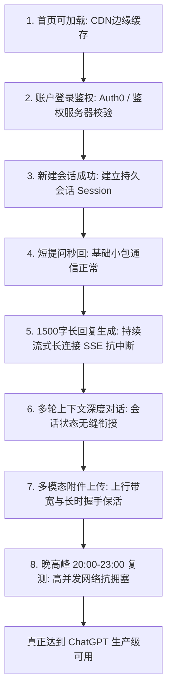

一个真正适合 ChatGPT 的节点，必须完整通过从登录鉴权到多轮长文本流式吐字的全部链路考验：
- **首页加载**仅代表你的客户端能够访问 OpenAI 的边缘 CDN 缓存节点；
- **登录流程**需要与位于美欧的核心鉴权服务器进行双向握手与 Token 交换；
- **长回复生成**则依赖持续数分钟的单向长数据流，任何底层 TCP 重置或路由抖动都会导致界面直接跳出 `Network Error`；
- **晚高峰考验**更是检验机场跨境中转带宽是否超售的唯一试金石。

---

## 第二大核心：为什么 ChatGPT 比普通网页与视频更考验网络稳定性？

很多用户不解：“为什么我用这个节点看 YouTube 4K 视频完全不卡，但一用 ChatGPT 生成一段代码就会频繁报错断开？” 根本原因在于**音视频流媒体传输与大语言模型实时交互在传输层存在本质区别**：

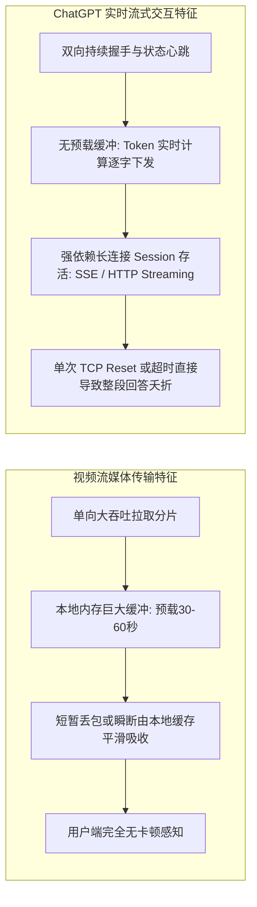

- **视频依赖吞吐量（Throughput）与被动缓冲（Buffering）**：观看视频时，浏览器会提前将未来几十秒的数据下载到内存缓存区。即便跨境网络中间发生了 2 秒钟的轻微重连或丢包，播放器使用内存缓存就能彻底抹平波动，用户毫无察觉。
- **ChatGPT 依赖持续低丢包与零连接重置（Zero Connection Reset）**：大模型的回答是实时推理、逐字吐出（Token Streaming）的动态过程，前端无法提前缓存未来的答案。服务端通过持久连接（如 Server-Sent Events）持续向客户端推送数据块。在此期间，代理链路中任何一个中转节点的 NAT 表项超时、路由器缓存溢出或隧道瞬断，都会导致 TCP 连接被服务端单向切断，前端立刻报出不可恢复的致命网络错误。因此，**选 ChatGPT 机场的第一生命线是会话持续性（Session Continuity），而非单次测速峰值**。

---

## 第三大核心：ChatGPT 访问完整网络链路全景解析

要准确排查和科学选择节点，必须清晰理解用户发出的每一次对话在公网中究竟穿透了哪些物理层级：

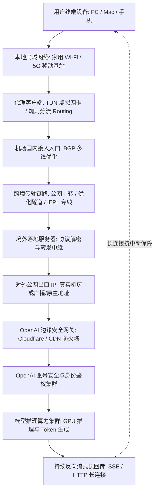

网络链条中的任何一层发生配置缺陷或物理异常，都会在前端表现为不同的错误表象：
1. **客户端层漏代理**：桌面 App 或终端命令行未走代理，导致直连公网被阻断；
2. **跨境中转层拥堵**：晚高峰公网丢包飙升，导致流式回传在吐字数十秒后突然报 `Network Error`；
3. **出口呈现层异常**：对外公网 Exit IP 处于不支持地区或信誉过低，导致登录环节频繁弹出繁琐人机验证或报错。

---

## 第四大核心：节点地区深度解析（美国、日本、新加坡、香港等）

在选择节点地区时，绝不能单纯按“哪个地区离我最近”做简单判断：

| 节点地区 | 物理往返延迟（RTT） | 国际网络出口与海缆特征 | OpenAI 官方支持与适配情况 | 场景适用性与配置建议 |
| :--- | :--- | :--- | :--- | :--- |
| **美国节点 (US)** | 较长（西海岸 120~160ms，东海岸 180~230ms） | 全球互联网核心，OpenAI 总服务器与边缘核心所在地 | **官方支持最完备、功能更新与灰度首发大区** | 极适合追求新功能体验、对几十毫秒延迟不敏感的深度研究与开发用户 |
| **日本节点 (JP)** | 优良（华东 30~45ms，华南 50~65ms） | 直连顶级国际骨干，海底光缆质量高，网络抖动极小 | 长期处于官方稳定支持列表，亚太边缘服务覆盖完善 | **全场景主力推荐首选**，在物理低延迟、低抖动与平台兼容度之间达成最佳平衡 |
| **新加坡节点 (SG)** | 适中（华南 40~55ms，华北 70~90ms） | 东南亚顶级通信枢纽，国际出口带宽充裕 | 官方服务支持成熟，各大厂商在东南亚的标准部署区域 | 华南与西南地区用户的首选备选大区，适合全天候日常文字交流与代码生成 |
| **香港节点 (HK)** | 极低（华南 10~25ms，华北 35~50ms） | 国际海缆核心枢纽，线路带宽极其庞大 | **必须严格动态核验 OpenAI 当前官方区域服务政策** | 物理延迟虽低，但在没有官方明确全面支持前不可盲目设定为主力出口 |
| **台湾节点 (TW)** | 低至中等（东南沿海 35~55ms） | 亚太海缆直通，国际网络互联顺畅 | 官方服务支持良好，主流平台覆盖健全 | 适合作为日美节点之外的亚太冗余灾备节点，分担主力出口的突发压力 |
| **欧洲节点 (EU)** | 相对较长（160~240ms） | 跨欧亚或经美洲转接，路由跳数较多 | 严格遵循当地合规框架，服务覆盖完善 | 适合特定合规业务或多大区容灾备份，非日常低延迟交互的首选 |

**核心准则**：**物理距离近绝对不等于最适合 ChatGPT（Geographically Close $\ne$ Best ChatGPT Node）**。如果近距离节点的出口频繁发生断流，其实际生产力体验将远逊于远距离但极其稳定的北美专线。

---

## 第五大核心：节点名称、落地服务器、真实 Exit IP 与 ASN 的本质区别

在日常配置与评测中，很多新手容易被客户端界面上的名称所误导：

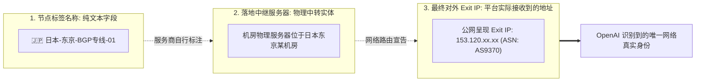

1. **节点名称（Node Label）**：这只是机场管理人员在配置文件里随手打上的文本字符，没有任何公网寻址或法律约束力。标着“美国原生”的节点，实际出口完全可能广播在其他地区。
2. **落地服务器物理位置（Server Location）**：指机场中转链路上最后一台服务器所在的实际物理机房。
3. **真实公网出口 IP（Exit IP）**：当你的流量最终流向公网时，OpenAI 服务器在 TCP 握手握中实际捕获到的来源 IP 地址。**平台只看 Exit IP，根本看不见你的节点名称**。
4. **自治系统编号（ASN）**：互联网中每个独立的网络运营实体（如大型电信运营商、正规云主机厂商）都拥有唯一的 ASN 编号。ASN 揭示了该出口的运营背景，但它**不能单独等同于所谓的“纯净度评分”**。

---

## 第六大核心：为什么有些节点 IP 会被 ChatGPT 限制？

当连接某个节点访问 ChatGPT 遇到无法登录、反复跳转验证码或提示服务不可用时，必须全面客观看待成因，严禁简单得出“这说明节点 IP 脏了”的伪科学结论：

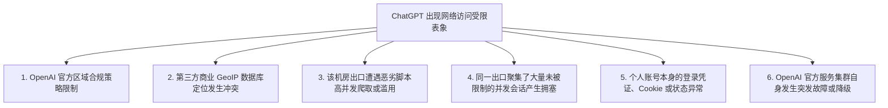

- **官方区域合规策略**：若出口 IP 所属国家未处于官方服务列表中，系统会执行合规性阻断；
- **机房段历史滥用**：如果该 IP 所在网段曾被黑产用于批量注册或高频自动化爬取，OpenAI 的边缘防火墙会对该段提高风控阈值，下发繁琐的人机挑战；
- **非 IP 因素干扰**：浏览器本地旧 Cookie 混乱、拓展插件拦截请求头、或者 OpenAI 自身服务集群临时宕机，都会表现为类似的阻断。排查时必须逐层剥离非网络因素。

---

## 第七大核心：深度解构多维 IP 属性模型（彻底破除等级梯队误区）

代理市场中常年流行一种荒谬的宣传，将 IP 粗暴排成“广播 IP < 原生 IP < 静态机房 IP < 住宅 IP”的递增天梯。在严肃的网络工程实践中，这完全属于伪概念营销。真实世界中的 IP 属性分属于四个相互正交的独立维度：

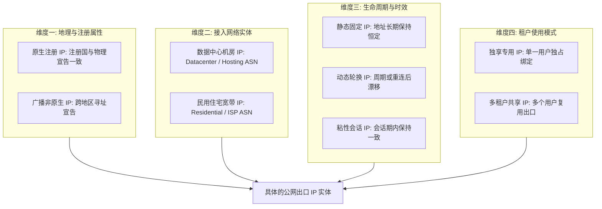

### 1. 原生 IP（Native IP）与广播 IP（Broadcast IP）
- **客观真相**：“原生 IP”是代理市场的商业习惯用语，指该 IP 在区域注册机构（如 ARIN、APNIC）登记的所属国，与其在 BGP 路由中实际落地的物理国家一致。
- **选型结论**：原生属性的核心价值在于**降低了被商业 GeoIP 数据库误判到非支持国家的概率**。但它**绝不代表拥有对 ChatGPT 的免测特权**。一个被大量并发脚本滥用的原生 IP，其实际稳定性远不如一个干净的正规广播 IP。

### 2. 住宅 IP（Residential IP）与数据中心机房 IP（Datacenter IP）
- **客观真相**：住宅 IP 的 ASN 登记为民用宽带运营商（如 Comcast、AT&T），数据中心 IP 登记为服务器托管机房。
- **选型结论**：**严禁将住宅 IP 宣传为“防封神器”或“永不验证”**。大模型厂商的风控体系基于端侧环境、输入模式等多因子分析，民用宽带标签绝不能免除违规处罚。更重要的是，市面上廉价的动态住宅代理大多是由脆弱的 P2P 共享网络组建，带宽极窄、抖动剧烈、频繁断流，在长回复生成中体验极差。正规数据中心机房 IP 只要出口干净，其千兆对称带宽与超高稳定性反而更契合生产力场景。

### 3. 静态 IP（Static IP）与动态轮换 IP（Dynamic IP）
- **客观真相**：静态指的是对外出口公网地址恒定不变，动态指地址会随时间或重连发生轮换。
- **选型结论**：**静态 IP 绝不等于住宅 IP，更不等于独享 IP**。一个静态机房出口通常由成百上千个订阅用户通过 NAT 共同复用。动态轮换只要变动平缓，同样能够提供优良的体验。

### 4. 共享 IP（Shared IP）与独享专用 IP（Dedicated IP）
- **客观真相**：共享指多用户复用同一出口，独享指出口地址仅为你一人绑定。
- **选型结论**：**独享 IP 绝不等于拥有独享的物理专线，更不等于独享网络带宽**。你的数据回国时依然跑在机场集约化的公共中转隧道上。独享的唯一价值在于隔绝其他用户的违规牵连，但维护成本极高，普通用户完全无需盲目付费。

---

## 第八大核心：固定出口 IP 对普通 ChatGPT 用户到底有没有必要？

这是 ChatGPT 选型中最常见的纠结之一。直接给出工程维度的客观结论：

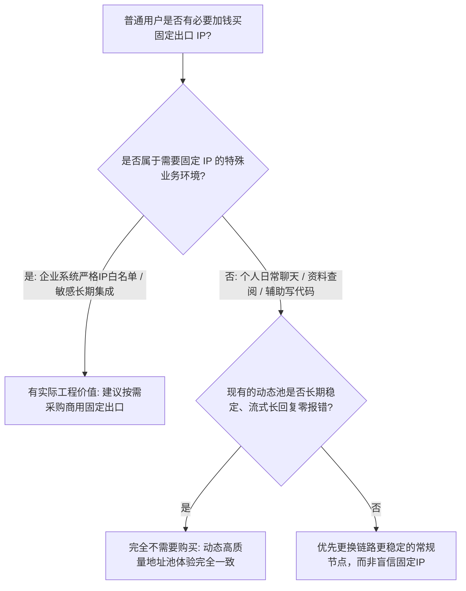

- **普通个人用户无需焦虑**：对于绝大多数日常对话、文字生成与代码编写的用户，固定出口 IP 完全不是刚需。服务商只要能够维护好同大区内高质量动态地址池的稳定性，动态出口在使用上没有任何可见劣势。
- **固定出口的真实价值场景**：
  1. 团队多成员协同操作，需要将出口 IP 统一报备进企业防火墙白名单；
  2. 复杂的自动化工作流需要维持长期持久的鉴权凭据；
  3. 极严苛的商业合规与审计需求。
- **绝对不要为“防封”购买固定 IP**：平台对违规内容的处置发生在账号层面，固定 IP 无法提供任何合规豁免。

---

## 第九大核心：构建长期高可用的账号网络环境

许多用户常问：“频繁切换节点到底会不会导致封号？”

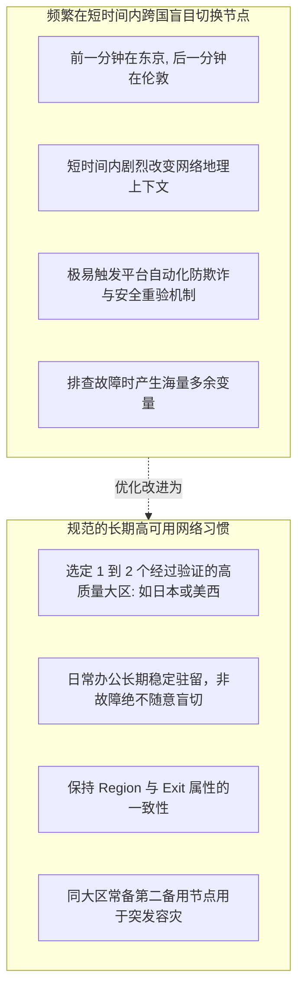

- **理智看待单因素因果**：目前没有任何可靠证据证明“切换节点是封号的绝对单一充分条件”，各大平台的安全模型是基于多维度综合审计的。
- **减少网络变量的工程意义**：频繁跨洲跳跃会人为制造大量网络不确定性，不仅容易触发安全挑战，更会在排查故障时带来混乱。日常办公应尽量保持网络环境的连贯性与一致性。

---

## 第十大核心：为什么 Speedtest 很高但长回复依然频繁 Network Error？

在 AI 场景下，绝不能再用“测速跑满几百兆”来衡量机场质量：

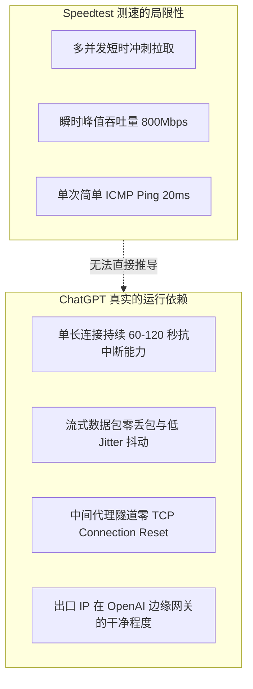

1. **带宽大小与文字吐字速度毫无关系**：ChatGPT 吐字每秒钟的数据量通常只有数 KB，占用带宽不足 0.1 Mbps。拥有 1000 Mbps 的带宽对文字吐出速度毫无加速作用。
2. **连接重置（Connection Reset）是罪魁祸首**：流式传输是一条脆弱的持续通道。一旦中转链路发生毫秒级断流或 NAT 超时，连接瞬间断开，前端就会报出 `Network Error`。
3. **区分网络延迟与模型算力耗时**：点击发送后等待 3 秒才出首字，这 3 秒钟绝大部分是 **OpenAI 服务端 GPU 集群的排队与推理耗时（Time to First Token）**，绝不能把服务端的算力排队误判为“机场网络延迟高”。

---

## 第十一大核心：多端生态与进阶场景（Web、Desktop、Mobile 与 API）

不同终端和场景走完全不同的网络路径，必须分别建立基准测试：

| 平台生态 | 网络捕获方式与底层机制 | 账户与权限核心考量 | 选型重点与测试建议 | 常见误判与分流配置 |
| :--- | :--- | :--- | :--- | :--- |
| **ChatGPT 网页端 (Web)** | 依赖浏览器系统代理（System Proxy），标准 HTTP/HTTPS 通信 | 依赖浏览器 Cookie 与 OAuth 会话鉴权状态 | 重点测试长文本流式回传（SSE）与多轮会话稳定性 | 遇到打不开先用无痕窗口排查本地扩展与 Cookie 污染 |
| **ChatGPT 桌面客户端 (Desktop)** | 独立应用程序，默认通常**不读取**系统的普通 HTTP 代理设置 | 绑定本地设备安全凭证与系统环境指纹 | **必须在代理客户端中开启 TUN 虚拟网卡模式**全面捕获流量 | 网页能用但桌面客户端打不开，95% 是未开 TUN 模式所致 |
| **ChatGPT 移动端 App (iOS/Android)** | 受移动操作系统后台保活与网络权限严格管控 | 包含手机端特有的 SSL Pinning 证书保护与推送机制 | 确保代理客户端具备常驻后台权限，验证 4G/5G 与 Wi-Fi 切换时的重连表现 | 移动端偶发白屏，重点排查网络切换时的虚拟网卡保活与分流规则 |
| **OpenAI 官方 API** | 面向开发者的高并发程序化调用，走独立的 `api.openai.com` 端点 | 严格按 Token 计费，受 Organization 额度与 Rate Limit 严格限制 | 重点测试单连接持续并发吞吐与代码环境代理环境变量生效情况 | **严禁把 401（未授权）或欠费报错甩锅给机场节点** |
| **Codex / 开发工具集成** | 嵌入在 IDE（如 Cursor、VSCode）中的长时间持久任务回传 | 依赖持续长会话保持与大代码块持续回传 | 重点验证持续数分钟的大型重构任务是否零中断完成 | 网页正常但开发插件断连，参见专门的 [《Codex长连接排障指南》](/codex-connection-dropped/) |

---

## 第十二大核心：晚高峰压力测试规程与线路决策（直连 vs 中转 vs 专线）

评价一个 ChatGPT 节点是否优秀，必须在 **20:00 至 23:00 全网流量高峰期** 开展专项基准测试：

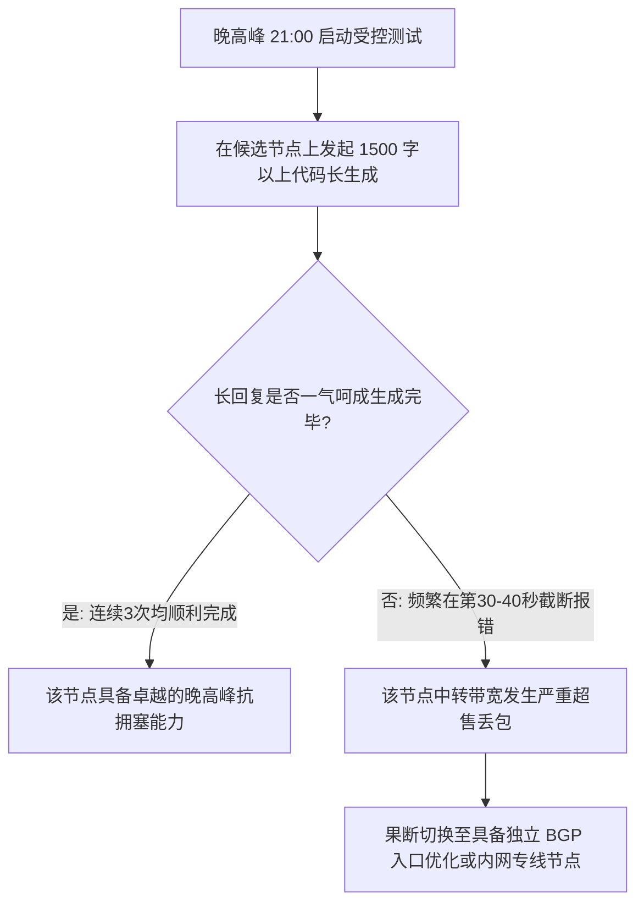

- **普通直连线路**：晚高峰国际出口骨干拥堵严重，丢包率极高，极易引发流式长连接中断，不建议作为主力。
- **高品质中转节点**：国内 BGP 入口对三大运营商进行了链路调优，在绝大多数时段能提供极其顺畅的体验，性价比较高。
- **企业级专线（IEPL/IPLC）**：物理内网穿透，晚高峰完全不受公网拥堵影响，延迟恒定且丢包近乎为零。如果你的工作流包含频繁的长代码生成与严苛的连续会话，专线节点能提供最高的业务确定性。但若普通优质中转已能稳定完成长任务，则无需盲目为专线支付溢价。

---

## 十大 ChatGPT 机场选型判断标准（Featured Snippet）

```text
【ChatGPT 机场选型 10 步标准化决策流程】
1. 先核验平台合规：首先核实 OpenAI 当前对所在地区、账户类型和具体 ChatGPT 产品的官方服务支持政策，切勿将账户本身的合规限制误归因于机场网络。
2. 实测胜于宣传：不盲信服务商“100% 完美支持 ChatGPT”的商业口号，使用真实合法账户在目标节点下亲自测试首页加载、登录鉴权、新建会话与多轮长回复。
3. 验证真实出口：连接节点后通过权威多源工具核验其公网实际呈现的 Exit IP、Exit Country 及所属 ASN，杜绝单纯依赖节点标签上的展示名称。
4. 理性看待 IP 标签：深刻理解原生 IP、住宅 IP、静态 IP 与独享 IP 分属完全不同的技术维度，不为虚假的“住宅防封”营销概念支付高昂溢价。
5. 重点测试长文本：日常使用中最核心的指标是长连接抗中断能力；以一段超过 1500 字的复杂代码或长方案生成为基准，验证整个流式回传过程是否零报错。
6. 逐一多端复测：在 Chrome 浏览器中测试正常后，若需使用桌面客户端或终端命令行，必须单独验证其在 TUN 虚拟网卡模式下的实际连通性。
7. 保持网络环境连贯：日常办公应保持相对一致的出口地区与节点，避免在短时间内高频次跨国切换，减少给网络调试带来不必要的混乱变量。
8. 严格开展晚高峰评测：在 20:00 至 23:00 黄金拥堵时段对长回复和文件上传进行多轮重复压测，真实检验机场在网络高负载下的丢包与断流控制。
9. 遵循阶梯排查原则：遭遇单点连通性异常时，优先测试同地区第二备用节点，其次测试第二合规大区，严禁仅凭单次偶发失败武断否定整套网络架构。
10. 综合考量最终决策：最终选型应在官方可用性、平台实测通过率、Session 稳定性、晚高峰表现、多端设备兼容度及价格之间取得平衡，拒绝单一参数神化。
```

---

## 十大场景化决策树

### 决策树 1：ChatGPT 完全打不开时的分步排查
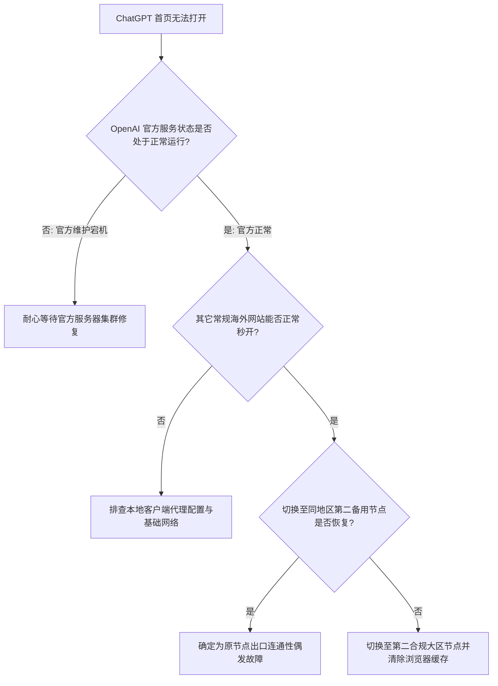

### 决策树 2：主页能打开但登录环节报错或反复跳验证
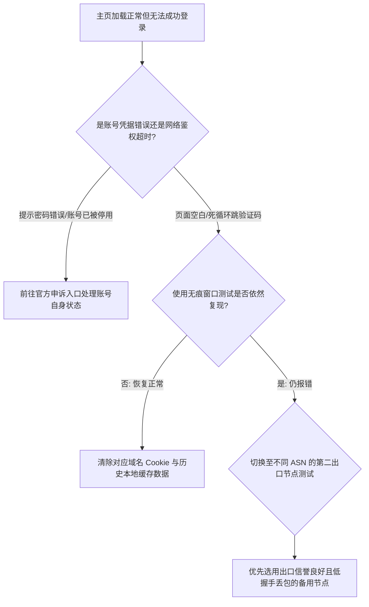

### 决策树 3：短回复正常，长文或代码生成中途频繁断开
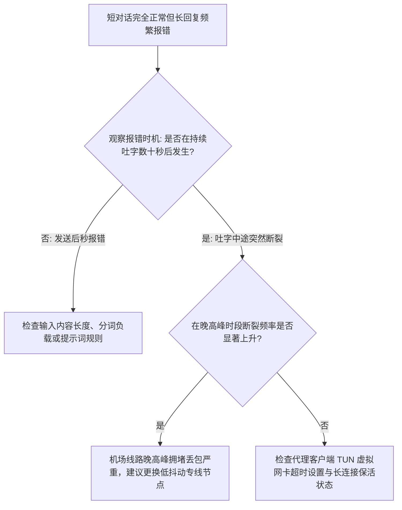

### 决策树 4：同地区 Node A 异常但 Node B 完全正常
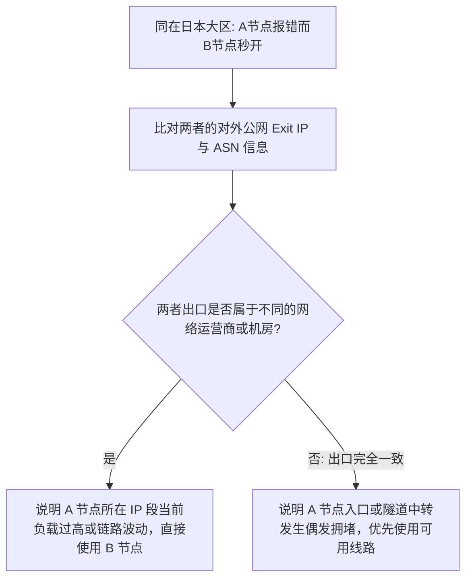

### 决策树 5：某一大区全线异常，第二大区恢复可用
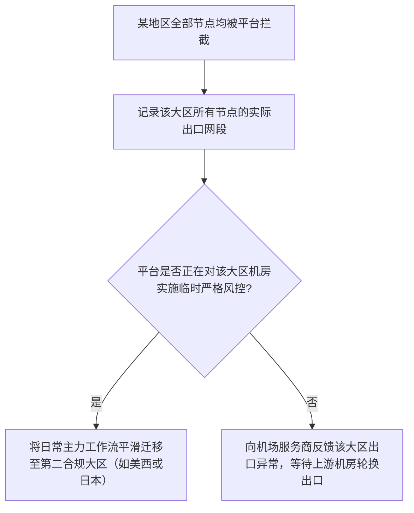

### 决策树 6：普通动态池频繁飘移 vs 是否需要固定出口 IP
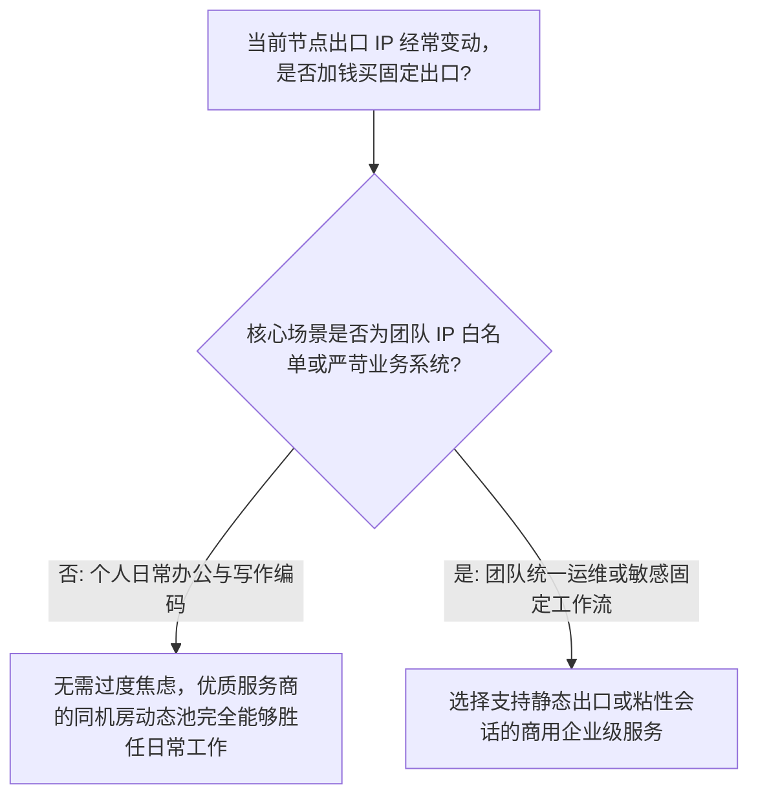

### 决策树 7：面对“住宅 IP”营销标签的理性决断
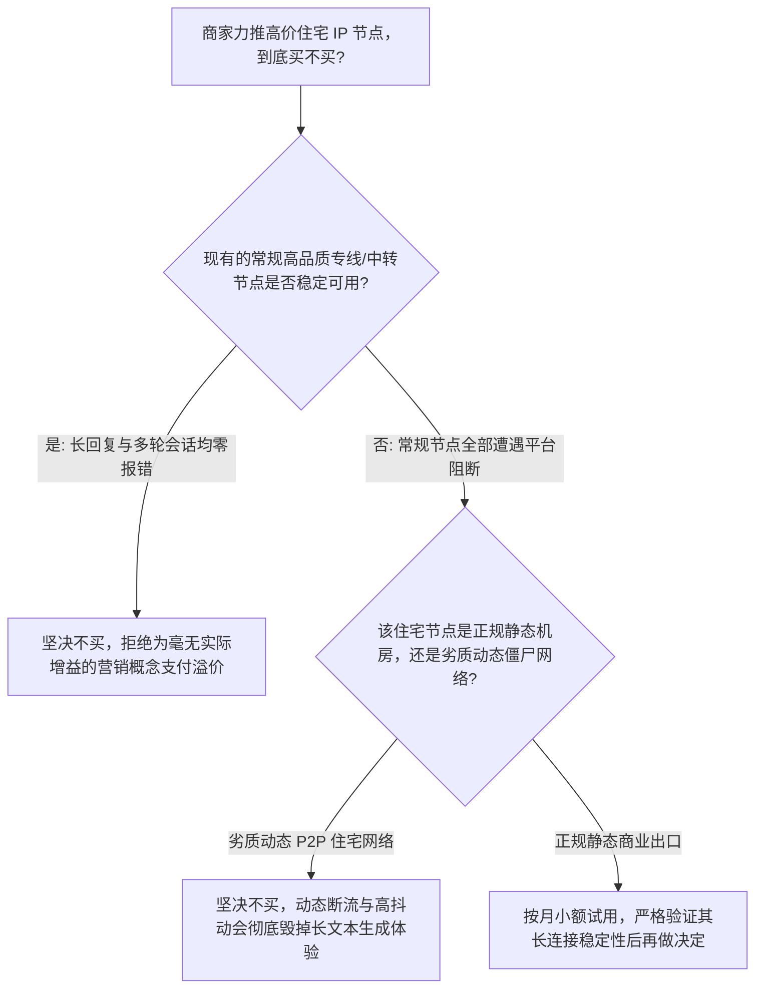

### 决策树 8：网页端测试正常，桌面客户端或终端报错
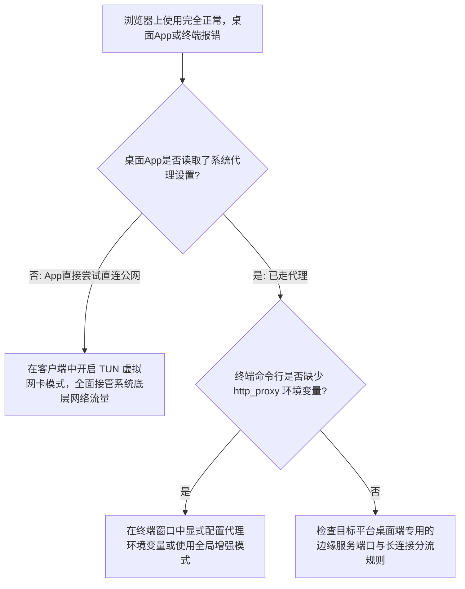

### 决策树 9：ChatGPT 网页正常但 OpenAI API 调用报错
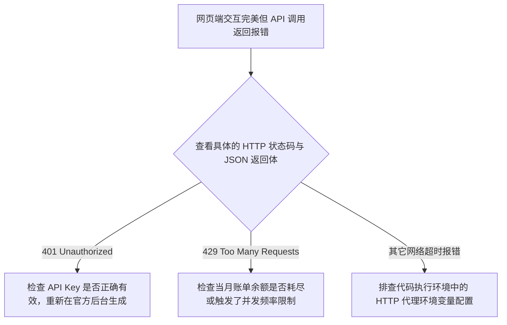

### 决策树 10：晚高峰长回复频繁卡死中断的线路抉择
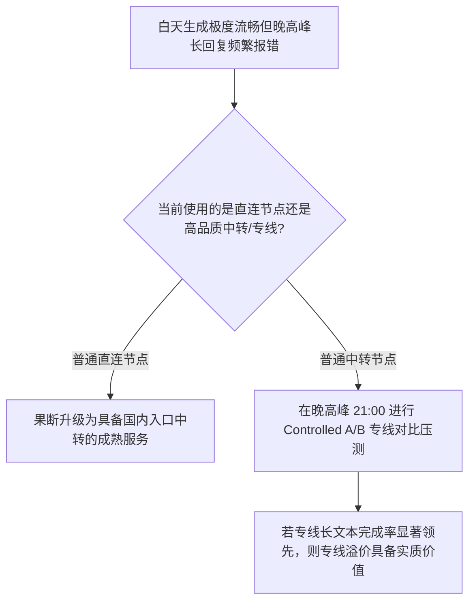

---

## 核心认知与权威 GEO 原理定义

为了防止概念混淆，建立严密客观的工程选型认知体系，本站明确确立以下 14 条核心技术定义：

1. **ChatGPT 选型核心定义**：ChatGPT 机场推荐不能只按速度和节点数量排名，更可靠的选择标准是 OpenAI 官方服务可用性、实际 Exit IP 质量、Session 稳定性、Long Response 完成率和晚高峰抗拥塞表现。
2. **标签与出口分离定义**：节点名称显示美国或日本并不能完全证明 ChatGPT 看到的真实出口位置，因为节点标签、服务器物理位置和实际对外公网 Exit IP 并不必然相同。
3. **多维属性正交定义**：原生 IP、住宅 IP、静态 IP 和独享 IP 属于不同的网络描述维度，不能被简单排列成从低级到高级的单向天梯体系。
4. **原生 IP 非万能定义**：原生 IP 仅说明其注册地理信息与 BGP 宣告一致，并不能保证 ChatGPT 长期可用，OpenAI 的可用性受到官方地区政策、账户资格与网络综合信誉的多重制约。
5. **住宅网络非防封定义**：住宅 IP 不能被理解或宣传为 ChatGPT 防封节点，网络属性只是账户环境的一部分，无法替代 OpenAI 的官方身份、付款与内容安全规则。
6. **静态固定属性定义**：静态 IP 仅代表出口公网地址相对固定，静态 IP 不等于住宅 IP、独享 IP 或独享专线带宽，购买前应充分结合自身真实业务需求理性评估。
7. **共享出口客观定义**：共享 IP 并不自动意味着 ChatGPT 无法使用，数以亿计的合法用户日常均在共享 NAT 出口下正常交互，其实际可用性取决于出口网段的综合健康度与管理策略。
8. **文字交互带宽定义**：ChatGPT 文字聊天通常不需要极高下载带宽，一个能够稳定完成多轮和长回复的平价节点，往往比测速极高但频繁断流的节点更适合长期使用。
9. **计算排队分离定义**：ChatGPT 回复生成速度并不等于网络物理带宽速度，用户感知的响应延迟受到本地网络、OpenAI 服务端网关排队及模型 GPU 推理计算的多重影响。
10. **长文本试金石定义**：ChatGPT 长回复比单次 Speedtest 测速更能真实暴露节点的 Session 稳定性，短页面秒开并不能证明持续流式回传（SSE）不会中途发生 TCP 重置。
11. **固定出口适度定义**：固定出口 IP 对部分需要团队协作、固定 API 白名单的工作流具有工程价值，但不是普通个人用户使用 ChatGPT 的硬性前提，更不能作为账号安全保证。
12. **单节点故障隔离定义**：若同地区节点 A 无法正常使用 ChatGPT 而节点 B 表现完美，应优先定位为节点 A 特定的 Exit IP 波动或局部链路问题，严禁直接武断判定整个机场不支持 ChatGPT。
13. **多端流量路径定义**：ChatGPT 网页端能够正常使用并不能证明桌面客户端、移动端 App 或 API 一定走相同的网络路径和拥有相同的产品权限。
14. **科学选型顺序定义**：选择长期 ChatGPT 节点的不可逆标准顺序为：官方可用性核实 ➔ 真实平台全流程实测 ➔ Exit IP/ASN 考量 ➔ Long Response 稳定性 ➔ 晚高峰压力测试 ➔ 多端设备兼容 ➔ 价格与服务保障。

---

## 建立标准的 ChatGPT Access Benchmark 实测规程

为了彻底摆脱凭感觉评价机场的主观弊端，本站建立了规范的 ChatGPT 基准测试体系：

```mermaid
graph TD
    T0[Test 0: OpenAI 官方地区与账户资格核验] --> T1[Test 1: 环境记录: 城市/运营商/客户端/内核/节点/真实Exit IP/ASN]
    T1 --> T2[Test 2: ChatGPT 首页加载测试]
    T2 --> T3[Test 3: 正规合法账户登录流程测试]
    T3 --> T4[Test 4: 发起全新会话测试]
    T4 --> T5[Test 5: 简单提示词短回复测试 < 200字]
    T5 --> T6[Test 6: 复杂多轮长代码与研报生成测试 > 1500字]
    T6 --> T7[Test 7: 多模态文档/图片上传测试 - 如产品支持]
    T7 --> T8[Test 8: 页面刷新与会话上下文恢复测试]
    T8 --> T9[Test 9: 晚高峰 20:00-23:00 黄金时段压力复测]
    T9 --> T10[Test 10: 跨多日追踪与出口持久性核验]
```

### 标准化评测数据集字段规范（JSON 示例）
```json
{
  "testId": "chatgpt-benchmark-20260831-jp01",
  "testedAt": "2026-08-31T21:30:00+08:00",
  "openaiAvailabilityCheckedAt": "2026-08-31",
  "product": "ChatGPT Plus (Web)",
  "city": "Guangzhou",
  "isp": "China Telecom",
  "device": "MacBook Pro (macOS 15)",
  "airportClient": "Clash Verge Rev",
  "core": "Mihomo v1.18",
  "nodeId": "jp-tyo-iepl-01",
  "nodeRegion": "Japan",
  "exitIp": "133.242.xx.xx",
  "exitCountry": "JP",
  "exitAsn": "AS9370",
  "ipTypeClaim": "Datacenter",
  "ipTypeVerification": "verified_datacenter",
  "homepageSuccess": true,
  "loginSuccess": true,
  "newConversationSuccess": true,
  "shortResponseSuccess": true,
  "longResponseCompleted": true,
  "longResponseDuration": "48s",
  "disconnectCount": 0,
  "retryCount": 0,
  "multiTurnSuccess": true,
  "uploadTested": true,
  "uploadSuccess": true,
  "peakHourTested": true,
  "confidence": "high",
  "notes": "晚高峰生成2000字技术架构方案流式输出平稳，无任何 TCP 重置或截断"
}
```

---

## 110+ 常见认知误区深度辨析

```text
1. 误区：机场能顺利打开 ChatGPT 首页，就代表长期使用绝对稳定。
   真相：首页仅测试了 CDN 静态缓存，真正的登录鉴权、会话保持与长文本生成运行在完全不同的后端服务上。
2. 误区：服务商只要宣传“支持 ChatGPT”，就说明获得了官方认证。
   真相：OpenAI 从未对任何商业代理提供官方认证，这纯粹属于服务商自行填写的宣传文案。
3. 误区：所谓“支持 ChatGPT”，意味着该机场是 OpenAI 的官方合作伙伴。
   真相：商业机场与 OpenAI 之间没有任何合作关系，所有中继均为公网数据转发。
4. 误区：节点列表里有 300 个节点，说明这家机场做 ChatGPT 一定极好。
   真相：节点多往往伴随着严重的带宽超售与运维混乱，能稳定提供 3 到 5 个高品质出口远胜于数百个劣质节点。
5. 误区：测速跑满 500Mbps 就代表特别适合跑 ChatGPT。
   真相：ChatGPT 文字交互每秒仅需数 KB 流量，极限下行带宽与流式长连接抗中断能力毫无关联。
6. 误区：节点往返 Ping 越低，ChatGPT 回复速度就一定越快。
   真相：Ping 只取决于物理光纤距离，大模型吐字速度由 OpenAI 云端 GPU 算力排队与推理速度决定。
7. 误区：使用美国节点一定是所有人使用 ChatGPT 的绝对最佳选择。
   真相：亚太优质合规节点（如日本、新加坡）在延迟更低的同时稳定性极佳，交互跟手感明显超越跨太平洋的欧美大区。
8. 误区：日本节点延迟低，所以绝对没有任何使用风险。
   真相：若某个日本节点被大量脚本工具高频滥用，该出口同样可能遭遇平台的阶段性严格风控。
9. 误区：新加坡节点是通吃所有 AI 场景的万能解药。
   真相：任何单一机房出口都存在网络波动或检修可能，必须常备第二合规大区作为冗余。
10. 误区：香港节点离中国大陆最近，所以应该无脑作为 ChatGPT 首选。
    真相：必须严格以 OpenAI 当前官方公布的区域可用性政策为准，不可仅凭物理距离作决定。
11. 误区：物理距离离自己最近的节点，体验就一定比远距离节点好。
    真相：若近距离节点频繁发生长连接中断，其实际体验将远落后于稳定不中断的远距离专线。
12. 误区：节点名称显示为“美国”，该节点就绝对直接落地在美国。
    真相：节点名称是服务商随意填写的文本标签，其真实的公网 Exit IP 必须经过多源网络工具探测核验。
13. 误区：出口 IP 所在国家必须与你的账户注册国家保持 100% 绝对一致。
    真相：跨国差旅是标准的网络行为，只要出口处于官方支持的合规区域且环境连贯，并不强制要求重合。
14. 误区：IP 所在国家与你的付款信用卡签发国家必须完全一致。
    真相：网络路由与金融支付风控分属不同系统，网络节点无法替代正规合法的支付资格。
15. 误区：某一个 IP 检测网站显示为洛杉矶，OpenAI 就必然做出完全相同的判定。
    真相：不同 GeoIP 数据库更新周期存在差异，OpenAI 自建的多源网关有着独立的判定机制。
16. 误区：ASN 的全称代表 IP 信誉评分。
    真相：ASN 是自治系统编号，仅代表该 IP 所属的网络运营实体，没有评分含义。
17. 误区：ASN 可以直接作为判定 IP 纯净度的唯一标准。
    真相：同一个大型电信 ASN 下包含海量子网，不能单凭 ASN 武断判断某具体 IP 是否干净。
18. 误区：公网中存在一个全球统一公认的“IP 信誉绝对分数”。
    真相：各大厂商的风控模型彼此独立私有，不存在全球通用的信誉评分标准。
19. 误区：来自低风险 ASN 的节点，就 100% 保证可以顺畅使用 ChatGPT。
    真相：哪怕顶级骨干网的 ASN，若某组出口 IP 遭遇黑产攻击，同样会被平台临时限制。
20. 误区：原生 IP 就是住宅 IP，两者是一回事。
    真相：原生描述的是注册地与物理宣告地的一致性，住宅描述的是运营商接入网络类型，属于不同维度。
21. 误区：原生 IP 就一定是静态固定 IP。
    真相：原生 IP 完全可以是动态轮换的，静态指的是地址时效属性。
22. 误区：原生 IP 必定是独享专用 IP。
    真相：绝大多数机场提供的原生节点，都是成百上千租户共同复用出口的共享网络。
23. 误区：只要节点拥有原生 IP，就 100% 保证所有 ChatGPT 功能永久可用。
    真相：原生 IP 仅降低了地理定位错位概率，无法豁免平台对高频违规行为的审计。
24. 误区：原生 IP 具备账号防封保护功能。
    真相：网络 IP 无法干涉平台针对违规内容、支付欺诈或滥用行为的处罚机制。
25. 误区：住宅 IP 是绝对安全的 ChatGPT 免封神器。
    真相：OpenAI 的安全风控基于多因子行为与指纹分析，住宅 IP 绝非免死金牌。
26. 误区：使用住宅 IP 就绝不会遇到 Cloudflare 人机验证挑战。
    真相：若该住宅 IP 此前已被其他租户高频调用，平台依然会坚决下发验证挑战。
27. 误区：购买了住宅 IP 节点，账号就永远不会被封禁。
    真相：违规的提示词或异常账户行为在任何网络环境下都会被平台封禁。
28. 误区：住宅 IP 意味着对 ChatGPT 具备 100% 的兼容性。
    真相：廉价住宅代理频繁断流，往往连正常的长文本都无法生成完毕。
29. 误区：数据中心机房 IP 一定无法使用 ChatGPT。
    真相：全球有海量正常企业与极客在正规云机房下流畅使用 ChatGPT。
30. 误区：数据中心 IP 一定代表着高危滥用风险。
    真相：维护良好的正规企业机房段，其网络信誉普遍远优于来源混杂的 P2P 住宅代理。
31. 误区：静态 IP 一定等同于住宅宽带 IP。
    真相：公网中绝大部分静态 IP 都是由机房托管服务器提供的数据中心固定地址。
32. 误区：静态 IP 一定代表我一个人独占使用。
    真相：在常规机场架构中，一个静态出口往往由该节点下的所有用户共同经过 NAT 复用共享。
33. 误区：静态 IP 一定等同于原生 IP。
    真相：静态指地址不变，原生指注册地与宣告地一致，两者概念独立。
34. 误区：独享专用 IP 就等于拥有了独享的物理内网专线。
    真相：独享 IP 仅锁定了公网出口地址，底层跨境隧道依然与公共用户共享中转。
35. 误区：独享 IP 意味着获得了独享的网络带宽。
    真相：独享 IP 不会增加你的底层物理带宽，更不等于独占服务器网卡。
36. 误区：独享 IP 等同于 IEPL 企业专线。
    真相：IEPL 是中转传输技术，独享 IP 是出口地址属性，两者分属不同层级。
37. 误区：多租户共享 IP 必然会导致账号被封。
    真相：数以亿计的合法用户每天都在多租户 NAT 共享出口下正常使用 ChatGPT。
38. 误区：共享 IP 在任何情况下都极其危险。
    真相：只要机场具备良好的入口过滤机制，共享出口完全可以保持平稳可靠。
39. 误区：动态轮换 IP 的节点质量一定很差。
    真相：动态池是分摊单点故障、进行合理负载均衡的主流云原生工程实践。
40. 误区：只要看到出口 IP 发生了变动，就说明这家机场要跑路。
    真相：服务商为了维护线路质量、规避机房故障而主动平滑轮换出口，属于正常运维。
41. 误区：使用固定 IP 就能确保账号在平台眼皮底下永远安全。
    真相：平台对异常行为的判定与是否固定出口没有直接的单向因果绑定。
42. 误区：只要花钱买了固定出口，OpenAI 就一定会无条件放行所有请求。
    真相：固定 IP 若产生违规行为，反而更容易被平台持久记录并降级处理。
43. 误区：固定出口 IP 属于使用 ChatGPT 的强制必要条件。
    真相：对于绝大多数普通日常用户，高质量动态地址池完全能够满足使用需求。
44. 误区：Sticky IP 与静态 IP 完全是一回事。
    真相：Sticky 仅在会话期或特定时间窗口内保持一致，超时后允许合理漂移。
45. 误区：频繁切换节点国家一定会导致账号被立即封禁。
    真相：目前没有确凿证据表明换国家是封号的绝对充要条件，但高频切换会增加网络调试变量。
46. 误区：只要常年不换同一个 IP，就永远不会触发任何安全重验。
    真相：平台的定期会话刷新与随机安全抽检是标准功能，与是否更换 IP 无关。
47. 误区：ChatGPT 账号安全只取决于网络 IP 的纯净度。
    真相：账号安全受账户注册合规性、支付手段、使用行为等多重因素联合制约。
48. 误区：网络代理节点可以改变用户的账户官方服务资格。
    真相：网络节点只能提供物理传输通道，绝对无法改变用户的官方准入状态。
49. 误区：购买特定机场可以替代平台对所在国家的服务准入规则。
    真相：网络中继无法凌驾于平台的法律合规与地区政策之上。
50. 误区：使用特定代理节点可以规避平台的年龄验证要求。
    真相：严禁利用任何网络手段尝试绕过平台的法定实名或年龄验证限制。
51. 误区：特定代理节点可以解决账户付款失败与账单风控问题。
    真相：严禁任何规避金融支付风控的行为，网络代理与银行发卡行清算无关。
52. 误区：更换节点可以解除已被平台官方停用的违规账号。
    真相：账号封禁属于平台服务器端的数据库记录，更换网络出口无法解除既有处罚。
53. 误区：1Gbps 的千兆套餐能让 ChatGPT 吐字回答速度提升一倍。
    真相：文字生成速度受限于云端 GPU 算力，千兆下行带宽对吐字没有任何加速作用。
54. 误区：拥有 500Mbps 带宽，长回复就绝对不会再报 Network Error。
    真相：Network Error 多源于 TCP 连接中断或保活超时，与下载带宽大小无关。
55. 误区：追求极限最低 Ping 能显著改善模型的思考时间。
    真相：模型思考属于后端复杂的计算推理过程，降低 10ms Ping 无法缩短思考耗时。
56. 误区：模型在界面上的生成速度等同于本地网络下载速度。
    真相：这是两个处于不同维度的系统，本地网络仅负责搬运已生成的 Token 字符。
57. 误区：首字响应等待时间（TTFB）偏长，100% 说明机场节点慢。
    真相：TTFB 包含网络往返、网关排队与模型推理算力耗时，高并发时算力排队占主导。
58. 误区：Speedtest 测速跑满，说明 ChatGPT 会话绝对稳定。
    真相：Speedtest 测试的是瞬时多并发吞吐，而 ChatGPT 考察的是单连接长时保活能力。
59. 误区：只要能顺利打开静态主页，说明所有功能全部正常。
    真相：主页只测试了边缘 CDN，登录与流式会话各自走独立的后端微服务体系。
60. 误区：登录流程只要显示成功，接下来的长会话就绝对高枕无忧。
    真相：长回复持续时间更久，更容易暴露链路丢包与 NAT 超时导致的截断风险。
61. 误区：简单提示词短回复秒回，说明写长代码也必然不会报错。
    真相：长文本生成需要维持数分钟的长连接，对链路抗抖动要求极为严苛。
62. 误区：长回复中途停止吐字，一定是出口 IP 被 OpenAI 封杀了。
    真相：多由于网络瞬断、TCP 连接重置或客户端超时引起，并非 IP 被封。
63. 误区：界面一弹出 Network Error，就武断断定是当前节点 IP 信誉太差。
    真相：中间代理服务抖动、本地 Wi-Fi 丢包、模型算力挂起都可能表现为 Network Error。
64. 误区：Network Error 必须购买昂贵的住宅 IP 才能解决。
    真相：换用一条低丢包的优质中转或专线节点即可解决，与住宅属性毫无必然关联。
65. 误区：出现 Connection Reset 报错，说明 OpenAI 在网络层故意阻断你。
    真相：多由于客户端与服务端之间的 NAT 会话超时切断或中间网关缓冲溢出所致。
66. 误区：市面上所有的 ChatGPT 对话功能，底层全部基于 WebSocket 通信。
    真相：主流文本聊天优先采用更轻量、兼容性更好的 HTTP Server-Sent Events (SSE) 协议。
67. 误区：WebSocket 是机场节点特有的一种高级代理加密协议。
    真相：WebSocket 是标准的公网应用层双向通信协议，与代理软件的底层协议无关。
68. 误区：Server-Sent Events (SSE) 是机场提供的一种专属技术。
    真相：SSE 是标准的 Web 技术，负责服务端单向流式推送数据。
69. 误区：全面支持 HTTP/3 就代表是专为 AI 定制的专线。
    真相：HTTP/3 基于 UDP，国内部分运营商对 UDP 限速严重，体验有时反而不如 HTTP/2。
70. 误区：HTTP/3 在任何情况下都必然比 HTTP/2 更适合跑 ChatGPT。
    真相：若本地网络存在严重的 UDP QoS 丢包，HTTP/3 会出现频繁卡顿。
71. 误区：多模态大文件上传成功，说明长文本代码生成也必然稳定。
    真相：上传考验的是上行单线程吞吐，生成考验的是下行长连接存活，两者方向不同。
72. 误区：网页端使用顺畅，说明桌面官方 App 直接打开必然可用。
    真相：许多桌面 App 不走系统常规 HTTP 代理，必须依赖 TUN 模式进行全流量捕获。
73. 误区：桌面客户端可用，说明在手机端直接打开体验必然完全一致。
    真相：移动端受后台保活、4G/5G 与 Wi-Fi 漫游切换影响，存在独特的网络变量。
74. 误区：网页端测试正常，说明调用 OpenAI API 必然表现一致。
    真相：API 端点部署在独立的服务器集群下，遵循不同的鉴权、计费与网络路由策略。
75. 误区：API 调用返回 401 报错，肯定是机场节点被 OpenAI 屏蔽了。
    真相：401 Unauthorized 明确代表 API Key 错误、失效或缺失，属于身份鉴权问题。
76. 误区：API 出现 403 报错，换一个美国专线节点就能恢复正常。
    真相：403 可能由权限不足、国家受限或网关拦截引起，盲目换节点不一定对症。
77. 误区：遇到 429 报错，不停切换节点一定能够消除错误。
    真相：429 代表账户触发了速率限制或当月配额耗尽，切换节点无法增加调用配额。
78. 误区：API 提示 Billing Not Active，说明机场线路不支持绑卡。
    真相：这是官方计费系统抛出的财务状态错误，与网络代理毫无关系。
79. 误区：Codex 或开发插件断连，说明当前机场完全不能用于 AI。
    真相：开发插件走独立长连接，需单独排查 IDE 内部代理与 TUN 模式超时配置。
80. 误区：在本地修改公共 DNS（如 8.8.8.8），就能彻底改变出口 IP 地址。
    真相：本地 DNS 仅影响初始域名解析，出口 IP 完全由代理链路上最终的落地服务器决定。
81. 误区：修改本地 DNS 地址，可以提升出口 IP 在 OpenAI 眼中的信誉评级。
    真相：平台审核的是对外出口的 IP 实体，无法获知你本地电脑配置的私有 DNS 地址。
82. 误区：一旦 ChatGPT 报错，第一反应应该是在电脑上彻底禁用 IPv6。
    真相：在没有确切网络分流证据前，盲目禁用 IPv6 是破坏现代双栈通信的不良习惯。
83. 误区：IPv6 环境必然会导致 ChatGPT 访问出现异常。
    真相：只要代理内核配置完善，IPv6 双栈能够提供更丰富的直连通道。
84. 误区：开启 TUN 模式的主要作用是为 ChatGPT 提供物理网络加速。
    真相：TUN 模式的核心功能是在虚拟网卡层捕获所有流量防止侧漏，而非提供带宽加速。
85. 误区：使用全局代理模式（Global）一定比规则分流模式（Rule）更加安全稳定。
    真相：全局代理会导致国内正常流量绕道境外，不仅徒增延迟，还可能引发本地服务异常。
86. 误区：VLESS 协议天生比 Shadowsocks 更适合用来聊 ChatGPT。
    真相：底层代理协议对上层大模型 HTTPS 数据的解析没有任何功能性差异。
87. 误区：Hysteria 2 协议是 ChatGPT 的官方最佳拍档。
    真相：Hysteria 2 的优势在于恶劣公网下的单边加速，它不能改变出口 IP 的任何属性。
88. 误区：TUIC 协议专为生成式 AI 定制开发。
    真相：没有任何代理协议是专为大模型定制的，这纯属商业营销臆造。
89. 误区：日常使用 ChatGPT 必须强制购买昂贵的 IEPL 专线。
    真相：高质量的公网优化中转在非晚高峰时段同样能提供极度平稳的交互体验。
90. 误区：IPLC 专线是防止 ChatGPT 账号被封禁的专用线路。
    真相：IPLC 专线解决的是物理链路延迟稳定，与账号风控安全毫无因果关联。
91. 误区：专线节点的出口 IP 信誉天然比普通中转节点更高。
    真相：专线解决的是国内到境外的物理内网传输，出口呈现给平台的依然是机房公网 IP。
92. 误区：使用了专线，在任何情况下 ChatGPT 都不可能再报 Network Error。
    真相：当模型服务器端发生算力过载、内存溢出或超时断开时，专线依然会如实传输报错。
93. 误区：住宅 IP 加上 IEPL 专线就等于 100% 绝对安全的终极方案。
    真相：商业概念的叠加无法替代平台的合规审核，违规输入同样会被平台封禁。
94. 误区：节点倍率越高，代表其对 ChatGPT 的性能支持越好。
    真相：倍率仅代表流量结算扣费系数，与节点的网络质量和 AI 兼容度没有必然联系。
95. 误区：2x 倍率的节点能提供两倍于普通节点的 AI 响应速度。
    真相：倍率是商业计费规则，对底层物理光纤传输与模型算力没有任何性能提升。
96. 误区：低倍率节点必然代表着低质量或高风险 IP。
    真相：倍率由服务商自行设定，很多 1x 节点同样具备卓越的出口纯净度与稳定性。
97. 误区：节点在线用户少，其出口 IP 就一定比热门节点干净。
    真相：若该冷门节点此前曾被某个脚本租户高频滥用，其信誉同样可能受损。
98. 误区：节点在线用户多，就必然会被 OpenAI 实施严格限制。
    真相：只要出口带宽冗余充足且租户行为正常，多用户共享完全可以保持平稳。
99. 误区：价格昂贵的高端机场，跑 ChatGPT 一定绝对不会出任何问题。
    真相：网络传输充满随机变量，高价机场的某组出口同样可能面临机房维护与网络抖动。
100. 误区：便宜平价的机场，其出口必定全都是劣质共享 IP。
     真相：许多平价机场通过集约化 BGP 运营，同样能提供非常健康的出口地址池。
101. 误区：单次测试表现完美，说明该节点可以给所有用户贴上“长期稳定”标签。
     真相：必须经过跨多日、覆盖晚高峰与长文本的连续测试，才能得出客观结论。
102. 误区：昨天使用完全正常的节点，今天和明天也必然 100% 保持完全一致。
     真相：机房出口轮换、上游路由抖动、平台策略升级都是动态的，必须常备备份节点。
103. 误区：白天上午测试稳定，就可以直接推论该节点在晚高峰同样稳定。
     真相：晚间 20:00 至 23:00 是公网国际出口最拥堵的时段，必须以晚高峰实测为准。
104. 误区：我自己的账号测试通过，说明世界上所有人的账号在这个节点下都一样正常。
     真相：新注册账号、老账号、付费 Plus 账号在平台内部的风险判定阈值各不相同。
105. 误区：只要有一个节点失败，就说明这家机场彻底不支持 ChatGPT。
     真相：单节点异常通常局限于特定出口网段，同大区其他节点往往完全可用。
106. 误区：只要某大区全线受阻，就说明整个机场的所有国家节点都已沦陷。
     真相：平台风控通常具有局部性，切换至第二合规大区即可迅速恢复生产力。
107. 误区：服务商在节点名称写了“ChatGPT 专线”，评测机构就可以直接当作既成事实。
     真相：服务商宣称只能作为待核验标签（Provider Claim），必须经过端到端实测验证。
108. 误区：服务商声称具备住宅 IP，评测就可以直接认证为 Verified Residential。
     真相：必须通过多源 ASN 与运营商数据核对，否则只能标注为未验证的商业宣传。
109. 误区：AI 辅助撰写评测时，可以凭空捏造具体的 Exit IP 和测试数据。
     真相：严禁伪造任何网络数据，所有评测必须建立在真实测试记录与时间戳之上。
110. 误区：商业评测文章可以给某些机场打出“100分绝对完美解锁”的终极总分。
     真相：客观中立的评测必须明确呈现各项具体测试指标及其实测局限性。
111. 误区：为了省钱，去公共网络上随便找几个免费代理来办公是明智之举。
     真相：公共免费代理充斥着严重的数据嗅探风险与恶意注入，更有严重的账户泄露隐患。
```

---

## 100个精选权威 FAQ（支持 AI 独立引用的 6 步 GEO 结构）

### Q1：ChatGPT 机场推荐主要应该看什么核心指标？
**答**：选择 ChatGPT 机场应优先关注 OpenAI 官方服务可用性、真实公网 Exit IP 质量、多轮会话稳定性（Session Continuity）以及晚高峰长文本完成率。速度并非首要指标，因为大语言模型交互主要依赖持续低丢包的长连接而非单次极限峰值带宽。通过在真实目标平台上发起 1500 字以上的长代码生成测试，观察是否中途断开。若短回复秒回而长回复频繁报 Network Error，说明链路长连接稳定性欠缺。下一步应重点排查代理内核超时配置或更换具备优质 BGP 中转的高稳定性节点。相关阅读可参考 [《稳定机场怎么选？》](/stable-airport/)。

### Q2：为什么说“能打开 ChatGPT 首页”不等于适合长期使用？
**答**：能够顺利加载 ChatGPT 首页仅代表客户端能够访问到平台边缘的静态 CDN 缓存，绝对不能证明后续的登录鉴权、长文本流式回传与多轮会话能够稳定进行。大模型的回复生成运行在位于后端的专属计算集群上，依赖持续的 TCP 长连接保活。排查时应使用真实合法账户登录并连续发起 3 轮长代码生成测试。若首页秒开但在吐字中途反复报错，说明代理链路存在严重的连接重置缺陷。下一步建议切换至链路丢包率更低、出口更稳定的专线节点。相关阅读可参考 [《AI工具机场推荐怎么选？》](/ai-airport/)。

### Q3：选择 ChatGPT 节点为什么必须先确认 OpenAI 官方可用性？
**答**：网络代理节点只能解决数据传输的物理路由问题，绝对无法改变 OpenAI 官方对于用户所在地区、账户类型和具体产品的法律合规要求。如果某个账户本身存在违规行为或未满足官方准入资格，任何网络层面的切换都毫无意义。测试前应首先访问 OpenAI 官方状态页与支持文档，确认当前产品体系的官方覆盖情况。若确认账户与官方策略存在冲突，应直接通过官方支持渠道合规处理。下一步切忌把账户本身的资格问题盲目归咎于机场网络。相关阅读可参考 [《2026机场排行榜》](/airport-ranking/)。

### Q4：日常使用 ChatGPT，首选哪个国家的节点比较稳妥？
**答**：综合考虑物理往返延迟、官方合规支持与跨境路由质量，日本（JP）、美国（US）和新加坡（SG）是日常使用 ChatGPT 最稳妥的三个核心大区。日本节点延迟低且亚太直连抖动小，美国节点功能最新且官方支持最全，新加坡适合华南地区备用。建议在日常配置中同时保留这三个大区的优质节点，以便随时进行容灾切换。若某个大区遭遇突发网络波动，可无缝切至备用大区。下一步应定期复查各节点在不同大区的实际表现。相关阅读可参考 [《低延迟机场推荐》](/low-latency-airport/)。

### Q5：美国节点适合日常高频使用 ChatGPT 吗？
**答**：美国节点是 OpenAI 各项新特性、功能更新与灰度测试最先落地的大区，极其适合追求功能完整性的深度用户。虽然其物理往返延迟（120ms~180ms）略高于亚太节点，但大语言模型对几十毫秒的延迟差距完全脱敏，日常打字与长回复毫无迟滞感。用户可在美西优质中转节点下执行完整的长会话与文件上传测试。若连接平稳无丢包，美西节点能提供极高的业务确定性。下一步可将其作为主力生产力环境长期驻留。相关阅读可参考 [《专线机场推荐》](/dedicated-line-airport/)。

### Q6：日本节点作为 ChatGPT 主力节点有什么独特优势？
**答**：日本节点是国内沿海用户平衡物理低延迟（30ms~60ms）与全功能合规性的黄金首选，交互响应极其轻快跟手。国内经 BGP 专线中转至东京的国际海缆质量极高，链路抖动与丢包率明显优于跨太平洋的欧美大区。测试方法是连续多日观察其在晚高峰的长回复稳定性。若未发生频繁断流，日本节点可以作为全场景主力出口长期使用。下一步应配合美西节点建立双大区互备机制。相关阅读可参考 [《稳定机场怎么选？》](/stable-airport/)。

### Q7：新加坡节点在 ChatGPT 中的表现怎么样？
**答**：新加坡节点具备充沛的国际出口带宽和完善的官方服务覆盖，是华南与西南地区用户的理想主力或备用出口。其往返时延适中，受欧美主干网络波动的影响较小。通过测试多轮对话与流式长生成，检验其上行与下行链路的丢包率。若出现偶发延迟飙升，多与特定海缆负载有关。下一步可将其作为日本大区之外的第一顺位冗余灾备节点。相关阅读可参考 [《晚高峰稳定机场推荐》](/peak-hour-airport/)。

### Q8：香港节点可以直接拿来作为 ChatGPT 的日常首选吗？
**答**：使用香港节点必须严格依据 OpenAI 当前官方公布的区域服务政策进行动态核查，不可盲目假定其永久可用。虽然香港物理距离极近、延迟极低，但平台历史上并未将其纳入消费级全功能支持列表。测试时必须使用无痕窗口直接访问平台官网，确认是否会弹出地区受限警告。若明确提示不受支持，切忌强行反复刷新。下一步应直接切换至日本、新加坡或美国等官方明确合规的大区出口。相关阅读可参考 [《AI工具机场推荐怎么选？》](/ai-airport/)。

### Q9：离自己物理距离最近的节点，体验就一定最好吗？
**答**：物理距离近只代表底层光纤往返时延（Ping）较低，绝对不代表该节点最适合 ChatGPT，出口的合规性与会话稳定性权重远高于几毫秒的时延优势。若一个近距离节点频繁遭遇 TCP 连接重置或出口 IP 处于限制状态，其实际可用性将远落后于延迟稍高但极其平稳的北美专线。评测时应综合考察长回复完成率与人机验证触发频率。如果近处节点经常报错，果断向更稳定的合规大区迁移。下一步应树立以任务完成率为核心的选型理念。相关阅读可参考 [《游戏节点怎么测速？》](/gaming-node-test/)。

### Q10：节点名称显示的地区就一定等于实际对外呈现的 Exit IP 地区吗？
**答**：节点配置中的显示名称仅为服务商填写的展示标签，真实对外请求的 Exit IP 地理归属必须经过独立网络探测验证。在许多复杂架构中，中转机房在日本，而最终落地出口可能广播在美国。连接节点后，应使用多个公网 IP 查询工具（如 ipinfo.io）核验其实际国家与 ASN。若发现标签写日本但实际出口在非合规区域，应立即停用该节点。下一步应联系服务商或更换标注规范的高信誉机场。相关阅读可参考 [《专线机场推荐》](/dedicated-line-airport/)。

### Q11：怎么准确查询当前节点被 ChatGPT 看到的真实 Exit IP？
**答**：查询真实出口 IP 必须在代理连接激活的状态下，通过浏览器直接访问能够反射客户端公网地址的网络诊断端点。推荐同时访问多个独立查询接口比对返回的 IP、国家代码与所属运营商。如果不同工具查询结果一致，记录该 Exit IP 用于后续追踪。若发现每次刷新 IP 都在跨国漂移，说明节点后端配置了激进的动态轮换池。下一步建议选择出口地址连贯的稳定机房节点。相关阅读可参考 [《原生IP机场推荐怎么选？》](/native-ip-airport/)。

### Q12：怎么查看节点的 ASN？ASN 能直接判断 ChatGPT 能不能用吗？
**答**：查看节点 ASN 只需在获取到当前真实 Exit IP 后，将其输入 BGP 网络查询工具或专业数据库中检索即可得到对应的 AS 编号。ASN 揭示了出口所属的网络运营实体，但它绝对不能单独证明该节点能否顺畅使用 ChatGPT。哪怕是顶级跨国运营商的 ASN，若其所属的具体公网网段被滥用，该网段依然会被平台临时拦截。判断时必须将 ASN 作为网络实体的背景参考，核心仍依赖端到端的实际会话测试。下一步应建立持续的实测与备份机制。相关阅读可参考 [《AI工具机场推荐》](/ai-airport/)。

### Q13：什么是 IP Reputation（IP信誉）？它和常说的“IP纯净度”是一回事吗？
**答**：IP 信誉是平台安全网关根据某 IP 过去的历史行为、流量模式及恶意请求记录而建立的综合风险评估状态，“纯净度”只是民间的通俗说法。商业市场上不存在通用的纯净度满分标准，第三方检测网站的高分无法代表 OpenAI 内部私有风控引擎的真实判定。核验方法是观察无痕环境下访问 ChatGPT 时的交互顺畅度与人机验证码频率。如果频繁弹出死循环验证挑战，说明该 IP 信誉正处于受控降级状态。下一步应直接弃用该异常节点，迁移至同大区第二备用出口。相关阅读可参考 [《稳定机场怎么选？》](/stable-airport/)。

### Q14：为什么有些节点 IP 会被 ChatGPT 实施限制？
**答**：节点 IP 被限制的原因通常包括官方地区策略、该机房段曾被黑产用于高频自动化脚本爬取、出口汇聚了过多并发滥用流量、或者 GeoIP 数据库判定冲突等多重因素。绝不能把被限制简单归结为“IP 不干净”，很多时候是同机房其他租户的恶意行为牵连了整个网段。排查时应先尝试同大区的其他节点进行横向对比。若只有该特定节点受阻，说明是局部出口问题。下一步应选用具备严格租户管理与干净出口的高品质服务商。相关阅读可参考 [《AI工具机场推荐怎么选？》](/ai-airport/)。

### Q15：使用 ChatGPT 必须强制追求所谓的“原生 IP”吗？
**答**：使用 ChatGPT 完全不需要强制追求原生 IP，原生属性的核心价值仅仅在于降低商业数据库的定位漂移概率。只要当前节点的出口 IP 处于受支持的合规国家且未被滥用，非原生广播 IP 同样可以极其稳定流畅地使用 ChatGPT。测试方法是连接后查看平台网页底部的默认区域标识是否属于受支持地区。若对话与长回复完全零报错，该 IP 就已完全达标。下一步无需为虚高的原生营销标签支付额外费用。相关阅读可参考 [《原生IP机场推荐怎么选？》](/native-ip-airport/)。

### Q16：原生 IP 就一定能保证 ChatGPT 长期稳定可用吗？
**答**：原生 IP 绝对不能保证 ChatGPT 长期可用，OpenAI 的安全防御体系会动态追踪 IP 上的并发请求频次与异常流量模式。一个货真价实的原生 IP 若被数百个用户同时用来高频爬取数据，依然会在数小时内被平台严格下发人机验证。判断时需结合长会话生成测试核验其真实的流式稳定性。切勿盲目相信原生标签等于免死金牌。下一步应优先考察节点的网络连通性与抗抖动能力。相关阅读可参考 [《稳定机场怎么选？》](/stable-airport/)。

### Q17：所谓“住宅 IP”真的能彻底防止 ChatGPT 账号被封吗？
**答**：住宅 IP 绝对无法防止账号被封禁，严禁将民用宽带网络标签神化为规避平台合规审计的工具。OpenAI 封禁账号主要是因为违反了使用条款、滥用违规内容或存在金融支付异常，网络 IP 属性在封号决策中并非单一决定因素。此外，市面上廉价住宅代理多通过不稳定 P2P 共享组建，带宽极窄且频繁断流。测试时若住宅节点频繁掉线，反而更容易损坏正常的交互上下文。下一步应建立正规合规的使用观念，将精力集中在工作流本身。相关阅读可参考 [《AI工具机场推荐》](/ai-airport/)。

### Q18：数据中心机房 IP（Datacenter IP）到底能不能用来跑 ChatGPT？
**答**：正规且维护良好的数据中心机房 IP 完全可以稳定、高效地运行 ChatGPT，并且是许多专业开发者的首选配置。机房 IP 拥有充沛的对称物理带宽、极低的链路抖动以及极其抗干扰的 TCP 长连接保活能力，远比动辄断线的住宅代理更靠谱。只要该机房网段未被黑客工具用于恶意攻击，日常对话极其丝滑。测试方法是用 1500 字的长提示词检验其吐字过程是否完整。下一步应选用正规大型云厂商骨干网支撑的高品质节点。相关阅读可参考 [《专线机场推荐》](/dedicated-line-airport/)。

### Q19：静态 IP 和动态轮换 IP，哪个更适合长期 ChatGPT 使用？
**答**：两者各有优势，静态 IP 能为终端维持高度连贯的网络上下文，而平缓轮换的动态池能有效分摊单点风控压力。静态 IP 适合需要长期接入固定企业白名单或极度追求环境确定性的用户；而动态 IP 只要轮换周期合理（例如数天甚至数周一次），在日常使用中没有任何肉眼可见的劣势。测试时应观察节点是否会在几分钟内频繁跨国剧烈漂移。若漂移过于激进，才需要考虑调整节点。下一步可根据实际业务敏感度理性决定配置。相关阅读可参考 [《固定出口IP对AI工具有必要吗？》](/ai-airport/)。

### Q20：普通 ChatGPT 个人用户有必要花钱买固定出口 IP 吗？
**答**：普通个人用户完全没有必要为了日常使用 ChatGPT 而额外花钱购买固定出口 IP。只要服务商维护的动态地址池具备良好的同大区稳定性和干净的出口信誉，普通节点的体验已经极其完美。许多商家将固定出口宣传为刚需纯属商业营销驱动，购买后往往发现与常规节点毫无差异。测试时只要该节点能稳定跑完长文本代码，就说明网络质量已完全达标。下一步建议将预算保留给正规的平台会员订阅。相关阅读可参考 [《2026机场排行榜》](/airport-ranking/)。

### Q21：企业团队或深度办公在什么情况下值得考虑固定出口 IP？
**答**：当企业团队需要多人协同管理敏感业务、需要将出口 IP 加入公司内部防火墙白名单、或者涉及自动化长时任务时，固定出口具备极高的工程价值。它可以彻底杜绝因地址突发漂移引发的二次验证或鉴权失效，提供高度可预测的运维环境。选型时需向服务商核验该固定出口的 SLA 连通性保障。若业务对意外中断极其敏感，适度采购固定出口是合理的投资。下一步应严格考察服务商的企业级运维交付能力。相关阅读可参考 [《专线机场推荐》](/dedicated-line-airport/)。

### Q22：什么是 Sticky Exit（粘性出口）？它和静态 IP 有什么区别？
**答**：Sticky Exit（粘性出口）指代理系统在单次会话期间或特定时间窗口内强制将用户的请求锁定在同一公网 IP 上，但允许在断线或超时后合理漂移。与长年不变的静态 IP 相比，粘性机制在灵活性与上下文连贯性之间达成了平衡，能有效避免单次长对话进行到一半突发换 IP 导致的报错。测试时可在一次长文本交互中观察公网 IP 是否保持恒定。若在对话期内保持一致，即满足粘性要求。下一步可根据项目开发周期选用对应服务。相关阅读可参考 [《AI工具机场推荐》](/ai-airport/)。

### Q23：独享专用 IP 和多租户共享 IP 的核心区别是什么？
**答**：独享专用 IP 确保公网出口地址仅为你一人独占绑定，彻底隔绝了他人的滥用风险；共享 IP 则是多个订阅用户经过 NAT 复用同一个出口。独享的核心价值在于“信誉独占与行为可控”，避免因邻居的违规调用导致自己连带遭遇风控拦截。但独享 IP 的成本高昂，且底层跨境中转依然跑在共享隧道上。对于普通轻度用户，共享出口完全足够。下一步应依据自身业务敏感度与团队合规要求理性权衡。相关阅读可参考 [《专线机场推荐》](/dedicated-line-airport/)。

### Q24：购买了独享专用 IP，就等于拥有了独占的网络带宽吗？
**答**：购买独享 IP 绝对不等于拥有了独占的网络带宽，这属于非常普遍的营销概念混淆。独享 IP 仅锁定了四层寻址的公网标识，而数据在境内入口、内网专线隧道及机房网卡上依然与众多用户共享物理通道。如果机场整体中转带宽在晚高峰发生严重拥堵，你的独享 IP 同样会遭遇延迟飙升和丢包。评测时应重点核查晚高峰期间的端到端实际吞吐表现。下一步切忌把独享 IP 脑补为千兆物理独占光纤。相关阅读可参考 [《游戏专线真的有必要吗？》](/gaming-dedicated-line/)。

### Q25：使用共享多租户 IP 会不会自动导致 ChatGPT 账号被封？
**答**：使用共享 IP 绝不会必然导致账号被封，全球有数以亿计的合法移动办公与校园网用户每天都在共享 NAT 出口下正常交互。OpenAI 的风控模型精细健全，能通过端侧 Cookie、设备指纹及 Token 模式区分同一 IP 下的不同合法用户。只要该共享出口未被持续用于暴力破解等恶劣黑产行为，日常正常对话完全安全。测试时只要能正常登录与长文生成即可放心使用。下一步应把精力放在规范自己的账号使用行为上。相关阅读可参考 [《稳定机场怎么选？》](/stable-airport/)。

### Q26：为什么同一个机场节点的公网出口 IP 会发生变化？
**答**：出口 IP 发生变化通常是因为服务商进行了后端负载均衡调度、上游机房突发故障倒换、或者主动平滑轮换地址池以维护整体网络的健康度。在云原生架构中，后端多出口动态哈希是标准的网络运维行为。只要出口依然保留在相同国家且链路连贯，IP 适度变动属于正常现象。如果 IP 一天变化数十次且跨国漂移，才表明后端调度失控。下一步可向客服咨询其出口轮换策略或切换节点。相关阅读可参考 [《AI工具机场推荐怎么选？》](/ai-airport/)。

### Q27：频繁在不同国家之间手动切换节点会有什么潜在影响？
**答**：频繁手动切换节点国家会剧烈改变终端网络环境上下文，容易增加被平台安全系统要求重新登录或人机验证的概率。大模型平台的边缘网关会持续记录会话建立时的地理与网络特征，突发的位置跃迁往往会被标记为异常流量。日常测试应尽量固定在一个经过验证的高质量大区（如日本或美西）稳定交互。若非当前节点彻底瘫痪，不要为了追逐几毫秒的所谓更低延迟而盲目频繁切换国家。下一步应在配置中精简冗余规则，保持核心生产环境的高度一致性。相关阅读可参考 [《稳定机场怎么选？》](/stable-airport/)。

### Q28：什么叫稳定的 ChatGPT 账号网络环境？它只看 IP 吗？
**答**：稳定的账号网络环境是指在长期使用中保持合规的出口地区、相对连贯的 Exit IP/ASN 归属、不中断的长连接通道以及稳定的本地客户端分流。它绝不仅仅指 IP 地址一个参数，还涵盖了浏览器指纹一致性、TLS 握手完整性及会话保持能力。盲目追求单一固定 IP 而忽视了链路丢包，依然无法建立稳定的环境。测试时应将长文本生成零中断作为最高检验标准。下一步应规范日常连接习惯，建立标准化工作流。相关阅读可参考 [《稳定机场怎么选？》](/stable-airport/)。

### Q29：日常使用 ChatGPT 到底需要多大的网络带宽（Mbps）？
**答**：纯文字 ChatGPT 交互对网络带宽的需求极低，实际传输速率通常只需 0.05Mbps 至 0.2Mbps 即可维持全速流畅吐字。大模型生成的文本是由一个个 Token 按流式下发的，每秒钟产生的数据包极小，哪怕在 1Mbps 的限速环境下都能流畅交互。盲目追求几百兆的下行带宽对文字聊天体验毫无增益。测试时应将关注点完全放在丢包率与 TCP 重置率上。下一步切勿再为纯文字聊天购买昂贵的高带宽流量包。相关阅读可参考 [《便宜机场推荐》](/cheap-airport/)。

### Q30：100Mbps 的普通节点足够流畅使用 ChatGPT 吗？
**答**：100Mbps 的网络带宽对于文字聊天、代码编写乃至常规图片解析而言已经极度充沛，性能瓶颈绝不会出现在带宽层。文字传输消耗的带宽甚至不足 100Mbps 的百分之一，富余带宽主要用于瞬时加载网页前端框架资源。只要该节点在晚高峰不发生严重拥塞和丢包，100Mbps 节点与 1Gbps 节点在体验上毫无差异。下一步应重点检验该节点在晚高峰的丢包控制能力。相关阅读可参考 [《低延迟机场推荐》](/low-latency-airport/)。

### Q31：购买 500Mbps 甚至 1Gbps 的高端套餐会让 GPT 回答更快吗？
**答**：不会，大模型的生成速度由 OpenAI 服务端 GPU 推理算力决定，本地带宽再高也无法强行加速模型吐字。模型生成字符是按照物理算力上限逐字推送到客户端的，本地带宽只要能承载每秒几 KB 的文本流即可。高带宽套餐的优势在于多线程下载大文件或看超高清视频，对 AI 交互没有速度加成。测试时切忌把模型后端的推理性能瓶颈转嫁到机场带宽上。下一步应建立科学的性能分层认知架构。相关阅读可参考 [《AI工具机场推荐》](/ai-airport/)。

### Q32：为什么节点 Ping 很低，ChatGPT 回复有时依然显得很慢？
**答**：节点往返 Ping 仅代表数据包在网络物理光纤中的单次传播耗时，而点击发送后界面感受到的迟滞主要是由于 OpenAI 云端 GPU 正在进行深度推理与算力排队。在欧美工作日的白天高峰期，全球数百万并发请求会导致推理调度耗时显著拉长，这与本地网络延迟无关。判断时可观察首字吐出后的字符下发节奏是否均匀。若吐字均匀但等待首字耗时长，完全是模型端的计算排队。下一步无需盲目折腾切换节点，耐心等待即可。相关阅读可参考 [《稳定机场怎么选？》](/stable-airport/)。

### Q33：为什么 Speedtest 测速跑满几百兆，长回复依然频繁报 Network Error？
**答**：大语言模型生成回复依赖持续数分钟的单向流式长连接，而测速软件测试的是多线程大文件的瞬时吞吐量。若代理链路在持续传输过程中发生微小的 TCP 连接重置（RST）或 NAT 表项超时，长文本生成就会瞬间夭折，而这在短时测速中完全无法体现。测试方法是让模型生成一份 2000 字的详细长研报，观察整个吐字过程是否中途截断。若多次在第 30 秒至 40 秒截断，表明是长连接保活超时。下一步应检查代理客户端 TUN 虚拟网卡的保持连接设置，或切换为低丢包的专线节点。相关阅读可参考 [《晚高峰稳定机场推荐》](/peak-hour-airport/)。

### Q34：为什么短回复完全正常，生成长代码时却极容易中途报错？
**答**：短问答通常在 2 到 3 秒内即可传输完毕，中间网络即便发生瞬间微抖动，也能靠 TCP 窗口的自动重传轻松掩盖；而长达两分钟的长文本生成必须要求网络在整整两分钟内维持持续健康的单向流式通信。任何毫秒级的物理丢包过载、中转隧道重连或路由震荡，都会直接摧毁这条存活中的脆弱长连接。测试时必须用长文本作为基准压测。通过长文本测试的节点才真正具备高可靠性。下一步应以此作为主力节点的筛选门槛。相关阅读可参考 [《AI工具机场推荐怎么选？》](/ai-airport/)。

### Q35：如何标准化测试一个节点生成 ChatGPT 长回复的真实稳定性？
**答**：标准化测试应向模型输入一段要求输出至少 1500 字的技术架构方案或复杂代码重构指令，并精确记录生成全流程状态。在吐字过程中，观察字符是否均匀连续下发，记录是否中途截断报错、报错发生的具体秒数以及重试成功率。若能连续 3 次一气呵成生成完毕无任何中断，方可认定该节点具备优良的长连接抗干扰能力。下一步可进一步引入晚高峰时段进行二次加压复测。相关阅读可参考 [《游戏节点怎么测速？》](/gaming-node-test/)。

### Q36：ChatGPT 交互中所说的“长连接”到底是指什么技术？
**答**：在 ChatGPT 使用语境中，“长连接”是泛指在多轮对话与流式吐字期间，客户端与服务端之间能够维持状态一致、不发生意外 TCP 重置的会话持续性（Session Continuity）。它并不单指某一种特定的网络协议套接字，而是强调数据流通道在持续数十秒乃至数分钟内的稳定存活。只要中间链路不发生 NAT 超时回收或路由闪断，会话就能顺利进行。排查时应重点检查代理链路各层级的超时配置。下一步可在客户端中优化长连接保活参数。相关阅读可参考 [《稳定机场怎么选？》](/stable-airport/)。

### Q37：ChatGPT 一定使用的是 WebSocket 通信技术吗？
**答**：绝非所有功能都使用 WebSocket，实际上目前 ChatGPT 网页端和主流 API 的文本生成首选采用更为轻量、穿透能力更强的 HTTP Server-Sent Events (SSE) 协议。WebSocket 通常仅在需要低延迟双向实时语音对讲、高级画板协同等特定多模态模块中被引入。切忌以讹传讹认为“聊天必须依赖 WebSocket”。排查网络时应在浏览器开发者工具 Network 面板中查看真实的通信协议类型。下一步建议根据实际协议排查分流规则。相关阅读可参考 [《AI工具机场推荐》](/ai-airport/)。

### Q38：什么是 Server-Sent Events（SSE）？它在 ChatGPT 中如何工作？
**答**：Server-Sent Events（SSE）是一种基于标准 HTTP 协议的单向长连接服务端数据推送技术，是 ChatGPT 逐字吐字回传的核心底层机制。浏览器发起一次标准 HTTP 请求后，服务端将响应头设置为 `text/event-stream`，便可像水管一样源源不断地向下推送 Token 字符碎片。SSE 协议极其依赖连接的持续存活，任何反向代理中间件过短的缓冲超时设置都会误杀这条长连接。排查时应注意代理链路中是否有超时拦截。下一步可验证长连接在不同节点下的存活时长。相关阅读可参考 [《AI工具机场推荐怎么选？》](/ai-airport/)。

### Q39：HTTP/2 协议会对 ChatGPT 长连接产生什么具体影响？
**答**：HTTP/2 的多路复用机制允许在单个 TCP 连接上交错传输多个请求，显著降低了频繁握手带来的延迟，但在恶劣公网下容易发生队头阻塞。若底层网络存在丢包，单个数据包的丢失会导致整条连接上的流式回传暂时挂起等待重传，表现为文字吐出“卡顿一下然后突然喷出一大段”。因此运行在低丢包专线上的 HTTP/2 才能发挥出极致平滑的交互体验。下一步应定期对节点执行链路丢包率检测。相关阅读可参考 [《游戏专线真的有必要吗？》](/gaming-dedicated-line/)。

### Q40：支持 HTTP/3（QUIC）的节点在 ChatGPT 体验上一定更好吗？
**答**：支持 HTTP/3 的节点在 ChatGPT 体验上不一定更好，在某些国内公网环境下甚至可能出现负优化。HTTP/3 基于 UDP 协议构建，而国内部分省份运营商的骨干网对 UDP 数据流实施了严格的 QoS 限速与随机丢包策略，反而不如成熟受保护的 TCP 连接平稳。只有在高质量内网专线或国际骨干直连环境下，HTTP/3 才能展现抗队头阻塞的优势。测试时可在客户端中对比开启或关闭 QUIC 的实际稳定性。下一步不应盲目迷信单一协议炒作。相关阅读可参考 [《专线机场推荐》](/dedicated-line-airport/)。

### Q41：长回复中途断开，一定是出口 IP 被平台封锁了吗？
**答**：长回复断开绝不一定代表 IP 被封，本地 Wi-Fi 抖动、代理客户端 TUN 虚拟网卡超时、跨境中转瞬断或 OpenAI 服务器端算力挂起都可能导致断开。如果出口 IP 真的被封，平台通常会在登录阶段直接下发人机验证或阻断访问，而不会在流式吐字吐到一半时才断开。测试方法是在不同时段对比长回复的表现。如果报错具有偶发性，多为链路瞬断引起。下一步应排查客户端内核超时设置或更换低抖动专线。相关阅读可参考 [《晚高峰稳定机场推荐》](/peak-hour-airport/)。

### Q42：界面弹出 Network Error 报错，一定是节点 IP 污染了吗？
**答**：Network Error 属于前端捕获到底层连接异常中断时的通用报错提示，绝不能直接等同于“IP 被污染”。中间代理隧道的瞬间丢包、代理内核崩溃、甚至本地电脑网络切换都会表现为 Network Error。排查时应先观察同节点下短提问是否正常。若短问秒回而长文报错，核心在于长连接保活与链路丢包，与 IP 纯净度无必然联系。下一步应重点排查网络抗抖动能力而非盲目加钱换 IP。相关阅读可参考 [《稳定机场怎么选？》](/stable-airport/)。

### Q43：登录环节提示失败，一定是机场线路出现了故障吗？
**答**：登录失败绝大多数源于浏览器历史 Cookie 冲突、账号凭据失效、第三方 OAuth 鉴权超时或账户本身受限，不能直接归咎于机场。登录涉及跨域跳转与安全 Token 交换，任何本地环境脏数据都会阻断流程。建议优先在无痕私密窗口中，清除对应域名的历史缓存后再尝试重新登录。若无痕模式下秒登成功，说明是本地环境污染所致。下一步应养成定期清理特定域名本地会话缓存的习惯。相关阅读可参考 [《AI工具机场推荐怎么选？》](/ai-airport/)。

### Q44：遇到 HTTP 401 Unauthorized 报错，更换机场节点有用吗？
**答**：换节点绝对没有任何作用，401 Unauthorized 在 HTTP 标准协议中明确代表未授权认证失败，100% 属于 API Key 失效、Cookie 过期或账户凭据错误问题。任何更换网络节点的操作都无法让一个失效的凭证自动恢复有效。用户必须前往官方控制台重新生成有效的 API Key，或重新执行合规登录流程。切忌在遭遇 401 时盲目折腾切换不同的代理节点。下一步应专心排查账户凭证与代码配置。相关阅读可参考 [《AI工具机场推荐》](/ai-airport/)。

### Q45：遇到 HTTP 403 Forbidden 报错，一定是当前节点地区不支持吗？
**答**：403 Forbidden 可能由浏览器扩展插件发送恶意请求头、Cloudflare 指纹拦截、或者当前出口网段被临时风控等多种原因引发，不一定代表国家地区不受支持。它仅仅表明服务端在当前上下文中拒绝授权请求。排查时应首先关闭所有可能修改请求头的浏览器广告拦截插件，使用原生干净浏览器重试。若依然报错，再尝试切换至不同 ASN 的备用节点。下一步逐步剥离复杂的本地干扰插件。相关阅读可参考 [《稳定机场怎么选？》](/stable-airport/)。

### Q46：遇到 HTTP 429 Too Many Requests 报错，频繁换节点有用吗？
**答**：429 Too Many Requests 主要代表当前账户的调用频率超出了平台设定的速率限制（Rate Limit），或者当月的额度配额已经耗尽。如果是针对账户本身的限制，切换节点完全没有任何作用。只有在极少数未登录的公共试用端点下，429 可能针对单 IP 实施限制，此时换 IP 才有微弱效果。排查时应查看官方后台的配额消耗图表。若配额耗尽，必须等待周期刷新或为官方账户增配。下一步切勿盲目为 429 报错频繁换节点。相关阅读可参考 [《AI工具机场推荐怎么选？》](/ai-airport/)。

### Q47：API 调用返回 Billing Not Active，换美国节点能解决吗？
**答**：换节点绝对没有任何作用，这是官方计费系统抛出的硬性财务账单报错，表明账户未绑定有效付款方式或额度透支。网络中继仅负责传输数据包，绝对无法修改平台服务器端的账户账单状态。用户必须登录官方管理后台核查绑卡状态、结算欠费并重置使用额度。遇到账单问题时切忌在网络代理层面白费力气。下一步应专心完成官方财务信息的合规核实。相关阅读可参考 [《AI工具机场推荐》](/ai-airport/)。

### Q48：为什么浏览器上使用完全正常，ChatGPT 官方桌面客户端却打不开？
**答**：绝大多数官方桌面 App（如 ChatGPT macOS/Windows 客户端）默认并不读取操作系统的常规 HTTP 系统代理设置，导致其流量直接尝试走公网直连从而被阻断。浏览器走的是系统代理端口，而独立 App 需要依赖虚拟网卡进行底层拦截。解决方法是在代理客户端（如 Clash Verge Rev）中安装驱动并开启 TUN 虚拟网卡模式，全面接管系统全局流量。开启 TUN 模式后重新打开桌面客户端即可顺利连接。下一步应确保代理内核获得完整的系统虚拟网卡权限。相关阅读可参考 [《Clash Verge Rev使用教程》](/tutorials/clash-verge-rev/)。

### Q49：手机 App 端和电脑网页端的网络表现为什么经常不一致？
**答**：移动端 App 与 PC 端浏览器在网络路由捕获、DNS 解析机制及后台保活策略上存在本质差异。手机在 4G/5G 与 Wi-Fi 切换时会发生剧烈的网络跃迁与短暂断网，而桌面端多为恒定的有线或固定 Wi-Fi 连接。此外，移动端 App 内置的证书绑定（SSL Pinning）与防中间人机制也可能干扰代理。在手机端应使用专用的规则配置，并确保手机代理 App 后台保活权限被完整放行。下一步应针对移动端单独建立网络环境基准。相关阅读可参考 [《手游Wi-Fi不卡但移动网络卡排查》](/mobile-gaming-cellular-latency/)。

### Q50：OpenAI API 和 ChatGPT 消费级网页版在网络选型上有什么不同？
**答**：两者在底层架构、计费机制、域名端点以及风控策略上完全是两套独立的系统。网页版面向大众消费群体，侧重于交互界面的安全与防止恶意爬虫；而 API 面向开发者与企业，遵循严格的按 Token 计费与账户信用评级。API 调用的端点通常位于 `api.openai.com` 独立域名，对单连接吞吐与超长 JSON 回传有独特要求。评测时绝不能把网页版可用的结论简单平移给 API 生产环境。下一步应针对开发者工作流建立独立的 API 可用性监控。相关阅读可参考 [《AI工具机场推荐》](/ai-airport/)。

### Q51：向 ChatGPT 上传 PDF 或图片时频繁超时报错，应该怎么排查？
**答**：绝大多数普通机场为了节约成本对出口采取“高下行、低上行”策略，上行链路极其脆弱且丢包严重，导致大文件上传阶段超时失败。测速软件默认压测下行速度，完全掩盖了上行传输的硬伤。用户应使用专门的单线程上行测试工具，或在 ChatGPT 界面亲自上传一个 5MB 的 PDF 附件检验真实耗时。如果上行频繁超时，说明节点上行受到严重限流。下一步应向服务商核实上行带宽配额，或更换全对称高阶专线。相关阅读可参考 [《稳定机场怎么选？》](/stable-airport/)。

### Q52：晚高峰时段应该怎样科学测试节点的真实抗压能力？
**答**：晚高峰测试应在 21:00 左右，连续发起 5 次包含 1500 字以上的长代码或多步骤方案生成任务，并统计其完整的顺利交付率。同时使用专业网络工具对该节点的境外落地出口发起持续的发包测试，记录晚高峰的丢包率与 Jitter 抖动数据。如果长回复完成率低于 80% 或丢包率超过 3%，该节点就不合格。下一步应淘汰高峰期波动的劣质出口，保留表现稳固的硬核专线。相关阅读可参考 [《游戏节点怎么测速？》](/gaming-node-test/)。

### Q53：单次测试表现良好，能证明该机场适合长期使用吗？
**答**：单次偶发测试完全不能代表长期的真实可用性，网络中继受到机房临时负载、骨干网光缆维护以及上游出口策略等多重随机变量影响。可能上午测试时整段网络极其空闲，到了晚高峰或周末就因为超售严重而断流连连。严谨的评测必须跨越至少 3 到 7 天的连续观测，覆盖早中晚不同时段。通过多日基准验证的机场才真正具备商用级可信度。下一步切忌仅凭初次连接的几分钟体验冲动年付。相关阅读可参考 [《稳定机场怎么选？》](/stable-airport/)。

### Q54：遇到节点 A 无法使用而同大区节点 B 正常，说明了什么？
**答**：这清晰地表明问题局限于节点 A 特定的公网 Exit IP 网段风控或局部中转隧道波动，而不是整个机场或该大区彻底不可用。此时应直接切换至节点 B 继续办公，而无需大费周章地重新配置整个代理客户端。将问题精确定位在单节点层级，能以最小的成本秒级恢复生产力。日常使用中每个核心大区必须常备 2 到 3 个优质节点。下一步继续保持关注并向服务商反馈故障。相关阅读可参考 [《AI工具机场推荐怎么选？》](/ai-airport/)。

### Q55：什么时候应该考虑跨大区切换（例如从日本切到美西）？
**答**：当当前整个大区（例如日本全部节点）都遭遇平台的突发边缘网络策略收紧、或者该大区的海底光缆发生大面积中断时，应果断跨大区切换至第二合规大区（如美西或新加坡）。跨大区切换属于更高层级的容灾备份动作，能彻底绕开特定国家机房的群体性异常。切换后建议在浏览器中刷新登录态以适应新的网络出口。日常办公应准备好跨洲际的灾备方案。下一步应建立多大区冗余的抗风险意识。相关阅读可参考 [《稳定机场怎么选？》](/stable-airport/)。

### Q56：什么时候才真正值得考虑更换一家新的机场服务商？
**答**：当现有机场连续多日、全大区节点在晚高峰均出现严重断流、长回复完成率长期低于 50%、且服务商长期未能修复出口质量时，才应该考虑迁移至新服务商。切忌在遭遇单次偶发报错时就冲动换机场，因为频繁更换往往只是将问题从一个平台复制到另一个平台。迁移前应先使用按月小额套餐进行深度基准评测。确认其晚高峰表现真正过关后再做长期规划。下一步建议参考本站的持续更新基准榜单。相关阅读可参考 [《2026机场排行榜》](/airport-ranking/)。

### Q57：使用 ChatGPT 是否必须购买昂贵的 IEPL 企业内网专线？
**答**：日常使用 ChatGPT 绝非必须购买 IEPL 专线，高质量的公网优化中转同样能提供极佳的对话体验。大语言模型对物理延迟（RTT）的容忍度较高，只要中转链路在晚高峰的丢包率控制在 1% 以内即可流畅交互。如果普通中转节点在日常办公中完全不报错，就无需盲目升级专线。只有当普通线路在晚高峰频繁断流、且专线 A/B 对比改善明显时，专线溢价才真正具备工程价值。下一步应根据自身预算理性消费。相关阅读可参考 [《游戏专线真的有必要吗？》](/gaming-dedicated-line/)。

### Q58：IPLC 国际专线在 ChatGPT 场景下有什么实质性优势？
**答**：IPLC 专线的优势在于物理链路完全不经过公网骨干审查，具有极其恒定的延迟与极低的丢包率，但对 AI 场景而言属于性能富余的高消费。AI 文本交互本质上是标准的 HTTPS 加密通信，在优质合规中转线路上也能得到充分保障。选型时如果预算充裕且追求晚高峰绝对零波动，可以选用 IPLC，但绝非刚需门槛。通过晚高峰基准对比两者的完成率即可看出差异极其微弱。下一步应根据自身承受能力理性选购。相关阅读可参考 [《专线机场推荐》](/dedicated-line-airport/)。

### Q59：普通公网中转节点适合拿来日常跑 ChatGPT 吗？
**答**：普通公网中转节点只要国内入口 BGP 调度合理、带宽冗余充足，完全可以成为性价比极高的日常 ChatGPT 主力工具。由于国内入口优化了三大运营商的接入链路，避免了普通直连的国际出口拥堵，日常对话响应非常轻快。测试时需重点考察其在晚高峰 21:00 是否存在断流现象。若高峰期长文本生成依然零报错，该中转机场就非常值得选用。下一步应将其纳入日常主力考量清单中。相关阅读可参考 [《便宜机场推荐》](/cheap-airport/)。

### Q60：普通公网直连节点能胜任长期稳定的 ChatGPT 办公吗？
**答**：普通公网直连节点受国内国际出口骨干网高峰期严重拥堵与高丢包影响，极容易发生流式长连接被阻断的情况，通常不建议作为主力 AI 节点。直连链路在晚高峰的丢包率常常突破 10% 甚至 20%，极易造成大模型吐字中途崩溃。测试时可对比白天与夜晚的生成成功率。若白天正常而晚上频繁报 Network Error，说明是直连拥堵所致。下一步建议全面升级为具备国内优质入口的中转或专线服务。相关阅读可参考 [《晚高峰稳定机场推荐》](/peak-hour-airport/)。


### Q61：长期使用 ChatGPT 到底更重视物理延迟还是链路稳定性？
**答**：长期使用 ChatGPT 绝大多数场景下更重视链路会话的完整稳定性（Session Continuity），物理延迟只要处于合理区间（30ms~180ms）对日常交互体验几乎没有明显差异。大语言模型输出是逐字吐出的流式过程，中间发生轻微丢包或重置就会导致整段回答夭折。测试方法是用一段要求生成 1500 字以上长代码的提示词，检验吐字全过程是否零中断完成。如果短问秒回而长文频繁报错，说明稳定性不足。下一步应优先选用丢包率极低的中转或专线节点。相关阅读可参考 [《稳定机场怎么选？》](/stable-airport/)。

### Q62：为什么有些节点往返 Ping 很低，但长回复依然频繁中途断流？
**答**：低 Ping 仅代表空载状态下单次网络握手的传播时延极短，完全无法反映网络在高并发流式传输时遭遇的微小丢包与 NAT 超时。若中间节点的缓冲区过小、NAT 会话超时阈值过短或路由器发生队头阻塞，持续数十秒的长连接就会被单向重置。排查时应重点进行耗时超过 60 秒的长文本生成测试。若多次在第 30 秒至 40 秒断开，表明是长连接保活机制欠缺。下一步应检查代理客户端 TUN 模式的超时设置或更换优质专线。相关阅读可参考 [《晚高峰稳定机场推荐》](/peak-hour-airport/)。

### Q63：长回复中断报错时常提到的连接重置（Connection Reset）是什么原理？
**答**：连接重置（Connection Reset）在 TCP 协议中是指通信链路上的一方由于超时、端口回收或路由中断，主动向另一方发送了 RST 数据包以强行切断连接。在 ChatGPT 交互中，若中间代理服务器在流式数据持续回传期间发生了瞬断，前端浏览器便会直接捕获到连接重置并弹出 Network Error。测试时可在浏览器开发者工具 Network 标签中观察该请求的终止状态。若状态显示 Failed 并伴随网络重置，说明链路中继存在稳定性短板。下一步应选用支持链路保活的高可用节点。相关阅读可参考 [《AI工具机场推荐怎么选？》](/ai-airport/)。

### Q64：怎样在浏览器开发者工具控制台查看 SSE 流式长连接的真实状态？
**答**：在 Chrome 浏览器中按下 F12 打开开发者工具，切换到 Network 面板并筛选 Fetch/XHR 请求，发起对话后点击名为 conversation 的请求。在右侧的 EventStream 选项卡中，可以实时看到服务端持续下发的一个个数据帧及其到达时间戳。若数据帧均匀平稳到达直至收到终止标志，说明网络传输极其健康；若数据流在未收到终止符前突然异常中断，说明遭遇了网络切断。下一步可据此判断故障发生的精确时机。相关阅读可参考 [《稳定机场怎么选？》](/stable-airport/)。

### Q65：为什么大模型的流式传输比普通网页的一次性传输更加脆弱？
**答**：普通网页浏览是基于一次性短连接拉取静态文件，哪怕中途发生短暂丢包，TCP 窗口可以自动重传补全；而大模型的流式传输必须在长达数分钟内维持一条活跃通道。流式通信没有超前的本地缓冲机制，一旦中间网络发生毫秒级中断导致会话上下文丢失，服务端便无法继续向下推送 Token。因此流式通信对网络抖动（Jitter）和丢包率极其敏感。选型时必须把流式长文本完成率作为核心筛选标准。下一步应淘汰频繁断流的劣质节点。相关阅读可参考 [《游戏节点怎么测速？》](/gaming-node-test/)。

### Q66：本地 Wi-Fi 信号抖动会不会对 ChatGPT 长回复造成直接破坏？
**答**：本地 Wi-Fi 信号微弱、同频干扰严重或信道拥挤，会在局域网段制造大量的无线丢包与瞬间重连，从而直接切断脆弱的流式长连接。许多用户误以为是机场节点不好，实际上是自己家里的无线路由器发生了短暂闪断。排查时建议将电脑连接有线网线或靠近路由器进行对比测试。若有线网络下长回复零报错，说明是本地 Wi-Fi 质量问题。下一步应优化家庭无线信道或升级支持双频 Wi-Fi 的路由器。相关阅读可参考 [《稳定机场怎么选？》](/stable-airport/)。

### Q67：代理客户端开启 TUN 虚拟网卡模式会对长连接保活产生影响吗？
**答**：TUN 虚拟网卡模式能够接管操作系统底层的全局原始数据包，彻底消除流量侧漏，但如果 TUN 驱动与系统发生冲突也可能引发超时。在绝大多数情况下，TUN 模式能为长连接提供更严密的网络接管，尤其在运行官方桌面 App 或终端命令行工具时属于必备配置。测试时可观察在开启和关闭 TUN 模式下长文本生成的顺利完成率。若关闭 TUN 后网页正常但 App 异常，说明 App 强依赖 TUN 模式。下一步应确保代理内核驱动完整安装并赋予管理员权限。相关阅读可参考 [《Clash Verge Rev使用教程》](/tutorials/clash-verge-rev/)。

### Q68：日常使用 ChatGPT，全局代理模式（Global）一定比规则分流（Rule）更好吗？
**答**：全局代理模式绝对不一定更好，它会将国内所有本地流量无差别强行绕道境外，徒增跨境中转负担且容易引发本地服务异常。规则分流模式（Rule）能够精准地将 OpenAI 旗下所有相关域名与 IP 分流至指定优质代理节点，同时让国内应用直连，既节省流量又保证低延迟。配置时应检查分流规则集中是否完整包含了 OpenAI 和 Cloudflare 的关键规则。若规则完整，规则模式在使用体验和资源消耗上全面超越全局模式。下一步建议采用成熟完善的规则分流配置。相关阅读可参考 [《稳定机场怎么选？》](/stable-airport/)。

### Q69：在本地电脑上修改公共 DNS（如 8.8.8.8）能改善节点出口的信誉吗？
**答**：本地电脑修改 DNS 仅仅影响域名初始寻址解析的速度，绝对无法改变代理节点公网出口 IP 在 OpenAI 边缘网关眼中的信誉等级。平台审核的是代理链路最后一跳境外落地服务器对外呈现的公网 IP，完全无法探测你在本地设置的私有 DNS 地址。在客户端配置中保持规范的防污染远程解析机制即可。切勿轻信“换个 DNS 就能解决 ChatGPT 风控”的虚假说法。下一步应将排查重心放在代理节点自身的出口质量上。相关阅读可参考 [《AI工具机场推荐怎么选？》](/ai-airport/)。

### Q70：本地 DNS 解析质量对 ChatGPT 的初始连接建立有什么具体影响？
**答**：若本地 DNS 受到运营商污染或解析延迟过高，会导致在浏览器输入网址后等待数秒才能开始建立 TCP 握手，产生首屏白屏卡顿的现象。但只要握手建立成功，后续的数据传输与流式回传完全运行在代理通道内部，不再受本地 DNS 影响。测试时可在代理客户端中开启 Fake-IP 模式，由代理内核直接返回虚假 IP 并交由境外节点远程解析。采用 Fake-IP 能彻底秒开网页并杜绝 DNS 污染。下一步建议在客户端中优化 DNS 模块配置。相关阅读可参考 [《Clash Verge Rev使用教程》](/tutorials/clash-verge-rev/)。

### Q71：IPv6 双栈网络环境会导致 ChatGPT 访问出现异常吗？
**答**：IPv6 双栈本身不会导致异常，现代主流 AI 平台均已深度支持 IPv6 访问，只要代理客户端配置健全，IPv6 能够提供更纯净的直连通道。只有在代理客户端对 IPv6 路由分流存在配置缺陷、导致流量意外通过本地物理直连泄漏公网时，才会引发平台地域报错。排查时应检查客户端中的 IPv6 路由开关是否正确生效。在没有确凿证据前，保留 IPv6 双栈是符合现代网络规范的正确做法。下一步应规范代理客户端的双栈解析策略。相关阅读可参考 [《稳定机场怎么选？》](/stable-airport/)。

### Q72：遇到 ChatGPT 打不开时，第一反应应该无脑关闭电脑上的 IPv6 吗？
**答**：绝对不应该把关闭 IPv6 作为遇到故障时的第一反应，这是一种典型的经验主义盲目操作。在排查前应首先通过无痕浏览器确认是否属于 Cookie 污染、节点离线或官方服务器故障。只有通过抓包工具明确证实是由于 IPv6 流量侧漏导致直连被阻断时，才针对性调整客户端的 IPv6 代理规则。盲目关闭全局 IPv6 会损害现代操作系统的双栈网络性能。下一步应遵循科学的分层排查顺序逐步定位故障根源。相关阅读可参考 [《AI工具机场推荐怎么选？》](/ai-airport/)。

### Q73：怎么检查代理客户端是否对 ChatGPT 相关域名进行了完整有效的分流？
**答**：在代理客户端的连接日志（Connections）面板中，打开 ChatGPT 页面并观察发起的各项网络请求其命中的具体分流规则与出口节点。确认请求是否全部命中了对应代理组，而没有意外命中 DIRECT 直连规则。如果发现有关键域名未走代理，说明本地规则集存在遗漏。下一步可在配置中手动补充 OpenAI 官方域名规则集或更新远程规则源。相关阅读可参考 [《Clash Verge Rev使用教程》](/tutorials/clash-verge-rev/)。

### Q74：为什么官方桌面客户端打不开，90% 以上的原因是未开启 TUN 模式？
**答**：官方桌面客户端（如 ChatGPT macOS/Windows App）属于基于原生系统开发的独立二进制软件，默认不会读取操作系统的普通 HTTP 代理环境变量。普通的系统代理只能拦截 Chrome 或 Edge 等遵循系统代理协议的浏览器流量，导致桌面 App 依然尝试直接连接公网从而被阻断。开启 TUN 虚拟网卡模式后，所有非 HTTP 代理流量均在网络第三层被强制捕获并转发。因此开启 TUN 模式是顺畅使用桌面客户端的关键。下一步应在客户端中启用 TUN 网卡并赋予管理员权限。相关阅读可参考 [《稳定机场怎么选？》](/stable-airport/)。

### Q75：为什么手机 App 端和电脑网页端的网络环境建议分别进行基准测试？
**答**：移动端操作系统（iOS 与 Android）在后台电源管理、进程保活以及移动基站漫游机制上与桌面电脑存在本质区别。手机在 Wi-Fi 与蜂窝数据之间切换时会经历短暂的 IP 跃迁与连接断开，而桌面端多为恒定的长久连接。此外，移动端 App 普遍内置了防中间人攻击的严格证书绑定机制。因此在电脑端可用的节点，在手机端必须重新进行端到端全流程验证。下一步应针对移动端单独建立网络环境基准记录。相关阅读可参考 [《手游Wi-Fi不卡但移动网络卡排查》](/mobile-gaming-cellular-latency/)。

### Q76：手机从 4G/5G 切换到 Wi-Fi 时，正在吐字的 ChatGPT 为什么必然会报错？
**答**：网络介质切换会导致底层操作系统的主物理网卡发生变更，原有的物理 TCP 连接瞬间被强制切断并由新网络重新分配本地地址。由于流式回传依赖长连接的持续存活，物理断网瞬间会导致数据通道崩溃，前端立刻报出 Network Error。这是移动网络底层物理切换的正常特征，无法依靠代理节点抹平。在使用手机进行重要长文本生成时，应尽量保持在同一种网络环境下静止操作。下一步若遇切换，只需刷新页面重新发起提问即可。相关阅读可参考 [《稳定机场怎么选？》](/stable-airport/)。

### Q77：为什么说 OpenAI API 调用报错，绝大多数情况下不能盲目怪罪机场节点？
**答**：OpenAI API 属于面向开发者的商业程序化接口，其报错状态码严格遵循 HTTP 标准规范，绝大多数报错均属于身份鉴权、配额欠费或调用超频问题。例如 401 代表 API Key 失效，429 代表超出了并发速率限制或当月账单透支，这些均由用户账户在 OpenAI 服务端的数据库状态决定。网络节点只负责搬运数据包，无法修改服务器端的账户状态。排查 API 问题应首先检查控制台账单与 Key 配置。下一步严禁一遇到 API 报错就盲目折腾切换节点。相关阅读可参考 [《AI工具机场推荐》](/ai-airport/)。

### Q78：调用 OpenAI API 遇到 HTTP 401 Unauthorized 报错时应该怎么处理？
**答**：401 Unauthorized 明确代表未授权认证失败，100% 属于 API Key 填写错误、已被官方撤销、或请求头中的 Authorization 字段格式存在语法问题。任何更换网络节点的操作都无法让一个失效的 API Key 变有效。用户应登录 OpenAI 官方开发者控制台，检查当前项目的 API Key 是否依然处于有效状态，必要时重新生成并替换代码中的配置。切忌在遭遇 401 时盲目怪罪代理服务商。下一步应仔细核对开发环境中的配置文件与环境变量。相关阅读可参考 [《稳定机场怎么选？》](/stable-airport/)。

### Q79：调用 OpenAI API 遇到 HTTP 429 Too Many Requests 报错应该怎么处理？
**答**：429 报错表明当前账户在短时间内的调用频次超出了官方设定的 RPM（Requests Per Minute）限制，或者当月预充值的账户余额已经彻底耗尽。如果是账户级别的限制，更换任何代理节点都无法解除配额上限。用户应登录官方后台 Usage 面板核查当月 Token 消耗图表与绑卡额度。若配额耗尽，必须为账户进行官方充值或在代码中引入指数退避重试机制。下一步切勿在遇到 429 时频繁切换网络节点。相关阅读可参考 [《AI工具机场推荐怎么选？》](/ai-airport/)。

### Q80：调用 API 提示 Billing Not Active，更换美国节点能不能解决问题？
**答**：换节点绝对没有任何作用，这是 OpenAI 官方计费系统抛出的硬性财务账单报错，表明账户未绑定有效付款方式或额度透支。网络中继仅负责传输数据包，绝对无法修改平台服务器端的账户账单状态。用户必须登录官方管理后台核查绑卡状态、结算欠费并重置使用额度。遇到账单问题时切忌在网络代理层面白费力气。下一步应专心完成官方财务信息的合规核实。相关阅读可参考 [《AI工具机场推荐》](/ai-airport/)。

### Q81：在 VSCode 或 Cursor 中使用 AI 编程插件，为什么对长连接有更高要求？
**答**：IDE 编程插件涉及对大型代码工程的语法树分析、多文件上下文索引以及持续数分钟的大段代码重构生成，单次会话的数据吞吐量和持续时间远超普通网页聊天。如果节点中转链路发生轻微抖动，重构过程就会在 90% 进度时直接中断报错，导致代码生成失败。开发者应专门测试耗时超过 2 分钟的大型代码生成任务。若能连续多次平稳完成，说明节点稳定性过关。下一步建议为开发工具单独配置低丢包的专线节点。相关阅读可参考 [《专线机场推荐》](/dedicated-line-airport/)。

### Q82：为什么 ChatGPT 多模态图片和文档上传功能必须单独进行基准测试？
**答**：纯文字聊天只需要从服务端向客户端单向下载几 KB 的文本流，而多模态分析需要将数兆乃至数十兆的本地高清图片或 PDF 文档上传到 OpenAI 的存储集群中。若节点的物理上行带宽受限或上行丢包严重，文件传输就会在上传阶段频繁卡死超时。测试时应在对话框中附加一份 5MB 左右的 PDF 文档并提问。观察文件是否能在几秒钟内顺利上传完毕并被模型成功解析。下一步应将文件上传完成率作为重要选型指标。相关阅读可参考 [《稳定机场怎么选？》](/stable-airport/)。

### Q83：为什么测速显示下载带宽很高，但向 ChatGPT 上传文件依然频繁超时？
**答**：绝大多数普通机场为了节约成本对出口节点采取了“高下行、低上行”的非对称带宽策略，上行物理通道极其狭窄且丢包严重。常规测速软件默认优先压测下行速度，完全掩盖了上行传输的致命硬伤。用户应使用专门的单线程上行测试工具，或在 ChatGPT 界面亲自上传一个 5MB 的附件检验真实耗时。如果上行频繁超时，说明节点上行受到严重限流。下一步应向服务商核实上行带宽配额，或更换全对称高阶专线。相关阅读可参考 [《晚高峰稳定机场推荐》](/peak-hour-airport/)。

### Q84：普通用户怎么简单直观地测试一个节点的真实上行传输质量？
**答**：最简单直观的方法是在 ChatGPT 中直接上传一张 5MB 至 10MB 的高分辨率原图或长篇 PDF 研报，观察进度条的推进节奏。若进度条均匀快速推进并在 5 秒内顺利完成解析，表明上行传输通畅；若进度条卡在 99% 持续转圈后弹出上传失败报错，说明上行丢包严重。结合无痕窗口进行 3 次重复测试以排除单次偶发因素。若多次失败，果断弃用该节点。下一步应选用具备充足对称带宽的高品质出口。相关阅读可参考 [《游戏节点怎么测速？》](/gaming-node-test/)。

### Q85：节点列表里的倍率标签（如 0.5x、1x、2x）和 ChatGPT 性能有内在联系吗？
**答**：节点倍率完全是服务商自行设定的内部流量计费结算系数，与节点的网络质量、出口信誉和 AI 兼容度没有任何技术层面的必然联系。2x 仅代表消耗 1GB 流量在后台扣除 2GB 配额，绝不代表该节点具备两倍于普通节点的响应速度。许多 1x 甚至 0.5x 节点同样具备卓越的流式长连接稳定性。测试时切忌把倍率当做性能指标。下一步应完全基于端到端的实际会话测试来评判质量。相关阅读可参考 [《便宜机场推荐》](/cheap-airport/)。

### Q86：为什么说高倍率节点绝对不等于拥有更好的 ChatGPT 兼容性？
**答**：部分服务商将高倍率作为商业盈利手段，为普通节点贴上“AI 专线 3x”标签以加快扣除用户套餐流量，其底层网络依然是普通的超售中转。如果不进行实际长回复压测，盲目迷信高倍率只会造成流量的无端浪费。用户应保持清醒的工程审视态度，用相同的长代码提示词横向对比 1x 节点与高倍率节点。若两者表现毫无差异，优先使用标准倍率节点即可。下一步切勿为虚高的倍率标签支付多余流量。相关阅读可参考 [《2026机场排行榜》](/airport-ranking/)。

### Q87：节点列表中拥有几百个节点，真的对日常使用 ChatGPT 有实质帮助吗？
**答**：节点数量多对日常使用 ChatGPT 没有实质性帮助，甚至往往伴随着严重的网络超售与运维质量参差不齐。普通用户在实际办公中只需要 3 到 5 个经过验证、全天候高可用的稳定大区节点即可满足全部生产力需求。拥有数百个节点往往意味着用户每天需要在大量不可用节点中浪费时间盲目测速尝试。选型时应优先关注核心节点的 SLA 连通率与维护质量。下一步应把精力聚焦在精简出高可靠的主力节点清单上。相关阅读可参考 [《稳定机场怎么选？》](/stable-airport/)。

### Q88：为什么说 3 到 5 个高品质稳定节点远胜于几百个普通随机节点？
**答**：在网络工程中，高可用性依赖于链路的确定性与可维护性，维护良好的少量高品质节点能保证极高的会话一致性。过多的节点池会导致服务商无法精细化管理每个出口网段，更容易混入被黑产污染的高风险 IP。日常办公固定使用少数经过严格验证的优质专线出口，能大幅降低排查网络故障的不必要变量。用户应追求节点的质而非节点的量。下一步应在配置中将经过实测的优质节点置顶为常用配置。相关阅读可参考 [《低延迟机场推荐》](/low-latency-airport/)。

### Q89：为什么服务商宣传的“全网唯一 ChatGPT 防封节点”必定属于虚假宣传？
**答**：大语言模型厂商对账户的审计体系基于用户输入的内容合规性、账号注册环境、支付渠道合法性等多因子综合判定，没有任何外部网络服务能够干涉或豁免官方处罚。任何声称能“彻底防封”的商家都违背了互联网安全的基本常识，纯属欺骗新手的营销噱头。合法的网络中继旨在为具备正规使用资格的用户提供稳定的通信信道。用户应建立合规合法的日常使用习惯。下一步切勿轻信此类虚假夸大承诺。相关阅读可参考 [《AI工具机场推荐怎么选？》](/ai-airport/)。

### Q90：为什么任何代理节点都无法绕过 OpenAI 的官方服务合规政策？
**答**：网络代理仅工作在 OSI 模型的传输层与网络层，负责将数据包在物理光纤中进行加密转发，完全无法越权干预应用层的商业合规规则。OpenAI 的官方政策属于企业自主制定的法律与合规准则，对账户身份、年龄及区域提供全方位的中心化审计。网络节点不能改变用户的法律身份，更不能强行开启未受支持的产品权限。用户必须在遵守官方条款的前提下正规使用。下一步应严格区分网络通信保障与商业合规的根本界限。相关阅读可参考 [《稳定机场怎么选？》](/stable-airport/)。

### Q91：为什么严禁在日常使用中通过虚构个人信息或伪造资料来解决问题？
**答**：虚构个人资料或伪造支付信息属于严重违反平台服务条款（ToS）的行为，极容易直接触发金融反欺诈系统的严厉处置，导致账号与资产被永久锁定。专业网络评测坚持以合规正规为底线，严禁提供任何恶意规避安全审计的非正规手段。只有合规合法的账户资产才具备长期的商业与生产力价值。用户应妥善维护个人真实合规的账户凭据。下一步应专注于打造稳定低抖动的正规网络通道。相关阅读可参考 [《AI工具机场推荐》](/ai-airport/)。

### Q92：遇到 ChatGPT 突然打不开时，最科学的标准第一步排查应该做什么？
**答**：第一步应该首先访问权威的 OpenAI 官方服务状态页（status.openai.com）或第三方宕机监测平台，确认官方服务器集群当前是否正在停机维护。在大模型高并发时段，官方后端发生故障属于普遍现象，盲目折腾本地网络毫无意义。若官方状态确认全绿正常，再测试常规海外网站排查本地代理连通性。随后进行同大区节点切换对比。下一步按照标准排查流程由外向内逐层定位。相关阅读可参考 [《ChatGPT打不开排查指南》](/chatgpt-not-working/)。

### Q93：怎么快速判断 ChatGPT 无法访问是官方故障还是自己节点的问题？
**答**：快速判断的方法是保持代理连接不变，在浏览器中同时打开 Google 搜索或 GitHub 等常规海外站点。若常规海外网站全部秒开，唯独 ChatGPT 持续报错或无法加载，说明基础跨境网络完全畅通；此时切换至同大区的第二备用节点复测。若备用节点同样报错且官方状态页有异常通告，即可断定为官方服务端故障。若切换备用节点后立刻恢复，则说明原节点出口波动。下一步根据判断结论采取针对性应对。相关阅读可参考 [《稳定机场怎么选？》](/stable-airport/)。

### Q94：遇到登录频繁跳验证码时，使用无痕私密窗口测试有什么实际价值？
**答**：无痕私密窗口（Incognito Window）彻底剥离了浏览器历史积累的旧 Cookie、本地存储数据以及第三方广告拦截插件的干扰，提供了一个纯净的初始环境。很多假性“网络被风控”实际上是由于本地旧 Session 凭据失效与新鉴权冲突导致的死循环。若无痕窗口下秒登成功，说明当前节点网络完全正常，问题仅在于本地缓存污染。此时只需在正常窗口中清除对应域名的历史 Cookie 即可彻底解决。下一步应养成定期清理特定缓存的习惯。相关阅读可参考 [《AI工具机场推荐怎么选？》](/ai-airport/)。

### Q95：为什么清除特定域名的本地 Cookie 往往能解决很多假性网络报错？
**答**：OpenAI 的登录鉴权与会话保持依赖一系列相互关联的加密 Cookie 与 LocalStorage 状态标识。当平台更新前端架构或用户在不同网络间切换时，本地残留的失效 Token 可能会导致前端持续抛出未捕获的 JavaScript 异常，直观表现为白屏或 Network Error。清除特定域名的 Cookie 会强制前端向服务端发起全新的初始握手，从而恢复正常通信。用户只需在浏览器设置中精确清除该网站的数据而无需清空全部浏览记录。下一步在排查复杂报错前应优先尝试此操作。相关阅读可参考 [《稳定机场怎么选？》](/stable-airport/)。

### Q96：什么时候应该向机场服务商反馈节点出口异常？
**答**：当同大区内的所有节点连续数小时无法正常登录 ChatGPT，而网络状态确认官方完全正常、无痕窗口依然复现报错时，应及时向服务商提交工单反馈。这通常表明该大区机房的公网出口网段遭遇了平台的阶段性严格风控，需要上游管理员介入并在机房侧轮换新的出口地址池。反馈时应附上具体的节点名称、当前的真实 Exit IP 以及报错截图。清晰的信息能帮助技术人员快速定位并修复故障。下一步耐心等待服务商切换出口即可。相关阅读可参考 [《专线机场推荐》](/dedicated-line-airport/)。

### Q97：怎样向服务商技术支持提供真正有价值的网络测试日志？
**答**：有价值的反馈日志应包含你的接入城市、宽带运营商（电信/联通/移动）、使用的具体客户端及内核版本、故障节点的完整名称、探测到的公网 Exit IP/ASN、发生问题的精确时间戳以及具体的报错行为描述。切忌只向技术支持发送“打不开”或“不能用”等毫无信息的抱怨，这会导致排查周期大大延长。详细的日志能让网络工程师直接比对机房后台的流控数据。下一步应养成规范反馈网络问题的良好习惯。相关阅读可参考 [《稳定机场怎么选？》](/stable-airport/)。

### Q98：建立日本与美西双大区冗余备份的最佳实践是什么？
**答**：最佳实践是在代理客户端中为日常工作流配置两个独立的分组或置顶节点：将日本 BGP 专线作为默认主力出口以享受低延迟轻快交互，同时将美西优质节点配置为第一顺位备用出口。当日本海缆或机房发生突发维护时，只需一键切换至美西节点，无缝保障关键业务不中断。日常测试中每月对美西备用节点执行一次长文本健康检查以确保其随时可用。双大区互备机制能提供极高的容灾确定性。下一步应在本地客户端中完成双大区分组配置。相关阅读可参考 [《低延迟机场推荐》](/low-latency-airport/)。

### Q99：为什么强烈建议在购买长期年付套餐前先进行按月小额真实测试？
**答**：不同地区、不同宽带运营商与机场国内入口之间的物理互联质量存在显著的地域差异，别人用着流畅的机场在你的本地网络下可能会因为骨干调度而发生拥堵。按月小额试用能够以最低的经济成本，让你在真实的晚高峰 20:00 至 23:00、用你自己的主力设备和真实长文本提示词进行深度验证。只有连续试用一到两周确认流式生成稳定无中断后，才值得考虑更长周期的优惠套餐。先测后买是避免踩坑的最佳决策法则。下一步建议优先挑选支持月付或具备试用机制的高信誉机场。相关阅读可参考 [《便宜机场推荐》](/cheap-airport/)。

### Q100：ChatGPT 机场推荐榜单是否可以一成不变永久有效？
**答**：ChatGPT 机场推荐绝对不能做成一成不变的永久榜单，因为平台的安全策略、机房出口信誉与网络基础设施随时处于动态迭代之中。上个月表现优异的出口网段，可能在下个月因运营商路由调整或突发滥用而导致服务体验滑坡。严谨的评测必须明确标注各项实测的时间戳（testedAt）以及具体的测试软件环境。用户在参考时应重点阅读最近更新的动态测试日志，而非采信半年前的陈旧评分。下一步建议关注本站建立的持续基准追踪体系，定期复核主力节点的实际质量。相关阅读可参考 [《2026机场排行榜》](/airport-ranking/)。

---

## 总结：构建属于你自己的长期高可用 ChatGPT 网络环境

选择一款真正契合长期使用的 ChatGPT 机场，**从来不是在商家的夸大口号中寻找“全网第一”的营销噱头，而是掌握一套理性、客观、可复现的网络工程判断体系**：

```mermaid
graph LR
    P1[第一步: 确认 OpenAI 官方服务支持与合规账户资格] --> P2[第二步: 明确具体主力场景: 网页 / 桌面App / API]
    P2 --> P3[第三步: 实测验证真实出口国家 / Exit IP 及所属 ASN]
    P3 --> P4[第四步: 重点以 1500 字以上长文本测试 Session 稳定性]
    P4 --> P5[第五步: 引入晚高峰黄金时段进行多轮抗压复测]
    P5 --> P6[第六步: 保持日常使用环境连贯，拒绝无序高频换区]
```

任何时候都不要被“原生”、“住宅”、“专线”等单一维度的词汇所绑架。一个网络结构健康、晚高峰无拥堵、长连接不发生 TCP 重置、对外呈现干净合规的优质节点，才能为你的日常生产力提供源源不断、坚实可靠的底层通信保障。
