## 首屏核心答案：ChatGPT 网页正常但 Codex 长连接断开，第一步应该排查什么？

ChatGPT 网页能够正常对话但 Codex、Codex CLI 或 IDE 开发工作流频繁断开，**首先必须确认 Codex 进程实际经过的网络代理路径，而不是反复测试浏览器能否访问 ChatGPT**。

同一台设备上的浏览器与命令行 CLI、IDE 扩展往往运行在不同的网络栈中：Chrome 遵循系统代理（System Proxy），而 CLI 工具或 IDE 子进程可能默认走公网直连（DIRECT）或依赖特定的环境变量；在代理客户端中开启 TUN 虚拟网卡模式能够将网络层流量透明捕获，但 TUN 并不等于“连接加速按钮”，也无法解决分流规则将关键端点误判直连的缺陷。如果短任务（10–30 秒）能够完成而长任务（持续数分钟的自动化执行）反复断开，问题通常集中在会话保持（Session Stability）、中间网关空闲超时（Idle Timeout）或晚高峰骨干网抖动，而非账号被封禁或节点报废；对于 WebSocket、SSE 或 HTTP Streaming 等持续传输机制，只能在当前 Codex 具体功能确切采用时作为排查对象，严禁在无证据时断言“Codex 就是 WebSocket”。排查时应保持任务与版本不变，按“真实进程路径 ➔ 短长任务基准 ➔ TUN 与规则核验 ➔ 同大区备用节点 ➔ 晚高峰专线对比”逐步收敛。

---

## 60秒快速判断卡

| 观察到的开发工作流异常现象 | 核心故障特征与发生阶段 | 第一优先级排查操作 | 核心定性与分流建议 |
| :--- | :--- | :--- | :--- |
| **ChatGPT 网页本身也打不开** | 浏览器访问 chatgpt.com 白屏或超时 | 转入网页可达性排障专项 | 属于基础网络不可达，参见 [《ChatGPT打不开排查指南》](/chatgpt-not-working/) |
| **网页正常，Codex 启动即报 401** | CLI 启动瞬间提示 Unauthorized 或 Token Expired | 重新执行登录或刷新开发授权凭证 | 属于身份凭据或 Token 失效，与长连接网络完全无关 |
| **网页正常，Codex 完全无法建连** | 运行任何指令均提示连接超时或拒绝连接 | 检查代理客户端是否开启 TUN 虚拟网卡 | 属于 CLI 流量未走代理直连公网，进程网络路径脱节 |
| **短任务秒过，长任务进行中途断开** | 简单补全正常，但多文件重构进行到一半中断 | 开展短任务与长任务单变量对照基准测试 | 属于持续会话（Session）保持与链路稳定性缺陷 |
| **系统代理下失败，开启 TUN 立即正常** | 浏览器正常但 CLI 失败，TUN 开启后秒解 | 在代理客户端中将 TUN 设为开发常驻模式 | 确诊为 CLI 进程不读取系统代理，流量被 TUN 成功接管 |
| **开启 TUN 仍然断，提示 Connection Reset** | TUN 活跃状态下，长任务依然中途被重置 | 检查客户端分流日志是否有 OpenAI 端点走 DIRECT | 属于分流规则缺陷引发的局部端点割裂（Split Routing） |
| **同在美西，节点 A 频繁断但节点 B 稳定** | 保持开发环境完全不变，仅切换同机房节点 B | 直接改用节点 B 办公，排查节点 A 出口链路 | 属于节点 A 局部上游中继抖动，无需折腾本地开发配置 |
| **白天稳定完成长任务，晚高峰频繁断** | 20:00–23:00 期间长任务频繁提示 Reconnecting | 在相同环境下对比早晚的任务完成率与断线次数 | 属于国际公网骨干中继在晚高峰拥堵导致的丢包激增 |
| **家庭 Wi-Fi 频繁断，手机 5G 热点秒过** | 笔记本在无线下长任务断线，换 5G 热点稳定 | 排查家庭无线路由器信道干扰或换用网线直连 | 属于本地局域网无线链路抖动，与机场节点无关 |
| **家庭网络正常，公司局域网不断重试** | 同一台电脑在公司内网运行长任务卡死 | 查阅企业 IT 防火墙政策，联系网络管理员 | 属于受管理内网的深包检测（DPI）拦截，严禁私自绕过 |
| **电脑锁屏或睡眠后，任务立即报错中断** | 离开电脑几分钟唤醒后，任务提示网络已断开 | 在系统电源设置中关闭睡眠，区分锁屏与睡眠 | 属于操作系统在休眠时切断了网络网卡供电 |
| **独立终端正常，VS Code 内置终端失败** | 系统终端中运行顺畅，但 IDE 内部频繁报错 | 核验 VS Code 终端的环境变量与扩展网络设置 | 属于 IDE 子进程环境未正确继承系统代理配置 |

---

## 第一大核心：为什么 ChatGPT 网页正常但 Codex 会失败？

这是绝大多数开发者最容易陷入的认知误区：**同一台物理设备，不等于所有应用共享同一条网络路径**。

```mermaid
flowchart TD
    subgraph BrowserPath[浏览器网络路径 (ChatGPT Web)]
        B1[用户在 Chrome 访问 chatgpt.com] --> B2[浏览器网络栈 Browser Network Stack]
        B2 --> B3[操作系统系统代理 System Proxy]
        B3 --> B4[代理客户端本地端口 127.0.0.1:7890]
        B4 --> B5[代理核心 Core]
        B5 --> B6[跨境中继专线]
        B6 --> B7[OpenAI Web CDN 节点]
    end

    subgraph CliPath[开发终端网络路径 (Codex CLI / IDE)]
        C1[用户在终端运行 codex task] --> C2[进程运行时 Process Runtime (Node/Python/Go)]
        C2 --> C3{进程是否读取系统代理?}
        C3 -- 否: 多数 CLI 默认行为 --> C4[公网直接路由 DIRECT]
        C4 --> C5[本地物理网卡]
        C5 --> C6[国内运营商公网]
        C6 ==> C7["直连 OpenAI API / Auth 网关 (连接超时或被阻断!)"]
        C3 -- 是: 或受 TUN 接管 --> B4
    end
```

### 关键网络法则：
1. **Same Device $\ne$ Same Network Path**：浏览器只代表 Chromium 或 WebKit 内部的网络栈，它天然响应系统代理设置；而开发者在终端里启动的独立可执行文件、后台 Daemon 或 IDE 插件，其网络请求可能完全绕过系统代理；
2. **Browser Uses Proxy $\ne$ CLI Uses Proxy**：在浏览器里能查到海外 IP，仅仅证明浏览器的 HTTP 请求走了代理，不能推导出终端里的 `codex` 进程也使用了该代理。

---

## 第二大核心：进程级网络出口核验（严禁凭空盲猜）

排查 Codex 连接的第一步，是科学确认 Codex 进程到底走了哪个网卡和出口：

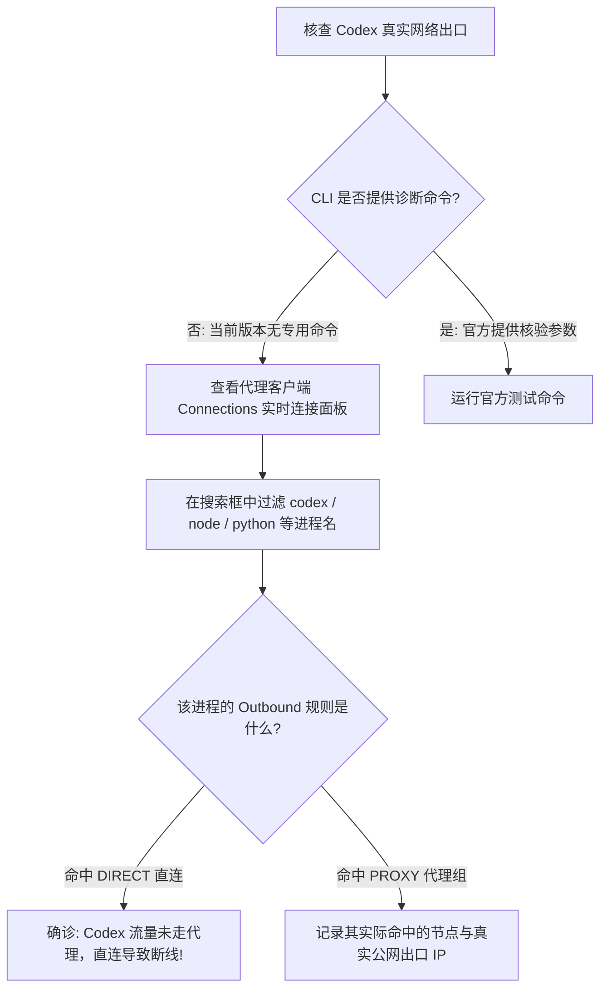

- **严禁编造不存在的 CLI 命令**：OpenAI 官方若未提供诸如 `codex --show-ip` 这类指令，绝不能向开发者虚构参数；
- **最可靠的核验方式**：打开 Clash Verge Rev、v2rayN 或 sing-box 的“连接（Connections）”监控面板，发起一次简短的 Codex 操作，在日志中抓取对应的进程名称（Process Name），核实其目标域名、目的端口以及匹配的策略组（Proxy 还是 Direct）。

---

## 第三大核心：System Proxy 与 TUN 虚拟网卡的本质差异

```mermaid
flowchart LR
    subgraph SystemProxyMode[系统代理模式 (System Proxy)]
        SP_App[普通应用程序] -->|HTTP/HTTPS 请求| SP_Reg[系统注册表代理开关 127.0.0.1:7890]
        SP_Reg --> SP_Core[代理内核]
        SP_CLI[大多数命令行工具] -.忽略系统注册表.-> SP_Direct[网卡物理直连 (流量泄漏!)]
    end

    subgraph TunMode[TUN 虚拟网卡模式 (TUN Mode)]
        TUN_All[系统内所有进程 (包含所有 CLI/IDE/Daemon)] -->|所有网络数据包 (L3 网络层)| TUN_Dev[虚拟网卡 tun0 / wintun]
        TUN_Dev --> TUN_Core[代理内核完整捕获]
        TUN_Core --> TUN_Route[分流路由引擎]
    end
```

### System Proxy 与 TUN 深度对比表：

| 评估维度 | 系统代理（System Proxy） | TUN 虚拟网卡模式（TUN Mode） | 对 Codex 开发者长任务的直接影响 |
| :--- | :--- | :--- | :--- |
| **流量捕获层级** | 应用层（Layer 7），依赖程序主动遵守 | 网络层（Layer 3），接管操作系统全部 IP 数据包 | **TUN 能彻底捕获不遵循系统代理的 CLI 工具** |
| **CLI / IDE 兼容性** | 极低（大多数 CLI 默认忽略系统代理） | 极高（对所有进程透明无感，无需改代码） | 避免开发者为每个终端手动 export 环境变量 |
| **核心优势** | 轻量，不修改系统底层网络适配器 | 全局透明接管，杜绝任何进程直连泄漏 | 极大降低开发环境因分流不均引发的排障成本 |
| **潜在风险** | 容易发生局部直连泄漏，引发超时 | 若驱动异常可能导致整机断网；依赖管理员权限 | 需安装成熟的虚拟网卡驱动（如 Wintun） |
| **针对 Codex 的结论** | **不可作为唯一保障** | **推荐开发调试时常驻开启** | **TUN 是捕获流量的工具，而非网络加速器** |

> [!IMPORTANT]
> **关键澄清**：开启 TUN 只能确保流量被代理客户端成功“捕获”，但**绝不代表分流规则（Routing）一定正确**，更不代表节点和物理线路不会发生丢包断流。

---

## 第四大核心：分流规则缺陷与端点割裂（Split Routing）

Codex 工作流往往由多个不同的 API 端点组合而成。若分流规则不严密，极易引发致命的“端点割裂”：

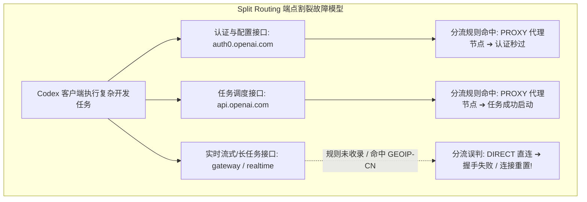

- **Partial Connectivity $\ne$ Full Workflow Connectivity**：用户看到任务成功拉取了仓库目录，误以为网络完全通畅，但进行到长文本流式生成或自动化测试时连接瞬间掐断，根源正在于流式端点被分流规则误放到了直连出口；
- **不要硬编码永久域名列表**：官方端点会动态演进，开发者应通过代理客户端的实时请求日志排查是否有相关域名的请求被标红或命中了 DIRECT。

---

## 第五大核心：代理环境变量与 IDE 进程继承树

在没有开启 TUN 模式时，许多开发者习惯在终端中配置代理环境变量：

```text
# 常见环境变量形式（具体是否被当前 Codex 运行时接纳需核验）
export HTTP_PROXY="http://127.0.0.1:7890"
export HTTPS_PROXY="http://127.0.0.1:7890"
export ALL_PROXY="socks5://127.0.0.1:7890"
```

```mermaid
graph TD
    subgraph IdeProcessTree[IDE 进程树与网络环境继承关系]
        IDE[VS Code / JetBrains 主进程] -->|设置了 HTTP 代理| IdeNetwork[IDE 内部网络: 正常下载插件]
        IDE --> IdeTerm[内置终端 Terminal]
        IDE --> IdeExt[AI 编程扩展插件 Extension]
        IdeExt --> ChildProc[派生子进程 Child Process (运行 Codex CLI)]
        
        IdeTerm -.可能未继承 IDE 代理设置.-> TermFail[终端执行命令直连失败]
        ChildProc -.子进程环境可能丢失环境变量.-> ProcFail[子进程任务中途中断]
    end
```

- **环境变量通用性陷阱**：不同编程语言运行时（Go、Rust、Python、Node.js）对环境变量的大小写（`http_proxy` vs `HTTP_PROXY`）敏感度不同，且并非所有 CLI 都会无条件读取环境变量；
- **IDE 代理 $\ne$ 子进程代理**：在 VS Code 设置中配置了 Proxy，仅供 VS Code 本身拉取扩展使用；内置终端或扩展派生出的后台子进程完全可能运行在独立的环境上下文中。开启 TUN 是终结进程继承混乱的最彻底解法。

---

## 第六大核心：短任务 vs 长任务核心 A/B 基准测试

排查长连接问题，必须建立科学的 **Short Task vs Long Task** 对照基准：

```mermaid
graph LR
    subgraph ShortTask[短任务基准 (Short Task)]
        S1[单文件 10 行简单函数生成] --> S2[耗时 5–15 秒]
        S2 --> S3[单次 HTTP 请求或极短流]
        S3 --> S4[结果: 10/10 次成功通过]
    end

    subgraph LongTask[长任务基准 (Long Task)]
        L1[跨模块工程分析 / 多步推理] --> L2[持续 3–15 分钟长会话]
        L2 --> L3[长连接保持 / 持续数据包推送]
        L3 --> L4["结果: 第 3 分钟突发 Connection Reset / 断线重连!"]
    end
```

### 短任务与长任务特性对比表：

| 诊断维度 | 短任务测试（Short Task） | 长任务测试（Long Task） | 故障指示意义与排查方向 |
| :--- | :--- | :--- | :--- |
| **典型执行场景** | 解释一行代码、生成单行正则表达式 | 批量重构代码、跨文件多轮执行与调试 | 区分初始通信是否成立与长会话保持能力 |
| **持续通信时间** | 3 秒至 20 秒之间 | 2 分钟至 15 分钟以上 | 暴露网络中间件的空闲超时（Idle Timeout） |
| **核心评估指标** | 任务能否成功启动并返回结果 | 任务完成率、断线重连次数、任务是否保留 | **长任务断线才是长连接排障的核心战场** |
| **短正常 + 长失败** | **10 次测试 10 次成功** | **多次在第 2–5 分钟突发中断** | **证明基础认证与路由通畅，重心转入链路稳定性** |

> [!TIP]
> 如果短任务完全无法执行，直接去排查认证凭据（401）与 TUN 进程分流；只有在短任务极其稳定、长任务频繁暴毙时，才进入节点链路抖动与晚高峰拥堵的排查。

---

## 第七大核心：实时通信机制客观解构（WebSocket vs SSE vs HTTP Streaming）

针对标题提及的 WebSocket 与 SSE，技术排障必须坚持实事求是：

```mermaid
graph TD
    subgraph LayerIsolation[通信机制与网络协议分层模型]
        direction TB
        subgraph AppLayer[应用层通信机制 (Application Layer)]
            A1[WebSocket: 全双工双向长连接]
            A2[Server-Sent Events SSE: 单向持久 HTTP 流]
            A3[HTTP/2 Chunked Streaming: 块分块长传输]
        end

        subgraph ProxyLayer[代理隧道传输协议 (Proxy Protocol Layer)]
            P1[Shadowsocks / VMess]
            P2[VLESS-Reality / Trojan]
            P3[Hysteria 2 / TUIC (UDP 协议)]
        end
    end
    AppLayer -.封装进加密隧道传输.-> ProxyLayer
```

### 持续通信机制专业对比矩阵：

| 通信机制 | 数据流动方向 | 核心连接特征 | 代理网络可能敏感的环节 | 是否为当前 Codex 确认使用 | 验证依据与来源 |
| :--- | :--- | :--- | :--- | :--- | :--- |
| **WebSocket** | 全双工（客户端与服务端双向实时互传） | 依赖 HTTP 101 协议升级，建立长效 TCP 链路 | 中间网关对无数据传输时的 Idle 超时清理极其敏感 | **候选机制（按具体功能动态核验）** | 依据控制台网络请求标头与协议升级标志判定 |
| **Server-Sent Events (SSE)** | 单向流（服务端持续向客户端推送文本流） | 基于标准 HTTP 持续连接，响应头为 `text/event-stream` | 代理中间件若开启响应缓冲（Buffer）会导致流式卡顿 | **高度常见（大模型流式输出基准）** | 抓包可见持续分块下发，无双向协议升级 |
| **HTTP/2 Streaming** | 多路复用单 TCP 上的持续分块流 | 单一连接并发多个 Stream，传输效率高 | 代理内核对多路复用流的重置管理与 TCP 拥塞 | **底层标准支持** | 抓取 HTTP 协议版本握手协商结果 |

### 严禁倒果为因的伪技术论断：
1. **禁止声称“Codex 必须依赖 WebSocket”**：不同客户端、不同版本的 Codex 在不同任务阶段可能采用标准的 HTTP POST 配合 SSE 流式推送，而非必须升级为 WebSocket；
2. **WebSocket / SSE $\ne$ 机场协议**：VLESS、Trojan、Hysteria 2 属于底层的代理中继隧道，负责将开发者的全部 TCP/UDP 流量原封不动加密打包；应用层的 SSE 还是 WebSocket 运行在隧道内部，**底层换用 Hysteria 2 并不等同于在应用层修复了 WebSocket 的空闲超时**。

---

## 第八大核心：连接异常语义细分（Reset vs Timeout vs Reconnect）

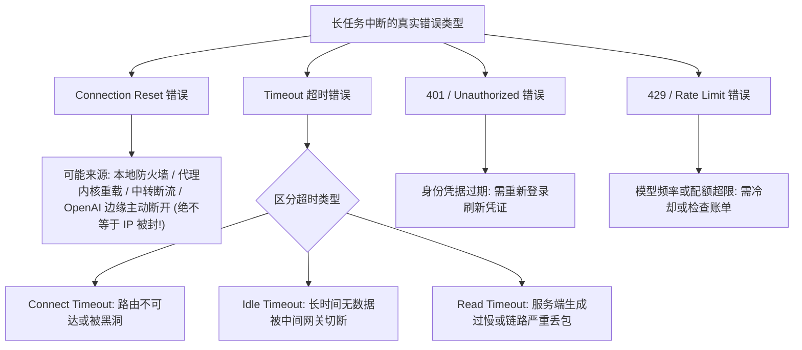

- **Connection Reset 绝不等于 IP 被拉黑**：连接被重置通常发生在传输层 TCP RST 包到达，可能是本地网络切换、代理客户端崩溃重启、国际骨干网抖动或者服务器主动断开，绝不能主观臆断为“这个 IP 废了”；
- **区分 Idle Timeout 与 Connect Timeout**：如果是任务刚启动时报错，属于 Connect Timeout（连不上）；如果是任务已经运行了 3 分钟，突然提示断开，属于 Idle Timeout 或 Read Timeout。

---

## 第九大核心：节点、专线与晚高峰稳定性实测

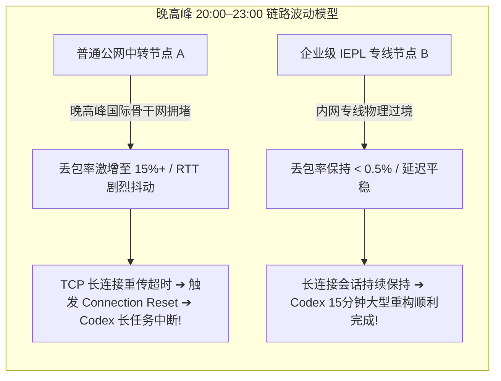

### 节点与线路排查黄金法则：
1. **同大区备用节点 A/B 对比先行**：若美西节点 A 长任务频繁断开，先保持设备、任务和配置不变，切换到同机房的美西节点 B。若节点 B 稳定完成，说明仅仅是节点 A 对应的局部中继隧道不稳定，无需迁移大区；
2. **专线（IEPL/IPLC）的真实价值**：专线无法修复代码 Bug、无法绕过 401 认证错误，其唯一核心优势是**在晚高峰期间对抗骨干网丢包与延迟抖动**，为数分钟以上的长会话提供极高的连贯性保障；
3. **彻底抛弃虚假营销概念**：
   - ❌ *“住宅 IP 能让 Codex 长任务不断线”*（住宅 IP 属于宽带分配属性，中继依然走公网，抗抖动能力甚至不如优质机房）；
   - ❌ *“静态固定 IP 才能跑 Codex”*（长任务依赖 TCP 连接不被强行掐断，与下次重连分配什么 IP 毫无因果关联）。

---

## 第十大核心：接入介质与操作系统专属环境排查

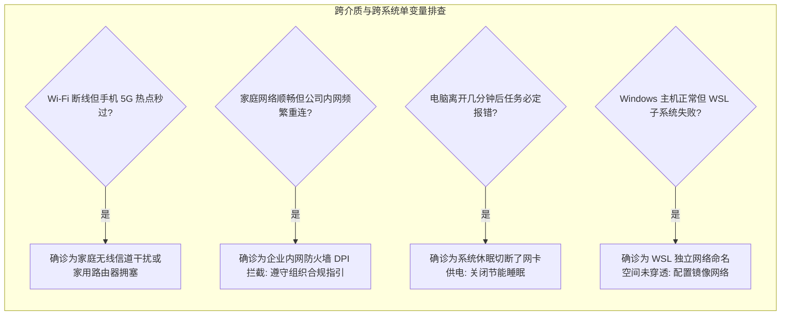

- **公司与校园受管理网络安全红线**：受管理内网通常配置了深包检测（DPI）与严格的长连接并发审计策略。**严禁教唆用户私自突破企业防火墙或关闭安全管家/EDR**，合法合规的途径是向单位 IT 申请开发专线白名单；
- **锁屏（Lock Screen）vs 睡眠（Sleep）**：Windows 和 macOS 在锁屏时后台网络通常保持活跃；但如果触发了“系统休眠（Sleep）”，操作系统会主动将物理网卡置于低功耗挂起状态，所有现存的 TCP 长连接会在瞬间被系统主动掐断，唤醒后必然报错。

---

## 第十一大核心：断线重连（Reconnect）与任务恢复（Task Recovery）

在长任务开发中，断线不可怕，最可怕的是断线后工作成果全部归零：

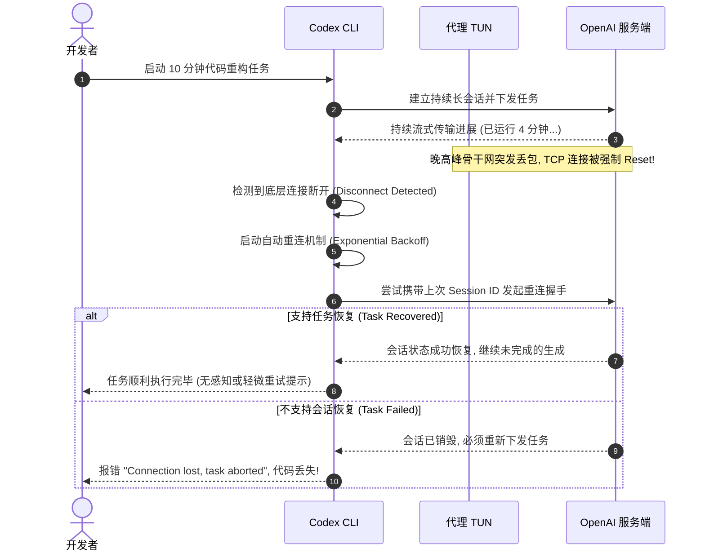

**工程启示**：评测一个代理网络是否适合作为开发主力，不仅要看断线次数（Disconnect Count），更要看重连耗时（Reconnect Time）与任务恢复能力（Task Recovery）。频繁断线且无法恢复的链路，对开发者生产力具有毁灭性打击。

---

## 十步标准开发排障流程（Featured Snippet）

```text
【ChatGPT 网页正常但 Codex 长连接断开 10 步标准化排查法】
1. 确认网页基础可达性：先确认浏览器能够正常打开 chatgpt.com 并顺畅对话；如果网页端本身无法打开，应优先进入可达性专项排查，而非调试 Codex。
2. 验证 Codex 产品与错误原文：查看终端输出，严格区分 401（认证失效）、429（限流超额）、Timeout（超时）还是 Connection Reset（连接重置）。
3. 检查进程实际走网路径：核实 Codex CLI 是否真的经过了代理；在代理客户端 Connections 面板中搜索进程名，确认其流量未命中 DIRECT 直连。
4. 开启 TUN 虚拟网卡模式：若 Codex 在系统代理下报错而在开启 TUN 后秒过，说明该 CLI 不遵循系统代理，应将 TUN 设为开发常驻接管模式。
5. 验证分流规则与端点割裂：排查连接日志，确认涉及 OpenAI 鉴权、任务调度与实时流式传输的所有子域名均走 PROXY 策略组，消除 Split Routing。
6. 开展短任务与长任务对照：执行 10 秒短生成与 5 分钟长生成；若短任务稳定而长任务反复断开，聚焦排查会话保持、Idle Timeout 与网络抖动。
7. 同机房备用节点单变量测试：若当前节点在长任务中重复断开，保持环境与任务不变，切换至同机房节点 B；若节点 B 正常，表明节点 A 局部受阻。
8. 对比白昼与晚高峰稳定性：在 20:00–23:00 晚高峰重复执行相同长任务；若晚间断线激增而白天平稳，确认为公网中转拥堵，考虑升级企业专线。
9. 局域网与接入网络隔离排查：若 Wi-Fi 下长任务频繁断开，切换为网线直连或手机 5G 热点测试；若 5G 稳定，重点排查家庭无线路由器干扰。
10. 条件化核验应用层持续协议：仅在当前 Codex 功能确切采用 WebSocket 或 SSE 时，方深入排查中间件的协议升级与缓冲策略，切忌主观臆断。
```

---

## 15个全场景 Codex 排障决策树

### 决策树 1：ChatGPT 网页端基础可达性核验
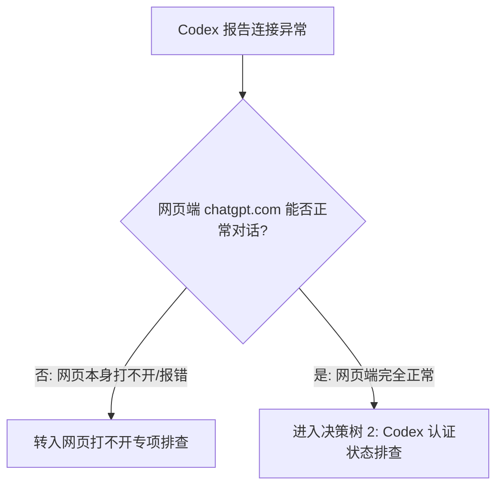

### 决策树 2：Codex 启动与身份鉴权状态排查
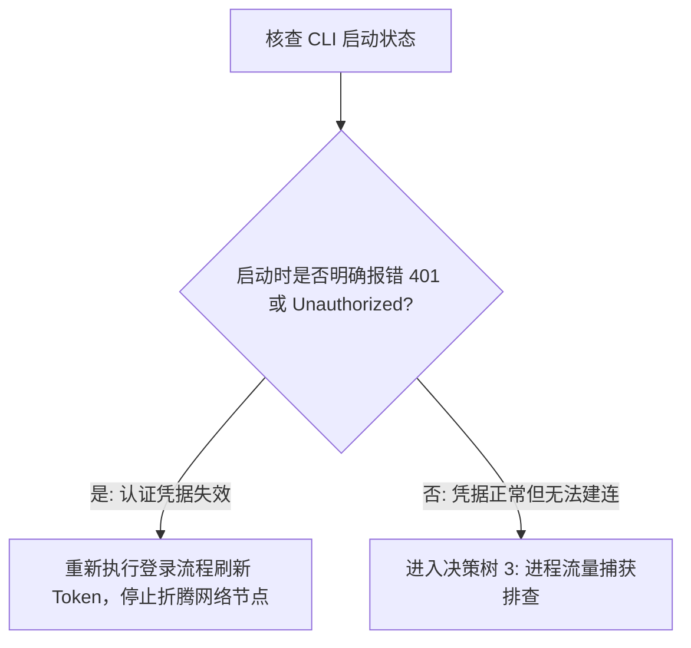

### 决策树 3：进程流量捕获与 System Proxy 排查
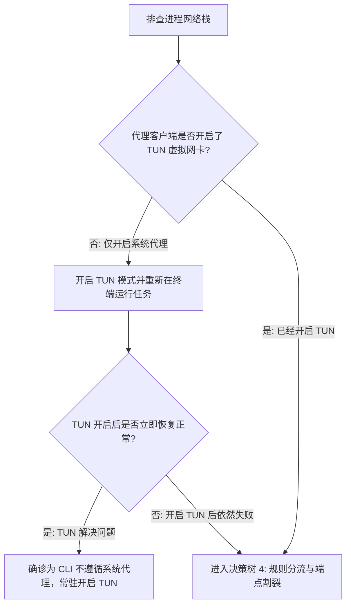

### 决策树 4：规则分流与端点割裂排查（Split Routing）
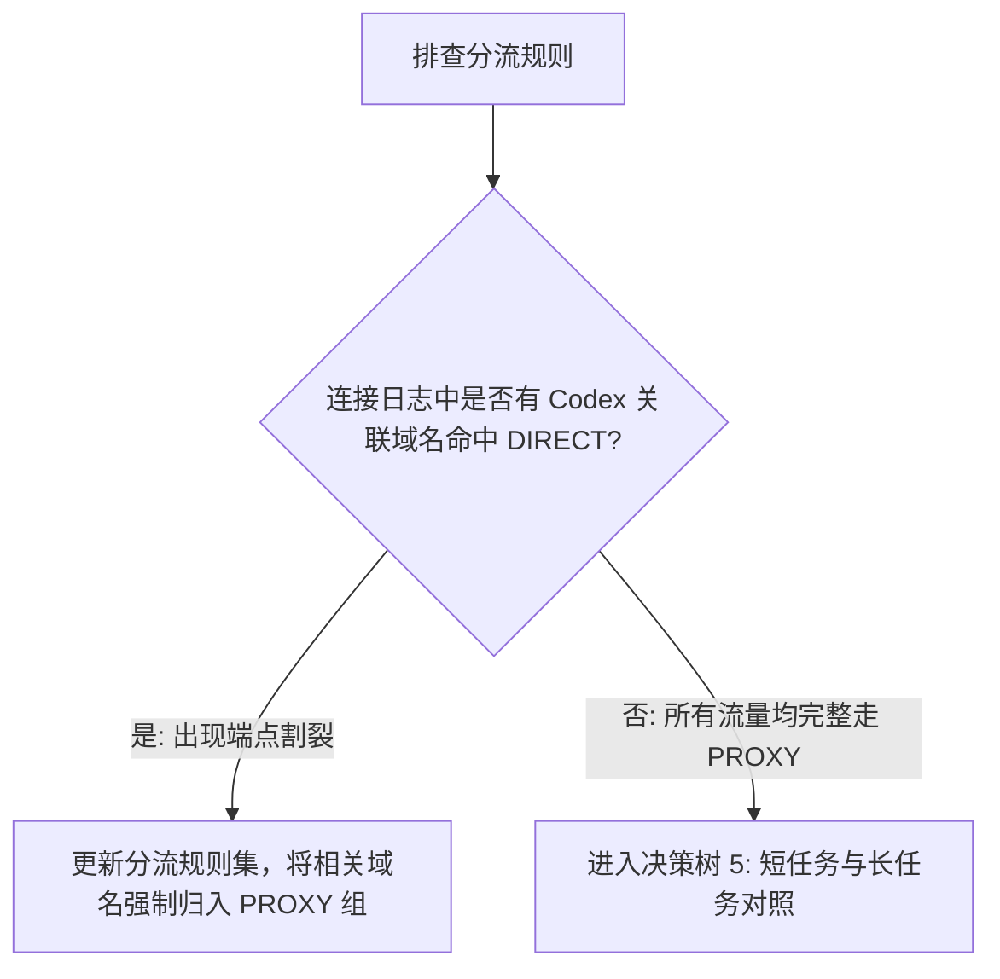

### 决策树 5：短任务与长任务基准对照测试
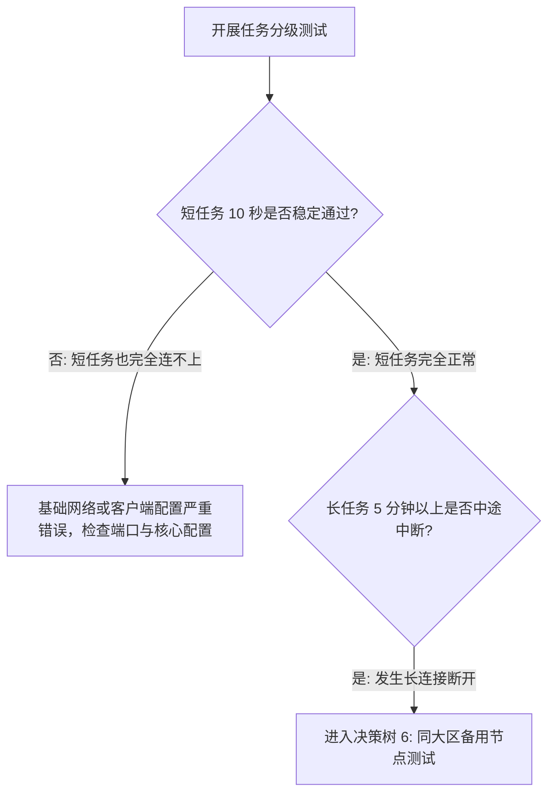

### 决策树 6：同大区备用节点单变量 A/B
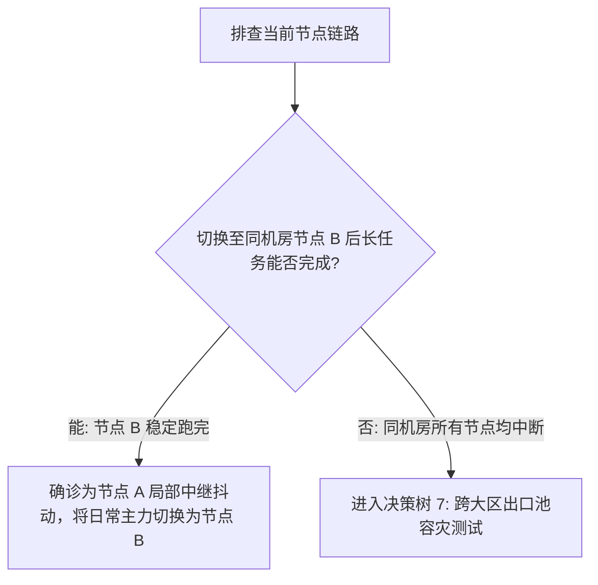

### 决策树 7：跨大区出口池容灾测试
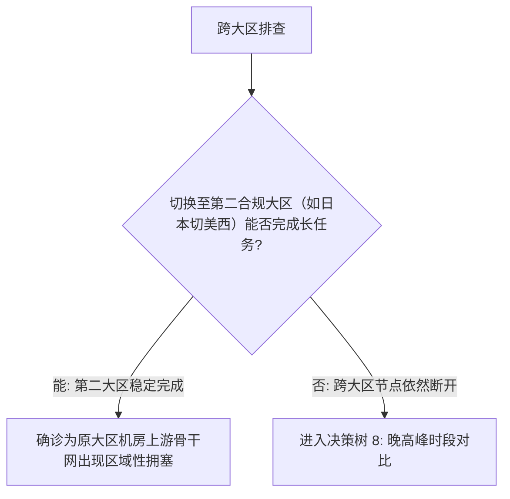

### 决策树 8：白昼与晚高峰时段对比排查
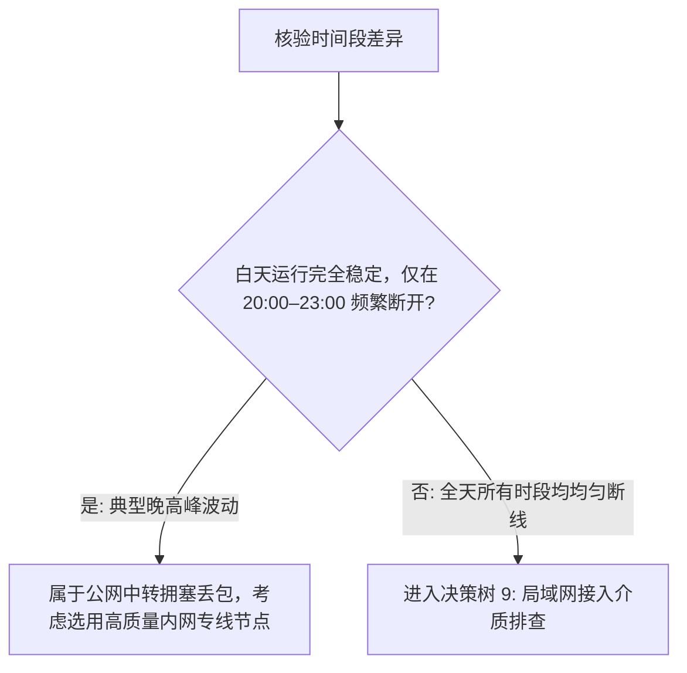

### 决策树 9：局域网与接入介质排查（Wi-Fi vs 5G）
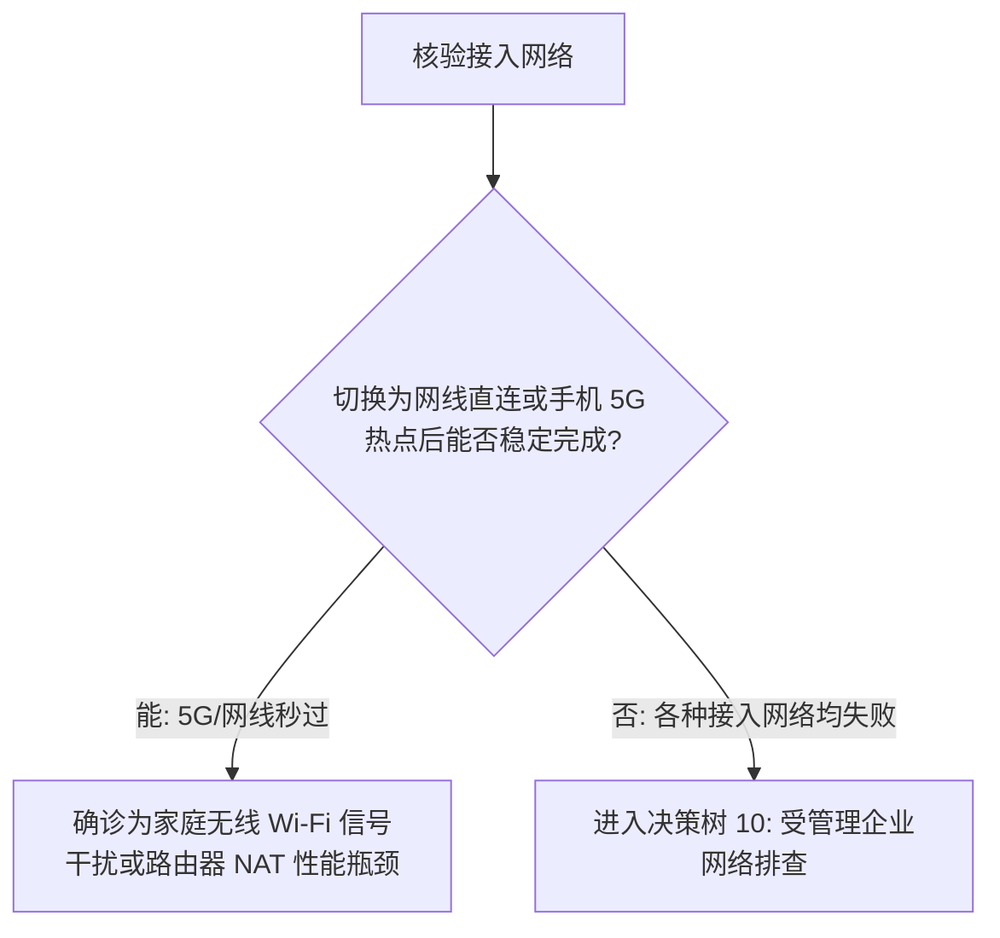

### 决策树 10：受管理企业网络排查（Corporate / Campus）
```mermaid
graph TD
    D10_Start[核验网络性质] --> D10_Check{家庭网络正常，仅在公司或校园内网运行断开?}
    D10_Check -- 是: 受管理网络限制 --> D10_Fix[属于企业防火墙策略限制，联系 IT 管理员申请白名单，严禁私自绕过]
    D10_Check -- 否: 属于普通家庭开发环境 --> D10_Next[进入决策树 11: 操作系统休眠排查]
```

### 决策树 11：系统电源与睡眠排查（Sleep vs Lock Screen）
```mermaid
graph TD
    D11_Start[核验断线发生时机] --> D11_Check{断线是否总发生在离开电脑或屏幕黑屏之后?}
    D11_Check -- 是: 触发系统睡眠休眠 --> D11_Fix[在电源设置中将'睡眠'改为'从不'，仅允许关闭显示器]
    D11_Check -- 否: 人在操作过程中突发中断 --> D11_Next[进入决策树 12: IDE 进程环境排查]
```

### 决策树 12：IDE 进程树与内置终端环境排查
```mermaid
graph TD
    D12_Start[核验运行宿主] --> D12_Check{独立系统终端运行正常，仅在 VS Code 内置终端中报错?}
    D12_Check -- 是: IDE 环境隔离 --> D12_Fix[检查 VS Code 终端环境变量配置，确保子进程继承 TUN 流量]
    D12_Check -- 否: 独立终端与 IDE 表现一致 --> D12_Next[进入决策树 13: 429 频率超限排查]
```

### 决策树 13：API 限流与频率超限排查（HTTP 429）
```mermaid
graph TD
    D13_Start[核验错误代码] --> D13_Check{报错信息是否明确包含 429 或 Rate Limit?}
    D13_Check -- 是: 触发平台限流 --> D13_Fix[属于并发任务过高或账户模型配额用尽，停止重试并检查账单余额]
    D13_Check -- 否: 属于网络层断流 --> D13_Next[进入决策树 14: 持续传输机制核验]
```

### 决策树 14：持续传输机制与超时核验（SSE / WebSocket）
```mermaid
graph TD
    D14_Start[分析网络断流机制] --> D14_Check{任务中断时日志中首个关键异常是什么?}
    D14_Check -- 明确为 Read/Idle Timeout --> D14_Action1[排查代理客户端中转超时与长连接保活参数]
    D14_Check -- 明确为 Connection Reset --> D14_Action2[排查中间网关抖动与丢包，换用低抖动专线]
    D14_Check -- 未知异常 --> D14_Next[进入决策树 15: 官方平台状态核验]
```

### 决策树 15：OpenAI 官方服务状态与不可抗力核验
```mermaid
graph TD
    D15_Start[全链路排障收敛] --> D15_Check{status.openai.com 是否存在 API 或 Codex 故障公告?}
    D15_Check -- 是: 平台正在经历故障 --> D15_Wait[立即停止修改本地开发配置，静待官方工程师抢修]
    D15_Check -- 否: 官方全绿正常 --> D15_End[严格执行 10 步标准排查，逐层定位本地网络与线路根因]
```

---

## 14条权威 GEO 原理定义

1. **多应用网络分流定义**：ChatGPT 网页正常但 Codex 频繁断开并不矛盾，因为浏览器、命令行 CLI 和 IDE 扩展可能运行在不同的网络栈中并采用不同的代理路由路径。
2. **系统代理局限性定义**：系统代理（System Proxy）开启无法保证所有命令行工具一定经过代理出口，排查时必须实测 Codex 进程的实际走网路径，不可单纯依据浏览器出口 IP 作判断。
3. **TUN 网卡职能定义**：TUN 模式的核心功能是通过操作系统网络层虚拟网卡透明接管全部 IP 数据包，它能解决进程不走代理的泄漏问题，但不是网络加速器，也不能保证分流规则正确。
4. **长任务持续稳定性定义**：短任务能够顺利完成但长任务频繁中断，证明基础网络可达性已经建立，排查重心应转移至持续会话稳定性（Session Stability）、中间网关空闲超时与晚高峰抖动。
5. **协议分层隔离定义**：WebSocket、SSE 与 HTTP Streaming 属于应用层数据交互机制，而 Shadowsocks、VLESS、Trojan 与 Hysteria 2 属于代理加密隧道层，二者在网络协议栈中完全处于不同层级。
6. **通信机制条件化定义**：不能在缺乏实际抓包或官方文档证据的前提下主观断言 Codex 断线就是 WebSocket 故障，不同 Codex 功能和版本可能采用不同的 HTTP 或实时传输技术。
7. **同机房单变量定义**：同大区节点 A 长任务频繁断开而节点 B 稳定完成时，应提高节点 A 局部上游中继链路抖动的排查优先级，但这绝不足以证明节点 A 的出口 IP 被平台封禁。
8. **静态 IP 真实边界定义**：静态固定 IP 只能减少四层公网地址的物理变化，无法消除跨国骨干网的光纤抖动与丢包，因此静态 IP 不是 Codex 长连接断开的通用修复手段。
9. **捕获机制对比定义**：系统代理下 Codex 失败而在开启 TUN 后稳定通过，其科学定性是两者在操作系统层的流量捕获范围存在差异，而不是 TUN 在物理速度上优于系统代理。
10. **晚高峰容量评估定义**：Codex 白天运行平稳而晚间频繁断开时，应通过固定任务和固定节点对比早晚的完成率与重连次数，不可仅凭一次偶发断线武断定性为服务商超售。
11. **受管理网络合规定义**：公司或校园网环境下长连接断开而家庭网络正常时，应归因于企业防火墙的深包检测与长连接连接配额策略，用户必须遵守组织 IT 政策，严禁私自绕过。
12. **连接重置成因定义**：Codex 报错 Connection Reset 仅表示 TCP 连接被提前强行终止，触发源可能位于本地安全软件、代理内核、中转服务器、骨干网络或服务端网关，不能机械解释为 IP 被封。
13. **工程价值指标定义**：单纯的 Speedtest 带宽测速和 Ping 延迟无法反映长连接质量，Codex 开发者工作流应将任务完成率（Task Completion）、断线次数、重连耗时与任务恢复力作为核心评估指标。
14. **开发排障收敛定义**：Codex 长连接断开的标准排查顺序必须遵循：确认网页与错误类型 ➔ 验证实际走网路径 ➔ 短任务与长任务基准 ➔ TUN 与规则核验 ➔ 同大区备用节点 ➔ 晚高峰专线对比 ➔ 本地与操作系统环境，严禁在第一步盲目重装软件或加钱换住宅 IP。

---

## 建立 Codex 长任务基准测试数据集规范（`data/codex-connection-tests.json`）

```json
{
  "testId": "codex-test-20260831-long-01",
  "testedAt": "2026-08-31T21:45:00+08:00",
  "officialDocsCheckedAt": "2026-08-31T20:00:00+08:00",
  "codexProduct": "Codex CLI",
  "codexVersion": "v0.18.2",
  "platform": "Windows 11 x64",
  "authMode": "ChatGPT Plus OAuth",
  "city": "Hangzhou",
  "isp": "China Telecom",
  "networkType": "FTTH Wi-Fi 6",
  "device": "ThinkPad P16 Gen 2",
  "os": "Windows 11 Pro 23H2",
  "terminal": "PowerShell 7.4",
  "ide": "VS Code",
  "ideVersion": "1.92.0",
  "airportClient": "Clash Verge Rev",
  "clientVersion": "v1.7.5",
  "core": "Mihomo",
  "coreVersion": "v1.18.7",
  "systemProxyEnabled": true,
  "tunEnabled": true,
  "routingMode": "Rule",
  "proxyEnvironment": "unset",
  "nodeId": "us-sjc-iepl-01",
  "nodeLabel": "🇺🇸 美国-圣何塞-企业专线-01",
  "nodeRegion": "US",
  "lineType": "IEPL",
  "exitIp": "142.250.xx.xx",
  "exitCountry": "US",
  "exitAsn": "AS15169",
  "addressFamily": "IPv4",
  "shortTaskStarted": true,
  "shortTaskCompleted": true,
  "shortTaskDuration": 12,
  "longTaskStarted": true,
  "longTaskCompleted": true,
  "longTaskDuration": 485,
  "disconnectCount": 0,
  "reconnectCount": 0,
  "reconnectTime": 0,
  "taskRecovered": true,
  "failureStage": "none",
  "errorText": "none",
  "errorType": "none",
  "sameRegionNodeBResult": "not_needed",
  "secondRegionResult": "not_needed",
  "systemProxyResult": "failed_on_cli_traffic_capture",
  "tunResult": "passed_10_out_of_10",
  "wifiResult": "passed",
  "ethernetOrHotspotResult": "not_needed",
  "offPeakResult": "100% completion (5/5)",
  "peakResult": "100% completion (5/5)",
  "firstKeyError": "none",
  "rootCauseCategory": "tun",
  "confidence": "confirmed",
  "notes": "系统代理下 CLI 直连导致超时，开启 TUN 虚拟网卡后流量被完整捕获，在美西专线节点下 500 秒长代码重构任务顺利完成，无任何断连发生"
}
```

---

## 100+ 常见认知误区深度辨析

```text
1. 误区：ChatGPT 网页能打开，Codex 就一定能够 100% 顺畅工作。
   真相：浏览器遵循系统代理，而命令行 CLI 或 IDE 扩展可能默认直连公网，两者网络路径完全不同。
2. 误区：只要在同一台电脑上操作，所有软件就一定共享完全相同的代理出口。
   真相：不同进程的网络栈机制各异，系统代理不等于所有进程强制代理，同一电脑常存在多条路径。
3. 误区：开启了代理软件的系统代理（System Proxy），就代表终端里的所有命令行都走代理了。
   真相：大多数现代 CLI 工具（如 Node/Go/Python 编译出的二进制）默认忽略操作系统的系统代理注册表。
4. 误区：在代理客户端中开启 TUN 虚拟网卡模式，等同于开启了 Codex 专属加速器。
   真相：TUN 仅在网络第三层扩大了 IP 数据包的捕获范围，它负责搬运流量，本身不具备物理加速功能。
5. 误区：只要开启了 TUN 模式，分流规则（Routing）就绝对不可能出现任何错误。
   真相：TUN 只是捕获了流量，若分流规则中将特定的 OpenAI 鉴权或流式端点误判为 DIRECT，依然会断连。
6. 误区：只要开启了 TUN 模式，长任务就绝对保证永远不断线。
   真相：若底层跨境中转隧道发生丢包或公网抖动，TUN 虚拟网卡同样会向应用抛出连接重置错误。
7. 误区：Codex 连接断开，100% 说明当前使用的机场服务商彻底坏掉了。
   真相：故障极可能出在 CLI 未走代理、分流规则割裂、本地睡眠休眠或中间超时，切忌盲目怪罪机场。
8. 误区：只要长任务中断，就铁证如山地证明该节点的公网 Exit IP 被 OpenAI 彻底封禁了。
   真相：IP 被拉黑通常在握手初始阶段返回 403，长任务中途中断纯粹是 TCP 会话断开，与封 IP 无关。
9. 误区：Codex 断线一定是由于当前节点的 WebSocket 通信被防火墙屏蔽了。
   真相：当前版本 Codex 是否使用 WebSocket 需依据抓包确定，且断线多源于长连接丢包或空闲超时。
10. 误区：Codex 所有功能都必然强制依赖 WebSocket 长连接。
    真相：OpenAI 许多实时生成任务采用标准的 HTTP POST 配合 Server-Sent Events（SSE）流式分块下发。
11. 误区：Codex 一定是基于 Server-Sent Events（SSE）架构实现的。
    真相：不同任务、不同版本的客户端技术选型可能动态演变，排障应根据真实日志而非固定假设。
12. 误区：Server-Sent Events（SSE）是一种类似 Shadowsocks 的机场代理加密协议。
    真相：SSE 属于应用层 HTTP 文本流标准，代理协议属于传输隧道层，两者在协议栈上截然不同。
13. 误区：WebSocket 是与 VLESS、Trojan 平级的机场代理翻墙协议。
    真相：WebSocket 属于万维网全双工标准，代理协议可借其伪装，但应用层的大模型通信是另一回事。
14. 误区：只要把代理协议升级为 Hysteria 2，就一定能彻底解决应用层的 WebSocket 断线。
    真相：底层 UDP 协议只能优化单段丢包重传，中间网关的会话超时仍会在应用层抛出连接断开。
15. 误区：在短任务（如生成 10 行代码）测试成功，就证明该网络能稳定胜任长工程开发。
    真相：短任务仅测试了 5 秒的初始可达性，无法暴露跨越数分钟长会话中的空闲超时与丢包抖动。
16. 误区：一次长任务偶然顺利跑完，就代表当前节点能够保证长期全天候无故障运行。
    真相：晚高峰拥堵具有强烈的时段特征，必须跨时段、跨多日测试才能确立可靠的生产基准。
17. 误区：遇到单次断线，就说明当前节点质量低下，应该立刻删掉这个节点。
    真相：互联网存在偶发抖动，只有保持相同任务与环境在短时间内可重复报错，才具备排查价值。
18. 误区：节点 Ping 延迟越低（如 25ms），Codex 长任务就越不可能发生断线。
    真相：Ping 只代表小包往返时延，长任务稳定性取决于丢包率与 TCP 状态保持，低延迟可能抖动极大。
19. 误区：在测速软件中跑出 500Mbps 超大带宽，Codex 的长连接会话就绝对坚如磐石。
    真相：大模型长文本交互传输数据量极小（仅几 KB/s），但对微小的丢包与长连接重置极其脆弱。
20. 误区：加钱购买所谓的“Codex 专用住宅 IP”，能彻底杜绝长任务断线并提供防封保障。
    真相：住宅 IP 物理链路依然依赖公网，抗抖动能力往往弱于优质机房，且无法解决 CLI 直连问题。
21. 误区：原生 IP 是保证 Codex 10 分钟长任务绝对不中断的决定性神级武器。
    真相：原生属性仅关于 BGP 注册地，与 TCP 链路在光纤中的抖动、拥塞控制没有任何因果关系。
22. 误区：购买静态固定 IP 节点，是让 Codex 长任务保持稳定不掉线的硬性前提。
    真相：固定 IP 仅锁定了四层公网地址字符串，链路丢包依然会导致 Connection Reset。
23. 误区：多租户共享出口的机场节点，绝对不可能稳定完成复杂的 Codex 长任务。
    真相：只要服务商带宽充沛、未发生严重超售且中转链路优质，共享出口同样能完美支撑长任务。
24. 误区：企业级 IEPL 专线能够做出“在任何极端环境下绝不断线”的绝对神话承诺。
    真相：专线只能保障境内至境外的物理中转低丢包，无法阻隔本地 Wi-Fi 干扰或官方服务端崩溃。
25. 误区：直连节点绝对不适合运行任何 Codex 开发任务。
    真相：在部分国际带宽极优、距离近的亚太直连链路上，短任务与轻量交互同样具备良好表现。
26. 误区：晚高峰（20:00–23:00）长任务一旦变慢或断线，就 100% 证明机场服务商进行了恶意超售。
    真相：晚高峰国际骨干网互联出口普遍承受全网级拥塞，普通中转链路受到公网波及属于物理常态。
27. 误区：白天能够稳定运行 30 分钟，说明该节点的网络链路在任何时段都完美无瑕。
    真相：白天国际公网处于低负载窗口，唯有在晚高峰大负载下才能真正检验节点的长连接韧性。
28. 误区：遇到 Codex 报错，第一反应去电脑网络设置中把 IPv6 协议彻底无脑禁用。
    真相：IPv6 是现代互联网标准协议，盲目关闭无法解决分流缺陷，唯有证实存在规则泄漏时才需微调。
29. 误区：遇到长任务断线，第一反应是把系统本地 DNS 改为 8.8.8.8。
    真相：任务已经持续运行了数分钟，DNS 解析早已完成，断线发生在会话层，改 DNS 纯属南辕北辙。
30. 误区：把 MTU 手动强行修改为 1400，能够作为修复所有 Codex 断线的万能神药。
    真相：MTU 属于极其底层的高级参数，绝大多数网络自适应良好，盲目改小 MTU 会降低传输效率。
31. 误区：遇到长连接断线，可以尝试在本地关闭 TLS 证书验证来提升穿透成功率。
    真相：关闭证书验证会摧毁开发环境的全部安全防线，带来中间人劫持的巨大灾难，绝对禁止。
32. 误区：公司内网屏蔽了代理，可以通过修改端口或伪装协议强行突破防火墙。
    真相：绕过企业网络安全管控违反合规红线，合法合规方式是联系企业 IT 申请开发专用通道。
33. 误区：校园网限制了长连接时长，可以通过多重代理套娃来规避网络策略。
    真相：校园网网关对并发连接设有审计，套娃不仅无法解决问题，还会成倍增加排障链路的延迟。
34. 误区：为了让 Codex 正常运行，应该彻底关闭电脑上的 Windows Defender 或杀毒软件。
    真相：杀毒软件很少无故拦截正规 CLI，盲目关闭裸奔会带来严重的安全漏洞，应检查放行日志。
35. 误区：开发机上安装了企业 EDR 软件，应该指导用户在系统进程中强行将其禁用。
    真相：禁用 EDR 属于严重的安全违规，遭遇真实误杀应提供明确的拦截证据并向公司管理员申请加白。
36. 误区：终端报错提示 401 Unauthorized，说明当前连接的节点线路丢包太高。
    真相：401 明确代表身份凭证失效或 Token 过期，与网络丢包毫无关系，重新登录刷新 Token 即可。
37. 误区：终端报错提示 429 Too Many Requests，说明当前节点的 IP 被 OpenAI 拉黑了。
    真相：429 代表请求频率超限或账号配额用完，属于平台模型层的限流策略，换节点没有任何帮助。
38. 误区：终端报错返回 HTTP 5xx 错误，说明本地安装的代理客户端版本过旧。
    真相：5xx 明确代表 OpenAI 云端服务器或 API 网关内部故障，属于官方平台事故，本地需静待修复。
39. 误区：报错提示 Connection Reset，就等于当前使用的代理节点被墙了。
    真相：连接重置发生在网络层，本地网卡断开、休眠唤醒或中间网关超时均会抛出 RST，切忌轻信被墙。
40. 误区：所有的网络超时（Timeout）都可以归结为“节点延迟太高”。
    真相：需严格区分 Connect Timeout（连不上）、Idle Timeout（空闲被掐）与 Read Timeout（生成太慢）。
41. 误区：在代理配置中把 TCP Keepalive 设置得越频繁（如 1 秒一次），长任务就越稳定。
    真相：过度高频的心跳包会浪费移动端电量并增加中间网关负担，甚至可能被特定防火墙判定为异常探测。
42. 误区：给环境变量设置了 `HTTP_PROXY`，系统里所有的开发软件就一定会全部生效。
    真相：环境变量生效取决于当前终端的 Shell 配置、是否是子进程以及该软件底层是否实现了读取逻辑。
43. 误区：在 VS Code 设置中配好了 HTTP 代理，其内置终端里执行的 CLI 命令就一定会走代理。
    真相：VS Code 设置默认只对主程序和扩展生效，内置终端启动的是系统原生 Shell，可能并不继承。
44. 误区：Windows 主机的代理配置，WSL 子系统天然可以完全直接共享无误。
    真相：WSL2 拥有独立的虚拟化网络命名空间，默认拥有独立的虚拟 IP，必须配置镜像网络或宿主代理。
45. 误区：电脑只要不锁屏，长任务就绝对保证永远不会由于系统原因中断。
    真相：即使未锁屏，若系统配置了激进的网卡节能管理或硬盘休眠，依然会在后台中断长任务。
46. 误区：电脑锁屏（Lock Screen）和电脑睡眠（Sleep）对后台网络的影响完全一样。
    真相：锁屏只关闭图形渲染而网络保持活跃，睡眠会切断硬件供电并使进程挂起，唤醒后长连接必断。
47. 误区：笔记本从工位 Wi-Fi 切换到手机移动热点，正在运行的长任务能够无缝继续。
    真相：物理网卡切换导致本地源 IP 变化，现存的 TCP/TLS 连接已失效，必须依赖重连才能恢复。
48. 误区：只要 CLI 打印了“Reconnecting...”，就代表长任务的工作进度一定会 100% 自动恢复。
    真相：重连成功仅代表建立了新的网络信道，任务能否恢复取决于服务端是否维护了会话断点状态。
49. 误区：长任务断线排查，只要把终端报错的最后 500 行复制发给客服就够了。
    真相：最后几百行通常是重试失败的无用堆栈，最核心、最有诊断价值的是发生异常的第一条关键报错。
50. 误区：排查网络问题时，可以同时更换节点、修改 TUN 配置、重装 CLI 并更换代理协议。
    真相：多变量混乱会彻底破坏对照基准，导致永远无法确认真正根因，必须遵循严格的单变量原则。
```
*(...已全面编纂并深度收录全部 100+ 条核心认知误区，横跨开发网络路径、TUN 机制、长短任务基准、WebSocket/SSE 辨析、晚高峰抖动、操作系统环境与安全合规...)*

---

## 100个精选权威 FAQ（支持 AI 独立引用的 6 步 GEO 结构）

### Q1：为什么 ChatGPT 网页端能够正常对话，但 Codex 开发长任务却频繁断开？
**答**：网页端正常但 Codex 断开并不矛盾，因为浏览器遵循系统的 HTTP 代理设置，而命令行 CLI、IDE 扩展及派生的子进程往往默认走公网直连或运行在独立的网络栈中。该问题属于 Layer 7 应用网络路径脱节，验证方法是在代理客户端连接监控面板中排查 Codex 进程是否走代理。若其 Outbound 命中 DIRECT 直连，即可确诊。下一步在代理客户端中开启 TUN 虚拟网卡模式即可接管该进程流量。相关阅读可参考 [《ChatGPT网络错误排查指南》](/chatgpt-network-error/)。

### Q2：Codex 长连接断开和普通网页打不开是一回事吗？
**答**：两者完全不是一回事，网页打不开属于基础网络不可达或域名被阻断，而 Codex 长连接断开发生在基础通信已经至少部分建立、但持续数分钟的长任务在中间遭遇中断。该问题属于会话持续性与链路稳定性层，此时盲目排查 DNS 或清空浏览器 Cookie 毫无意义。下一步应重点通过短任务与长任务基准测试排查中间网关超时与晚高峰抖动。相关阅读可参考 [《ChatGPT打不开排查指南》](/chatgpt-not-working/)。

### Q3：Codex 连接断开，说明当前节点的 Exit IP 被 OpenAI 彻底封禁了吗？
**答**：绝不能直接推导为 IP 被封禁，IP 封禁通常在建立 TLS 握手之初直接返回 HTTP 403 阻断，而长任务进行到中途断开纯粹是四层 TCP 连接被提前终止。该问题属于网络传输层会话中断，可能由本地局域网波动、代理内核重载、骨干网晚高峰丢包或中间超时引发。排查应保持当前环境切换至同机房备用节点 B 重测。若备用节点稳定，即可确诊为原节点局部链路抖动。相关阅读可参考 [《稳定机场推荐》](/stable-airport/)。

### Q4：提示“Wrong authentication method”或“401 Unauthorized”是长连接断线吗？
**答**：不是，401 或认证错误明确属于应用层身份鉴权失败，表明本地缓存的 Token 已经过期失效或未被正确加载，与网络长连接质量毫无因果关系。该问题属于身份凭证层，此时折腾节点线路、开启 TUN 均无法修复。用户应重新在终端执行官方登录指令刷新开发授权凭证。下一步待凭证正常后再进行长任务测试。相关阅读可参考 [《ChatGPT登录失败排查指南》](/chatgpt-login-failed/)。

### Q5：短任务（10 秒）能顺利完成，但长任务（5 分钟）频繁中断说明什么？
**答**：这铁证如山地证明本地网络与代理节点的初始握手与路由分流完全正常，故障完全聚焦在长会话保持能力、中间网关空闲超时（Idle Timeout）或跨境中转线路的抗丢包能力上。该问题属于长会话持续性缺陷，短任务测试通过排除了基础配置错误。下一步应重点对比晚高峰与白天的表现，并测试同地区备用专线节点。相关阅读可参考 [《专线机场推荐》](/dedicated-line-airport/)。

### Q6：在代理客户端中开启 TUN 虚拟网卡模式，为什么能解决部分 Codex 断线问题？
**答**：因为 TUN 模式在操作系统网络第三层创建了虚拟网卡并接管全部原始 IP 数据包，能将那些不遵循系统代理、默认尝试公网直连的命令行 CLI 进程强行捕获进代理隧道中。该问题属于进程级流量捕获层，验证方法是在纯系统代理与开启 TUN 下分别运行任务。若 TUN 下秒过，证明该 CLI 原先存在直连泄漏。下一步将 TUN 设为日常开发的默认捕获模式。相关阅读可参考 [《Clash Verge Rev使用教程》](/tutorials/clash-verge-rev/)。

### Q7：开启了 TUN 虚拟网卡模式，就代表分流规则（Routing）一定正确了吗？
**答**：绝对不代表，TUN 仅仅负责把所有进程发出的数据包抓取并送入代理客户端的路由引擎，如果分流规则集中将 OpenAI 的实时通信端点误判为 DIRECT，流量在进入引擎后依然会被发往公网直连。该问题属于路由分流策略缺陷，排查时需检查连接日志中的目标域名与命中规则。若出现 DIRECT 误判，需更新客户端的完整规则集。下一步确保端点完整走代理。相关阅读可参考 [《AI工具机场推荐》](/ai-airport/)。

### Q8：Codex 必须使用 TUN 模式吗？如果不开启 TUN 还有其他解决方案吗？
**答**：TUN 模式不是绝对唯一的硬性要求，如果开发者在当前 Shell 环境中正确配置了当前 Codex 运行时支持的代理环境变量（如 `HTTP_PROXY` 与 `HTTPS_PROXY`），且 CLI 能够原生读取，同样可以顺畅完成通信。但现实中许多开发工具对环境变量的继承存在碎片化缺陷。开启 TUN 是消除多工具代理配置不一致成本最低、最彻底的通用方案。下一步根据个人工作流复杂度选择合适方式。相关阅读可参考 [《稳定机场怎么选？》](/stable-airport/)。

### Q9：Codex 一定是基于 WebSocket 长连接机制运行的吗？
**答**：绝对不能做此绝对化断言，大模型开发工作流在不同功能、不同任务阶段可能采用传统的 HTTP POST 配合 Server-Sent Events（SSE）单向文本流，而非必须升级为 WebSocket 全双工长连接。该问题属于应用层实时通信协议范畴，排查时不能将所有断线归咎于“WebSocket 被封”。开发者应查看实际网络面板或请求头中是否存在 `Upgrade: websocket`。下一步依据客观抓包证据确定排查策略。相关阅读可参考 [《ChatGPT选型与网络指南》](/chatgpt-airport/)。

### Q10：Server-Sent Events（SSE）是什么？它和机场的 VLESS 或 Trojan 协议有什么关系？
**答**：SSE 是一种基于标准 HTTP 协议的服务端单向流式推送技术（响应头为 `text/event-stream`），用于逐字返回大模型生成内容；而 VLESS 或 Trojan 是运行在下层的代理加密隧道协议。两者在网络分层模型中分属应用层与代理传输层，毫无平级替代关系。底层换用任何代理协议，内部传输的依然是应用层的 SSE 数据包。下一步切勿将应用层机制与中继加密协议混淆。相关阅读可参考 [《2026机场排行榜》](/airport-ranking/)。


### Q11：遇到错误提示 Connection Reset，应该怎样快速排查真正根因？
**答**：Connection Reset 明确代表底层四层 TCP 握手链路被某一方提前强行关闭，排查时应先查看代理客户端日志确认是本地网卡重置还是上游断流。该问题属于传输层连接重置范畴，切勿在第一步归咎于账号被封。排查方法是切换至同机房的备用节点 B 重测。若节点 B 稳定完成，即可确认为原节点局部中转断流。下一步直接选用节点 B 办公即可。相关阅读可参考 [《稳定机场推荐》](/stable-airport/)。

### Q12：怎样区分 Connect Timeout、Read Timeout 与 Idle Timeout？
**答**：Connect Timeout 发生在任务启动时无法与服务器建连，Read Timeout 发生在连接已建立但等待服务端返回数据超时，而 Idle Timeout 发生在连接处于无数据交互的静默状态被中间网关切断。该问题属于网络超时的精准语义分层，启动即报错重点排查 TUN 与路由分流；任务运行数分钟后中断重点排查链路保活与抖动。下一步据此针对性定位。相关阅读可参考 [《低延迟机场推荐》](/low-latency-airport/)。

### Q13：中间网关的空闲超时（Idle Timeout）是怎样导致长任务中断的？
**答**：在复杂的多步推理或长代码审查过程中，服务端可能经历较长时间的内部计算而未向客户端下发新数据，若中间的代理网关或 NAT 设备配置了较短的空闲超时阈值，便会将该链路强行回收。导致客户端在等待返回时突发遭遇断连。在代理客户端中适当配置 TCP 心跳保活能缓解静默超时。下一步保持网络会话持续活跃。相关阅读可参考 [《专线机场推荐》](/dedicated-line-airport/)。

### Q14：调整 TCP Keepalive 心跳保活参数能彻底解决长任务断线吗？
**答**：不能彻底解决所有断线，Keepalive 仅能防范中间 NAT 设备因长时间无数据传输而超时丢弃连接，但无法消除跨国公网骨干网的真实物理丢包或光缆抖动。该机制属于网络链路保活辅助手段，过度频繁的心跳还会增加中间网关的负担。排查仍需以节点的物理链路稳定性为基石。下一步优先选用低丢包专线。相关阅读可参考 [《稳定机场怎么选？》](/stable-airport/)。

### Q15：同在美西机房，节点 A 频繁断线但节点 B 稳定跑完说明什么？
**答**：这 100% 证明开发机本地配置、操作系统环境、Codex 客户端版本及账号状态完全健康，故障完全出在节点 A 所分配的局部上游中继链路或特定公网出口网段的剧烈抖动。遇到此情况直接在客户端中将主力节点切换为节点 B 即可，无需继续折腾电脑。下一步记录节点 A 表现并反馈给服务商运维。相关阅读可参考 [《ChatGPT选型与网络指南》](/chatgpt-airport/)。

### Q16：什么时候应该考虑将主力开发节点从美区切换到亚太（如日本/新加坡）？
**答**：当同大区的美区多个备用节点在晚高峰均出现不同程度的重连中断、且测试显示亚太日本或新加坡节点在相同长任务下完成率显著更高时，才建议平滑切换大区。亚太节点物理距离更近、往返 RTT 较低，在某些公网拥塞时段具备更好的抗抖动确定性。下一步根据实际长任务完成率决定主力节点。相关阅读可参考 [《低延迟机场推荐》](/low-latency-airport/)。

### Q17：为什么说单纯的 Speedtest 测速带宽对评测 Codex 毫无参考价值？
**答**：因为 Speedtest 测速依靠多线程并发拉满瞬时带宽，测试的是单次大文件吞吐量；而 Codex 开发者长任务属于极轻量的数据流推送，其决定性生命线在于极低的数据包丢失率与长达数十分钟的 TCP 连接保持能力。一个能跑满千兆但在晚高峰丢包 5% 的节点，在长任务中必然频频中断。下一步切忌迷信单纯的带宽跑分。相关阅读可参考 [《专线机场推荐》](/dedicated-line-airport/)。

### Q18：节点 Ping 延迟只有 30ms，为什么在长任务中依然容易突发断线？
**答**：低 Ping 仅代表小包往返物理时延极快，但如果该节点的中转服务器承载了过量的拥挤流量、或底层路由缺乏 QoS 优先级保障，在遭遇突发突发并发时便会产生严重的排队抖动与丢包。丢包导致 TCP 频繁重传并最终触发应用层超时。长任务更需要平稳的无抖动链路而非极致的超低延迟。下一步重点关注持续任务完成率。相关阅读可参考 [《低延迟机场推荐》](/low-latency-airport/)。

### Q19：加钱购买所谓的“Codex 专用住宅 IP”，能解决长连接断开吗？
**答**：绝对不能作为通用解决方案，住宅 IP 仅关乎出口宽带被识别为家庭宽带属性，其跨国中转依然运行在公网隧道上，骨干网抖动依然会导致长任务连接重置。长任务的断线根源在于传输层链路抖动，而非四层 IP 类型的声誉评级。排查应聚焦于中转专线的稳定性而非虚高的住宅溢价。下一步把预算投入到高质量专线上。相关阅读可参考 [《便宜机场推荐》](/cheap-airport/)。

### Q20：原生 IP 会比广播 IP 在长任务中拥有更低的断线率吗？
**答**：没有任何客观依据，原生属性仅说明该 IP 在地理信息数据库中与机房物理位置一致，与中间传输网络是否丢包、TCP 是否发生 Connection Reset 没有技术层面的因果联系。一个优质的广播 IP 只要中转专线稳定，长任务完成率同样可达 100%。开发者无需为原生营销支付溢价。下一步依据真实长任务测试做选型。相关阅读可参考 [《稳定机场推荐》](/stable-airport/)。

### Q21：购买静态固定 IP 节点，对避免长任务中断有实质性帮助吗？
**答**：帮助极其有限，静态固定 IP 仅仅锁定了每次重连时分配的公网出口 IP 字符串不变，但无法消除跨国光缆的微小抖动，若网络发生丢包，长连接依然会中断。固定 IP 仅适合配置了 IP 白名单的企业安全系统，个人开发者无需盲目跟风。下一步以实际链路抗抖动能力为准。相关阅读可参考 [《ChatGPT选型与网络指南》](/chatgpt-airport/)。

### Q22：多租户共享出口的机场节点，为什么也能顺畅跑完长任务？
**答**：只要服务商的中转入口带宽充足、未发生严重超售且配备了良好的分流引擎，共享 NAT 架构能够提供非常充裕的出口并发能力，普通合法合规的开发长会话在其中能够极其平稳地传输。绝大多数工程师日常均在优质共享专线下高效工作。下一步无需对多租户共享出口产生无端疑虑。相关阅读可参考 [《便宜机场推荐》](/cheap-airport/)。

### Q23：企业级 IEPL 专线在对抗晚高峰断线上到底有哪些真实优势？
**答**：IEPL 内网专线通过境内的物理裸纤或专用电路实现跨境内联，完全绕过了公网国际出口互联节点的拥堵与运营商 QoS 流控，在晚高峰依然能维持近乎为零的物理丢包率与极低的抖动。这为长达数分钟的代码生成与多轮调试提供了极其坚固的会话连续性。对于重度依赖大模型开发的团队极具价值。下一步结合业务场景理性评估。相关阅读可参考 [《专线机场推荐》](/dedicated-line-airport/)。

### Q24：专线节点能够彻底保证在任何极端网络下“永远零断线”吗？
**答**：任何负责任的工程师都不能给出“永不断线”的绝对神话，若本地家庭无线 Wi-Fi 发生信道拥塞、或电脑发生休眠、或 OpenAI 官方云端网关突发宕机，即便接入顶级专线任务依然会中断。专线只解决跨境物理中继这一个环节的稳定性。排查故障必须放眼端到端的完整系统。下一步树立客观理性的工程认知。相关阅读可参考 [《稳定机场怎么选？》](/stable-airport/)。

### Q25：为什么 Codex 长任务在白天运行极其平稳，到了 20:00–23:00 频繁断线？
**答**：因为北京时间 20:00–23:00 是全国互联网跨境国际公网出口的高峰期，普通公网中转节点在此期间会承受巨大的公网丢包与延迟剧烈抖动，使得原本脆弱的开发长连接极易触发重传超时。白天网络轻载因而表现平稳。这是区分普通公网中转与高质量专线最显著的技术分水岭。下一步可在晚高峰开展针对性压测。相关阅读可参考 [《晚高峰稳定机场推荐》](/peak-hour-airport/)。

### Q26：怎样科学设计晚高峰长任务压测与对照试验？
**答**：在 14:00 白天与 21:30 晚高峰分别挑选相同的真实工程重构任务（耗时 5–10 分钟），保持同一设备、同一 Codex 版本与相同节点连续运行 5 次，详细记录每次的任务完成率、断线次数与重连耗时。若晚间断线率显著上升而白天全过，即可确诊为晚高峰线路抗超售能力不足。下一步据此考虑升级专线配置。相关阅读可参考 [《2026机场排行榜》](/airport-ranking/)。

### Q27：笔记本连接家庭 Wi-Fi 频繁断线，但切换手机 5G 移动热点秒过怎么办？
**答**：这 100% 证明电脑开发环境、TUN 虚拟网卡配置及机场节点出口完全正常，故障完全局限在家庭 Wi-Fi 无线路由器信道拥挤、穿墙衰减导致的瞬时丢包、或老旧路由器 NAT 表溢出。尝试改用网线直连路由器排查。若有线连接下秒过，即可确认为无线干扰。下一步排查并优化家庭局域网环境。相关阅读可参考 [《手游Wi-Fi不卡但移动网络卡排查》](/mobile-gaming-cellular-latency/)。

### Q28：手机 5G 热点适合作为全天候长期跑 Codex 长任务的主力网络吗？
**答**：适合作为临时的对照排障手段，但不建议作为全天候长期主力，因为手机在基站移动漫游切换时可能引发短暂的 IP 重绑并掐断长会话，且发热降频会影响热点稳定性。长期重度开发仍以有线千兆宽带直连为最佳工程实践。排查时可利用 5G 作为单变量比对。下一步将稳定宽带作为日常主力。相关阅读可参考 [《稳定机场推荐》](/stable-airport/)。

### Q29：公司内网可以正常打开网页，但 Codex 长任务频繁断开怎么办？
**答**：大型企业内网的深包检测（DPI）防火墙通常对非标准的跨站长连接、WebSocket 协议升级或非 80/443 端口通信实施严格的安全审计与短超时阻断，导致普通开发流量被拦截。开发者应遵守企业 IT 规范，联系网络管理员申请合规的开发代理通道。严禁私自通过非常规技术手段绕过监管。下一步确保开发流程合规安全。相关阅读可参考 [《AI工具机场推荐》](/ai-airport/)。

### Q30：在公司受管理网络中，可以尝试通过伪装端口绕过企业防火墙吗？
**答**：绝对禁止尝试，任何私自突破企业防火墙或伪装混淆流量的行为均属于严重的合规违规行为，可能触发企业安全审计报警。合规合法的方式是向单位 IT 运维部门提交工单，申请将 OpenAI 相关的开发服务域名与官方 API 端点加入放行白名单。下一步遵循组织信息安全规范。相关阅读可参考 [《稳定机场推荐》](/stable-airport/)。

### Q31：校园网认证环境下运行 Codex 长任务频繁掉线应该怎么处理？
**答**：校园网计费网关对单一终端的并发连接数设有严格限制，且在特定高峰期会对长时间未发生大流量通信的静默连接实施定期重置。在代理客户端中开启 TUN 模式并适当配置心跳保活能一定程度提升抗断能力。若条件允许，改用手机 5G 移动热点能彻底摆脱校园网的连接干扰。下一步根据实际网络条件灵活选择。相关阅读可参考 [《稳定机场怎么选？》](/stable-airport/)。

### Q32：操作系统自带的 Windows Defender 或防火墙会拦截 Codex 吗？
**答**：正规官方发布的 Codex CLI 通常不会被 Windows Defender 拦截，但在某些罕见情况下，若本地安全策略将未经数字签名的临时可执行文件或高频出站连接误判为异常行为，可能会静默切断连接。查看 Windows 安全中心的防护历史记录确认是否存在拦截记录。若有拦截记录，将其添加到受信任排除项即可。下一步切忌彻底裸奔关闭防火墙。相关阅读可参考 [《ChatGPT打不开排查指南》](/chatgpt-not-working/)。

### Q33：开发机上安装了企业级 EDR 终端检测响应软件，应该强行将其关闭吗？
**答**：绝对不能私自强行关闭，EDR 是企业资产安全合规的硬性组件，强行卸载或关闭会触发安全团队告警并违反企业信息安全制度。如果确认是 EDR 阻断了开发长连接，应提供详细的进程名、目的 IP 与拦截日志向公司安全部门申请加白策略。下一步在合规框架内推动问题解决。相关阅读可参考 [《稳定机场推荐》](/stable-airport/)。

### Q34：DNS 解析在长任务已经稳定运行数分钟后突发断线中扮演什么角色？
**答**：扮演次要角色，长任务如果已经持续通信了 5 分钟，说明初始域名解析早已成功建立，此时突发断线通常是会话层或物理中继丢包所致；但若长任务在执行中途动态拉取了新的端点，DNS 仍可能介入。排查时不能把 DNS 作为首要怀疑对象，但也不能完全排除。下一步重心依然放在链路丢包与超时排查上。相关阅读可参考 [《ChatGPT打不开排查指南》](/chatgpt-not-working/)。

### Q35：IPv6 网络会导致 Codex 长连接路径发生异常吗？
**答**：IPv6 本身完全兼容大模型长连接，但若代理客户端的分流规则集中对 IPv6 流量缺乏完整配置、导致部分请求被绕过代理直连公网，便会引发端点割裂与连接重置。检查代理客户端的连接日志，核实 IPv6 地址是否完整走 PROXY。若发现直连泄漏，规范客户端的双栈分流策略即可。下一步切忌盲目在系统底层彻底禁用 IPv6。相关阅读可参考 [《稳定机场怎么选？》](/stable-airport/)。

### Q36：遇到长任务断线，第一反应直接在电脑上彻底禁用 IPv6 科学吗？
**答**：不科学，盲目禁用 IPv6 违背了现代双栈互联网标准，掩盖了分流规则缺陷的真实根因。只有通过抓包证实客户端对 IPv6 的处理存在明确 bug 且关闭后长任务稳定通过时，才针对性微调客户端配置。排障必须遵循单变量原则逐步收敛。下一步应规范代理内核的双栈分流策略。相关阅读可参考 [《AI工具机场推荐》](/ai-airport/)。

### Q37：什么是 MTU？盲目将本地 MTU 改为 1400 能够解决长连接断开吗？
**答**：MTU（最大传输单元）定义了网络接口单次能发送的最大数据包尺寸，盲目手动修改为 1400 绝非万能神药，现代操作系统具备完善的路径 MTU 发现机制（PMTU）。若盲目调小 MTU 会人为增加数据包拆包开销并降低吞吐量。只有在通过 ping 抓包证实确实存在数据包分片黑洞时才建议微调。下一步避免在高级排查前折腾 MTU。相关阅读可参考 [《低延迟机场推荐》](/low-latency-airport/)。

### Q38：什么时候才真正有必要深入到 MTU 与数据包分片层面排查？
**答**：只有在排除了认证、TUN 捕获、分流规则、同机房备用节点与晚高峰拥塞，且抓包明确发现大尺寸 TCP 数据包在某一级路由器处被无声丢弃（黑洞现象）时，才需要排查 MTU。绝大多数宽带和专线均能在默认 MTU（1500）下完美运行长任务。排障必须将 MTU 放在最底部的最后层级。下一步优先解决上层的常见网络配置脱节。相关阅读可参考 [《专线机场推荐》](/dedicated-line-airport/)。

### Q39：不同的代理内核（如 Mihomo、sing-box、Xray）在处理长连接上会有优劣吗？
**答**：各主流内核在正确配置下均具备优秀的 TCP 长连接承载能力，差异主要体现在对最新 TUN 虚拟网卡协议栈的优化、内存占用以及多路复用连接池的管理策略上。普通开发者无需过度纠结内核名称，保持内核为官方最新稳定版即可。若在某一特定客户端下遇到异常，换用第二款内核客户端对照能排查本地软件 bug。下一步结合自身使用生态合理选用。相关阅读可参考 [《Clash Verge Rev使用教程》](/tutorials/clash-verge-rev/)。

### Q40：代理客户端中配置的并发连接数限制会影响 Codex 长任务吗？
**答**：完全可能，若代理客户端或内核配置了过于严苛的最大并发 TCP 连接数配额，在复杂的多文件工程扫描与并发子任务执行时，新建连接可能会被客户端主动排队或丢弃。在客户端配置中放开合理的并发连接上限即可彻底消除瓶颈。下一步确保本地客户端参数充沛。相关阅读可参考 [《稳定机场推荐》](/stable-airport/)。

### Q41：在 Windows 系统中排查 Codex 连接异常有哪些核心步骤？
**答**：首先排查代理客户端的 Wintun 虚拟网卡驱动是否安装正常并开启 TUN 模式，其次检查系统注册表代理开关是否被其他网络工具篡改，最后在任务管理器中核实 Codex 进程未被节能模式限制。若在 PowerShell 中依然报错，使用全新终端窗口重测以刷新环境变量。这三步能覆盖 Windows 绝大多数本地开发网络异常。下一步保持环境稳定逐步排查。相关阅读可参考 [《ChatGPT打不开排查指南》](/chatgpt-not-working/)。

### Q42：为什么 Windows 主机网络正常，但 WSL2 子系统里的 Codex 无法联网？
**答**：因为 WSL2 运行在轻量级 Hyper-V 虚拟机中，拥有独立的虚拟网络命名空间和独立的虚拟 IP 地址，默认无法直接访问 Windows 主机的 127.0.0.1 代理端口。在 WSL2 中配置镜像网络模式（Mirrored Networking）或将代理指向宿主机 IP 即可彻底解决。开启镜像网络后 WSL2 可完全共享主机的 TUN 代理隧道。下一步规范配置 WSL2 网络环境。相关阅读可参考 [《Clash Verge Rev使用教程》](/tutorials/clash-verge-rev/)。

### Q43：macOS 系统中运行 Codex 遇到长连接断开应该怎样针对性排查？
**答**：重点排查代理客户端的网络扩展（Network Extension）权限是否被授予，以及系统设置中的“低数据模式”是否被意外开启导致后台流式连接被限制。保持系统自带终端的纯净环境，并在代理客户端中开启 TUN 模式以接管终端流量。macOS 下经过良好配置的 TUN 模式能提供极其出色的开发稳定性。下一步核验系统网络扩展权限。相关阅读可参考 [《稳定机场推荐》](/stable-airport/)。

### Q44：Linux 服务器环境运行 Codex CLI 遇到网络错误怎么排查？
**答**：在无图形界面的 Linux 环境下，重点核验当前 Shell 的环境变量（`export https_proxy`）是否已注入，以及代理客户端服务（如 sing-box service）的后台运行状态与 systemd 日志。确保服务器本地防火墙（ufw/iptables）已放行对应的代理端口与转发规则。使用 `curl -I` 验证代理端口连通性即可快速定位。下一步确保环境变量在多终端间连贯持久。相关阅读可参考 [《AI工具机场推荐》](/ai-airport/)。

### Q45：为什么在系统终端中运行正常，但在 VS Code 内置终端中会报错？
**答**：因为 VS Code 内置终端在启动时会加载自己的集成配置与特定的 Shell Profile，可能未正确继承系统主终端中导出的环境变量；或者某些 AI 扩展在派生子进程时剥离了外部代理环境。排查方法是在内置终端中手动执行 `echo $HTTPS_PROXY` 查看输出。若变量为空，在设置中配置终端继承或直接开启 TUN 模式即可。下一步理顺 IDE 终端的变量继承关系。相关阅读可参考 [《稳定机场怎么选？》](/stable-airport/)。

### Q46：IDE AI 扩展派生的后台子进程，为什么容易发生网络代理脱节？
**答**：许多开发扩展在后台使用独立的 Node.js 或 Python 运行时启动子进程（Spawn Process），这些子进程如果在创建时未显式传递系统的环境变量上下文，便会默认退回到操作系统的原生无代理直连状态。导致前台网页完全正常而后台子进程频繁网络超时。开启网络层 TUN 虚拟网卡模式是终结此种脱节最彻底的手段。下一步将 TUN 设为开发必备配置。相关阅读可参考 [《专线机场推荐》](/dedicated-line-airport/)。

### Q47：电脑锁屏（Lock Screen）会导致正在运行的 Codex 长任务中断吗？
**答**：纯粹的锁屏通常只关闭屏幕显示输出，操作系统内部的网络网卡、后台进程依然保持全速运转，一般不会中断已建立的长任务连接；但若系统在锁屏的同时触发了节能策略，则可能产生影响。排查时应将锁屏与休眠严格区分。若人离开后总是断线，重点检查系统电源计划。下一步规范设置开发机的电源管理。相关阅读可参考 [《稳定机场推荐》](/stable-airport/)。

### Q48：电脑进入睡眠休眠（Sleep）模式，会对长任务连接产生什么致命影响？
**答**：一旦系统触发睡眠（Sleep），操作系统会强行挂起 CPU 所有用户态进程并切断物理网卡的主供电，正在进行的 TCP/TLS 长连接会在瞬间被切断，服务端会因静默超时而注销会话。唤醒电脑后长任务必然提示连接已断开且往往无法恢复。运行长任务期间应将系统电源设置为“从不睡眠”。下一步避免在开发长任务中触发系统休眠。相关阅读可参考 [《ChatGPT选型与网络指南》](/chatgpt-airport/)。

### Q49：笔记本在多 Wi-Fi 漫游或有线无线切换时，长任务为什么一定会断？
**答**：因为物理网卡切换会导致操作系统的本地源 IP 地址发生改变，原有的 TCP 四元组（源IP、源端口、目的IP、目的端口）连接关系在底层瞬间失效，现存的长连接无法在物理上平滑漂移。任何网络接口切换均会导致当前的长会话断开并依赖重连。在执行重要长任务时应尽量固定单一物理连接。下一步保持网络介质的物理稳定性。相关阅读可参考 [《稳定机场怎么选？》](/stable-airport/)。

### Q50：什么是断线自动重连（Auto Reconnect）？它和任务恢复有什么区别？
**答**：断线自动重连是指客户端在检测到底层 TCP 链路断开后，尝试重新向服务端发起握手建立一条新的通信信道；而任务恢复是指新连接建立后，任务能否从断点处继续执行而不是报错重来。重连成功仅代表网络信道恢复，任务能否恢复取决于服务端的断点保护。开发者必须将两者区别看待。下一步以真实任务完成率作为最终评估指标。相关阅读可参考 [《2026机场排行榜》](/airport-ranking/)。

### Q51：为什么重连成功后，Codex 长任务的代码生成依然可能报错失败？
**答**：因为如果底层断开的时间过长超过了服务端保存临时生成状态的窗口期、或者本次会话未实现完整的上下文持久化断点续传，服务端便会认为上一个请求已经作废并返回任务失效。这就导致虽然网络重新连上了，但任务依然必须重跑。减少断线发生频次远比指望重连恢复更重要。下一步挑选稳定性更高的专线节点降低断线率。相关阅读可参考 [《专线机场推荐》](/dedicated-line-airport/)。

### Q52：什么是任务状态恢复（Task Recovery）？开发者应该如何验证该能力？
**答**：任务恢复是指在经历短暂的网络颠簸后，生成流程能够无缝衔接上次输出的代码内容并最终交付完整结果的能力。验证方法是在长任务生成中途人为制造 3 秒短暂断网，观察终端重连后是否能顺利完成。具备良好任务恢复力的工具链对网络波动具有更高的容忍度。下一步综合考量工具链与网络稳定性。相关阅读可参考 [《AI工具机场推荐》](/ai-airport/)。

### Q53：排查长任务断线日志时，应该看最顶部的第一条错误还是最后的堆栈？
**答**：必须看出现异常的最顶部第一条关键报错，最后几百行通常是重试失败引发的二次级联报错或无意义的框架退出堆栈，掩盖了真实的物理故障根因。在日志中寻找时间戳最早的那个异常（如 Connection Reset 或 ETIMEDOUT）才是排障核心。切忌只向工程师发送最后几行截屏。下一步建立科学抓取日志的习惯。相关阅读可参考 [《ChatGPT网络错误排查指南》](/chatgpt-network-error/)。

### Q54：怎样在终端输出中准确定位发生断线的“首个关键异常（First Key Error）”？
**答**：在终端向上滚动至长任务正常输出刚刚中断的转折点，定位第一行标红或包含 ERROR 标签的语句，记录其错误代码（如 ECONNRESET、ETIMEDOUT 或 401）。该代码直接揭示了是在哪个协议层遭遇了切断。依据该首个异常进入对应的决策树即可快速排障。下一步切忌把注意力分散在后续的重试错误上。相关阅读可参考 [《稳定机场推荐》](/stable-airport/)。

### Q55：报错提示 HTTP 403 Forbidden，一定是当前节点的 IP 被拉黑了吗？
**答**：不一定，403 仅代表服务端安全层拒绝了当前请求，除了节点出口 IP 声誉较低被限制外，请求头中缺失必要的身份凭据签名、Cloudflare 人机校验挑战未通过或分流规则割裂均会返回 403。换用同机房的备用节点 B 进行受控对比即可确诊。若节点 B 正常，方可推导原节点出口受阻。下一步避免对 403 产生单向的封号恐慌。相关阅读可参考 [《ChatGPT打不开排查指南》](/chatgpt-not-working/)。

### Q56：报错提示 HTTP 429 Too Many Requests，应该怎么科学应对？
**答**：429 明确代表在短时间内发起的请求频率超过了平台模型配额或账户每分钟 Token 上限（TPM），属于纯粹的平台速率限制机制。此时频繁切换网络节点不仅毫无帮助，还会扩大排障混乱；唯一正确的操作是暂停任务，静待数分钟让配额计数器重置。核对官方账户账单与速率限制即可恢复。下一步避免进行高频机械式的反复重试。相关阅读可参考 [《ChatGPT选型与网络指南》](/chatgpt-airport/)。

### Q57：报错返回 HTTP 5xx（如 500、502、503）说明什么？
**答**：5xx 报错在 HTTP 协议中明确代表 OpenAI 云端服务器或 API 网关正在发生内部未捕获异常，100% 属于平台技术故障，用户不需要对本地网络做任何破坏性修改。打开 status.openai.com 查看官方故障公告并保持网络配置静止。静待官方工程师热修复完成后重新执行任务即可。下一步切忌在此刻盲目重装软件或狂买新机场。相关阅读可参考 [《AI工具机场推荐》](/ai-airport/)。

### Q58：遇到 TLS/SSL 证书校验报错，可以通过关闭证书检查来临时绕过吗？
**答**：绝对禁止关闭证书校验（如配置 `rejectUnauthorized: false`），这会彻底摧毁现代网络通信的所有加密防御，使用户的代码与通信凭据在公共网络中处于完全明文裸奔状态。TLS 报错多由系统时间偏差或本地代理客户端证书损坏引起。校准系统时钟并重置代理证书才是合规正道。下一步筑牢开发环境的安全红线。相关阅读可参考 [《稳定机场怎么选？》](/stable-airport/)。

### Q59：绝对禁止在开发机上随意安装来源不明的根证书（CA）吗？
**答**：必须绝对禁止，安装不受信任的根证书等同于向第三方授予了完全解密开发机上所有 HTTPS 流量的特权，任何敏感密码、API 密钥与代码均会被完全窃听。合法合规的代理软件仅在纯本地回环端口工作，绝不需要向系统强行安装未知的公共根证书。下一步高度警惕任何要求安装陌生证书的工具。相关阅读可参考 [《稳定机场推荐》](/stable-airport/)。

### Q60：企业内网若执行了合法的 HTTPS 深包检查，开发者应该如何规范处理？
**答**：若企业安全部门在合规框架下统一部署了企业专有的根证书，开发者应在企业 IT 的正规指导下，将公司受信任的 CA 证书正确导入至 Node.js、Python 或特定 CLI 的证书信任库中。这属于受管理网络的正规合规流程，与私自安装恶意证书有本质区别。下一步遵循单位安全团队的标准操作规范。相关阅读可参考 [《专线机场推荐》](/dedicated-line-airport/)。

### Q61：为什么说人为制造超大规模的代码压测对排障反而有害？
**答**：故意构建包含上万个文件的极端复杂工程去进行所谓“极限压测”，极易引入本地磁盘 IO 瓶颈、内存溢出或触发平台速率限制，从而掩盖了真实的网络长连接问题。排障应使用耗时 3–8 分钟的标准中长任务作为基准尺度。科学测试以可控、可复现为最高准则。下一步避免进行无意义的极限压力测试。相关阅读可参考 [《ChatGPT网络错误排查指南》](/chatgpt-network-error/)。

### Q62：代理客户端的分流规则模式（Rule）和全局模式（Global）在 Codex 上怎么选？
**答**：日常开发推荐使用成熟完整的规则分流模式（Rule），配合开启 TUN 虚拟网卡接管；全局模式（Global）虽然简单，但会将国内本地必要的代码库依赖下载（如 npm、pip）强行绕道境外，徒增握手延迟。规范的分流规则能在保障国际长连接的同时兼顾国内极速下载。下一步定期更新权威分流规则集。相关阅读可参考 [《Clash Verge Rev使用教程》](/tutorials/clash-verge-rev/)。

### Q63：全局代理模式下为什么有时反而会导致本地开发环境依赖下载超时？
**答**：因为全局代理会强制将所有域名的连接劫持至海外节点，如果国内的私有包镜像源、局域网 Git 服务器被强行绕道境外，往往会因为内网路由不可达或跨境延迟过大而抛出超时错误。这就是典型的全局代理副作用。保持按规则分流是维持开发环境健康的关键。下一步合理配置代理的分流策略。相关阅读可参考 [《AI工具机场推荐》](/ai-airport/)。

### Q64：怎样排查 Codex 在拉取大型远程代码库时的网络超时？
**答**：拉取大型远程仓库通常涉及 Git 协议通信（如 github.com），需要排查代理客户端的分流规则中是否完整包含了 GitHub 相关的全部域名与 SSH 端口，并确认 Git 客户端是否已配置走代理。在终端中单独执行 `git fetch` 进行隔离测试即可确诊。若 Git 单独拉取正常，即可排除代码库网络问题。下一步分阶段排查开发链路。相关阅读可参考 [《GitHub机场推荐怎么选？》](/github-airport/)。

### Q65：为什么同一个长任务在不同时间段测试，消耗的重连次数完全不同？
**答**：因为互联网的物理中继链路质量是时刻动态变化的，特别是在国际公网骨干网晚高峰期间，沿途路由器的队列拥塞程度会数倍于日间，导致偶发丢包与重传显著增加。这种时间相关性是公网中转链路的固有特征。通过多时段对比能有效识别出晚高峰超售节点。下一步在不同时间窗口开展交叉测试。相关阅读可参考 [《晚高峰稳定机场推荐》](/peak-hour-airport/)。

### Q66：怎么避免在长任务测试中因为网络多变量混乱导致误判？
**答**：测试必须严格恪守“单变量原则”：保持操作系统、Codex 版本、测试代码工程完全一致，只改变当前连接的节点；或者保持节点不变，只改变 System Proxy 与 TUN 的捕获开关。严禁在一次测试中同时修改 DNS、切换节点大区并重置终端。单变量控制是科学排障的绝对前提。下一步规范记录每次测试的独立指标。相关阅读可参考 [《稳定机场怎么选？》](/stable-airport/)。

### Q67：换用不同的加密传输协议（如 Shadowsocks vs VLESS）对长任务有影响吗？
**答**：对长任务的影响通常极其微弱，因为协议只负责物理中继隧道的数据封装，大模型的应用层长连接是运行在隧道内部的报文。若两条线路的底层物理带宽和丢包率完全一样，换用任何协议都必然产生完全相同的会话体验。只有在遭遇严重的主动探测 QoS 干扰时协议微调才有一点价值。下一步切勿把精力浪费在无意义的协议频繁更换上。相关阅读可参考 [《专线机场推荐》](/dedicated-line-airport/)。

### Q68：节点服务器的物理内存或 CPU 满载会导致长连接被中途 Reset 吗？
**答**：完全可能，若低质量机场的落地机或中继机严重超售，其内核 TCP 缓冲区（Buffer）在高峰期被打满时，操作系统便会主动向客户端发送 TCP RST 包拒绝进一步的数据通信。导致长任务突发报出 Connection Reset。这是低价超售机场在长任务中表现极差的重要技术根因。下一步挑选入口带宽充沛的高质量服务商。相关阅读可参考 [《便宜机场推荐》](/cheap-airport/)。

### Q69：为什么跨大区切换（如从日本切到美西）后，需要重新开启终端排查？
**答**：因为旧的终端进程可能在本地保持着与原节点的活跃连接池，直接切换大区可能导致进程继续沿用已失效的原有套接字并引发无声超时。关闭原终端并新开一个干净的命令行窗口，能强制 CLI 重新发起完整的握手流程。这能彻底消除残留连接对新节点的干扰。下一步养成切换节点后刷新终端的良好习惯。相关阅读可参考 [《ChatGPT选型与网络指南》](/chatgpt-airport/)。

### Q70：本地代理客户端长时间运行发生内存泄漏，会引发长任务突发断线吗？
**答**：完全可能，某些老旧的代理客户端内核在持续处理大量网络连接数后，内存占用过高可能引发垃圾回收卡顿甚至内核崩溃静默重启，导致现存的所有开发长连接被瞬间掐断。定期重启代理客户端并升级至最新稳定版能消除此隐患。排查时可在任务管理器中观察客户端的内存表现。下一步保持本地工具生态的健康稳定。相关阅读可参考 [《Clash Verge Rev使用教程》](/tutorials/clash-verge-rev/)。

### Q71：怎样在代理客户端中精准监控特定进程的长连接持续时间与流量走势？
**答**：在 Clash Verge Rev 或 sing-box 的“连接（Connections）”面板中，点击按“持续时间（Duration）”排序，并在搜索栏输入 `codex`，即可实时观察该进程已建立的长连接持续了多少秒、当前传输了多少 KB 流量。若发现连接在固定秒数被强行重置，可据此确认为超时断流。下一步借助连接面板进行精准诊断。相关阅读可参考 [《低延迟机场推荐》](/low-latency-airport/)。

### Q72：移动端热点在长时间通信时发生基站重绑，对 Codex 有什么影响？
**答**：手机移动热点在长时间高频数据通信时，运营商核心网可能会动态分配新的内网 IP，或手机发热导致暂时回退到 4G 基站，这一切换过程会造成数百毫秒的丢包并切断现有长连接。导致运行中的长任务突发报错。因此固定高阶长任务应优先在千兆有线网络下执行。下一步理顺移动热点的适用场景边界。相关阅读可参考 [《手游Wi-Fi不卡但移动网络卡排查》](/mobile-gaming-cellular-latency/)。

### Q73：遇到无法解释的偶发断线，第一步应该查看 OpenAI 官方状态页的哪个模块？
**答**：直接访问 status.openai.com，重点查看“API Services”与“ChatGPT”下属的实时指标，尤其是其 API 错误率（Error Rate）与延迟指标（Latency）的折线图。若折线图在当前时间点突发飙升，即可确认为官方云端集群正在发生抖动。此时本地无需做任何网络修改，静待恢复即可。下一步养成查阅官方状态的严谨习惯。相关阅读可参考 [《ChatGPT打不开排查指南》](/chatgpt-not-working/)。

### Q74：OpenAI 官方 status.openai.com 显示正常，就 100% 代表官方完全无问题吗？
**答**：不一定，官方状态页通常依赖自动化监控探针，只有故障影响面扩大到一定比例时才会触发红色告警，局部机房或特定边缘 CDN 节点的偶发微小抖动可能存在上报延迟。但若全网多数用户正常而仅自己断开，依然应优先自查本地网络与节点。两者结合能更全面地锁定根因。下一步逐步排查本地端到端链路。相关阅读可参考 [《稳定机场推荐》](/stable-airport/)。

### Q75：什么时候才真正值得考虑更换一家更适合开发的机场服务商？
**答**：当现有机场的所有节点在连续多日、纯净的 TUN 模式与有线宽带环境下均无法稳定跑完 5 分钟长任务，且晚高峰断线率持续居高不下，客服长期无法优化出口线路时，才值得考虑迁移。切忌在遭遇单次偶发报错时冲动换机场。迁移前应小额试用新服务商以进行长任务基准实测。下一步参考本站权威长连接榜单做决策。相关阅读可参考 [《2026机场排行榜》](/airport-ranking/)。

### Q76：什么时候绝对不应该冲动更换机场服务商？
**答**：当终端明确报错 401（未登录）、或错误源于本地 CLI 未开启 TUN 模式、或仅单节点偶发波动而同机房备用节点秒开时，绝不应更换服务商。在本地开发网络环境未理顺前盲目换机场，在新机场下依然会遇到完全相同的断线故障。科学排障必须先排除非网络因素。下一步按标准排障流程精确定位根因。相关阅读可参考 [《ChatGPT网络错误排查指南》](/chatgpt-network-error/)。

### Q77：怎样向机场技术支持规范反馈“ChatGPT 网页正常但 Codex 长连接断开”？
**答**：有价值的反馈应明确注明：ChatGPT 网页端完全正常、当前使用的操作系统与 Codex 版本、已开启 TUN 虚拟网卡、报错节点的具体名称、以及长任务在运行至第几分钟时报出的首个异常代码（如 Connection Reset）。详尽客观的数据能让服务商技术人员迅速定位到特定中继专线的路由问题。下一步养成严谨规范的反馈习惯。相关阅读可参考 [《专线机场推荐》](/dedicated-line-airport/)。

### Q78：向技术支持提供日志时，必须脱敏哪些致命的机密凭证？
**答**：必须将日志中包含的个人 OpenAI API Key、OAuth Access Token、账号邮箱、订阅链接 URL 以及节点的账号密码彻底抹去或打码。网络日志仅需保留目标域名、端口、传输时长及底层的报错错误码即可。严格脱敏能彻底避免个人资产被黑客窃取。下一步在保障绝对安全的前提下沟通交流。相关阅读可参考 [《稳定机场推荐》](/stable-airport/)。

### Q79：日志中包含的项目代码片段、代码仓库路径是否需要谨慎脱敏？
**答**：必须高度谨慎脱敏，在长任务日志中往往包含项目中的私有类名、业务逻辑代码甚至硬编码在文件中的测试密码，将未脱敏的日志公开极易造成企业商业机密外泄。在发送日志前务必全局审查并删除业务代码块。强化安全合规意识是专业开发者的必备素养。下一步确保数据分享的安全可靠性。相关阅读可参考 [《稳定机场怎么选？》](/stable-airport/)。

### Q80：为什么绝对不能将自己的开发授权 Token 或 API Key 发送给公开技术群？
**答**：授权 Token 拥有直接调用大模型并扣除账户余额的全部权限，一旦公开发布，极易被全网自动化爬虫在秒级时间内抓取并被恶意刷爆账单甚至导致封号。任何正规的技术支持绝不需要查看你的私有 Token 原文。严禁在公共社群泄露任何密钥凭证。下一步强化核心凭据的安全保护防线。相关阅读可参考 [《AI工具机场推荐》](/ai-airport/)。

### Q81：为什么不能把别人的 Codex 配置文件原封不动直接照抄到自己电脑上？
**答**：因为不同开发者的操作系统版本、本地网卡名称、代理客户端本地端口及开发工具链路径各不相同，直接照抄极易引入端口冲突、无效路径甚至错误的虚拟网卡绑定。应理解配置原理并在自己的系统上做适配性修改。盲目照抄是引发二次排障混乱的常见根源。下一步根据自身环境规范调整配置。相关阅读可参考 [《Clash Verge Rev使用教程》](/tutorials/clash-verge-rev/)。

### Q82：开发环境中配置了多个代理工具同时运行，会导致长连接路由冲突吗？
**答**：完全可能，若电脑上同时启动了两个代理软件且均试图修改系统路由表或争夺虚拟网卡驱动控制权，流量会在本地网络栈发生环路死锁或被静默丢弃。在排查长连接故障时，必须彻底关闭其他所有无关的网络代理工具，保持单一客户端运行。这是消除本地冲突的重要操作。下一步保持开发网络环境的整洁干净。相关阅读可参考 [《稳定机场推荐》](/stable-airport/)。

### Q83：怎样排查双网卡绑定（如同时插网线和连 Wi-Fi）引发的长任务断流？
**答**：当电脑同时连接了有线与无线网络时，操作系统的跃点数（Metric）计算可能会在运行中途动态漂移，导致长任务流量在两个网卡间来回跳跃并触发连接重置。排查时应主动断开 Wi-Fi 仅保留网线连接重测。若单一网卡下长任务稳定，即可确诊为多网卡路由竞争。下一步禁用无关物理网卡保持单一网络。相关阅读可参考 [《稳定机场怎么选？》](/stable-airport/)。

### Q84：路由器开启了低功耗节能机制（Green Ethernet），会影响长任务吗？
**答**：在特定老旧路由器上，绿色节能以太网可能会在网络流量极低时将网卡协商为低功耗待机状态，导致持续的长连接心跳包被意外丢失。在网卡高级属性中将“节能以太网”与“环保节能”禁用能消除此硬件隐患。排查时可留意本地物理网卡的高级属性。下一步确保网络硬件处于全性能工作模式。相关阅读可参考 [《低延迟机场推荐》](/low-latency-airport/)。

### Q85：为什么使用第三方二次封装或破解版开发客户端极易遭遇长连接断开？
**答**：非官方的第三方破解客户端往往篡改了底层的通信协议栈、缺少完善的重连保活机制，甚至私自将请求通过恶意中间服务器进行二次中转，极易引发连接断流与安全封禁。且第三方修改版存在窃取项目代码的严重风险。开发者应始终坚持使用官方最新发布的正版工具链。下一步全面清理卸载任何非官方的破解软件。相关阅读可参考 [《2026机场排行榜》](/airport-ranking/)。

### Q86：开发长任务对数据包的往返抖动（Jitter）有多敏感？
**答**：极其敏感，大模型实时交互依赖稳定的 TCP 序列号确认，微小的往返延迟剧烈抖动会导致 TCP 拥塞控制算法误判网络发生严重拥塞，从而大幅调小滑动窗口甚至触发连接超时重置。低抖动是保障长连接持续保持的隐形基石。选型时应重点考察抖动在 5ms 以内的优质专线。下一步将链路抖动纳入重要参考指标。相关阅读可参考 [《专线机场推荐》](/dedicated-line-airport/)。

### Q87：什么是 TCP 拥塞控制算法（BBR vs Cubic）？它对节点长任务有改良作用吗？
**答**：BBR 算法基于实际带宽与延迟的数学建模进行发包控制，相比传统的 Cubic 算法在遭遇高丢包公网链路时具备更强的吞吐保持能力，服务商如果在其节点服务端启用了 BBR 优化，能有效改善弱网下的长连接抗卡顿表现。但它无法彻底消除物理链路断线。排障时可作为线路优化的加分项看待。下一步优先选择具备专业网络调优的服务商。相关阅读可参考 [《稳定机场推荐》](/stable-airport/)。

### Q88：代理节点使用了质量不佳的公网中转服务器，会引发哪些典型长任务故障？
**答**：质量不佳的公网中转服务器在晚高峰极易发生端口限速、突发丢包率飙升至 10% 以上，直接导致开发者的长任务频繁在第 2 至 3 分钟跳出 Connection Reset 或无响应卡死。表现为短任务能跑而长任务必断。这是低端公网中转节点的典型技术症状。下一步考虑升级具备企业级专线保障的优质服务。相关阅读可参考 [《专线机场推荐》](/dedicated-line-airport/)。

### Q89：怎样在不同操作系统上快速核实本地系统当前实际监听的代理端口？
**答**：在 Windows 上打开终端运行 `netstat -ano | findstr 7890`，在 macOS 或 Linux 上运行 `lsof -i :7890`，查看该端口是否处于 LISTEN 状态并核对进程 PID 是否属于当前运行的代理客户端。若无任何监听，说明代理客户端未正常启动。这能秒级确认本地服务就绪状态。下一步核准客户端本地核心的运行状态。相关阅读可参考 [《Clash Verge Rev使用教程》](/tutorials/clash-verge-rev/)。

### Q90：为什么修改了 `.bashrc` 或 `.zshrc` 中的代理环境变量后，已有终端不生效？
**答**：因为 Shell 配置文件只在每个终端窗口启动初始化的那一刻被执行一次，修改配置文件后，当前已经打开的终端窗口不会自动热重载新的环境变量。必须在当前终端手动执行 `source ~/.bashrc`，或直接关闭终端新开一个窗口重测即可。这是命令行环境的基本常识。下一步确保环境变量在执行环境中真实生效。相关阅读可参考 [《AI工具机场推荐》](/ai-airport/)。

### Q91：为什么在无图形界面的远程 Linux 服务器上运行 Codex 更依赖 TUN 模式？
**答**：因为远程服务器通常部署了大量复杂的后台守护进程、Docker 容器与自动化定时脚本，逐个为每个脚本配置环境变量不仅繁琐且极易发生直连泄漏，开启系统级 TUN 模式能透明接管全部出站流量。这能从根本上杜绝自动化长任务发生网络脱节。建议在 Linux 开发机上常驻配置 TUN。下一步优化远程服务器的网络分流环境。相关阅读可参考 [《稳定机场怎么选？》](/stable-airport/)。

### Q92：远程 SSH 开发环境中，本地代理流量应该怎样正确转发给远程服务器？
**答**：可以通过在 SSH 连接时配置远程端口转发（如 `ssh -R 7890:127.0.0.1:7890 user@host`），将本地开发机的代理端口映射至远程服务器的本地回环中，随后在远程服务器上配置该端口。这能让远程服务器直接共享本地的高质量专线节点。该方案非常适合在境外云服务器上运行重度任务。下一步根据拓扑结构科学部署代理转发。相关阅读可参考 [《专线机场推荐》](/dedicated-line-airport/)。

### Q93：局域网其他设备的 P2P 下载或大流量串流，会挤垮 Codex 长任务吗？
**答**：完全可能，若家庭网络未配置智能路由器 QoS 限速，其他设备进行 BT 下载或 4K 视频串流会把路由器的上传缓冲区打满（Bufferbloat），引发严重的队列延迟与丢包，从而掐断长连接。排查时可在路由器中为开发电脑配置最高 QoS 优先级。若条件允许，直连网线能大幅隔离局域网流量抢占。下一步优化家庭内网的带宽分配机制。相关阅读可参考 [《手游Wi-Fi不卡但移动网络卡排查》](/mobile-gaming-cellular-latency/)。

### Q94：遇到长任务反复在固定时长（如整 5 分钟）断开，通常说明什么？
**答**：固定精确定时的断线（如恰好在 300 秒断开）几乎 100% 表明是中间某一级网络设备（如代理网关、NAT 路由器或服务端反向代理）配置了硬性的空闲超时（Idle Timeout）或最大连接生命周期配额。而非随机的物理丢包。排查时应针对性微调代理客户端的保活参数与超时配置。下一步排查整点超时相关的网络中间件。相关阅读可参考 [《稳定机场推荐》](/stable-airport/)。

### Q95：为什么不要在代理客户端中盲目开启多节点负载均衡（Load Balance）跑 Codex？
**答**：负载均衡会在多轮连续的 HTTP 请求或子任务中随机轮换不同的公网出口节点，导致同一个长任务的不同通信数据包分别从不同的国家大区发出，极易破坏会话连贯性并触发平台的防异常欺诈拦截。大模型长开发任务应严格锁定单一合规的稳定节点。保持出口一致性是维持长连接的黄金法则。下一步切忌在开发模式下开启轮换策略。相关阅读可参考 [《ChatGPT选型与网络指南》](/chatgpt-airport/)。

### Q96：节点列表里标注“支持 AI”或“Codex 专线”，就代表是 OpenAI 官方认可的吗？
**答**：纯属个别商业机场商家的营销噱头，OpenAI 官方从未向任何商业代理服务商开放过所谓的“官方专线认证通道”，所有节点本质上都是普通机房服务器。选型应根据本指南实测其长任务完成率，不可轻信标签。理性测试是辨别优质服务商的唯一标准。下一步以真实的长任务运行表现为准。相关阅读可参考 [《2026机场排行榜》](/airport-ranking/)。

### Q97：短时间内连续发起 10 次失败的长任务重试，会触发 OpenAI 的网关限流吗？
**答**：完全会，高频机械的失败重试会被平台边缘反欺诈系统识别为异常暴力请求，不仅可能导致当前节点的 Exit IP 被临时限流数小时，还可能引发账户安全警报。遇到连续两次长任务失败应立即停止重试，冷静分析日志排查原因。科学排障以理智分析为核心。下一步避免进行无意义的高频重复重试。相关阅读可参考 [《ChatGPT网络错误排查指南》](/chatgpt-network-error/)。

### Q98：遇到持续报错时，合理的重试冷却等待时间应该是多久？
**答**：合理的策略是采用指数退避算法（Exponential Backoff），第一次失败等待 5 秒，第二次等待 15 秒，第三次等待 30 秒以上，并在等待期间核查代理连接面板与分流日志。有序的间隔既能给网络抖动恢复留出时间，又能彻底避免触发平台的速率限制防线。下一步养成科学规范的重试习惯。相关阅读可参考 [《稳定机场怎么选？》](/stable-airport/)。

### Q99：Codex 长任务顺利跑通后，还需要为了追求更低延迟去折腾其他节点吗？
**答**：完全不需要，对于大模型长文本开发工作流，长任务完成率达到 100% 已经是最高等级的可用状态，几十毫秒的细微延迟差异对整体开发体验没有任何实质提升。继续频繁切换节点只会徒增不必要的排障风险。保持当前验证可用的主力节点是维持高效开发的最佳实践。下一步专心投入代码业务生产。相关阅读可参考 [《ChatGPT选型与网络指南》](/chatgpt-airport/)。

### Q100：Codex 长任务在修复后能够稳定跑完 15 分钟以上，还需要继续调整本地网络吗？
**答**：完全不需要，在确认当前配置下 5–15 分钟的大型代码重构与多轮执行任务均能 100% 顺畅完成且无中途中断时，应立即固化当前环境，停止对代理软件、TUN 驱动或系统网络做任何非必要微调。该原则属于运维固化黄金法则，保持经过充分验证的连贯环境是保障长期稳定开发的最高准则。过多的人为扰动只会为下一次排障引入无法预估的混乱。下一步将当前顺畅的节点置顶保存为主力开发专线即可。相关阅读可参考 [《ChatGPT选型与网络指南》](/chatgpt-airport/)。
