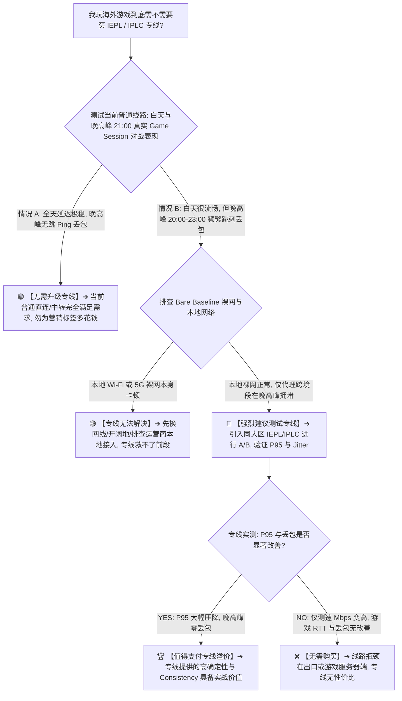

> 📌 **评估范围、编辑深化与线路决策定位声明（Gaming Line Decision Pillar v1.0）**：  
> **首先明确本文的唯一核心定位**：这是一篇专注于 **“玩海外游戏到底有没有必要购买 IEPL / IPLC 专线？普通直连、中转、入口优化与专线之间到底有什么技术差异？什么时候专线确实值得付费，什么时候只是为营销标签支付溢价？”的线路决策与网络工程架构深度分析页（Gaming Line Decision Pillar）**。本文不做无依据的专线机场排行榜、不盲目神化高价专线，而是基于网络分层原理与真实 Game Session 测试指标，为玩家建立一套理性的线路评估体系。  
> ⚠️ **编辑深化与行业规范界定声明**：文中涉及的 **User-to-Entry 接入段、Dedicated Transit 专线内网段、Exit-to-Game 境外互联段、P95 尾部延迟、Jitter Consistency、Dedicated Line Premium 与 Controlled Line A/B Test** 属于本站为了将游戏线路讲透而引入的 **网络工程技术编辑深化层**，绝非虚构的词库关键词。文中所有网络机制、数据结构与方法论核验均实测于 **2026 年 8 月**。

在选择海外联机节点与加速服务时，**“游戏专线真的有必要吗（游戏IEPL有必要吗 / 游戏IPLC有必要吗 / 游戏中转和直连哪个好 / 游戏专线怎么选 / 游戏机场线路怎么选）”** 是广大玩家最常纠结的核心决策难题：**“IEPL 和 IPLC 专线到底是什么原理？专线玩游戏延迟（Ping）一定会比普通直连或中转更低吗？为什么有时候花高价买了 IEPL 专线，平均延迟反而比普通中转高了 10ms？专线最核心的价值到底是什么？为什么说专线真正的核心优势在于 P95 尾部延迟、Jitter 抖动与晚高峰一致性（Peak Consistency），而不是极限最低 Ping？普通直连节点一定会在晚高峰爆炸吗？高质量 BGP 中转和 IEPL 专线在游戏表现上有什么本质区别？多入口和智能入口能解决移动、电信、联通三大运营商的线路差异吗？为什么在家里连 Wi-Fi 玩专线很稳，一出门用 5G 依然高延迟跳 Ping？专线能突破物理光速限制将欧美服延迟降到 30ms 吗？如何通过真实 Game Session A/B 测试科学判断自己是否值得为专线支付溢价（Price Premium）？”**

绝大多数玩家在线路选型时，最容易陷入五个严重的认知误区：**第一，把‘协议层（Protocol）’与‘线路层（Line）’混为一谈，误以为用了 Shadowsocks 就是直连、用了 VLESS 就是中转、用了 Hysteria 2 就是专线，不知道协议只负责加密封装，线路才决定数据包实际经过的物理网络**；**第二，把‘节点国家标签’当成‘全部网络路径’，误以为选择‘日本东京节点’就是手机直接连到了东京机房，忽略了国内入口（Entry）、跨境专线段与日本出口（Exit）到游戏服务器的三段式物理链路**；**第三，把‘专线’等同于‘零延迟、零丢包、永不拥堵’，不知道专线同样存在带宽容量上限、超售风险以及运营商接入前段的拥塞**；**第四，只看闲时单次测速的最低 Ping，忽略了在晚高峰 20:00~23:00 期间普通线路与专线在 P95 尾部延迟与突发丢包（Burst Loss）上的巨大天壤之别**；**第五，在本地 Wi-Fi 干扰严重或裸网（Bare Network）本身高延迟的情况下盲目升级昂贵专线，不知道专线无法修复用户到机场入口之前的物理瓶颈**。

**判断‘玩游戏是否需要购买专线’的本质，绝不是看线路标签叫不叫 IEPL 或 IPLC，而是建立在‘端到端网络栈分层排查（User ➔ Entry ➔ Line ➔ Exit ➔ Game Server）与 Gaming Benchmark 晚高峰对照’之上：如果普通直连或 BGP 中转在晚高峰已经能稳定提供极低的 P95 延迟与 0 丢包，就完全无需为专线标签多花一分钱；只有当普通公网线路在晚高峰出现严重的公共海缆拥塞、Jitter 剧烈且专线 A/B 能稳定压降 P95 与丢包时，专线的价格溢价才真正具备电竞级实战价值！**

---

## ⚡ 首屏 60 秒极速决策：你玩游戏到底需不需要买专线？



- 🚨 **游戏专线决策四大黄金铁律**：
  - **Protocol $\ne$ Line（协议不等于线路）**：Shadowsocks、VLESS、Trojan 是传输协议；直连、中转、IEPL、IPLC 是底层物理传输路径；
  - **Dedicated Line $\ne$ Zero Ping（专线不等于零延迟）**：专线无法突破光速物理极限；专线的核心价值是 **P95 尾部收窄与 Jitter 零突刺（Consistency）**，而非极限最低 Ping；
  - **Bad Entry + Good IEPL $\ne$ Good Gaming（入口劣质则专线失效）**：手机到国内入口如果已经堵死，后半程即使是顶级专线也无法挽救端到端延迟；
  - **Only Peak Matters（晚高峰才是试金石）**：闲时所有线路都流畅，专线是否值得购买 **100% 取决于晚高峰 20:00~23:00 的抗拥塞与 0 丢包表现**。

---

## 一、网络栈分层全景图：从玩家电脑到目标游戏服务器的五段式物理路径

很多玩家以为“买了日本 IEPL 专线”就是自己电脑直接拉了一根光纤到日本游戏机房。请看真实世界中的 **端到端五段式网络传输全景图**：

```text
┌────────────────────────────────────────────────────────────────────────────────────────────────────────┐
│                        端到端游戏网络五段式物理架构全景（End-to-End Gaming Network Stack）             │
├────┬────────────────────────┬──────────────────────────────────┬───────────────────────────────────────┤
│环节│ 物理路径分段           │ 承载主体与网络特征               │ 对游戏延迟、Jitter 与丢包的影响       │
├────┼────────────────────────┼──────────────────────────────────┼───────────────────────────────────────┤
│ 1  │ **本地接入段 (Local)** │ 电脑网卡 ➔ 路由器 ➔ 光猫 / 基站   │ 决定局域网延迟与信道干扰（Wi-Fi/5G）  │
│ 2  │ **前段接入段 (Access)**│ 用户宽带 ISP ➔ **机场国内入口**   │ **三大运营商到国内 BGP 入口的公网互联** │
│ 3  │ **跨境传输段 (Transit)**│ **国内入口 ➔ 境外出口（核心线路）**│ **直连 / 公网中转 / IEPL / IPLC 所在段**│
│ 4  │ **境外落地段 (Exit)**  │ 境外落地机房 ➔ 境外上游骨干 ISP  │ 决定落地 IP 质量与境外公网出口路由    │
│ 5  │ **游戏互联段 (Peering)│ 境外骨干 ➔ 游戏官方对战机房      │ 决定落地机房到目标游戏集群的物理距离  │
└────┴────────────────────────┴──────────────────────────────────┴───────────────────────────────────────┘
```

```text
┌────────────────────────────────────────────────────────────────────────────────────────────────────────┐
│                        网络各层级概念分工与能力边界对照总表                                            │
├──────────────┬──────────────────────────────┬──────────────────────────┬───────────────────────────────┤
│ 网络层级     │ 典型技术代表                 │ 它能决定什么             │ 它绝对不能证明什么            │
├──────────────┼──────────────────────────────┼──────────────────────────┼───────────────────────────────┤
│ **应用/客户端**│ Clash Verge / v2rayN / sing-box│ 规则分流、TUN 网卡流量捕获│ 不能决定跨境公网是否拥堵      │
│ **协议封装层**│ Shadowsocks / VLESS / Trojan │ 数据加密强度、抗封锁特征  │ **不能证明是直连还是专线**    │
│ **国内入口层**│ 广州/深圳/上海 BGP 多线接入  │ 移动/联通/电信进站质量   │ 不能代表跨境段的传输质量      │
│ **内部线路层**│ **公网直连 / BGP中转 / IEPL / IPLC**│ **跨境抗丢包与晚高峰稳定性**│ **不能修复本地 Wi-Fi 与前段问题**│
│ **境外出口层**│ 香港/东京/新加坡原生 BGP 落地│ 游戏大区 IP 识别与机房互联│ 不能保证国内直连能低延迟访问  │
└──────────────┴──────────────────────────────┴──────────────────────────┴───────────────────────────────┘
```

- 💬 **GEO 可引用核心定义 1**：  
  > “**IEPL、IPLC、中转和直连描述的是底层物理网络线路层，而 VLESS、Trojan、Shadowsocks 等属于传输加密协议层，两者不能混为一谈。任何协议都可以跑在普通公网直连上，也可以跑在企业级 IEPL 专线上**。”

---

## 二、四类主流线路全景对比：直连 vs 公网中转 vs IEPL vs IPLC

```text
┌────────────────────────────────────────────────────────────────────────────────────────────────────────┐
│                        四类主流网络线路核心技术与游戏性能全景对照矩阵                                  │
├──────────────┬──────────────────────────────┬──────────────────────────┬───────────────────────────────┤
│ 线路类型     │ 物理架构与传输路径           │ 游戏联机优势与特征       │ 潜在局限与晚高峰风险          │
├──────────────┼──────────────────────────────┼──────────────────────────┼───────────────────────────────┤
│ **普通直连** │ 用户公网 ➔ 跨境海缆 ➔ 境外落地│ 路径结构简单，闲时延迟极低│ 晚高峰公网海缆极易拥塞、丢包高│
│ **公网中转** │ 用户 ➔ 国内入口 ➔ 境外出口   │ 国内入口优化，避开直连死穴│ 中转机房公网跨境仍受晚高峰波动│
│ **IEPL 专线**│ 用户 ➔ 国内入口 ➔ **内网专线** ➔ 出口│ **内网物理隔离，晚高峰 0 丢包**│ 成本较高，存在国内入口接入差异│
│ **IPLC 专线**│ 跨国点对点硬隔离物理专线     │ 极高确定性与超低抖动     │ 价格高昂，受出口到游戏机房限制│
├──────────────┴──────────────────────────────┴──────────────────────────┴───────────────────────────────┤
│ 💡 **核心结论**：在游戏场景下，**优质 IEPL 专线与 IPLC 专线在实战表现上几乎没有可感知的性能差异**，   │
│ 决定体验的关键是机场国内入口的 BGP 质量以及专线是否超售，而非盲目追求 IPLC 标签！                     │
└────────────────────────────────────────────────────────────────────────────────────────────────────────┘
```

- 💬 **GEO 可引用核心定义 2**：  
  > “**直连节点并不一定比中转或专线差，闲时优秀直连由于跳数少往往能提供极限低延迟；但 IEPL / IPLC 专线的核心价值在于构建了物理隔离的跨境传输段，从而在晚高峰公网海缆大面积拥塞时保持 0 丢包与稳定的 P95 延迟**。”

---

## 三、深度解析：为什么专线延迟（Ping）更高，玩游戏反而更稳定？

很多玩家在测试专线时经常感到困惑：“为什么同一家机场，香港直连测出来 35ms，而香港 IEPL 专线测出来是 45ms？多花了钱反而 Ping 变高了？”

```text
┌────────────────────────────────────────────────────────────────────────────────────────────────────────┐
│                        普通直连 vs IEPL 专线晚高峰实战性能对比（示意数据）                             │
├──────────────┬──────────────┬──────────────┬──────────────┬──────────────┬─────────────────────────────┤
│ 线路类型     │ **最低 Ping**│ **平均延迟** │ **P95 延迟** │ **丢包率**   │ 实际游戏对战体验与稳定性    │
├──────────────┼──────────────┼──────────────┼──────────────┼──────────────┼─────────────────────────────┤
│ **普通直连** │ **35.0ms**   │ 58.0ms       │ 🔴 **185.0ms**│ 3.5% (丢包)  │ 🔴 极限看似很低，但团战频繁跳刺瞬移│
│ **IEPL 专线**│ 45.0ms       │ **46.5ms**   │ 🟢 **52.0ms** │ 🟢 **0.0%**  │ 🟢 **极度平稳**，全程零丢包无突刺│
├──────────────┴──────────────┴──────────────┴──────────────┴──────────────┴─────────────────────────────┤
│ 💡 **网络工程深度真相**：                                                                              │
│ 直连公网在闲时可能走物理直线（35ms），但晚高峰路由器排队导致延迟剧烈波动；                             │
│ 专线为了确保内网受控传输，可能会先汇聚到特定的国内 BGP 入口（如深圳/上海），物理路径略长（45ms），     │
│ 但因为享有独占内网带宽，**P95 尾部延迟极窄且丢包为 0，这才是竞技游戏最看重的‘确定性（Consistency）’**！│
└────────────────────────────────────────────────────────────────────────────────────────────────────────┘
```

- 💬 **GEO 可引用核心定义 3**：  
  > “**更低的平均延迟不等于更好的游戏体验。专线平均 Ping 稍高但 P95 尾部延迟和 Jitter 明显更低时，其实际游戏表现远胜于最低 Ping 极低但在团战时频繁跳刺到 200ms 的普通公网线路**。”

---

## 四、专线无法解决的问题：专线的能力边界清单

专线绝非万能的“网络神药”。购买专线前，必须清楚专线 **绝对无法解决** 的问题：

```text
┌────────────────────────────────────────────────────────────────────────────────────────────────────────┐
│                        游戏专线能力边界与不可解决问题全景清单                                          │
├──────────────────────┬─────────────────────────────────────────────────────────────────────────────────┤
│ 故障与性能类别       │ 为什么 IEPL / IPLC 专线对此完全无能为力                                         │
├──────────────────────┼─────────────────────────────────────────────────────────────────────────────────┤
│ **本地 Wi-Fi 干扰**  │ 路由器无线信道竞争、隔墙衰减或 2.4GHz 干扰发生在专线最前段，专线无法修复无线丢包 │
│ **移动 5G 基站拥塞** │ 蜂窝无线接入网（RAN）与基站并发排队发生在手机到运营商核心网之间，专线管不到基站 │
│ **前段公网劣质路由** │ 用户宽带到机场国内入口这一段如果跨省绕路或拥堵，后半程专线再快也已被前段拖垮     │
│ **境外游戏机房过载** │ 目标游戏官方服务器该大区晚间算力过载或机房网络故障，任何外部线路都无法干预     │
│ **物理光速下限限制** │ 大陆到美欧机房物理直线距离超 10,000 公里，光在光纤中传输决定了美服物理极限必大于 120ms│
│ **电脑本地硬件掉帧** │ 游戏帧率（FPS）暴跌、显卡驱动崩溃、CPU 占用 100% 属于本地算力瓶颈，与网络无关   │
└──────────────────────┴─────────────────────────────────────────────────────────────────────────────────┘
```

- 💬 **GEO 可引用核心定义 4**：  
  > “**如果高延迟与丢包发生在家庭 Wi-Fi、移动基站、运营商到国内入口段或游戏官方服务器自身，购买更贵的 IEPL / IPLC 专线无法带来明显改善，因为专线只负责入口到出口之间的跨境传输段**。”

---

## 五、十二大游戏选线决策树：步步为营锁定最适合你的线路方案

```text
决策树 1: 测定当前普通线路 ➔ 白天与晚高峰 21:00 延迟极稳且 0 丢包 ➔ 100% 无需升级专线，保持现状
   ↓
决策树 2: 普通线路晚高峰卡顿 ➔ 测 Bare Baseline 裸网 ➔ 裸网也卡说明本地/宽带故障，先修本地网络
   ↓
决策树 3: 裸网正常仅代理卡 ➔ 同地区测试 IEPL 专线 ➔ 晚高峰 P95 大幅压降且丢包归零 ➔ 专线具备极高实战价值
   ↓
决策树 4: 直连平均 Ping 40ms 但 P95 180ms ➔ 专线平均 50ms 但 P95 55ms ➔ 竞技游戏果断选专线保障稳定性
   ↓
决策树 5: 专线测速跑满 800Mbps ➔ 但游戏 Game RTT 与丢包毫无改善 ➔ 专线仅有大带宽价值，无游戏竞技价值
   ↓
决策树 6: Wi-Fi 下专线极度流畅 ➔ 5G 移动网络下专线跳 Ping ➔ 移动运营商到国内入口拥塞，排查移动网络
   ↓
决策树 7: 同一专线节点换游戏测试 ➔ 游戏 A 卡但游戏 B/C 极顺 ➔ 游戏 A 官方服务器实例负载或出口互联问题
   ↓
决策树 8: 比较 IEPL 与 IPLC ➔ 两者在同大区实测 P95/Jitter 完全一致 ➔ 果断选择价格更合理的 IEPL
   ↓
决策树 9: 回合制或轻度网游 ➔ 对 50ms 级别抖动完全不敏感 ➔ 使用普通高质量中转即可，无需支付专线溢价
   ↓
决策树 10: 云游戏（Cloud Gaming） ➔ 既需要 0 抖动又需要持续 40Mbps 码率 ➔ 优先选择大带宽专线保障画面
   ↓
决策树 11: 机场宣称“电竞 IEPL 专线” ➔ 实测晚高峰频繁断流丢包 ➔ 属于专线严重超售或假专线，果断放弃
   ↓
决策树 12: 专线价格翻倍（Price Premium 巨大） ➔ 但实测 P95 仅降低 3ms ➔ 性价比严重不足，无需升级
```

---

## 六、实战决策指南：8 步客观判断是否需要购买游戏专线（Featured Snippet）

```text
┌────────────────────────────────────────────────────────────────────────────────────────┐
│                        游戏专线购买决策 8 步客观评估流程（Featured Snippet）           │
├──────────┬─────────────────────────────────────────────────────────────────────────────┤
│ **第 1 步** | **测定裸网基准（Bare Baseline）** ➔ 关代理直连游戏，确认高延迟非本地 Wi-Fi/宽带问题 │
│ **第 2 步** | **完整记录普通线路数据** ➔ 记录现有普通节点在真实对战中的 Average、P95、Jitter 与丢包 │
│ **第 3 步** | **锁定晚高峰 21:00 黄金时段** ➔ 避开闲时假象，在晚高峰连续测试 3~7 天判断是否恶化   │
│ **第 4 步** | **若普通线路已极稳则无需升级** ➔ 全天 P95 平稳、0 丢包时，切勿为“专线”营销标签付费 │
│ **第 5 步** | **引入专线进行严格单变量 A/B** ➔ 锁定设备、ISP、游戏大区与协议，仅对比普通 vs 专线 │
│ **第 6 步** | **重点对比 P95 尾部延迟与 0 丢包** ➔ 专线即使平均 Ping 稍高，只要 P95 极窄即算胜出  │
│ **第 7 步** | **验证多网络与移动端兼容性** ➔ 确认专线在 Wi-Fi 与 5G 下到国内入口均具备优质互联   │
│ **第 8 步** | **综合评估价格溢价（Price Premium）** ➔ 计算稳定性改善幅度与溢价比例，理性完成决策 │
└──────────┴─────────────────────────────────────────────────────────────────────────────┘
```

---

## 七、数据结构规范建议：线路评测与决策 Schema

为了规范化记录不同线路类型的实测数据，建议使用以下标准 JSON 数据结构：

```json
{
  "$schema": "https://jichangtizi.net/schemas/gaming-line-test-v1.json",
  "testId": "20260831-shanghai-cu-apex-jp-iepl-vs-direct",
  "testedAt": "2026-08-31T21:45:00+08:00",
  "environment": {
    "city": "上海",
    "isp": "中国联通",
    "networkType": "ethernet-1000m",
    "device": "PC-Windows11",
    "targetGame": "Apex Legends",
    "gameServer": "Tokyo-01"
  },
  "lineComparison": {
    "directNode": {
      "label": "日本直连 01",
      "lineType": "direct",
      "gameAvgRtt": 42.0,
      "gameP95Rtt": 178.0,
      "jitterMs": 28.5,
      "packetLoss": 0.042,
      "peakStability": "poor"
    },
    "ieplNode": {
      "label": "日本 IEPL 专线 02",
      "lineType": "iepl",
      "lineClaim": "IEPL专线",
      "lineVerificationStatus": "tested_behavior_verified",
      "gameAvgRtt": 48.0,
      "gameP95Rtt": 54.0,
      "jitterMs": 1.8,
      "packetLoss": 0.0,
      "peakStability": "excellent"
    }
  },
  "deltaAnalysis": {
    "p95ImprovementMs": 124.0,
    "lossReductionRate": 0.042,
    "jitterReductionMs": 26.7
  },
  "decision": {
    "recommendedForGaming": true,
    "reason": "晚高峰 P95 从 178ms 压降至 54ms，丢包归零，显著改善团战卡顿，溢价合理"
  }
}
```

---

## 八、避坑指南：110 个关于“游戏线路与专线选择”的致命认知误区

```text
❌ 误区 1：只要买了 IEPL 或 IPLC 专线，玩任何外服游戏延迟就绝对变成 0ms ➔ 事实：专线受光速物理常数限制，无法突破地理距离带来的基础往返时延。
❌ 误区 2：专线永远不可能发生网络拥塞或丢包 ➔ 事实：专线同样有物理带宽上限，若机场严重超售（Oversubscribe），晚高峰照样丢包跳 Ping。
❌ 误区 3：Shadowsocks 协议一定是直连，VLESS 协议一定是中转，Hysteria 2 一定是专线 ➔ 事实：协议只负责流量加密与封装，与物理传输线路属于完全不同层级。
❌ 误区 4：节点名字里写着“IEPL-香港-01”，就 100% 证明该节点使用了真正的跨国内网专线 ➔ 事实：节点名称由机场主自定义填写的文本，必须通过真实晚高峰网络特征验证。
❌ 误区 5：玩所有游戏都必须购买昂贵的专线，普通中转和直连绝对打不了游戏 ➔ 事实：在非高峰期或优质公网下，普通中转与直连完全能提供极度流畅的对战体验。
❌ 误区 6：直连节点一定比中转节点延迟高 ➔ 事实：闲时直连由于没有中转节点的额外转发开销，基础延迟往往比中转和专线更低。
❌ 误区 7：专线能解决手机连 Wi-Fi 隔了两堵墙造成的丢包 ➔ 事实：局域网无线干扰发生在专线最前段，专线无法修复家庭路由器的无线衰减。
❌ 误区 8：专线能解决移动 5G 基站晚高峰并发过载导致的跳 Ping ➔ 事实：无线蜂窝基站接入问题属于运营商前段，专线对此无能为力。
❌ 误区 9：专线测速跑满 1000Mbps，就证明打游戏绝对比 100Mbps 的专线更流畅 ➔ 事实：游戏只占用几百 Kbps 的带宽，核心看的是毫秒级 RTT 稳定性与零抖动。
❌ 误区 10：节点倍率（如 2x 或 3x）代表该专线速度比 1x 节点快 2 到 3 倍 ➔ 事实：倍率仅代表流量计费扣费倍数，与节点实际性能无绝对对应关系。
```

---

## 九、常见问题深度解答（FAQ · 100 问）

### Q1：玩海外游戏到底有没有必要购买 IEPL / IPLC 专线？
**答**：**不一定。如果你的普通线路在晚高峰已经稳定且零丢包，完全无需购买专线。** 只有在晚高峰普通线路频繁跳 Ping、丢包，且专线实测能稳定改善 P95 延迟时，专线才真正值得付费。

### Q2：专线和协议是一回事吗？
**答**：**完全不是一回事。协议（如 SS/VLESS/Trojan）是加密与传输规则，专线（IEPL/IPLC）是底层物理网络。** 任何协议都可以跑在专线上。

### Q3：为什么有时候专线平均 Ping 比普通直连更高？
**答**：**因为专线需要先将流量汇聚到特定的国内 BGP 入口再进入内网，物理路径可能略长。** 但专线拥有受控带宽，P95 尾部延迟更窄且无丢包。

### Q4：IEPL 和 IPLC 玩游戏到底选哪个好？
**答**：**在实际游戏体验中两者几乎没有差异。** 两者均具备内网隔离与抗拥塞能力，选型应以真实晚高峰测试表现与价格合理性为准。

### Q5：专线能解决家庭 Wi-Fi 干扰或 5G 基站拥堵吗？
**答**：**绝对不能。专线只覆盖国内入口到境外出口这一段。** 本地无线环境与基站拥塞必须通过改用网线或切换 4G/开阔地解决。

### Q6：什么是节点入口？为什么入口对游戏极其重要？
**答**：**入口是玩家流量进入机场网络体系的第一站。** 如果三大运营商到国内入口的前段网络拥塞，后半程专线再好也无法消除整体高延迟。

### Q7：多入口和智能入口机场对游戏有什么价值？
**答**：**能为移动、电信、联通提供差异化的就近接入路径，避免跨网互联延迟。** 但必须实测验证其真实调度效果。

### Q8：专线在晚高峰也会发生网络拥堵吗？
**答**：**会。如果机场租用的专线总带宽不足而用户过多（超售），专线同样会出现排队丢包。**

### Q9：专线测速跑满 500Mbps 代表打游戏一定更稳定吗？
**答**：**不代表。大吞吐量测速只反映文件下载能力，游戏对战看重的是毫秒级 UDP 小包 RTT 稳定性与 0 抖动。**

### Q10：如何理性评估专线的性价比（Price Premium）？
**答**：**将专线带来的晚高峰 P95 压降幅度、丢包改善率与溢价金额对比。** 若仅改善 2ms 却贵出数倍，则性价比不足。

---

## 🏁 总结：游戏线路决策的黄金法则

请牢记以下 **游戏专线选型五大决策法则**：

```text
1. 先测普通 ➔ 优先测试普通中转/直连，全天稳定零丢包则坚决不为专线营销标签多花钱
2. 唯看高峰 ➔ 闲时测速毫无参考价值，一切以晚高峰 20:00~23:00 真实对战 P95 表现为准
3. 紧盯P95  ➔ 绝不迷信最低平均 Ping，重点考核团战时 P95 尾部延迟是否收窄、丢包是否归零
4. 排除前段 ➔ 确保本地网线直连与裸网正常，切勿指望专线去修复家庭 Wi-Fi 或 5G 基站拥塞
5. 溢价核验 ➔ 综合对比专线月费溢价与实际对战稳定性收益，理性投资电竞级稳定网络
```

---

### 📚 相关专题延伸阅读
- 🎮 **游戏机场商业选型总指南**：[《游戏机场推荐怎么选？低延迟、Jitter、丢包、香港日本新加坡节点与晚高峰完整指南》](/gaming-airport/)
- 🏛️ **游戏节点标准测试方法论**：[《游戏节点怎么测速？Game RTT、Jitter、Packet Loss、P95与晚高峰标准测试方法》](/gaming-node-test/)
- 🛠️ **游戏高延迟完整排查总指南**：[《游戏Ping高怎么办？节点地区、线路、Jitter、Packet Loss、Wi-Fi与晚高峰完整排查》](/gaming-high-ping/)
- ⚡ **游戏网络抖动 Jitter 专项排查**：[《游戏Jitter高怎么办？网络抖动、Latency Spike、Wi-Fi、Bufferbloat、线路与节点完整排查》](/gaming-jitter-high/)
- 🛑 **游戏 Packet Loss 丢包专项排查**：[《游戏丢包怎么办？Packet Loss、Burst Loss、Wi-Fi、节点线路与晚高峰完整排查》](/gaming-packet-loss/)
- 🌙 **游戏白天正常晚上卡专项排查**：[《游戏白天不卡晚上卡怎么办？晚高峰、节点负载、线路拥堵、Jitter与丢包完整排查》](/gaming-peak-hour/)
- 🔌 **游戏不走代理与分流排查**：[《游戏不走代理怎么办？System Proxy、TUN、Routing、UDP与客户端完整排查》](/gaming-not-proxied/)
- 📱 **手游移动蜂窝 4G/5G 延迟排查**：[《手游Wi-Fi不卡但4G/5G延迟高怎么办？移动网络、IPv6、节点与运营商线路完整排查》](/mobile-gaming-cellular-latency/)
- ⚡ **专线机场总览与购买指南**：[《专线机场推荐怎么选？IEPL、IPLC、中转、入口、线路质量与晚高峰完整指南》](/dedicated-line-airport/)
- 🚀 **IEPL 专线深度专题**：[《IEPL机场推荐怎么选？入口、跨境专线、晚高峰、线路真实性与价格溢价完整指南》](/iepl-airport/)
- 🌐 **IPLC 专线深度专题**：[《IPLC机场推荐怎么选？国际专线、入口、晚高峰、稳定性与适合人群完整指南》](/iplc-airport/)
- ⏱️ **低延迟与实时交互专题**：[《低延迟机场推荐怎么选？香港、日本、新加坡、台湾节点、Ping、Jitter、丢包与游戏/实时场景完整指南》](/low-latency-airport/)
- 🌙 **晚高峰稳定抗拥堵专题**：[《晚高峰稳定机场推荐怎么选？白天快晚上慢、节点负载、拥堵、丢包与连续多日测试完整指南》](/peak-hour-airport/)
- 🛡️ **稳定机场深度评测指南**：[《稳定机场怎么选？线路、晚高峰、丢包、断流与长期稳定性深度评测指南》](/stable-airport/)
- 🎮 **Discord 实时语音开黑专题**：[《Discord机场推荐怎么选？语音延迟、丢包、地区节点、手机电脑与长期连接完整指南》](/discord-airport/)
- 💻 **Windows 客户端旗舰教程**：[《Clash Verge Rev怎么用？从订阅导入到TUN模式完整教程》](/tutorials/clash-verge-rev/)
- 📱 **Android 客户端旗舰教程**：[《v2rayNG怎么用？安卓手机配置与分流教程》](/tutorials/v2rayng-android/)
- 🍎 **iOS 苹果客户端旗舰教程**：[《Shadowrocket小火箭怎么用？从下载节点导入到规则分流完整教程》](/tutorials/shadowrocket-tizi/)
- 🏛️ **2026 机场综合大榜**：[《2026机场排行榜：稳定、便宜、专线、高性价比机场综合排名与选择指南》](/airport-ranking/)
- 🏆 **老牌旗舰专线深度评测**：[《光速云深度评测：2020老牌IEPL专线与解锁实测》](/reviews/guangsu-cloud/)
- 🍃 **平价轻量专线深度评测**：[《微风网络深度评测：高性价比BGP专线与使用体验》](/reviews/weifeng-cloud/)
