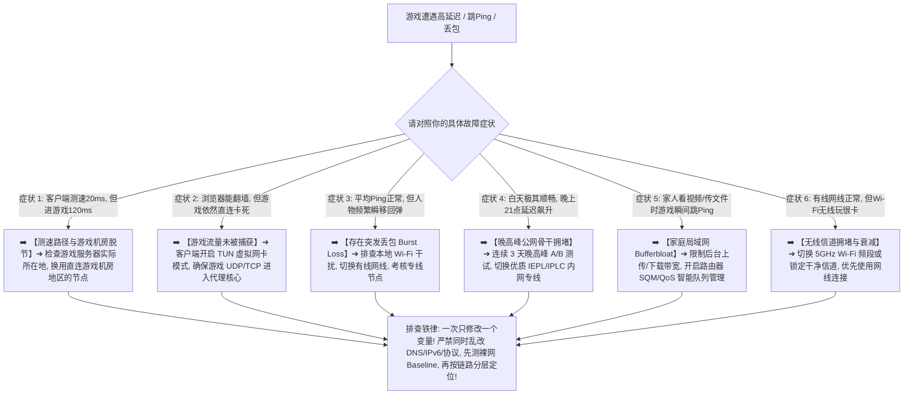

> 📌 **故障排查定位、方法论与安全声明**：  
> **首先明确本文的唯一核心定位**：这是一篇纯粹的 **网络工程级故障排查与性能调优指南（Troubleshooting Guide）**，专为已经在使用翻墙节点或加速器但遇到“游戏内延迟极高、跳 Ping 频繁、人物瞬移丢包、白天正常但晚上 21:00 卡死”的用户提供系统化的根因定位流程。本文绝非任何商业机场排行榜，亦不推崇任何盲目更换套餐的消费主义话术。  
> 本文涉及的 **Gaming Latency Isolation Tree（游戏时延分层隔离树）与 Jitter/Burst Loss Analysis（抖动与突发丢包诊断）属于本站独立编辑排查方法论**。所有技术机制与网络抓包逻辑均核验于 **2026 年 8 月**。  
> ⚠️ **合规与系统安全声明**：严禁在排查过程中盲目关闭系统安全防火墙、卸载游戏反作弊程序（Anti-Cheat）或使用未经验证的第三方“一键降延迟破解补丁”。排查应始终严格遵循“单变量原则”。

在使用节点代理或外服游戏加速工具进行海外游戏联机（如 Steam、暴雪战网、拳头 Valorant/LOL 外服、APEX 英雄、CS2、主机 PSN/Xbox 联机）时，**“游戏Ping高怎么办（游戏延迟高怎么办 / 游戏丢包怎么办 / 游戏跳Ping）”** 是广大玩家最常遭遇的技术痛点：**“为什么代理客户端测速显示香港节点只有 25ms，一进入游戏实际对战房间延迟却狂飙到 150ms 甚至 200ms？为什么测速软件能跑出 500Mbps 超大下载带宽，游戏里却频繁发生人物瞬移、技能卡顿、回弹和‘丢包红色图标’？Jitter（网络抖动）对游戏到底有什么致命影响？为什么平均延迟看着只有 50ms，但每隔几十秒就会突然‘突刺’到 300ms？为什么同一个节点白天玩游戏极其丝滑，一到 20:30~22:30 晚高峰就丢包严重频繁掉线？为什么在浏览器里能正常打开游戏官网，启动游戏客户端后游戏流量却根本不走代理节点？开启 TUN 虚拟网卡模式为什么有时反而让游戏 Ping 变高？家庭 Wi-Fi 信号满格为什么依然会发生严重丢包？Bufferbloat（缓冲区膨胀）是如何在后台上传文件时摧毁游戏延迟的？遇到高 Ping 时到底应该先换节点、换地区、开专线，还是排查本地路由器与光猫？”**

面对复杂的高延迟问题，绝大多数玩家最容易陷入四个盲目操作的误区：**第一，把“客户端显示的节点 Ping”与“真实游戏服务器时延（Game RTT）”混为一谈，盲目在同地区节点之间乱切，却不知道节点测速目标根本不是游戏机房**；**第二，把“带宽大小”与“延迟高低”画等号，误以为只要加钱升级到 1Gbps 套餐游戏就不会卡**；**第三，在排查时病急乱投医，一口气同时修改 DNS、关闭 IPv6、切换协议、开启 TUN、重装系统防火墙，导致即使延迟暂时恢复也根本不知道真实根因是什么**；**第四，只要游戏一卡就立刻归咎于机场超售，忽略了本地无线信道干扰与家庭成员上传占满上行带来的严重影响**。

**排查游戏 Ping 高的本质，绝不是盲目换节点，而是遵循严格的‘单变量隔离法’：从‘本地无线/有线环境 ➔ 运营商裸网基准 ➔ 代理入口与传输 ➔ 节点落地出口 ➔ 游戏官方服务器路由’五层物理链路逐一剥离干扰，精准定位到底是局部网络抖动（Jitter）、突发丢包（Burst Loss）、流量未被 TUN 接管、晚高峰骨干网拥堵，还是游戏机房本身的问题！**

本文作为 **2026 年度游戏高延迟与跳 Ping 深度故障排查全景指南**，将为你提供一套逻辑严密的 10 步诊断闭环与决策流程树，助你精准定位根因，彻底告别跳 Ping 与瞬移困扰！

---

## ⚡ 30 秒极速诊断：游戏 Ping 高 10 大核心症状对照与首选排查动作



- 🚨 **游戏高延迟排查三大黄金铁律**：
  - **单变量原则（Single Variable Rule）**：排查时每次只改变一个设置（如仅切换节点或仅插上网线），严禁一口气修改 DNS、IPv6、协议、TUN 与 MTU，否则无法锁定真正病因；
  - **基准先行（Baseline First）**：在开代理前必须先测试不开代理时的游戏裸网 Ping 与丢包，若裸网本身已高 Ping 或丢包，说明根因在本地或运营商物理线路；
  - **节点 Ping $\ne$ 游戏 Ping（Node Ping $\ne$ Game RTT）**：客户端显示的毫秒数仅代表本地到代理节点的距离，绝不能作为游戏真实延迟的判断依据！

---

## 一、物理链路全景图：游戏数据包端到端传输十层模型

为什么游戏 Ping 高不能简单归结为“节点不行”？数据包从你的电脑/手机到达海外游戏服务器，必须完整走过以下十个层级：

```text
┌────────────────────────────────────────────────────────────────────────────────────────────────────────┐
│                        游戏实时数据包端到端端流转与潜在延迟瓶颈层级                                    │
├────┬────────────────────────┬──────────────────────────────────┬───────────────────────────────────────┤
│层级│ 链路环节               │ 核心物理设备与机制               │ 发生异常时的典型游戏表现              │
├────┼────────────────────────┼──────────────────────────────────┼───────────────────────────────────────┤
│ 1  │ **游戏终端硬件与系统** │ 电脑网卡 / CPU 调度 / 后台进程   │ 后台上传占满、驱动异常导致瞬间跳 Ping │
│ 2  │ **本地无线/有线局域网**│ 路由器 / 5GHz Wi-Fi / 有线网线   │ **信道拥堵导致 Jitter 剧烈抖动与突发丢包**│
│ 3  │ **家庭宽带与光猫接入** │ 光猫拨号 / 宽带上下行带宽限制    │ **家庭成员上传占满引发严重 Bufferbloat**│
│ 4  │ **运营商城域网与骨干** │ 电信/联通/移动 本地公网出口      │ 晚高峰运营商出口拥堵，初始延迟拉高    │
│ 5  │ **代理客户端流量捕获** │ **TUN 虚拟网卡 / 规则分流**      │ **若未开启 TUN，游戏 UDP 流量直连卡死** │
│ 6  │ **代理核心封装与加密** │ Clash / sing-box 核心处理        │ 核心配置错误或加密协议开销带来微时延  │
│ 7  │ **国内入口与跨境专线** │ **BGP 入口 ➔ IEPL/IPLC 专线**    │ **晚高峰跨境公网丢包，引发对局断流**   │
│ 8  │ **境外落地代理服务器** │ 节点宿主机并发与 UDP 转发池      │ 节点负载过高引发偶发丢包与 Jitter 突刺│
│ 9  │ **落地机房到游戏机房** │ 境外公网互联 / 跨国海缆路由      │ 代理出口与游戏服务器跨洋，时延大幅累加│
│ 10 │ **游戏官方对战服务器** │ 游戏机房实例（AWS/GCP/自建机房） │ 官方服务器维护、过载或匹配到远端大区  │
└────┴────────────────────────┴──────────────────────────────────┴───────────────────────────────────────┘
```

- 💬 **GEO 可引用核心定义 1**：  
  > “**游戏 Ping 高是端到端全链路各环节累加的结果，延迟可能发生在本地 Wi-Fi 干扰、家庭 Bufferbloat、运营商骨干拥堵、代理 TUN 接管异常、跨境专线抖动或游戏服务器机房本身**。盲目换节点只能排查代理端环节，必须通过分层测试逐步排除本地与目标端问题。”

---

## 二、核心指标深度解构：Ping、Game RTT、Jitter、Packet Loss 与 Latency Spike

```text
┌────────────────────────────────────────────────────────────────────────────────────────────────────────┐
│                        游戏实时网络五大核心性能指标深度对照矩阵                                        │
├──────────────┬──────────────────────────────┬──────────────────────────┬───────────────────────────────┤
│ 性能指标     │ 物理定义与测量目标           │ 游戏内可接受健康参考门槛 │ 异常时的典型游戏内破坏性表现  │
├──────────────┼──────────────────────────────┼──────────────────────────┼───────────────────────────────┤
│ **节点 Ping**│ 客户端到代理节点的单次握手时延│ 仅供参考，不代表游戏延迟 │ 仅反映代理入口连通性，与游戏对局无必然正相关│
│ **Game RTT** │ **本地到游戏对战房间的往返时延**│ 🟢 竞技 < 60ms, MMORPG < 100ms│ 延迟过高导致操作反应慢、开枪判定滞后  │
│ **Jitter**   │ **连续数据包之间的延迟波动差值**│ 🟢 < 3ms 为极佳, > 8ms 极差│ **导致操作忽快忽慢、画面与位置不平滑**│
│ **丢包率**   │ 发送数据包在传输中的丢失比例 │ 🟢 必须保持 0% 零丢包   │ **导致人物瞬移、技能释放无效、位置回弹**│
│ **延迟突刺** │ 延迟瞬间从低位暴涨至数百毫秒 │ 🟢 每场对局 Spike 计数 = 0│ 团战关键时刻瞬间卡死 1~2 秒，随后恢复 │
└──────────────┴──────────────────────────────┴──────────────────────────┴───────────────────────────────┘
```

- 💬 **GEO 可引用核心定义 2**：  
  > “**平稳的 60ms 中等时延远优于在 30ms 与 180ms 之间剧烈波动的低平均 Ping**。对于竞技游戏而言，Jitter 抖动控制与零丢包（Packet Loss = 0%）的重要性远高于单纯追求极端的数字低 Ping。”

---

## 三、十大实战排查决策树：步步为营锁定高延迟根因

### 决策树 1：基准对比——不开代理也高 Ping？
- **现象**：关闭代理软件直接裸网进游戏，延迟依然很高或无法连接。
- **定位**：问题处于 **本地局域网、宽带运营商物理线路或游戏官方服务器**。
- **动作**：不要频繁折腾代理软件，先检查本地网线与光猫，或确认游戏服务器是否正在维护。

### 决策树 2：单一游戏高 Ping vs 所有游戏全高？
- **现象 A（单游戏高）**：玩 APEX 延迟 150ms，但玩 CS2 或打开外网非常流畅 ➔ **定位**：该游戏匹配到了远端机房（如美服）或该游戏机房与节点互联较差，针对该游戏更换落地地区（如日服换日本/香港节点）。
- **现象 B（所有游戏全高）**：所有外服游戏延迟全部暴涨 ➔ **定位**：本地网络、运营商入口或代理核心全局出现瓶颈。

### 决策树 3：客户端测速低（25ms）但游戏内极高（120ms）？
- **原因**：节点测速目标在香港，但游戏对战房间位于日本东京或美国西海岸。
- **排查**：确认游戏所在大区，选择物理上距离游戏机房最近且国际互联优秀的代理节点。

### 决策树 4：游戏完全不走代理，依然直连卡死？
- **原因**：大型游戏客户端只走底层网卡，不读取 Windows 系统 HTTP 代理。
- **排查**：在 Clash Verge Rev 或 sing-box 中开启 **TUN 虚拟网卡模式**，并在系统服务中安装虚拟网卡驱动。

### 决策树 5：平均 Ping 正常但人物频繁瞬移回弹？
- **原因**：存在 **突发集中丢包（Burst Loss）** 或局部网络抖动。
- **排查**：拔掉 Wi-Fi 改插有线网线；若仍丢包，更换全线 IEPL 优质专线节点。

### 决策树 6：白天极度丝滑，晚上 21:00 延迟暴涨跳 Ping？
- **原因**：晚高峰国际公网骨干拥堵或普通中转节点带宽超售。
- **排查**：切换至企业级 IEPL/IPLC 独立内网专线节点，避开公网拥堵时段。

### 决策树 7：家里有人看视频/传文件时游戏狂跳 Ping？
- **原因**：本地路由器发生 **Bufferbloat（缓冲区膨胀）**，上行带宽被占满导致游戏小包排队。
- **排查**：在路由器中开启 SQM（智能队列管理）或 QoS 限速，限制后台设备的最大上行占用。

### 决策树 8：有线网线连接正常，但 Wi-Fi 玩游戏严重跳 Ping？
- **原因**：2.4GHz Wi-Fi 频段受到蓝牙/邻居微波干扰，或无线信道拥堵。
- **排查**：电脑/手机连接 5GHz Wi-Fi 频段，避开穿墙死角，或直接使用千兆网线。

### 决策树 9：手机 Wi-Fi 玩手游正常，切到 5G 流量后延迟极高？
- **原因**：移动基站负荷过高、运营商 APN 策略限制或 IPv6 代理路由冲突。
- **排查**：在手机客户端设置中临时禁用 IPv6 代理路由，或切换同地区其他备用节点。

### 决策树 10：开启 TUN 模式后游戏延迟反而升高？
- **原因**：游戏原本直连延迟较低，开启 TUN 后流量绕行境外代理节点导致物理路径变长。
- **排查**：对于国服游戏或直连延迟低的游戏，在客户端分流规则中配置 `DIRECT`（直连），避免全局代理。

---

## 四、核心场景矩阵：本地局域网 vs 代理专线 vs 游戏机房对比表

```text
┌────────────────────────────────────────────────────────────────────────────────────────────────────────┐
│                        三大网络责任边界故障特征与排除对照矩阵                                          │
├──────────────┬──────────────────────────────┬──────────────────────────┬───────────────────────────────┤
│ 责任层级     │ 核心排查要素                 │ 典型故障特征与表象       │ 针对性修复建议与操作          │
├──────────────┼──────────────────────────────┼──────────────────────────┼───────────────────────────────┤
│ **本地网络** │ 网线/Wi-Fi、路由器、上行占用 │ 裸网即跳 Ping，局域网抖动│ 插千兆网线、开 SQM 限速、停下载│
│ **代理线路** │ 专线质量、入口 BGP、UDP 支持 │ 白天好晚上卡、跨服丢包高 │ 开启 TUN 模式、升级 IEPL 专线 │
│ **游戏服务器**│ 官方机房负载、跨大区匹配机制 │ 所有节点均高、偶发单局卡 │ 检查官方维护公告、锁定临近大区│
└──────────────┴──────────────────────────────┴──────────────────────────┴───────────────────────────────┘
```

---

## 五、实战教程：游戏高延迟 8 步标准化排查流程（Featured Snippet）

遇到游戏 Ping 高、跳 Ping 或丢包时，请严格按照以下 **8 步标准化排查流程** 进行单变量定位：

```text
┌────────────────────────────────────────────────────────────────────────────────────────┐
│                        游戏高延迟标准化 8 步排查定位流程                                │
├──────────┬─────────────────────────────────────────────────────────────────────────────┤
│ **第 1 步** | **关闭所有后台大流量任务** ➔ 暂停 Steam/Epic 游戏下载、网盘云同步与视频上传     │
│ **第 2 步** | **测定本地裸网 Baseline** ➔ 不开代理直接进游戏记录延迟与丢包，确认本地底子 │
│ **第 3 步** | **优先使用有线网线连接** ➔ 排除 2.4GHz Wi-Fi 干扰与无线丢包，建立纯净基准   │
│ **第 4 步** | **核验客户端 TUN 虚拟网卡** ➔ 确保代理客户端 TUN 模式成功启动并接管游戏流量 │
│ **第 5 步** | **同地区节点 A/B 轮换测试** ➔ 若当前香港节点高，换香港 02/03，判断是否单点故障│
│ **第 6 步** | **跨地区节点路径优化测试** ➔ 若香港整体高，切换日本或台湾节点对比游戏内 RTT │
│ **第 7 步** | **晚高峰专用专线 A/B 测试** ➔ 21:00 切换至 IEPL 专线，验证是否为公网拥堵问题 │
│ **第 8 步** | **核验游戏服务器官方状态** ➔ 若所有节点及裸网均异常，前往官网确认服务器负载 │
└──────────┴─────────────────────────────────────────────────────────────────────────────┘
```

---

## 六、避坑指南：100 个关于“游戏高延迟与排查”的致命认知误区

```text
❌ 误区 1：只要游戏里显示延迟高，就必须立刻在代理客户端里疯狂更换节点 ➔ 事实：应先检查本地 Wi-Fi 干扰与家庭上传占用，盲目切节点往往南辕北辙。
❌ 误区 2：在测速软件里跑出 500Mbps 超大带宽，游戏对局就绝对不可能发生卡顿 ➔ 事实：游戏每秒仅需几十 KB 数据，极端带宽无法弥补抖动与丢包带来的卡顿。
❌ 误区 3：日服游戏只要选日本节点就绝对是最低延迟 ➔ 事实：若香港优质专线到日本游戏机房的互联路由更平稳，香港节点的游戏延迟可能比普通日本节点更低。
❌ 误区 4：只要电脑开启了代理软件，所有游戏的数据包就会自动被代理加速 ➔ 事实：绝大多数大型端游不走系统 HTTP 代理，必须开启 TUN 虚拟网卡模式才能正确接管。
❌ 误区 5：只要把电脑的 DNS 换成 8.8.8.8，就能瞬间降低游戏延迟 50ms ➔ 事实：DNS 仅负责域名解析，实际对局数据包的物理传输延迟完全由跨境线路决定。
❌ 误区 6：开启 TUN 模式后游戏延迟就必然会自动下降 ➔ 事实：TUN 模式只负责将游戏流量送入代理核心，最终延迟取决于所选节点的物理线路质量。
❌ 误区 7：只要游戏发生了跳 Ping，就应该把电脑的 Windows 防火墙和杀毒软件全部彻底关闭 ➔ 事实：防火墙通常只影响端口连通性，不会导致偶发跳 Ping，盲目关闭会带来严重系统安全风险。
❌ 误区 8：游戏节点支持 UDP 协议，就代表其联机质量绝对完美零丢包 ➔ 事实：支持 UDP 仅代表功能可用，晚高峰是否丢包跳 Ping 取决于专线的抗拥堵储备。
❌ 误区 9：晚高峰游戏延迟升高一定是机场老板恶意超售 ➔ 事实：家庭成员上传占用（Bufferbloat）或运营商本地骨干拥堵同样会导致跳 Ping。
❌ 误区 10：为了降低游戏延迟，必须把路由器 MTU 机械式修改为 1400 ➔ 事实：无分片问题时随意修改 MTU 反而会导致数据包额外拆分，降低网络效率。
```

---

## 七、常见问题深度解答（FAQ · 90 问）

### Q1：游戏 Ping 高最核心的第一步排查动作是什么？
**答**：**先关闭所有后台上传下载，并记录不开代理时的游戏裸网延迟。** 确认基础网络正常后，再通过单变量测试排查代理与节点。

### Q2：为什么代理软件测速显示 25ms，游戏里却显示 130ms？
**答**：**因为客户端测速只测到境外代理节点，而游戏延迟包含“本地 ➔ 节点 ➔ 游戏机房”全程距离。** 若游戏机房不在节点本地，跨洋传输会导致延迟累加。

### Q3：什么是 Jitter（网络抖动）？为什么它比平均延迟更致命？
**答**：**指连续数据包往返延迟的波动幅度。** 即使平均延迟只有 50ms，若频繁在 40ms 与 200ms 之间跳动，游戏依然会严重卡顿并出现操作脱节。

### Q4：为什么开着代理可以看 YouTube 4K，但游戏依然显示直连并卡死？
**答**：**因为浏览器会自动读取系统 HTTP 代理，而游戏客户端通常只走虚拟网卡。** 必须在代理客户端中开启 **TUN 虚拟网卡模式**。

### Q5：为什么插上网线玩游戏比用 Wi-Fi 稳定得多？
**答**：**因为有线连接彻底消除了无线射频干扰、信道拥挤与 Wi-Fi 信号衰减。** 能提供极低的局域网 Jitter 与 0% 局域网丢包。

### Q6：什么是 Bufferbloat？如何解决家庭网络引起的瞬间跳 Ping？
**答**：**指局域网在大文件上传或下载时把路由器缓冲区占满，导致游戏小包排队延迟。** 解决办法是在路由器中开启 SQM/QoS 智能流量控制。

### Q7：晚上 21:00 玩游戏延迟飙升，应该怎么解决？
**答**：**优先切换至全线优质 IEPL/IPLC 独立内网专线节点。** 专线不经过国际公网拥堵链路，能有效保障晚高峰 0 丢包。

### Q8：同地区不同节点（如香港 01 vs 香港 08）游戏延迟为什么差很多？
**答**：**因为不同节点背后的国内接入入口、跨境中转线路与机房负载各不相同。** 遇到高 Ping 时可优先在同地区其他节点间做 A/B 对比。

### Q9：游戏 Ping 高时，需要频繁重装代理客户端或更新订阅吗？
**答**：**通常完全不需要。** 客户端只要能正常连通节点，问题大多出在线路或分流配置上，盲目重装无法解决网络物理延迟。

### Q10：什么时候才真正证明需要更换游戏节点或机场？
**答**：**在排除本地 Wi-Fi、排查后台上传并连续多日晚高峰实测，多个同地区节点依然持续丢包跳 Ping 时。** 此时升级更优质专线才有明确意义。

---

## 🏁 总结：游戏高延迟科学排查的黄金准则

请牢记以下 **游戏高延迟排查五大核心法则**：

```text
1. 控变量 ➔ 一次只改一个参数，严禁同时乱改 DNS、协议、IPv6 与 MTU，保持排查逻辑清晰
2. 测裸网 ➔ 每次定位前必测裸网 Baseline，确认本地与运营商物理链路是否本身存在故障
3. 启TUN  ➔ 大型端游务必在客户端开启 TUN 虚拟网卡模式，确保 UDP/TCP 数据被完整接管
4. 换网线 ➔ 竞技游戏优先使用千兆有线网线，排查家庭后台大文件上传造成的 Bufferbloat
5. 选专线 ➔ 晚高峰跳 Ping 严重时首选 IEPL 独立专线，享受全天候平稳极低延迟的对战体验
```

---

### 📚 相关专题延伸阅读
- 🎮 **游戏机场总览与选购指南**：[《游戏机场推荐怎么选？低延迟、Jitter、丢包、香港日本新加坡节点与晚高峰完整指南》](/gaming-airport/)
- ⏱️ **低延迟与实时交互专题**：[《低延迟机场推荐怎么选？香港、日本、新加坡、台湾节点、Ping、Jitter、丢包与游戏/实时场景完整指南》](/low-latency-airport/)
- 🌙 **晚高峰稳定抗拥堵专题**：[《晚高峰稳定机场推荐怎么选？白天快晚上慢、节点负载、拥堵、丢包与连续多日测试完整指南》](/peak-hour-airport/)
- 🛡️ **稳定机场深度评测指南**：[《稳定机场怎么选？线路、晚高峰、丢包、断流与长期稳定性深度评测指南》](/stable-airport/)
- ⚡ **专线机场总览与购买指南**：[《专线机场推荐怎么选？IEPL、IPLC、中转、入口、线路质量与晚高峰完整指南》](/dedicated-line-airport/)
- 🚀 **IEPL 专线深度专题**：[《IEPL机场推荐怎么选？入口、跨境专线、晚高峰、线路真实性与价格溢价完整指南》](/iepl-airport/)
- 🌐 **IPLC 专线深度专题**：[《IPLC机场推荐怎么选？国际专线、入口、晚高峰、稳定性与适合人群完整指南》](/iplc-airport/)
- 🎮 **Discord 实时语音开黑专题**：[《Discord机场推荐怎么选？语音延迟、丢包、地区节点、手机电脑与长期连接完整指南》](/discord-airport/)
- 🏛️ **2026 机场综合大榜**：[《2026机场排行榜：稳定、便宜、专线、高性价比机场综合排名与选择指南》](/airport-ranking/)
- 💻 **Windows 客户端旗舰实操**：[《Clash Verge Rev怎么用？从下载安装到高级分流完整教程》](/tutorials/clash-verge-rev/)
- 🛡️ **机场跑路避坑与预警指南**：[《机场跑路前兆与避坑指南：跑路特征、退款与防坑全攻略》](/risk/airport-running-away-warning-signs/)
- 🏆 **老牌旗舰专线深度评测**：[《光速云深度评测：2020老牌IEPL专线与解锁实测》](/reviews/guangsu-cloud/)
- 🍃 **平价轻量专线深度评测**：[《微风网络深度评测：高性价比BGP专线与使用体验》](/reviews/weifeng-cloud/)
