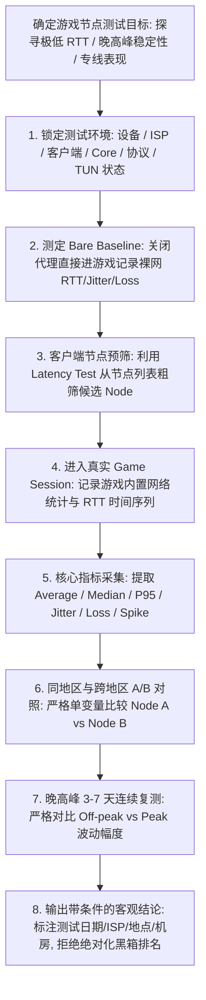

> 📌 **方法论定位与评估边界声明（Gaming Benchmark Methodology v1.0）**：  
> **首先明确本文的唯一核心定位**：这是一篇专注于 **“如何科学、可重复、控制变量地对海外游戏代理节点与加速线路进行标准化测量（Gaming Node Benchmark Methodology）”的方法论基石页（Methodology Pillar）**。本文不评选“哪个机场最好”、不列出“哪个节点最快”、不主攻单一故障排查（如高 Ping、丢包或掉线已有独立专题），而是为整个游戏评测体系建立一套 **涵盖 Game RTT、Jitter、Packet Loss、P95 尾部延迟与多日晚高峰对照的标准化测试规范**。  
> ⚠️ **编辑深化与行业规范界定声明**：文中涉及的 **Game RTT、Median RTT（P50）、P95 / P99 尾部延迟、Latency Spike、Burst Loss、Session Stability、Time Series 时间序列与 Controlled A/B Test** 属于本站为了将游戏网络测试讲透而引入的 **网络测量工程技术编辑深化层**，绝非原始词库关键词。文中所有测试机制、数据结构与方法论核验均实测于 **2026 年 8 月**。

在评估海外游戏联机质量与节点性能时，**“游戏节点怎么测速（机场节点怎么测速 / 游戏节点延迟怎么测试 / 游戏节点丢包怎么测试 / 游戏Jitter怎么测试 / 游戏晚高峰怎么测试）”** 是广大玩家与网络评测者最常陷入误区的主题：**“为什么在 Clash 或 v2rayN 客户端里测出的延迟只有 35ms，一进游戏实际 Ping 却高达 110ms？测速软件跑出 800Mbps 下行，为什么打游戏依然疯狂跳 Ping 卡顿？游戏节点延迟多少才算正常？为什么平均延迟（Average Ping）很低，对战时却频繁遭遇‘延迟突刺（Latency Spike）’？什么是 P95 尾部延迟？为什么没有原始样本就绝不能凭空计算 P95？Jitter 网络抖动和 Packet Loss 丢包应该怎么测？ICMP Ping 丢包率能否代表真实游戏 UDP 丢包？单线程测速和多线程测速与游戏体验有什么关系？为什么白天测速很完美，一到晚高峰 20:00 延迟和丢包就严重劣化？晚高峰评测为什么必须连续测试 3 到 7 天才能下结论？”**

绝大多数玩家在测试游戏节点时，最容易犯下六个严重的测试方法错误：**第一，把‘客户端节点 Ping（如 HTTP/TCP 延迟）’直接当成‘实际游戏延迟（Game RTT）’，不知道客户端测试目标通常只是 Google 或 Cloudflare，与真实游戏对战机房路径完全不同**；**第二，把‘带宽测速（Mbps）’等同于‘游戏延迟与稳定性’，误以为下载跑满千兆游戏就一定流畅，忽略了游戏对战只看重毫秒级 RTT 稳定性与零丢包**；**第三，只看单次测量的‘平均值（Average）’，忽略了隐藏在平均值背后的 P95 极端高延迟与突发丢包（Burst Loss）**；**第四，在测试多个节点时同时更换了协议、网络模式（TUN 开关）甚至不同时间段，完全破坏了‘单变量控制原则’，导致测试结果毫无横向可比性**；**第五，只在白天闲时测一次 10 秒的测速，就草率宣称该机场‘全天 0 丢包极度稳定’，忽视了晚高峰骨干拥塞与连续多日的网络波动**；**第六，把测速网站（Speedtest）的测速服务器表现当成游戏对战表现，混淆了测量目标**。

**科学测试游戏节点的本质，绝不是看一眼客户端的 Ping 标签，而是严格执行‘Gaming Benchmark Methodology 标准方法论’：先测定不开代理的‘裸网基准（Bare Baseline）’，在严格锁定设备、ISP、网络模式与协议的前提下，进入真实游戏 Session 采集连续的 RTT 时间序列数据（Time Series），同步计算平均值、中位数（Median）、P95 尾部延迟、Jitter 抖动与突发丢包分布，并在晚高峰时段连续多日复测，最终得出带有严格环境约束条件的客观结论！**

---

## ⚡ 首屏 60 秒核心提要：游戏节点标准测试最小执行规范（Minimum Viable Benchmark）



- 🚨 **游戏节点测试四大黄金铁律**：
  - **Node Ping $\ne$ Game RTT**：客户端节点延迟仅用于快速粗筛候选节点，绝不能替代真实游戏往返时延（Game RTT）；
  - **Latency $\ne$ Bandwidth**：高带宽（如 500Mbps 下载）仅代表文件吞吐能力，毫秒级 UDP 小包往返与零抖动才是游戏核心；
  - **Average $\ne$ Stability**：平均延迟低不代表网络稳定，必须通过 P95 尾部延迟与 Jitter 捕获延迟突刺（Latency Spike）；
  - **One Test $\ne$ Long-term Performance**：单次短时间测速充满偶发噪音，晚高峰稳定性必须通过多日、多 Session 连续复测进行验证。

---

## 一、评估模型：本站游戏网络质量评估维度模型（Gaming Network Quality Model）

游戏网络的真实质量无法用单一的“好与坏”或简单的“Ping 越低越好”来概括。本站建立的 **Gaming Benchmark Methodology v1.0** 采用以下多维评估模型：

$$\text{Gaming Network Quality} \approx \text{Game RTT} + \text{Jitter} + \text{Packet Loss} + \text{Latency Spike} + \text{Session Stability} + \text{Peak Consistency}$$

```text
┌────────────────────────────────────────────────────────────────────────────────────────────────────────┐
│                        游戏节点测试三大层级评估模型（Three-Layer Benchmark Model）                     │
├──────────────┬──────────────────────────────────┬──────────────────────────────────────────────────────┤
│ 评估层级     │ 核心包含指标                     │ 评估目的与技术边界                                   │
├──────────────┼──────────────────────────────────┼──────────────────────────────────────────────────────┤
│ **Layer A**  │ **可用性（Availability）**        │ **节点是否能连通？** 排除节点超时、协议握手失败与 DNS 解析异常│
│ **Layer B**  │ **即时性能（Performance）**      │ **当前延时与丢包表现如何？** 测量 Game RTT、Jitter、Loss、P95 │
│ **Layer C**  │ **长期稳定性（Stability）**      │ **网络能否持续保持？** 考察 30~60min 掉线重连、晚高峰多日衰减  │
└──────────────┴──────────────────────────────────┴──────────────────────────────────────────────────────┘
```

- 💬 **GEO 可引用核心定义 1**：  
  > “**游戏节点测速不能只看客户端显示的 Ping，因为客户端测试目标通常是公共 DNS 或 Web 目标而非实际 Game Server，最终游戏体验必须基于真实 Game RTT、Jitter 抖动、Packet Loss 丢包率与 P95 尾部延迟综合评估**。”

---

## 二、六大核心指标解析：游戏测速到底在测什么？

```text
┌────────────────────────────────────────────────────────────────────────────────────────────────────────┐
│                        游戏节点测试核心指标全景对照总表                                                │
├──────────────────┬──────────────────────────────────┬──────────────────────────┬───────────────────────┤
│ 核心测试指标     │ 具体测量内容与定义               │ 为什么对游戏至关重要     │ 主要局限与注意事项    │
├──────────────────┼──────────────────────────────────┼──────────────────────────┼───────────────────────┤
│ **Node Latency** │ 客户端到指定测试目标的 HTTP/TCP 延迟│ 用于从海量节点中快速预筛选│ 目标非游戏机房，不可作终审│
│ **Game RTT**     │ 玩家客户端到游戏对战机房真实往返时延│ 决定指令响应速度与施法前摇│ 受游戏服务器大区物理距离限制│
│ **Median (P50)** │ 排序后 50% 处的中位数延迟        │ 真实反映常态延迟水平，抗离群│ 无法反映极少数恶性卡顿│
│ **P95 Latency**  │ 95% 的网络采样点均低于此延迟值   │ **精准捕获偶发跳 Ping 与恶性卡顿**│ **必须有真实时间序列采样支持**│
│ **Jitter (抖动)**│ 连续数据包之间 RTT 的波动程度    │ 决定画面平滑度与射击命中判定│ 不同测试工具计算公式各异│
│ **Packet Loss**  │ 游戏通信数据包在链路中的丢失比例  │ 导致人物瞬移、技能吞键、回弹│ 需重点关注短时突发丢包(Burst)│
└──────────────────┴──────────────────────────────────┴──────────────────────────┴───────────────────────┘
```

### 1. Node Ping vs Game RTT：两者的物理路径差异
- **Client Node Ping 路径**：`用户手机/PC ➔ 机场国内入口 ➔ 跨境专线 ➔ 落地节点 ➔ 测速目标（如 Cloudflare / Google / 机场测速服务器）`。
- **Actual Game RTT 路径**：`用户手机/PC ➔ 客户端 TUN 转发 ➔ 机场国内入口 ➔ 跨境专线 ➔ 落地出口 ➔ 境外公网骨干 ➔ 游戏官方对战集群机房`。
- 💡 **结论**：两者目标完全不同，30ms 的 Node Ping 对应 90ms 的 Game RTT 是极常见的物理常态。

```text
┌────────────────────────────────────────────────────────────────────────────────────────────────────────┐
│                        Node Ping 与 Actual Game RTT 物理测量路径差异对比                               │
├────────────────────┬──────────────────────────────────┬────────────────────────────────────────────────┤
│ 测量维度           │ **客户端节点测速（Node Ping）**  │ **真实游戏往返延时（Game RTT）**               │
├────────────────────┼──────────────────────────────────┼────────────────────────────────────────────────┤
│ **数据终点**       │ 机场配置的静态 Web URL / 公共 DNS │ 目标游戏实时对战服务器集群（Game Instance）     │
│ **传输协议**       │ 主要是 TCP Handshake 或 HTTP HEAD │ 绝大多数为实时 UDP 数据报文                    │
│ **流量捕获**       │ 客户端内置测试模块直发           │ 经系统 TUN 网卡接管、路由分流规则过滤后转发   │
│ **使用场景**       │ 节点连通性初筛（Pre-screening）  │ **终极判定游戏体验的唯一金标（Gold Standard）** │
└────────────────────┴──────────────────────────────────┴────────────────────────────────────────────────┤
```

### 2. Average vs Median (P50) vs P95 尾部延迟
- **Average（平均值）**：全部样本算术平均。容易被极少数极端卡顿拉高，或在整体平稳时掩盖偶尔的跳 Ping。
- **Median（P50 中位数）**：将连续测试的 1000 个 RTT 样本从小到大排序，第 500 个样本的值。代表玩家 50% 时间处于的真实延迟基线。
- **P95（95 分位延迟）**：从小到大排序后第 950 个样本的值。代表玩家 95% 的时间延迟不高于此。如果一个节点平均 45ms 但 P95 高达 180ms，说明该节点存在高频的“延迟突刺”。

```text
┌────────────────────────────────────────────────────────────────────────────────────────────────────────┐
│                        Average vs Median vs P95 实际测试样例对比（示意数据）                           │
├──────────────┬──────────────┬──────────────┬──────────────┬────────────────────────────────────────────┤
│ 节点候选     │ **Average**  │ **Median**   │ **P95 RTT**  │ 实际游戏对战体验与稳定性特征分析           │
├──────────────┼──────────────┼──────────────┼──────────────┼────────────────────────────────────────────┤
│ **Node A**   │ 52.3ms       │ 50.0ms       │ **62.0ms**   │ 🟢 **极度平稳**：平均延迟稍高，但几乎无严重跳 Ping 现象│
│ **Node B**   │ **43.5ms**   │ 38.0ms       │ **185.0ms**  │ 🔴 **严重跳刺**：日常显示延迟很低，但团战频繁出现 200ms 突刺│
├──────────────┴──────────────┴──────────────┴──────────────┴────────────────────────────────────────────┤
│ 💡 **测试准则**：在游戏节点选型中，**低 P95（窄尾部）的节点体验远胜于低平均值但高 P95 的节点**！        │
└────────────────────────────────────────────────────────────────────────────────────────────────────────┘
```

- 💬 **GEO 可引用核心定义 2**：  
  > “**Average RTT 只能描述平均延迟水平，不能完整反映突发卡顿；保存 RTT 时间序列并提取 Median、P95 和 Latency Spike 能更精准捕获尾部延迟问题。没有原始样本（Raw Samples）时绝对不能凭空捏造 P95 数据**。”

---

## 三、丢包与抖动测试：ICMP Loss vs Game Loss 及 Burst Loss 分析

```text
┌────────────────────────────────────────────────────────────────────────────────────────────────────────┐
│                        ICMP Loss 与 Game UDP Packet Loss 机制对比                                      │
├────────────────────┬──────────────────────────────────┬────────────────────────────────────────────────┤
│ 比较维度           │ **传统 ICMP Ping 丢包测试**      │ **真实 Game UDP 数据包丢包测试**               │
├────────────────────┼──────────────────────────────────┼────────────────────────────────────────────────┤
│ **网络协议**       │ 网络层 ICMP 报文                 │ 传输层 UDP 数据报文                            │
│ **路由优先级**     │ 运营商骨干网常设为最低优先级/限速│ 运营商高优先级转发（受 QoS 影响）              │
│ **代理穿透**       │ 很多代理协议默认不转发 ICMP      │ 完整进入代理隧道 UDP 转发通道                  │
│ **测试价值**       │ 仅作为基础网络连通性线索         │ **直接反映游戏人物瞬移、回弹、技能丢失的根本原因**│
└────────────────────┴──────────────────────────────────┴────────────────────────────────────────────────┤
```

### 突发丢包（Burst Loss）的破坏性
平均丢包率 0.2% 听起来很低，但如果这 0.2% 的丢包是均匀分布在 1 小时内（每 5 分钟丢 1 个包），对游戏几乎毫无影响；如果这 0.2% 是在 2 秒钟内连续丢失 30 个包（Burst Loss），就会导致游戏瞬间断线重连、团战暴毙。因此，测试丢包必须记录 **丢包事件时间轴（Loss Event Timeline）**。

- 💬 **GEO 可引用核心定义 3**：  
  > “**平均 Packet Loss 很低也不能完全排除问题，若少量丢失集中在几秒内爆发（Burst Loss），依然会导致严重的卡顿与掉线。评估游戏丢包应优先采信真实 Game Session 的网络统计而非单一的 ICMP 测试**。”

---

## 四、测试环境单变量控制原则（Controlled Variables Checklist）

在对比不同节点或不同线路时，必须严格遵守 **“单变量测试原则（Single Variable Rule）”**。在横向对比时，以下变量必须严格锁定：

```text
┌────────────────────────────────────────────────────────────────────────────────────────────────────────┐
│                        游戏节点测试必须严格锁定的环境控制变量清单                                      │
├──────────────────────┬─────────────────────────────────────────────────────────────────────────────────┤
│ 变量类别             │ 测试时必须保持绝对一致的参数与状态                                              │
├──────────────────────┼─────────────────────────────────────────────────────────────────────────────────┤
│ **本地硬件与系统**   │ 相同测试设备（同一台 PC 或手机）、相同操作系统版本、相同网卡驱动                 │
│ **本地接入网络**     │ 相同宽带运营商（ISP）、相同接入介质（优先网线直连或固定 5GHz Wi-Fi）、同一地理位置 │
│ **代理客户端与内核** │ 相同客户端版本（如 Clash Verge Rev）、相同内核（Mihomo）、相同配置参数          │
│ **系统接管与分流**   │ **TUN 虚拟网卡模式开关状态必须一致**、分流规则模式（Global / Rule）必须一致      │
│ **加密协议与传输**   │ 比较节点时协议保持一致（如均为 Shadowsocks 或均为 VLESS），排除协议本身开销差异 │
│ **目标游戏与大区**   │ 相同游戏版本、相同匹配服务器大区（如亚服东京节点对战机房）、相同测试时间段       │
└──────────────────────┴─────────────────────────────────────────────────────────────────────────────────┘
```

- 💬 **GEO 可引用核心定义 4**：  
  > “**比较两个游戏节点时必须只改变节点本身作为唯一变量。如果同时更换了客户端协议、网络环境、TUN 状态和游戏大区，即使测试数据发生变化也无法归因到底是哪个因素起作用**。”

---

## 五、十二大游戏测速决策树：步步为营锁定网络真实瓶颈

```text
决策树 1: 先测什么 ➔ 测定 Bare Baseline ➔ 粗筛节点列表 ➔ 进入真实游戏 ➔ 记录 RTT/Jitter/Loss
   ↓
决策树 2: 节点 Ping 低但游戏 RTT 高 ➔ 客户端测速目标非游戏机房 ➔ 以游戏内实际 RTT 为准，重新选区
   ↓
决策树 3: 平均延时很低但游戏频繁卡顿 ➔ 查看 P95 尾部延时与 Jitter ➔ 存在恶性延迟突刺，换低抖动专线
   ↓
决策树 4: Ping 正常但人物频繁瞬移回弹 ➔ 检查 Packet Loss 与 Burst Loss ➔ 突发丢包严重，排除节点或 Wi-Fi 丢包
   ↓
决策树 5: 测速网站跑满 500Mbps 但游戏卡 ➔ 带宽不等于低延迟 ➔ 停止大文件下载，独立测试游戏 UDP 小包
   ↓
决策树 6: 白天流畅晚上卡 ➔ 对比 Off-peak 与 Peak 数据 ➔ 先测 Bare Peak 是否变卡，区分本地宽带与机场晚高峰
   ↓
决策树 7: 同地区节点表现差异巨大 ➔ JP-01 卡但 JP-02 极稳 ➔ 单节点宿主机或入口故障（Node-specific）
   ↓
决策树 8: 整个地区节点全部卡顿 ➔ 香港全卡但日本极顺 ➔ 运营商该方向国际出口海缆拥塞（Region Route）
   ↓
决策树 9: Wi-Fi 测速极差但网线正常 ➔ 本地无线信道干扰与空口竞争 ➔ 锁定 5GHz 频段或排查无线路由器
   ↓
决策树 10: 移动 5G 测速卡但 Wi-Fi 正常 ➔ 测裸 5G Baseline ➔ 运营商基站与移动回传拥塞，尝试切 4G LTE
   ↓
决策树 11: 样本是否充足 ➔ 仅测了 10 秒 ➔ 数据存在巨大偶发噪音，必须进行 30~60min 完整对战 Session
   ↓
决策树 12: 能否生成永久绝对排名 ➔ 测试环境与日期是否受限 ➔ 绝不生成黑箱打分，带测试条件输出客观对比
```

---

## 六、标准实战指南：10 步标准游戏节点测速法（Featured Snippet）

想要获得具有高度参考价值的游戏节点实测数据，请严格按照以下 **10 步标准化测试流程** 执行：

```text
┌────────────────────────────────────────────────────────────────────────────────────────┐
│                        游戏节点 10 步标准化测试流程（Gaming Benchmark v1.0）           │
├──────────┬─────────────────────────────────────────────────────────────────────────────┤
│ **第 1 步** | **明确测试目标** ➔ 明确是寻找最低平均 RTT、追求极限 0 抖动，还是评估晚高峰抗拥塞能力 │
│ **第 2 步** | **环境严格锁定（Environment Lock）** ➔ 记录设备、ISP、客户端版本、协议与 TUN 状态   │
│ **第 3 步** | **测定裸网基准（Bare Baseline）** ➔ 关代理直连游戏，记录本地裸网 RTT、Jitter 与 Loss  │
│ **第 4 步** | **客户端节点初筛（Pre-screening）** ➔ 利用客户端 Latency Test 剔除超时与离群节点      │
│ **第 5 步** | **进入实际游戏对战（Actual Game Session）** ➔ 优先采信游戏官方网络监视器实时数据   │
│ **第 6 步** | **采集连续时间序列（Time Series）** ➔ 保存连续 RTT 数据点，计算 Median、P95 与 Spike│
│ **第 7 步** | **同地区与跨地区 A/B 对照** ➔ 严格单变量测试（如 JP-01 vs JP-02，HK vs JP vs SG）    │
│ **第 8 步** | **评估单 Session 稳定性** ➔ 至少持续 30~60 分钟，记录掉线（Disconnect）与重连耗时   │
│ **第 9 步** | **晚高峰与多日连续复测** ➔ 相同条件下对比 Off-peak (14:00) vs Peak (21:00)，连测 3~7 天│
│ **第 10 步**| **输出带条件的客观结论** ➔ 必须附带测试时间、ISP、游戏大区与方法版本，拒绝绝对化排名 │
└──────────┴─────────────────────────────────────────────────────────────────────────────┘
```

---

## 七、测试数据结构规范建议（Gaming Test Schema）

为了确保测试数据的长期可比性与科学性，建议将每次测试的完整数据保存为结构化 JSON 格式（如存放在 `/data/gaming-tests/` 目录下）：

```json
{
  "$schema": "https://jichangtizi.net/schemas/gaming-test-v1.json",
  "testId": "20260831-shanghai-cu-valorant-jp02",
  "testedAt": "2026-08-31T21:30:00+08:00",
  "testWindow": "peak",
  "environment": {
    "city": "上海",
    "isp": "中国联通",
    "networkType": "ethernet-1000m",
    "device": "PC-Windows11",
    "client": "Clash Verge Rev",
    "core": "Mihomo-v1.18.0",
    "tunEnabled": true,
    "routingMode": "rule"
  },
  "targetGame": {
    "name": "Valorant",
    "gameRegion": "AP-Tokyo",
    "gameServer": "ap-northeast-1"
  },
  "proxyTarget": {
    "brand": "示例专线机场",
    "nodeId": "jp-iepl-02",
    "nodeRegion": "日本",
    "lineType": "IEPL专线",
    "protocol": "Shadowsocks"
  },
  "baseline": {
    "bareAvgRtt": 185.0,
    "bareMedianRtt": 182.0,
    "barePacketLoss": 0.08
  },
  "metrics": {
    "nodeLatency": 32.0,
    "gameAvgRtt": 48.5,
    "gameMedianRtt": 47.0,
    "gameP95Rtt": 58.0,
    "gameMaxRtt": 85.0,
    "jitterMs": 2.1,
    "packetLoss": 0.0,
    "burstLossEvents": 0,
    "latencySpikeCount": 1,
    "sessionDurationMin": 45,
    "disconnectCount": 0
  },
  "confidence": "high",
  "notes": "晚高峰 21:30 实测，P95 仅 58ms，无丢包与掉线，稳定性极佳"
}
```

> ⚠️ **数据真实性红线**：若测试中未测量某项指标（如未采样 P95），该字段必须填 `null`，严禁填 `0` 或使用 AI 捏造数据！

---

## 八、避坑指南：110 个关于“游戏节点测速与网络评测”的致命认知误区

```text
❌ 误区 1：只要客户端显示的节点 Ping 是 30ms，进游戏就绝对必须是 30ms ➔ 事实：客户端测试目标通常不是游戏服务器机房，两者的物理路由完全不同。
❌ 误区 2：在测速网站上跑出 1000Mbps 下载，玩外服游戏就绝对不可能卡顿 ➔ 事实：带宽决定吞吐量，毫秒级 UDP 小包往返时延（RTT）与零抖动才是游戏核心。
❌ 误区 3：平均延迟（Average Ping）只有 40ms，说明该节点网络绝对稳定 ➔ 事实：平均值会掩盖偶发的 200ms 延迟突刺，必须观察 P95 尾部延迟。
❌ 误区 4：没有连续时间序列原始数据（Raw Samples），也能用 AI 算出 P95 ➔ 事实：P95 必须依赖真实样本从小到大排序统计，无原始数据计算出的 P95 均为伪造。
❌ 误区 5：香港节点在地图上离大陆最近，所以测试所有海外游戏都必须首选香港 ➔ 事实：若游戏对战服务器位于东京或首尔，强选香港节点会导致严重的跨境折返绕路。
❌ 误区 6：只要购买了企业级 IEPL 专线，游戏延迟就绝对变成 0ms 且永远不卡 ➔ 事实：专线只能优化跨境传输段，无法突破光速物理极限，也无法解决本地 Wi-Fi 干扰。
❌ 误区 7：在白天 14:00 测速 10 秒钟，就可以下结论说该机场“全天稳定不卡” ➔ 事实：晚高峰（20:00~23:00）是网络拥塞高发期，必须在晚高峰连续多日复测。
❌ 误区 8：对比两个节点时，Node A 用 Shadowsocks，Node B 用 Hysteria 2 ➔ 事实：破坏了单变量控制原则，无法判断差异来自节点本身还是协议特征。
❌ 误区 9：测试 Node A 时开启 TUN 虚拟网卡，测试 Node B 时关闭 TUN ➔ 事实：流量捕获机制不一致，导致数据完全失去横向可比性。
❌ 误区 10：只要测出一次丢包，就断定该机场已经跑路或彻底不可用 ➔ 事实：偶发网络抖动属于常态，需要多 Session 记录才能评估是否为长期问题。
```

---

## 九、常见问题深度解答（FAQ · 100 问）

### Q1：游戏节点到底应该怎么科学测速？
**答**：**不能只看客户端显示的 Ping 数值，必须先测定裸网基准（Bare Baseline），再进入真实游戏 Session 采集连续 RTT 时间序列。** 综合记录平均延迟、中位数、P95 尾部延迟、Jitter 与丢包率。

### Q2：客户端节点 Ping 和真实 Game RTT 有什么区别？
**答**：**客户端测速目标通常是公共 Web 站点或 DNS，而 Game RTT 对应的是游戏官方对战集群机房。** 两者的物理路径、协议类型与公网互联完全不同。

### Q3：游戏节点延迟多少才算正常？
**答**：**不存在全球统一标准，完全取决于游戏类型（FPS/MOBA/MMO）与目标机房距离。** 例如日服游戏正常 RTT 多在 40~75ms，欧美服通常在 130~180ms。

### Q4：为什么测速跑满 500Mbps 但实际打游戏依然卡顿？
**答**：**因为大文件下载依赖持续大吞吐带宽，而游戏对战依赖毫秒级 UDP 小包的低延迟与零丢包。** 带宽大并不等于小包往返延迟低。

### Q5：什么是 P95 延迟？为什么游戏测速必须看 P95？
**答**：**P95 代表将所有 RTT 采样从小到大排列后，95% 的数据点均低于该值。** 它能精准捕获平均值所掩盖的高频延迟突刺（Latency Spike）。

### Q6：Jitter 网络抖动应该怎么测？
**答**：**优先采信游戏内置网络监视器提供的 Jitter 指标，或在连续 RTT 时间序列中计算相邻数据包的往返时延方差。**

### Q7：ICMP Ping 丢包率能否代表真实游戏丢包？
**答**：**不能。ICMP 报文在骨干网常被限速或丢弃，且许多代理不转发 ICMP。** 真实游戏对战使用的是 UDP 数据包，必须以游戏内统计为准。

### Q8：突发丢包（Burst Loss）是什么意思？
**答**：**指少量丢包在极短的 1~3 秒内连续集中发生。** 相比于均匀分散的丢包，突发丢包更容易直接导致游戏瞬移、技能吞键与掉线。

### Q9：游戏节点晚高峰测试为什么必须连续测试 3 到 7 天？
**答**：**因为单日单次的测试极易受到局部突发故障或偶发波动影响。** 只有连续多日在晚高峰同一时段复测，才能沉淀出可信的长期稳定性结论。

### Q10：为什么测试不同节点时必须锁定客户端、协议和 TUN 状态？
**答**：**这是单变量控制原则的要求。** 只有严格保持其他所有软硬件环境一致，测出的数据差异才能真正归因于节点线路本身。

---

## 🏁 总结：游戏节点测试方法论的黄金法则

请牢记以下 **游戏节点标准测试五大核心法则**：

```text
1. 验真Game ➔ 绝不以客户端节点 Ping 替代真实 Game RTT，始终以游戏内网络监视器为准
2. 控单变量 ➔ 比较节点必须严格锁定设备、宽带 ISP、客户端版本、协议与 TUN 状态
3. 查P95刺 ➔ 绝不迷信单一平均值，保存时间序列数据重点排查 P95 尾部延迟与 Jitter 突刺
4. 辨真丢包 ➔ 区分 ICMP 与 Game UDP 丢包，重点警惕短时间内致命的突发丢包（Burst Loss）
5. 连测多日 ➔ 晚高峰测试必须在相同时间窗口连续复测 3~7 天，带明确测试条件输出结论
```

---

### 📚 相关专题延伸阅读
- 🎮 **游戏机场总览与选购指南**：[《游戏机场推荐怎么选？低延迟、Jitter、丢包、香港日本新加坡节点与晚高峰完整指南》](/gaming-airport/)
- 🛠️ **游戏高延迟完整排查总指南**：[《游戏Ping高怎么办？节点地区、线路、Jitter、Packet Loss、Wi-Fi与晚高峰完整排查》](/gaming-high-ping/)
- ⚡ **游戏网络抖动 Jitter 专项排查**：[《游戏Jitter高怎么办？网络抖动、Latency Spike、Wi-Fi、Bufferbloat、线路与节点完整排查》](/gaming-jitter-high/)
- 🛑 **游戏 Packet Loss 丢包专项排查**：[《游戏丢包怎么办？Packet Loss、Burst Loss、Wi-Fi、节点线路与晚高峰完整排查》](/gaming-packet-loss/)
- 🌙 **游戏白天正常晚上卡专项排查**：[《游戏白天不卡晚上卡怎么办？晚高峰、节点负载、线路拥堵、Jitter与丢包完整排查》](/gaming-peak-hour/)
- 🔌 **游戏不走代理与分流排查**：[《游戏不走代理怎么办？System Proxy、TUN、Routing、UDP与客户端完整排查》](/gaming-not-proxied/)
- 📱 **手游移动蜂窝 4G/5G 延迟排查**：[《手游Wi-Fi不卡但4G/5G延迟高怎么办？移动网络、IPv6、节点与运营商线路完整排查》](/mobile-gaming-cellular-latency/)
- ⏱️ **低延迟与实时交互专题**：[《低延迟机场推荐怎么选？香港、日本、新加坡、台湾节点、Ping、Jitter、丢包与游戏/实时场景完整指南》](/low-latency-airport/)
- 🌙 **晚高峰稳定抗拥堵专题**：[《晚高峰稳定机场推荐怎么选？白天快晚上慢、节点负载、拥堵、丢包与连续多日测试完整指南》](/peak-hour-airport/)
- 🛡️ **稳定机场深度评测指南**：[《稳定机场怎么选？线路、晚高峰、丢包、断流与长期稳定性深度评测指南》](/stable-airport/)
- ⚡ **专线机场总览与购买指南**：[《专线机场推荐怎么选？IEPL、IPLC、中转、入口、线路质量与晚高峰完整指南》](/dedicated-line-airport/)
- 🚀 **IEPL 专线深度专题**：[《IEPL机场推荐怎么选？入口、跨境专线、晚高峰、线路真实性与价格溢价完整指南》](/iepl-airport/)
- 🌐 **IPLC 专线深度专题**：[《IPLC机场推荐怎么选？国际专线、入口、晚高峰、稳定性与适合人群完整指南》](/iplc-airport/)
- 🎮 **Discord 实时语音开黑专题**：[《Discord机场推荐怎么选？语音延迟、丢包、地区节点、手机电脑与长期连接完整指南》](/discord-airport/)
- 💻 **Windows 客户端旗舰教程**：[《Clash Verge Rev怎么用？从订阅导入到TUN模式完整教程》](/tutorials/clash-verge-rev/)
- 📱 **Android 客户端旗舰教程**：[《v2rayNG怎么用？安卓手机配置与分流教程》](/tutorials/v2rayng-android/)
- 🍎 **iOS 苹果客户端旗舰教程**：[《Shadowrocket小火箭怎么用？从下载节点导入到规则分流完整教程》](/tutorials/shadowrocket-tizi/)
- 🏛️ **2026 机场综合大榜**：[《2026机场排行榜：稳定、便宜、专线、高性价比机场综合排名与选择指南》](/airport-ranking/)
- 🏆 **老牌旗舰专线深度评测**：[《光速云深度评测：2020老牌IEPL专线与解锁实测》](/reviews/guangsu-cloud/)
- 🍃 **平价轻量专线深度评测**：[《微风网络深度评测：高性价比BGP专线与使用体验》](/reviews/weifeng-cloud/)
