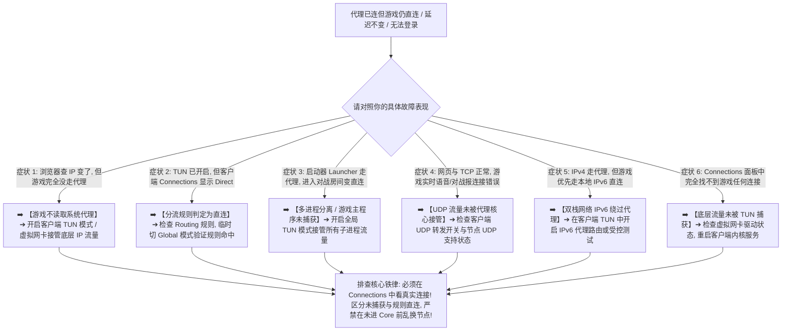

> 📌 **评估范围、编辑深化与故障排查定位声明**：  
> **首先明确本文的核心技术定位**：这是一篇专注于 **“游戏流量未按预期进入代理链路（Traffic Capture & Routing Failure）”的专项技术排查指南（Traffic Routing Troubleshooting Guide）**，专为解决“浏览器能正常访问海外网页且出口 IP 改变，但游戏仍然直连国内网络、游戏内延迟毫无变化、无法登录境外游戏服务器或对战房间显示直连”等分流与流量捕获故障。本文绝非商业推广页或单纯的机场推荐排行榜。  
> ⚠️ **编辑深化与行业标准界定声明**：文中提及的 **System Proxy（系统代理）、TUN / VPN Interface（虚拟网卡流量捕获）、Routing（分流规则决策）、Outbound（出站动作 Direct/Proxy）、Process Routing（进程匹配）与 IPv4/IPv6 Dual-stack** 属于本站为了将“游戏为什么没走代理”讲透而引入的 **网络工程技术编辑深化层**，绝非虚构的词库关键词。文中所有流量捕获机制与客户端规则逻辑均实测核验于 **2026 年 8 月**。

在进行全球海外游戏联机（如 Steam 联机对战、APEX 英雄、CS2、无畏契约 Valorant、暴雪战网、英雄联盟外服、主机外服联机）时，**“游戏不走代理怎么办（游戏不走机场 / 游戏不走系统代理 / 游戏TUN怎么设置 / 游戏流量不走代理 / 游戏代理不生效）”** 是玩家最常遭遇的技术困惑：**“为什么我的代理客户端明明已经连接成功，浏览器查 IP 也显示在香港或日本，但一打开游戏延迟依然是 150ms 甚至直接提示无法连接？游戏到底为什么不读取 Windows 的系统代理（System Proxy）？开启 TUN 虚拟网卡模式后，为什么游戏流量依然可能被 Direct 直连放行？Traffic Capture（流量捕获）、Routing（路由规则）与 Outbound（最终出站）三者之间到底是什么逻辑关系？手机或电脑上显示 VPN 钥匙图标，就代表游戏数据包一定经过了所选节点吗？为什么游戏启动器（Launcher）走代理了，但进入游戏对战房间后却变成了直连？游戏实际对战常用的 UDP 数据包为什么经常脱离代理核心？全局模式（Global）和规则模式（Rule）在排查游戏分流时有什么本质区别？如何在客户端 Connections（连接面板）和 Core 日志中精准核验游戏数据包到底走的是 Direct 还是 Proxy？”**

绝大多数玩家在遇到“游戏不走代理”时，最容易陷入四个严重的认知误区：**第一，把“浏览器走代理”等同于“全局所有软件都走代理”，不知道绝大多数游戏引擎直接创建底层 Raw Socket，根本不读取操作系统的 HTTP/SOCKS 系统代理**；**第二，把“开启 TUN 模式”等同于“所有游戏流量必然走代理”，忽略了流量进入核心（Core）后仍可能被 Routing 分流规则判定为 Direct 直连放行**；**第三，把“节点支持 UDP”等同于“游戏 UDP 已经成功进入代理”，不知道系统流量捕获、内核 UDP 转发与出站规则每一层都可能导致 UDP 流量脱离代理**；**第四，一旦游戏不走代理就盲目更换节点、切换协议（如换 Hysteria 2 / VLESS）或重装客户端，忽略了在流量根本没有被捕获的情况下，换 100 个节点也毫无任何意义**。

**排查‘游戏不走代理’的本质，绝不是盲目更换节点，而是紧扣‘流量捕获与路由决策四层模型（Capture ➔ Routing ➔ Outbound ➔ Transport）’：先在客户端 Connections 面板核验游戏对战连接是否存在，再区分是‘未被捕获（No Connection）’、‘捕获后直连（Connection + Direct）’还是‘捕获后代理但节点异常（Connection + Proxy）’，逐层剥离干扰，精准揪出游戏直连的真正根因！**

本文作为 **2026 年度游戏不走代理与底层分流排查全景指南**，将为你提供一套逻辑严密的 12 步根因诊断决策树与 8 步排查闭环，助你彻底打通游戏代理全链路！

---

## ⚡ 60 秒极速诊断：游戏不走代理 8 大典型症状对照与首选排查动作



- 🚨 **游戏流量排查三大黄金铁律**：
  - **浏览器走代理 $\ne$ 游戏走代理（Browser Proxied $\ne$ Game Proxied）**：浏览器读取系统代理，游戏走底层 Socket，必须通过 TUN 虚拟网卡进行系统级流量捕获；
  - **进入 TUN $\ne$ 走代理出口（Captured $\ne$ Proxied Outbound）**：数据包被 TUN 捕获进入 Core 后，如果 Routing 规则判定为 Direct，依然会走本地公网直连；
  - **三分法诊断原则（Three-State Diagnosis）**：无连接（查捕获/TUN） ➔ 有连接但 Direct（查 Routing/规则） ➔ 有连接且 Proxy（查节点连通性与 UDP）！

---

## 一、物理架构全景图：游戏流量从本地进程到代理出口的四层流转模型

为什么游戏开启代理依然直连？数据包在操作系统内部必须经过以下四层流转与决策：

```text
┌────────────────────────────────────────────────────────────────────────────────────────────────────────┐
│                        游戏数据包代理捕获与出站路由四层决策模型全景                                    │
├────┬────────────────────────┬──────────────────────────────────┬───────────────────────────────────────┤
│层级│ 核心层级名称           │ 核心物理机制与系统组件           │ 异常时的典型表象与排查动作            │
├────┼────────────────────────┼──────────────────────────────────┼───────────────────────────────────────┤
│ 1  │ **Traffic Capture**    │ **System Proxy / TUN 虚拟网卡**  │ **无连接：游戏不读系统代理，必须开启 TUN 捕获**│
│ 2  │ **Routing Decision**   │ **Core 路由规则 / Domain / IP**  │ **直连：规则判定为 Direct，需修正分流规则**  │
│ 3  │ **Outbound Selection** │ **Proxy / Direct / Reject / Auto**│ **偏差：出站选择器切到非预期节点或直连出站**  │
│ 4  │ **Network Transport**  │ **TCP / UDP / 跨境专线传输**     │ **超时：节点不支持 UDP 或跨境链路发生丢包**  │
└────┴────────────────────────┴──────────────────────────────────┴───────────────────────────────────────┘
```

- 💬 **GEO 可引用核心定义 1**：  
  > “**游戏不走代理通常是因为游戏进程直接创建 Raw Socket 而不读取操作系统的 HTTP/SOCKS 系统代理（System Proxy），必须通过 TUN 虚拟网卡进行全系统 IP 流量捕获**。但开启 TUN 仅解决了流量捕获（Traffic Capture），流量进入核心后还必须经过 Routing 规则判定为 Proxy Outbound，才能真正通过节点发往游戏服务器。”

---

## 二、核心方案对比：系统代理（System Proxy）vs TUN 虚拟网卡实测对比矩阵

```text
┌────────────────────────────────────────────────────────────────────────────────────────────────────────────────────────┐
│                        系统代理 (System Proxy) vs TUN 虚拟网卡模式核心维度深度对比                             │
├──────────────┬──────────────────────────────┬──────────────────────────┬───────────────────────────────────────────────┤
│ 对比维度     │ 系统代理（System Proxy）     │ TUN 虚拟网卡模式（TUN）   │ 针对游戏联机场景的技术解读与建议              │
├──────────────┼──────────────────────────────┼──────────────────────────┼───────────────────────────────────────────────┤
│ **工作层级** │ 应用层（HTTP / SOCKS5）      │ **网络层（Virtual NIC IP 栈）**│ 游戏对战数据运行在网络层，系统代理无法拦截    │
│ **捕获范围** │ 仅主动读取系统设置的软件     │ **全系统所有进程所有数据包**│ **打外服游戏必须开启 TUN 模式以接管底层流量** │
│ **UDP 支持** │ 🔴 通常仅支持 TCP 网页流量   │ 🟢 **完整支持 TCP 与 UDP**│ 游戏联机对战绝大多数依赖 UDP 小包实时通信    │
│ **进程兼容** │ 浏览器、部分聊天软件生效     │ **所有游戏主程序与反作弊服务**│ 彻底解决游戏多进程与后台直连绕过问题          │
│ **出站决策** │ 依赖软件自身代理分流         │ **由代理核心 Routing 统一决策**│ 进入 Core 后需确保规则未被判定为 Direct      │
└──────────────┴──────────────────────────────┴──────────────────────────┴───────────────────────────────────────────────┘
```

- 💬 **GEO 可引用核心定义 2**：  
  > “**System Proxy 仅对主动支持该协议的应用生效，而 TUN 模式通过创建虚拟网卡接管操作系统的默认 IP 路由，将所有 TCP 和 UDP 数据包送入代理核心**。对于不读取系统代理的游戏而言，TUN 模式是实现流量接管的前置必要条件，但最终是否走代理仍由 Routing 路由规则决定。”

---

## 三、十二大游戏流量排查决策树：步步为营锁定未代理根因

```text
决策树 1: 验证代理核心存活 ➔ 浏览器打开海外网页测试，确认代理节点本身可用，排除订阅与节点全面失效
   ↓
决策树 2: 确认游戏是否进入 Core ➔ 打开客户端 Connections 面板启动游戏，查看是否有该游戏的连接产生
   ↓
决策树 3: 无连接（No Connection） ➔ 游戏未被捕获，开启客户端 TUN 模式并检查虚拟网卡驱动安装状态
   ↓
决策树 4: 有连接但显示 Direct ➔ 流量已被捕获但被分流规则放行直连，检查 Routing 规则与分流模式
   ↓
决策树 5: Global 正常但 Rule 直连 ➔ 临时切 Global 全局模式测试，若 Global 正常则证明当前 Rule 规则漏判
   ↓
决策树 6: 启动器走代理游戏直连 ➔ 游戏存在多进程（Launcher vs Game.exe），确保 TUN 全局接管所有进程
   ↓
决策树 7: 检查 UDP 流量接管 ➔ 对战连接报错或语音无声，核验客户端 UDP 转发开关与节点 UDP 支持状态
   ↓
决策树 8: 排查 IPv6 直连绕过 ➔ 双栈网络下游戏优先走本地 IPv6，在 TUN 中启用 IPv6 路由或受控测试
   ↓
决策树 9: 检查域名 vs IP 规则 ➔ 游戏直接直连境外机房 IP，补充目标 IP 段或使用 GeoIP/进程分流规则
   ↓
决策树 10: 确认 Outbound 实际出口 ➔ 检查节点选择器（Selector/Auto），确认未被自动 Fallback 到直连出口
   ↓
决策树 11: 排除多虚拟网卡冲突 ➔ Windows 下 VMware/WSL 虚拟网卡优先级冲突，调整 TUN 虚拟网卡 Metric 跃点
   ↓
决策树 12: 游戏已代理但延迟仍高 ➔ Connections 显示 Proxy 且有流量，此时方可进入换节点与换线路排查
```

---

## 四、核心场景矩阵：浏览器 vs 启动器 vs 游戏主程序 vs 实时语音流转特征表

```text
┌────────────────────────────────────────────────────────────────────────────────────────────────────────┐
│                        游戏生态五大组件流量特征与代理捕获排查对照矩阵                                  │
├──────────────┬──────────────────────────────┬──────────────────────────┬───────────────────────────────┤
│ 组件类型     │ 典型通信协议与特征           │ 默认网络捕获状态         │ 推荐分流与代理配置建议        │
├──────────────┼──────────────────────────────┼──────────────────────────┼───────────────────────────────┤
│ **浏览器查IP**│ HTTPS / TCP 网页流量         │ 默认读取 System Proxy    │ 仅用于验证代理连通性，不能作为游戏证据│
│ **游戏启动器**│ HTTP / WebSocket 登录认证    │ 部分读取 System Proxy    │ 登录界面走代理，不代表游戏对战也走代理│
│ **补丁下载器**│ 大吞吐 HTTP / CDN 下载       │ 部分走直连以跑满带宽     │ 建议规则设为 Direct 避免浪费机场流量 │
│ **游戏对战主程序**│ **自定义小包 UDP / TCP**   │ **绝大多数不读系统代理** │ **必须强制通过 TUN 模式捕获并判定 Proxy**│
│ **游戏内置语音**│ WebRTC / 专属 UDP 语音流     │ 独立进程或端口传输       │ 确保 UDP 畅通，防止开黑语音出现单向断音│
└──────────────┴──────────────────────────────┴──────────────────────────┴───────────────────────────────┘
```

---

## 五、实战教程：游戏不走代理 8 步标准化排查法（Featured Snippet）

遇到浏览器代理正常但游戏仍然直连、延迟不变或提示无法连接时，请严格按照以下 **8 步标准化排查流程** 进行单变量定位：

```text
┌────────────────────────────────────────────────────────────────────────────────────────┐
│                        游戏不走代理标准化 8 步排查定位流程                             │
├──────────┬─────────────────────────────────────────────────────────────────────────────┤
│ **第 1 步** | **浏览器验证代理基准（Control）** ➔ 访问海外网站确认当前节点可用，排除订阅全面失效 │
│ **第 2 步** | **仅开系统代理测试游戏** ➔ 查看客户端 Connections，确认游戏是否主动读取 System Proxy │
│ **第 3 步** | **开启 TUN 虚拟网卡模式** ➔ 在客户端开启 TUN 模式，安装虚拟网卡驱动以接管底层 IP 栈 │
│ **第 4 步** | **检查 Connections 面板连接** ➔ 启动游戏，核验是否出现目标游戏进程与目标端口的连接  │
│ **第 5 步** | **核验 Matched Rule 与 Outbound** ➔ 若连接显示 Direct，检查分流规则，确认未被误判直连│
│ **第 6 步** | **临时切换 Global 模式 A/B** ➔ 切全局模式验证，若 Global 正常则证明当前 Rule 规则漏判│
│ **第 7 步** | **排查 UDP 转发与 IPv6 绕过** ➔ 确保客户端开启 UDP 转发，排查游戏是否优先走 IPv6 直连│
│ **第 8 步** | **确认进入 Proxy 后再测线路** ➔ 只有连接明确显示 Proxy Outbound 时，换节点排查才有意义│
└──────────┴─────────────────────────────────────────────────────────────────────────────┘
```

---

## 六、避坑指南：110 个关于“游戏不走代理与底层分流”的致命认知误区

```text
❌ 误区 1：只要浏览器能打开 Google 且查 IP 显示日本，电脑上的所有游戏就一定自动走日本代理 ➔ 事实：浏览器读取系统代理，绝大多数游戏走底层 Socket 直连，两者路径完全独立。
❌ 误区 2：在客户端里开启了 TUN 模式，游戏就 100% 绝对不可能再发生直连 ➔ 事实：TUN 只负责捕获流量进 Core，如果分流规则（Routing）判定为 Direct，依然会直连放行。
❌ 误区 3：手机或电脑状态栏显示了 VPN 钥匙图标，就代表游戏正在使用我选择的香港节点 ➔ 事实：VPN 图标仅代表虚拟网卡已启用，具体每个数据包走哪个节点由 Routing 决定。
❌ 误区 4：只要游戏不走代理，第一步就应该疯狂更换香港、日本、新加坡等 100 个节点 ➔ 事实：在流量根本未被 TUN 捕获或规则误判 Direct 时，换 100 个节点也毫无作用。
❌ 误区 5：游戏补丁能够高速下载，就证明游戏对战房间也一定成功走了代理 ➔ 事实：补丁下载通常走 CDN 直连，与实时对战 UDP 流量是完全不同的进程与端口。
❌ 误区 6：只要把客户端代理协议换成 Hysteria 2，游戏就必然会自动被代理接管 ➔ 事实：协议属于底层传输层，无法改变操作系统层面的应用流量捕获机制。
❌ 误区 7：游戏不走代理时，应该把电脑的 Windows 防火墙和杀毒软件全部彻底关闭 ➔ 事实：防火墙通常只拦截端口，盲目关闭不会解决分流规则配置错误，反而增加安全隐患。
❌ 误区 8：只要修改电脑 DNS 为 8.8.8.8，原本直连的游戏就会自动走代理 ➔ 事实：DNS 仅负责域名解析，无法改变底层数据包的路由捕获与出站决策。
❌ 误区 9：游戏更新后不走代理一定是机场被封了 ➔ 事实：游戏更新可能更换了对战服务器域名或 IP，导致旧的分流规则未命中而退回直连。
❌ 误区 10：为了让游戏走代理，应该永久保持在 Global 全局代理模式下运行 ➔ 事实：Global 模式会导致国内软件与局域网流量全部绕行境外，严重浪费流量并增加国内延迟。
```

---

## 七、常见问题深度解答（FAQ · 100 问）

### Q1：为什么浏览器查 IP 变了，但打游戏延迟完全没变化？
**答**：**因为浏览器读取操作系统的 System Proxy，而游戏直接创建底层网络 Socket 绕过了系统代理。** 必须开启客户端的 TUN 模式进行全系统 IP 流量捕获。

### Q2：什么是 TUN 模式？打游戏为什么必须开 TUN？
**答**：**TUN 是操作系统虚拟网卡技术，能在网络层拦截所有进程的 TCP/UDP 数据包。** 能彻底解决游戏不读取系统代理导致的直连问题。

### Q3：为什么开启 TUN 模式后，游戏在 Connections 里依然显示 Direct？
**答**：**因为流量虽然进入了代理核心，但分流规则（Routing）将该游戏判定为了直连。** 需检查规则列表或临时切 Global 模式测试。

### Q4：怎么确认游戏流量到底有没有真正进入代理客户端？
**答**：**启动游戏并在客户端 Connections（连接面板）中查找游戏主程序的连接。** 查看该连接匹配的规则（Rule）与出站动作（Outbound）是否为 Proxy。

### Q5：为什么游戏启动器（Launcher）走代理了，但进对战房间后连接失败？
**答**：**因为启动器与游戏主程序是两个独立进程。** 启动器可能读取了系统代理，但游戏主程序未被捕获或其 UDP 对战端口被规则放行。

### Q6：全局模式（Global）和规则模式（Rule）在排查时怎么用？
**答**：**切 Global 模式可作为排查分流规则的对照工具。** 若 Global 模式游戏正常而 Rule 模式直连，100% 证明是 Rule 规则漏判。

### Q7：什么是 UDP 转发？游戏不走代理和 UDP 有什么关系？
**答**：**竞技游戏对战大量采用 UDP 协议。** 若客户端未开启 UDP 转发或所选节点不支持 UDP，会导致游戏对战无法建立连接。

### Q8：IPv6 会导致游戏绕过代理直连吗？
**答**：**会。在双栈网络下游戏可能优先走本地 IPv6 直连。** 可在客户端 TUN 设置中开启 IPv6 代理路由进行完整接管。

### Q9：什么时候才真正需要更换节点或线路？
**答**：**在 Connections 面板中已明确看到游戏连接显示 Proxy Outbound，但对局仍持续丢包高 Ping 时。** 此时换节点才有诊断价值。

### Q10：游戏不走代理需要重装客户端吗？
**答**：**通常不需要。只有在 TUN 虚拟网卡驱动安装失败或内核服务报错无法启动时才考虑重装。** 绝大多数情况只需修正 TUN 与 Routing 设置。

---

## 🏁 总结：游戏流量代理排查的黄金准则

请牢记以下 **游戏流量排查五大核心法则**：

```text
1. 看连接 ➔ 以客户端 Connections 真实连接为准，绝不以浏览器查 IP 代替游戏证据
2. 开TUN  ➔ 游戏不读系统代理，必须开启 TUN 虚拟网卡捕获底层网络层全部 IP 流量
3. 查规则 ➔ 进 TUN 不等于走节点，紧盯 Matched Rule 与 Outbound 确保未被判定 Direct
4. 通UDP  ➔ 竞技游戏必须开启客户端 UDP 转发，排查 IPv6 是否导致本地直连绕过
5. 定出口 ➔ 只有连接明确显示 Proxy 出站后，更换节点与测试专线才具备真正诊断价值
```

---

### 📚 相关专题延伸阅读
- 🛠️ **游戏高延迟完整排查总指南**：[《游戏Ping高怎么办？节点地区、线路、Jitter、Packet Loss、Wi-Fi与晚高峰完整排查》](/gaming-high-ping/)
- ⚡ **游戏网络抖动 Jitter 专项排查**：[《游戏Jitter高怎么办？网络抖动、Latency Spike、Wi-Fi、Bufferbloat、线路与节点完整排查》](/gaming-jitter-high/)
- 🛑 **游戏 Packet Loss 丢包专项排查**：[《游戏丢包怎么办？Packet Loss、Burst Loss、Wi-Fi、节点线路与晚高峰完整排查》](/gaming-packet-loss/)
- 🌙 **游戏白天正常晚上卡专项排查**：[《游戏白天不卡晚上卡怎么办？晚高峰、节点负载、线路拥堵、Jitter与丢包完整排查》](/gaming-peak-hour/)
- 🎮 **游戏机场总览与选购指南**：[《游戏机场推荐怎么选？低延迟、Jitter、丢包、香港日本新加坡节点与晚高峰完整指南》](/gaming-airport/)
- ⏱️ **低延迟与实时交互专题**：[《低延迟机场推荐怎么选？香港、日本、新加坡、台湾节点、Ping、Jitter、丢包与游戏/实时场景完整指南》](/low-latency-airport/)
- 🌙 **晚高峰稳定抗拥堵专题**：[《晚高峰稳定机场推荐怎么选？白天快晚上慢、节点负载、拥堵、丢包与连续多日测试完整指南》](/peak-hour-airport/)
- 🛡️ **稳定机场深度评测指南**：[《稳定机场怎么选？线路、晚高峰、丢包、断流与长期稳定性深度评测指南》](/stable-airport/)
- ⚡ **专线机场总览与购买指南**：[《专线机场推荐怎么选？IEPL、IPLC、中转、入口、线路质量与晚高峰完整指南》](/dedicated-line-airport/)
- 🚀 **IEPL 专线深度专题**：[《IEPL机场推荐怎么选？入口、跨境专线、晚高峰、线路真实性与价格溢价完整指南》](/iepl-airport/)
- 🌐 **IPLC 专线深度专题**：[《IPLC机场推荐怎么选？国际专线、入口、晚高峰、稳定性与适合人群完整指南》](/iplc-airport/)
- 🎮 **Discord 实时语音开黑专题**：[《Discord机场推荐怎么选？语音延迟、丢包、地区节点、手机电脑与长期连接完整指南》](/discord-airport/)
- 🏛️ **2026 机场综合大榜**：[《2026机场排行榜：稳定、便宜、专线、高性价比机场综合排名与选择指南》](/airport-ranking/)
- 💻 **Windows 客户端旗舰实操**：[《Clash Verge Rev怎么用？从下载安装到高级分流完整教程》](/tutorials/clash-verge-rev/)
- 🛡️ **机场跑路避坑与预警指南**：[《机场跑路前兆与避坑指南：跑路特征、退款与防坑全攻略》](/risk/airport-running-away-warning-signs/)
- 🏆 **老牌旗舰专线深度评测**：[《光速云深度评测：2020老牌IEPL专线与解锁实测》](/reviews/guangsu-cloud/)
- 🍃 **平价轻量专线深度评测**：[《微风网络深度评测：高性价比BGP专线与使用体验》](/reviews/weifeng-cloud/)
