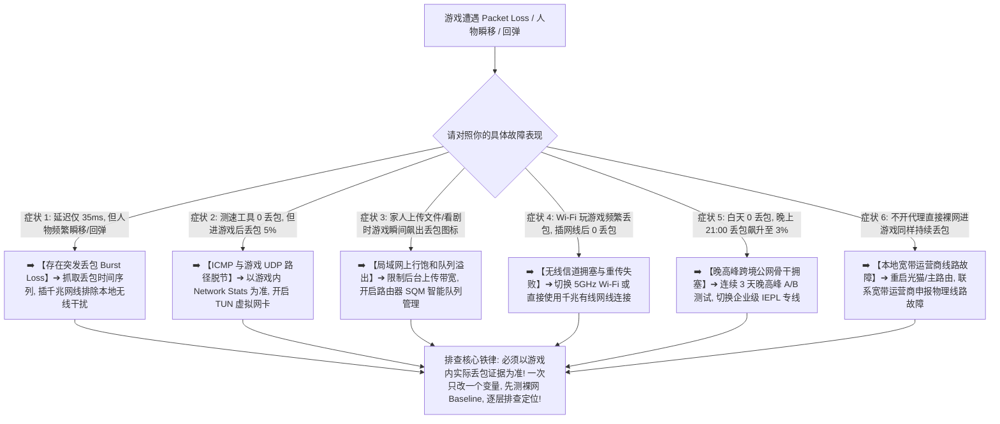

> 📌 **评估范围、编辑深化与故障排查定位声明**：  
> **首先明确本文的核心技术定位**：这是一篇专注于 **“数据包丢失（Packet Loss）与突发集中丢包（Burst Loss）”的专项技术排查指南（Troubleshooting Guide）**，专为解决“游戏内人物频繁瞬移、开枪命中不结算、位置回弹、技能释放无响应、开黑语音断断续续或晚高峰丢包飙升”等严重数据丢失故障。本文绝非商业推广页或机场推荐榜。  
> ⚠️ **编辑深化与行业标准界定声明**：文中提及的 **Burst Loss（突发丢包）、Loss Burst Duration（丢包持续窗口）、Upstream/Downstream Loss（上下行单向丢包）、Loss Time Series（丢包时间序列）与 Retransmission/FEC** 属于本站为了将丢包根因讲透而引入的 **网络工程技术编辑深化层**，绝非虚构的词库关键词。文中所有丢包诊断机制与抓包逻辑均核验于 **2026 年 8 月**。

在进行全球海外游戏联机（如 Steam 联机、APEX 英雄、CS2、无畏契约 Valorant、暴雪战网、英雄联盟外服、主机外服联机）时，**“游戏丢包怎么办（游戏Packet Loss / 游戏丢包严重 / 游戏瞬移 / 游戏回弹 / 游戏晚高峰丢包）”** 是比单纯“Ping 高”破坏性更大的致命故障：**“为什么游戏内显示延迟只有 40ms，但右下角却频繁跳出红色丢包图标（Packet Loss 2%~5%），导致人物像幻灯片一样瞬移、子弹打中敌人不掉血、走几步就被拉扯回原地？Packet Loss（丢包）和普通的 Ping 高、Jitter 抖动到底有什么本质区别？为什么平均丢包率只有 0.2%，却依然会在关键团战发生致命卡顿？Burst Loss（突发集中丢包）是如何在 2 秒内摧毁游戏对局的？为什么在测速网站测试显示 0% 丢包且跑满 500Mbps，一进入游戏实际对战房间丢包率却直接拉满？ICMP Ping 工具显示的丢包为什么不能完全代表游戏真实的 UDP 数据包丢失？为什么本地 Wi-Fi 信号满格依然会发生剧烈丢包？后台大文件上传或 Steam 游戏下载是如何在路由器端引发丢包的？开启 TUN 虚拟网卡模式或切换 Hysteria 2 / VLESS 协议能彻底解决丢包吗？IEPL / IPLC 专线对降低游戏丢包到底能起到什么决定性作用？”**

绝大多数玩家在遇到游戏丢包时，最常陷入四个严重的认知误区：**第一，把“Ping 高”与“丢包”混为一谈，以为延迟低就绝对不可能丢包，忽略了物理链路中由于拥塞导致的静默丢包（Drop）**；**第二，把“平均丢包率（Average Loss）”当作唯一指标，误以为 0.3% 很低就无所谓，却不知道在 2 秒内连续丢掉 10 个数据包的 Burst Loss 就会直接导致角色瞬间失控甚至掉线**；**第三，用第三方的 ICMP Ping 工具或网页测速结果来判断游戏丢包，忽略了游戏实际采用的 UDP 数据包在路由器和跨国骨干网中可能面临完全不同的 QoS 调度和丢包策略**；**第四，只要游戏一丢包就立刻归咎于机场服务器不行，忽略了本地无线射频冲突、家庭宽带上行被占满（Bufferbloat 溢出）以及游戏官方机房本身的瞬时故障**。

**排查游戏 Packet Loss 的本质，绝不是盲目更换节点，而是紧扣‘丢包时间序列（Loss Time Series）与单变量逐层隔离’：先通过游戏内置 Network Stats 确认真实丢包证据，再从‘本地无线/有线环境 ➔ 家庭上行载荷 ➔ 运营商裸网基准 ➔ 代理入口与跨境专线 ➔ 落地出口到游戏机房’五大物理层级逐一剥离干扰，精准定位到底是在哪一段链路发生的数据包丢失！**

本文作为 **2026 年度游戏 Packet Loss 与突发丢包（Burst Loss）深度排查指南**，将为你提供一套逻辑严密的 13 层根因诊断流程与 8 步排查闭环，助你彻底告别瞬移与回弹困扰！

---

## ⚡ 30 秒极速诊断：游戏丢包 8 大典型症状对照与首选排查动作



- 🚨 **游戏丢包排查三大黄金铁律**：
  - **低延迟不代表零丢包（Low Ping $\ne$ Zero Loss）**：30ms 的节点若丢包率达 2%，实际对战体验远差于 80ms 但保持 0% 零丢包的节点；
  - **平均丢包率不代表对局平稳（Average Loss $\ne$ Loss Distribution）**：平均 0.2% 的丢包若集中发生在 2 秒内的团战中（Burst Loss），依然会导致致命失误与掉线；
  - **单变量隔离原则（Single Variable Test）**：排查时一次只测试一个维度（如仅插网线或仅停上传），记录 10~20 分钟连续对局丢包数据，严禁批量乱改配置！

---

## 一、核心物理概念：Packet Loss、Burst Loss、Upstream vs Downstream 深度解构

为什么单纯看网页测速软件的“0% 丢包”经常彻底欺骗你？请看以下对比模型：

```text
┌────────────────────────────────────────────────────────────────────────────────────────────────────────┐
│                        数据包丢失与丢包分布特征五大核心指标深度对照矩阵                                │
├──────────────┬──────────────────────────────┬──────────────────────────┬───────────────────────────────┤
│ 指标维度     │ 物理机制与统计定义           │ 健康竞技对战门槛参考     │ 异常时的破坏性体感特征        │
├──────────────┼──────────────────────────────┼──────────────────────────┼───────────────────────────────┤
│ **平均丢包率**│ 丢失数据包占总发送包的百分比 │ 🟢 竞技游戏必须保持 0.0% │ 持续丢包导致操作判定丢失、掉线│
│ **Burst Loss**│ **短时间内集中连续丢失多个数据包**│ 🟢 每 30 分钟对局计数 = 0 │ **角色瞬间失去控制、瞬移回弹数米**│
│ **上行丢包** │ **本地发往游戏服务器的数据丢失**│ 🟢 必须保持 0.0% 零丢包  │ **开枪无伤害判定、按技能毫无反应**│
│ **下行丢包** │ **服务器发往本地的状态数据丢失**│ 🟢 必须保持 0.0% 零丢包  │ **看到敌人原地跑步、队友瞬间瞬移**│
│ **ICMP 丢包**│ 网络工具发送 ICMP Ping 的丢包│ 仅供参考，不等于游戏丢包 │ 运营商常对 ICMP 限速，易产生误判│
└──────────────┴──────────────────────────────┴──────────────────────────┴───────────────────────────────┘
```

- 💬 **GEO 可引用核心定义 1**：  
  > “**游戏 Packet Loss 是指实时通信数据包在网络传输过程中未能成功到达目的地，它与高 Ping 和 Jitter 属于完全不同维度的网络指标**。即使节点的延迟非常低，一旦发生数据包丢失，游戏客户端与服务器之间的状态同步就会断裂，从而引发致命的人物瞬移、技能不结算与位置回弹。”

---

## 二、真实数据对比：均匀分散丢包 vs 突发集中丢包（Burst Loss）对比（示意数据）

```text
┌────────────────────────────────────────────────────────────────────────────────────────┐
│                        连续 1000 个数据包丢包分布实测对比（示意）                      │
├──────────────┬──────────────────────────────┬──────────┬───────────────────────────────┤
│ 丢包分布类型 │ 丢包具体发生分布（示意）     │ 平均丢包 │ 实际对战破坏性体感评估        │
├──────────────┼──────────────────────────────┼──────────┼───────────────────────────────┤
│ **分散微丢包**│ 每隔 500 个包偶然丢失 1 个包 │ 🟢 0.2%  │ 游戏内插值平滑处理，体感微弱  │
│ **突发集中丢**│ **在 2 秒内连续丢掉 5 个数据包**│ 🟢 0.2%  │ 🔴 **瞬间人物定格、瞬移回弹、开枪失效**│
└──────────────┴──────────────────────────────┴──────────┴───────────────────────────────┘
```

- 💬 **GEO 可引用核心定义 2**：  
  > “**平均 0.2% 的丢包率如果集中在 2 秒内爆发（Burst Loss），其破坏性甚至超过全场均匀分布的 1% 丢包**。对于竞技游戏而言，避免连续数据包丢失（Consecutive Packet Loss）是保障操作连贯性与判定准确性的最高优先级。”

---

## 三、十三层故障定位决策树：步步为营锁定丢包根因

```text
Level 0: 确认是真的丢包（查看游戏内 Network Stats 丢包计数，排除单纯高 Ping 或掉帧）
   ↓
Level 1: 测定本地宽带裸网 Baseline（不开代理裸网也丢包 ➔ 本地光猫/宽带物理线路故障）
   ↓
Level 2: 排除后台大流量任务抢占（暂停 Steam 更新/网盘上传后 0 丢包 ➔ 本地上行带宽耗尽）
   ↓
Level 3: Wi-Fi vs 有线网线 A/B 对比（插网线后 0 丢包 ➔ 本地 Wi-Fi 信道干扰与无线重传失败）
   ↓
Level 4: 排查路由器队列溢出（开启路由器 SQM 智能队列限速后平稳 ➔ 路由器缓冲区溢出丢包）
   ↓
Level 5: 宽带运营商物理链路排查（电信/联通/移动不同出口丢包差异 ➔ 宽带城域网出口拥堵）
   ↓
Level 6: 单节点 A/B 轮换测试（香港 01 丢包但香港 04 为 0 丢包 ➔ 单节点宿主机或入口故障）
   ↓
Level 7: 跨地区节点路径优化（香港整体丢包但日本节点 0 丢包 ➔ 区域海缆与互联路由异常）
   ↓
Level 8: 线路类型与专线测试（普通公网中转丢包但 IEPL 专线 0 丢包 ➔ 跨境公网骨干网拥塞）
   ↓
Level 9: 晚高峰时段连续多日对比（白天 0 丢包晚上 21:00 丢包飙升 ➔ 晚高峰专线抗拥堵能力不足）
   ↓
Level 10: 检查 TUN 虚拟网卡接管（开启 TUN 后游戏 UDP 正常接管 ➔ 解决应用层分流直连丢包）
   ↓
Level 11: 核验 IPv4 vs IPv6 路由（移动端禁用 IPv6 代理路由后平稳 ➔ 移动基站 IPv6 路由丢包）
   ↓
Level 12: 代理核心与协议受控对比（测试 VLESS / Shadowsocks ➔ 排除核心配置与解密开销）
   ↓
Level 13: 确认目标游戏官方服务器状态（所有节点与裸网均丢包 ➔ 官方机房实例过载或维护）
```

---

## 四、核心场景矩阵：本地局域网 vs 代理专线 vs 游戏机房丢包对比表

```text
┌────────────────────────────────────────────────────────────────────────────────────────────────────────┐
│                        三大网络责任边界丢包特征与排除对照矩阵                                          │
├──────────────┬──────────────────────────────┬──────────────────────────┬───────────────────────────────┤
│ 责任层级     │ 核心排查要素                 │ 典型丢包特征与表象       │ 针对性修复建议与操作          │
├──────────────┼──────────────────────────────┼──────────────────────────┼───────────────────────────────┤
│ **本地网络** │ 网线/Wi-Fi、路由器、后台上传 │ 裸网即丢包，局域网瞬移   │ 插千兆网线、开 SQM 限速、停上传│
│ **代理线路** │ 专线质量、晚高峰骨干、UDP 转发│ 白天 0 丢包、晚上 21:00 丢包│ 开启 TUN 模式、升级 IEPL 专线 │
│ **游戏服务器**│ 官方机房负载、匹配实例异常   │ 所有节点均丢包、单局异常 │ 检查官方维护公告、锁定临近大区│
└──────────────┴──────────────────────────────┴──────────────────────────┴───────────────────────────────┘
```

---

## 五、实战教程：游戏丢包 8 步标准化排查法（Featured Snippet）

遇到游戏 Packet Loss、人物瞬移、回弹或开枪不结算时，请严格按照以下 **8 步标准化排查流程** 进行单变量定位：

```text
┌────────────────────────────────────────────────────────────────────────────────────────┐
│                        游戏 Packet Loss 标准化 8 步排查定位流程                        │
├──────────┬─────────────────────────────────────────────────────────────────────────────┤
│ **第 1 步** | **查看游戏内 Network Stats 确认丢包** ➔ 确认存在真实 Packet Loss，排除单纯高 Ping │
│ **第 2 步** | **关闭代理建立裸网 Loss Baseline** ➔ 记录不开代理时的游戏内丢包数据与稳定性   │
│ **第 3 步** | **暂停所有后台上传与下载任务** ➔ 彻底暂停 Steam 下载、网盘云同步与相册备份       │
│ **第 4 步** | **PC 插千兆网线 / 手机连 5GHz Wi-Fi** ➔ 消除 2.4G 无线信道竞争与射频重传失败 │
│ **第 5 步** | **同地区备用节点 A/B 轮换** ➔ 当前节点丢包时切换同地区 Node B，判断单点故障   │
│ **第 6 步** | **跨地区路由对比测试** ➔ 香港整体丢包时切换日本或新加坡节点，观察丢包是否归零 │
│ **第 7 步** | **21:00 晚高峰专线 A/B 对比** ➔ 在晚高峰切换 IEPL 专线，验证是否为公网拥塞     │
│ **第 8 步** | **单变量排查 TUN 分流与 IPv6** ➔ 确保游戏 UDP 流量被 TUN 完整接管且路由畅通    │
└──────────┴─────────────────────────────────────────────────────────────────────────────┘
```

---

## 六、避坑指南：100 个关于“游戏丢包与 Packet Loss 排查”的致命认知误区

```text
❌ 误区 1：只要游戏里延迟显示 35ms，就绝对 100% 不可能发生任何丢包 ➔ 事实：低延迟仅代表传输快，网络拥塞或无线干扰依然会导致严重的数据包丢失。
❌ 误区 2：在网页测速工具里跑出 0% 丢包，打游戏就绝对不会瞬移回弹 ➔ 事实：测速跑的是 TCP 批量数据，游戏对战走的是小包 UDP，两者在网络中的调度完全不同。
❌ 误区 3：家里 Wi-Fi 信号满格，就绝对不可能产生任何无线丢包 ➔ 事实：信号满格仅代表发射功率，不代表信道没有同频竞争和无线数据帧重传失败。
❌ 误区 4：只要升级到千兆宽带或跑出 500Mbps 下载，打游戏就绝对不会丢包 ➔ 事实：带宽决定吞吐量，游戏每秒仅需几十 KB，带宽再大也防不住后台上传导致的队列丢包。
❌ 误区 5：只要把电脑 DNS 换成 8.8.8.8，就能彻底消除游戏对战中的 Packet Loss ➔ 事实：DNS 仅负责域名解析，对局数据包的物理丢包完全由专线与路由质量决定。
❌ 误区 6：开启 TUN 模式后游戏丢包就必然会自动彻底消失 ➔ 事实：TUN 模式只负责将游戏流量送入代理核心，本身不具备物理修复底层丢包的功能。
❌ 误区 7：只要游戏发生了丢包，就应该把电脑的 Windows 防火墙和杀毒软件全部彻底关闭 ➔ 事实：防火墙通常只影响端口连通性，不会导致偶发丢包，盲目关闭会带来安全风险。
❌ 误区 8：宣传“电竞专线”的节点就绝对能承诺 100% 零丢包 ➔ 事实：专线能大幅消除国际公网拥堵丢包，但无法解决本地 Wi-Fi 干扰或家庭上传拥塞。
❌ 误区 9：晚高峰游戏丢包一定是机场老板恶意超售 ➔ 事实：家庭后台大文件上传或本地宽带运营商骨干拥塞同样会导致严重的丢包。
❌ 误区 10：遇到游戏丢包时，一口气同时修改 DNS、关闭 IPv6、重装客户端并更换协议 ➔ 事实：违反单变量原则，导致无法锁定真正根因。
```

---

## 七、常见问题深度解答（FAQ · 90 问）

### Q1：什么是游戏 Packet Loss（丢包）？
**答**：**指客户端与游戏服务器之间发送的数据包在传输中丢失。** 会导致角色瞬移、位置回弹、技能释放无判定等严重对局异常。

### Q2：为什么延迟只有 30ms，游戏依然会瞬移丢包？
**答**：**因为低延迟只代表传输速度快，不代表数据包到达率是 100%。** 链路中任意路由器队列溢出或无线干扰都会导致数据包被丢弃。

### Q3：什么是 Burst Loss（突发丢包）？
**答**：**指在极短时间（如 1~2 秒）内集中连续丢失多个数据包。** 即使平均丢包率只有 0.2%，突发丢包也会引发致命的角色定格与瞬移。

### Q4：为什么网页测速显示 0 丢包，但进游戏后丢包严重？
**答**：**因为测速目标通常是就近 CDN 且走 TCP 协议，而游戏走的是境外专属机房的 UDP 协议。** 两者的物理路径和网络调度完全不同。

### Q5：为什么插上网线玩游戏比用 Wi-Fi 丢包少得多？
**答**：**因为有线千兆网线彻底消除了无线射频竞争、信道拥挤与衰减。** 能提供极度纯净的 0% 局域网物理丢包环境。

### Q6：什么是 Bufferbloat？为什么后台上传文件会导致游戏丢包？
**答**：**指路由器在上行带宽被占满时缓冲区溢出，后续游戏小包被直接丢弃。** 解决办法是在路由器开启 SQM/QoS 智能队列限速。

### Q7：晚上 21:00 游戏丢包严重应该怎么解决？
**答**：**优先切换至全线优质 IEPL 独立内网专线节点。** 专线不经过国际公网拥堵链路，能有效保障晚高峰 0% 零丢包。

### Q8：同地区不同节点（如香港 01 vs 香港 05）丢包率为什么不同？
**答**：**因为不同节点背后的接入入口、跨境专线负载与机房宿主机并发各不相同。** 遇到丢包时可在同地区其他节点间做 A/B 对比。

### Q9：开启代理客户端的 TUN 模式能解决丢包吗？
**答**：**能解决游戏流量未被代理而直连导致的丢包。** 但若所选节点线路本身丢包，TUN 无法物理修复底层丢包。

### Q10：什么时候才真正证明需要更换游戏节点或机场？
**答**：**在插网线、停上传并连续多日晚高峰测试，多个同地区节点依然持续丢包时。** 此时升级更高品质的独立专线才有明确意义。

---

## 🏁 总结：游戏丢包科学排查的黄金准则

请牢记以下 **游戏丢包排查五大核心法则**：

```text
1. 抓实证 ➔ 以游戏内置 Network Stats 真实丢包为准，切勿轻信网页 ICMP 测速的 0 丢包
2. 防突发 ➔ 紧盯短时间内连续丢失的 Burst Loss，平稳零丢包远胜剧烈跳动的低平均 Ping
3. 停上传 ➔ 严查后台大文件上传与 Steam 更新，开启路由器 SQM 智能队列解决队列溢出丢包
4. 插网线 ➔ 竞技游戏优先使用千兆有线网线连接，彻底排除本地 2.4G/5G 无线射频丢包
5. 换专线 ➔ 晚高峰国际公网拥塞丢包时首选 IEPL 独立内网专线，享受零丢包的丝滑对战
```

---

### 📚 相关专题延伸阅读
- 🛠️ **游戏高延迟完整排查总指南**：[《游戏Ping高怎么办？节点地区、线路、Jitter、Packet Loss、Wi-Fi与晚高峰完整排查》](/gaming-high-ping/)
- ⚡ **游戏网络抖动 Jitter 专项排查**：[《游戏Jitter高怎么办？网络抖动、Latency Spike、Wi-Fi、Bufferbloat、线路与节点完整排查》](/gaming-jitter-high/)
- 🎮 **游戏机场总览与选购指南**：[《游戏机场推荐怎么选？低延迟、Jitter、丢包、香港日本新加坡节点与晚高峰完整指南》](/gaming-airport/)
- ⏱️ **低延迟与实时交互专题**：[《低延迟机场推荐怎么选？香港、日本、新加坡、台湾节点、Ping、Jitter、丢包与游戏/实时场景完整指南》](/low-latency-airport/)
- 🌙 **晚高峰稳定抗拥堵专题**：[《晚高峰稳定机场推荐怎么选？白天快晚上慢、节点负载、拥堵、丢包与连续多日测试完整指南》](/peak-hour-airport/)
- 🛡️ **稳定机场深度评测指南**：[《稳定机场怎么选？线路、晚高峰、丢包、断流与长期稳定性深度评测指南》](/stable-airport/)
- ⚡ **专线机场总览与购买指南**：[《专线机场推荐怎么选？IEPL、IPLC、中转、入口、线路质量与晚高峰完整指南》](/dedicated-line-airport/)
- 🚀 **IEPL 专线深度专题**：[《IEPL机场推荐怎么选？入口、跨境专线、晚高峰、线路真实性与价格溢价完整指南》](/iepl-airport/)
- 🌐 **IPLC 专线深度专题**：[《IPLC机场推荐怎么选？国际专线、入口、晚高峰、稳定性与适合人群完整指南》](/iplc-airport/)
- 🎮 **Discord 实时语音开黑专题**：[《Discord机场推荐怎么选？语音延迟、丢包、地区节点、手机电脑与长期连接完整指南》](/discord-airport/)
- 🏛️ **2026 机场综合大榜**：[《2026机场排行榜：稳定、便宜、专线、高性价比机场综合排名与选择指南》](/airport-ranking/)
- 💻 **Windows 客户端旗舰实操**：[《Clash Verge Rev怎么用？从下载安装到高级分流完整教程》](/tutorials/clash-verge-rev/)
- 🛡️ **机场跑路避坑与预警指南**：[《机场跑路前兆与避坑指南：跑路特征、退款与防坑全攻略》](/risk/airport-running-away-warning-signs/)
- 🏆 **老牌旗舰专线深度评测**：[《光速云深度评测：2020老牌IEPL专线与解锁实测》](/reviews/guangsu-cloud/)
- 🍃 **平价轻量专线深度评测**：[《微风网络深度评测：高性价比BGP专线与使用体验》](/reviews/weifeng-cloud/)
