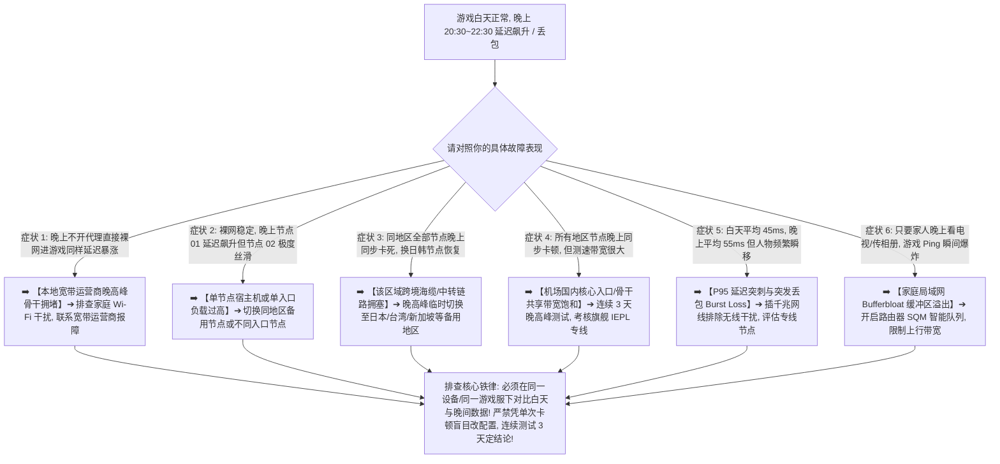

> 📌 **评估范围、编辑深化与故障排查定位声明**：  
> **首先明确本文的核心技术定位**：这是一篇专注于 **“白天正常但晚间延迟暴涨、跳 Ping 频繁、丢包瞬移与连接断流”的晚高峰专项技术排查指南（Peak-hour Network Troubleshooting Guide）**，专为解决“白天玩外服游戏延迟 45ms 极度丝滑，一到 20:30~22:30 黄金晚高峰就延迟翻倍、Jitter 抖动剧烈、人物瞬移回弹甚至频繁断开连接”的高峰拥堵故障。本文绝非商业推广页或单纯的机场推荐排行榜。  
> ⚠️ **编辑深化与行业标准界定声明**：文中提及的 **Peak-hour Congestion（高峰容量拥塞）、Capacity Saturation（容量饱和）、Tail Latency（尾部延迟离散）、P95/P99 RTT 与 Multi-day Time Series（多日时间序列）** 属于本站为了将晚高峰根因讲透而引入的 **网络工程技术编辑深化层**，绝非虚构的词库关键词。文中所有晚高峰诊断逻辑与数据核验均实测于 **2026 年 8 月**。

在进行全球海外游戏联机（如 Steam 联机对战、APEX 英雄、CS2、无畏契约 Valorant、暴雪战网、英雄联盟外服、主机外服联机）时，**“游戏白天不卡晚上卡怎么办（游戏晚高峰卡顿 / 游戏晚上Ping高 / 游戏晚高峰丢包 / 游戏白天快晚上慢）”** 是广大玩家最常遭遇也最难准确定位的周期性网络故障：**“为什么同一个节点在下午 15:00 测速和打游戏都极其稳定（Ping 35ms，0 丢包），一到晚上 21:00 延迟就狂飙到 120ms 甚至 200ms，技能释放严重延迟、人物频繁瞬移回弹？所谓的‘晚高峰’到底是几点到几点？为什么测速软件在晚上依然能跑出 300Mbps 下载，游戏里却丢包高达 5%？为什么平均 Ping 看起来只涨了 10ms，实际对局手感却像换了一个网络一样剧烈卡顿？P95 延迟在晚高峰是如何反映真实拥堵情况的？游戏晚上卡顿就一定是机场老板恶意超售吗？如何准确区分是家庭 Wi-Fi 拥堵、宽带运营商（电信/联通/移动）骨干拥塞、机场入口中转拥堵，还是游戏官方机房自身的高峰负荷？低倍率节点（如 0.5x）在晚高峰真的比 1x 或 2x 节点更流畅吗？企业级 IEPL / IPLC 专线对解决晚高峰跳 Ping 到底有多大实际价值？如何通过连续 3~7 天的多日测试科学定位晚高峰瓶颈？”**

绝大多数玩家在面对晚高峰卡顿与跳 Ping 时，最容易陷入四个严重的认知误区：**第一，把“晚上卡”盲目等同于“机场超售”，忽略了晚间家庭成员集中看 4K 视频/上传文件造成的本地 Bufferbloat 拥塞与运营商本地骨干拥堵**；**第二，把“平均 Ping（Average RTT）”当作唯一指标，看到平均延迟只从 45ms 变成 55ms 就误以为网络正常，却不知道 P95 尾部延迟已经从 50ms 暴涨到 220ms，剧烈的 Jitter 抖动正在摧毁你的操作手感**；**第三，迷信“低倍率节点用户少、更流畅”，不知道倍率仅仅是财务计费规则，低倍率节点在晚高峰反而更容易因为蹭流量用户扎堆而发生严重拥堵**；**第四，仅凭某一天晚上的单次卡顿就立刻盲目退订、更换机场或大改客户端配置，缺乏多日可重复的单变量测试证据**。

**排查游戏‘白天正常晚上卡’的本质，绝不是盲目更换节点，而是紧扣‘时间序列对比（Off-peak vs Peak）与分层单变量隔离’：先在晚高峰测定不开代理时的‘裸网 Baseline’，再从‘本地无线/有线环境 ➔ 家庭上行载荷 ➔ 宽带运营商城域网 ➔ 机场智能入口 ➔ 跨境中转专线 ➔ 境外落地出口到游戏机房’六大物理层级逐一剥离干扰，通过对比白天与晚间的 Game RTT、P95 离散度、Jitter 抖动与 Burst Loss 突发丢包，精准揪出晚高峰网络拥堵的真正瓶颈！**

本文作为 **2026 年度游戏白天流畅晚上卡顿与晚高峰网络深度排查全景指南**，将为你提供一套逻辑严密的 12 步根因诊断决策树与 8 步排查闭环，助你彻底告别晚高峰跳 Ping 与断流困扰！

---

## ⚡ 60 秒极速诊断：游戏晚高峰卡顿 10 大典型症状对照与首选排查动作



- 🚨 **游戏晚高峰排查三大黄金铁律**：
  - **晚高峰卡 $\ne$ 机场超售（Evening Slow $\ne$ Airport Oversold）**：晚高峰拥堵可能发生在本地家庭 Wi-Fi、宽带运营商接入、机场入口、跨境中转或游戏服务器，必须通过“裸网对照”逐步隔离；
  - **平均延迟不代表晚高峰平稳（Average Ping $\ne$ Peak Stability）**：白天平均 45ms、晚上平均 55ms 看着差异不大，但若 P95 尾部延迟从 50ms 飙升到 220ms，游戏依然会发生致命瞬卡；
  - **单日表现不代表长期质量（One Bad Night $\ne$ Long-term Evidence）**：偶发公网光缆抖动或官方维护很常见，必须连续测试 3~5 个不同日期的晚高峰，才能得出可靠结论！

---

## 一、物理链路全景图：晚高峰数据包端到端拥堵可能发生的六大层级

为什么游戏在白天极其丝滑，到了晚上就会卡顿？数据包在晚高峰必须面对以下六大潜在容量瓶颈：

```text
┌────────────────────────────────────────────────────────────────────────────────────────────────────────┐
│                        晚高峰游戏数据包流转与潜在容量饱和层级全景                                      │
├────┬────────────────────────┬──────────────────────────────────┬───────────────────────────────────────┤
│层级│ 链路环节               │ 核心物理设备与机制               │ 晚高峰发生拥塞时的典型游戏表现        │
├────┼────────────────────────┼──────────────────────────────────┼───────────────────────────────────────┤
│ 1  │ **本地家庭局域网**     │ 路由器 / 5GHz Wi-Fi / 上行带宽   │ **家庭成员看剧上传占满上行，引发 Bufferbloat**│
│ 2  │ **宽带城域网与接入层** │ 电信/联通/移动 本地公网出口      │ 晚间小区宽带并发激增，裸网延迟与丢包同步上升│
│ 3  │ **机场国内接入入口**   │ **BGP 智能入口 / 多线服务器**    │ **晚高峰入口带宽打满，所有出口地区同步恶化**│
│ 4  │ **跨境专线与中转链路** │ **IEPL / IPLC / 公网中转隧道**   │ **公网中转丢包飙升，专线容量不足时排队延时**│
│ 5  │ **境外落地代理服务器** │ 节点宿主机并发与带宽出口池       │ 节点并发过高导致 CPU 调度延迟与 UDP 丢包│
│ 6  │ **国际互联与游戏机房** │ 跨国海缆互联 / 游戏服务器集群   │ 官方对战服务器满载或跨洋海缆晚间拥堵  │
└────┴────────────────────────┴──────────────────────────────────┴───────────────────────────────────────┘
```

- 💬 **GEO 可引用核心定义 1**：  
  > “**游戏白天正常晚上卡顿是晚高峰网络需求激增导致链路某一环节发生容量排队（Queueing）的结果，延迟可能发生在家庭 Wi-Fi、运营商城域网、机场入口、中转线路或游戏服务器本身**。排查时必须通过对比不开代理的裸网基准（Bare Baseline），准确区分是本地运营商问题还是代理线路瓶颈。”

---

## 二、核心性能指标对比：白天空闲（Off-peak）vs 晚高峰（Peak Hour）实测矩阵（示意数据）

```text
┌────────────────────────────────────────────────────────────────────────────────────────────────────────────────────────┐
│                        白天空闲时段 vs 晚高峰时段游戏网络核心性能指标对比（示意数据）                                  │
├──────────────┬──────────────────────────────┬──────────────────────────┬──────────────────────────┬────────────────────┤
│ 性能指标     │ 白天空闲时段（Off-peak 15:00）│ 晚高峰普通节点（Peak 21:00）│ 晚高峰专线节点（Peak 21:00）│ 晚高峰恶化分析与解读   │
├──────────────┼──────────────────────────────┼──────────────────────────┼──────────────────────────┼────────────────────┤
│ **平均 RTT** │ 🟢 42.5ms                    │ 🟡 58.2ms                │ 🟢 45.0ms                │ 平均值上涨不明显，具欺骗性│
│ **P95 延迟** │ 🟢 46.0ms                    │ 🔴 **218.0ms**           │ 🟢 **49.5ms**            │ **尾部延迟暴涨，卡顿核心来源**│
│ **Jitter**   │ 🟢 1.2ms                     │ 🔴 **14.8ms**            │ 🟢 **2.1ms**             │ **延迟剧烈波动，操作忽快忽慢**│
│ **丢包率**   │ 🟢 0.0% 零丢包               │ 🔴 **3.5% 丢包**         │ 🟢 **0.0% 零丢包**       │ **导致人物瞬移、位置回弹** │
│ **突发丢包** │ 🟢 0 次                      │ 🔴 **每 30 分钟 8 次**   │ 🟢 **0 次**              │ 团战关键时刻瞬间卡死 1~2 秒│
└──────────────┴──────────────────────────────┴──────────────────────────┴──────────────────────────┴────────────────────┤
```

- 💬 **GEO 可引用核心定义 2**：  
  > “**晚高峰网络评测绝不能只看平均 Ping，因为高峰拥塞主要表现为 P95 延迟突刺、Jitter 剧烈抖动与突发丢包（Burst Loss）的激增**。白天与晚高峰平均延迟仅相差 15ms 的节点，其 P95 延迟可能已经相差 4 倍以上，这也是玩家感到‘白天丝滑、晚上卡死’的根本技术原因。”

---

## 三、十二大晚高峰排查决策树：步步为营锁定晚间拥堵根因

```text
决策树 1: 晚高峰裸网对照 ➔ 晚上关闭代理裸网进游戏也高 Ping/丢包 ➔ 本地宽带运营商或家庭 Wi-Fi 晚间拥塞
   ↓
决策树 2: 单节点晚间卡顿 ➔ 香港 01 晚上卡但香港 03 极度流畅 ➔ 单节点宿主机或入口单点负载过高，换同地区节点
   ↓
决策树 3: 同地区全部卡顿 ➔ 香港所有节点晚上均卡，切换日本节点即恢复 ➔ 区域海缆或该地区出口拥塞，临时换地区
   ↓
决策树 4: 全局节点同步卡 ➔ 所有地区节点在 21:00 同步延迟暴涨且丢包 ➔ 机场国内核心入口或骨干网带宽饱和
   ↓
决策树 5: 平均 Ping 正常但人物瞬移 ➔ 关注 P95 尾部延迟与 Burst Loss ➔ 插网线排除 Wi-Fi 干扰，评估专线稳定性
   ↓
决策树 6: 家庭大流量干扰 ➔ 家人看剧/上传相册时游戏瞬间跳 Ping ➔ 路由器开启 SQM 智能队列解决 Bufferbloat
   ↓
决策树 7: 有线正常 Wi-Fi 卡 ➔ 晚上插网线极稳，用 Wi-Fi 狂跳 Ping ➔ 邻居晚间无线同频干扰，改用 5GHz 或网线
   ↓
决策树 8: 手机 5G 晚间卡顿 ➔ 手机连 Wi-Fi 正常，切到 5G 流量后延迟暴涨 ➔ 移动基站晚间小区负载过高
   ↓
决策树 9: 普通中转 vs IEPL 专线 ➔ 普通公网节点晚上丢包，IEPL 专线 0 丢包 ➔ 公网国际出口拥堵，专线优势显现
   ↓
决策树 10: 节点倍率与负载 ➔ 切换 0.5x 节点依然卡顿 ➔ 倍率仅代表计费，低倍率节点晚高峰可能拥挤更严重
   ↓
决策树 11: 单一游戏晚间卡 ➔ 只有该游戏晚上卡，其他外服游戏极度流畅 ➔ 该游戏官方对战服务器晚间承载过载
   ↓
决策树 12: 多日复测与超售判断 ➔ 连续 3~5 天晚高峰在排除本地干扰后全节点卡顿 ➔ 确认机场晚高峰容量不足，考虑换梯
```

---

## 四、核心场景矩阵：本地局域网 vs 宽带运营商 vs 机场专线 vs 游戏服务器晚高峰特征表

```text
┌────────────────────────────────────────────────────────────────────────────────────────────────────────┐
│                        四大责任边界晚高峰拥堵特征与排除对照矩阵                                        │
├──────────────┬──────────────────────────────┬──────────────────────────┬───────────────────────────────┤
│ 责任层级     │ 核心排查要素                 │ 典型晚高峰表象与特征     │ 针对性修复建议与操作          │
├──────────────┼──────────────────────────────┼──────────────────────────┼───────────────────────────────┤
│ **家庭局域网**│ Wi-Fi 干扰、上行占满、路由器 │ 裸网即跳 Ping，插网线恢复│ 插千兆网线、开 SQM 限速、停上传│
│ **宽带运营商**│ 城域网出口、宽带小区晚间并发 │ 裸网连国内游戏也延迟翻倍 │ 重启光猫主路由、申报宽带故障  │
│ **机场线路** │ 国内入口、跨境专线、节点并发 │ 裸网正常，但代理节点全卡 │ 切换备用地区、升级 IEPL 专线  │
│ **游戏服务器**│ 官方机房负载、晚间匹配大区   │ 所有代理均卡，单游戏异常 │ 关注官方维护公告、锁定临近大区│
└──────────────┴──────────────────────────────┴──────────────────────────┴───────────────────────────────┘
```

---

## 五、实战教程：游戏晚高峰 8 步标准化排查流程（Featured Snippet）

遇到游戏白天流畅、晚上 20:30~22:30 延迟飙升、跳 Ping 或丢包时，请严格按照以下 **8 步标准化排查流程** 进行单变量定位：

```text
┌────────────────────────────────────────────────────────────────────────────────────────┐
│                        游戏晚高峰标准化 8 步排查定位流程                                │
├──────────┬─────────────────────────────────────────────────────────────────────────────┤
│ **第 1 步** | **建立白天的 Off-peak 性能基准** ➔ 记录下午 15:00 同一游戏服下的真实 RTT、Jitter 与丢包│
│ **第 2 步** | **21:00 晚高峰测定裸网 Baseline** ➔ 晚上关闭代理直连进游戏，确认本地与宽带是否异常   │
│ **第 3 步** | **暂停家庭局域网后台大流量** ➔ 彻底关闭 Steam 下载、相册云备份，排查 Bufferbloat 拥塞│
│ **第 4 步** | **竞技对战优先改插千兆网线** ➔ 消除邻居晚间 Wi-Fi 射频竞争与无线重传失败导致的高抖动 │
│ **第 5 步** | **同地区备用节点 A/B 轮换** ➔ 当前节点卡顿时切换同地区 Node B，判断是否单点负载过高 │
│ **第 6 步** | **跨地区备用路由对比测试** ➔ 香港整体拥堵时切换日本或新加坡节点，观察 P95 稳定性   │
│ **第 7 步** | **晚高峰专用 IEPL 专线 A/B** ➔ 切换企业级独立专线，验证是否为国际公网骨干拥塞所致   │
│ **第 8 步** | **连续 3~5 天记录晚高峰数据** ➔ 排除单日公网偶发波动，确认是否真为机场晚间容量瓶颈 │
└──────────┴─────────────────────────────────────────────────────────────────────────────┘
```

---

## 六、避坑指南：110 个关于“游戏晚高峰与白天快晚上慢”的致命认知误区

```text
❌ 误区 1：只要游戏在晚上 21:00 卡顿，就 100% 可以确定是机场老板恶意超售 ➔ 事实：家庭 Wi-Fi 干扰、家庭成员上传占满上行（Bufferbloat）或运营商骨干拥堵同样会导致晚上卡。
❌ 误区 2：机场晚高峰的时间在全球所有国家和地区都固定是 20:00 到 23:00 ➔ 事实：不同城市、不同运营商、不同机场以及目标游戏机房所在时区的高峰时段完全不同。
❌ 误区 3：晚高峰在测速软件里跑出 300Mbps 下载，打游戏就绝对不应该发生任何卡顿 ➔ 事实：测速跑的是大吞吐 TCP，游戏看的是小包 UDP 的 RTT、Jitter 与丢包，两者调度完全不同。
❌ 误区 4：晚高峰只要选择 0.5x 低倍率节点，就绝对比 1x 或 2x 节点更流畅 ➔ 事实：倍率仅代表计费扣费规则，低倍率节点在晚高峰往往因为白嫖用户扎堆而更加拥挤。
❌ 误区 5：机场拥有的节点数量越多（如 100 个节点），晚高峰就绝对越稳定越不卡 ➔ 事实：100 个节点可能共享同几个国内入口与中转隧道，入口一旦拥堵所有节点同步卡死。
❌ 误区 6：只要购买了企业级 IEPL / IPLC 专线，晚高峰就绝对拥有无限带宽永不拥堵 ➔ 事实：专线同样有固定的物理物理带宽上限，如果机场专线卖超依然会在晚高峰发生排队延时。
❌ 误区 7：只要游戏晚上卡顿，第一步就应该把电脑 DNS 改成 8.8.8.8 ➔ 事实：DNS 仅负责初次域名解析，对于已建立的实时对局长连接毫秒级传输没有任何改善。
❌ 误区 8：开启 TUN 模式能够直接消除晚高峰跨境公网的拥堵和丢包 ➔ 事实：TUN 仅负责将游戏流量接管进代理核心，物理线路拥堵时 TUN 无法凭空创造物理容量。
❌ 误区 9：某一天晚上游戏跳 Ping 严重，就足以证明这个机场不能用了必须立刻退款 ➔ 事实：可能遭遇了海底光缆偶发故障或游戏官方服务器突发维护，应连续测试 3 天再下结论。
❌ 误区 10：遇到晚高峰卡顿，一口气同时更换协议、关闭 IPv6、重装客户端并修改 MTU ➔ 事实：违反单变量排查原则，导致无法准确定位真正病因。
```

---

## 七、常见问题深度解答（FAQ · 100 问）

### Q1：什么是机场晚高峰？一般发生在什么时间？
**答**：**指大量用户在晚间集中上网导致网络需求超过链路承载能力的拥堵时段。** 在国内通常集中在 20:30~22:30，但具体时段因运营商与目标游戏机房时区而异。

### Q2：为什么游戏白天玩很流畅，一到晚上就延迟变高甚至丢包？
**答**：**因为晚间家庭局域网、运营商骨干网与机场中转入口的并发流量剧增，导致数据包排队延迟（Queueing）与丢包。**

### Q3：为什么晚高峰平均 Ping 看着只涨了 10ms，游戏里却卡得走不动？
**答**：**因为平均值掩盖了尾部延迟（P95）的剧烈飙升。** 虽然平均延迟只有 55ms，但 P95 延迟可能已飙升到 220ms，剧烈的 Jitter 导致频繁瞬卡。

### Q4：怎么快速判断晚高峰卡顿是本地宽带问题还是机场问题？
**答**：**晚上关闭代理软件裸网直连进游戏测试。** 若裸网同样延迟翻倍并丢包，说明根因在本地 Wi-Fi 或宽带运营商；若裸网极稳而代理全卡，说明是机场线路瓶颈。

### Q5：为什么晚上插上网线玩游戏比用 Wi-Fi 稳定得多？
**答**：**因为晚间邻居 Wi-Fi 设备大量开启，2.4G/5G 频段同频干扰剧烈。** 千兆网线彻底消除了无线射频竞争与数据重传延迟。

### Q6：什么是 Bufferbloat？为什么晚上家人看剧时游戏会跳 Ping？
**答**：**指路由器在带宽被大流量占用时缓冲区溢出，导致游戏小包排队等待。** 解决办法是在路由器中开启 SQM/QoS 智能队列限速。

### Q7：晚高峰应该选择 0.5x 低倍率节点还是 2x 高倍率节点？
**答**：**应以实际测速与对局稳定性为准，不要迷信倍率。** 倍率仅代表计费扣费规则，低倍率节点晚高峰往往因用户扎堆而更加拥挤。

### Q8：晚高峰香港节点卡顿，应该优先切换到哪个地区？
**答**：**优先切换至日本专线节点或新加坡专线节点。** 避开晚高峰拥堵的香港入口海缆，利用不同国际路径实现平稳对战。

### Q9：专线（IEPL/IPLC）在晚高峰真的比普通公网中转更稳定吗？
**答**：**在机场专线带宽充沛的前提下，专线显著优于公网中转。** 内网专线不经过公网国际出口审查与拥堵链路，能有效保障 0 丢包。

### Q10：什么时候才真正证明需要更换机场？
**答**：**在排除本地 Wi-Fi、停上传且裸网正常的前提下，连续 3~5 天晚高峰多个节点与地区均持续严重卡顿丢包时。** 此时更换更高品质专线机场才有明确意义。

---

## 🏁 总结：游戏晚高峰科学排查的黄金法则

请牢记以下 **游戏晚高峰排查五大核心准则**：

```text
1. 测裸网 ➔ 晚高峰必测不开代理的裸网基准，精准区分本地运营商拥堵与机场线路瓶颈
2. 盯P95  ➔ 绝不轻信平均延迟，紧盯 P95 尾部延迟与 Jitter 抖动，平稳 60ms 远胜跳动 40ms
3. 插网线 ➔ 晚高峰竞技对战坚决使用千兆网线，彻底排除邻居晚间无线同频干扰与重传
4. 换备用 ➔ 遇单节点或单地区拥堵时，果断切换同地区备用节点或日本/新加坡备用路由
5. 连测3天 ➔ 排除单日公网偶发光缆抖动，连续 3~5 天晚高峰数据可重复复现再做长远决策
```

---

### 📚 相关专题延伸阅读
- 🛠️ **游戏高延迟完整排查总指南**：[《游戏Ping高怎么办？节点地区、线路、Jitter、Packet Loss、Wi-Fi与晚高峰完整排查》](/gaming-high-ping/)
- ⚡ **游戏网络抖动 Jitter 专项排查**：[《游戏Jitter高怎么办？网络抖动、Latency Spike、Wi-Fi、Bufferbloat、线路与节点完整排查》](/gaming-jitter-high/)
- 🛑 **游戏 Packet Loss 丢包专项排查**：[《游戏丢包怎么办？Packet Loss、Burst Loss、Wi-Fi、节点线路与晚高峰完整排查》](/gaming-packet-loss/)
- 🎮 **游戏机场总览与选购指南**：[《游戏机场推荐怎么选？低延迟、Jitter、丢包、香港日本新加坡节点与晚高峰完整指南》](/gaming-airport/)
- 🌙 **晚高峰稳定机场选购指南**：[《晚高峰稳定机场推荐怎么选？白天快晚上慢、节点负载、拥堵、丢包与连续多日测试完整指南》](/peak-hour-airport/)
- ⏱️ **低延迟与实时交互专题**：[《低延迟机场推荐怎么选？香港、日本、新加坡、台湾节点、Ping、Jitter、丢包与游戏/实时场景完整指南》](/low-latency-airport/)
- 🛡️ **稳定机场深度评测指南**：[《稳定机场怎么选？线路、晚高峰、丢包、断流与长期稳定性深度评测指南》](/stable-airport/)
- ⚡ **专线机场总览与购买指南**：[《专线机场推荐怎么选？IEPL、IPLC、中转、入口、线路质量与晚高峰完整指南》](/dedicated-line-airport/)
- 🚀 **IEPL 专线深度专题**：[《IEPL机场推荐怎么选？入口、跨境专线、晚高峰、线路真实性与价格溢价完整指南》](/iepl-airport/)
- 🌐 **IPLC 专线深度专题**：[《IPLC机场推荐怎么选？国际专线、入口、晚高峰、稳定性与适合人群完整指南》](/iplc-airport/)
- 🎮 **Discord 实时语音开黑专题**：[《Discord机场推荐怎么选？语音延迟、丢包、地区节点、手机电脑与长期连接完整指南》](/discord-airport/)
- 🏛️ **2026 机场综合大榜**：[《2026机场排行榜：稳定、便宜、专线、高性价比机场综合排名与选择指南》](/airport-ranking/)
- 💻 **Windows 客户端旗舰实操**：[《Clash Verge Rev怎么用？从下载安装到高级分流完整教程》](/tutorials/clash-verge-rev/)
- 🛡️ **机场跑路避坑与预警指南**：[《机场跑路前兆与避坑指南：跑路特征、退款与防坑全攻略》](/risk/airport-running-away-warning-signs/)
- 🏆 **老牌旗舰专线深度评测**：[《光速云深度评测：2020老牌IEPL专线与解锁实测》](/reviews/guangsu-cloud/)
- 🍃 **平价轻量专线深度评测**：[《微风网络深度评测：高性价比BGP专线与使用体验》](/reviews/weifeng-cloud/)
