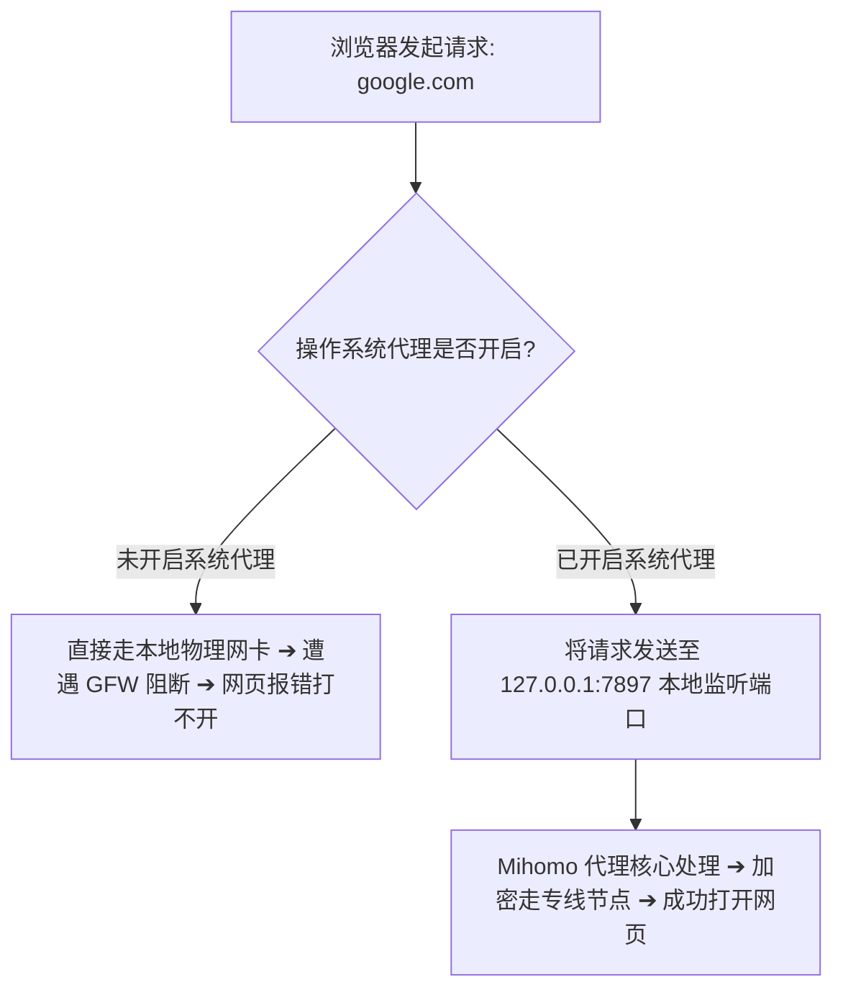
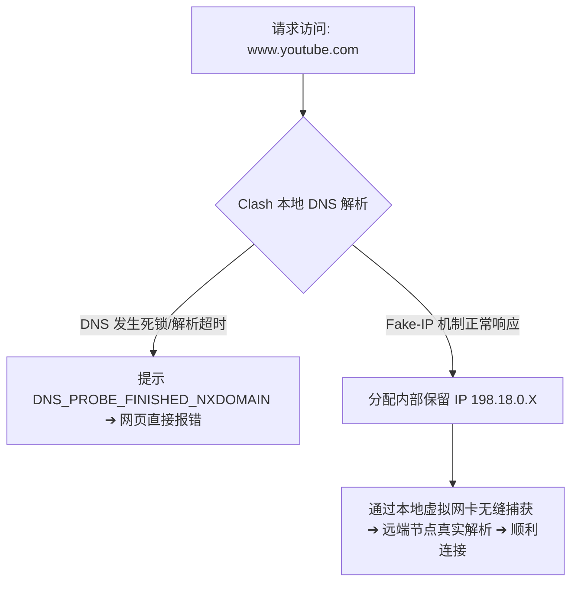

在日常使用 Clash / Mihomo 客户端时，最让用户困惑和抓狂的故障莫过于：**“明明 Profiles 订阅更新成功了，节点列表整整齐齐展示着几十个绿色低延迟节点，但打开浏览器却提示‘无法访问此网站’或‘未连接到互联网’。”**

**在 Clash 中“能看到节点”只说明订阅配置文件已经成功下载并解析，绝不能证明本地代理链路、系统流量接管、规则分流与 DNS 解析已经处于正常可用状态。**

完整的数据通信链路包含：**本地物理裸网 ➔ 激活 Profile ➔ 节点服务器通信 ➔ 代理组分流 ➔ System Proxy / TUN 流量接管 ➔ Rule 规则匹配 ➔ DNS 域名解析 ➔ 海外出口 IP ➔ 目标网站**。这其中任何一个环节发生断裂，都会表现为“有节点但没网”。

本文专为解决 **“Clash 节点存在但无法联网”** 这一高频故障打造，手把手带你通过 5 大症状分类、7 步极速修复法以及四大核心技术模块（系统代理、分流规则、DNS、TUN 虚拟网卡）彻底定位并解决断网问题。

---

## ⚡ 30 秒快速排障速查流

```text
┌────────────────────────────────────────────────────────────────────────┐
│               Clash 有节点但无法上网：30 秒极速诊断流程                │
├────────────────────────────────────────────────────────────────────────┤
│ ① 完全关闭 Clash ➔ 测试本地裸网（能否打开百度/B站？）                 │
│    ├─ 🔴 裸网打不开 ➔ 本地宽带/Wi-Fi/路由器断网，先修复本地网络        │
│    └─ 🟢 裸网秒开 ➔ 确认本地网络正常，进入第二步                      │
│ ② 在 Profiles 界面点击「Update」刷新一次订阅配置                       │
│ ③ 在 Proxies 界面切换 3 个不同地区的绿色节点 (如香港 01 ➔ 日本 01)     │
│ ④ 在 Settings 界面确认「系统代理 (System Proxy)」开关已处于开启状态    │
│ ⑤ 将路由模式由「Rule (规则)」临时切换为「Global (全局)」测试           │
│    ├─ 🟢 Global 能打开网页 ➔ 核心在【Rule 规则集】或【DNS 解析】异常   │
│    └─ 🔴 Global 依然打不开 ➔ 核心在【节点不可达】或【TUN/代理端口冲突】│
│ ⑥ 若开启了 TUN 模式，先临时关闭 TUN，仅保留系统代理重新测试           │
│ ⑦ 检查电脑系统时间是否与国家标准时间精准同步（偏差超 60 秒会导致断网） │
└────────────────────────────────────────────────────────────────────────┘
```

---

## 一、先区分 5 种完全不同的“断网症状”与排查方向

“无法上网”只是表象，不同应用和网站的表现直接揭示了故障所在的具体技术层级：

| 症状表现分类 | 典型现象特征 | 核心诱因层级定位 | 第一步排查动作 |
| :--- | :--- | :--- | :--- |
| **症状 A：所有网站都打不开** | 无论是国内百度还是国外 Google 全部断网报错 | 本地物理裸网断开、或**系统代理端口残留死锁** | 关闭 Clash 测裸网；检查 Windows 代理设置 |
| **症状 B：国内正常，国外打不开** | 微信/B站秒开，但 Google/YouTube 持续转圈 | 节点已失效、系统代理未开启、或目标被误设 Direct | 切换备用节点；核实系统代理开关；检查代理组 |
| **症状 C：Global 正常，Rule 不行** | 切到全局模式立刻能翻墙，切回规则模式就失效 | **分流规则集未命中目标域名**，或客户端 DNS 污染 | 更新远程规则集；将客户端 DNS 设为 `1.1.1.1` |
| **症状 D：浏览器正常，桌面 App 不行** | Chrome 访问正常，但 ChatGPT 桌面版/Git 报错 | **该桌面应用不遵循系统代理**，流量未进入 Clash | 在客户端内开启 **TUN 模式**（虚拟网卡接管） |
| **症状 E：Google 正常，ChatGPT 不行** | 普通外网畅通，但 OpenAI 提示 403 或 Access Denied | 基础代理链完全正常，**出口 IP 被目标平台风控拦截** | 更换美区/日区原生住宅专线节点；清空 Cookie |

---

## 二、第一核心排查：System Proxy（系统代理）状态与残留死锁

在桌面端（Windows / macOS），**系统代理**是让浏览器流量流入 Clash 的第一道闸门：



### 1. 为什么选了节点还必须开启系统代理？
在 Clash 界面中选中香港节点，只是告诉 Clash 核心：“如果接下来有流量进来，请通过香港节点发送”。**如果你没有打开「系统代理 (System Proxy)」开关，Windows / macOS 根本不会把浏览器的流量转发给 Clash，浏览器依然在尝试直连，自然无法打开海外网站**。

### 2. 致命故障：系统代理端口残留（关了 Clash 连百度都打不开）
很多用户遇到过这样的诡异情况：“一旦关闭 Clash，或者电脑意外关机重启后，连国内百度、微信都打不开了”。
- **故障根因**：Clash 在异常退出时，没来得及清理 Windows 注册表中的代理设置，导致系统的网络设置依然固执地把所有流量发往 `127.0.0.1:7897`，而此时该端口已经没有程序在监听，整个电脑陷入断网死锁；
- **秒级修复方法**：
  1. 打开 Windows **「设置 ➔ 网络和 Internet ➔ 代理」**；
  2. 找到“手动设置代理”，将 **「使用代理服务器」开关手动拨至【关闭】**；
  3. 刷新浏览器，本地网络即可瞬间恢复。

---

## 三、第二核心排查：Rule（规则分流）与 Global（全局模式）诊断

这是判定“节点本身坏了”还是“本地分流坏了”最关键的试金石：

```text
┌────────────────────────────────────────────────────────────────────────┐
│                   Clash 三种路由分流模式排障特性对比                   │
├──────────────┬────────────────────────────────┬────────────────────────┤
│ 模式名称     │ 流量处理逻辑                   │ 排障核心诊断价值       │
├──────────────┼────────────────────────────────┼────────────────────────┤
│ **Rule**     │ 根据域名/IP规则库智能分流：     │ 日常默认模式。若此模式失效，   │
│ (规则分流)   │ 国内走直连，国外走代理         │ 重点排查规则集与 DNS 解析      │
├──────────────┼────────────────────────────────┼────────────────────────┤
│ **Global**   │ 接管范围内的所有流量全部走代理 │ **最重要的诊断工具**。若全局正常│
│ (全局代理)   │ (强制所有请求经由选定节点)     │ 证明节点完好，无需更换机场套餐 │
├──────────────┼────────────────────────────────┼────────────────────────┤
│ **Direct**   │ 所有流量全部直连，不走任何节点 │ 误选此模式会导致所有外网打不开 │
└──────────────┴────────────────────────────────┴────────────────────────┘
```

### 为什么 Global 能用，Rule 不能用？深度根因与修复：
如果切换到 Global 模式后 Google 能够秒开，说明**你的机场节点、专线通信和系统代理全部 100% 正常**。问题必定出在以下三个地方之一：
1. **目标网站被分流规则误判为 DIRECT**：某些小众境外网站未被收录在机场下发的规则集内，被默认规则判定为直连。在 Clash Verge Rev 中更新订阅或添加自定义规则（如 `DOMAIN-SUFFIX,example.com,PROXY`）即可；
2. **代理组（Proxy Group）绑定错误**：部分订阅将规则拆分为多个组（如 `PROXY`、`AI平台`、`流媒体`）。如果主代理组选了可用节点，但 `AI平台` 分组里被误选为 `DIRECT` 或某个超时节点，就会导致特定网站打不开；
3. **Auto / URL-Test 自动优选失效**：自动测速组挑选出的“低延迟节点”可能恰好在建立 HTTPS 握手时阻塞，手动点击切换为一个固定的绿色节点测试。

---

## 四、第三核心排查：DNS 解析失败与 Fake-IP 死锁

很多时候节点通信良好，但域名在本地解析阶段就已经夭折：



### DNS 故障的典型表现与修复：
- **表现**：直接在浏览器输入 IP 可以连通，但输入域名提示 `DNS_PROBE_FINISHED_BAD_CONFIG` 或连接超时；
- **排查与修复步骤**：
  1. **检查系统时间**：TLS 证书与加密通信高度依赖标准时间戳。进入系统设置点击「立即同步时间」，时间偏差超过 60 秒会导致几乎所有 HTTPS 域名的 DNS 与握手直接报废；
  2. **清除本地 DNS 缓存**：在 Windows 搜索框输入 `cmd`，以管理员身份运行命令提示符，执行 `ipconfig /flushdns`；
  3. **配置安全的远程 DNS**：在 Clash Verge Rev 设置中，将 Remote DNS 解析服务器填入公共高可用 DoH 地址（如 `https://1.1.1.1/dns-query` 或 `https://8.8.8.8/dns-query`）。

---

## 五、第四核心排查：TUN 模式（虚拟网卡）冲突与适用边界

很多用户为了解决“某些软件不走代理”开启了 TUN 模式，却不料引发了更严重的断网：

```text
┌────────────────────────────────────────────────────────────────────────┐
│                   TUN 模式 (虚拟网卡) 深度排障与冲突根因               │
├────────────────────┬───────────────────────────────────────────────────┤
│ 技术机理           │ 通过在系统物理网卡之上创建 `Wintun` 虚拟网卡接口， │
│                    │ 强制接管网络层 (IP 层) 所有进出数据包             │
├────────────────────┼───────────────────────────────────────────────────┤
│ 为什么开启 TUN 断网│ 1. 虚拟网卡驱动未正确安装（缺少服务模式管理员权限）│
│                    │ 2. 与电脑上正在运行的商业 VPN、公司内网 VPN 冲突  │
│                    │ 3. 杀毒软件（如 360/火绒）拦截了虚拟网卡的路由注入 │
├────────────────────┼───────────────────────────────────────────────────┤
│ 正确处理原则       │ **日常浏览网页只需开启系统代理，绝不盲目默认开 TUN**│
│                    │ 若开 TUN 导致断网，立刻在设置中关闭 TUN 并重启内核 │
└────────────────────┴───────────────────────────────────────────────────┘
```

---

## 六、跨网络与跨设备四维诊断矩阵

当无法确定问题到底出在“电脑本身”还是“机场服务器”时，使用以下四维矩阵进行交叉对照测试：

```text
┌────────────────────────────────────────────────────────────────────────┐
│                      四维交叉 A/B 诊断测试矩阵                         │
├────────────────────┬────────────────────┬──────────────────────────────┤
│ 交叉测试组合       │ 测试结果表现       │ 精准故障定位推断             │
├────────────────────┼────────────────────┼──────────────────────────────┤
│ 电脑连 Wi-Fi ❌    │ 电脑切手机热点 🟢  │ 问题在**家庭宽带/路由器防火墙**│
│ (同一节点)         │ (同一节点)         │ (路由器拦截了节点端口或DNS)  │
├────────────────────┼────────────────────┼──────────────────────────────┤
│ 电脑连 Wi-Fi ❌    │ 手机连 Wi-Fi 🟢    │ 问题在**电脑本地系统代理/TUN** │
│ (同一订阅)         │ (同一订阅)         │ (排除宽带与机场，专攻电脑设置)│
├────────────────────┼────────────────────┼──────────────────────────────┤
│ 节点香港 01 ❌     │ 节点日本 01 🟢     │ 问题在**单节点临时维护或拥堵** │
│ (同一电脑)         │ (同一电脑)         │ (切换可用节点即可，无需重装)  │
├────────────────────┼────────────────────┼──────────────────────────────┤
│ 电脑 ❌ / 手机 ❌  │ 5G ❌ / Wi-Fi ❌   │ **套餐已欠费过期 / 订阅源失效**│
│ (全部节点持续超时) │ (跨设备全部失效)   │ (登录机场后台检查账单与公告)  │
└────────────────────┴────────────────────┴──────────────────────────────┘
```

---

## 七、日志诊断：如何从 Clash 运行日志中秒抓真凶？

打开 Clash Verge Rev 左侧菜单栏的 **「日志 (Logs)」**，在筛选栏输入以下关键字，即可迅速定位问题本质：

| 日志关键字 | 实际技术含义 | 针对性解决动作 |
| :--- | :--- | :--- |
| `timeout` | 节点服务器在规定时间内无响应 | 节点离线或网络严重丢包，切换其他绿色节点 |
| `connection refused` | 远端服务器明确拒绝连接或端口关闭 | 节点正在进行维护，等待恢复或切换备用线路 |
| `network unreachable` | 本地路由无法到达目标入口 | 检查网线/Wi-Fi 是否插好，重启本地光猫 |
| `certificate expired / tls` | SSL 证书验证失败 | **立即在 Windows 设置中同步北京时间** |
| `dns resolve failed` | 域名无法通过当前 DNS 解析 | 更换客户端 DNS 为 `8.8.8.8` 并清空 DNS 缓存 |
| `rule match: DIRECT` | 目标网站被规则强制直连 | 切换到 Global 模式，或为该域名补充 Proxy 规则 |

---

## 八、Clash 高适配性专线品牌推荐矩阵

针对 Clash Verge Rev 订阅一键同步、分流规则完整性与晚高峰抗压，精选以下真实稳定方案：

```text
┌────────────────────────────────────────────────────────────────────────────────────────┐
│                             2026 Clash 精选专线服务商候选矩阵                          │
├──────────┬──────────────────────────┬──────────────┬──────────────┬────────────────────┤
│ 适配场景 │ 推荐品牌候选             │ 实际起付门槛 │ 每月流量配额 │ Clash 核心适配优势 │
├──────────┼──────────────────────────┼──────────────┼──────────────┼────────────────────┤
│ 全能主力 │ 光速云 (GuangSuYun)      │ 约 ¥7.5/月起 │ 59G~238G /月 │ 6年老牌物理专线，4K极速，Clash零断流配置 │
│ 平价轻量 │ 微风网络 (BreezeNet)     │ 约 ¥7/月起   │ 50GB / 月    │ 专为网页查资料与AI优化，年付百元内极低负担│
│ 弹性月付 │ 唯兔云 (V2Yun)           │ ¥14.9/月     │ 100GB / 月   │ 15元单月付，60+节点备用，随用随买  │
│ 应急备用 │ 星岛梦 (XingDaoMeng)     │ 约 ¥8/月起   │ 60G/不限时包 │ 0月租不限时包，电脑防断网首选备用通道 │
│ AI/开发  │ 速界 (SpeedWorld)        │ ¥25/月       │ 150GB / 月   │ 原生纯净住宅 IP，ChatGPT/API 秒响应 │
└──────────┴──────────────────────────┴──────────────┴──────────────┴────────────────────┘
```

- 🏆 **全能旗舰首选**：[光速云](/reviews/guangsu-cloud/) —— 全线 IEPL 企业专线，Clash 订阅格式完美兼容，晚高峰 20:00 4K/8K 零卡顿；
- 🍃 **超低预算轻量**：[微风网络](/reviews/weifeng-cloud/) —— 针对电脑轻度查资料与文字 AI 优化的 50GB 小流量专线，年付折算仅约 ¥7/月；
- 💳 **拒绝绑定的单月付**：[唯兔云](/recommend/best-airports/) —— ¥14.9 纯单月付，100GB 充沛流量，节点丰富。

---

## 九、Clash 联网排障 18 项安全与操作通关清单

```text
┌────────────────────────────────────────────────────────────────────────┐
│                   Clash 联网故障排查 18 项自查清单                     │
├────────────────────────────────────────────────────────────────────────┤
│ □ 1. 关闭 Clash 客户端后，测试国内百度/B站能秒开加载 (排除本地断网)   │
│ □ 2. 当前 Profiles 界面中已高亮激活正确的配置文件 (非过期旧配置)       │
│ □ 3. 在 Profiles 中已点击「Update」成功拉取最新的节点列表与规则集     │
│ □ 4. 连续切换测试了香港、日本、美国等至少 3 个不同地区的节点          │
│ □ 5. 在 Settings 菜单中，已确认「系统代理 (System Proxy)」处于开启状态 │
│ □ 6. 临时切换至「全局模式 (Global)」测试目标网站能否正常打开           │
│ □ 7. 确认目标网站未被分流规则误设为 DIRECT，且代理组未选错            │
│ □ 8. 电脑系统时间已与国家授时中心精准同步 (防止 TLS 握手报错)          │
│ □ 9. 若开启了 TUN 模式，已尝试临时关闭 TUN 单独测试系统代理           │
│ □ 10. 电脑上没有同时运行其他互相冲突的商业 VPN 或网络加速软件         │
│ □ 11. 在 Windows 代理设置中未残留已失效的旧端口 (如 127.0.0.1:7890)    │
│ □ 12. 已在命令行中执行 `ipconfig /flushdns` 清空本地 DNS 缓存          │
│ □ 13. 尝试切换手机 5G 热点进行了跨网络 A/B 对照测试                   │
│ □ 14. 尝试在手机端使用相同订阅链接进行了跨设备 A/B 对照测试           │
│ □ 15. 登录机场官网后台，已核实套餐未欠费且月度流量未耗尽              │
│ □ 16. 打开 Connections 连接记录，确认访问请求有流量数据产生           │
│ □ 17. 我确认没有在电脑上为了“翻墙”而永久关闭防火墙或杀毒软件          │
│ □ 18. 我已掌握在遇到断网时通过关闭代理残留和重启内核快速复原网络      │
└────────────────────────────────────────────────────────────────────────┘
```

---

## 十、避坑指南：20 个关于“Clash 断网与排障”的致命认知误区

```text
❌ 误区 1：节点测速显示绿色数字，就代表一定能打开 Google ➔ 事实：测速只测握手回包，不代表完整数据转发正常。
❌ 误区 2：在客户端里选了节点，浏览器就自动翻墙了 ➔ 事实：必须开启系统代理或 TUN 模式流量才会进入客户端。
❌ 误区 3：有节点但连不上网，一定是机场彻底跑路了 ➔ 事实：90% 是系统代理未开、规则未命中或本地端口冲突。
❌ 误区 4：一遇到打不开网页，第一步必须卸载重装 Clash ➔ 事实：重装会丢失配置并掩盖真正原因，应按排障树定位。
❌ 误区 5：Global 全局模式是 Clash 的“高速加速模式” ➔ 事实：Global 是强制全局代理，仅用于故障诊断。
❌ 误区 6：开启 TUN 模式可以让网速翻倍 ➔ 事实：TUN 只解决流量接管范围，对物理带宽容量没有加速作用。
❌ 误区 7：开 TUN 模式断网了说明电脑中毒了 ➔ 事实：多为虚拟网卡缺少管理员权限或与其他 VPN 路由冲突。
❌ 误区 8：关了 Clash 连国内百度都打不开了说明系统坏了 ➔ 事实：这是系统代理端口残留，在 Windows 设置中关闭代理即可。
❌ 误区 9：浏览器能用，代表电脑上所有桌面软件都走了代理 ➔ 事实：终端、Git、桌面 App 需配置代理或开启 TUN。
❌ 误区 10：只要连接了美国节点，ChatGPT 就 100% 能打开 ➔ 事实：机房共享脏 IP 会被 OpenAI 拦截报 403 阻断。
❌ 误区 11：遇到无法联网应该彻底关闭 Windows 防火墙 ➔ 事实：正常客户端只需普通网络权限，严禁关闭系统防火墙。
❌ 误区 12：提示 TLS Error 是节点服务器坏了 ➔ 事实：绝大多数是因为电脑系统时间与标准时间存在偏差。
❌ 误区 13：可以同时打开 Clash、v2rayN 和商业 VPN ➔ 事实：多个客户端会互相争抢系统代理与虚拟网卡导致断网。
❌ 误区 14：只要买了付费专线就永远不会出任何断网故障 ➔ 事实：仍需掌握刷新订阅、切换节点等基本运维常识。
❌ 误区 15：一个节点超时代表整个机场所有节点都坏了 ➔ 事实：单节点维护很常见，应切换其他 2~3 个节点交叉测试。
❌ 误区 16：订阅更新成功等于节点已经可以上网 ➔ 事实：Update 仅代表配置解析成功，节点连通需单独验证。
❌ 误区 17：只要能打开 Google 搜索就代表 Netflix 完整解锁 ➔ 事实：需具备原生住宅 IP 才能看全量版权剧集。
❌ 误区 18：遇到网络问题应该去网上随便下载一个未知 YAML 覆盖 ➔ 事实：陌生配置可能包含恶意规则或窃取流量。
❌ 误区 19：客户端版本越新就一定越不会断网 ➔ 事实：新版本主要修复 Bug 与适配系统，断网多与网络配置相关。
❌ 误区 20：订阅链接可以随意发给微信好友协助测试 ➔ 事实：订阅包含个人密钥，泄露会导致流量被盗刷甚至封号。
```

---

## 十一、常见问题深度解答（FAQ · 35 问）

### Q1：Clash 有节点为什么还是不能上网？
**答**：看到节点只证明订阅配置解析成功。常见断网原因包括：**系统代理开关未开启、代理模式误设为 Direct、选中的单节点临时维护、本地 DNS 解析死锁、或系统代理端口残留死锁**。

### Q2：为什么状态栏显示已连接，但网页却提示无网络？
**答**：排查系统代理是否真正接管了浏览器流量。打开 Windows 设置 ➔ 网络 ➔ 代理，确认代理服务器已开启且端口与 Clash 监听端口一致。

### Q3：为什么 Global 全局模式能用，Rule 规则模式不能用？
**答**：说明机场节点完全正常，故障出在**分流规则集未匹配目标域名**，或者客户端本地 DNS 解析发生污染。可尝试在 Profiles 界面更新订阅或将 DNS 改为 `1.1.1.1`。

### Q4：为什么关闭 Clash 之后，电脑连国内百度也打不开了？
**答**：这是因为 Clash 异常退出导致 **系统代理端口残留**。打开 Windows 设置 ➔ 网络 ➔ 代理 ➔ 手动将「使用代理服务器」拨至【关闭】即可秒解。

### Q5：为什么 Chrome 浏览器能翻墙，但 ChatGPT 桌面版客户端打不开？
**答**：因为 ChatGPT 桌面客户端不遵循 Windows 系统代理设置。在 Clash Verge Rev 中**开启「TUN 模式」**即可通过虚拟网卡强制接管该软件。

### Q6：开启 TUN 模式后为什么电脑反而彻底断网？
**答**：通常是因为虚拟网卡驱动未获得管理员权限、或与电脑上运行的其他 VPN 软件发生路由冲突。可先在设置中安装服务模式并以管理员权限启动。

### Q7：提示 TLS Error 怎么解决？
**答**：进入 Windows 设置 ➔ 时间和语言 ➔ 点击**「立即同步时间」**，确保电脑系统时间与标准北京时间一致，防止安全证书验证失败。

### Q8：为什么所有节点测速都是漂亮的绿色数字，但还是打不开网页？
**答**：测速仅测试单一探测点的极小回包，不代表完整数据转发正常；且如果系统代理未开启，流量根本没有进入 Clash 核心。

### Q9：为什么单节点超时，换其他节点就可以上网？
**答**：单台海外服务器可能正在进行机房维护、网络震荡或出口 IP 轮换，属于正常现象，日常使用切换备用节点即可。

### Q10：所有节点全部显示 Timeout 红色怎么办？
**答**：先关代理确认本地物理裸网正常，登录机场后台核对套餐是否欠费或流量耗尽，最后在 Profiles 中点击「Update」刷新订阅。

### Q11：为什么手机连同一个 Wi-Fi 能翻墙，电脑却不行？
**答**：证明机场服务与家庭宽带均正常，问题 100% 出在电脑本地：排查电脑系统代理开关、杀毒软件拦截或 Windows 代理端口残留。

### Q12：为什么电脑连手机热点能翻墙，连家里 Wi-Fi 却不行？
**答**：说明家用路由器开启了防火墙端口拦截，或宽带运营商在本地存在特定协议阻断。可尝试切换其他协议端口的节点。

### Q13：Clash 提示 Connection Refused 是什么意思？
**答**：说明远端服务器明确拒绝连接或目标端口未开启服务，通常表示该节点服务器处于离线维护状态。

### Q14：Clash 提示 Network Unreachable 是什么意思？
**答**：说明本地网络路由层无法到达目标入口服务器，优先检查网线、Wi-Fi 连接或本地路由器状态。

### Q15：电脑开机后连不上网怎么排查？
**答**：检查 Clash 是否设置为开机自启、Profile 是否处于激活状态；若不开代理，检查 Windows 代理设置中是否有残留端口未关闭。

### Q16：电脑睡眠唤醒后 Clash 断网怎么办？
**答**：睡眠唤醒时虚拟网卡或网络接口未能自动恢复。在客户端界面点击“重启内核”，或快速开关一次系统代理即可恢复。

### Q17：Clash 一定要以管理员权限运行吗？
**答**：普通系统代理模式不需要；但若需要开启 **TUN 模式**（安装虚拟网卡与注入系统路由），则必须授予管理员权限。

### Q18：普通翻墙需要关闭 Windows 防火墙吗？
**答**：**坚决不需要。** 正常使用只需允许 Clash 访问本地专用网络，永久关闭防火墙会带来严重系统安全隐患。

### Q19：杀毒软件（如火绒/360）会阻止 Clash 上网吗？
**答**：部分杀毒软件可能会拦截虚拟网卡驱动安装或拦截本地代理端口。在杀毒软件弹窗时选择“允许所有操作”即可。

### Q20：为什么 Google 能打开，但打开 YouTube 视频一直缓冲？
**答**：这属于**带宽与丢包性能问题**，而不是无法联网。建议切换至企业级 **IEPL 物理专线节点**，保障晚高峰持续吞吐。

### Q21：为什么能打开外网网页，但 Git clone 依然报错超时？
**答**：Git 命令行默认不走系统代理。需开启 **TUN 模式**，或在终端中执行命令设置局部代理：`git config --global http.proxy http://127.0.0.1:7897`。

### Q22：为什么能打开外网网页，但无法登录 Telegram 桌面版？
**答**：Telegram 桌面版需在客户端内部设置中将代理类型配置为 `HTTP 127.0.0.1:7897`，或直接开启 Clash 的 TUN 模式。

### Q23：如何查看当前系统流量是否真正进入了 Clash？
**答**：进入 Clash Verge Rev 左侧的 **「连接 (Connections)」** 页面，访问网页时观察是否有实时的域名连接请求与上下行速率产生。

### Q24：Connections 页面有流量记录但依然打不开网页说明什么？
**答**：说明流量已成功进入客户端，问题发生在节点通信层、DNS 解析层或目标网站服务端阻断。

### Q25：Connections 页面没有任何记录说明什么？
**答**：说明流量根本没有进入 Clash 核心，问题 100% 出在 **系统代理未开启** 或 **程序不遵循系统代理**。

### Q26：如何确认当前出口 IP 是否已经变成境外？
**答**：在浏览器中访问可信的 IP 查询网站（如 `ip138.com` 或 `ipinfo.io`），观察显示的地理位置是否为节点所在国家。

### Q27：出口 IP 变了但为什么还是提示地区不可用？
**答**：目标平台（如 OpenAI/Netflix）对机房 IP 实施了风控拉黑。需切换至具备原生住宅属性的纯净专线节点。

### Q28：为什么 Direct 模式下无法打开任何海外网站？
**答**：Direct 代表完全直连，所有请求不经过代理节点直接发送，自然无法访问被 GFW 屏蔽的海外站点。

### Q29：规则模式下如何让某个特定网站强制走代理？
**答**：在客户端的自定义规则或扩展配置中添加一条规则：`DOMAIN-SUFFIX,目标域名.com,PROXY` 并保存生效。

### Q30：规则模式下如何让某个国内网站强制走直连？
**答**：在自定义规则中添加：`DOMAIN-SUFFIX,目标域名.com,DIRECT`，确保国内网站不走代理以节约套餐流量。

### Q31：DNS 缓存导致打不开网页怎么清理？
**答**：以管理员身份打开 cmd 命令提示符，输入 `ipconfig /flushdns` 并回车，随后重启浏览器即可。

### Q32：IPv6 会导致 Clash 断网吗？
**答**：如果本地宽带启用了纯 IPv6 且节点不兼容，可能引发冲突。若排查确认相关，可在客户端网络设置中关闭 IPv6 解析。

### Q33：遇到断网问题需要重新购买新的机场套餐吗？
**答**：**绝大多数情况下不需要。** 先按本文 7 步排查本地网络与系统代理，只有当确认所有设备、所有网络均无法连通且官方发布故障通告时才考虑备用方案。

### Q34：可以同时开启多个代理客户端吗？
**答**：**坚决不能。** 多个客户端会互相争抢系统代理端口与虚拟网卡，导致严重的网络死循环与断网。

### Q35：什么时候才真正需要重装客户端？
**答**：日常断网只需调整系统代理与节点，只有当虚拟网卡驱动彻底损坏、或软件文件损坏导致持续闪退崩溃时才需重装。

---

## 🏁 总结：Clash 断网排障终极心法

遇到 Clash 有节点却无法上网时，请牢记以下**排障黄金四步法**：

```text
1. 先测物理裸网 ➔ 关闭 Clash 确认百度秒开，排除本地宽带与路由器断网
2. 验证流量入口 ➔ 确认系统代理已开启，排查 127.0.0.1 端口残留与冲突
3. 切换全局诊断 ➔ 切 Global 测节点与核心，Global 能用则主攻 Rule 规则与 DNS
4. 特殊软件开TUN ➔ 命令行/桌面App不通开 TUN，开 TUN 断网则关 TUN 排查驱动
```

---

### 📚 延伸进阶阅读与选型专栏
- 🛠️ **Clash 生态总指南**：[《Clash梯子怎么用？Clash Verge Rev、Mihomo、订阅与节点完整教程》](/tutorials/clash-tizi/)
- 📋 **订阅导入与排障**：[《Clash订阅怎么导入？Profile、节点更新与订阅失败完整教程》](/tutorials/clash-subscription-import/)
- 💻 **电脑端总指南**：[《电脑梯子哪个好？Windows 10/11、Mac梯子工具与客户端完整指南》](/recommend/pc-tizi/)
- ⚙️ **客户端安装实操**：[《Clash Verge Rev 下载与安装配置完整教程》](/tutorials/clash-verge-rev/)
- 📉 **测速深度解析**：[《为什么机场节点延迟低但实际速度慢？》](/issues/low-ping-slow-speed-reasons/)
- ⚡ **老牌旗舰专线**：[《光速云深度评测：2020老牌IEPL专线与解锁实测》](/reviews/guangsu-cloud/)
- 🍃 **平价轻量专线**：[《微风网络深度评测：小流量套餐值不值得买？》](/reviews/weifeng-cloud/)
- 🏆 **2026 全景大榜**：[《2026梯子推荐：稳定、速度、价格、安全与不同使用场景怎么选》](/recommend/best-tizi/)
