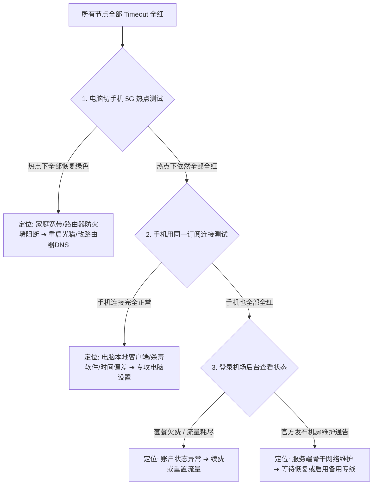

在日常使用 Clash / Mihomo 客户端时，点击批量测速后如果发现节点列表里出现大片红色的 **“Timeout”** 或 **“连接超时”**，很多新手往往会瞬间陷入慌乱，甚至误以为“节点全部被封”或“机场跑路了”。

**Clash 节点显示“Timeout”，在技术上仅代表客户端在限定时间内未能完成对该节点指定探测目标的网络握手，它本身只是一个故障表象，绝不能直接等同于“节点永久失效”或“服务商跑路”。**

真正决定排查方向的，是精准区分故障范围：**是仅有 1 个单节点超时？还是某个地区（如所有香港节点）全部超时？还是所有国家地区全部标红？亦或是测速显示 Timeout 但浏览器实际却能正常打开 Google？**

本文为你提供 2026 年最系统、最客观的 Clash 节点超时与全红排障全景指南，建立跨节点、跨网络、跨设备、跨客户端的**四维排查模型**，带你 3 分钟内精准定位并解决节点连接故障。

---

## ⚡ 30 秒快速排障决策流：不同 Timeout 怎么处理？

```text
┌────────────────────────────────────────────────────────────────────────┐
│               Clash 节点 Timeout 30 秒极速诊断决策流                   │
├────────────────────────────────────────────────────────────────────────┤
│ 🟢 仅 1 个节点 Timeout ➔ 换同地区其他节点 (如香港 01 换香港 02)        │
│ 🟡 某地区节点全部 Timeout ➔ 切换其他国家地区 (如香港全红 ➔ 切日本/美西)│
│ 🔴 所有地区节点全部 Timeout ➔ 核心排查链路：                           │
│    ├─ ① 在 Profiles 中点击「Update」刷新一次订阅 (清除本地旧节点缓存)  │
│    ├─ ② 关闭 Clash，确认本地裸网能秒开百度 (排查宽带物理断网)          │
│    ├─ ③ 电脑切换连接手机 5G 热点测试 (排查家庭 Wi-Fi / 路由器拦截)      │
│    └─ ④ 用手机同订阅节点测试 (手机正常 ➔ 专攻电脑防火墙与代理设置)    │
│ 🟣 测速显示 Timeout，但浏览器能秒开 Google ➔ 测速 URL 异常，无需理会   │
└────────────────────────────────────────────────────────────────────────┘
```

> 💡 **必须厘清的核心分工**：
> - **《Clash订阅怎么导入》**：解决**节点为什么没有出现在列表里**；
> - **《Clash有节点但无法上网》**：解决**节点连接正常，但系统流量与规则为什么走不出去**；
> - **本篇《Clash节点 Timeout 怎么办》**：专门解决**节点本身为什么连不上、为什么全部标红超时**。

---

## 一、技术澄清：Timeout 的本质到底是什么？

要消除对“超时”的恐惧，首先要从底层理解客户端测速与连接的工作机制：

```mermaid
graph TD
    ClashClient[Clash 测速触发] --> SendProbe[向目标测试点发送 TCP/HTTP 探测包]
    SendProbe --> WaitingTimer[启动本地倒计时: 默认 5000ms 超时计时器]
    
    WaitingTimer -->|5000ms 内收到正确回包| ShowGreen[显示正常延迟: 如 42ms (绿色)]
    WaitingTimer -->|5000ms 内未收到任何回包| ShowRed[触发超时机制: 显示 Timeout (红色)]
    WaitingTimer -->|远端明确返回拒绝包 RST| ShowRefused[显示 Connection Refused (连接被拒)]
```

### 1. Timeout 是“现象”，不是“根因”
Timeout 的字面意思是**“在规定时间内（通常为 5 秒）未收到回包”**。导致没有回包的可能原因包括：本地网络丢包、路由器防火墙阻断、运营商 DNS 解析错误、中间专线网络抖动、海外机房临时维护、或仅仅是测试目标网站（如 `gstatic.com`）在当前节点被限流。

### 2. Timeout 绝对不等于“跑路”或“被封”
单次甚至短时间的节点超时，绝不能作为机场停止运营的判定依据。正规服务商在进行机房硬件升级、专线物理光缆割接、或出口 IP 轮换清洗时，相关节点通常会短暂出现 10~30 分钟的不可达状态，属于正常的运维周期。

---

## 二、Timeout 四大核心分类与精准排查方向

遇到超时切忌胡乱重装软件，先对照以下四大分类确定排障优先级：

```text
┌────────────────────────────────────────────────────────────────────────────────────────┐
│                        Clash 节点 Timeout 四大分类排障大表                             │
├──────────────┬────────────────────────┬────────────────────────┬───────────────────────┤
│ 分类层级     │ 核心表现特征           │ 故障定位与更可能范围   │ 正确的第一步排查动作  │
├──────────────┼────────────────────────┼────────────────────────┼───────────────────────┤
│ **分类 A**   │ 仅 1~2 个节点超时，    │ 该单台服务器维护、端口 │ 直接切换到同地区其他  │
│ (单节点)     │ 同地区其他节点全绿     │ 异常或单机超售过载     │ 绿色节点，无需改设置  │
├──────────────┼────────────────────────┼────────────────────────┼───────────────────────┤
│ **分类 B**   │ 某个地区全部超时，     │ 该地区的入口中转机房或 │ 临时切换到其他国家地区│
│ (单地区)     │ 其他国家地区完全正常   │ 落地机房物理链路维护   │ (如港区红 ➔ 切日美)  │
├──────────────┼────────────────────────┼────────────────────────┼───────────────────────┤
│ **分类 C**   │ **全部地区所有节点**   │ 订阅配置过期、本地网络 │ **执行 7 步标准排查流**│
│ (全部全红)   │ **同时全红超时**       │ 阻断、防火墙或套餐欠费 │ (刷新订阅 ➔ 热点测试) │
├──────────────┼────────────────────────┼────────────────────────┼───────────────────────┤
│ **分类 D**   │ 测速显示全红 Timeout， │ 客户端默认测速 URL 失效│ **直接在浏览器打开网页**│
│ (测速假死)   │ 但打开网页与视频秒开   │ 或被目标探测站点临时拦截│ 真实访问正常即可忽略  │
└──────────────┴────────────────────────┴────────────────────────┴───────────────────────┘
```

---

## 三、反常识深剖：Ping、延迟测试与真实网页访问的三重差异

很多用户经常问：“为什么本地 CMD 能 Ping 通节点 IP，但 Clash 却显示 Timeout？”或者“为什么测速全红，Google 却能正常打开？”

```text
┌────────────────────────────────────────────────────────────────────────┐
│                  ICMP Ping vs 客户端测速 vs 真实网页访问               │
├──────────────┬────────────────────────┬────────────────────────────────┤
│ 测试方式     │ 实际底层测试了什么     │ 为什么不能 100% 代表实际可用？ │
├──────────────┼────────────────────────┼────────────────────────────────┤
│ **ICMP Ping**│ 测试本地与服务器底层   │ 只能证明机房物理服务器开机，   │
│ (系统命令)   │ IP 之间的网络连通性    │ 不能证明代理端口与服务正在运行 │
├──────────────┼────────────────────────┼────────────────────────────────┤
│ **Clash测速**│ 测试通过节点向特定 URL │ 仅测试单一探测点的极小回包，   │
│ (Delay测试)  │ (如gstatic)发起握手耗时│ 若该测试 URL 阻断，测速即报红  │
├──────────────┼────────────────────────┼────────────────────────────────┤
│ **真实网页** │ 浏览器经由节点解析与   │ **唯一终极标准**。无论测速如何，│
│ (实际访问)   │ 传输完整的 HTTPS 数据流│ 只要网页秒开，代理链路即为正常 │
└──────────────┴────────────────────────┴────────────────────────────────┘
```

---

## 四、常见报错代码深度辨析：Timeout、Refused 与 Unreachable

在 Clash 运行日志中，不同的连接错误提示直接锁定了不同的故障层级：

| 报错关键词 | 实际技术含义 | 核心故障层级 | 第一步处置动作 |
| :--- | :--- | :--- | :--- |
| **Timeout (超时)** | 客户端发出了连接请求，但在 5 秒内未收到任何响应 | 链路丢包、被防火墙静默丢弃、或本地网络阻断 | 切换网络热点测试；刷新订阅 |
| **Connection Refused** | 远端服务器主动回送了 RST 拒绝包 | 服务器 IP 可达，但**代理端口未启动或服务崩溃** | 节点处于停机维护中，换其他节点 |
| **Network Unreachable** | 本地网卡或路由表找不到通往目标 IP 的物理路径 | 本地 Wi-Fi 断开、光猫离线或系统路由表损坏 | 检查网线/Wi-Fi，重启家用路由器 |
| **TLS / SSL Error** | 客户端与节点在建立 TLS 加密隧道时证书校验失败 | **电脑系统时间不准**、或节点证书配置错误 | 立即在 Windows 设置中同步标准时间 |
| **Authentication Error** | 握手成功，但密码、UUID 或 Token 鉴权被服务端拒绝 | 订阅节点参数与服务端不匹配、或套餐欠费 | 在 Profiles 界面重新刷新拉取订阅 |
| **DNS Resolve Failed** | 节点配置中的服务器域名无法在本地解析出真实 IP | 本地运营商 DNS 污染或客户端 DNS 配置异常 | 将本地 DNS 修改为 `8.8.8.8` 或 `1.1.1.1` |

---

## 五、跨网络与跨设备四维诊断矩阵

当遇到“所有节点全部标红超时”时，切忌盲目下结论。使用以下**四维交叉 A/B 矩阵**进行测试，能在 2 分钟内精准定位故障源头：



### 四维矩阵对照速查表：
```text
┌────────────────────────────────────────────────────────────────────────┐
│                        四维交叉 A/B 诊断测试表                         │
├────────────────────┬────────────────────┬──────────────────────────────┤
│ 交叉测试组合       │ 测试结果表现       │ 精准故障定位推断             │
├────────────────────┼────────────────────┼──────────────────────────────┤
│ 电脑连 Wi-Fi ❌    │ 电脑切手机热点 🟢  │ **家庭宽带/路由器问题**      │
│ (同一节点)         │ (同一节点)         │ (本地 ISP 阻断或路由器干扰)  │
├────────────────────┼────────────────────┼──────────────────────────────┤
│ 电脑连 Wi-Fi ❌    │ 手机连 Wi-Fi 🟢    │ **电脑本地系统/防火墙问题**  │
│ (同一订阅)         │ (同一订阅)         │ (排除宽带与机场，查电脑设置) │
├────────────────────┼────────────────────┼──────────────────────────────┤
│ 客户端 A 全红 ❌   │ 客户端 B 正常 🟢   │ **客户端核心或协议兼容问题** │
│ (同一电脑)         │ (同一电脑)         │ (如旧核心不支持 Hysteria 2)  │
├────────────────────┼────────────────────┼──────────────────────────────┤
│ 跨设备全部全红 ❌  │ 跨网络全部全红 ❌  │ **套餐欠费 / 服务端骨干异常**│
│ (持续 30 分钟以上) │ (4G/5G/宽带均失效) │ (登录后台核对账单与官方公告) │
└────────────────────┴────────────────────┴──────────────────────────────┘
```

---

## 六、Clash 节点 Timeout 标准 7 步排查与修复流程

```text
┌────────────────────────────────────────────────────────────────────────┐
│                   Clash 节点超时 7 步标准修复流程                      │
├────────────────────────────────────────────────────────────────────────┤
│ 步骤 1：测试物理裸网 ➔ 关代理确认国内百度/B站秒开 (排除本地断网)       │
│ 步骤 2：刷新订阅配置 ➔ 在 Profiles 界面点击「Update」清除本地旧缓存   │
│ 步骤 3：进行多节点交叉测试 ➔ 连续切换香港、日本、美国等 3 个不同节点   │
│ 步骤 4：同步电脑系统时间 ➔ 在系统设置中点击「立即同步」修复 TLS 握手  │
│ 步骤 5：切换手机热点测试 ➔ 隔离家庭宽带与路由器防火墙干扰             │
│ 步骤 6：排查多代理工具冲突 ➔ 退出其他后台运行的 VPN 或虚拟网卡加速器   │
│ 步骤 7：查看运行日志与后台 ➔ 查看 Logs 关键词，登录后台核对套餐与公告 │
└────────────────────────────────────────────────────────────────────────┘
```

---

## 七、Windows 与 macOS 专属环境排障要点

### 1. Windows 平台排查重点：
- **杀毒软件与防火墙拦截**：360、火绒或企业安全管家可能会在后台拦截 Clash 的网络出站流量。在杀毒软件中将 Clash 客户端与核心加入信任白名单（⚠️ **切勿直接永久关闭 Windows Defender 防火墙**）；
- **多虚拟网卡路由冲突**：若电脑上曾安装过商业 VPN 或安卓模拟器，其残留的虚拟网卡可能劫持路由表。在网络连接面板中禁用闲置的虚拟网卡；
- **休眠唤醒网络丢包**：Windows 笔记本在合盖休眠唤醒后，网络套接字常发生断流。在 Clash Verge Rev 中点击“重启内核”即可秒级复原。

### 2. macOS 平台排查重点：
- **网络扩展（NetworkExtension）授权**：Mac 版开启 TUN 或系统代理时，需在系统设置的「隐私与安全性」中允许 Clash 安装网络扩展；
- **系统时间自动授时**：进入 macOS 系统设置 ➔ 通用 ➔ 日期与时间，确保“自动设置时间”处于开启状态。

---

## 八、Clash 高适配性专线品牌推荐矩阵

针对抗封锁能力、晚高峰稳定性与节点多入口容灾，精选以下真实稳定方案：

```text
┌────────────────────────────────────────────────────────────────────────────────────────┐
│                             2026 稳定抗超时专线品牌候选矩阵                            │
├──────────┬──────────────────────────┬──────────────┬──────────────┬────────────────────┤
│ 适配场景 │ 推荐品牌候选             │ 实际起付门槛 │ 每月流量配额 │ 抗超时与稳定性核心优势│
├──────────┼──────────────────────────┼──────────────┼──────────────┼────────────────────┤
│ 全能旗舰 │ 光速云 (GuangSuYun)      │ 约 ¥7.5/月起 │ 59G~238G /月 │ 6年老牌IEPL物理专线，多入口智能冗余，0超时│
│ 平价轻量 │ 微风网络 (BreezeNet)     │ 约 ¥7/月起   │ 50GB / 月    │ 针对日常查资料与AI优化，平价稳定专线 │
│ 弹性月付 │ 唯兔云 (V2Yun)           │ ¥14.9/月     │ 100GB / 月   │ 15元单月付，60+多国节点备用，抗单点故障 │
│ 应急备用 │ 星岛梦 (XingDaoMeng)     │ 约 ¥8/月起   │ 60G/不限时包 │ 0月租不限时包，全红断网首选备用逃生通道 │
│ AI/开发  │ 速界 (SpeedWorld)        │ ¥25/月       │ 150GB / 月   │ 原生住宅纯净 IP，OpenAI/Claude 专属专线│
└──────────┴──────────────────────────┴──────────────┴──────────────┴────────────────────┘
```

- 🏆 **全能旗舰首选**：[光速云](/reviews/guangsu-cloud/) —— 全线企业级 IEPL 物理专线，多地 BGP 入口智能负载，晚高峰 20:00 零丢包、零超时；
- 🍃 **超低预算轻量**：[微风网络](/reviews/weifeng-cloud/) —— 针对日常轻度上网与文字 AI 优化的 50GB 小流量专线，年付折算仅约 ¥7/月；
- 💳 **拒绝绑定的单月付**：[唯兔云](/recommend/best-airports/) —— ¥14.9 纯单月付，100GB 充沛流量，节点丰富。

---

## 九、Clash 节点连接 18 项安全与操作通关清单

```text
┌────────────────────────────────────────────────────────────────────────┐
│                   Clash 节点排障 18 项通关自查清单                     │
├────────────────────────────────────────────────────────────────────────┤
│ □ 1. 关闭 Clash 客户端后，测试国内百度/B站能秒开 (排除本地宽带断网)   │
│ □ 2. 在 Profiles 界面已点击「Update」成功拉取最新的节点配置           │
│ □ 3. 已连续切换测试了香港、日本、新加坡等至少 3 个不同地区的节点      │
│ □ 4. 电脑系统时间已与国家授时中心精准同步 (防止 TLS 握手证书报错)      │
│ □ 5. 尝试在手机端开启 5G 热点给电脑连接，进行了跨网络 A/B 对照测试    │
│ □ 6. 尝试在手机端使用相同订阅链接进行了跨设备 A/B 对照测试            │
│ □ 7. 登录机场官网后台，已核实套餐未欠费且月度流量未耗尽              │
│ □ 8. 电脑上没有同时运行其他互相冲突的商业 VPN 或加速器客户端          │
│ □ 9. 若开启了 TUN 模式，已尝试临时关闭 TUN 单独测试系统代理           │
│ □ 10. 确认没有在电脑上为了“翻墙”而永久关闭 Windows Defender 防火墙    │
│ □ 11. 在命令行中执行 `ipconfig /flushdns` 清空了本地 DNS 缓存          │
│ □ 12. 若测速显示 Timeout，已直接在浏览器中打开 Google 验证真实连通性  │
│ □ 13. 我确认绝不将自己的订阅 URL 或节点配置公开截图到技术群聊         │
│ □ 14. 电脑中已常备第二个备用服务商的订阅或不限时按量流量包            │
│ □ 15. 遇到节点维护时，已掌握先查看服务商官方公告渠道而非盲目重装软件  │
│ □ 16. 未在同一台电脑上开启多个互相争抢代理端口的客户端                │
│ □ 17. 已了解单节点超时属于正常机房维护，无需大惊小怪                  │
│ □ 18. 我已掌握按照「单节点 ➔ 单地区 ➔ 全节点 ➔ 跨网络 ➔ 跨设备」排障 │
└────────────────────────────────────────────────────────────────────────┘
```

---

## 十、避坑指南：20 个关于“节点 Timeout”的致命认知误区

```text
❌ 误区 1：节点显示 Timeout 就代表机场一定跑路了 ➔ 事实：95% 是本地网络丢包、订阅未更新或单节点维护。
❌ 误区 2：节点测速显示全红就绝对不能上网 ➔ 事实：测速依赖特定测试 URL，若该 URL 异常并不影响正常访问。
❌ 误区 3：单节点超时第一步必须卸载重装 Clash ➔ 事实：单节点维护很常见，切换其他绿色节点即可。
❌ 误区 4：CMD 能 Ping 通节点 IP 代表节点 100% 可用 ➔ 事实：Ping 只测 ICMP 连通，不代表代理端口正常。
❌ 误区 5：Ping 不通的节点一定无法上网 ➔ 事实：很多机房为了安全禁用了 ICMP 回显，但代理服务完全正常。
❌ 误区 6：所有节点突然全红应该立刻去买新机场 ➔ 事实：先测本地裸网、更新订阅与切换手机热点排查。
❌ 误区 7：提示 Timeout 必须彻底关闭 Windows 防火墙 ➔ 事实：正常客户端只需允许网络出站，严禁关闭防火墙。
❌ 误区 8：提示 TLS Error 是节点服务器坏了 ➔ 事实：绝大多数是因为电脑系统时间与标准北京时间存在偏差。
❌ 误区 9：订阅 Update 成功就代表所有节点一定不会 Timeout ➔ 事实：Update 仅代表配置下载成功，服务器仍需连通。
❌ 误区 10：每隔 1 分钟点一次批量测速能保持节点通畅 ➔ 事实：高频测速会触发服务商防刷机制导致被临时封禁。
❌ 误区 11：Auto 自动测速组永远能选出最好的节点 ➔ 事实：若测试 URL 异常，Auto 可能把流量导向错误节点。
❌ 误区 12：免费公开分享的节点出现 Timeout 很意外 ➔ 事实：公开节点随时面临失效与高负载，超时是常态。
❌ 误区 13：只要是 IEPL 专线就永远不会发生任何节点维护 ➔ 事实：物理光缆割接与机房升级在所难免，通常有备用入口。
❌ 误区 14：手机能用但电脑全红说明机场针对电脑限制 ➔ 事实：证明机场正常，问题出在电脑杀毒软件或网络设置。
❌ 误区 15：家里 Wi-Fi 全红但热点正常说明机场坏了 ➔ 事实：说明家庭宽带或路由器开启了特定端口防火墙拦截。
❌ 误区 16：可以同时打开多个代理软件进行“加速” ➔ 事实：多客户端争抢端口会导致严重的网络冲突与全红超时。
❌ 误区 17：Connection Refused 和 Timeout 是一回事 ➔ 事实：Refused 是服务端主动拒绝，Timeout 是无响应。
❌ 误区 18：遇到全红超时第一步应该重启电脑 ➔ 事实：先更新订阅并切换手机热点测试，排查更高效。
❌ 误区 19：客户端版本越新就越不会发生 Timeout ➔ 事实：超时取决于网络路径与服务器状态，与客户端版本关系不大。
❌ 误区 20：订阅链接可以发给微信好友让其帮忙测速 ➔ 事实：订阅包含个人密钥，泄露会导致流量被盗刷甚至封号。
```

---

## 十一、常见问题深度解答（FAQ · 35 问）

### Q1：Clash 节点 Timeout 是什么意思？
**答**：在技术上表示客户端在限定时间（通常 5 秒）内，未能收到来自该节点探测服务器的网络回包，属于连接超时的表象。

### Q2：Clash 节点为什么会全部显示 Timeout 红色？
**答**：常见根因包括：**本地宽带断网、订阅配置已过期未更新、电脑系统时间偏差导致 TLS 失败、家庭路由器防火墙拦截、或服务商骨干专线临时维护**。

### Q3：单个节点 Timeout 怎么办？
**答**：单台服务器维护或出口轮换极为常见。直接在客户端中**切换同地区的其他绿色节点**（如香港 01 换香港 02）即可。

### Q4：为什么某个地区（如所有香港节点）全部 Timeout？
**答**：通常是因为该地区的入口中转机房、物理专线或出口集群正在进行集中网络维护，临时切换至日本、新加坡或美西节点使用即可。

### Q5：Clash 延迟测试全部显示红色 Timeout，但为什么实际能正常打开 Google？
**答**：因为客户端测速依赖特定的测试 URL（如 `gstatic.com`）。如果该测试站点受阻或被节点限流，测速会显示超时，但只要实际网页能秒开，代理就是完全正常的。

### Q6：节点显示红色就一定代表完全不能用吗？
**答**：**不一定。** 测速结果仅供参考，最终应以在浏览器中实际访问 Google、YouTube 的真实效果为准。

### Q7：节点 Timeout 是不是代表机场跑路了？
**答**：**绝不能这样简单推断。** 95% 的超时是由本地网络、订阅过期或单节点维护引起的。判断跑路需结合官网状态、公告、多网络与多设备交叉验证。

### Q8：节点 Timeout 是不是代表节点被封了？
**答**：不一定。普通机房维护、本地路由器拦截、DNS 污染或线路抖动都会导致超时。

### Q9：本地 CMD 能 Ping 通节点 IP，为什么 Clash 测速依然显示 Timeout？
**答**：Ping 只测试底层 ICMP 连通性，不能证明代理服务的端口正在监听与转发数据，两者技术层级不同。

### Q10：Ping 不通的节点实际能正常上网吗？
**答**：可以。很多海外优质机房为了防范 DDoS 攻击主动禁用了 ICMP 回显，导致 Ping 失败，但其代理业务端口完全正常。

### Q11：Timeout 和 Connection Refused 有什么区别？
**答**：**Timeout** 是发出请求后没有收到任何回包；**Connection Refused** 是远端服务器明确回送了拒绝包，表明服务器开机但代理服务未启动。

### Q12：Timeout 和 Network Unreachable 有什么区别？
**答**：**Network Unreachable** 表示本地网络层根本找不到通向目标的物理路由（通常为本地断网）；**Timeout** 则表示路由可达但目标未响应。

### Q13：提示 Authentication Error 是怎么回事？
**答**：说明握手成功但鉴权失败，通常是因为账户 Token 发生变动或套餐欠费，需重新刷新订阅。

### Q14：提示 TLS Error 怎么解决？
**答**：进入系统设置点击**「立即同步时间」**，确保电脑时间与北京时间误差在 30 秒以内，防止安全证书验证失效。

### Q15：全部节点超时需要更新订阅吗？
**答**：**必须第一步执行。** 登录后台确认套餐有效后，在 Profiles 界面点击「Update」，拉取最新的节点 IP 与端口。

### Q16：订阅更新成功了，为什么节点还是全部全红？
**答**：Update 仅代表配置解析成功。若节点依然全红，需排查电脑系统时间、杀毒软件拦截、或切换手机热点测试。

### Q17：套餐过期会导致节点 Timeout 吗？
**答**：会。多数服务商在套餐过期后会关停用户节点的通信权限，导致握手超时。

### Q18：流量耗尽会导致节点 Timeout 吗？
**答**：会。月度流量用尽后，节点服务器通常会阻断数据转发。

### Q19：为什么家里 Wi-Fi 全红，但切手机 5G 热点就全部恢复绿色？
**答**：证明机场节点完好，问题出在**家庭宽带或路由器**（如宽带运营商本地阻断、路由器开启了恶意端口过滤）。

### Q20：为什么手机端能正常连接，电脑端却全部全红？
**答**：证明机场服务与网络均正常，问题 100% 出在**电脑本地**（排查 Windows 防火墙、第三方杀毒软件或系统时间）。

### Q21：为什么电脑能用，手机却连接超时？
**答**：排查手机端是否开启了多重 VPN 冲突、Wi-Fi 代理设置异常、或手机时间未开启自动同步。

### Q22：为什么一个客户端全红，另一个客户端（如 v2rayN）正常？
**答**：通常是因为两个客户端使用的代理内核版本不同，旧内核无法解析最新的协议参数（如 Hysteria 2 或 VLESS-Reality）。

### Q23：Windows 防火墙会导致 Clash 节点 Timeout 吗？
**答**：若防火墙规则误将 Clash 核心的出站请求拦截，会导致无法连通节点。在防火墙中允许 Clash 通过专用网络即可。

### Q24：排查 Timeout 需要关闭 Windows Defender 吗？
**答**：**坚决不需要。** 正常使用只需普通网络权限，永久关闭系统防护存在巨大安全风险。

### Q25：电脑上安装了其他 VPN 会导致节点超时吗？
**答**：会。多个代理或 VPN 软件同时运行会篡改系统路由表导致冲突，测试时请彻底退出其他网络加速工具。

### Q26：开启 TUN 模式会导致节点 Timeout 吗？
**答**：若 TUN 虚拟网卡路由配置错误，可能导致客户端自身请求也陷入死循环。可尝试先关闭 TUN 模式再测速。

### Q27：本地 DNS 异常会导致节点 Timeout 吗？
**答**：如果节点配置中使用的是服务器域名，本地 DNS 解析失败就会直接引发连接超时。

### Q28：IPv6 会引发节点超时吗？
**答**：部分宽带的 IPv6 路由较差，可能导致节点连接变慢甚至超时。可尝试在客户端设置中禁用 IPv6 解析。

### Q29：晚高峰会引发节点 Timeout 吗？
**答**：公网普通线路在晚高峰丢包率高达 30% 以上，极易触发超时；而优质 **IEPL 物理专线** 能保持全天 0 丢包。

### Q30：节点 Timeout 和“有节点没网”有什么区别？
**答**：**节点 Timeout** 是节点本身未能建立连接；**有节点没网** 是节点已连接成功，但系统代理或分流规则未正确生效。

### Q31：节点 Timeout 和“速度慢”有什么区别？
**答**：**Timeout** 是连接完全阻断；**速度慢** 是已经建立连接但带宽受限或存在轻微丢包。

### Q32：Auto 自动选择组全部标红怎么办？
**答**：不要依赖自动组，手动展开节点列表，手动点击选择一个绿色的香港或日本节点使用。

### Q33：什么时候才可能是机场服务器故障？
**答**：当**多个设备、多个网络（Wi-Fi与5G）均无法连通所有地区节点，且官方发布了维护通告**时，才可判定为服务端故障。

### Q34：遇到全部节点超时需要重装软件吗？
**答**：**不需要。** 超时绝大多数与网络、订阅或系统时间有关，重装只会丢失配置并增加排障变量。

### Q35：出现 Timeout 后应该立刻换新机场吗？
**答**：**不建议冲动消费。** 先按本文标准 7 步排障，日常建议常备一个 0 月租的不限时流量包（如星岛梦）作为应急备用。

---

## 🏁 总结：Clash 节点 Timeout 排障终极心法

遇到 Clash 节点超时与全红时，请牢记以下**四维排障法则**：

```text
1. 区分范围 ➔ 单节点换节点，单地区换地区，全节点测网络
2. 隔离网络 ➔ Wi-Fi 失败切手机 5G 热点，秒级排除家用宽带与路由器阻断
3. 跨端验证 ➔ 手机能用则专攻电脑系统时间与防火墙，手机不通则查套餐账单
4. 实测为王 ➔ 测速红字不慌张，直接打开 Google 验证真实通信能力
```

---

### 📚 延伸进阶阅读与选型专栏
- 🛠️ **Clash 生态总指南**：[《Clash梯子怎么用？Clash Verge Rev、Mihomo、订阅与节点完整教程》](/tutorials/clash-tizi/)
- 📋 **订阅导入与排障**：[《Clash订阅怎么导入？Profile、节点更新与订阅失败完整教程》](/tutorials/clash-subscription-import/)
- 🚨 **断网排查手册**：[《Clash 有节点但无法上网怎么办？7 步系统排查与修复指南》](/issues/clash-connected-no-internet/)
- 💻 **电脑端总指南**：[《电脑梯子哪个好？Windows 10/11、Mac梯子工具与客户端完整指南》](/recommend/pc-tizi/)
- 📉 **测速深度解析**：[《为什么机场节点延迟低但实际速度慢？》](/issues/low-ping-slow-speed-reasons/)
- ⚡ **老牌旗舰专线**：[《光速云深度评测：2020老牌IEPL专线与解锁实测》](/reviews/guangsu-cloud/)
- 🍃 **平价轻量专线**：[《微风网络深度评测：小流量套餐值不值得买？》](/reviews/weifeng-cloud/)
- 🏆 **2026 全景大榜**：[《2026梯子推荐：稳定、速度、价格、安全与不同使用场景怎么选》](/recommend/best-tizi/)
