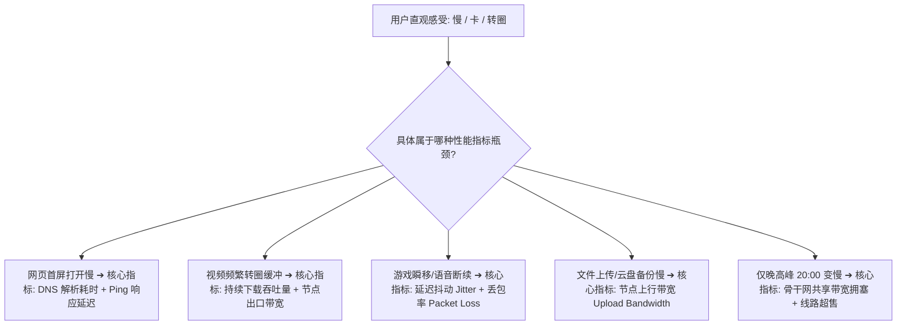
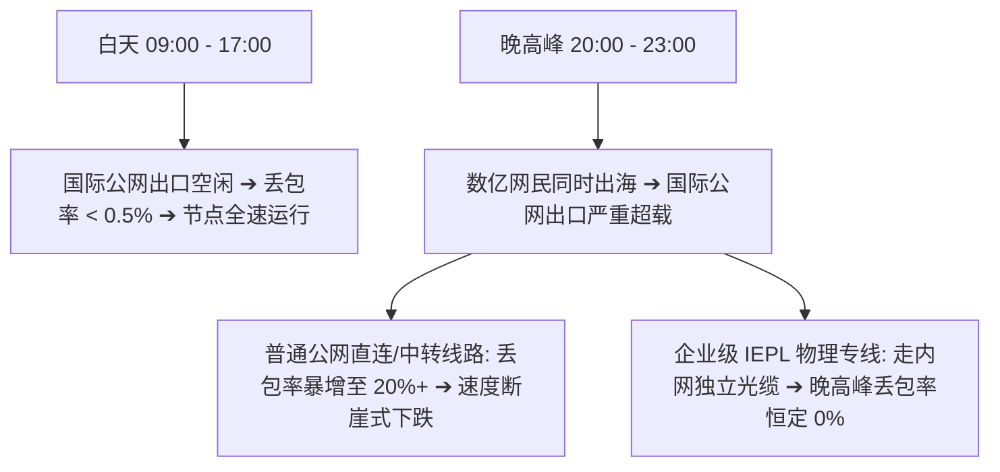

在日常使用 Clash / Mihomo 客户端时，很多用户最常遇到的不是完全断网，而是令人抓狂的**“性能瓶颈”**：

**“为什么测速显示绿色 25ms 低延迟，但在 YouTube 上看 4K 视频却一直转圈缓冲？”**  
**“为什么白天测速能跑满 300Mbps，一到晚上 8 点到 10 点就掉速到几百 KB，网页都刷不开？”**  
**“为什么在 Speedtest 上测速很高，但实际下载大文件或在 GitHub 克隆代码时却极其缓慢？”**  
**“同一个机场订阅，为什么朋友用得飞快，自己家里却卡顿严重？”**

**Clash 能够成功连通目标网站，并不代表整条数据传输链路上拥有充足的带宽与稳定性。“速度慢”并不是单一原因造成的，而是本地网络、家庭 Wi-Fi、运营商路由、专线带宽、机房负载与海外出口综合作用的结果。**

本文专注于 **“Clash 能正常联网但性能不佳”** 这一高频痛点，从 **Ping、抖动（Jitter）、丢包率（Packet Loss）、持续吞吐量** 四大核心性能指标切入，手把手带你通过 **「节点 × 设备 × 网络 × 时段」4D 诊断模型**，彻底查清并解决节点卡顿与降速根因。

---

## ⚡ 30 秒快速排障速查流：节点速度慢怎么排查？

```text
┌────────────────────────────────────────────────────────────────────────┐
│               Clash 速度慢与卡顿 30 秒极速诊断决策流                   │
├────────────────────────────────────────────────────────────────────────┤
│ ① 关闭 Clash 测裸网 ➔ 本地物理宽带是否正常？(排除本地宽带欠费/故障)    │
│ ② 切换同地区 2~3 个备用节点 ➔ 速度恢复？(原节点单机超售/维护拥堵)      │
│ ③ 切换不同国家地区 (如香港 ➔ 日本/新加坡) ➔ 排除区域骨干网络拥堵       │
│ ④ 对比白天与晚间 20:00 表现 ➔ 仅晚上慢？(晚高峰公网拥塞，需升级专线)  │
│ ⑤ 电脑连接手机 5G 热点测试 ➔ 热点秒开？(本地家庭 Wi-Fi / 路由器 QoS 瓶颈)│
│ ⑥ 查看 Connections 连接记录 ➔ 确认当前流量未被规则误分流到慢速 Auto 组│
│ ⑦ YouTube 查看“详细统计信息” ➔ 确认 Connection Speed 持续吞吐量        │
└────────────────────────────────────────────────────────────────────────┘
```

> 💡 **必须厘清的核心分工**：
> - **《Clash订阅怎么导入》**：解决**订阅报错、404/403、Profile 解析失败**；
> - **《Clash节点Timeout怎么办》**：解决**节点完全连不上、全部标红超时**；
> - **《Clash有节点但无法上网》**：解决**节点已连上，但因系统代理/规则/DNS导致打不开网页**；
> - **本篇《Clash速度慢怎么办》**：专门解决**已经能正常上网，但网速慢、卡顿、晚高峰掉速**。

---

## 一、技术澄清：“慢”到底指什么？性能指标全景大拆解

在排查网速之前，首先要搞懂“速度慢”的具体表现与对应的底层性能指标：



### 核心性能指标大对比表：
| 性能指标 | 衡量单位 | 实际代表的技术意义 | 对应受影响的核心使用场景 |
| :--- | :---: | :--- | :--- |
| **往返延迟 (Ping)** | 毫秒 (ms) | 数据包往返目标服务器的**握手响应时间** | 网页点击首屏加载、SSH 终端操作、即时搜索 |
| **延迟抖动 (Jitter)** | 毫秒 (ms) | 连续数据包之间延迟的**波动幅度** | 实时语音通话、视频会议、外服竞技游戏 |
| **丢包率 (Packet Loss)** | 百分比 (%) | 传输过程中未能到达终点被丢弃的数据包比例 | **所有场景的头号杀手**，即使 2% 丢包也会导致 4K 降画质 |
| **下行带宽 (Download)** | Mbps | 节点持续向本地设备下载数据的**通道宽度** | 大文件下载、系统更新、4K/8K 视频流媒体播放 |
| **上行带宽 (Upload)** | Mbps | 本地设备向海外服务器上传数据的**通道宽度** | 视频会议推流、网盘同步、向 AI 批量发送多模态图片 |
| **持续吞吐量 (Throughput)** | KB/s / MB/s | 在 10~30 分钟长连接下**能够稳定维持的真实速率** | 长视频观看、BT/P2P 下载、云端大模型微调 |

---

## 二、反常识深剖：为什么“Ping 20ms 依然很慢”，而“Ping 100ms 节点反而更快”？

这是困扰无数新手的最大认知误区：**“延迟低（Ping）”绝不等于“下载速度快”**。

```text
┌────────────────────────────────────────────────────────────────────────┐
│                   低 Ping 节点 vs 高吞吐节点 形象比喻                   │
├────────────────────┬───────────────────────────────────────────────────┤
│ 节点 A             │ 相当于一条【空旷但极窄的自行车道】：              │
│ (Ping 20ms / 慢)   │ 起步反应极快 (Ping 20ms)，但一次只能运一袋米      │
│                    │ 看 YouTube 4K 时，极窄的带宽根本运不过来，频繁转圈│
├────────────────────┼───────────────────────────────────────────────────┤
│ 节点 B             │ 相当于一条【距离稍远但 8 车道的高速公路】：       │
│ (Ping 100ms / 快)  │ 起步反应稍慢 (Ping 100ms)，但一次能跑 8 辆重型卡车│
│                    │ 看 4K 视频时，几秒钟就能缓存 2 分钟，全程丝滑播放 │
└────────────────────┴───────────────────────────────────────────────────┘
```

> 📌 **核心结论**：
> - **香港普通公网节点**（物理距离近，Ping 只有 25ms）：如果晚高峰涌入上千人共享 100M 带宽，发生 15% 丢包，实际视频速度甚至不如 5Mbps；
> - **美西/日本 IEPL 专线节点**（物理距离远，Ping 130ms）：但由于独享物理千兆专线且 **0 丢包**，能跑满 500Mbps 宽带，4K/8K 秒开。

---

## 三、丢包率（Packet Loss）：摧毁网络流畅度的隐形杀手

在 TCP 协议的拥塞控制机制中，**哪怕发生 1%~3% 的轻微丢包，TCP 协议栈就会触发“拥塞避免算法”，主动将当前的下载速度腰斩 50% 以上**；若丢包率达到 10%，数据流将陷入持续的重传等待，导致看视频频繁断流。

```text
┌────────────────────────────────────────────────────────────────────────┐
│                       丢包率对实际网速的毁灭性打击                     │
├──────────────┬────────────────────────┬────────────────────────────────┤
│ 节点丢包率   │ TCP 协议实际表现       │ 真实用户体验                   │
├──────────────┼────────────────────────┼────────────────────────────────┤
│ **0% (专线)**│ 窗口持续扩张，跑满带宽 │ YouTube 4K/8K 缓冲条极速填充   │
├──────────────┼────────────────────────┼────────────────────────────────┤
│ **1% ~ 3%**  │ 偶发重传，带宽波动 30% │ 1080P 偶尔降画质，下载速度跳水 │
├──────────────┼────────────────────────┼────────────────────────────────┤
│ **5% ~ 10%** │ 频繁超时重传，带宽骤降 │ 视频频繁转圈缓冲，网页加载卡死 │
├──────────────┼────────────────────────┼────────────────────────────────┤
│ **> 15%**    │ 连接几乎瘫痪           │ 无法维持长连接，频繁提示网络断开│
└──────────────┴────────────────────────┴────────────────────────────────┘
```

---

## 四、晚高峰拥塞剖析：为什么白天飞快，晚上 8 点准时卡死？

很多用户抱怨：“为什么工作日白天看 4K 毫无压力，一到晚上 20:00~23:00 就连 720P 都卡？”



### 晚高峰性能测试记录对比表示例：
| 测试时段 | 节点类型 | 平均 Ping | 丢包率 (Loss) | 真实下载吞吐 | YouTube 实际体验 |
| :--- | :--- | :---: | :---: | :---: | :--- |
| **白天 14:00** | 普通公网中转节点 | 45ms | 0% | 220 Mbps | 4K 极速秒开，体验丝滑 |
| **晚高峰 21:00** | 普通公网中转节点 | 95ms | **18.5%** | **4.2 Mbps** | **频繁转圈，只能勉强看 480P** |
| **晚高峰 21:00** | **IEPL 企业物理专线** | **48ms** | **0%** | **310 Mbps** | **4K/8K 毫无压力，零缓冲** |

---

## 五、本地网络瓶颈排查：别让家里的路由器拖了后腿

很多时候节点本身性能充沛，但本地环境存在严重的“隐形限速”：

### 1. 本地物理裸网测试（第一步排除项）
在怀疑梯子之前，先**完全退出 Clash**，打开国内测速网站（如 `speedtest.cn`）测试本地宽带：
- 如果本地裸网测速只有 10Mbps 或 Ping 本身就高达 80ms，说明是宽带欠费、光猫故障或家庭 Wi-Fi 信号不良，**代理不可能跑出超越本地物理宽带的速度**。

### 2. Wi-Fi 2.4GHz vs 5GHz vs 有线网线
- 🔴 **2.4GHz Wi-Fi**：穿墙虽好但频段极其拥挤，受微波炉、蓝牙干扰严重，实际最高往往只能跑出 30~50Mbps；
- 🟢 **5GHz Wi-Fi**：带宽充沛但穿墙衰减大，建议在路由器同房间内使用；
- 🏆 **千兆网线直连**：排查速度问题时的终极基准，能彻底排除无线信号波动与丢包。

### 3. 电脑后台“偷跑流量”排查
在进行节点测速前，打开 Windows 任务管理器 ➔ 性能 ➔ 查看以太网/Wi-Fi 发送与接收数据：
- 确认后台没有正在静默下载的 **Steam 游戏更新、Windows 系统补丁、OneDrive / 百度网盘同步**。

---

## 六、Clash 分流规则与代理组配置隐患

有时速度慢并不是节点不行，而是**你的流量根本没有走你选中的那个节点**：

```text
┌────────────────────────────────────────────────────────────────────────┐
│                   分流规则导致的“虚假慢速”排查要点                     │
├────────────────────┬───────────────────────────────────────────────────┤
│ 隐患 1：           │ 用户在主代理组中选了高速日本节点，但订阅自带的    │
│ 独立分流组覆盖     │ 「YouTube / 视频平台」独立分组里却选了慢速香港节点│
│                    │ ➔ 在 Proxies 界面展开所有分组，逐一检查选定节点   │
├────────────────────┼───────────────────────────────────────────────────┤
│ 隐患 2：           │ 使用了「Auto / 自动选择」测速组，系统将流量导向了 │
│ Auto 自动组误判    │ 延迟虽低但丢包严重的节点                          │
│                    │ ➔ 改为手动选择固定的优质专线节点                  │
├────────────────────┼───────────────────────────────────────────────────┤
│ 隐患 3：           │ 节点切换后，浏览器依然复用了旧的 TCP 长连接通道   │
│ 浏览器长连接残留   │ ➔ 切换节点后，彻底重启浏览器或清空连接记录        │
└────────────────────┴───────────────────────────────────────────────────┘
```

> 💡 **排查利器**：打开 Clash Verge Rev 左侧的 **「连接 (Connections)」** 页面，播放 YouTube 时观察目标域名到底命中了哪个规则分组、实际走的是哪一台节点服务器。

---

## 七、YouTube 4K 卡顿深度诊断：手把手教你看 Stats for Nerds

在电脑 Chrome/Edge 浏览器中播放 YouTube 视频时，**右键点击播放器画面 ➔ 选择「详细统计信息 (Stats for Nerds)」**：

```text
┌────────────────────────────────────────────────────────────────────────┐
│                   YouTube 详细统计信息核心参数深度解读                 │
├────────────────────────┬───────────────────────────────────────────────┤
│ **Connection Speed**   │ 播放器向海外 CDN 请求数据的当前持续速率。     │
│ (当前连接速度)         │ 🟢 4K 流畅播放要求：稳定保持在 **35,000 Kbps 以上** │
│                        │ 🔴 若此数值低于 10,000 Kbps，4K 必定频繁转圈  │
├────────────────────────┼───────────────────────────────────────────────┤
│ **Buffer Health**      │ 播放器本地已下载的视频预缓存时长。            │
│ (缓存健康度)           │ 🟢 正常状态：**保持在 15s ~ 30s 以上**       │
│                        │ 🔴 若此数值持续走低跌至 0s，视频瞬间卡住      │
├────────────────────────┼───────────────────────────────────────────────┤
│ **Dropped Frames**     │ 丢帧数量。若丢帧很多但网络良好，说明电脑显卡硬│
│ (视频丢帧数)           │ 解码性能不足或 CPU 满载，属于硬件性能瓶颈     │
└────────────────────────┴───────────────────────────────────────────────┘
```

---

## 八、不同高频场景的针对性提速策略

| 应用场景 | 性能核心瓶颈 | 最有效的针对性优化手段 |
| :--- | :--- | :--- |
| **YouTube / Netflix 4K** | 持续下载带宽吞吐量、晚高峰丢包 | 必须选用 **IEPL 物理专线节点**；避开公网中转与高峰拥塞 |
| **ChatGPT / Claude / Gemini** | 首次响应延迟（TTFT）、原生住宅 IP | 选用**日本/美西原生专线节点**；文字生成慢多为平台自身负载 |
| **GitHub Clone / 开发工具** | 单连接下载带宽、长连接稳定性 | 开启 **TUN 模式** 并为 Git 终端单独配置本地代理端口 |
| **外服游戏 (Steam/Apex)** | 往返延迟 Ping、抖动 Jitter、0 丢包 | 选用物理距离最近的**直连专线**（如广港 IEPL）；优先插网线 |
| **Zoom / 腾讯会议跨国通话** | 上行带宽 Upload、单向抖动 | 确保节点具备充足的上行带宽，避开高倍率下行非对称节点 |

---

## 九、跨网络、设备与时段 4D 诊断矩阵

当网速变慢时，使用以下 **「节点 × 设备 × 网络 × 时段」4D 矩阵** 进行交叉排查：

```text
┌────────────────────────────────────────────────────────────────────────┐
│                         4D 性能交叉诊断对照表                          │
├────────────────────┬────────────────────┬──────────────────────────────┤
│ 交叉测试组合       │ 测试结果表现       │ 精准性能瓶颈推断             │
├────────────────────┼────────────────────┼──────────────────────────────┤
│ 电脑连 Wi-Fi 慢 ❌ │ 电脑插千兆网线 快🟢│ 问题在**无线信号干扰/频段拥塞**│
│ (同一节点)         │ (同一节点)         │ (切换 5GHz Wi-Fi 或更换网线) │
├────────────────────┼────────────────────┼──────────────────────────────┤
│ 家用宽带慢 ❌      │ 手机 5G 热点 快🟢  │ 问题在**本地宽带运营商/光猫**│
│ (同一电脑同一节点) │ (同一电脑同一节点) │ (家庭宽带到节点入口路由较差) │
├────────────────────┼────────────────────┼──────────────────────────────┤
│ 白天速度飞快 🟢    │ 晚 20:00 严重卡顿❌│ 问题在**公网晚高峰骨干拥塞** │
│ (同一宽带同一节点) │ (同一宽带同一节点) │ (该节点为公网中转，需换专线) │
├────────────────────┼────────────────────┼──────────────────────────────┤
│ 节点香港 01 慢 ❌  │ 节点日本 01 快🟢   │ 问题在**单节点单机超售或拥堵**│
│ (同一时间同一网络) │ (同一时间同一网络) │ (切换其他空闲节点即可)       │
└────────────────────┴────────────────────┴──────────────────────────────┘
```

---

## 十、Clash 高速抗晚高峰专线品牌推荐矩阵

针对晚高峰 0 丢包、YouTube 4K/8K 秒开与大带宽下载，精选以下真实高吞吐方案：

```text
┌────────────────────────────────────────────────────────────────────────────────────────┐
│                             2026 高速抗拥塞专线品牌候选矩阵                            │
├──────────┬──────────────────────────┬──────────────┬──────────────┬────────────────────┤
│ 适配场景 │ 推荐品牌候选             │ 实际起付门槛 │ 每月流量配额 │ 速度与晚高峰核心优势│
├──────────┼──────────────────────────┼──────────────┼──────────────┼────────────────────┤
│ 4K/8K旗舰│ 光速云 (GuangSuYun)      │ 约 ¥7.5/月起 │ 59G~238G /月 │ 6年老牌物理专线，独享千兆入口，晚高峰4K秒开│
│ 平价轻量 │ 微风网络 (BreezeNet)     │ 约 ¥7/月起   │ 50GB / 月    │ 专为文字AI与查资料优化，平价稳定专线 │
│ 弹性大包 │ 唯兔云 (V2Yun)           │ ¥14.9/月     │ 100GB / 月   │ 15元单月付，100G大流量，不限速满血跑 │
│ 应急备用 │ 星岛梦 (XingDaoMeng)     │ 约 ¥8/月起   │ 60G/不限时包 │ 0月租不限时包，主节点卡顿时极速逃生备用 │
│ AI/开发  │ 速界 (SpeedWorld)        │ ¥25/月       │ 150GB / 月   │ 原生纯净住宅 IP，ChatGPT/API 秒级响应 │
└──────────┴──────────────────────────┴──────────────┴──────────────┴────────────────────┘
```

- 🏆 **4K/8K 极速旗舰首选**：[光速云](/reviews/guangsu-cloud/) —— 全线企业级 IEPL 物理专线，晚高峰 20:00~23:00 依然保持 0 丢包，跑满 500M 宽带；
- 🍃 **超低预算轻量**：[微风网络](/reviews/weifeng-cloud/) —— 针对日常网页查资料与文字 AI 优化的 50GB 小流量专线，年付折算仅约 ¥7/月；
- 💳 **拒绝绑定的单月付**：[唯兔云](/recommend/best-airports/) —— ¥14.9 纯单月付，100GB 充沛流量，节点丰富。

---

## 十一、Clash 网速优化 18 项安全与操作通关清单

```text
┌────────────────────────────────────────────────────────────────────────┐
│                   Clash 网速优化 18 项自查通关清单                     │
├────────────────────────────────────────────────────────────────────────┤
│ □ 1. 关闭 Clash 客户端后，测试国内宽带测速能跑满本地套餐 (排除裸网故障)│
│ □ 2. 电脑优先使用千兆网线或 5GHz Wi-Fi，未在受干扰严重的 2.4G 频段上  │
│ □ 3. 任务管理器中已确认无后台静默下载程序 (Steam/OneDrive/系统更新)   │
│ □ 4. 在 Proxies 界面中连续切换测试了同地区的 2~3 个不同节点           │
│ □ 5. 在 Proxies 界面中跨区域测试了日本、新加坡、美西等其他专线节点     │
│ □ 6. 打开 Connections 连接页面，确认访问目标网站走的是预期的高速节点   │
│ □ 7. 确认未将流量误导向延迟高且丢包严重的 Auto 自动测速组              │
│ □ 8. 进行了白天与晚上 20:00 的对照测试，已掌握区分单机拥塞与晚高峰骨干│
│ □ 9. 电脑切换连接手机 5G 热点测试，秒级排查了家庭路由器 QoS 与宽带限速 │
│ □ 10. 播放 YouTube 4K 时，已在 Stats for Nerds 中核实连接速度持续吞吐 │
│ □ 11. 了解低 Ping 并不等于高下载速度，挑选节点时重点关注丢包率与带宽   │
│ □ 12. 确认没有为了“提速”而在网上下载安装来源不明的网络加速脚本或修改版│
│ □ 13. 确认没有在电脑上为了“提速”而永久关闭防火墙或 Windows Defender   │
│ □ 14. 电脑中已常备第二个备用专线服务商的订阅以防突发晚高峰网络拥堵     │
│ □ 15. 若使用 ChatGPT，已了解文字生成速度主要取决于 OpenAI 平台算力负载 │
│ □ 16. 若使用 Git/开发工具，已知晓开启 TUN 模式或手动配置终端本地代理   │
│ □ 17. 已掌握在切换节点后重启浏览器以清理旧 TCP 连接复用                │
│ □ 18. 遇到严重卡顿排查完毕后，已掌握按 4D 性能模型科学定位真正瓶颈    │
└────────────────────────────────────────────────────────────────────────┘
```

---

## 十二、避坑指南：25 个关于“Clash 速度与性能”的致命认知误区

```text
❌ 误区 1：Ping 越低，下载速度与看 4K 视频就越快 ➔ 事实：Ping 仅测响应时间，带宽与丢包才决定下载速度。
❌ 误区 2：Speedtest 测速跑满 500Mbps，看 YouTube 就绝不会卡 ➔ 事实：Speedtest 路径好不代表 YouTube CDN 路径好。
❌ 误区 3：节点列表里节点数量越多，速度就越快 ➔ 事实：100 个劣质公网节点也不如 3 个优质 IEPL 专线节点。
❌ 误区 4：香港节点的速度永远比日本、新加坡节点快 ➔ 事实：香港节点常因人多拥挤严重，日本专线吞吐往往更大。
❌ 误区 5：美国节点因为延迟高所以绝对不能用来下载 ➔ 事实：美西机房带宽极其充沛，大文件下载速度常超越亚洲。
❌ 误区 6：只要买了 IEPL 专线就永远能跑 1000Mbps ➔ 事实：速度依然受你的本地宽带上限与服务商单线带宽限制。
❌ 误区 7：中转节点一定比直连节点快 ➔ 事实：若中转机房入口拥塞严重，速度反而不如优质直连。
❌ 误区 8：Hysteria 2 协议在任何网络下都绝对最快 ➔ 事实：UDP 协议在部分 QoS 严格的宽带下会被运营商恶意限速。
❌ 误区 9：开启 TUN 模式可以让网速翻倍 ➔ 事实：TUN 只解决应用流量接管范围，对物理带宽毫无加速作用。
❌ 误区 10：换个“神奇 DNS”能让下载速度提升 10 倍 ➔ 事实：DNS 仅影响域名首包解析，不影响长视频持续吞吐。
❌ 误区 11：Global 全局模式是 Clash 的性能加速模式 ➔ 事实：Global 是强制全局代理，仅用于故障诊断。
❌ 误区 12：节点名字带有 VIP/Premium 就一定比普通节点快 ➔ 事实：节点名称只是标识，实际性能以多时段实测为准。
❌ 误区 13：白天测速很快就代表晚高峰一定不卡 ➔ 事实：晚高峰骨干网拥堵严重，必须在 20:00~23:00 单独实测。
❌ 误区 14：别人测速能跑 800Mbps，我用同套餐也一定能跑 800Mbps ➔ 事实：两地宽带运营商路由不同，体验差异巨大。
❌ 误区 15：套餐流量倍率 2x 代表拥有 2 倍下载速度 ➔ 事实：倍率仅代表扣除流量的比例，与速度带宽毫无关系。
❌ 误区 16：不限流量的梯子套餐一定比限流量的快 ➔ 事实：不限流量套餐往往涌入大量重度下载用户导致严重塞车。
❌ 误区 17：看视频卡顿一定是机场节点出了问题 ➔ 事实：也可能是家庭 Wi-Fi 信号衰减、微波炉干扰或后台偷跑流量。
❌ 误区 18：ChatGPT 回复打字慢一定是梯子节点慢 ➔ 事实：文字吐字速度由 OpenAI 平台自身算力与负载决定。
❌ 误区 19：只要网速慢就说明机场跑路或超售了 ➔ 事实：先测本地裸网与手机热点，90% 是本地网络与单节点拥堵。
❌ 误区 20：多开几个代理软件可以“叠加网速” ➔ 事实：多客户端争抢网卡会导致网络严重死锁与断网。
❌ 误区 21：只要速度慢第一步就应该修改电脑 MTU ➔ 事实：MTU 属于极特殊排障项，乱改会导致大面积网页打不开。
❌ 误区 22：关闭 IPv6 能够让梯子速度瞬间翻倍 ➔ 事实：仅当本地 IPv6 路由严重异常时关闭才有轻微改善。
❌ 误区 23：切换节点后无需刷新网页就能生效 ➔ 事实：浏览器复用旧 TCP 长连接，需彻底重启浏览器或开新标签页。
❌ 误区 24：免费公开分享的节点速度能媲美付费专线 ➔ 事实：免费节点万人挤占，带宽极其有限且极不稳定。
❌ 误区 25：发现节点变慢必须立刻花钱买新机场 ➔ 事实：先按 4D 模型排查，通常切换同地区备用节点即可解决。
```

---

## 十三、常见问题深度解答（FAQ · 35 问）

### Q1：Clash 速度慢怎么办？
**答**：首先关闭 Clash 确认本地裸网速度正常；然后在客户端中切换同地区的 2~3 个备用节点；若仍慢，尝试切换日本或美西专线节点，并切换手机 5G 热点排查家庭 Wi-Fi 干扰。

### Q2：为什么 Clash 测速 Ping 很低，但实际下载和看视频却很慢？
**答**：**Ping 仅代表握手响应时间，不代表带宽容量。** 一个节点可能延迟只有 25ms，但若出口带宽被多人占满或发生丢包，看视频依然会频繁转圈。

### Q3：为什么 Clash 白天速度很快，一到晚上 8 点就极度卡顿？
**答**：这是典型的**晚高峰国际骨干网拥塞**。普通公网中转线路在晚间丢包率常暴增至 15% 以上，只有采用**企业级 IEPL 物理专线**才能全天保持 0 丢包。

### Q4：Clash 节点丢包率高怎么解决？
**答**：丢包多发生在公网拥堵或 Wi-Fi 干扰时。优先使用 5GHz Wi-Fi 或有线网线连接，并在客户端中切换至标有 IEPL / 专线字样的节点。

### Q5：Clash 延迟抖动（Jitter）很大是什么原因？
**答**：说明网络传输路径不稳定，通常由无线信号干扰、路由器负荷过高或公网路由频繁跳段引起。插网线或切换专线节点可显著降低抖动。

### Q6：看 YouTube 视频卡顿，但 Speedtest 测速很高是怎么回事？
**答**：Speedtest 连接的是测速服务器，而 YouTube 走的是 Google 独立的海外 CDN 网络。若节点出口到 Google CDN 的路由拥塞，就会出现测速高但看视频卡的现象。

### Q7：YouTube 播放 4K 视频需要多少真实带宽？
**答**：在 YouTube Stats for Nerds 中，**Connection Speed 需稳定保持在 35,000 Kbps（约 35 Mbps）以上**，且丢包率为 0%，方可实现 4K 零缓冲流畅播放。

### Q8：为什么使用 5GHz Wi-Fi 比 2.4GHz Wi-Fi 速度快很多？
**答**：2.4GHz 频段极其拥挤且易受蓝牙和家电干扰，实际带宽常被压缩至几十兆；5GHz 频段干扰少、频宽大，能完整跑满几百兆的代理带宽。

### Q9：手机连接 5G 热点为什么比家里 Wi-Fi 速度快？
**答**：说明家庭宽带的国际出口路由较差、或家用路由器开启了 QoS 限速。手机 5G 走的是蜂窝移动独立骨干网，能秒级排除宽带瓶颈。

### Q10：为什么同一个机场，朋友测速 500M 而我只有 50M？
**答**：因为两地的宽带运营商（如电信 vs 移动 vs 联通）以及所在城市的物理网络路由完全不同，到机场入口服务器的连接质量存在天然地域差异。

### Q11：Clash 节点数量越多，网速就越快吗？
**答**：**完全不会。** 决定速度的是单节点的带宽上限、专线质量与负载人数，节点数量多只是提供了更多的冗余备用选择。

### Q12：香港节点一定比日本、新加坡节点快吗？
**答**：不一定。香港节点由于物理距离近常被大量用户扎堆使用导致拥塞；而日本或新加坡专线节点负载更低，实际下载吞吐往往更胜一筹。

### Q13：美国节点延迟 150ms，看视频会比香港节点卡吗？
**答**：只要带宽充足且 0 丢包，150ms 延迟在长视频播放中与 30ms 体验毫无差异，因为视频是流式预缓存的，几秒后即可流畅播放。

### Q14：为什么切换了节点，网页速度感觉没有变化？
**答**：浏览器通常会复用已经建立的 TCP 连接。切换节点后，建议**彻底重启浏览器**，或在 Clash 的 Connections 页面中点击关闭所有活动连接。

### Q15：Connections 页面在排查速度时有什么用？
**答**：可以实时查看当前访问的域名到底命中了哪条规则、实际流经了哪台节点，避免出现“以为选了日本专线，实际流量却走了慢速默认组”的情况。

### Q16：Auto 自动选择组好用吗？
**答**：日常查资料尚可；但在看 4K 视频或打游戏时**强烈建议手动固定选择一个优质专线节点**，防止自动组频繁切换导致网络瞬间卡顿。

### Q17：修改 Clash 本地 DNS 能大幅提升下载网速吗？
**答**：**不能。** DNS 仅负责把域名翻译成 IP，影响的是首次打开网页那 0.1 秒的反应速度，对持续下载和看视频的带宽毫无加速作用。

### Q18：开启 TUN 模式能让网速翻倍吗？
**答**：**不能。** TUN 模式的作用是让游戏、命令行和桌面 App 强制走代理，属于流量接管范围层面的工具，不会增加物理带宽。

### Q19：电脑 CPU 占用过高会导致 Clash 速度变慢吗？
**答**：会。代理协议（如 VLESS-Reality、TLS、Hysteria 2）在高速传输时需要高强度的 CPU 加解密运算，低端电脑 CPU 满载会成为严重瓶颈。

### Q20：为什么 ChatGPT 生成文字的速度很慢？
**答**：文字吐字速度主要由 OpenAI 平台的 GPU 算力排队与服务器负载决定；只要首字能秒出，后续打字慢属于平台自身行为，与梯子速度无关。

### Q21：GitHub clone 速度极慢怎么解决？
**答**：Git 命令行默认不走 Windows 系统代理。在客户端中**开启 TUN 模式**，或在终端中设置局部代理即可秒级跑满宽带。

### Q22：外服游戏看重的是什么速度指标？
**答**：游戏最看重 **Ping（低于 60ms）、Jitter（抖动小于 5ms）与 0 丢包**，而不是 500Mbps 的极限下载带宽。

### Q23：跨国视频会议频繁断续卡顿怎么优化？
**答**：视频会议对**上行带宽（Upload）与丢包率**极其敏感。避免使用上下行不对称的拥挤节点，优先选择企业级专线。

### Q24：流量倍率高的节点速度一定更快吗？
**答**：**不一定。** 倍率只是服务商扣除流量的计算系数（如 2x、3x），必须实测其背后的带宽与专线质量。

### Q25：不限流量的机场套餐为什么容易变慢？
**答**：因为不限流量套餐会吸引大量长时间挂机下载的大流量用户，机房带宽更容易被吃满导致严重拥堵。

### Q26：如何判断当前节点是否遭遇了机房限速？
**答**：在不同时段多次测速，如果无论白天晚上速度都极其精准地卡在某个固定数值（如 30Mbps），通常表示服务商对该套餐或节点设置了 QoS 上限。

### Q27：家庭路由器老旧会影响 Clash 速度吗？
**答**：会。老旧百兆路由器、NAT 转发性能弱或开启了不当的 QoS 限速规则，都会严重压制高带宽代理的表现。

### Q28：电脑插网线真的比连 Wi-Fi 快很多吗？
**答**：在抗丢包和降低延迟抖动方面，千兆网线直连具有压倒性优势，是排查网络卡顿的最标准测试对照组。

### Q29：IEPL 专线为什么能在晚高峰保持高速？
**答**：因为 IEPL 走的是企业内网独立海底光缆，不经过公网国际出口，完全绕过了晚高峰数亿网民出海的拥堵路段。

### Q30：为什么手机端用同一个节点测速比电脑快？
**答**：排查电脑后台是否有程序偷跑流量、电脑 Wi-Fi 频段是否处于 2.4G、或电脑杀毒软件对网络层进行了深度数据包过滤。

### Q31：测速时提示网络波动怎么排查？
**答**：查看本地 Wi-Fi 信号强度，关闭后台下载软件，并在客户端内切换其他负载较低的同地区节点。

### Q32：IPv6 会拖慢 Clash 速度吗？
**答**：若本地运营商的 IPv6 国际路由较差，可能引发降速。若实测确认相关，可在客户端网络设置中关闭 IPv6。

### Q33：遇到全天速度极慢需要重装 Clash 吗？
**答**：**不需要。** 速度慢与客户端安装程序基本无关，重点应排查本地宽带、节点线路与服务商套餐。

### Q34：什么时候才真正需要考虑更换或升级机场套餐？
**答**：当连续多天在多个时段（尤其是晚高峰）、使用有线网络和手机热点测试多个地区节点均持续卡顿且丢包严重时，说明该服务商带宽容量已无法满足需求。

### Q35：如何搭建一个永不断流的高速网络组合？
**答**：主力选用企业级 **IEPL 物理专线套餐**（保障日常 4K 与晚高峰 0 丢包），同时常备一个 **0 月租的不限时按量流量包**（如星岛梦）作为应急备用通道。

---

## 🏁 总结：Clash 网速优化终极心法

彻底解决 Clash 速度慢与卡顿，请牢记以下**四维性能优化法则**：

```text
1. 认清指标 ➔ 网页首屏看 Ping 与 DNS，长视频看持续吞吐，游戏会议看 Jitter 与 0 丢包
2. 排除本地 ➔ 关代理测物理裸网，插千兆网线避 2.4G 干扰，切手机热点秒排宽带瓶颈
3. 精准选线 ➔ 晚高峰卡顿换 IEPL 物理专线，单节点拥堵换同地区备用节点
4. 查看真相 ➔ 善用 YouTube Stats for Nerds 详细统计，以真实业务吞吐为唯一标准
```

---

### 📚 延伸进阶阅读与选型专栏
- 🛠️ **Clash 生态总指南**：[《Clash梯子怎么用？Clash Verge Rev、Mihomo、订阅与节点完整教程》](/tutorials/clash-tizi/)
- 📋 **订阅导入与排障**：[《Clash订阅怎么导入？Profile、节点更新与订阅失败完整教程》](/tutorials/clash-subscription-import/)
- 🔴 **节点超时专题**：[《Clash 节点 Timeout 怎么办？全部节点红色与网络异常排查》](/issues/clash-node-timeout/)
- 🚨 **断网排查手册**：[《Clash 有节点但无法上网怎么办？7 步系统排查与修复指南》](/issues/clash-connected-no-internet/)
- 📉 **测速深度解析**：[《为什么机场节点延迟低但实际速度慢？》](/issues/low-ping-slow-speed-reasons/)
- 💻 **电脑端总指南**：[《电脑梯子哪个好？Windows 10/11、Mac梯子工具与客户端完整指南》](/recommend/pc-tizi/)
- ⚡ **老牌旗舰专线**：[《光速云深度评测：2020老牌IEPL专线与解锁实测》](/reviews/guangsu-cloud/)
- 🍃 **平价轻量专线**：[《微风网络深度评测：小流量套餐值不值得买？》](/reviews/weifeng-cloud/)
- 🏆 **2026 全景大榜**：[《2026梯子推荐：稳定、速度、价格、安全与不同使用场景怎么选》](/recommend/best-tizi/)
