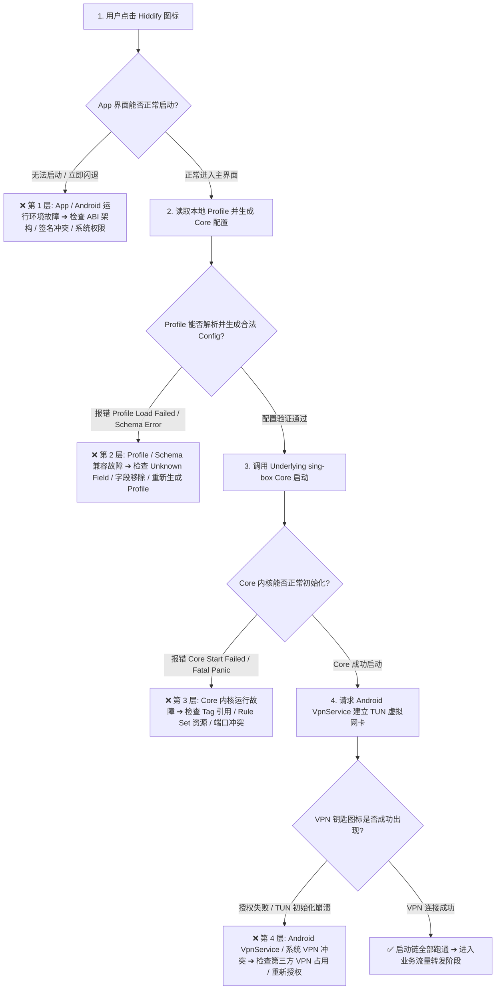
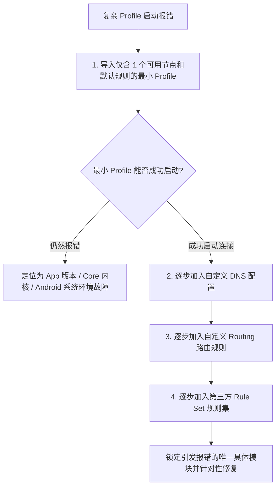

在配置与使用 Hiddify 客户端的过程中，很多 Android 用户在遇到客户端异常时，常常会陷入“盲目重装、乱删订阅、病急乱投医”的误区：**“为什么点击 Hiddify 图标直接白屏闪退，连主界面都进不去？为什么订阅链接明明拉取成功了，点击连接时却弹出红字报 `Profile Load Failed` 或 `Core Start Failed`？为什么更新了 Hiddify 版本后，旧的节点配置突然全部报错无法使用？提示 `Unknown Field` 或 `Deprecated` 到底是什么意思？下载的 APK 为什么提示‘应用未安装’或‘签名冲突’？”**

面对复杂的系统底层与内核配置报错，绝大多数新手都会把不同层级的故障混为一谈：

**“Hiddify App 界面打不开，到底是 Android 系统的 WebView 坏了，还是安装包架构（ABI）下载错了？”**  
**“Hiddify 的 App 版本和它底层的 sing-box Core 内核版本是一回事吗？”**  
**“为什么在 Clash 或 v2rayN 上能用的订阅文件，直接导入 Hiddify 却提示配置 Schema 错误？”**  
**“遇到配置报错时，直接‘清除应用数据’或‘卸载重装’真的能修好吗？”**  
**“日志里刷出几十行红字报错，到底哪一行才是真正的致命根因（Fatal Error）？”**

**排查 Hiddify 打不开与配置报错，绝不能靠‘无脑卸载重装、盲目修改节点、随意关闭系统防护’，而必须建立严密的‘四层故障模型与九维版本启动诊断体系’！**

要彻底攻克 Hiddify 客户端与内核崩溃难题，必须建立一套 **四层全景诊断与最小复现模型**：**“严格区分四大故障层级（App/GUI 界面层 ➔ Profile / Generated Config 转换层 ➔ Underlying sing-box Core 内核层 ➔ Android OS 系统运行环境层） ➔ 解耦‘客户端 App 版本’与‘底层 Core 内核版本’的双轨演进关系 ➔ 洞悉‘服务商原始 Profile’与‘Hiddify 最终生成的 Core Config’之间的 Schema 校验逻辑 ➔ 掌握 Deprecated（已废弃警告）、Removed（已彻底移除）与 Migration（配置迁移）的生命周期 ➔ 准确排查 Android CPU 架构（arm64-v8a vs armeabi-v7a）与 Google Play / GitHub 安装包的签名冲突 ➔ 避免滥用 Clear Data（清除数据）导致重要 Profile 丢失 ➔ 建立‘最小可用 Profile ➔ 逐步恢复 TUN/DNS/Routing/Rule Set’的单变量二分调试法 ➔ 锁定日志中的第一条 Fatal 核心根因”**。

本文作为 **Hiddify 客户端启动与配置报错排查的权威最终收口指南**，将带你穿透 Android 运行环境与底层 Core 内核，彻底解决从启动闪退到 Schema 不兼容的各类深层疑难杂症。

---

## ⚡ 30 秒极速看懂：Hiddify 启动流与四层故障快速定位



- 🚨 **核心排查黄金定律**：
  - **订阅获取成功 $\ne$ Core 启动成功**：从 URL 成功拉取 Profile 仅代表 HTTP 传输正常，不代表生成的内容符合当前 Core 的 Schema 规范；
  - **App 版本 $\ne$ Core 内核版本**：Hiddify GUI 升级可能会携带新版 Core，导致旧版配置中的已移除字段（Removed Field）彻底无法启动；
  - **切莫第一步就清数据或卸载**：90% 的配置报错是由 Profile 格式不兼容引起的，卸载重装后重新导入同一份错误 Profile 依然会 100% 复现报错！

---

## 一、架构全景：Hiddify 四层故障诊断与错误特征对照表

```text
┌────────────────────────────────────────────────────────────────────────────────────────┐
│                        Hiddify 四层故障定位与核心特征表                                │
├──────────────┬────────────────────────┬────────────────────────────────────────────────┤
│ 故障层级     │ 典型故障表征           │ 核心定位与第一排查证据                         │
├──────────────┼────────────────────────┼────────────────────────────────────────────────┤
│ **1. App / GUI 层**| 点击图标闪退、白屏卡死、UI 界面崩溃| 检查 Android 系统版本、CPU ABI（arm64-v8a）、安装包完整性│
│ **2. Profile 层**  | `Profile Load Failed`、Schema 不兼容 | 检查字段拼写、旧配置 Deprecated/Removed、Tag 引用缺失│
│ **3. Core 内核层** | `Core Start Failed`、内核 Panic 崩溃 | 查看日志第一条 Fatal、Rule Set 远程资源不可达、端口被占用│
│ **4. Android 环境**| VPN 权限无法授予、TUN 网卡建立失败   | 检查其他 VPN/防火墙软件冲突、存储空间不足、系统签名冲突 │
└──────────────┴────────────────────────┴────────────────────────────────────────────────┘
```

---

## 二、第一大核心：App 版本 $\ne$ Core 版本与三版本兼容模型

排查升级后配置失效，必须建立 **三版本对应模型**：

```mermaid
graph TD
    AppVer[Hiddify App 客户端版本 (如 v2.5.x)] --> CoreVer[Underlying sing-box Core 内核版本 (如 v1.11.x)]
    CoreVer --> ProfileSchema[Profile 配置 Schema 规范版本]
    
    AppVer -.->|GUI 更新可能升级内核| CoreVer
    CoreVer -.->|内核升级可能废弃旧字段| ProfileSchema
```

### 1. 为什么旧 Profile 在旧版可用，升级后却报错？
- 当 Hiddify 发布新版本时，底层打包的 **sing-box Core 内核通常也会同步升级**；
- 若新版 Core 彻底移除了某项旧语法（例如旧版的 `geosite` 字段或旧版 DNS 格式），原本在旧版本上仅触发 Warning 的配置，在新版 Core 下会直接升级为 **Fatal Error（致命错误）**，导致内核拒绝启动。

### 2. 禁止把其他客户端的配置文件直接重命名使用
- **Clash YAML $\ne$ Hiddify Profile**：把 `.yaml` 强行改成 `.json` 不会发生任何魔法转换，Core 无法理解 Clash 的语法；
- **Xray JSON $\ne$ Hiddify Profile**：即使节点同样采用 VLESS 协议，底层 sing-box Core 与 Xray-core 的完整配置 Schema 完全不同，不能直接混用。

---

## 三、第二大核心：Schema 错误、Unknown Field 与 Deprecated 迁移

```text
┌────────────────────────────────────────────────────────────────────────────────────────┐
│                        Schema 常见错误分类与应对策略表                                 │
├──────────────┬──────────────────────────────┬──────────────────────────────────────────┤
│ 报错类型     │ 技术本质与产生原因           │ 正确应对与解决思路                       │
├──────────────┼──────────────────────────────┼──────────────────────────────────────────┤
│ **Unknown Field**| Core 无法识别该字段名称（属于旧版/新版）| 对照当前 Core 文档删除无效字段或重新生成 Profile│
│ **Deprecated**   | 字段已被废弃，当前版本仅告警但不阻止启动| 记录该字段并在后续更新中提前进行 Schema 迁移   │
│ **Removed Field**| 字段已被彻底移除，新版 Core 强制拦截报错| 必须更新配置结构，切莫靠降级或忽略 Warning 逃避│
│ **Tag Reference**| 引用的 Outbound 或 DNS Server 标签不存在 | 检查规则中引用的 tag 名称是否存在于声明列表中  │
└──────────────┴──────────────────────────────┴──────────────────────────────────────────┘
```

- 🚨 **第一条错误铁律**：当日志中刷出数十行报错时，**永远只看第一条 Fatal/Error 记录**！后面的几十行报错通常只是第一条语法错误引发的连锁反应。

---

## 四、第三大核心：Android 运行环境、CPU ABI 与签名冲突排查

```mermaid
graph TD
    DownAPK[下载 Hiddify 安装包] --> CheckABI{选择的 CPU 架构是否与手机匹配?}
    
    CheckABI -->|下载了 x86_64 但手机是 ARM| FailABI[❌ 提示'应用未安装'或解析软件包时出现问题]
    CheckABI -->|正确选择 arm64-v8a / Universal| CheckSign{手机已安装版本的签名来源}
    
    CheckSign -->|旧版来自 Google Play, 新版来自 GitHub APK| FailSign[❌ 提示'签名不一致'覆盖安装失败]
    CheckSign -->|同源覆盖安装 (如 GitHub 覆盖 GitHub)| SuccessInstall[✅ 成功安装并保留原有配置]
```

### 1. CPU ABI 架构选型指南
- **arm64-v8a**：绝大多数 2018 年以后生产的现代 Android 手机首选架构，体积小且运行性能最佳；
- **armeabi-v7a**：极少数老旧 32 位 Android 手机或电视盒子使用；
- **Universal（通用包）**：内置所有架构二进制，体积较大，在不确定手机架构时作为保底备选。

### 2. 签名冲突如何安全解决？
- 若从第三方应用商店下载的版本想要切换为 GitHub 官方原版，因**签名证书不同**，Android 系统出于安全机制会强制拒绝覆盖；
- **安全操作步骤**：**先导出/记录当前的订阅链接与自定义规则 ➔ 卸载旧版应用 ➔ 安装官方最新 APK ➔ 重新导入订阅**。

---

## 五、第四大核心：最小化复现（Minimal Profile）与二分调试法

当导入大型复杂 Profile 发生配置报错时，切莫在包含上百个节点与上千条规则的原始文件中盲目修改：



- 💡 **二分调试黄金法则**：每次只还原一组模块（DNS $\rightarrow$ 路由 $\rightarrow$ 规则集），哪一步加入后 Core 崩溃，哪一步就是问题的根源！

---

## 六、7步极速排查与配置修复指南（HowTo）

```text
步骤 1：记录环境信息 ➔ 记下当前 Hiddify App 版本、底层 Core 版本与 Android 系统版本。
步骤 2：区分故障层级 ➔ 点击图标闪退查 ABI/签名，点击连接报错查 Profile/Core，连上无网查 DNS/路由。
步骤 3：读取第一条报错 ➔ 打开 Hiddify 日志，忽略后续连锁错误，直击第一条 Fatal/Error 核心信息。
步骤 4：检查 Schema 兼容 ➔ 若提示 Unknown/Removed Field，联系机场重新生成或更新订阅配置。
步骤 5：排除 VPN 冲突 ➔ 关闭手机内的其他 VPN、代理工具及拦截类防火墙，确保 VpnService 独占。
步骤 6：采用最小化测试 ➔ 导入单一节点的基础 Profile 验证 Core 连通性，再逐步叠加复杂规则。
步骤 7：安全回退与迁移 ➔ 若确属新版 Core 突发 Bug，可临时回退至官方旧版并备份等待热修复更新。
```

---

## 七、2026 全协议完美兼容与标准 Hiddify 高速专线推荐

无论客户端与配置调优得多么完美，如果订阅源本身节点频繁失联或格式生成严重滞后，依然会导致无法正常使用。建议搭配**全协议原生兼容与多客户端标准订阅交付**的高速服务：

```text
┌────────────────────────────────────────────────────────────────────────────────────────┐
│                        2026 全协议兼容与标准专线推荐                                   │
├──────────┬──────────────────────────┬──────────────┬──────────────┬────────────────────┤
│ 适配场景 │ 推荐品牌候选             │ 实际起付门槛 │ 每月流量配额 │ Hiddify 兼容与专线优势 │
├──────────┼──────────────────────────┼──────────────┼──────────────┼────────────────────┤
│ 旗舰全能 │ 光速云 (GuangSuYun)      │ 约 ¥7.5/月起 │ 59G~238G /月 │ 全线 IEPL 专线，标准 Hiddify/sing-box 订阅秒导入，0 Schema 报错│
│ 平价轻量 │ 微风网络 (BreezeNet)     │ 约 ¥7/月起   │ 50GB / 月    │ 优质 BGP 优化专线，纯净轻量，节点更新秒级响应，Schema 极稳 │
│ 弹性月付 │ 唯兔云 (V2Yun)           │ ¥14.9/月     │ 100GB / 月   │ 14.9 元纯单月付，多协议节点充沛，单节点故障秒切  │
│ 应急备用 │ 星岛梦 (XingDaoMeng)     │ 约 ¥8/月起   │ 60G/不限时包 │ 0月租不限时包，永不过期，专线拥塞时随时顶上应急  │
│ 极速专精 │ 速界 (SpeedWorld)        │ ¥25/月       │ 150GB / 月   │ 企业级超大独立专线带宽，AI 与流媒体原生解锁极速响应 │
└──────────┴──────────────────────────┴──────────────┴──────────────┴────────────────────┘
```

- 🏆 **全协议旗舰首选**：[光速云](/reviews/guangsu-cloud/) —— 2020 老牌专线，全线内网 IEPL 专线，原生纯净解锁；
- 🍃 **超低预算轻量**：[微风网络](/reviews/weifeng-cloud/) —— 50GB 精品小流量专线，年付折算仅约 ¥7/月；
- 💳 **拒绝绑定的单月付**：[唯兔云](/recommend/best-airports/) —— ¥14.9 纯单月付，100GB 充沛流量。

---

## 八、避坑指南：85 个关于“Hiddify 报错与闪退”的致命认知误区

```text
❌ 误区 1：Hiddify 客户端闪退一定是机场的节点服务器被封锁了 ➔ 事实：闪退属于 App 进程或系统运行环境崩溃，与远程节点物理状态无关。
❌ 误区 2：订阅链接获取成功就代表生成的 Core 配置一定 100% 正确 ➔ 事实：获取成功仅代表 HTTP 200，内容可能存在 Core 无法识别的无效字段。
❌ 误区 3：Hiddify 的 App 软件版本号和它底层的 sing-box Core 内核版本号完全相同 ➔ 事实：App 与 Core 是两个独立项目，版本号各自分别演进。
❌ 误区 4：看到日志里出现 Warning 警告就代表 Core 已经崩溃必须卸载 ➔ 事实：Warning 仅作为提醒（如废弃提示），通常不会阻止 Core 正常启动。
❌ 误区 5：遇到 Unknown Field 报错时，第一反应是把手机里的 IPv6 开关关掉 ➔ 事实：Unknown Field 是配置字段语法错误，与系统 IPv6 毫无关联。
❌ 误区 6：把 Clash 的 config.yaml 扩展名改成 config.json 就能导入 Hiddify ➔ 事实：文件扩展名不会改变语法结构，Schema 不兼容依然会报错。
❌ 误区 7：出现配置报错时直接“清除应用数据”是最有效的万能修复手段 ➔ 事实：清数据会抹除本地保存的订阅与设置，重新导入错误配置依然会报错。
❌ 误区 8：提示“签名冲突”说明下载的 GitHub 官方 APK 安装包被植入了病毒 ➔ 事实：这是 Android 对不同发布渠道签名证书不一致的正常安全拦截。
❌ 误区 9：所有 Android 手机下载 APK 时都可以无脑选择 arm64-v8a 架构 ➔ 事实：极少数老旧设备或电视盒子是 32 位，需选择 armeabi-v7a 或 Universal。
❌ 误区 10：只要把 Hiddify 卸载重装，所有的 Schema 错误就会自动被修复 ➔ 事实：如果远程订阅服务器下发的配置模板有错，重装后导入依然报错。
❌ 误区 11：在配置报错日志中，排在最后一行的一定是导致崩溃的核心原因 ➔ 事实：真正致命的通常是第一条 Fatal Error，后续错误只是连锁反应。
❌ 误区 12：Deprecated 字段等同于 Removed 字段，出现后 Core 会立即拒绝启动 ➔ 事实：Deprecated 仍可暂用，Removed 才是彻底移除并导致启动失败。
❌ 误区 13：只要向 Hiddify 授予了相机权限，Core 内核就能获得更高的运行稳定性 ➔ 事实：相机权限仅用于扫描订阅二维码，与内核运行稳定性毫无关系。
❌ 误区 14：当 Core 报错时，在网上随便找一个旧版 APK 降级是最好的长期方案 ➔ 事实：旧版无法获得安全补丁与新协议支持，正确做法是推进 Schema 迁移。
❌ 误区 15：只要把复杂 Profile 中的所有规则全部删光，就能彻底解决配置报错 ➔ 事实：缺少基础 Outbound 或必要 DNS 配置会导致 Core 因缺少必需项而报错。
```

---

## 九、常见问题深度解答（FAQ · 90 问）

### Q1：Hiddify 打不开或点击图标立即闪退怎么办？
**答**：**先检查 APK 架构与安装完整性。** 确认下载的是与手机 CPU 匹配的 `arm64-v8a` 或 `Universal` 安装包；若从第三方版本切换而来，先备份订阅后卸载重装官方原版。

### Q2：提示 `Profile Load Failed` 是什么原因？
**答**：**说明订阅内容解析失败或存在不符合当前 Core 规范的字段。** 检查订阅链接是否已过期，或联系机场客服确认下发的是否为最新版兼容 Profile。

### Q3：为什么更新 Hiddify 之后突然无法连接了？
**答**：**通常是新版本升级了底层 sing-box Core 并移除了某些旧字段。** 查看日志中的第一条 Fatal 报错定位已移除的字段，更新订阅或恢复默认配置。

### Q4：Unknown Field 报错到底是什么意思？
**答**：**代表底层 Core 无法识别配置文件中的某个字段名称。** 可能是将其他客户端（如 Clash/Xray）的专属参数误写入了 Hiddify，需清理该字段。

### Q5：清除缓存（Clear Cache）和清除数据（Clear Data）有什么区别？
**答**：**清除缓存只删除临时文件，清除数据会彻底抹除已导入的订阅与设置。** 遇到配置报错应先做日志分析与最小复现，切莫轻易清除数据。

### Q6：提示“签名冲突，应用未安装”该怎么解决？
**答**：**这是因为手机上已有的旧版本与新下载的 APK 签名证书不同。** 先备份你的订阅链接与自定义规则，将手机上的旧版卸载后再安装新 APK。

### Q7：Hiddify 提示 `Core Start Failed` 该怎么排查？
**答**：**打开日志查看第一条 Fatal/Error 记录。** 检查是否引用了不存在的 Outbound Tag、远程 Rule Set 是否无法下载，或本地端口是否被其他应用占用。

### Q8：为什么同一个节点在 v2rayN 上正常，导入 Hiddify 却报错？
**答**：**因为两者使用的底层内核与配置结构不同。** v2rayN 多基于 Xray-core，而 Hiddify 基于 sing-box Core，必须使用对应的专属订阅格式。

### Q9：什么是最小化复现（Minimal Profile）测试？
**答**：**导入仅包含 1 个基础节点和默认 DNS/分流的精简配置。** 若最小配置能成功启动，说明核心环境正常，故障必然出自原配置中的复杂规则模块。

### Q10：遇到严重 Bug 时可以向官方提交 Issue 吗？
**答**：**可以。** 需提供脱敏后的第一条错误日志、Hiddify App 版本、Core 版本及 Android 系统信息，注意切勿在公开社区泄露你的真实订阅 URL 与节点 Token。

---

## 🏁 总结：Hiddify 启动与配置故障核心认知金字塔

排查 Hiddify 故障与配置报错，请牢记以下**核心铁律**：

```text
1. 准定层 ➔ 区分 App 界面崩溃、Profile 转换错误、Core 内核启动失败与 Android VPN 冲突
2. 抓首错 ➔ 忽略数十行连锁警告，直击日志中的第一条 Fatal Error 锁定真正根因
3. 严区分 ➔ App 版本与 Core 版本各自分立，升级后报错优先排查 Removed 字段与 Schema 迁移
4. 慎清数 ➔ 卸载与清数据前务必备份订阅 URL 与规则，避免操作失误丢失重要配置
5. 最小测 ➔ 运用最小化 Profile 与二分调试法，逐项排查 DNS、Routing 与 Rule Set 模块
```

---

### 📚 相关专题延伸阅读
- 🏛️ **Hiddify 概念总览**：[《Hiddify是什么？Hiddify Next、sing-box、V2Ray、Xray与Clash有什么区别？》](/wiki/what-is-hiddify/)
- 📱 **Android 主实操教程**：[《Hiddify Android怎么用？下载安装、订阅、节点、VPN权限与完整配置教程》](/tutorials/hiddify-android/)
- 📦 **订阅导入专项教程**：[《Hiddify订阅怎么导入？订阅链接、二维码、节点更新与订阅失败完整教程》](/tutorials/hiddify-subscription/)
- 🛠️ **有节点但无网排查**：[《Hiddify有节点但无法上网怎么办？VPN、TUN、DNS、Routing与Android网络完整排查》](/issues/hiddify-connected-no-internet/)
- ⚡ **性能与慢速排查**：[《Hiddify速度慢怎么办？节点、线路、Wi-Fi/5G、丢包与晚高峰完整排查》](/issues/hiddify-slow-speed/)
- 🔄 **断线与掉线排查**：[《Hiddify经常掉线怎么办？Android后台、电池优化、锁屏与Wi-Fi/5G切换完整排查》](/issues/hiddify-disconnect/)
- 🌐 **DNS 设置与排查**：[《Hiddify DNS怎么设置？Private DNS、IPv6、FakeIP与域名解析完整指南》](/tutorials/hiddify-dns/)
- 🔀 **Routing 路由分流**：[《Hiddify Routing怎么设置？Direct、Proxy、分应用、规则与流量分流完整教程》](/tutorials/hiddify-routing/)
- 🤖 **sing-box 配置排查**：[《sing-box配置报错怎么办？JSON、Schema、字段版本、Deprecated与配置迁移完整排查》](/issues/sing-box-config-error/)
- ⚡ **老牌旗舰专线评测**：[《光速云深度评测：2020老牌IEPL专线与解锁实测》](/reviews/guangsu-cloud/)
