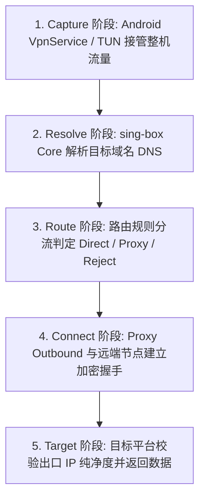
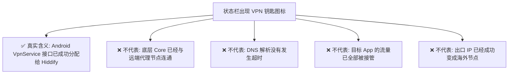
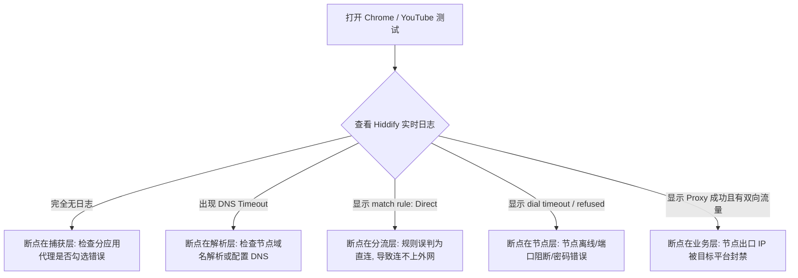
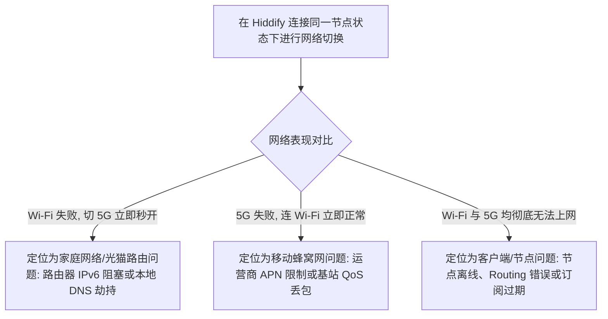

在科学上网工具的使用过程中，最让用户感到困惑与抓狂的场景往往不是“订阅拉取失败”，而是：**“Hiddify 客户端里明明几十个节点都测出了延迟，主界面也显示绿色 Connected，手机顶部状态栏也亮起了 VPN 小钥匙图标，但打开 Chrome 浏览器、YouTube 或 ChatGPT 却始终转圈提示‘连接超时’或‘无网络连接’！”**

面对这种“看似全通、实则瘫痪”的异常状态，绝大多数新手都会陷入盲目折腾的死胡同：

**“为什么明明选了日本节点，打开 IP 查询网站显示的依然是本地运营商宽带？”**  
**“为什么在手机状态栏已经看到了系统 VPN 钥匙图标，但微信能发消息，外网却完全打不开？”**  
**“为什么在家里 Wi-Fi 下 Hiddify 完全连不上网，一旦切成手机 5G 移动流量就能秒开？”**  
**“为什么 Chrome 浏览器可以正常打开 Google，但单独打开 ChatGPT 或 Claude App 却显示网络错误？”**  
**“遇到有节点没网时，到底该改 DNS、关 IPv6，还是在 Routing 路由分流里盲目乱切？”**

**排查 Hiddify 有节点但无法上网，绝不能靠‘瞎换节点、狂改 DNS、频繁重装’碰运气，而必须建立严密的‘五阶段流量流转与九维分层排错模型’！**

要彻底解决 Hiddify 无网故障，必须建立一套 **九维网络流量诊断与排障体系**：**“确认物理裸网连通性（排查底层网络是否本身瘫痪） ➔ 破除‘VPN钥匙图标=翻墙成功’的认知盲区（VpnService活动 $\ne$ 代理服务器已连通） ➔ 捕获核心日志断点（判断目标 App 请求是否真正进入底层 sing-box Core） ➔ 检查 TUN 虚拟网卡与分应用代理（Per-App）规则 ➔ 梳理 DNS 域名解析链（区分节点域名 DNS 与目标网站 DNS） ➔ 审计 Routing 路由分流判定（排查是否被误判为 Direct 直连或 Reject 拦截） ➔ 诊断 Proxy Outbound 远端握手（Dial Timeout / Connection Refused / TLS Error） ➔ 实施 Wi-Fi 与 5G 蜂窝网络 A/B 隔离测试 ➔ 验证真实出口 IP 属性与目标平台风控策略”**。

本文作为 **Hiddify 无网故障排查的权威 Cluster 核心指南**，将带你逐层穿透网络断点，彻底打通上网链路。

---

## ⚡ 30 秒极速看懂：Hiddify 五阶段无网诊断架构



- 🚨 **核心排查黄金定律**：
  - **状态栏 VPN 小钥匙图标仅代表 Android 系统 VpnService 管道已开**，不代表远端服务器通信正常；
  - **打开测试网站时，先看 Hiddify 日志**：若日志里**没有任何该 App 的请求记录**，说明问题出在 TUN/分应用层，切莫去乱改 DNS 或换节点；
  - **普通网页秒开而 AI/流媒体打不开**，问题出在出口 IP 纯净度与平台风控，切莫继续折腾客户端网络设置！

---

## 一、架构全景：九维 Hiddify Android 无网排障模型

```text
┌────────────────────────────────────────────────────────────────────────────────────────┐
│                        Hiddify 九维无网诊断核心对象表                                  │
├──────────────┬────────────────────────┬────────────────────────────────────────────────┤
│ 核心排查维度 │ 检查重点与技术本质     │ 典型故障表征与排查方案                         │
├──────────────┼────────────────────────┼────────────────────────────────────────────────┤
│ **1. 物理裸网**| 本地 Wi-Fi / 5G 原始网络| 临时断开 Hiddify，确认手机在不翻墙时能否正常上网│
│ **2. VpnService**| Android 系统 VPN 接口 | 检查是否被其他杀毒软件、双开框架或第三方 VPN 抢占│
│ **3. TUN 模式**| 虚拟网卡与流量拦截     | 检查分应用代理（Per-App）是否意外排除了目标 App │
│ **4. Core 运行**| 底层 sing-box Core 状态| 检查日志中是否有 Fatal Crash、内存溢出或进程被杀│
│ **5. DNS 解析**| 域名到 IP 的解析调度   | 区分节点服务器域名解析与海外目标网站解析超时    │
│ **6. Routing 路由**| 分流规则匹配 (Proxy/Direct)| 排查目标域名是否被误判定为 Direct 本地直连或 Reject│
│ **7. Outbound**| 节点服务器网络握手     | 排查 Dial Timeout（节点离线）与 TLS 证书时间偏差│
│ **8. 网络 A/B**| Wi-Fi 与 5G 差异排查   | 排除家庭路由器 IPv6 路径阻塞或运营商局部 QoS 阻断 │
│ **9. 目标平台**| ChatGPT / Netflix 风控 | 检查节点出口 IP 是否为纯净住宅 IP 或机房黑名单   │
└──────────────┴────────────────────────┴────────────────────────────────────────────────┘
```

---

## 二、第一大断点：Android VPN 钥匙图标到底证明了什么？



### 为什么会出现“VPN 图标亮着，但网页彻底打不开”？
1. **虚拟网卡已建，但远端节点离线**：手机本地成功建立了一个 TUN 虚拟网卡，把整机流量抽送给 Hiddify，但 Hiddify 底层连接远端 VPS 服务器时发生了超时（Timeout）或被阻断，流量在网关处被丢弃；
2. **DNS 解析链路瘫痪**：应用发起的域名解析请求无法从远端或本地拿到任何 IP 地址，浏览器直接报错 `DNS_PROBE_FINISHED_NXDOMAIN`；
3. **Routing 规则全部 Reject**：分流规则发生语法冲突，导致发出的所有非 Direct 流量全部被内核强制执行丢弃动作。

---

## 三、第二大断点：日志断点分析——流量到底有没有进 Core？

排查无网故障最核心的一步，就是在打开故障 App 的同时，**进入 Hiddify 的 Logs（日志）页面查看实时流量**：

```text
┌────────────────────────────────────────────────────────────────────────────────────────┐
│                        Hiddify 日志断点诊断与故障分流表                                │
├──────────────────────────────┬─────────────────────────────────────────────────────────┤
│ 日志观察到的实际状态         │ 根本原因与针对性处理方向                                │
├──────────────────────────────┼─────────────────────────────────────────────────────────┤
│ **场景 A：完全没有任何请求日志** | **流量未进 Core**：检查分应用（Per-App）、VPN冲突或TUN模式│
│ **场景 B：日志显示 `dns: timeout`**| **DNS 瘫痪**：节点域名无法解析，或海外 DNS 服务器不可达  │
│ **场景 C：日志显示 `route: direct`**| **分流走直连**：规则误将海外网站判定为本地直连导致打不开 │
│ **场景 D：日志显示 `route: reject`**| **规则误伤**：规则将目标域名判定为广告/阻断并丢弃数据包  │
│ **场景 E：日志显示 `dial timeout`**| **节点连不上**：Proxy Outbound 无法与服务器建立 TCP/UDP 握手│
└──────────────────────────────┴─────────────────────────────────────────────────────────┘
```



---

## 四、第三大断点：分应用代理（Per-App）与 VPN 冲突排查

### 1. 分应用代理的 Include 与 Exclude 逻辑陷阱
- **Include（仅代理选中的应用）**：若开启此模式，**未勾选的 App 将完全绕过 Hiddify 直连互联网**。若忘记勾选 Chrome 或 ChatGPT，这些 App 就会完全无法翻墙；
- **Exclude（仅绕过选中的应用）**：若误将浏览器或 AI 客户端勾选，这些应用同样会被排除在代理网卡之外。
- 💡 **快速验证法**：排错时先在设置中**彻底关闭“分应用代理”**，恢复全局接管测试。

### 2. 第三方 VpnService 抢占与冲突
Android 系统同一时刻**仅允许一个应用持有系统的 VpnService 虚拟网卡**：
- 若手机后台同时运行了第三方去广告软件（如 AdGuard 本地模式）、游戏加速器或企业移动办公 VPN，启动 Hiddify 会导致相互踢下线或网卡流量丢失；
- 排错时请务必退出其他所有网络辅助工具。

---

## 五、第四大断点：DNS 调度与 Android 私人 DNS 冲突

```text
┌────────────────────────────────────────────────────────────────────────────────────────┐
│                        现代代理网络两阶段 DNS 架构对比表                              │
├──────────────┬────────────────────────┬────────────────────────────────────────────────┤
│ DNS 阶段     │ 负责解析的目标         │ 故障表征与排错要点                             │
├──────────────┼────────────────────────┼────────────────────────────────────────────────┤
│ **阶段一：节点 DNS**| 机场服务器的域名 (Host) | 若此步失败，Hiddify 连节点服务器 IP 都拿不到，节点 Timeout│
│ **阶段二：目标 DNS**| 用户访问的 Google/YouTube| 若此步失败，节点已连通但浏览器报 DNS 无法解析错误 │
└──────────────┴────────────────────────┴────────────────────────────────────────────────┘
```

### Android 系统“私人 DNS（Private DNS）”排错指南
- **默认原则**：通常情况下 Android 私人 DNS 可与 Hiddify 和平共存，**初次使用无需刻意关闭**；
- **排错测试**：若日志中持续出现 DNS 解析失败，且切换节点无效，可在 Android【设置】➔【网络与互联网】➔【私人 DNS】中临时切换为【关闭】，进行 A/B 测试。

---

## 六、第五大断点：Wi-Fi 与 5G 移动网络 A/B 隔离测试



- 💡 **网络切换后的长连接恢复**：
  - 从 Wi-Fi 切换到 5G（或反向切换）时，手机的本地物理 IP 与网络网卡发生突变；
  - 状态栏的 VPN 钥匙可能依然存在，但旧的 TCP 代理隧道已断开。若发现切网后断流，**在 Hiddify 主界面先点击断开（Disconnect），再重新点击连接**即可迅速恢复。

---

## 七、第六大断点：普通网站正常，唯独 ChatGPT / Netflix 打不开？

若访问 Google、YouTube 极速秒开，但访问 ChatGPT 提示 `Access Denied` 或 Netflix 提示 `无法播放此内容`：

```text
┌────────────────────────────────────────────────────────────────────────────────────────┐
│                        AI 与流媒体特定受阻诊断表                                       │
├──────────────┬──────────────────────────────┬──────────────────────────────────────────┤
│ 受阻平台     │ 根本原因分析                 │ 正确应对策略                             │
├──────────────┼──────────────────────────────┼──────────────────────────────────────────┤
│ **ChatGPT / Claude**| 目标平台封锁了节点的机房 IP 段   | 切换至服务商专门标注【AI / 原生住宅】的节点│
│ **Netflix / Disney+**| 节点 IP 被判定为非家庭原生 IP    | 切换至标注【流媒体解锁 / NF】的专属专线节点│
│ **国内银行 / 微信**  | 银行 App 检测到 VPN 接口拒绝登录| 在分应用代理中将银行 App 设为 Exclude 绕过│
└──────────────┴──────────────────────────────┴──────────────────────────────────────────┘
```

- 🚨 **核心认知**：**客户端软件只负责搭建网络管道，能否通过目标平台的风控检测取决于节点出口 IP 的纯净度！**

---

## 八、2026 全协议完美兼容与标准 Hiddify 高速专线推荐

如果客户端设置完全正确、DNS 与分流无误，但跨网络测试所有节点均频繁 Timeout 或无法联网，通常说明服务商节点的物理线路或出口已被阻断。建议搭配**全线内网专线与纯净原生住宅出口**的高可用服务：

```text
┌────────────────────────────────────────────────────────────────────────────────────────┐
│                        2026 全协议兼容与标准专线推荐                                   │
├──────────┬──────────────────────────┬──────────────┬──────────────┬────────────────────┤
│ 适配场景 │ 推荐品牌候选             │ 实际起付门槛 │ 每月流量配额 │ Hiddify 兼容与专线优势 │
├──────────┼──────────────────────────┼──────────────┼──────────────┼────────────────────┤
│ 旗舰全能 │ 光速云 (GuangSuYun)      │ 约 ¥7.5/月起 │ 59G~238G /月 │ 全线 IEPL 专线，完美适配 Hiddify 多协议订阅，4K 秒开无拥塞│
│ 平价轻量 │ 微风网络 (BreezeNet)     │ 约 ¥7/月起   │ 50GB / 月    │ 优质 BGP 优化专线，纯净轻量，节点更新秒级响应，日常极稳│
│ 弹性月付 │ 唯兔云 (V2Yun)           │ ¥14.9/月     │ 100GB / 月   │ 14.9 元纯单月付，多协议节点充沛，单节点故障秒切  │
│ 应急备用 │ 星岛梦 (XingDaoMeng)     │ 约 ¥8/月起   │ 60G/不限时包 │ 0月租不限时包，永不过期，专线拥塞时随时顶上应急  │
│ 极速专精 │ 速界 (SpeedWorld)        │ ¥25/月       │ 150GB / 月   │ 企业级超大独立专线带宽，AI 与流媒体原生解锁极速响应 │
└──────────┴──────────────────────────┴──────────────┴──────────────┴────────────────────┘
```

- 🏆 **全协议旗舰首选**：[光速云](/reviews/guangsu-cloud/) —— 2020 老牌专线，全线内网 IEPL 专线，原生解锁 ChatGPT 与 4K 流媒体；
- 🍃 **超低预算轻量**：[微风网络](/reviews/weifeng-cloud/) —— 50GB 精品小流量专线，年付折算仅约 ¥7/月；
- 💳 **拒绝绑定的单月付**：[唯兔云](/recommend/best-airports/) —— ¥14.9 纯单月付，100GB 充沛流量。

---

## 九、避坑指南：75 个关于“Hiddify 有节点但无法上网”的致命认知误区

```text
❌ 误区 1：只要 Hiddify 节点列表中能测出毫秒延迟，就代表该节点一定能打开网页 ➔ 事实：测速仅代表建立握手，不保证后续数据传输畅通。
❌ 误区 2：状态栏出现了 VPN 钥匙图标就代表代理已经 100% 成功生效了 ➔ 事实：钥匙图标仅代表本地 VpnService 管道已开，与远端连通性无关。
❌ 误区 3：有节点但连不上网时，第一反应应该把 Hiddify 卸载并清空数据 ➔ 事实：卸载会丢失配置，应先查看日志确认是 DNS、路由还是节点问题。
❌ 误区 4：在分应用代理中把所有 App 都勾选上就一定最保险 ➔ 事实：若当前处于 Exclude 排除模式，全部勾选会导致所有应用全部绕过代理。
❌ 误区 5：选择日本节点后，打开国内测速网站显示本地 IP 说明节点没生效 ➔ 事实：分流规则将国内测速站自动判定为 Direct 本地直连。
❌ 误区 6：遇到网页打不开时，把手机系统的“私人 DNS”永久关闭是唯一解法 ➔ 事实：私人 DNS 多数情况可共存，盲目关闭会降低本地解析安全。
❌ 误区 7：Wi-Fi 下连不上而 5G 正常，说明 Hiddify 软件本身出现了严重 Bug ➔ 事实：这是典型的局域网路由器 IPv6 阻塞或光猫 DNS 劫持。
❌ 误区 8：Google 能正常打开但 ChatGPT 报错说明 Hiddify 的代理隧道断了 ➔ 事实：隧道完全正常，是 ChatGPT 封锁了该节点的机房出口 IP。
❌ 误区 9：所有打不开网页的故障都可以通过把 DNS 改成 8.8.8.8 来解决 ➔ 事实：若请求根本未进入 Core 或节点已离线，改 DNS 毫无意义。
❌ 误区 10：手机同时运行两个不同的 VPN 软件可以起到双重加速效果 ➔ 事实：Android 仅支持单个活动 VpnService，多开会相互冲突抢占。
❌ 误区 11：日志中出现 AAAA 记录就说明 IPv6 发生了致命错误必须关闭 ➔ 事实：AAAA 代表正常的 IPv6 解析请求，并非错误标志。
❌ 误区 12：局域网内的 NAS 或路由器后台打不开说明 Hiddify 坏了 ➔ 事实：局域网私网 IP 被分流规则误送至 Proxy 代理，需调整直连规则。
❌ 误区 13：只要点击开启 TUN 模式，手机网速就能自动获得翻倍提升 ➔ 事实：TUN 是虚拟网卡流量接管技术，绝非网络加速开关。
❌ 误区 14：切换网络（Wi-Fi 切 5G）后 VPN 图标还在就无需重新连接 ➔ 事实：物理网卡改变后 TCP 长连接可能已死，需手动断开重连。
❌ 误区 15：日志可以直接截图发到公共技术群寻求无偿帮助 ➔ 事实：日志可能暴露你的真实 IP、节点服务器与 Token，必须先彻底脱敏。
```

---

## 十、常见问题深度解答（FAQ · 80 问）

### Q1：Hiddify 状态栏有 VPN 图标但为什么网页打不开？
**答**：**VPN 钥匙图标仅代表 Android 本地虚拟网卡接口已建立。** 网页打不开通常是因为远端节点离线（Dial Timeout）、DNS 解析超时，或分流规则将流量错误拦截（Reject）。

### Q2：怎么判断流量到底有没有进入 Hiddify？
**答**：**打开故障 App 的同时查看 Hiddify 的 Logs（日志）页面。** 若日志中有该域名的请求记录，说明已进 Core；若完全空白，说明被分应用（Per-App）规则或第三方 VPN 抢占阻断。

### Q3：为什么只有 Chrome 浏览器能上网，其他 App 没网？
**答**：**最常见的原因是开启了分应用代理且未勾选其他 App。** 检查 Hiddify 设置中的 Per-App 配置，或尝试临时关闭分应用代理进行全局测试。

### Q4：为什么选了日本节点，查询 IP 依然显示本地真实 IP？
**答**：**因为你访问的 IP 查询网站命中了 Direct（直连）分流规则。** 尝试访问海外 IP 站（如 `ipinfo.io`），或检查分流规则中该网站是否被划入直连列表。

### Q5：为什么在 Wi-Fi 下无法上网，切换到 5G 移动网络就正常了？
**答**：**说明断点在家庭路由器或宽带运营商层。** 常见原因是路由器下发了有缺陷的 IPv6 DNS，或光猫拦截了代理协议端口，可尝试在路由器中关闭 IPv6 测试。

### Q6：遇到有节点但没网，需要把 Android 私人 DNS 关掉吗？
**答**：**通常不需要，仅在 DNS 持续超时时做 A/B 测试。** 若关闭后网络立即恢复，说明系统私人 DNS 与节点 DNS 发生了路由抢占。

### Q7：YouTube 能正常看 4K，但 ChatGPT 提示打不开怎么办？
**答**：**这是因为 ChatGPT 封禁了该节点的出口 IP。** 代理隧道本身完全畅通，解决方法是在节点列表中切换至专门标注【AI 原生解锁】的节点。

### Q8：开启 Hiddify 后为什么打不开家里的 NAS 或路由器后台？
**答**：**因为私网 IP（如 `192.168.1.1`）被分流规则误判送入了 Proxy。** 检查分流设置，确保局域网与私网地址段（LAN / Private IP）处于 Direct 直连状态。

### Q9：切换 Wi-Fi 与 5G 之后为什么经常瞬间断网？
**答**：**因为手机底层物理 IP 改变导致原有的 TCP/QUIC 会话失效。** 在 Hiddify 主界面点击【断开】并重新【连接】，即可强制刷新网络隧道。

### Q10：有节点但无法上网时，第一步应该怎么做？
**答**：**先断开 Hiddify 确认裸网正常，再连接并观察日志是否有请求进入。** 按照“裸网 ➔ 捕获 ➔ DNS ➔ 路由 ➔ 节点”五步排查，切莫盲目重装。

### Q11：网络已经跑通，但看视频速度极慢或晚高峰卡顿该怎么排查？
**答**：建议接下来关注本站即将推出的《Hiddify速度慢怎么办？节点、线路、Wi-Fi/5G、丢包与晚高峰完整排查》，或者先阅读 [《sing-box速度慢怎么办？节点、线路、协议、Wi-Fi/5G、丢包与晚高峰完整排查》](/issues/sing-box-slow-speed/)，系统攻坚性能瓶颈。

---

## 🏁 总结：Hiddify 无网排障核心认知金字塔

排查 Hiddify 有节点但无法上网，请牢记以下**核心铁律**：

```text
1. 破钥匙 ➔ 状态栏 VPN 图标不等于代理成功，必须以真实出口 IP 与网页秒开为准
2. 抓日志 ➔ 遇故障先看日志：无请求查分应用，DNS超时查解析，Direct查分流，Dial失败查节点
3. 做隔离 ➔ 保持节点不变做 Wi-Fi 与 5G 隔离测试，快速定位局域网路由与运营商故障
4. 分业务 ➔ 基础网页正常而 AI/流媒体受阻属于出口 IP 风控，切莫胡乱修改客户端底层配置
5. 守极简 ➔ 初次排错恢复默认 DNS 与 Routing 规则，先建立最小可用连接，切忌盲目重装
```

---

### 📚 相关专题延伸阅读
- 🏛️ **Hiddify 概念总览**：[《Hiddify是什么？Hiddify Next、sing-box、V2Ray、Xray与Clash有什么区别？》](/wiki/what-is-hiddify/)
- 📱 **Android 主实操教程**：[《Hiddify Android怎么用？下载安装、订阅、节点、VPN权限与完整配置教程》](/tutorials/hiddify-android/)
- 📦 **订阅导入专项教程**：[《Hiddify订阅怎么导入？订阅链接、二维码、节点更新与订阅失败完整教程》](/tutorials/hiddify-subscription/)
- 🛠️ **sing-box 无网排障**：[《sing-box有节点但无法上网怎么办？TUN、DNS、Route与Android网络完整排查》](/issues/sing-box-connected-no-internet/)
- 🤖 **v2rayNG 无网排障**：[《v2rayNG有节点但无法上网怎么办？连接成功没网与排查教程》](/issues/v2rayng-connected-no-internet/)
- ⚡ **老牌旗舰专线评测**：[《光速云深度评测：2020老牌IEPL专线与解锁实测》](/reviews/guangsu-cloud/)
