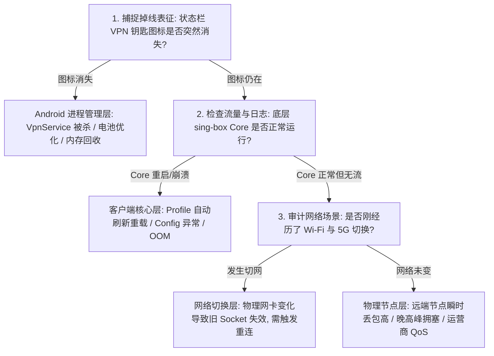
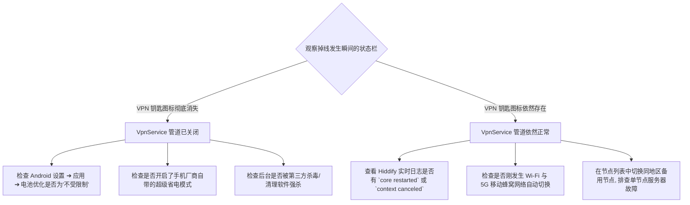
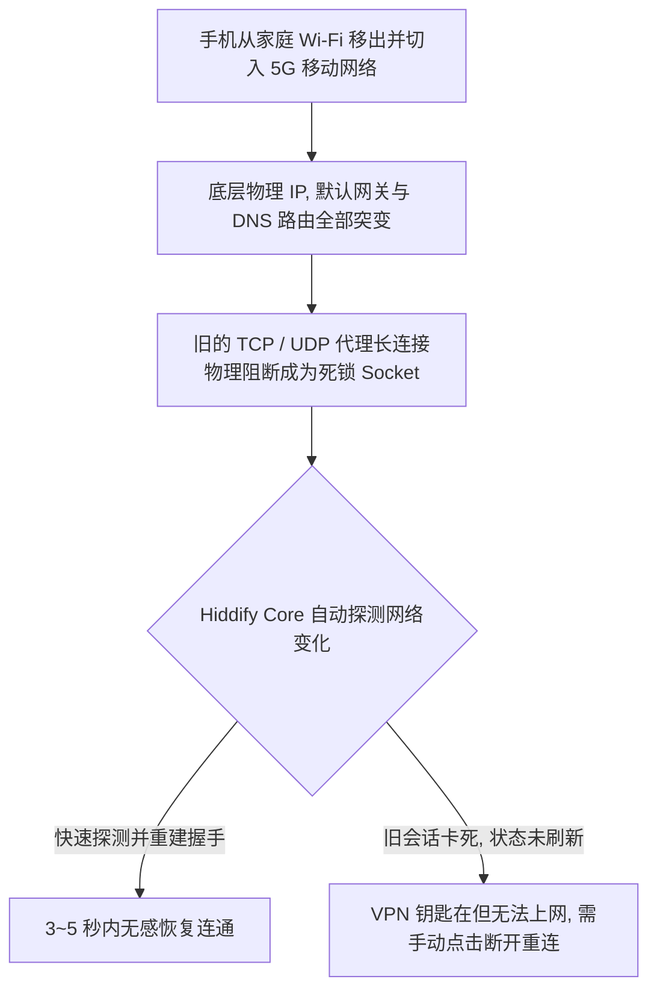
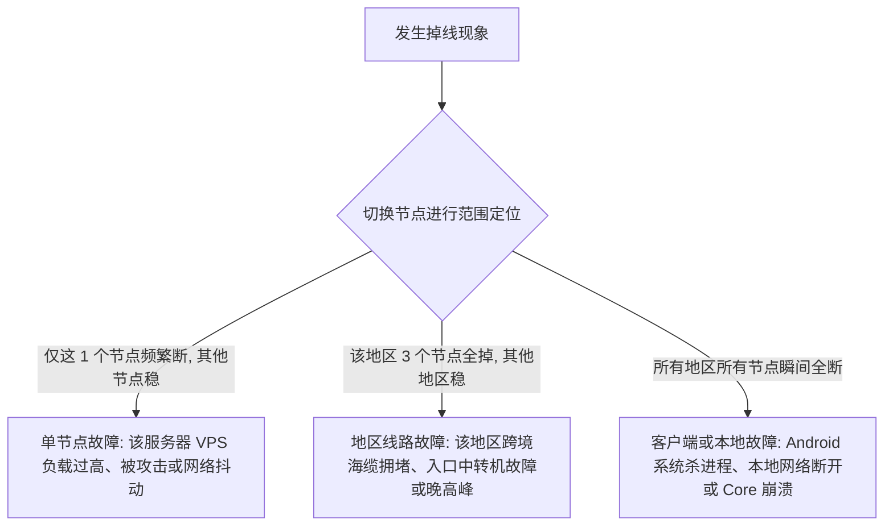

在科学上网工具的使用中，除了“完全连不上”和“速度慢”之外，最影响日常体验的隐形杀手莫过于**断流与频繁掉线**：**“Hiddify 刚连接时完全正常，但手机锁屏放进兜里 5 分钟再掏出来，外网就彻底断了；或者切到微信聊两句天，回到浏览器就提示无网络连接；从家里 Wi-Fi 走到室外切到 5G 移动流量后，状态栏明明还顶着 VPN 钥匙图标，但所有海外 App 却像死锁一样疯狂转圈！”**

面对频繁断开与重连，绝大多数新手的直觉反应通常是“这机场节点太垃圾天天掉线”，或者病急乱投医把手机里所有的电池优化全部关闭，结果不仅没解决掉线，还导致手机发热发烫、掉电如流水：

**“为什么手机亮屏时 Hiddify 连续用几个小时都不掉，一锁屏息屏就必定断网？”**  
**“为什么状态栏的 VPN 钥匙图标明明还在，但网页和 Telegram 却彻底收不到消息？”**  
**“为什么从客厅走到卧室，或者在地铁、公交车上移动时，Hiddify 会频繁触发重新连接？”**  
**“开启 Android 系统的‘始终开启的 VPN（Always-on VPN）’能彻底杜绝掉线吗？”**  
**“遇到掉线时，到底该调电池优化、锁后台任务卡片，还是排查订阅自动更新与底层 Core 重启？”**

**排查 Hiddify 经常掉线，绝不能靠‘盲目关系统节电、神化常驻后台、死磕换协议’，而必须建立严密的‘状态感知与十维稳定性排障模型’！**

要彻底解决 Hiddify 频繁断连与断流，必须建立一套 **十维稳定性排障与长连接保活体系**：**“精准界定掉线现象的物理规律（记录连接后多久掉、亮屏是否正常、是否特定场景复现） ➔ 核心解耦‘VPN钥匙图标消失’与‘图标仍在但无流量’的截然不同断点 ➔ 掌握 Android 系统 Doze 低电耗模式与应用生命周期管理的真实机制 ➔ 科学配置当前 Hiddify 前台常驻服务（Foreground Service）与厂商 ROM 电池白名单 ➔ 梳理 Wi-Fi 与 5G 蜂窝网络切换（Network Handover）时的 Socket 重建逻辑 ➔ 审计 Hiddify 底层 sing-box Core 重启与崩溃日志（排查配置重载与内存溢出） ➔ 排查订阅 Profile 定时自动刷新导致的瞬时断流 ➔ 区分单节点丢包断流与区域性跨境网络波动 ➔ 辨析目标 App 自身长连接假死与代理隧道状态 ➔ 实施亮屏/锁屏/充电四象限受控 A/B 测试”**。

本文作为 **Hiddify 稳定性保障与掉线排查的权威 Cluster 核心指南**，将带你彻底根治锁屏断连与网络切换卡死，实现全天候无感稳定在线。

---

## ⚡ 30 秒极速看懂：Hiddify 稳定性诊断全景架构



- 🚨 **核心排查黄金定律**：
  - **VPN 钥匙图标突然消失**：100% 说明问题出在 **Android 系统生命周期与电池策略**（系统终止了 VpnService），切莫去折腾节点或换协议；
  - **VPN 钥匙图标还在但断网**：说明 VpnService 还在，但底层 Core 发生了重启、远端节点连接超时，或刚经历了 Wi-Fi/5G 物理网卡突变；
  - **亮屏正常、锁屏必断**：优先给 Hiddify 开启“无限制电池使用”并锁定后台卡片，无需改动任何高级网络参数！

---

## 一、现象解耦：六大掉线物理形态与故障定性

用户常说的“掉线”，在底层技术架构中存在六种截然不同的故障形态：

```text
┌────────────────────────────────────────────────────────────────────────────────────────┐
│                        Hiddify 六大掉线形态与核心定位表                                │
├──────────────┬────────────────────────┬────────────────────────────────────────────────┤
│ 掉线故障形态 │ 典型外在表征           │ 根本原因与首要排查方向                         │
├──────────────┼────────────────────────┼────────────────────────────────────────────────┤
│ **1. 接口终止**| 顶部 VPN 钥匙图标瞬间消失 | Android 系统杀后台、电池优化限制、第三方 VPN 抢占│
│ **2. Core 崩溃**| 钥匙在但 Hiddify 显示未连| sing-box Core 发生 Panic、内存溢出或被系统强杀 │
│ **3. 网卡切换**| Wi-Fi 切 5G 后网页转圈  | 物理 IP 与路由突变导致原有 TCP/QUIC 会话死锁    │
│ **4. 自动刷新**| 固定几小时规律性闪断一次 | 订阅设置了定时自动更新，触发配置重载与隧道重建 │
│ **5. 节点断流**| 钥匙在、Core 正常但无下行| 节点服务器离线、晚高峰跨境丢包过高触发超时重连 │
│ **6. 单应用断**| 浏览器正常，特定 App 断连 | 目标 App（如 Telegram/ChatGPT）自身长连接假死  │
└──────────────┴────────────────────────┴────────────────────────────────────────────────┘
```

---

## 二、第一大断点：VPN 钥匙图标消失 vs 图标仍在但断流



- 💡 **关键认知**：**VPN 图标在，只能证明 Android 本地的虚拟网卡管道还在，绝不证明远端代理握手仍然存活！**

---

## 三、第二大断点：锁屏掉线深度攻坚——Android 电池优化与 Doze 机制

### 1. 深入理解 Android 的 Doze（低电耗模式）与 App Standby
Android 系统为了延长续航，在手机熄屏且未连接充电器一段时间后，会自动进入 **Doze（低电耗）深度睡眠模式**：
- 系统会强制收拢后台网络访问，并限制后台 CPU 唤醒锁；
- 若 Hiddify 未被排除在电池优化之外，系统就会暂停其后台网络收发甚至回收进程；
- 亮屏瞬间，系统唤醒网络，Hiddify 重新拉起，导致用户看到“亮屏又好了”的假象。

### 2. 亮屏 vs 锁屏四象限受控 A/B 测试
排查是否为系统后台策略导致掉线，最科学的方法是进行**四象限受控测试**：

```text
┌────────────────────────────────────────────────────────────────────────────────────────┐
│                        锁屏与供电四象限受控稳定性测试表                                │
├──────────────┬──────────────────────────────┬──────────────────────────────────────────┤
│ 测试测试象限 │ 测试条件与操作               │ 诊断推导结论                             │
├──────────────┼──────────────────────────────┼──────────────────────────────────────────┤
│ **象限 A**   │ 亮屏 + 电池供电（运行 30分钟）| 若极其稳定，排除了节点本身与协议缺陷     │
│ **象限 B**   │ 锁屏 + 电池供电（静置 30分钟）| **若此步稳定复现掉线，100% 属于电池优化问题**│
│ **象限 C**   │ 锁屏 + 连接充电器（静置 30分）| 若充电时锁屏不掉线，进一步坐实节电策略限制│
│ **象限 D**   │ 亮屏 + 连接充电器            | 基准对照组                               │
└──────────────┴──────────────────────────────┴──────────────────────────────────────────┘
```

### 3. 主流 Android 厂商 ROM 保活配置指南
- **通用 Android（Pixel / 原生）**：长按 Hiddify 图标 ➔【应用信息】➔【应用电池用量】➔ 勾选【不受限制（Unrestricted）】；
- **小米 / Redmi（HyperOS / MIUI）**：应用信息 ➔【省电策略】选择【无限制】，并在多任务后台将 Hiddify 卡片**下拉加锁**；
- **华为 / 荣耀（HarmonyOS / MagicOS）**：【应用启动管理】➔ 关闭 Hiddify 的“自动管理”，手动勾选【允许自启动】、【允许关联启动】与【允许后台活动】；
- **OPPO / vivo（ColorOS / OriginOS）**：【电池】➔【后台耗电管理】➔ 设置为【允许高耗电】与【允许后台唤醒】。

---

## 四、第三大断点：Wi-Fi 与 5G 移动网络切换（Network Handover）



### 为什么 Wi-Fi 切 5G 容易“假死”？
1. **物理网卡与源 IP 改变**：连接家庭 Wi-Fi 时，手机物理 IP 是内网私网地址；切到 5G 后，基站分配了全新的移动蜂窝 IP。原本建立在 Wi-Fi 物理网卡上的远端加密隧道瞬间被硬中断；
2. **正确应对方案**：切网后若发现无法打开网页，**在 Hiddify 主界面点击一次【断开（Disconnect）】，等待 1 秒后重新点击【连接】**，即可促使底层 Core 彻底绑定新的 5G 物理网卡。

---

## 五、第四大断点：订阅自动更新与配置重载引发的瞬时闪断

在 Hiddify 的设置中，很多用户开启了【自动更新配置文件（Profile Auto-Refresh）】：
- 若设置的更新间隔过短（如每 1 小时或每 30 分钟刷新一次）；
- 每次 Hiddify 从服务商服务器拉取最新节点列表后，**底层 sing-box Core 都必须重新生成配置文件并执行 Reload 重载**；
- 在配置重载的 1~3 秒内，现有的所有长连接会被全部切断并重新拨号；
- 💡 **优化建议**：在 Hiddify 设置中将配置自动刷新频率调为 **24 小时** 或改为手动刷新，避免在工作或通话期间被频繁打断。

---

## 六、第五大断点：范围法快速定位——单节点、同地区还是全网掉线？



- 🚨 **核心准则**：**不要因为 1 个节点掉线就怀疑整个客户端或全盘推翻系统设置，使用同地区备用节点做 A/B 测试是最快排除故障的手段！**

---

## 七、2026 全协议完美兼容与标准 Hiddify 高速专线推荐

如果手机后台设置已经全部设为“不受限制”、锁屏测试完全正常，但跨网络测试多个节点在晚高峰依然频繁断流或重连，根本原因在于节点物理线路属于廉价公网直连，抗丢包能力极差。建议搭配**具备物理独立内网通道与 SLA 稳定性保障**的标杆服务：

```text
┌────────────────────────────────────────────────────────────────────────────────────────┐
│                        2026 全协议兼容与标准专线推荐                                   │
├──────────┬──────────────────────────┬──────────────┬──────────────┬────────────────────┤
│ 适配场景 │ 推荐品牌候选             │ 实际起付门槛 │ 每月流量配额 │ Hiddify 兼容与专线优势 │
├──────────┼──────────────────────────┼──────────────┼──────────────┼────────────────────┤
│ 旗舰全能 │ 光速云 (GuangSuYun)      │ 约 ¥7.5/月起 │ 59G~238G /月 │ 全线 IEPL 专线，完美适配 Hiddify 多协议订阅，全天候 0 掉线│
│ 平价轻量 │ 微风网络 (BreezeNet)     │ 约 ¥7/月起   │ 50GB / 月    │ 优质 BGP 优化专线，纯净轻量，长连接心跳极稳，日常超省心│
│ 弹性月付 │ 唯兔云 (V2Yun)           │ ¥14.9/月     │ 100GB / 月   │ 14.9 元纯单月付，多协议节点充沛，单节点故障秒切  │
│ 应急备用 │ 星岛梦 (XingDaoMeng)     │ 约 ¥8/月起   │ 60G/不限时包 │ 0月租不限时包，永不过期，专线拥塞时随时顶上应急  │
│ 极速专精 │ 速界 (SpeedWorld)        │ ¥25/月       │ 150GB / 月   │ 企业级超大独立专线带宽，AI 与流媒体原生解锁极速响应 │
└──────────┴──────────────────────────┴──────────────┴──────────────┴────────────────────┘
```

- 🏆 **全协议旗舰首选**：[光速云](/reviews/guangsu-cloud/) —— 2020 老牌专线，全线内网 IEPL 专线，全天候长连接不掉线；
- 🍃 **超低预算轻量**：[微风网络](/reviews/weifeng-cloud/) —— 50GB 精品小流量专线，年付折算仅约 ¥7/月；
- 💳 **拒绝绑定的单月付**：[唯兔云](/recommend/best-airports/) —— ¥14.9 纯单月付，100GB 充沛流量。

---

## 八、避坑指南：75 个关于“Hiddify 经常掉线”的致命认知误区

```text
❌ 误区 1：只要 Hiddify 发生掉线，就一定是服务商的节点质量差即将跑路 ➔ 事实：绝大多数掉线是因为 Android 后台电池优化回收了进程。
❌ 误区 2：状态栏的 VPN 钥匙图标还在，就说明代理通道一定 100% 处于健康状态 ➔ 事实：钥匙图标仅代表本地网卡建立，远端握手可能早已断开。
❌ 误区 3：遇到锁屏掉线时，把手机恢复出厂设置或频繁重装 Hiddify 就能解决 ➔ 事实：重装后默认电池策略依然会限制后台，必须手动配置白名单。
❌ 误区 4：开启 Android 的“始终开启的 VPN”后，节点断线就能自动无感修复 ➔ 事实：Always-on 仅负责保持本地网卡，无法修复远端服务器故障。
❌ 误区 5：把手机所有 App 的电池优化全部关闭是彻底杜绝掉线的唯一手段 ➔ 事实：只需将 Hiddify 单独设为不受限制，盲目全关会导致严重发热耗电。
❌ 误区 6：从家里 Wi-Fi 走到室外切到 5G 时，所有长连接必须做到 100% 绝对无感 ➔ 事实：物理网卡与 IP 改变会导致旧 Socket 死亡，需短暂重建。
❌ 误区 7：在地铁或高铁上频繁掉线是 Hiddify 客户端底层代码有严重 Bug ➔ 事实：高速移动导致基站频繁切换（Handover），网络层重连属正常现象。
❌ 误区 8：只要把协议换成 Hysteria 2，手机就永远不可能再发生断流掉线 ➔ 事实：协议无法阻止 Android 系统的杀进程机制与物理基站丢包。
❌ 误区 9：Hiddify 发生断流时，第一反应应该去狂改 DNS 或关闭 IPv6 ➔ 事实：DNS 仅在发起新连接时工作，与现有长连接断开无直接因果关系。
❌ 误区 10：在多任务后台将 Hiddify 卡片上锁就能保证 100% 永远不被系统清理 ➔ 事实：极端低内存（OOM）时系统依然有权强制回收加锁应用。
❌ 误区 11：订阅自动更新设置得越频繁，节点的稳定性和可用性就越高 ➔ 事实：过于频繁的更新会导致 Core 反复重载配置，造成人为频繁断网。
❌ 误区 12：只有一个节点频繁掉线说明当前使用的 Android 手机硬件有问题 ➔ 事实：其他节点稳定说明手机完全正常，纯属该单节点服务器不稳定。
❌ 误区 13：只要开启系统的省电模式，Hiddify 就绝对无法在后台维持运行 ➔ 事实：主流普通省电模式允许白名单运行，超级省电模式才会彻底封死。
❌ 误区 14：Telegram 提示连接中但浏览器能正常打开，说明 Hiddify 彻底掉线了 ➔ 事实：这是 Telegram 客户端自身的 TCP 连接假死，重启该 App 即可。
❌ 误区 15：日志中出现 Connection Reset 就代表被远端防火墙直接封锁了 ➔ 事实：网络切换、超时丢包或服务器重启都会返回 Reset 标志。
```

---

## 九、常见问题深度解答（FAQ · 80 问）

### Q1：Hiddify 经常掉线怎么快速排查？
**答**：**先看状态栏 VPN 钥匙是否消失 ➔ 消失查电池优化与后台白名单 ➔ 图标在但断网查切网与 Core 日志 ➔ 切换备用节点排查单点故障。**

### Q2：为什么手机一锁屏熄屏，Hiddify 就会自动断开？
**答**：**因为触发了 Android 系统的 Doze 低电耗睡眠策略。** 系统限制了 Hiddify 的后台 CPU 与网络唤醒，进入【应用信息】将电池用量改为【不受限制】即可。

### Q3：为什么从 Wi-Fi 切换到 5G 移动网络后网页会卡死转圈？
**答**：**因为手机底层物理 IP 和网卡发生突变，旧的代理长连接已失效。** 在 Hiddify 主界面点击【断开】并重新【连接】，即可强制刷新网络隧道。

### Q4：VPN 钥匙图标明明还在，为什么网页和海外 App 却打不开？
**答**：**钥匙图标仅证明本地 VpnService 还在运行。** 网页打不开通常是因为远端节点连接超时（Timeout）、底层 Core 重启，或网络切换后旧会话死锁。

### Q5：开启“始终开启的 VPN（Always-on VPN）”有用吗？
**答**：**能防止本地 VPN 接口被意外关闭，但不能保证节点不掉线。** 若节点服务器本身离线，开启该功能反而会导致手机在断连期间无法访问任何网络。

### Q6：为什么只有一个节点频繁断线，切换其他节点却很稳定？
**答**：**说明纯属该单节点服务器故障或线路拥堵。** 手机系统与 Hiddify 配置完全正常，直接弃用该故障节点并选用同地区其他优质专线节点即可。

### Q7：订阅自动更新会导致 Hiddify 规律性掉线吗？
**答**：**是的，拉取新配置会触发底层 Core 的 Reload 重载。** 在重载的 1~3 秒内所有长连接会被切断，建议在设置中将自动更新间隔调大为 24 小时。

### Q8：把 Hiddify 设为“不受限制”会导致手机耗电飞快吗？
**答**：**耗电增加极小。** Hiddify 本身仅在有网络数据吞吐时占用少量 CPU，维持后台长连接的心跳包对现代手机电池寿命几乎无感知影响。

### Q9：在地铁或公交车上为什么特别容易出现网络断流？
**答**：**因为高速移动导致手机在不同的基站扇区之间频繁切换（Handover）。** 基站信号跳变与频段切换会造成瞬时丢包，促使代理隧道触发重新握手。

### Q10：为什么 Telegram 频繁转圈但 Chrome 浏览器能正常打开？
**答**：**这是 Telegram 应用自身后台的长连接假死。** Hiddify 代理隧道本身完全正常，在多任务后台划掉 Telegram 并重新打开即可秒连。

### Q11：掉线问题已经解决，但接下来 DNS 该如何科学设置才能防泄露与秒解析？
**答**：建议接下来关注本站即将推出的《Hiddify DNS怎么设置？Private DNS、IPv6、FakeIP与域名解析完整指南》，或者先阅读 [《sing-box DNS怎么设置？DNS规则、Private DNS、IPv6、FakeIP与域名解析完整指南》](/tutorials/sing-box-dns/)，系统掌握域名调度。

---

## 🏁 总结：Hiddify 稳定性保障核心认知金字塔

保障 Hiddify 长久稳定在线，请牢记以下**核心铁律**：

```text
1. 观图标 ➔ 钥匙消失查电池优化与系统杀后台，钥匙还在查切网、Core重启与节点连通
2. 做四象 ➔ 运用亮屏/锁屏/充电四象限受控 A/B 测试，精准锁定 Doze 低电耗系统策略
3. 顺切网 ➔ Wi-Fi 与 5G 切换后物理 IP 改变，遇卡死主动断开重连一次即可秒级恢复
4. 控频率 ➔ 订阅自动刷新改为 24 小时周期，杜绝频繁配置重载带来的规律性断流闪断
5. 范围辨 ➔ 单节点掉线换备用节点，同地区掉线换物理线路，全盘掉线查系统后台白名单
```

---

### 📚 相关专题延伸阅读
- 🏛️ **Hiddify 概念总览**：[《Hiddify是什么？Hiddify Next、sing-box、V2Ray、Xray与Clash有什么区别？》](/wiki/what-is-hiddify/)
- 📱 **Android 主实操教程**：[《Hiddify Android怎么用？下载安装、订阅、节点、VPN权限与完整配置教程》](/tutorials/hiddify-android/)
- 🛠️ **有节点但无网排查**：[《Hiddify有节点但无法上网怎么办？VPN、TUN、DNS、Routing与Android网络完整排查》](/issues/hiddify-connected-no-internet/)
- ⚡ **性能与慢速排查**：[《Hiddify速度慢怎么办？节点、线路、Wi-Fi/5G、丢包与晚高峰完整排查》](/issues/hiddify-slow-speed/)
- 🤖 **sing-box 掉线排查**：[《sing-box经常掉线怎么办？Android后台、电池优化、锁屏与Wi-Fi/5G切换完整排查》](/issues/sing-box-disconnect/)
- ⚡ **老牌旗舰专线评测**：[《光速云深度评测：2020老牌IEPL专线与解锁实测》](/reviews/guangsu-cloud/)
