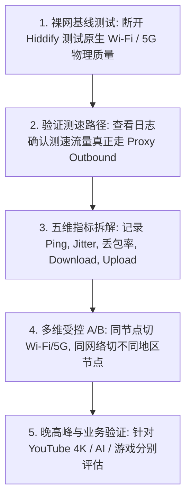
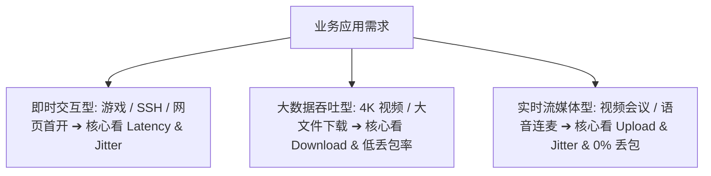
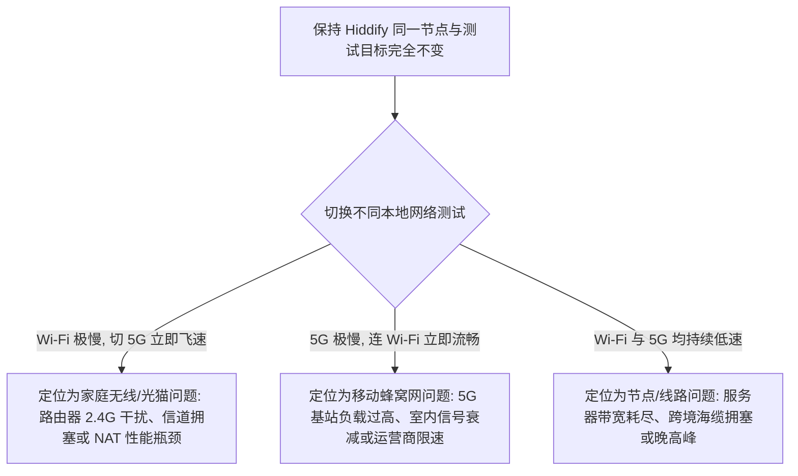
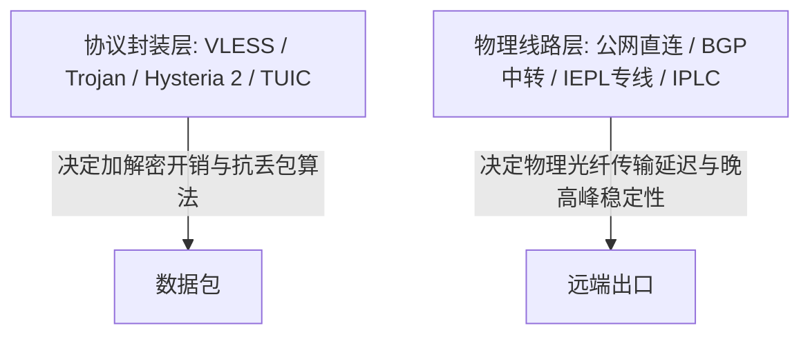
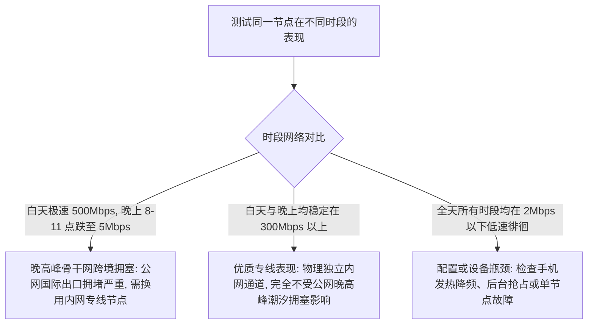

在科学上网工具的日常使用中，许多用户在成功连接 Hiddify 后，常常会遭遇令人费解的性能瓶颈：**“Hiddify 状态栏明明显示已连接，网页也能勉强打开，但看 YouTube 4K 视频疯狂转圈降画质到 480p、GitHub 下载 Release 文件只有几十 KB/s、玩外服游戏时延迟忽高忽低疯狂跳 Ping，或者一到晚上 8 点至 11 点晚高峰网速就直接断崖式下跌！”**

面对卡顿与低速，绝大多数新手的直觉反应通常是“赶紧换个延迟最低的节点”、“到处找所谓的 Hiddify 提速优化参数”，或者盲目在设置里修改 DNS 与 MTU，结果往往越改越卡甚至直接断网：

**“为什么在节点列表里测出来的延迟（Ping）只有 25ms，但实际测速下载带宽却连 10Mbps 都跑不满？”**  
**“为什么美国节点延迟高达 180ms，看 4K 视频却比 30ms 的香港节点更加流畅丝滑？”**  
**“为什么在 Speedtest 网站测出了 500Mbps 极速，但一打开 YouTube 或 Twitter 却依然卡得动弹不得？”**  
**“在家里 Wi-Fi 下 Hiddify 慢如蜗牛，一旦切到手机 5G 移动网络为什么网速瞬间起飞？”**  
**“Hysteria 2 协议真的比 VLESS-REALITY 永远更快吗？换用 Hiddify 客户端到底能不能让原本劣质的直连线路变快？”**

**排查 Hiddify 速度慢，绝不能靠‘迷信单次低 Ping、盲改高级参数、神化协议’，而必须建立一套严谨的‘五大性能指标与十维受控 A/B 诊断模型’！**

要彻底解决 Hiddify 性能瓶颈，必须建立一套 **十维网络性能诊断与调优体系**：**“厘清五大核心指标的内在制约（往返延迟 Latency $\ne$ 抖动 Jitter $\ne$ 丢包率 Loss $\ne$ 持续下行 Download $\ne$ 上行带宽 Upload） ➔ 建立‘物理裸网基准线’（先测脱离代理时的 Wi-Fi/5G 本地质量） ➔ 识破‘测速走 Direct 直连’的假象（确认 Speedtest 流量真正穿透 Proxy Outbound） ➔ 实施 Wi-Fi 与 5G 移动网络的精准 A/B 隔离测试 ➔ 辨析节点物理地区特性（香港极低延迟 vs 日本综合稳定 vs 美国大吞吐） ➔ 彻底解耦‘协议层（VLESS/Hy2）’与‘物理线路层（直连/中转/IEPL）’ ➔ 掌握晚高峰骨干网跨境拥塞的客观规律（多日期受控采样） ➔ 针对 YouTube 4K、AI 大模型交互、GitHub 源码下载等不同业务建立差异化调优 ➔ 评估 Android 硬件发热降频与后台流量挤占”**。

本文作为 **Hiddify 性能优化与速度排查的权威 Cluster 核心指南**，将带你彻底穿透卡顿迷雾，榨干节点的每一兆物理带宽。

---

## ⚡ 30 秒极速看懂：Hiddify 性能诊断全景架构



- 🚨 **核心排查黄金定律**：
  - **最低 Ping（延迟）$\ne$ 最高下载带宽**（Ping 仅代表单次握手耗时，4K 视频流畅度取决于持续吞吐量与抗丢包能力）；
  - **测速前必须查看 Hiddify 日志**：若测速站被分流规则判定为 Direct（直连），测出的 500Mbps 仅代表本地宽带，不代表节点性能；
  - **换客户端不能把普通公网直连变成企业内网专线**，物理网络质量由服务器底层线路决定！

---

## 一、指标基石：五大性能核心指标深度拆解

用户常说的“网速慢”，在网络工程中对应着截然不同的技术瓶颈：

```text
┌────────────────────────────────────────────────────────────────────────────────────────┐
│                        现代代理网络五大性能核心指标对比表                              │
├──────────────┬────────────────────────┬────────────────────────────────────────────────┤
│ 性能指标     │ 衡量维度与技术定义     │ 核心影响的业务场景与表现                       │
├──────────────┼────────────────────────┼────────────────────────────────────────────────┤
│ **1. 延迟 (Ping)**| 数据包单次往返耗时 (ms)| 决定网页首包响应、SSH 终端敲命令、外服游戏即时交互│
│ **2. 抖动 (Jitter)**| 延迟波动的离散程度 (ms)| 决定语音通话、视频会议连麦是否卡顿、游戏是否跳Ping│
│ **3. 丢包 (Loss)**| 数据包丢失率 (%)       | 致命瓶颈！触发 TCP 拥塞重传，导致视频疯狂缓冲  │
│ **4. 下行 (Download)**| 持续数据吞吐能力 (Mbps)| 决定 YouTube 4K/8K 视频、大文件下载、App 商店更新│
│ **5. 上行 (Upload)**  | 本地数据发送能力 (Mbps)| 决定网盘备份、视频会议推流、AI 大文件与附件上传 │
└──────────────┴────────────────────────┴────────────────────────────────────────────────┘
```



---

## 二、第一大核心基石：先测裸网与识破 Direct 测速陷阱

### 1. 为什么排查速度慢必须先测“物理裸网”？
代理隧道无法脱离底层物理网络独立存在。如果手机连接的家庭 Wi-Fi 本身就存在严重的无线信道干扰、光猫桥接跑不满，或者手机 5G 处于基站拥塞边缘，**任何部署在顶层的 Hiddify 代理都不可能跑出好成绩**。
- 💡 **标准动作**：在 Hiddify 主界面点击【断开】，使用浏览器打开测速网站，记录当前的物理裸网带宽与丢包率作为基准线。

### 2. 致命陷阱：测速流量走 Direct 直连
很多用户兴高采烈地展示“Hiddify 测速 1000Mbps 截图”，实际往往是假象：
- 许多国内测速节点（如各大测速网）会被 Hiddify 的分流规则自动判定为 **Direct 本地直连**；
- 测速时并未经过海外节点，测出的只是本地家庭宽带速度；
- 💡 **确认方法**：在测速的同时查看 Hiddify 日志，确认发往测速服务器的请求明确被路由标记为 `match rule: proxy`。

---

## 三、第二大核心基石：Wi-Fi 与 5G 移动网络 A/B 深度隔离



### 1. Android Wi-Fi 常见瓶颈排查
- **2.4GHz vs 5GHz 频段**：2.4GHz 穿墙好但极易受到邻居无线、蓝牙与微波炉干扰，最高速率常被压制在 30Mbps 以下；排查时请务必连接 **5GHz Wi-Fi** 频段；
- **Mesh 组网回程衰减**：若手机连接的是无线回程的子 Mesh 路由器，多次空口转发会导致延迟抖动（Jitter）成倍飙升。

### 2. 4G / 5G 移动网络误区
- **5G 图标满格 $\ne$ 网络通畅**：在大型商场、地铁站或写字楼晚高峰，5G 基站的小区用户数可能严重超载，此时手动在系统设置中切换为 **4G LTE** 往往速度反而更快。

---

## 四、第三大核心辨析：节点物理地区与科学选型指南

```text
┌────────────────────────────────────────────────────────────────────────────────────────┐
│                        主流节点地区性能特性与适用场景全景表                            │
├──────────┬──────────────┬──────────────┬───────────────────────────────────────────────┤
│ 节点地区 │ 延迟倾向 (ms)| 吞吐潜力     │ 最佳适用业务场景与选型策略                    │
├──────────┼──────────────┼──────────────┼───────────────────────────────────────────────┤
│ **香港** │ 极低 (15~40) | 极高 (视线路) | 网页秒开、外贸收发信件、实时手游加速首选     │
│ **日本** │ 低 (40~70)   | 极高 (骨干优) | 综合素质最佳！晚高峰抗拥塞强，全解锁 4K 流媒体 │
│ **新加坡**| 低 (50~85)   | 充沛稳定     | 东南亚流媒体、TikTok 直播推流、澳洲/南亚路由  │
│ **美国** │ 中高 (130~190)| 超大吞吐     | 延迟较高但国际出口带宽充沛，大文件下载/备用首选│
└──────────┴──────────────┴──────────────┴───────────────────────────────────────────────┘
```

- 💡 **为什么 150ms 的美国节点看 4K 视频比 30ms 的香港节点更快？**
  - 流媒体视频播放依赖的是**持续的大水管吞吐量（Sustained Bandwidth）**，播放器会预先加载 30 秒缓冲区；
  - 只要物理带宽充沛且没有丢包，150ms 延迟对视频毫无影响；而 30ms 的香港节点若发生 3% 丢包，TCP 窗口就会疯狂收缩导致持续缓冲卡顿！

---

## 五、第四大核心辨析：协议层（VLESS/Hy2）与物理线路层（IEPL）彻底解耦



```text
┌────────────────────────────────────────────────────────────────────────────────────────┐
│                        协议层与物理线路层技术边界对照表                                │
├──────────────┬────────────────────────┬────────────────────────────────────────────────┤
│ 体系分层     │ 包含的典型实体         │ 承担职责与技术真相                             │
├──────────────┼────────────────────────┼────────────────────────────────────────────────┤
│ **协议层**   │ **VLESS** / Hysteria 2 │ 负责数据封装、加密算法与抗丢包重传调度         │
│ **线路层**   │ **IEPL 专线** / IPLC   │ 负责物理光缆跨境传输，**直接决定晚高峰网络上限**│
└──────────────┴────────────────────────┴────────────────────────────────────────────────┘
```

- 🚨 **核心技术纠错**：
  - **Hysteria 2 基于 UDP / QUIC**：在丢包率 10%~20% 的恶劣公网直连下具备极强的暴力抗拥塞能力；但在零丢包的 IEPL 内网专线中，Hysteria 2 与 VLESS 的速度体验基本持平；
  - **2x / 3x 倍率节点**：通常代表服务商针对该节点的**流量计费扣费倍率**，绝不代表该节点速度比 1x 节点快 2 倍！

---

## 六、第五大核心辨析：晚高峰拥塞真相与多日受控采样



- 💡 **科学评估晚高峰原则**：
  - 晚高峰（20:00~23:00）是全国民用宽带出海流量的洪峰期；
  - 单一晚上一次测速变慢不能直接给服务商定性为“超售跑路”，必须连续在 3 个不同日期的晚高峰进行多节点交叉验证。

---

## 七、第六大核心辨析：差异化业务场景调优指南

```text
┌────────────────────────────────────────────────────────────────────────────────────────┐
│                        主流业务场景核心指标与优化策略矩阵                              │
├──────────────┬──────────────────────────────┬──────────────────────────────────────────┤
│ 业务场景     │ 真正依赖的核心指标           │ 针对性优化方案                           │
├──────────────┼──────────────────────────────┼──────────────────────────────────────────┤
│ **YouTube 4K**| 持续下行带宽 (>30Mbps) + 0%丢包| 首选日本/美国大带宽专线，避开丢包高峰节点│
│ **ChatGPT / AI**| 稳定连接 + 低风控出口 IP     | 首选标注【AI 专线】的日本/美国家庭原生节点│
│ **GitHub Release**| 单线程长连接吞吐能力       | 切换至 TCP 窗口优化较好的美国大带宽节点  │
│ **外服手游联机**| 极低延迟 (<50ms) + 极低 Jitter| 必须选用香港/日本 IEPL 专线，禁用高丢包节点│
│ **Zoom 视频会议**| 持续上行带宽 (>10Mbps) + 低丢包| 重点测试节点 Upload 上行速度，避开单向大下载节点│
└──────────────┴──────────────────────────────┴──────────────────────────────────────────┘
```

---

## 八、2026 全协议完美兼容与标准 Hiddify 高速专线推荐

如果客户端设置完全正确、本地 Wi-Fi 顺畅，但所有节点在晚高峰均发生严重丢包卡顿，根本原因在于节点属于廉价公网直连。建议升级至具备**物理企业内网专线与超大冗余带宽**的标杆服务：

```text
┌────────────────────────────────────────────────────────────────────────────────────────┐
│                        2026 全协议兼容与标准专线推荐                                   │
├──────────┬──────────────────────────┬──────────────┬──────────────┬────────────────────┤
│ 适配场景 │ 推荐品牌候选             │ 实际起付门槛 │ 每月流量配额 │ Hiddify 兼容与专线优势 │
├──────────┼──────────────────────────┼──────────────┼──────────────┼────────────────────┤
│ 旗舰全能 │ 光速云 (GuangSuYun)      │ 约 ¥7.5/月起 │ 59G~238G /月 │ 全线 IEPL 专线，完美适配 Hiddify 多协议订阅，4K 秒开无拥塞│
│ 平价轻量 │ 微风网络 (BreezeNet)     │ 约 ¥7/月起   │ 50GB / 月    │ 优质 BGP 优化专线，纯净轻量，节点更新秒级响应，日常极稳│
│ 弹性月付 │ 唯兔云 (V2Yun)           │ ¥14.9/月     │ 100GB / 月   │ 14.9 元纯单月付，多协议节点充沛，单节点故障秒切  │
│ 应急备用 │ 星岛梦 (XingDaoMeng)     │ 约 ¥8/月起   │ 60G/不限时包 │ 0月租不限时包，永不过期，专线拥塞时随时顶上应急  │
│ 极速专精 │ 速界 (SpeedWorld)        │ ¥25/月       │ 150GB / 月   │ 企业级超大独立专线带宽，AI 与流媒体原生解锁极速响应 │
└──────────┴──────────────────────────┴──────────────┴──────────────┴────────────────────┘
```

- 🏆 **全协议旗舰首选**：[光速云](/reviews/guangsu-cloud/) —— 2020 老牌专线，全线内网 IEPL 专线，晚高峰 4K 视频丝滑秒开；
- 🍃 **超低预算轻量**：[微风网络](/reviews/weifeng-cloud/) —— 50GB 精品小流量专线，年付折算仅约 ¥7/月；
- 💳 **拒绝绑定的单月付**：[唯兔云](/recommend/best-airports/) —— ¥14.9 纯单月付，100GB 充沛流量。

---

## 九、避坑指南：75 个关于“Hiddify 速度慢”的致命认知误区

```text
❌ 误区 1：在节点列表里挑选 Ping 延迟最低的节点看 4K 视频速度一定最快 ➔ 事实：Ping 只代表握手响应，持续大带宽与零丢包才是视频流畅的核心。
❌ 误区 2：使用 Speedtest 测出了 500Mbps 极速，就代表访问所有外网都快 ➔ 事实：测速站可能命中了 Direct 本地直连，测出的只是本地裸网。
❌ 误区 3：只要把 Hiddify 换成 Hysteria 2 协议，任何卡顿的节点都能跑满千兆 ➔ 事实：Hysteria 2 仅改善恶劣网络丢包，无法突破物理带宽瓶颈。
❌ 误区 4：2x 倍率节点的网速一定会比 1x 倍率节点快整整 2 倍 ➔ 事实：倍率通常是流量计费比例，与节点服务器的物理带宽毫无必然联系。
❌ 误区 5：只要手机 Wi-Fi 信号显示满格，就说明家庭无线网络绝无瓶颈 ➔ 事实：2.4G 频段信道拥塞或信噪比低会导致严重丢包，应换用 5G 频段。
❌ 误区 6：5G 移动网络的网速在任何地方都绝对碾压 4G 网络 ➔ 事实：在人群密集的基站重载区域，4G 网络的可用带宽往往优于 5G。
❌ 误区 7：换用 Hiddify 客户端后，原本卡顿的公网直连节点能自动变成 IEPL 专线 ➔ 事实：客户端无法改变物理线路质量，网络性能取决于服务器节点。
❌ 误区 8：遇到视频卡顿时，把 Hiddify 的 DNS 改成 8.8.8.8 就能立刻提速 ➔ 事实：DNS 仅负责域名解析，无法为持续的数据吞吐提供额外带宽。
❌ 误区 9：开启系统的“私人 DNS”或安装第三方的网络优化 App 能为 Hiddify 加速 ➔ 事实：多层系统级解析可能会增加解析时延，甚至导致冲突。
❌ 误区 10：美国节点延迟高达 160ms，绝对不可能用来流畅观看 4K 视频 ➔ 事实：美国大带宽节点丢包率低，缓冲区填满后 4K 拖拽极其流畅。
❌ 误区 11：ChatGPT 回复文字缓慢说明当前连接的 Hiddify 节点网速太慢 ➔ 事实：AI 流式输出速度取决于 OpenAI 服务器的模型推理负载与排队情况。
❌ 误区 12：关闭 Hiddify 的 TUN 模式就能让手机上网速度大幅提升 ➔ 事实：TUN 属于虚拟网卡流量接管机制，关闭后整机流量将无法正常进入代理。
❌ 误区 13：某天晚上 9 点测速变慢，就足以证明这家机场已经超售跑路 ➔ 事实：可能是骨干网突发海缆故障或运营商局部 QoS，需多日复测。
❌ 误区 14：手机玩外服手游只要带宽大于 100Mbps 就绝对不会卡顿 ➔ 事实：游戏只看往返延迟（Latency）与抖动（Jitter），带宽 5Mbps 足矣。
❌ 误区 15：手机发热发烫对 Hiddify 代理软件的网速没有任何影响 ➔ 事实：SoC 触发热降频后会限制 CPU 频率与网络基带吞吐，导致降速。
```

---

## 十、常见问题深度解答（FAQ · 80 问）

### Q1：Hiddify 速度慢怎么快速排查？
**答**：**先断开 Hiddify 测试裸网 ➔ 确认测速请求走 Proxy Outbound ➔ 切换 Wi-Fi/5G 隔离测试 ➔ 在同地区切换 2~3 个节点排除单点拥塞。**

### Q2：为什么节点延迟（Ping）很低，但下载速度依然很慢？
**答**：**因为 Ping 只代表数据包往返耗时，不代表管道粗细。** 若节点服务器总带宽受限、物理线路丢包严重或处于晚高峰拥堵，低 Ping 节点同样会发生下载卡顿。

### Q3：为什么在 Wi-Fi 下 Hiddify 速度极慢，切换 5G 却秒开？
**答**：**说明瓶颈在家庭无线局域网或宽带运营商。** 常见原因是手机连了 2.4GHz 频段受干扰、路由器 CPU 负载过高，或光猫拦截了代理协议的 UDP 流量。

### Q4：为什么 Speedtest 测速极快，但打开 YouTube 依然卡顿？
**答**：**可能测速流量命中了 Direct 本地直连规则。** 测出的仅为本地宽带；此外 Speedtest 测速点与 YouTube 海外 CDN 服务器的路由链路完全不同。

### Q5：香港、日本和美国节点日常该怎么选？
**答**：**网页浏览与游戏选香港（延迟极低）；综合看 4K 流媒体与 AI 选日本（骨干稳定）；大文件持续下载选美国（吞吐大）。**

### Q6：Hysteria 2 协议一定比 VLESS 协议更快吗？
**答**：**在丢包严重的恶劣网络下 Hysteria 2 优势明显；在优质内网专线中两者速度基本一致。** 最终速度仍由服务器物理线路带宽决定。

### Q7：为什么一到晚上 8 点至 11 点 Hiddify 就变慢？
**答**：**这是因为公网国际出口遇到了晚高峰骨干网拥塞。** 此时普通公网直连节点普遍丢包飙升，切换至具备独立内网通道的 IEPL 专线节点可彻底解决。

### Q8：改 DNS 可以提升 Hiddify 的下载速度吗？
**答**：**不能直接提升下载带宽。** DNS 仅负责域名解析并可能帮助匹配就近的 CDN 节点，但无法突破物理光缆与服务器的带宽上限。

### Q9：ChatGPT 生成文字慢是 Hiddify 节点的问题吗？
**答**：**通常是目标平台模型推理的计算耗时。** AI 文本交互仅消耗几 KB 流量，只要连接未断开，生成速度取决于 OpenAI 端的服务器算力负载。

### Q10：2x 或 3x 节点代表速度比普通节点快 2~3 倍吗？
**答**：**不是，倍率代表流量计费扣费倍数。** 2x 节点使用 1GB 流量扣除 2GB 额度，与节点的实际物理网速无必然对应关系。

### Q11：网络速度正常，但手机锁屏或切后台经常掉线该怎么解决？
**答**：建议接下来阅读 [《Hiddify经常掉线怎么办？Android后台、电池优化、锁屏与Wi-Fi/5G切换完整排查》](/issues/hiddify-disconnect/)，系统解决保活与断连故障。

---

## 🏁 总结：Hiddify 性能优化核心认知金字塔

优化 Hiddify 运行速度，请牢记以下**核心铁律**：

```text
1. 破指标 ➔ 延迟看 Ping，稳定性看 Jitter，卡顿看丢包，吞吐看 Download，切莫低Ping万能
2. 抓基线 ➔ 遇降速先测物理裸网，排查家庭 5G Wi-Fi 干扰与基站拥塞，避免误判节点
3. 验路径 ➔ 测速必查日志防 Direct 直连假象，确保流量真正穿透海外 Proxy Outbound 隧道
4. 分层级 ➔ 协议管加解密与抗丢包，线路管物理上限，换客户端无法把公网直连变成内网专线
5. 善采样 ➔ 晚高峰拥塞需多日受控采样，针对 4K 视频、AI交互与游戏联机采取差异化选型
```

---

### 📚 相关专题延伸阅读
- 🏛️ **Hiddify 概念总览**：[《Hiddify是什么？Hiddify Next、sing-box、V2Ray、Xray与Clash有什么区别？》](/wiki/what-is-hiddify/)
- 📱 **Android 主实操教程**：[《Hiddify Android怎么用？下载安装、订阅、节点、VPN权限与完整配置教程》](/tutorials/hiddify-android/)
- 🛠️ **有节点但无网排查**：[《Hiddify有节点但无法上网怎么办？VPN、TUN、DNS、Routing与Android网络完整排查》](/issues/hiddify-connected-no-internet/)
- ⚡ **sing-box 速度排查**：[《sing-box速度慢怎么办？节点、线路、协议、Wi-Fi/5G、丢包与晚高峰完整排查》](/issues/sing-box-slow-speed/)
- 🤖 **v2rayNG 速度排查**：[《v2rayNG速度慢怎么办？节点、延迟、丢包与晚高峰网速完整排查》](/issues/v2rayng-slow-speed/)
- ⚡ **老牌旗舰专线评测**：[《光速云深度评测：2020老牌IEPL专线与解锁实测》](/reviews/guangsu-cloud/)
