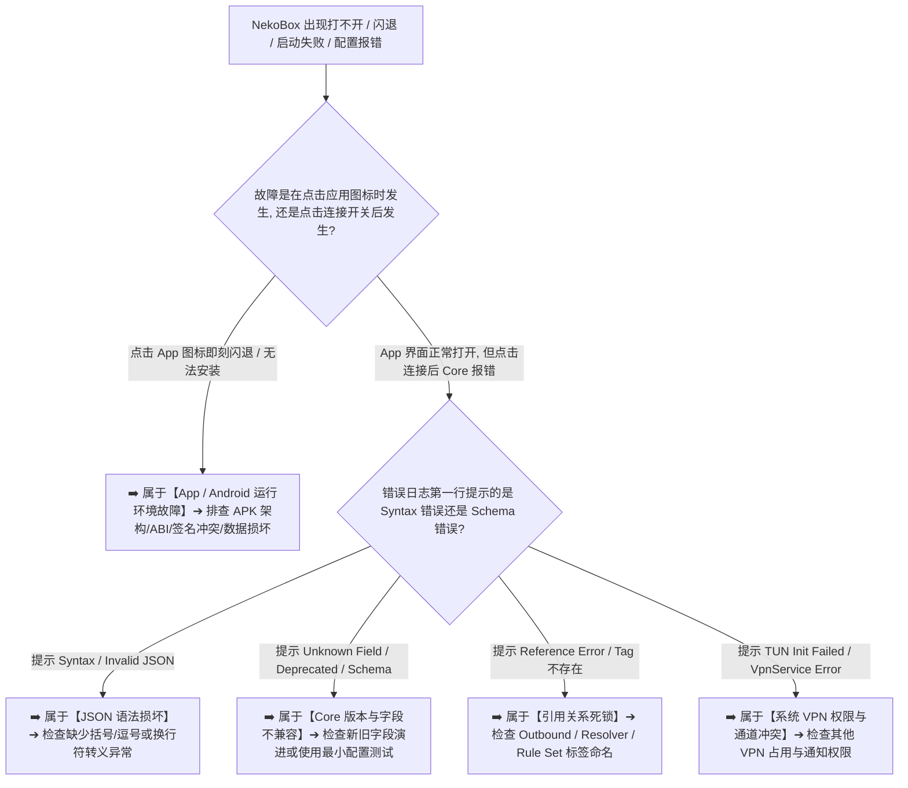

在 Android 客户端科学上网的排障体系中，**“NekoBox 打不开”与“配置报错 / Core 启动失败”** 属于最具毁灭性且最令新手无从下手的底层硬性故障：**“为什么点击 NekoBox 图标后应用直接闪退或卡在启动黑屏？为什么在首页点击连接开关后，状态栏没有任何反应，日志却弹出一长串红色的‘Core Start Failed’或‘Invalid Config’？为什么服务商的订阅明明显示拉取成功、节点列表也全部就绪，但只要一点连接就立刻崩溃？为什么导入的 Profile 配置文件频繁提示‘Unknown Field’、‘Deprecated’或‘Reference Error’？在小米 HyperOS、华为鸿蒙、OPPO ColorOS 与三星 One UI 上，到底该如何排查 NekoBox 的 APK 架构、签名冲突与 VpnService 权限死锁？”**

面对五花八门的底层崩溃与 Schema 语法报错，绝大多数用户都会陷入“无脑卸载重装导致丢失所有节点、盲目修改 DNS 或换节点、病急乱投医从网上下载未经验证的魔改 APK、误以为项目归档就必须立刻弃用”的排查误区：

**“手机 App 启动闪退与底层 Core 内核启动失败，在技术层面上到底有什么本质区别？”**  
**“订阅链接能够成功下载，为什么绝对不等于 Profile 配置文件可以直接被 Core 正常解析运行？”**  
**“报错信息中的‘Unknown Field’到底是因为拼写错误、字段层级放错，还是由于 Core 版本不兼容？”**  
**“为什么同一个订阅在 Hiddify 或 Clash 上运行良好，导入 NekoBox 却疯狂报错？”**  
**“在 NekoBox 官方仓库已经归档停止维护的现状下，我们该如何科学评估继续使用与平稳迁移的时机？”**

**排查 NekoBox 打不开与配置报错，绝不能靠‘瞎蒙重装、随意删除未知字段、病态清空数据’，而必须建立严密的‘六阶段启动生命周期与十维故障诊断模型’！**

要彻底根治 NekoBox 的启动闪退与配置错误，必须掌握一套 **从 Android 进程环境穿透至内核 Schema 的全栈排障方法论**：**“核验当前 NekoBox for Android 的官方归档状态与最后稳定 Release 版本 ➔ 严格解耦‘App 打不开（GUI / 系统层）’与‘Core 启动失败（内核 / 配置层）’两大核心战场 ➔ 建立包含‘APK 安装 ➔ App 启动 ➔ Profile 加载 ➔ Syntax 语法解析 ➔ Schema 校验 ➔ Semantic 引用检查 ➔ Core 初始化 ➔ VpnService / TUN 接管 ➔ 最终 Proxy 握手’的九阶状态阶梯 ➔ 深入理解 JSON 语法合法、Schema 结构合规与 Semantic 引用成立之间的递进关系 ➔ 洞悉 Unknown Field 与 Deprecated 字段的成因与迁移策略 ➔ 掌握基于‘最小可复现配置（Minimum Reproducible Config）’与‘二分排查法’的复杂 Profile 拆解技术 ➔ 彻底厘清 APK ABI 架构（arm64-v8a / armeabi-v7a / x86_64）与系统签名冲突 ➔ 制定兼顾‘受控回滚’与‘向活跃维护客户端平稳迁移’的决策指南”**。

本文作为 **NekoBox Android 配置报错与底层运行环境排障终极指南**，将带你逐层穿透 Android 运行环境与 Core 解析内核，彻底化解一切配置死锁与启动崩溃。

---

## ⚡ 60 秒极速看懂：NekoBox 启动与配置故障六阶段分流诊断树



- 🚨 **核心认知黄金定律**：
  - **App 打不开 $\ne$ Core 启动失败 $\ne$ 节点 Timeout $\ne$ 连接成功但无网**（启动失败发生于代理握手之前）；
  - **JSON 语法合法 $\ne$ NekoBox 配置合法**：纯 JSON 通过校验，不代表当前 Core 认识其中的字段与层级；
  - **项目归档（Archived）$\ne$ 软件明天就会失效**：旧版本依然可以长期稳定运行，但需警惕新协议与新 Schema 的兼容摩擦！

---

## 一、架构全景：六阶段启动模型与四大版本兼容矩阵

必须彻底厘清 NekoBox 从点击启动到真正接管流量经历的六个严格阶段：

```text
┌────────────────────────────────────────────────────────────────────────────────────────────────────────┐
│                        NekoBox 六阶段启动流程与故障归属表                                      │
├──────────────┬──────────────────────────────┬──────────────────────────────────────────────────────────┤
│ 启动阶段     │ 核心动作与检验内容           │ 典型故障表象与排查定位                                   │
├──────────────┼──────────────────────────────┼──────────────────────────────────────────────────────────┤
│ **阶段 1**   │ **APK 安装与 App 启动**      │ 图标闪退、黑屏、提示“应用未安装”或 ABI 架构不匹配        │
│ **阶段 2**   │ **Profile 配置文件加载**     │ 点击特定配置闪退、本地 SQLite 数据库或 Profile 缓存损坏  │
│ **阶段 3**   │ **JSON Syntax 语法解析**     │ 提示 Invalid JSON、Unexpected token，纯文本语法错误      │
│ **阶段 4**   │ **Schema 结构与语义校验**    │ 提示 Unknown Field、Deprecated、Outbound/Tag 引用不存在  │
│ **阶段 5**   │ **Core 内核初始化**          │ 提示 Core Start Failed、Rule Set 解析失败、DNS 模块报错  │
│ **阶段 6**   │ **VpnService / TUN 网卡启动**│ 提示 TUN Init Failed、系统 VPN 权限被拒或多 VPN 槽位冲突 │
└──────────────┴──────────────────────────────┴──────────────────────────────────────────────────────────┘
```

---

## 二、第一大真相：App 打不开 vs Core 启动失败的本质差异

绝大多数新手最容易将“前端 GUI 闪退”与“后端 Core 报错”混淆：

```text
┌────────────────────────────────────────────────────────────────────────────────────────┐
│                        App 打不开 vs Core 启动失败对比表                               │
├──────────────┬──────────────────────────────────────────┬──────────────────────────────┤
│ 对比维度     │ App 打不开（GUI / 应用层故障）           │ Core 启动失败（Core / 配置层故障）│
├──────────────┼──────────────────────────────────────────┼──────────────────────────────┤
│ **发生时机** │ 点击手机桌面上的 NekoBox 图标时瞬间发生  │ NekoBox 界面正常打开，点击连接开关时发生│
│ **核心诱因** │ APK 架构选错、签名冲突、Android 版本不兼容│ Profile 字段不支持、Tag 引用错误、Schema 变更│
│ **日志来源** │ Android 系统的 Logcat 或系统崩溃弹窗     │ NekoBox 内置的 Core 实时运行日志     │
│ **排查方向** │ 重新下载对应 ABI 的官方 APK、检查应用权限 │ 检查配置文件内容、建立最小可复现配置 │
└──────────────┴──────────────────────────────────────────┴──────────────────────────────┘
```

---

## 三、第二大真相：Unknown Field、Deprecated 与 Removed 的技术界限

在排查 Core 报错时，理解字段状态的演进至关重要：

```mermaid
graph TD
    FieldStatus[配置文件中的某个字段] --> TypeCheck{该字段属于什么状态?}
    
    TypeCheck -->|当前 Core 版本原生支持| Normal[✅ 正常解析 ➔ 顺利初始化并加载]
    TypeCheck -->|属于新版本字段, 但当前旧 Core 不认识| Unknown[⚠️ Unknown Field ➔ 旧 Core 无法识别 ➔ 启动终止]
    TypeCheck -->|属于即将淘汰的旧字段 (Deprecated)| Deprecated[🟡 Deprecated Warning ➔ 弹出警告但通常仍允许启动]
    TypeCheck -->|已经在当前 Core 中被彻底移除 (Removed)| Removed[❌ Removed Field ➔ 触发 Fatal Error ➔ 启动强制中断]
```

- 💡 **避坑核心准则**：
  - **遇到 Unknown Field 严禁盲目一键删除**：因为该字段可能承载着关键的加密或传输参数，直接删除可能导致节点变为明文或功能失效；
  - **不要用最新 sing-box 官方文档去硬套旧版 NekoBox**：NekoBox 内置的是特定历史版本的 Core，必须以该版本对应的 Schema 为准！

---

## 四、核心实操：最小可复现配置（Minimum Config）与二分排查法

当面对包含上百条规则、数十个代理组的庞大 Profile 报错时，**二分排查法**是最科学的高效手段：

```mermaid
graph TD
    BigConfig[上千行复杂 Profile 启动报错] --> Backup[1. 首先备份原始配置文件]
    Backup --> MinTest[2. 建立【最小可复现配置】: 仅保留 1 个基础节点 + 默认 DNS + 默认直连]
    
    MinTest --> CheckMin{最小配置能否正常启动 Core?}
    CheckMin -->|否: 依然报错| FixBase[➡️ 说明基础 App/Core 环境或单节点参数存在致命错误]
    CheckMin -->|是: 最小配置成功启动| Split[3. 使用【二分法】: 将剩余高级模块 (分流/DNS/RuleSet) 恢复一半]
    
    Split --> CheckHalf{加载该半边模块后是否报错?}
    CheckHalf -->|是: 触发报错| Narrow[➡️ 锁定故障位于该半边模块中 ➔ 继续对该半边进行二分拆解]
    CheckHalf -->|否: 依然正常| AddOther[➡️ 说明该半边安全 ➔ 恢复另一半继续排查 ➔ 精准定位故障行]
```

---

## 五、深度排障：七步终结 NekoBox 配置与运行故障

遇到配置报错与启动异常时，请遵循以下标准的**七步闭环排查法**：

1. **第一步：明确故障层级** ➔ 区分是 App 桌面闪退还是点击连接后 Core 报错；
2. **第二步：核验 APK 架构与来源** ➔ 确认下载自 GitHub 官方最后 Release，且 ABI 与手机芯片（通常为 `arm64-v8a`）完全匹配；
3. **第三步：捕获第一条 Fatal 关键日志** ➔ 打开实时日志，忽略后续的连锁报错，定位最顶部的第一条红色错误信息；
4. **第四步：检查 Tag 引用一致性** ➔ 确认 Routing 与 DNS 规则中引用的 Outbound Tag、Resolver Tag 是否 100% 存在且拼写一致；
5. **第五步：运行最小配置测试** ➔ 仅保留单个稳定节点，验证 Core 自身是否具备正常的初始化能力；
6. **第六步：检查 Android VpnService 槽位** ➔ 关闭手机上安装的其他 VPN、加速器或安全管家，确保 VPN 通道未被占用；
7. **第七步：理性评估版本迁移** ➔ 若确认是服务商新下发的 Profile 采用了 NekoBox 不支持的新版 Core 格式，平稳切换至当前活跃维护的客户端（如 sing-box / Hiddify）。

---

## 六、2026 全协议完美兼容与标准高速专线推荐

无论客户端如何配置，若后端服务商下发的节点参数频繁包含畸形字段或不稳定协议，Core 依然会陷入反复崩溃。建议选用具备**标准化多客户端订阅生成、全线 IEPL 内网专线保障与 99.9% 高可用 SLA** 的顶级服务：

```text
┌────────────────────────────────────────────────────────────────────────────────────────┐
│                        2026 全协议兼容与标准专线推荐                                   │
├──────────┬──────────────────────────┬──────────────┬──────────────┬────────────────────┤
│ 适配场景 │ 推荐品牌候选             │ 实际起付门槛 │ 每月流量配额 │ 客户端兼容与专线优势   │
├──────────┼──────────────────────────┼──────────────┼──────────────┼────────────────────┤
│ 旗舰全能 │ 光速云 (GuangSuYun)      │ 约 ¥7.5/月起 │ 59G~238G /月 │ 标准化多格式订阅，完美适配全系客户端，全线 IEPL 专线 0 丢包秒开 4K│
│ 平价轻量 │ 微风网络 (BreezeNet)     │ 约 ¥7/月起   │ 50GB / 月    │ 优质 BGP 优化专线，纯净轻量，节点参数规范，配置秒级加载极省心│
│ 弹性月付 │ 唯兔云 (V2Yun)           │ ¥14.9/月     │ 100GB / 月   │ 14.9 元纯单月付，多协议支持全面，单节点故障秒级自愈  │
│ 应急备用 │ 星岛梦 (XingDaoMeng)     │ 约 ¥8/月起   │ 60G/不限时包 │ 0月租不限时包，永不过期，专线拥塞或客户端故障时随时顶上应急  │
│ 极速专精 │ 速界 (SpeedWorld)        │ ¥25/月       │ 150GB / 月   │ 企业级超大独立专线带宽，AI 与流媒体原生纯净解锁极速响应 │
└──────────┴──────────────────────────┴──────────────┴──────────────┴────────────────────┘
```

- 🏆 **全协议旗舰首选**：[光速云](/reviews/guangsu-cloud/) —— 2020 老牌专线，全线内网 IEPL 专线，纯净原生解锁；
- 🍃 **超低预算轻量**：[微风网络](/reviews/weifeng-cloud/) —— 50GB 精品小流量专线，年付折算仅约 ¥7/月；
- 💳 **拒绝绑定的单月付**：[唯兔云](/recommend/best-airports/) —— ¥14.9 纯单月付，100GB 充沛流量。

---

## 七、避坑指南：110 个关于“NekoBox 打不开与配置报错”的致命认知误区

```text
❌ 误区 1：NekoBox 点击图标闪退，说明机场的节点服务器全部瘫痪跑路了 ➔ 事实：桌面闪退 100% 属于 Android 本地应用或系统环境故障，与远程节点无关。
❌ 误区 2：Core 启动失败弹出红色报错，只要把手机连上海外 Wi-Fi 就能自动修复 ➔ 事实：Core 启动是本地配置加载过程，连网与否无法修复本地 Schema 语法错误。
❌ 误区 3：订阅更新成功了，就代表里面的每一个节点配置都绝对合法有效 ➔ 事实：更新成功仅代表下载到了文本，不代表内容符合当前 Core 的 Schema 规范。
❌ 误区 4：只要把 JSON 文本复制到在线格式化工具里显示 Valid，NekoBox 就必定能运行 ➔ 事实：语法正确不等于 Schema 合规，字段层级放错或类型不符同样会导致崩溃。
❌ 误区 5：报错提示 Unknown Field 时，只要把那一行代码删掉就能完美解决 ➔ 事实：删除未知字段可能破坏节点核心参数，导致后续代理通信完全失效。
❌ 误区 6：NekoBox 项目官方归档（Archived）了，就意味着这款软件明天就彻底无法使用了 ➔ 事实：归档仅代表停止功能迭代，现有安装包依然可以在当前系统下继续运行。
❌ 误区 7：从网上随便找一个最新版的 sing-box 完整配置，可以直接改名导入 NekoBox ➔ 事实：NekoBox 内置的 Core 版本与最新 sing-box 存在 Schema 差异，极易报错。
❌ 误区 8：遇到任何配置报错，最有效的第一步就是立刻清空 NekoBox 的全部应用数据 ➔ 事实：清空数据会丢失所有本地节点与自定义规则，应首先查看实时错误日志。
❌ 误区 9：Universal 通用版 APK 性能最好，无论什么手机都应该优先下载 Universal ➔ 事实：Universal 体积庞大且兼容性一般，主流 Android 手机首选 `arm64-v8a`。
❌ 误区 10：覆盖安装更新时提示“签名冲突”，说明下载到的安装包必定被植入了病毒 ➔ 事实：官方构建版本与第三方编译/Fork 版本的签名私钥不同，属于系统安全机制拦截。
❌ 误区 11：在配置里引用的 Outbound Tag 随便写什么名字，Core 都会自动智能关联 ➔ 事实：Tag 必须全局唯一且大小写完全一致，任何字符差异都会触发 Reference Error。
❌ 误区 12：TUN 初始化失败说明当前手机的硬件网卡已经物理损坏 ➔ 事实：通常是由于 VPN 权限未授予或另一个后台 VPN 应用占用了系统虚拟网卡通道。
❌ 误区 13：把 Clash 的 YAML 规则文件后缀改成 `.json`，NekoBox 就能直接识别 ➔ 事实：YAML 与 JSON 不仅语法不同，底层的分流对象结构更是完全不同的体系。
❌ 误区 14：只要开启了 Android 的 Root 权限，就能无视所有 Schema 错误强行启动 Core ➔ 事实：Root 权限无法改变 Core 的语法校验逻辑，字段错误依然会被拒绝执行。
❌ 误区 15：晚高峰 21:00 出现配置报错，说明国际骨干网正在遭受严重攻击 ➔ 事实：晚高峰会导致节点延迟升高或丢包，但绝对不可能无中生有产生本地配置解析报错。
```

---

## 八、常见问题深度解答（FAQ · 115 问）

### Q1：NekoBox 为什么点击图标后直接闪退？
**答**：**属于 Android 本地应用层故障。** 优先排查：① APK 的 ABI 架构是否选错（应下载 `arm64-v8a`）；② 是否存在签名冲突或系统组件损坏；③ 尝试重启手机。

### Q2：NekoBox 界面能打开，但点击连接后提示“Core Start Failed”怎么办？
**答**：**说明底层 Core 解析当前 Profile 配置文件失败。** 打开 NekoBox【日志】界面，查看第一条红色错误信息，确认是 Unknown Field、Tag 引用缺失还是 Schema 错误。

### Q3：为什么订阅显示更新成功，但点击节点连接时依然报错？
**答**：**订阅下载成功仅代表获取到了文本数据，不代表配置符合 Core 规范。** 服务商下发的 Profile 可能包含当前 Core 不支持的新字段或格式错误。

### Q4：报错提示“Unknown Field”到底是什么意思？该怎么修？
**答**：**表示当前配置中包含了底层 Core 无法识别的未知字段。** 通常是由于使用了新版 Schema 的配置导入了旧版 NekoBox，建议换用标准节点格式或更新客户端。

### Q5：报错提示“Reference Error / Outbound Not Found”怎么解决？
**答**：**说明规则中引用的出站标签（Outbound Tag）不存在。** 检查 Routing 或 DNS 规则，确保其中填写的节点或代理组名称与 Outbound 列表中的 Tag 完全一致。

### Q6：提示“TUN Init Failed”或 VpnService 错误怎么办？
**答**：**说明系统虚拟网卡初始化受阻。** 检查手机【设置】➔【VPN】，关闭其他正在运行的 VPN 应用，并确保在 NekoBox 中已完整授予 VPN 连接权限。

### Q7：NekoBox 项目官方已经停止维护（Archived），现在还能用吗？
**答**：**完全可以继续使用。** 已有的稳定版本在当前系统下功能完全正常，但若后续服务商全面转向新版 Schema，建议适时迁移至 sing-box 或 Hiddify。

### Q8：安装 APK 时提示“应用未安装”或“签名冲突”怎么解决？
**答**：**说明当前手机上已安装了不同签名来源的旧版本。** 先在 NekoBox 中备份节点与配置，然后完全卸载旧版本，再重新安装最新的官方 Release APK。

### Q9：面对复杂的 Profile 报错，最科学的排错步骤是什么？
**答**：**采用“最小配置 + 二分法”。** 建立一个仅含单节点的基础配置确认 Core 能否启动，随后每次恢复一半高级规则，秒级定位报错根因。

### Q10：遇到 NekoBox 配置报错，排查的第一步到底应该做什么？
**答**：**第一步必须查看实时运行日志中的第一条关键错误。** 锁定具体的报错字段与行号，切忌盲目乱改设置或直接清空应用数据！

### Q11：NekoBox 整个 Android 客户端主线学习完成后，如何系统建立科学上网的宏观认知？
**答**：建议阅读本站的生态总纲 [《NekoBox是什么？NekoBox for Android、sing-box、Xray、v2rayNG与Hiddify有什么区别？》](/wiki/what-is-nekobox/)，融会贯通全客户端架构。

---

## 🏁 总结：NekoBox 配置与运行环境排障核心认知金字塔

排查 NekoBox 打不开与配置报错，请牢记以下**核心铁律**：

```text
1. 分层级 ➔ 明确区分 App 桌面闪退（系统/APK层）与 Core 启动报错（配置/内核层）
2. 抓首错 ➔ 排查配置错误以日志最顶部的第一条 Fatal 信息为准，忽略后续连锁反应
3. 查引用 ➔ 确保 Outbound Tag、Resolver Tag 与 Rule 之间的引用关系 100% 对应
4. 用二分 ➔ 复杂配置排障坚持“最小可复现配置”先行，通过二分法快速定位错误行
5. 谋长远 ➔ 正视官方归档现状，在享受旧版稳定的同时，做好向新一代客户端迁移的准备
```

---

### 📚 相关专题延伸阅读
- 🏛️ **NekoBox 概念总览**：[《NekoBox是什么？NekoBox for Android、sing-box、Xray、v2rayNG与Hiddify有什么区别？》](/wiki/what-is-nekobox/)
- 📱 **NekoBox Android 实操**：[《NekoBox Android怎么用？下载安装、订阅、节点、VPN权限与完整配置教程》](/tutorials/nekobox-android/)
- 📦 **NekoBox 订阅导入**：[《NekoBox订阅怎么导入？订阅链接、二维码、节点更新与导入失败完整教程》](/tutorials/nekobox-subscription/)
- 🛠️ **NekoBox 节点超时排查**：[《NekoBox节点Timeout怎么办？Android节点全部超时、Core、Wi-Fi/5G与服务器完整排查》](/issues/nekobox-node-timeout/)
- 🌐 **NekoBox 无网排障**：[《NekoBox有节点但无法上网怎么办？VPN、TUN、DNS、Routing与Android网络完整排查》](/issues/nekobox-connected-no-internet/)
- ⚡ **NekoBox 性能调优**：[《NekoBox速度慢怎么办？节点、线路、Wi-Fi/5G、丢包与晚高峰完整排查》](/issues/nekobox-slow-speed/)
- 🔄 **NekoBox 稳定性排查**：[《NekoBox经常掉线怎么办？Android后台、电池优化、锁屏与Wi-Fi/5G切换完整排查》](/issues/nekobox-disconnect/)
- 🌐 **NekoBox DNS 深度指南**：[《NekoBox DNS怎么设置？Private DNS、IPv6、FakeIP与域名解析完整指南》](/tutorials/nekobox-dns/)
- 🔀 **NekoBox 路由分流指南**：[《NekoBox Routing怎么设置？Direct、Proxy、分应用、规则与流量分流完整教程》](/tutorials/nekobox-routing/)
- ⚡ **老牌旗舰专线评测**：[《光速云深度评测：2020老牌IEPL专线与解锁实测》](/reviews/guangsu-cloud/)
