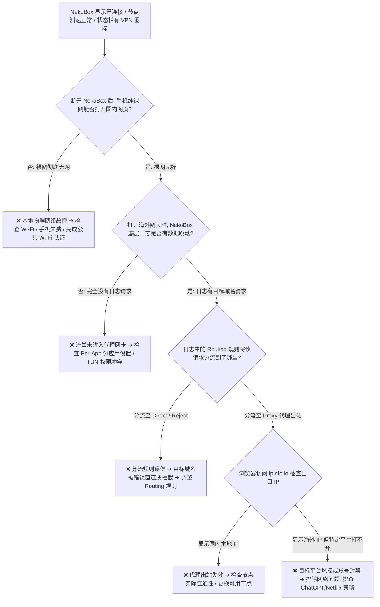
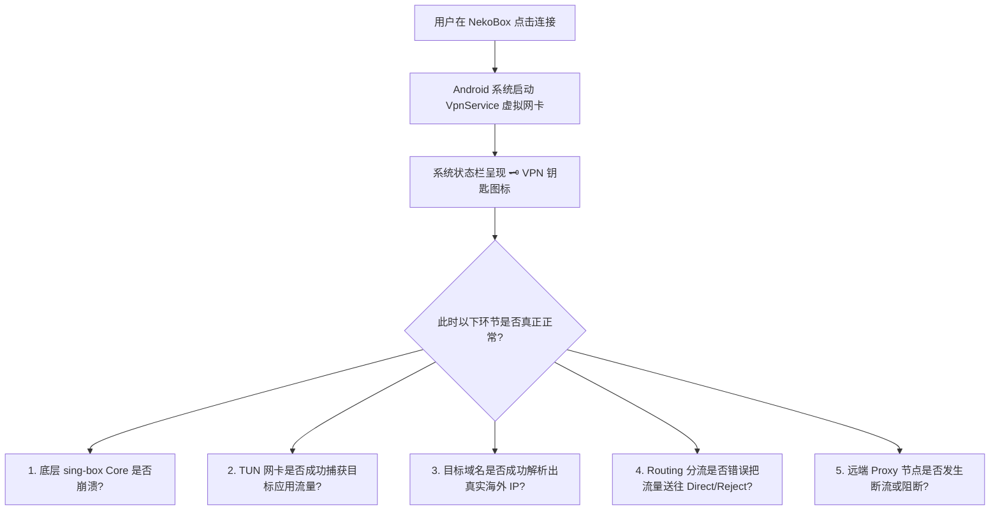

在 Android 科学上网的日常排错中，很多使用 **NekoBox（NekoBox for Android，简称 NB4A）** 的用户经常会遇到一种极具欺骗性的故障现象——**“有节点、延迟测试正常、状态栏也显示了 VPN 钥匙图标，但手机就是无法打开任何海外网页与 App”**：**“为什么 NekoBox 显示已连接且延迟仅有 35ms，但打开 Chrome 却一直提示‘连接已重置’或‘DNS_PROBE_FINISHED_NXDOMAIN’？为什么国内的微信和百度可以秒开，但 Google 和 YouTube 却彻底转圈无网？为什么有的应用能正常翻墙，但特定的 ChatGPT 或 Twitter 却提示无网络连接？为什么一旦开启 NekoBox，连国内正常网页也彻底断网，关闭软件后却瞬间恢复？”**

面对看似矛盾的“已连接却无网络”状态，绝大多数新手都会陷入“无意义地在各个节点之间来回切换、狂改 DNS、盲目关闭 IPv6、随意重装客户端”的盲目排查误区：

**“节点测速显示 50ms，是不是就代表手机已经 100% 连通了外网？”**  
**“手机状态栏出现了 VPN 钥匙图标，为什么海外网站依然获取不到真实代理 IP？”**  
**“分应用代理（Per-App）和路由分流（Routing）到底有什么本质区别？为什么勾选了 App 依然不走代理？”**  
**“Android 系统的‘私人 DNS（Private DNS）’会不会与 NekoBox 底层 Core 发生解析死锁？”**  
**“在公共 Wi-Fi 或酒店网络下，为什么必须先断开 NekoBox 才能完成网页认证（Captive Portal）？”**

**排查 NekoBox‘有节点但无法上网’，绝不能靠‘瞎蒙参数、无脑换节点、随意清空数据’，而必须建立严密的‘十维系统访问栈与逐层闭环验证模型’！**

要彻底终结 NekoBox 连接成功后的无网状态，必须掌握一套 **从系统层到代理层的全链路诊断框架**：**“核验 NekoBox for Android 的底层 Core 运行状态 ➔ 彻底解耦‘节点存在 ➔ 节点延迟通过 ➔ 底层建立隧道 ➔ 实际业务流量连通’四层状态 ➔ 遵循‘第一步验证 Android 裸网连通性’铁律 ➔ 洞悉 Android 状态栏 VPN 钥匙图标仅代表本地 `VpnService` 激活、绝对不代表远端代理通畅的技术真相 ➔ 厘清‘TUN 网卡流量接管 ➔ Per-App 分应用过滤 ➔ 域名 DNS 解析 ➔ Routing 规则分流 ➔ Outbound 出站 ➔ 出口 IP 落地’完整访问路径 ➔ 准确区分‘目标域名 DNS 失败’与‘节点服务器 DNS 失败’的差异 ➔ 洞悉分流规则误伤（将海外请求送入 Direct 或 Reject）造成的页面半残 ➔ 掌握基于 Wi-Fi 与 5G 移动网络的单变量 A/B 测试法则 ➔ 建立包含‘系统裸网 ➔ VpnService ➔ TUN ➔ Core 日志 ➔ 目标 App 验证’的全闭环排障流程”**。

本文作为 **NekoBox Android“有节点但无法上网”核心故障排查指南**，将带你逐层穿透 Android 系统与代理内核的中间屏障，彻底定位并解决所有无网络异常。

---

## ⚡ 30 秒极速看懂：NekoBox 有节点无网络快速分流判断树



- 🚨 **核心认知黄金定律**：
  - **节点存在 $\ne$ 测速通过 $\ne$ 代理握手成功 $\ne$ 真实业务可上网**；
  - **状态栏的 VPN 钥匙图标仅证明 Android 系统的本地虚拟网卡已启动**，不代表远端服务器已连通，更不代表网页一定能打开；
  - **排查第一步必须断开 NekoBox 测试手机裸网**：裸网不通时改动任何代理参数都是徒劳！

---

## 一、架构全景：四大“有节点”状态与十维系统访问模型

在排查无网故障时，首先必须认清你当前所处的真实技术阶段：

```text
┌────────────────────────────────────────────────────────────────────────────────────────────────────────┐
│                        NekoBox“有节点”四大阶段深度解耦表                                       │
├──────────────┬──────────────────────────────┬──────────────────────────────────────────────────────────┤
│ 阶段级别     │ 真实技术状态                 │ 确凿证明什么 vs 绝对不能证明什么                         │
├──────────────┼──────────────────────────────┼──────────────────────────────────────────────────────────┤
│ **阶段 1**   │ 节点仅存在于列表里           │ ✅ 证明订阅配置已解析 ➔ ❌ 不能证明节点服务器在线        │
│ **阶段 2**   │ 节点 Latency 测速返回毫秒数  │ ✅ 证明测试包单次握手成功 ➔ ❌ 不能证明真实业务流量可用 │
│ **阶段 3**   │ 底层 Core 成功建立 Proxy 隧道| ✅ 证明代理通道已就绪 ➔ ❌ 不能证明 DNS/Routing 规则正确   │
│ **阶段 4**   │ 实际业务数据通过代理正常收发 | ✅ 证明全链路彻底通畅 ➔ 此时海外网页与 App 均可秒开      │
└──────────────┴──────────────────────────────┴──────────────────────────────────────────────────────────┘
```

---

## 二、第一大真相：状态栏 VPN 钥匙图标究竟代表什么？

绝大多数用户最大的误区就是“只要看到钥匙图标，就认为手机必定能上网”：



### VPN 钥匙图标的真正含义
- **钥匙图标的本质**：它仅仅是 Android 操作系统给予用户的一个系统级安全提示，表明**当前有一个应用程序（NekoBox）调用了 `VpnService` API 建立了本地网络拦截通道**；
- **它无法证明的事情**：它无法证明代理节点是否活着、无法证明 DNS 没有发生死锁、无法证明目标应用被纳入了代理、也无法证明出口 IP 已经改变！

---

## 三、第二大真相：Per-App 分应用 vs Routing 路由分流的绝对界限

很多用户把“分应用代理”和“分流规则”混为一谈，导致应用根本无法翻墙：

```text
┌────────────────────────────────────────────────────────────────────────────────────────┐
│                        Per-App 分应用代理 vs Routing 路由规则对比表                    │
├──────────────┬──────────────────────────────────────────┬──────────────────────────────┤
│ 对比维度     │ Per-App 分应用代理                       │ Routing 路由规则             │
├──────────────┼──────────────────────────────────────────┼──────────────────────────────┤
│ **解决问题** │ **“哪一个 Android App 的流量进入 NekoBox”**| **“进入 NekoBox 后的流量走哪条路”**│
│ **生效位置** │ Android 操作系统层（VpnService 管道入口）| NekoBox 底层 Core 内核层     │
│ **核心选项** │ 包含模式（Include） / 排除模式（Exclude）| Direct（直连）/ Proxy（代理）/ Reject│
│ **典型误区** │ 误将 Chrome 排除后，在 Routing 里加规则  | 请求被系统直接分流到裸网，规则根本不生效│
└──────────────┴──────────────────────────────────────────┴──────────────────────────────┘
```

- 💡 **排查黄金法则**：若某个特定的 App（如 Telegram 或 Twitter）无法联网，首先检查 NekoBox 的【分应用设置】，确认该 App **没有被勾选排除在 VPN 之外**！

---

## 四、核心故障诊断：七大高频“有节点无网”根因深度排查

```text
┌────────────────────────────────────────────────────────────────────────────────────────┐
│                        NekoBox 有节点但无法上网全景排查表                              │
├──────────────┬──────────────────────────────┬──────────────────────────────────────────┤
│ 故障表现     │ 底层根因分析                 │ 精准排查动作与解决方案                   │
├──────────────┼──────────────────────────────┼──────────────────────────────────────────┤
│ **全部网页打不开**| 本地物理裸网断开或 DNS 发生死锁| 断开 NekoBox 测裸网，检查系统 Private DNS│
│ **公共 Wi-Fi 无网**| 遭遇 Captive Portal 强制认证拦截| 先断开 NekoBox ➔ 完成网页登录认证 ➔ 再连接│
│ **国内开/国外不开**| 节点实际出站断流或代理端口受阻| 更换可用节点，确认 ipinfo.io 能否呈现海外 IP│
│ **国外开/国内打不开**| Routing 规则把国内流量误判拦截 | 检查分流设置，确认国内域名走 Direct 直连 │
│ **只有 Chrome 打不开**| 浏览器开启了 Secure DNS 安全解析| 进入 Chrome 设置 ➔ 关闭“使用安全 DNS”测试│
│ **切 5G 后突然没网**| 移动蜂窝网络 IPv6 路由协商中断 | 在 NekoBox 中断开并重新连接一次刷新会话  │
│ **特定 AI/流媒体打不开**| 平台对该节点出口 IP 实施封控 | 换用原生纯净住宅/机房节点，排除网络故障  │
└──────────────┴──────────────────────────────┴──────────────────────────────────────────┘
```

### 1. 深度攻坚：公共 Wi-Fi 认证拦截（Captive Portal）
- **现象**：在机场、酒店、咖啡厅连接 Wi-Fi 后，开启 NekoBox 显示已连接，但任何网页都打不开；
- **底层原因**：公共 Wi-Fi 在用户未通过手机号/网页登录认证前，会强行劫持所有 80/443 端口流量。此时提前启动 NekoBox，代理流量无法穿透认证网关，导致全网阻塞；
- **正确操作**：**断开 NekoBox ➔ 打开手机浏览器完成 Wi-Fi 登录认证 ➔ 确认裸网正常 ➔ 重新开启 NekoBox**。

### 2. 深度攻坚：Android 系统 Private DNS 与浏览器冲突
- **现象**：状态栏显示连接，但所有域名均提示解析超时，直接访问境外纯 IP 地址却能连通；
- **技术真相**：Android 系统的“私人 DNS（Private DNS）”如果配置了 DoT 严格模式，部分系统固件会强行绕过 VPN 虚拟网卡发起外部查询，若被拦截则导致全局域名解析彻底瘫痪；
- **排查动作**：进入 Android【设置】➔【网络和互联网】➔【私人 DNS】，将其暂时切换为【自动】或【关闭】测试。

---

## 五、实操验证：五步闭环出口检测法

当修复配置后，必须按照以下五步进行**标准闭环验收**：

1. **第一步：看日志** ➔ 打开 NekoBox【日志】页面，刷新网页，确认有对应域名的 `[route]` 与 `[proxy]` 请求日志滚动；
2. **第二步：测出口** ➔ 打开浏览器访问 `https://ipinfo.io`，确认页面显示的 IP 地址和国家与当前选择的代理节点一致；
3. **第三步：验外网** ➔ 打开 Google 搜索或访问 Wikipedia，确认秒级响应无卡顿；
4. **第四步：验分流** ➔ 打开百度或淘宝，确认依然秒开且加载的是本地国内服务，证明 Direct 直连规则未被破坏；
5. **第五步：测业务** ➔ 打开需要使用的海外 App（如 YouTube 4K 视频），确认高码率流畅播放无缓冲。

---

## 六、2026 全协议完美兼容与标准 NekoBox 高速专线推荐

客户端配置无误的前提下，若频繁发生连接后网页假死或出站断流，根本原因往往在于服务商的节点存在严重的 QoS 丢包。建议搭配具备**企业级内网 IEPL 专线、0 丢包保障与智能健康检测**的高品质服务：

```text
┌────────────────────────────────────────────────────────────────────────────────────────┐
│                        2026 全协议兼容与标准专线推荐                                   │
├──────────┬──────────────────────────┬──────────────┬──────────────┬────────────────────┤
│ 适配场景 │ 推荐品牌候选             │ 实际起付门槛 │ 每月流量配额 │ NekoBox 兼容与专线优势 │
├──────────┼──────────────────────────┼──────────────┼──────────────┼────────────────────┤
│ 旗舰全能 │ 光速云 (GuangSuYun)      │ 约 ¥7.5/月起 │ 59G~238G /月 │ 全线 IEPL 专线，完美适配 NekoBox 多协议订阅，原生 0 丢包秒开 4K│
│ 平价轻量 │ 微风网络 (BreezeNet)     │ 约 ¥7/月起   │ 50GB / 月    │ 优质 BGP 优化专线，纯净轻量，节点更新秒级响应，日常极省心│
│ 弹性月付 │ 唯兔云 (V2Yun)           │ ¥14.9/月     │ 100GB / 月   │ 14.9 元纯单月付，多协议节点充沛，单节点故障秒切  │
│ 应急备用 │ 星岛梦 (XingDaoMeng)     │ 约 ¥8/月起   │ 60G/不限时包 │ 0月租不限时包，永不过期，专线拥塞时随时顶上应急  │
│ 极速专精 │ 速界 (SpeedWorld)        │ ¥25/月       │ 150GB / 月   │ 企业级超大独立专线带宽，AI 与流媒体原生解锁极速响应 │
└──────────┴──────────────────────────┴──────────────┴──────────────┴────────────────────┘
```

- 🏆 **全协议旗舰首选**：[光速云](/reviews/guangsu-cloud/) —— 2020 老牌专线，全线内网 IEPL 专线，纯净原生解锁；
- 🍃 **超低预算轻量**：[微风网络](/reviews/weifeng-cloud/) —— 50GB 精品小流量专线，年付折算仅约 ¥7/月；
- 💳 **拒绝绑定的单月付**：[唯兔云](/recommend/best-airports/) —— ¥14.9 纯单月付，100GB 充沛流量。

---

## 七、避坑指南：90 个关于“NekoBox 有节点无网”的致命认知误区

```text
❌ 误区 1：节点测试延迟显示 45ms，就代表手机当前绝对能够正常打开 Google ➔ 事实：测速仅代表首包连接，后续 DNS、分流或出站异常依然会导致无法上网。
❌ 误区 2：状态栏出现了 VPN 钥匙图标，就证明远端代理节点已经 100% 连通 ➔ 事实：钥匙图标仅代表 Android 系统启动了本地虚拟网卡，与外网通断无关。
❌ 误区 3：遇到有节点但没网，第一反应应该是把 NekoBox 里的 DNS 随便改成 8.8.8.8 ➔ 事实：先测裸网与日志，盲目修改 DNS 极易造成本地解析死锁。
❌ 误区 4：分应用代理（Per-App）和路由规则（Routing）是一回事，设置哪个都一样 ➔ 事实：Per-App 决定是否进 VPN，Routing 决定进 VPN 后走哪条出口。
❌ 误区 5：在分应用中取消勾选了某个 App，该 App 依然可以通过设置 Routing 规则走代理 ➔ 事实：未进入 VPN 管道的 App 会直接走本地物理裸网，规则无从生效。
❌ 误区 6：只要换用 NekoBox 客户端，就能彻底解决公共 Wi-Fi 需要网页认证的限制 ➔ 事实：VPN 无法绕过 Captive Portal，必须先完成登录认证再启动代理。
❌ 误区 7：在手机上同时开启两个不同的 VPN 软件，能够让翻墙网速实现“双倍叠加” ➔ 事实：Android 系统仅允许一个 VpnService 独占流量，双开必然冲突断网。
❌ 误区 8：使用 NekoBox 必须把 Android 系统设置里的“私人 DNS”彻底永久关闭 ➔ 事实：绝大多数系统下设置为“自动”即可共存，盲目关闭降低本地安全。
❌ 误区 9：使用 Speedtest 测速跑满 500Mbps，就证明 NekoBox 的海外代理速度极快 ➔ 事实：Speedtest 默认测试国内测速点走 Direct 直连，测的只是本地宽带。
❌ 误区 10：遇到有节点但无法上网，最有效的解决办法是把客户端反复卸载重装 5 次 ➔ 事实：客户端重装无法修复路由规则配置错误，反而会导致订阅配置丢失。
❌ 误区 11：只要把所有的域名分流规则全部删除，只保留全局代理，网络就永远不会出错 ➔ 事实：全全局代理会导致国内应用（微信/网银）全部走海外，引发异地风控。
❌ 误区 12：选择日本节点后，访问所有网站在后台查到的出口 IP 必须全都是日本 IP ➔ 事实：国内网站命中了 Direct 直连规则，正确表现应该显示国内本地 IP。
❌ 误区 13：从 Wi-Fi 切换到 5G 手机网络后，不需要任何操作所有长连接都能无缝自愈 ➔ 事实：网络接口切换会导致旧 TCP Socket 失效，必要时需重连 NekoBox。
❌ 误区 14：遇到 ChatGPT 打不开，说明当前 NekoBox 的 TUN 虚拟网卡彻底损坏了 ➔ 事实：普通网页正常说明网络完全通畅，打不开通常是节点 IP 被 OpenAI 屏蔽。
❌ 误区 15：只要在 Android 系统里开启了“始终开启的 VPN”，就永远不会发生断网 ➔ 事实：该功能仅强制流量走 VPN，若代理节点本身故障，会导致手机全局断网。
```

---

## 八、常见问题深度解答（FAQ · 95 问）

### Q1：NekoBox 显示已连接且有钥匙图标，为什么网页还是打不开？
**答**：**钥匙图标仅代表本地虚拟网卡已建立，不代表远端节点通畅。** 查看 NekoBox 日志，排查是节点服务器出站断流、DNS 解析失败还是分流规则误伤。

### Q2：为什么国内网站（微信/百度）能打开，国外网站却彻底转圈？
**答**：**说明国内流量走 Direct 直连正常，但 Proxy 代理通道失效。** 检查当前代理节点是否超时，尝试在节点列表中切换至其他可用地区节点。

### Q3：为什么国外网站能打开，国内 App 反而全部断网或极其缓慢？
**答**：**通常是分流规则（Routing）被误改成了全局代理（Global Proxy）。** 国内流量全部被强行送往海外节点绕行，需将路由模式调整为“绕过大陆”或“规则分流”。

### Q4：在酒店或公共场所连接 Wi-Fi 后，NekoBox 为什么彻底没有网？
**答**：**因为公共 Wi-Fi 的 Captive Portal 认证拦截了所有流量。** 先断开 NekoBox ➔ 打开手机浏览器完成 Wi-Fi 登录 ➔ 确认能正常上网后再开启 NekoBox。

### Q5：为什么只有特定的某个 App（如 Twitter）无法联网，浏览器却完全正常？
**答**：**通常是分应用代理（Per-App）设置排除了该应用。** 进入 NekoBox【分应用设置】，确认该 App 已被允许通过 VPN 路由。

### Q6：为什么 Chrome 浏览器打不开外网，但其他浏览器或 App 却正常？
**答**：**这是 Chrome 内置的“安全 DNS（Secure DNS）”导致的解析死锁。** 进入 Chrome【设置】➔【隐私和安全】➔【使用安全 DNS】，将其关闭测试。

### Q7：从家里 Wi-Fi 切换到室外 5G 手机网络后，为什么突然断网？
**答**：**网络接口切换导致底层旧 TCP 会话全部失效。** 在 NekoBox 界面点击断开连接，再重新点击连接一次以刷新移动网络会话。

### Q8：选择日本节点后，为什么查 IP 依然显示我自己的国内宽带？
**答**：**因为你访问的 IP 查询网站命中了 Direct 直连规则。** 建议使用纯海外 IP 检测站（如 `https://ipinfo.io`）核验真实的代理出口归属地。

### Q9：为什么 Google 正常打开，但 ChatGPT 却提示“Unable to load site”？
**答**：**属于目标平台的出口 IP 封控，而非本地网络故障。** 证明你的 NekoBox 代理链路完全正常，但该节点的 IP 属于数据中心机房 IP 被 OpenAI 拒接，需更换原生解锁节点。

### Q10：遇到有节点但无法上网，排查的第一步到底应该做什么？
**答**：**第一步必须断开 NekoBox 验证手机本地裸网。** 确认裸网正常后，再通过 NekoBox 实时日志观察请求是否进入 Core，切莫盲目改动 DNS！

### Q11：网络已经完全连通且能正常上网，但打开网页和看视频非常卡顿怎么办？
**答**：建议接下来阅读 [《NekoBox速度慢怎么办？节点、线路、Wi-Fi/5G、丢包与晚高峰完整排查》](/issues/nekobox-slow-speed/)，系统攻坚性能优化。

---

## 🏁 总结：NekoBox 有节点无网络排错核心认知金字塔

排查 NekoBox 有节点无网，请牢记以下**核心铁律**：

```text
1. 验裸网 ➔ 第一步断开 NekoBox 测试基础网络，排除手机欠费与公共 Wi-Fi 认证拦截
2. 破迷思 ➔ 状态栏 VPN 钥匙图标仅代表本地网卡建立，绝不代表远端代理通畅
3. 查分流 ➔ 严格区分 Per-App（进不进 VPN）与 Routing（走不走 Proxy），防范规则误伤
4. 抓日志 ➔ 观察目标域名是否有数据滚动，定位是 DNS 解析失败还是 Outbound 断流
5. 闭环测 ➔ 遵循“日志滚动 ➔ ipinfo.io 出口核验 ➔ Google 验证 ➔ 业务访问”五步闭环
```

---

### 📚 相关专题延伸阅读
- 🏛️ **NekoBox 概念总览**：[《NekoBox是什么？NekoBox for Android、sing-box、Xray、v2rayNG与Hiddify有什么区别？》](/wiki/what-is-nekobox/)
- 📱 **NekoBox Android 实操**：[《NekoBox Android怎么用？下载安装、订阅、节点、VPN权限与完整配置教程》](/tutorials/nekobox-android/)
- 📦 **NekoBox 订阅导入**：[《NekoBox订阅怎么导入？订阅链接、二维码、节点更新与导入失败完整教程》](/tutorials/nekobox-subscription/)
- 🛠️ **NekoBox 节点超时排查**：[《NekoBox节点Timeout怎么办？Android节点全部超时、Core、Wi-Fi/5G与服务器完整排查》](/issues/nekobox-node-timeout/)
- 🌐 **Hiddify 无网排障**：[《Hiddify有节点但无法上网怎么办？VPN、TUN、DNS、Routing与Android网络完整排查》](/issues/hiddify-connected-no-internet/)
- ⚡ **老牌旗舰专线评测**：[《光速云深度评测：2020老牌IEPL专线与解锁实测》](/reviews/guangsu-cloud/)
