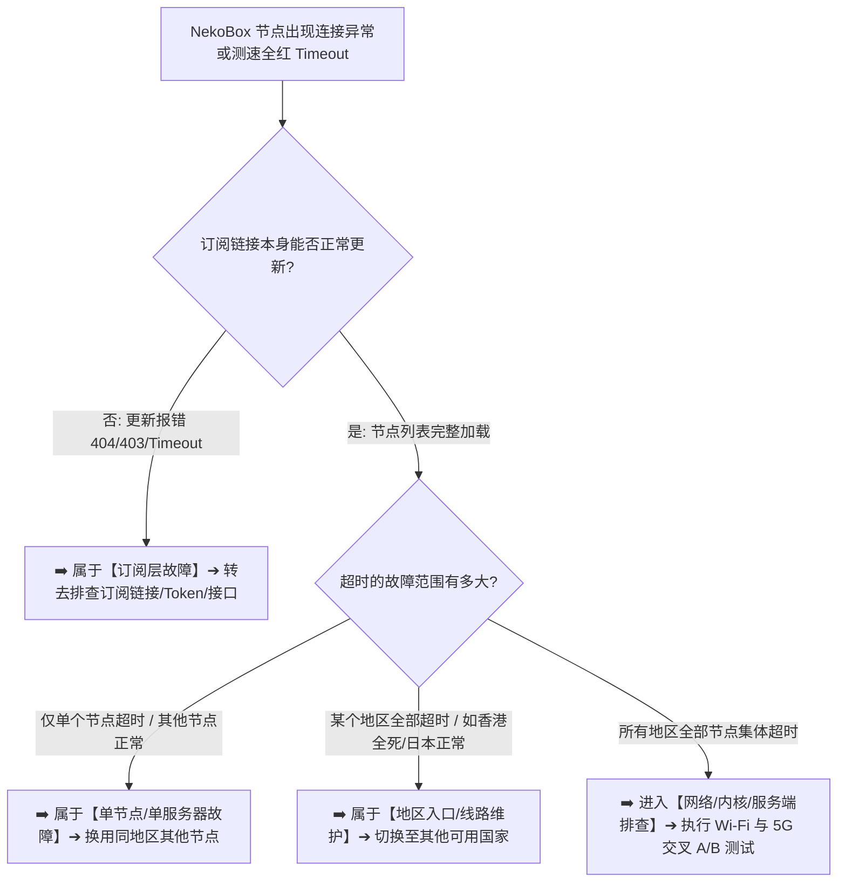

在使用 **NekoBox（NekoBox for Android，简称 NB4A）** 进行科学上网时，很多用户经常会遭遇令人束手无策的**节点连接超时（Node Timeout）**故障：**“为什么机场订阅明明拉取成功了，所有节点列表也完整显示，但点击测速却全部标红显示‘Timeout’或‘-1ms’？为什么选择单个节点点击连接后，日志里频繁刷出‘Dial Timeout’、‘Connection Refused’或‘Network Unreachable’？为什么连家里 Wi-Fi 时全部超时，切换到手机 5G 移动蜂窝网络却能秒连？为什么同一个订阅在另一台手机上完全正常，在当前设备上却所有地区节点集体死锁？”**

面对满屏飘红的超时提示，绝大多数新手都会陷入“病急乱投医、无休止刷新订阅、盲目关闭 IPv6、怀疑机场全线跑路”的排查误区：

**“节点测试显示 Timeout，到底说明服务器已经彻底关机，还是本地数据包被拦截？”**  
**“为什么在命令行能 Ping 通服务器 IP，NekoBox 里的代理节点却依然连接超时？”**  
**“为什么‘订阅更新超时（Subscription Timeout）’和‘节点连接超时（Node Timeout）’完全是两码事？”**  
**“遇到 VLESS 或 Hysteria 2 节点超时，第一步到底应该改目标 DNS、改端口还是换网络？”**  
**“晚高峰期间偶尔出现的集体超时，究竟是运营商 QoS 限速、物理专线拥塞还是客户端内核 Bug？”**

**排查 NekoBox 节点超时，绝不能靠‘瞎猜原因、疯狂刷订阅、随意关闭安全证书验证’，而必须建立严密的‘九维网络拓扑与三级故障范围诊断模型’！**

要彻底根治 NekoBox 节点的连接超时与握手死锁，必须掌握一套 **系统化的节点层排障方法论**：**“核验 NekoBox for Android 项目的实际内核版本 ➔ 彻底厘清‘订阅服务器请求超时 ➔ 代理节点握手超时 ➔ 代理成功后网页无网’三大故障层级的严格边界 ➔ 建立从‘单节点 ➔ 同地区节点组 ➔ 全地区节点 ➔ Wi-Fi/5G 单网络 ➔ 跨设备’的三级范围定位树 ➔ 精准区分‘Timeout（无响应超时）’、‘Connection Refused（端口拒绝）’、‘Network Unreachable（不可达）’、‘DNS Error（域名解析失败）’与‘TLS/REALITY 握手异常’的底层特征 ➔ 洞悉节点测速（Tcping / URL Test）与 ICMP Ping 的本质技术差异 ➔ 掌握基于 Wi-Fi vs 5G 蜂窝网络单变量 A/B 测试法则 ➔ 建立包含‘服务器域名 DNS ➔ IP 路由 ➔ 端口监听 ➔ 传输封装 ➔ 安全解密’的全链路证据链”**。

本文作为 **NekoBox 节点连接与超时排障专项核心指南**，将带你层层穿透底层日志与网络协议，彻底搞清节点超时的真正元凶并快速恢复畅通连接。

---

## ⚡ 30 秒极速看懂：NekoBox 节点超时三级快速分流模型



- 🚨 **核心认知黄金定律**：
  - **订阅 Timeout $\ne$ 节点 Timeout $\ne$ 连上后无网**（三者处于不同网络层级，排查方向截然不同）；
  - **节点测试显示 Timeout 不等于机场跑路**：必须通过单节点、同地区、全地区及 Wi-Fi/5G 交叉验证缩小故障源；
  - **严禁遇到 TLS/REALITY 超时就盲目关闭证书验证或安装未知 Root CA**，这会带来极高的中间人凭据劫持风险！

---

## 一、架构全景：两大超时链条的本质区别对照表

在排查前，必须彻底区分 **订阅请求超时** 与 **代理节点连接超时** 的底层网络链条：

```text
┌────────────────────────────────────────────────────────────────────────────────────────────────────────┐
│                        订阅更新超时 (Subscription Timeout) vs 节点连接超时 (Node Timeout)              │
├──────────────┬──────────────────────────────────────────┬──────────────────────────────────────────────┤
│ 对比维度     │ 订阅更新超时 (Subscription Timeout)       │ 节点连接超时 (Node Timeout)                  │
├──────────────┼──────────────────────────────────────────┼──────────────────────────────────────────────┤
│ **连接目标** │ 机场的 Web 业务服务器 (如 `sub.site.com`) │ 部署在海外的代理节点 (如香港/日本 Proxy IP)  │
│ **交互协议** │ 标准 HTTPS (HTTP GET 请求获取 Base64/JSON)│ VLESS / VMess / Trojan / Hysteria 2 / TUIC   │
│ **触发时机** │ 点击分组“更新/刷新订阅”时发生            │ 节点测速（Latency Test）或用户点击“连接”时发生│
│ **常见原因** │ 订阅域名 DNS 污染、套餐过期、接口被拦截  │ 节点服务器下线、中转机故障、本地端口阻断     │
│ **排查重点** │ 检查订阅 URL 完整性、重置 Token、换 5G 拉取│ 检查服务器 IP/域名解析、换节点、做网络 A/B 测│
└──────────────┴──────────────────────────────────────────┴──────────────────────────────────────────────┘
```

---

## 二、第一大真相：NekoBox 节点测速到底测了什么？（打破 Ping 迷思）

很多用户误以为节点列表中显示的毫秒数（如 `45ms` 或 `Timeout`）是操作系统的 ICMP Ping：

```mermaid
graph TD
    UserTest[用户点击 NekoBox 节点测速] --> TestMode{NekoBox 执行的具体测速机制}
    
    TestMode -->|Tcping 模式| TestTCP[尝试与节点服务器的 IP:Port 建立 TCP 三次握手]
    TestMode -->|URL Test 模式| TestHTTP[通过底层 Core 建立代理通道 ➔ 发起真实的轻量 HTTP 请求 (如 204)]
    
    TestTCP --> ResultTCP[计算 TCP 握手往返耗时 (RTT)]
    TestHTTP --> ResultHTTP[计算全链路完整握手与响应延迟]
```

### 1. 为什么服务器能 Ping 通，节点依然显示 Timeout？
- **ICMP 与 TCP/UDP 处于不同网络层**：服务商的服务器防火墙可能允许 ICMP 数据包（系统 Ping），但负责承载代理服务的核心进程（如 VLESS 或 Xray/sing-box 服务端）由于崩溃、重启或端口变动未在对应端口监听，导致代理握手彻底超时。

### 2. 为什么服务器 Ping 不通，节点却能正常飞速上网？
- **服务器开启了禁 Ping（ICMP Drop）**：出于安全防护与防扫描考虑，几乎所有高品质专线入口都会默认禁用 ICMP 回应，但代理端口（TCP/UDP）完全畅通无阻。**因此，永远不要用单一的 ICMP Ping 来判定节点生死！**

---

## 三、第二大真相：六大高频连接报错类型与底层根因图谱

查看 NekoBox 底层 Core 日志时，常见的失败提示具有不同的技术含义：

```text
┌────────────────────────────────────────────────────────────────────────────────────────┐
│                        Core 日志常见连接报错深度解析表                                 │
├──────────────────────┬──────────────────────────────┬──────────────────────────────────┤
│ 报错关键词           │ 底层技术含义                 │ 核心排查方向与定位               │
├──────────────────────┼──────────────────────────────┼──────────────────────────────────┤
│ **i/o timeout**      │ 在规定超时时间内未收到对端回包| 线路严重丢包、路由不可达或中转机掉线│
│ **connection refused**| 目标主机主动拒绝了该连接请求 | 服务器端口未监听、节点端口填错   │
│ **network unreachable**| 本地系统找不到通往目标的路由 | Wi-Fi 无外网、移动网络未分配 IP  │
│ **no such host**     │ 服务器域名（Domain）解析失败 | 本地 DNS 故障或服务商域名被污染  │
│ **tls handshake**    │ TLS 安全加密握手失败         │ 系统时间偏差、SNI 证书域名不匹配 │
│ **reality verification**| REALITY 身份公钥/ShortID 校验失败| 服务端 REALITY 参数变更、配置过旧 │
└──────────────────────┴──────────────────────────────┴──────────────────────────────────┘
```

---

## 四、实操排查：四级故障范围定位与单变量 A/B 测试法

遇到超时时，必须遵循**从小到大、从局部到整体**的科学排查路径：

```text
┌────────────────────────────────────────────────────────────────────────────────────────┐
│                        节点超时四级范围定位标准流程                                    │
├────────────────────────────────────────────────────────────────────────────────────────┤
│ 【第一级：单节点测试】➔ 切换同地区的 Node B / Node C ➔ 若其他节点正常 ➔ 确认为单个节点故障│
│ 【第二级：跨地区测试】➔ 切换日本、新加坡、美国节点 ➔ 若其他国家正常 ➔ 确认为特定地区线路维护│
│ 【第三级：网络 A/B 测】➔ 保持同一节点 ➔ 切换 Wi-Fi 与 5G 移动网络 ➔ 快速定位是否为本地宽带阻断│
│ 【第四级：跨设备测试】➔ 保持同一订阅 ➔ 在备用手机或电脑端测试 ➔ 排除当前手机系统/客户端 Bug│
└────────────────────────────────────────────────────────────────────────────────────────┘
```

### 1. Wi-Fi 失败而 5G 正常的典型根源
- **家庭宽带 DNS 污染**：路由器默认分配的运营商 DNS 无法正确解析节点服务器域名；
- **家庭路由器防火墙拦截**：部分智能路由器开启了深度包检测（DPI）或恶意阻断了特定高位端口；
- **排查动作**：在手机 Wi-Fi 设置中将 DNS 手动指定为公共 DNS，或重启家庭光猫与路由器。

### 2. 5G 失败而 Wi-Fi 正常的典型根源
- **移动运营商 IPv6 路由断流**：部分移动省份的 IPv6 蜂窝网络在跨境路由上存在严重的黑洞路由，导致优先走 IPv6 握手时直接挂起；
- **排查动作**：在 NekoBox 中断开并重新连接，刷新蜂窝网络连接会话。

---

## 五、深度攻坚：不同协议节点的超时特征与排障要点

```text
┌────────────────────────────────────────────────────────────────────────────────────────┐
│                        各大代理协议超时特性与排障指南                                  │
├──────────────┬──────────────────────────────┬──────────────────────────────────────────┤
│ 协议类型     │ 底层传输特征                 │ 核心超时诱因与应对措施                   │
├──────────────┼──────────────────────────────┼──────────────────────────────────────────┤
│ **VLESS-REALITY**| 基于 TCP/gRPC + 伪装 TLS   | 检查手机系统时间是否准确（偏差需<60s）   │
│ **Hysteria 2**| 基于 UDP / QUIC 高性能传输   | 若本地运营商严格限速 UDP，做 5G/Wi-Fi A/B│
│ **Trojan**   | 标准 HTTPS 流量伪装          | 检查 SNI 伪装域名证书是否过期            │
│ **VMess**    | 经典 TCP / WebSocket 封装    | 检查 AlterID 与用户 UUID 是否与服务端一致│
└──────────────┴──────────────────────────────┴──────────────────────────────────────────┘
```

- 💡 **特别提醒**：切勿将某一个 Hysteria 2 节点的超时直接武断地判定为“全省运营商封死 UDP”。很多时候只是该节点的 UDP 端口在晚高峰遭遇了短暂的丢包反弹，换用同地区专线即可秒级恢复。

---

## 六、2026 全协议完美兼容与标准 NekoBox 高速专线推荐

节点连接的终极稳定性，本质上由服务商的**物理骨干网与内网专线质量**决定。建议选用具备**全线 IEPL 内网专线、多入口容灾与 SLA 高可用保障**的顶级服务：

```text
┌────────────────────────────────────────────────────────────────────────────────────────┐
│                        2026 全协议兼容与标准专线推荐                                   │
├──────────┬──────────────────────────┬──────────────┬──────────────┬────────────────────┤
│ 适配场景 │ 推荐品牌候选             │ 实际起付门槛 │ 每月流量配额 │ NekoBox 兼容与专线优势 │
├──────────┼──────────────────────────┼──────────────┼──────────────┼────────────────────┤
│ 旗舰全能 │ 光速云 (GuangSuYun)      │ 约 ¥7.5/月起 │ 59G~238G /月 │ 全线 IEPL 专线，完美适配 NekoBox 多协议订阅，原生 0 丢包秒开 4K│
│ 平价轻量 │ 微风网络 (BreezeNet)     │ 约 ¥7/月起   │ 50GB / 月    │ 优质 BGP 优化专线，纯净轻量，节点更新秒级响应，日常极省心│
│ 弹性月付 │ 唯兔云 (V2Yun)           │ ¥14.9/月     │ 100GB / 月   │ 14.9 元纯单月付，多协议节点充沛，单节点故障秒切  │
│ 应急备用 │ 星岛梦 (XingDaoMeng)     │ 约 ¥8/月起   │ 60G/不限时包 │ 0月租不限时包，永不过期，专线拥塞时随时顶上应急  │
│ 极速专精 │ 速界 (SpeedWorld)        │ ¥25/月       │ 150GB / 月   │ 企业级超大独立专线带宽，AI 与流媒体原生解锁极速响应 │
└──────────┴──────────────────────────┴──────────────┴──────────────┴────────────────────┘
```

- 🏆 **全协议旗舰首选**：[光速云](/reviews/guangsu-cloud/) —— 2020 老牌专线，全线内网 IEPL 专线，纯净原生解锁；
- 🍃 **超低预算轻量**：[微风网络](/reviews/weifeng-cloud/) —— 50GB 精品小流量专线，年付折算仅约 ¥7/月；
- 💳 **拒绝绑定的单月付**：[唯兔云](/recommend/best-airports/) —— ¥14.9 纯单月付，100GB 充沛流量。

---

## 七、避坑指南：85 个关于“NekoBox 节点超时”的致命认知误区

```text
❌ 误区 1：节点列表里测速显示 Timeout，说明订阅链接本身已经彻底失效 ➔ 事实：订阅拉取成功说明订阅有效，超时说明代理节点与服务器握手失败。
❌ 误区 2：只要在 Windows 电脑上能 Ping 通节点 IP，手机 NekoBox 就绝不可能超时 ➔ 事实：ICMP Ping 仅测试网络通断，代理端口未开启依然会导致握手超时。
❌ 误区 3：所有节点只要标红显示 Timeout，就代表机场服务商必定已经跑路 ➔ 事实：可能是本地网络 DNS 污染或特定入口维护，需做多网络交叉验证。
❌ 误区 4：遇到节点连接超时，第一反应应该是在 NekoBox 里把订阅重复刷新 20 次 ➔ 事实：狂刷订阅不仅无法修复节点连通性，还极易触发服务商 429 限流。
❌ 误区 5：遇到 REALITY 节点握手超时，只要在客户端关闭“证书验证”就能解决 ➔ 事实：REALITY 基于非对称公钥认证，关闭证书验证只会制造新的语法错误。
❌ 误区 6：只要节点名称里写着“IEPL 企业专线”，就代表这个节点在任何时候都绝不超时 ➔ 事实：专线入口服务器若发生硬件重启或维护，同样会出现暂时性超时。
❌ 误区 7：在 Wi-Fi 下节点超时而 5G 正常，说明当前使用的 NekoBox 版本损坏了 ➔ 事实：5G 正常说明软件完全完好，根源在于家庭宽带或路由器的网络阻断。
❌ 误区 8：只要把 Android 手机系统里的 IPv6 彻底关闭，就能解决所有节点超时 ➔ 事实：盲目关闭 IPv6 无法解决服务器端下线问题，反而破坏正常双栈通信。
❌ 误区 9：Hysteria 2 节点测速超时，说明你所在的城市运营商已经全网封死了 UDP 协议 ➔ 事实：通常是该节点端口瞬时拥塞，换用同地区其他端口或专线即可。
❌ 误区 10：修改 NekoBox 的 DNS 设置（如改成 8.8.8.8）能够修复所有服务器端口超时 ➔ 事实：目标 DNS 仅用于解析访问网站，无法改变节点服务器物理连接状态。
❌ 误区 11：手机状态栏出现了 VPN 钥匙图标，就证明节点已经绝对不可能处于超时状态 ➔ 事实：钥匙图标仅代表本地网卡启动，节点可能在后台正疯狂刷超时报错。
❌ 误区 12：Connection Refused 和 Timeout 是同一个错误，处理方法完全一致 ➔ 事实：Refused 是对端明确拒绝（端口错/未监听），Timeout 是发包无响应。
❌ 误区 13：遇到节点全部超时，把 NekoBox 卸载并重新安装就能自动修复服务器 ➔ 事实：客户端重装无法修复远端服务器故障，反而会导致本地配置丢失。
❌ 误区 14：只要把节点测速的 Test URL 改成百度，测出来的延迟为 5ms 就证明翻墙正常 ➔ 事实：百度走的是直连，测出 5ms 仅测了国内网络，外网代理仍是死的。
❌ 误区 15：晚高峰 20:00 出现节点超时，说明节点服务商正在进行恶意限速 ➔ 事实：晚高峰国际骨干网出口拥塞丢包率激增，低端直连线路极易被挤爆超时。
```

---

## 八、常见问题深度解答（FAQ · 90 问）

### Q1：NekoBox 节点 Timeout 是什么意思？
**答**：**意味着客户端在规定时间内未收到代理服务器的回应。** 节点配置虽然存在，但手机与远端代理服务器之间的网络握手失败。

### Q2：为什么订阅能成功更新，节点却全部显示超时？
**答**：**因为订阅分发与节点代理处于两个不同服务器。** 订阅服务器正常工作，但节点代理服务器可能存在域名解析受阻或入口维护。

### Q3：用电脑 Ping 节点 IP 能通，为什么 NekoBox 里还是超时？
**答**：**Ping 测的是底层 ICMP 通断，NekoBox 测的是代理端口业务握手。** 端口未监听、协议参数不匹配或中间阻断均会导致代理超时。

### Q4：为什么只有一个节点超时，其他节点都正常？
**答**：**属于典型的单节点服务器或线路维护。** 此时客户端与本地网络均正常，直接切换到同地区其他可用节点即可。

### Q5：为什么同地区的香港节点全部超时，而日本节点正常？
**答**：**说明该服务商的香港专属入口或专线正在维护。** 临时切换至日本或新加坡节点，等待服务商修复香港线路。

### Q6：为什么连家里 Wi-Fi 全部超时，切换手机 5G 就秒连？
**答**：**根源在于家庭宽带或路由器 DNS/防火墙限制。** 尝试重启家用路由器，或在 Wi-Fi 设置中将 DNS 修改为公共 DNS 测试。

### Q7：报错 Connection Refused 和 Timeout 有什么区别？
**答**：**Timeout 是发包石沉大海无回应，Refused 是对端主机明确拒接。** Refused 通常意味着服务器代理程序未启动或节点端口被服务商更改。

### Q8：报错 No such host 或 DNS Error 该怎么排查？
**答**：**说明节点服务器域名无法被解析为 IP 地址。** 检查本地网络 DNS 是否正常，或重新更新一次订阅获取最新的服务器解析。

### Q9：REALITY 节点频繁超时与系统时间有关吗？
**答**：**密切相关。** REALITY 与 TLS 协议严格校验时间戳，手机系统时间若与标准北京时间偏差超过 60 秒将直接导致握手失败。

### Q10：遇到晚高峰节点集体超时该怎么办？
**答**：**这是普通直连线路公网拥塞的典型现象。** 建议升级选用具备全线内网 IEPL 专线保障的高 SLA 服务商以彻底规避晚高峰丢包。

### Q11：节点连接成功且延迟正常，但打开海外网页依然打不开怎么办？
**答**：建议接下来关注本站即将推出的《NekoBox有节点但无法上网怎么办？VPN、TUN、DNS、Routing与Android网络完整排查》，系统攻坚连接后无网故障。

---

## 🏁 总结：NekoBox 节点超时诊断核心认知金字塔

排查 NekoBox 节点超时，请牢记以下**核心铁律**：

```text
1. 分层级 ➔ 订阅更新超时 $\ne$ 节点连接超时 $\ne$ 代理连通后网页无网
2. 识测速 ➔ 节点延迟测速不是系统 ICMP Ping，Ping 通不代表代理端口正常
3. 定范围 ➔ 遵循“单节点 ➔ 同地区 ➔ 全地区 ➔ Wi-Fi/5G A/B 测”四级定位
4. 读日志 ➔ 区分 Timeout、Refused、DNS Error 与 TLS Handshake 报错特征
5. 选专线 ➔ 晚高峰稳定不超时的终极解法是依靠高品质企业级 IEPL 内网专线
```

---

### 📚 相关专题延伸阅读
- 🏛️ **NekoBox 概念总览**：[《NekoBox是什么？NekoBox for Android、sing-box、Xray、v2rayNG与Hiddify有什么区别？》](/wiki/what-is-nekobox/)
- 📱 **NekoBox Android 实操**：[《NekoBox Android怎么用？下载安装、订阅、节点、VPN权限与完整配置教程》](/tutorials/nekobox-android/)
- 📦 **NekoBox 订阅导入**：[《NekoBox订阅怎么导入？订阅链接、二维码、节点更新与导入失败完整教程》](/tutorials/nekobox-subscription/)
- 🌐 **v2rayNG 节点超时排查**：[《v2rayNG节点全部超时怎么办？Timeout、Connection Refused与网络完整排查》](/issues/v2rayng-node-timeout/)
- ⚡ **VLESS 协议科普**：[《VLESS协议是什么？与VMess有什么区别？性能、安全性与流控完整科普》](/protocols/vless-vs-vmess/)
- ⚡ **老牌旗舰专线评测**：[《光速云深度评测：2020老牌IEPL专线与解锁实测》](/reviews/guangsu-cloud/)
