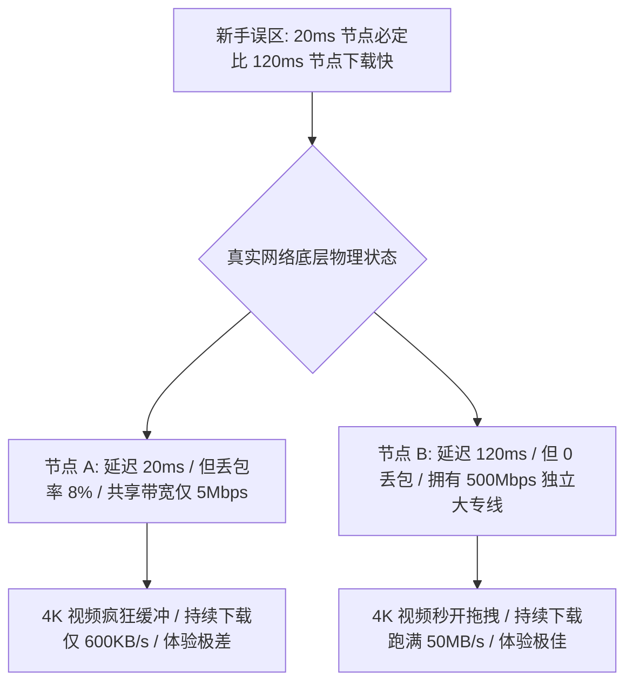

在 Android 科学上网的日常使用中，很多使用 **NekoBox（NekoBox for Android，简称 NB4A）** 的用户经常会遭遇令人抓狂的**网速极慢与视频卡顿**问题：**“为什么 NekoBox 节点列表里测速显示延迟只有 25ms，但打开 YouTube 看 4K 视频却一直转圈缓冲？为什么白天测速能跑满 300Mbps，一到晚上 20:00 晚高峰却断崖式暴跌到 2Mbps、丢包率飙升？为什么同一个节点连家里 Wi-Fi 只有 10Mbps，切换到手机 5G 移动网络却能飙到 150Mbps？为什么 Speedtest 测速显示几百兆，但打开 ChatGPT 或下载 Telegram 附件却慢如蜗牛？”**

面对复杂多变的网络卡顿，绝大多数新手都会陷入“延迟越低越快、香港一定最快、狂改 DNS 能提速、盲目开启 Hysteria 2 就能解决所有丢包”的盲目优化误区：

**“节点列表中显示的 25ms 延迟，到底能不能代表真实的下载带宽？”**  
**“为什么在家庭 Wi-Fi 信号满格的情况下，NekoBox 依然会出现严重的网络延迟抖动（Jitter）？”**  
**“Speedtest 测速跑出 500Mbps，究竟测的是真实海外代理还是被本地 Direct 直连欺骗了？”**  
**“VLESS、Trojan、Shadowsocks 与 Hysteria 2 协议在底层传输性能上到底有何本质差异？”**  
**“晚高峰期间出现的集体卡顿，究竟是本地宽带限制、公网骨干网拥塞还是机场服务器超售？”**

**排查 NekoBox 速度慢，绝不能靠‘瞎换节点、跟风改 MTU、盲目迷信单次测速’，而必须建立严密的‘九维网络性能栈与受控单变量 A/B 测试模型’！**

要彻底攻克 NekoBox 的网速瓶颈与丢包卡顿，必须掌握一套 **系统化的代理性能工程方法论**：**“核验 NekoBox for Android 的底层 Core 版本与传输协议 ➔ 彻底解耦‘往返延迟（Latency） $\ne$ 抖动（Jitter） $\ne$ 丢包率（Packet Loss） $\ne$ 下载带宽（Download） $\ne$ 上传带宽（Upload）’五大性能指标 ➔ 遵循‘第一步必须断开代理测试本地物理裸网基线’铁律 ➔ 掌握基于 8 bits = 1 Byte 的 Mbps 与 MB/s 理论换算逻辑 ➔ 洞悉 NekoBox 节点测试（Tcping / URL Test）与真实 ICMP Ping 的本质差异 ➔ 识别 Speedtest 命中 Direct 直连规则产生的‘假高速’陷阱 ➔ 建立包含‘本地裸网 ➔ 手机无线环境 ➔ Core 协议封装 ➔ 节点中转线路 ➔ 国际出口 ➔ 目标平台 CDN’全链路性能模型 ➔ 掌握 Wi-Fi vs 5G、单节点 A/B、跨地区 A/B 与白天 vs 晚高峰的单变量对照法则 ➔ 认清 IEPL 内网专线在晚高峰抗丢包维度的核心价值”**。

本文作为 **NekoBox Android 性能与速度调优专项核心指南**，将带你逐层穿透 Android 系统、无线射频与跨境物理骨干网的性能瓶颈，彻底释放高品质代理节点的全部潜能。

---

## ⚡ 30 秒极速看懂：NekoBox 速度慢五级定位判断模型

```mermaid
graph TD
    SpeedLow[NekoBox 能正常上网, 但网速慢 / 4K 卡顿 / 延迟极高] --> Step1{断开 NekoBox 后, 本地物理裸网测速是否正常?}
    
    Step1 -->|否: 裸网本身带宽极低/丢包严重| FixLocal[❌ 本地网络瓶颈 ➔ 排查家庭路由器 2.4GHz 干扰 / 手机移动网络基站拥塞]
    Step1 -->|是: 裸网带宽充足| Step2{同一个节点在 Wi-Fi 与 5G 下表现是否差异巨大?}
    
    Step2 -->|是: Wi-Fi 极慢但 5G 飞速| FixWiFi[❌ 本地局域网/宽带瓶颈 ➔ 切换 5GHz Wi-Fi / 重启光猫 / 调整路由器 MTU]
    Step2 -->|是: 5G 极慢但 Wi-Fi 飞速| FixCell[❌ 运营商蜂窝网络拥塞 ➔ 刷新 5G 数据会话 / 避开基站拥塞区]
    Step2 -->|否: Wi-Fi 与 5G 均同样卡顿| Step3{同地区的其他节点 (Node B / Node C) 是否同样缓慢?}
    
    Step3 -->|否: 仅当前单节点卡顿| FixNode[❌ 单节点负载过高 ➔ 换用同地区其他低负载节点]
    Step3 -->|是: 所有地区全线卡顿| Step4{是否仅在晚高峰 19:00~23:00 出现集体严重掉速?}
    
    Step4 -->|是: 典型晚高峰公网骨干网拥塞| FixLine[❌ 普通公网直连线路挤爆 ➔ 升级选用具备 IEPL 企业级内网专线服务]
    Step4 -->|否: 全天候无差别卡顿| FixCore[❌ 客户端分流或协议配置问题 ➔ 检查 Routing 规则是否误送 Direct]
```

- 🚨 **核心认知黄金定律**：
  - **低延迟（Low Ping） $\ne$ 高带宽（High Speed）**：20ms 的节点完全可能因为丢包和限速只能跑出 2Mbps；
  - **Speedtest 跑满 500Mbps 不等于代理飞速**：必须在 Core 日志中确认测速流量是否被分流规则（Routing）误送到了本地 Direct 直连；
  - **排查第一步必须测试断开代理后的物理裸网**：本地裸网只有 10Mbps 时，任何代理软件都无法凭空创造 100Mbps 带宽！

---

## 一、架构全景：五大性能指标解耦与单位换算真相

在优化速度前，必须彻底澄清关于网络速率的五大核心指标与换算关系：

```text
┌────────────────────────────────────────────────────────────────────────────────────────────────────────┐
│                        五大网络性能指标与单位换算全景表                                        │
├──────────────┬──────────────────────────────┬──────────────────────────────────────────────────────────┤
│ 指标名称     │ 物理技术含义                 │ 对实际使用体验的核心影响与评判标准                       │
├──────────────┼──────────────────────────────┼──────────────────────────────────────────────────────────┤
│ **往返延迟** │ 数据包在客户端与对端往返时间 | 决定网页首屏响应、实时语音、在线游戏与 AI 首 Token 速度  │
│ **抖动**     │ 连续数据包之间延迟的波动幅度 | 抖动越小（如 $\pm 2\text{ms}$）网络越平稳；抖动大导致实时语音音质撕裂│
│ **丢包率**   │ 传输过程中丢失数据包的百分比 | TCP 丢包会触发乘法减小窗口与重传，导致持续下载带宽断崖式下跌│
│ **下行带宽** │ 远端服务器向本地发送数据的速率| 决定 4K/8K 视频加载速度、大型文件下载与流媒体码率上限   │
│ **上行带宽** │ 本地向远端服务器发送数据的速率| 决定向 Claude/ChatGPT 上传大型代码文件、图片与云盘备份速度│
└──────────────┴──────────────────────────────┴──────────────────────────────────────────────────────────┘
```

### 💡 新手必懂：Mbps 与 MB/s 的换算铁律
- **网络通信单位（bit）**：运营商和测速软件通常使用 **Mbps（兆比特每秒，Megabits per second）**；
- **文件下载单位（Byte）**：手机浏览器和下载工具显示的是 **MB/s（兆字节每秒，MegaBytes per second）**；
- **换算公式**：$1\text{ Byte} = 8\text{ bits}$。因此：
  $$\text{理论下载速度 (MB/s)} = \frac{\text{测速带宽 (Mbps)}}{8}$$
  例如，**100 Mbps** 宽带在没有协议损耗的理想状态下，理论峰值下载速度约为 **12.5 MB/s**；实测跑出 10~11 MB/s 属于极佳水平。

---

## 二、第一大真相：低延迟不等于高带宽（打破 Ping 迷思）

很多用户在节点列表里看到 `20ms` 延迟就认为这是“最快节点”，这是严重的认知误区：



### 为什么会出现“低 Ping 但极慢”？
1. **ICMP / TCP 单包与持续吞吐的差异**：节点测速仅发送了一个微小的探针包，测试的是链路往返时间；而下载文件需要连续传输数以万计的数据包；
2. **丢包引发 TCP 拥塞控制惩罚**：一旦链路上存在 5% 的丢包，TCP 的拥塞控制算法（如 CUBIC）会强行将发送窗口腰斩，导致下载带宽直接暴跌 80% 以上！

---

## 三、第二大真相：Speedtest 测速陷阱与出口路由核验

测速软件显示几百兆，海外实际使用却慢如蜗牛，最常见的原因是**测速流量走了国内直连（Direct）**：

```mermaid
graph TD
    TestApp[用户打开 Speedtest App 进行测速] --> NekoBoxCore[流量进入 NekoBox 底层 Core]
    NekoBoxCore --> CheckRouting{Routing 分流规则匹配}
    
    CheckRouting -->|匹配到 GeoIP:CN 或国内测速域名| SendDirect[分流至 Direct (本地国内宽带直连)]
    CheckRouting -->|匹配到 Proxy 规则| SendProxy[分流至 Proxy (真正经过海外代理节点)]
    
    SendDirect --> FakeSpeed[显示 500Mbps ➔ 实际上测的是家里电信宽带, 代理根本没参与!]
    SendProxy --> RealSpeed[显示 120Mbps ➔ 真实反映代理节点的跨境传输带宽]
```

- 💡 **防欺骗核验法则**：测速时请务必使用 **Fast.com**（Netflix 旗下全球测速点）或在 Speedtest 中手动指定**香港/日本/美国**等海外测速服务器，并在 NekoBox 日志中确认该连接命中了 `[proxy]` 出站！

---

## 四、核心排查：四大单变量 A/B 测试法则

定位性能瓶颈时，切忌同时调整多个参数，必须遵循**单变量受控测试原则**：

```text
┌────────────────────────────────────────────────────────────────────────────────────────┐
│                        NekoBox 性能排障四大单变量 A/B 测试法则                         │
├──────────────┬──────────────────────────────────────────┬──────────────────────────────┤
│ 测试组别     │ 控制不变的变量                           │ 唯一改变的变量与定位结论     │
├──────────────┼──────────────────────────────────────────┼──────────────────────────────┤
│ **组别 1**   │ 同一手机、同一地点、同一时段             │ **裸网 vs 代理** ➔ 排除物理宽带瓶颈│
│ **组别 2**   │ 同一节点、同一 Profile、同一时段         │ **Wi-Fi vs 5G** ➔ 排除路由器/基站拥塞│
│ **组别 3**   │ 同一网络、同一时段、同一地区             │ **Node A vs Node B** ➔ 排除单节点过载│
│ **组别 4**   │ 同一节点、同一网络、同一测速目标         │ **白天 14:00 vs 晚高峰 21:00** ➔ 验证线路│
└──────────────┴──────────────────────────────────────────┴──────────────────────────────┘
```

### 1. Wi-Fi vs 5G 移动网络深度解析
- **2.4GHz Wi-Fi 的频段拥挤**：2.4GHz 频段极易受到邻居 Wi-Fi、蓝牙设备及微波炉的射频干扰，实际可用吞吐往往不足 30Mbps 且 Jitter 极高；
- **排查动作**：手机优先连接路由器的 **5GHz Wi-Fi** 频段；若 5GHz 依然缓慢但 5G 蜂窝网络极快，重点排查光猫与家用路由器性能。

### 2. 晚高峰（19:00~23:00）骨干网拥塞真相
- **普通直连线路的天然缺陷**：普通公网 163 骨干网在晚高峰期间国际出口负载极高，丢包率往往从白天的 0.5% 激增至 25% 以上；
- **终极解法**：普通直连线路在晚高峰几乎无法通过软件调优提速，必须依赖物理隔离的 **IEPL 企业级内网专线** 彻底绕过公网拥塞。

---

## 五、深度调优：主流代理协议性能特性全景对比

不同代理协议在加解密开销与抗丢包拥塞控制上具有不同的设计倾向：

```text
┌────────────────────────────────────────────────────────────────────────────────────────┐
│                        主流代理协议性能与适用网络场景对比表                            │
├──────────────┬──────────────────────────────┬──────────────────────────────────────────┤
│ 协议名称     │ 底层传输与拥塞控制           │ 最佳适用网络场景与性能特点               │
├──────────────┼──────────────────────────────┼──────────────────────────────────────────┤
│ **VLESS**    │ 极简无状态传输，CPU 开销极低 | 搭配 IEPL 专线或优质 BGP，提供极致吞吐与极低延迟│
│ **Hysteria 2**| 基于 UDP / 自定义拥塞控制    | 在高丢包（5%~20%）普通公网直连线路上抗卡顿能力极强│
│ **Trojan**   | 标准 HTTPS 流量伪装          | 伪装度高，加解密稳定，适合日常网页浏览与办公 │
│ **Shadowsocks**| 经典流加密 / AEAD 快速封装  | 架构轻盈，低端设备 CPU 占用极小，性能极其稳定│
└──────────────┴──────────────────────────────┴──────────────────────────────────────────┘
```

- 💡 **特别提醒**：切勿将 Hysteria 2 当作“无脑万能加速器”。在网络本身丢包率为 0 的高质量专线上，VLESS-TCP 的单线程吞吐与稳定性往往优于 UDP 协议。

---

## 六、2026 全协议完美兼容与标准 NekoBox 高速专线推荐

节点连接的终极稳定性与峰值速率，本质上取决于服务商的**物理带宽冗余与专线质量**。建议选用具备**全线 IEPL 内网专线、0 丢包保障与超大带宽**的顶级服务：

```text
┌────────────────────────────────────────────────────────────────────────────────────────┐
│                        2026 全协议兼容与标准专线推荐                                   │
├──────────┬──────────────────────────┬──────────────┬──────────────┬────────────────────┤
│ 适配场景 │ 推荐品牌候选             │ 实际起付门槛 │ 每月流量配额 │ NekoBox 兼容与专线优势 │
├──────────┼──────────────────────────┼──────────────┼──────────────┼────────────────────┤
│ 旗舰全能 │ 光速云 (GuangSuYun)      │ 约 ¥7.5/月起 │ 59G~238G /月 │ 全线 IEPL 专线，完美适配 NekoBox 多协议订阅，原生 0 丢包秒开 4K│
│ 平价轻量 │ 微风网络 (BreezeNet)     │ 约 ¥7/月起   │ 50GB / 月    │ 优质 BGP 优化专线，纯净轻量，节点更新秒级响应，日常极省心│
│ 弹性月付 │ 唯兔云 (V2Yun)           │ ¥14.9/月     │ 100GB / 月   │ 14.9 元纯单月付，多协议节点充沛，单节点故障秒切  │
│ 应急备用 │ 星岛梦 (XingDaoMeng)     │ 约 ¥8/月起   │ 60G/不限时包 │ 0月租不限时包，永不过期，专线拥塞时随时顶上应急  │
│ 极速专精 │ 速界 (SpeedWorld)        │ ¥25/月       │ 150GB / 月   │ 企业级超大独立专线带宽，AI 与流媒体原生解锁极速响应 │
└──────────┴──────────────────────────┴──────────────┴──────────────┴────────────────────┘
```

- 🏆 **全协议旗舰首选**：[光速云](/reviews/guangsu-cloud/) —— 2020 老牌专线，全线内网 IEPL 专线，纯净原生解锁；
- 🍃 **超低预算轻量**：[微风网络](/reviews/weifeng-cloud/) —— 50GB 精品小流量专线，年付折算仅约 ¥7/月；
- 💳 **拒绝绑定的单月付**：[唯兔云](/recommend/best-airports/) —— ¥14.9 纯单月付，100GB 充沛流量。

---

## 七、避坑指南：90 个关于“NekoBox 速度慢”的致命认知误区

```text
❌ 误区 1：节点列表里测速显示 20ms，手机下载速度就必须达到 100MB/s ➔ 事实：20ms 仅代表首包往返延迟，下载带宽取决于链路带宽与丢包率。
❌ 误区 2：在所有国家中，香港节点的速度必定比日本、新加坡和美国更快 ➔ 事实：若香港节点遭遇晚高峰拥塞，日本或美西大带宽专线反而更快。
❌ 误区 3：遇到速度慢，把 NekoBox 里的 DNS 换成 8.8.8.8 就能立刻提升下载带宽 ➔ 事实：DNS 仅负责域名解析，无法增加远端代理服务器的物理带宽。
❌ 误区 4：Speedtest 测速跑满 300Mbps，就证明 NekoBox 的海外代理节点极速飞起 ➔ 事实：测速流量若命中了 Direct 直连规则，跑出的只是国内裸网带宽。
❌ 误区 5：只要把代理协议切换成 Hysteria 2，就能够自动消除世界上的一切丢包 ➔ 事实：Hysteria 2 仅通过激进发包补偿丢包，无法修复本地断流与运营商 QOS。
❌ 误区 6：手机状态栏 Wi-Fi 信号满格，就代表通往海外网站的网络绝对不可能卡顿 ➔ 事实：满格仅说明手机与路由器信号好，不代表国际出口骨干网通畅。
❌ 误区 7：只要开启了 NekoBox 的 Mux 多路复用功能，所有网页的打开速度都能翻倍 ➔ 事实：高并发下载或高吞吐场景下，Mux 极易造成队头阻塞反而严重降速。
❌ 误区 8：把 TUN 虚拟网卡的 MTU 强行修改为 1400，能够解决全网所有卡顿问题 ➔ 事实：MTU 必须与本地运营商物理 MTU 匹配，盲目修改可能导致分片丢包。
❌ 误区 9：ChatGPT 生成回复非常缓慢，说明当前 NekoBox 的代理节点严重卡顿 ➔ 事实：模型生成速度主要取决于 OpenAI 服务端算力负载，与网络带宽无关。
❌ 误区 10：只要节点名称带有“10Gbps”，每一个连接该节点的用户就都能跑满万兆 ➔ 事实：10Gbps 是服务器物理端口总带宽，由所有在线用户动态共享。
❌ 误区 11：在 5G 手机网络下测速慢，说明 NekoBox 客户端对 5G 存在严重的系统 Bug ➔ 事实：通常是当前地理位置的 5G 基站用户负载过高或进入了信号盲区。
❌ 误区 12：YouTube 视频清晰度自动跳到 480p，说明服务商对你的账号进行了恶意限速 ➔ 事实：视频码率受 CDN 节点分配与实时丢包影响，切换同地区节点即可。
❌ 误区 13：遇到速度慢，最有效的办法是在设置里将所有分流规则全部删除走全局 ➔ 事实：全局代理会导致国内流量绕行海外，造成国内应用极度卡顿。
❌ 误区 14：只要把手机系统升级到最新版本，NekoBox 的加密代理性能就能翻倍 ➔ 事实：系统升级无法改变跨境物理链路带宽，性能核心依然在专线质量。
❌ 误区 15：晚高峰 21:00 出现网速下降，说明该机场服务商 100% 存在严重超售 ➔ 事实：家庭宽带、本地运营商城域网与国际出口均可能在晚高峰发生公网拥塞。
```

---

## 八、常见问题深度解答（FAQ · 95 问）

### Q1：NekoBox 节点延迟很低，为什么实际下载速度却非常慢？
**答**：**低延迟仅代表握手响应快，不代表传输带宽高。** 若链路上存在丢包、服务器带宽被共享占满或触发了运营商 QoS 限速，依然会导致下载速度断崖式下跌。

### Q2：为什么白天速度极快，一到晚上 20:00~23:00 就严重卡顿？
**答**：**属于典型的公网国际出口晚高峰骨干网拥塞。** 普通直连线路在晚高峰丢包率激增，建议换用具备全线企业级 IEPL 内网专线的高品质服务商。

### Q3：为什么连家里 Wi-Fi 速度极慢，切换手机 5G 却瞬间恢复秒开？
**答**：**根源在于家庭 2.4GHz Wi-Fi 干扰或宽带光猫路由性能瓶颈。** 手机请优先连接 5GHz Wi-Fi 频段，或重启家用路由器以刷新信道。

### Q4：Speedtest 测速跑满几百兆，为什么看 YouTube 依然频繁缓冲？
**答**：**因为 Speedtest 测速流量命中了 Direct 直连规则。** 实际上测的是国内宽带而非代理节点，请使用 Fast.com 或在测速软件中手动指定海外测速节点。

### Q5：VLESS、Trojan 与 Hysteria 2 哪个协议速度最快？
**答**：**没有绝对最快的协议，取决于具体网络环境。** 在 0 丢包的优质 IEPL 专线上，VLESS 性能极致且稳定；在丢包严重的普通直连线路上，Hysteria 2 体验更佳。

### Q6：换用 8.8.8.8 等公共 DNS 能够提升 NekoBox 的网速吗？
**答**：**不能提升持续下载带宽，仅能优化初次域名解析速度。** DNS 仅负责将域名翻译为 IP 地址，无法增加跨境物理专线的传输带宽。

### Q7：NekoBox 里的 Mux 多路复用功能需要开启吗？
**答**：**日常高带宽使用（看 4K/大文件下载）建议保持关闭。** Mux 将多个 TCP 连接合并为一个，在高并发大流量下极易引发队头阻塞导致降速。

### Q8：为什么同一个节点在电脑上很快，在 Android 手机上却很慢？
**答**：**可能由于手机处于省电模式、2.4GHz 无线干扰或后台调度限制。** 关闭手机省电模式，连接 5GHz Wi-Fi 频段重试。

### Q9：使用 ChatGPT 或 Claude 响应很慢，是 NekoBox 的网速问题吗？
**答**：**属于 AI 服务端模型推理计算延迟，而非代理网络带宽瓶颈。** 只要文字能够连续吐出即证明网络畅通，生成速度由平台算力决定。

### Q10：遇到 NekoBox 速度慢，排查的第一步到底应该做什么？
**答**：**第一步必须断开 NekoBox 测试手机本地物理裸网。** 确认裸网测速充足后，再通过单变量 A/B 对照排查单节点、单地区或网络频段问题！

### Q11：网速正常但连接一段时间后频繁断开或锁屏掉线怎么办？
**答**：建议接下来阅读 [《NekoBox经常掉线怎么办？Android后台、电池优化、锁屏与Wi-Fi/5G切换完整排查》](/issues/nekobox-disconnect/)，系统攻坚稳定性问题。

---

## 🏁 总结：NekoBox 性能调优核心认知金字塔

排查 NekoBox 速度慢，请牢记以下**核心铁律**：

```text
1. 标基线 ➔ 第一步断开代理测裸网，明确本地物理宽带与 5GHz Wi-Fi 基础能力
2. 破迷思 ➔ 延迟低不等于带宽高，Speedtest 跑满需确认是否被 Direct 直连欺骗
3. 控变量 ➔ 遵循“单节点 ➔ 跨地区 ➔ Wi-Fi vs 5G ➔ 白天 vs 晚高峰”单变量 A/B 测
4. 选协议 ➔ 专线环境优选 VLESS 极简封装，普通高丢包直连线路适配 Hysteria 2
5. 靠专线 ➔ 晚高峰稳定抗拥塞的终极解法是依靠物理隔离的 IEPL 企业级内网专线
```

---

### 📚 相关专题延伸阅读
- 🏛️ **NekoBox 概念总览**：[《NekoBox是什么？NekoBox for Android、sing-box、Xray、v2rayNG与Hiddify有什么区别？》](/wiki/what-is-nekobox/)
- 📱 **NekoBox Android 实操**：[《NekoBox Android怎么用？下载安装、订阅、节点、VPN权限与完整配置教程》](/tutorials/nekobox-android/)
- 📦 **NekoBox 订阅导入**：[《NekoBox订阅怎么导入？订阅链接、二维码、节点更新与导入失败完整教程》](/tutorials/nekobox-subscription/)
- 🛠️ **NekoBox 节点超时排查**：[《NekoBox节点Timeout怎么办？Android节点全部超时、Core、Wi-Fi/5G与服务器完整排查》](/issues/nekobox-node-timeout/)
- 🌐 **NekoBox 无网排障**：[《NekoBox有节点但无法上网怎么办？VPN、TUN、DNS、Routing与Android网络完整排查》](/issues/nekobox-connected-no-internet/)
- ⚡ **老牌旗舰专线评测**：[《光速云深度评测：2020老牌IEPL专线与解锁实测》](/reviews/guangsu-cloud/)
