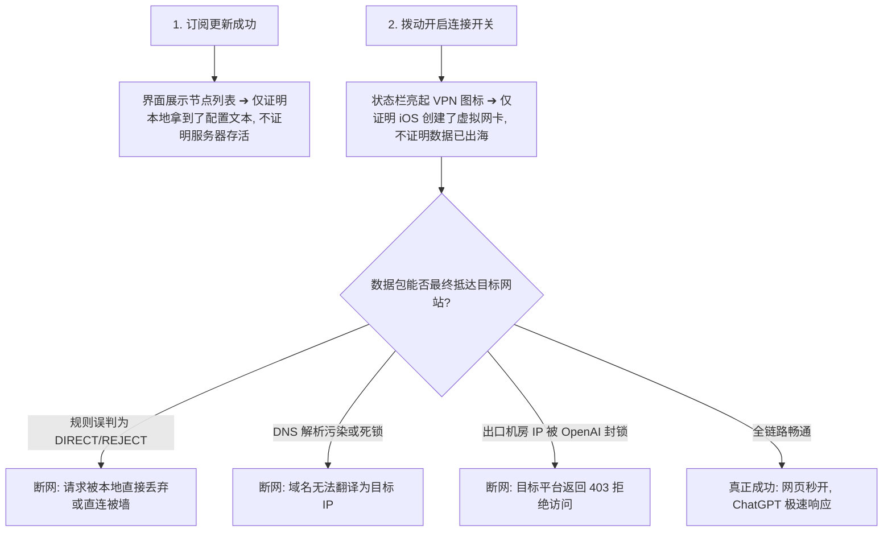
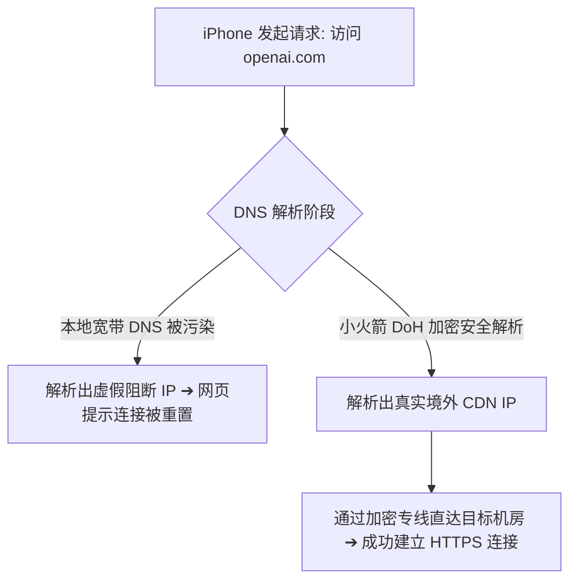
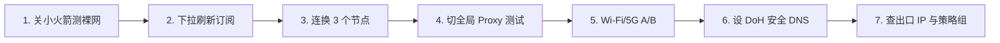

在 iPhone 上使用 Shadowrocket（小火箭）时，最令人困惑的故障莫过于**“看似一切正常，但就是打不开网页”**：

**“小火箭列表里几十个节点都在，测速也显示几十毫秒绿色数字，为什么用 Safari 打开 Google 却提示找不到服务器？”**  
**“为什么 iPhone 顶部状态栏已经亮起了 `[VPN]` 图标，但国内国外所有 App 全部断网无响应？”**  
**“为什么把全局路由切到‘全局 (Proxy)’就能秒开网页，一切回‘配置 (Rule)’就瞬间没网？”**  
**“为什么在 Safari 里能正常上 Google 和 YouTube，但官方 ChatGPT App 却一直报错提示网络连接失败？”**  
**“在家里连 Wi-Fi 一切顺畅，为什么一出门切到 5G 移动蜂窝网络就提示网络不可达？”**

**在 Shadowrocket 中“能够看到节点”或“状态栏亮起 VPN 图标”，仅仅证明了订阅拉取成功以及 iOS 虚拟网卡已启动，绝不等于整个代理通信链路已经畅通无阻。**

真正能够打开目标网站，还需要跨越 **「本地物理宽带 ➔ 节点加密握手 ➔ 智能分流规则判定 ➔ 本地/远端 DNS 解析 ➔ 出口 IP 信誉验证 ➔ 目标平台 WAF 防火墙」** 六大关卡。任何一个环节发生配置冲突，都会导致“有节点但没网”。

本文专注于 **Shadowrocket 的“代理链路与规则接管层故障”**，带你通过 **6 大症状分类排查表** 与 **六维诊断模型**，手把手彻底解决小火箭有节点无法上网的问题。

---

## ⚡ 30 秒快速排查速查流：有节点但没网怎么排查？

```text
┌────────────────────────────────────────────────────────────────────────┐
│           Shadowrocket 有节点但无法上网 30 秒极速诊断决策流            │
├────────────────────────────────────────────────────────────────────────┤
│ ① 断开小火箭测裸网 ➔ Safari 打开百度？(排除 iPhone 本身欠费或断网)      │
│ ② 首页向下拉动「刷新订阅」 ➔ 排除使用缓存的过期旧节点服务器配置        │
│ ③ 连续切换测试 2~3 个不同地区节点 ➔ 排除单节点服务器出口临时故障       │
│ ④ 将全局路由切到「全局 (Proxy)」测试 ➔ 能开网页？(100% 为 Rule/DNS 故障)│
│ ⑤ 切换 Wi-Fi 与 5G 蜂窝网络 ➔ 5G 失败 Wi-Fi 成功？(检查蜂窝权限与 IPv6)│
│ ⑥ 查看当前出口 IP ➔ 确认访问目标网站走的是预期节点的真实境外出口      │
│ ⑦ 访问 Google 正常但 ChatGPT 失败 ➔ 排除网络故障，直接更换原生纯净节点 │
└────────────────────────────────────────────────────────────────────────┘
```

> 💡 **必须厘清的四大故障分层分工**：
> - **《Shadowrocket订阅怎么导入》**：解决**订阅 404/403、解析失败、节点列表为空**（配置层）；
> - **《Shadowrocket节点Timeout怎么办》**：解决**节点测试超时、全部标红、端口连不上**（连接层）；
> - **本篇《Shadowrocket有节点但无法上网》**：解决**节点存在/VPN已开启，但打不开网页、Rule/DNS/5G异常**（接管与分流层）；
> - **《Shadowrocket速度慢怎么办》**：解决**已经能正常上网，但 4K 转圈、网速慢、晚高峰卡顿**（性能层）。

---

## 一、技术澄清：“有节点”与“VPN 图标亮起”到底证明了什么？

很多新手常被表面的 UI 图标所误导，必须认清这两个状态的真实技术边界：



### 核心真相大揭秘：
1. **“有节点” $\neq$ “节点可用”**：节点列表只是保存在 iPhone 上的服务器地址薄，如果该机房正在停机维护，节点依然会显示在列表中；
2. **“VPN 图标亮” $\neq$ “能够上网”**：iOS 状态栏的 `[VPN]` 标志只是操作系统告诉你 *“现在所有 App 的网络流量正在交给 Shadowrocket 处理”*。如果小火箭内部规则把流量导向了错误的出口，或者 DNS 解析卡死，手机就会彻底断网。

---

## 二、六大核心故障症状分类速查表

遇到有节点打不开网页时，请根据你的**具体故障表现**直接对照下表寻找突破口：

```text
┌────────────────────────────────────────────────────────────────────────────────────────┐
│                   Shadowrocket 有节点无法上网 6 大核心症状速查表                       │
├──────────────┬──────────────────────────────┬──────────────────────────────────────────┤
│ 故障表现分类 │ 底层技术根因分析             │ 优先排障动作与第一修复步骤               │
├──────────────┼──────────────────────────────┼──────────────────────────────────────────┤
│ **症状 A**   │ 国内国外所有网站全部打不开   │ **本地断网 / 代理隧道死锁** ➔ 关小火箭测裸网│
├──────────────┼──────────────────────────────┼──────────────────────────────────────────┤
│ **症状 B**   │ 微信正常，国外网站打不开     │ **节点连接失效 / 规则误设 Direct** ➔ 换节点│
├──────────────┼──────────────────────────────┼──────────────────────────────────────────┤
│ **症状 C**   │ **全局 (Proxy) 正常，配置 (Rule) 失败**│ **分流规则失效 / DNS 污染** ➔ 重点排查规则与 DNS│
├──────────────┼──────────────────────────────┼──────────────────────────────────────────┤
│ **症状 D**   │ Google 正常，ChatGPT / Claude 打不开│ **目标平台机房 IP 拦截** ➔ 更换原生专线节点│
├──────────────┼──────────────────────────────┼──────────────────────────────────────────┤
│ **症状 E**   │ Safari 能用，特定 App 无法联网 │ **App 走独立 API 域名或蜂窝权限受限** ➔ 查分流│
├──────────────┼──────────────────────────────┼──────────────────────────────────────────┤
│ **症状 F**   │ Wi-Fi 正常，切到 5G 蜂窝断网 │ **蜂窝数据权限关闭 / 移动 IPv6 冲突** ➔ 改 DNS│
└──────────────┴──────────────────────────────┴──────────────────────────────────────────┘
```

---

## 三、核心排障方向：全局 (Proxy) vs 配置 (Rule) vs 直连 (Direct) 模式深度诊断

小火箭主界面的**「全局路由」**是排查“有节点没网”的最核心切入点：

```text
┌────────────────────────────────────────────────────────────────────────┐
│                 三种全局路由模式工作原理与排障对比                     │
├────────────────────┬───────────────────────────────────────────────────┤
│ **配置模式 (Rule)**│ 按照分流规则自动判断：国内直连，国外走代理。      │
│ *(日常推荐默认)*   │ 🟢 **日常主力使用**；省流量且国内 App 极速直连    │
├────────────────────┼───────────────────────────────────────────────────┤
│ **全局模式 (Proxy) │ 强制所有流经小火箭的流量 100% 全部经过所选代理节点│
│ *(诊断黄金工具)*   │ 🔧 **故障排查首选**：若全局能上网，说明节点绝对正常│
├────────────────────┼───────────────────────────────────────────────────┤
│ **直连模式 (Direct)│ 所有流量直接连接目标服务器，不走任何代理节点      │
│ *(常见误操作)*     │ ⚠️ **误切后所有被墙境外网站将全部无法打开**        │
└────────────────────┴───────────────────────────────────────────────────┘
```

### 🌟 经典黄金排障法则：“为什么全局模式能用，配置模式不能用？”
如果你在小火箭主界面将全局路由切为 **「代理 / 全局 (Proxy)」后 Safari 能够秒开 Google**，但**一切回「配置 (Rule)」就无法上网**，这说明：
1. **你的机场节点 100% 完好无损，网络连接完全正常**；
2. **故障 100% 出在分流规则集或 DNS 匹配上**：
   - 目标域名没有被内置规则集收录，被默认规则判定为了 `DIRECT`（直连），导致在不翻墙的情况下直接去撞墙；
   - 远程规则集文件损坏或更新失败；
   - 存在自定义冲突规则将该网站错误标记为了 `REJECT`（拦截）。

---

## 四、DNS 解析故障深度排查：域名为什么解析不出来？

在科学上网过程中，DNS 负责将人类可读的域名（如 `google.com`）转换为网络 IP 地址：



### 小火箭 DNS 优化正确配置指南：
1. 打开小火箭底部 **「设置 ➔ DNS」**；
2. **不要盲目安装来路不明的 DNS 描述文件**；
3. 将主 DNS 服务器手动添加为国际通用安全 DoH 地址：
   - 🟢 `https://1.1.1.1/dns-query` (Cloudflare 安全加密 DNS)
   - 🟢 `https://8.8.8.8/dns-query` (Google 安全加密 DNS)
4. *注：修改 DNS 仅解决域名解析死锁，对持续下载带宽没有加速作用，切勿迷信“修改 DNS 提速十倍”。*

---

## 五、Wi-Fi vs 5G 移动蜂窝网络断流专项排查

许多 iPhone 用户反馈：“在家里连 Wi-Fi 翻墙非常丝滑，一出门切到 5G 移动蜂窝网络就彻底断网”：

```text
┌────────────────────────────────────────────────────────────────────────┐
│                   5G 移动蜂窝网络断流三大根因与解决方案                │
├────────────────────┬───────────────────────────────────────────────────┤
│ 根因 1：           │ 进入 iPhone「设置 ➔ 蜂窝网络 ➔ 找到 Shadowrocket」，│
│ 蜂窝网络权限被禁   │ 确保网络访问权限设置为 **「无线局域网与蜂窝数据」** │
├────────────────────┼───────────────────────────────────────────────────┤
│ 根因 2：           │ 国内移动/电信 5G 默认分配 IPv6，部分节点对 IPv6 兼│
│ 蜂窝网络 IPv6 冲突 │ 容不佳。在小火箭「设置 ➔ DNS」中开启“仅使用 IPv4” │
├────────────────────┼───────────────────────────────────────────────────┤
│ 根因 3：           │ 基站切换导致网络接口重置。短暂开启 **「飞行模式」**│
│ 基站网络栈锁死     │ 5 秒后关闭，强制手机重新向蜂窝基站注册并重置网络  │
└────────────────────┴───────────────────────────────────────────────────┘
```

---

## 六、出口 IP 校验：为什么换了节点，地区和网站依然没变？

很多用户遇到：“我明明在小火箭里选了美国节点，为什么打开网站还是显示香港，甚至依然打不开美区服务？”

```text
┌────────────────────────────────────────────────────────────────────────┐
│                   出口 IP 异常的三大典型诱因与排查                     │
├────────────────────┬───────────────────────────────────────────────────┤
│ 诱因 1：           │ 浏览器缓存了之前的 TCP 长连接。切换节点后，**必须 │
│ 浏览器 TCP 连接复用│ 彻底上滑退出 Safari 浏览器重新打开**              │
├────────────────────┼───────────────────────────────────────────────────┤
│ 诱因 2：           │ 订阅自带了独立策略组（如 OpenAI 分组），该分组内  │
│ 独立策略组未同步   │ 绑定的依然是香港节点，覆盖了主界面的手动选择      │
├────────────────────┼───────────────────────────────────────────────────┤
│ 诱因 3：           │ 节点名称带有“美国”，但实际落地机房由于广播 IP 漂移│
│ 节点广播 IP 漂移   │ 被数据库识别为了其他地区                          │
└────────────────────┴───────────────────────────────────────────────────┘
```

> 🔍 **验证方法**：打开 Safari 访问可信 IP 查询网站（如 `ipinfo.io`），查看当前实际出口国家、ISP 与经纬度，以实际公网 IP 为准。

---

## 七、特定应用打不开排查：Google 正常，为什么 ChatGPT / Claude 报错？

如果 Google 能够秒开，但特定 AI 或流媒体平台打不开，**说明你的小火箭与基础网络绝对没有问题**：

| 目标应用平台 | 常见报错现象 | 真实底层原因分析 | 针对性有效修复方案 |
| :--- | :--- | :--- | :--- |
| **ChatGPT App** | 提示 *“Unable to load”* 或 *“Access Denied 403”* | OpenAI 封锁了该机房的共享数据中心 IP 段 | 切换至标有 **原生住宅 / AI 专线** 的日本或美西节点 |
| **Claude** | 提示 *“App not available in your region”* | Claude 严格检测出口 IP 纯净度与归属地 | 避开香港节点，切换纯净美区/日区专线节点并开新无痕窗口 |
| **Netflix** | 只能看自制剧，无法观看全量版权剧集 | 节点被 Netflix 识别为普通数据中心机房 | 切换列表中标有 **NF / 解锁** 字样的专属流媒体节点 |
| **TikTok** | 刷不出视频、黑屏转圈 | 检测到国内 SIM 卡或定位权限与节点不匹配 | 拔出国内 SIM 卡或关闭手机定位服务后重新打开 |

---

## 八、Shadowrocket 有节点没网 7 步标准修复流程

遇到有节点但无法上网，请严格按照以下**7 步递进排查链**进行操作：



### 步骤 1：断开连接测试本地物理裸网
- 完全断开小火箭，用 Safari 打开国内网站（如 `baidu.com`），确认手机本身基础网络正常。

### 步骤 2：在小火箭首页向下拉动“刷新订阅”
- 同步服务商最新的节点 IP、端口与加密参数，清理失效的旧配置缓存。

### 步骤 3：跨地区连续切换测试 2~3 个节点
- 避免因单个节点单机故障导致误判，依次测试香港、日本、新加坡专线节点。

### 步骤 4：将全局路由临时切换为「全局 (Proxy)」测试
- 若切为全局后网页秒开，说明问题出在分流规则或 DNS，重点更新规则配置；若全局依然没网，说明问题在节点连接层。

### 步骤 5：切换 Wi-Fi 与 5G 移动蜂窝网络对照
- 排除家庭宽带路由器防火墙拦截或移动蜂窝网络权限受限。

### 步骤 6：设置高可用 DoH 安全 DNS
- 在设置中配置 `https://1.1.1.1/dns-query`，排除宽带 DNS 解析污染与死锁。

### 步骤 7：查验出口 IP 与独立策略组分流
- 访问 `ipinfo.io` 确认流量真正走通海外出口，并在策略组中检查特定 App 的分流指向。

---

## 九、Shadowrocket 高可用专线品牌推荐矩阵

针对智能规则分流兼容、ChatGPT/Claude 原生解锁与抗网络断流，精选以下真实稳定服务商：

```text
┌────────────────────────────────────────────────────────────────────────────────────────┐
│                        2026 Shadowrocket 高可用专线品牌候选矩阵                        │
├──────────┬──────────────────────────┬──────────────┬──────────────┬────────────────────┤
│ 适配场景 │ 推荐品牌候选             │ 实际起付门槛 │ 每月流量配额 │ 规则分流与解锁优势 │
├──────────┼──────────────────────────┼──────────────┼──────────────┼────────────────────┤
│ 全能旗舰 │ 光速云 (GuangSuYun)      │ 约 ¥7.5/月起 │ 59G~238G /月 │ 6年老牌物理专线，完美适配小火箭智能分流，4K秒开│
│ 平价轻量 │ 微风网络 (BreezeNet)     │ 约 ¥7/月起   │ 50GB / 月    │ 专为移动端查资料与AI优化，规则纯净，百元内年付 │
│ 弹性月付 │ 唯兔云 (V2Yun)           │ ¥14.9/月     │ 100GB / 月   │ 15元纯单月付，60+多国原生节点，随用随买 │
│ 应急备用 │ 星岛梦 (XingDaoMeng)     │ 约 ¥8/月起   │ 60G/不限时包 │ 0月租不限时包，主节点断网瞬间逃生，防失联必备 │
│ AI/开发  │ 速界 (SpeedWorld)        │ ¥25/月       │ 150GB / 月   │ 原生住宅 IP 节点，ChatGPT/Claude 专属高可用专线 │
└──────────┴──────────────────────────┴──────────────┴──────────────┴────────────────────┘
```

- 🏆 **全能旗舰首选**：[光速云](/reviews/guangsu-cloud/) —— 全线企业级 IEPL 物理专线，小火箭订阅自带高精度分流规则，晚高峰 0 丢包；
- 🍃 **超低预算轻量**：[微风网络](/reviews/weifeng-cloud/) —— 针对手机端日常查资料优化的 50GB 小流量专线，年付折算仅约 ¥7/月；
- 💳 **拒绝绑定的单月付**：[唯兔云](/recommend/best-airports/) —— ¥14.9 纯单月付，100GB 充沛流量，节点丰富。

---

## 十、Shadowrocket 代理链路 18 项自查清单

```text
┌────────────────────────────────────────────────────────────────────────┐
│                   Shadowrocket 链路排障 18 项自查通关清单              │
├────────────────────────────────────────────────────────────────────────┤
│ □ 1. 关闭小火箭后，Safari 能正常打开国内网站 (排除手机裸网断网)        │
│ □ 2. 我已在小火箭首页向下拉动屏幕并成功更新了订阅配置                 │
│ □ 3. 我已测试过日本、新加坡、美国等其他地区节点 (排除单节点故障)      │
│ □ 4. 将全局路由切换为「全局 (Proxy)」后，测试过 Safari 是否能打开网页  │
│ □ 5. 我确认全局路由没有误设为「直连 (Direct)」模式                     │
│ □ 6. 在 iPhone 设置中已确认「自动设置时间」处于开启状态 (防 TLS 报错)  │
│ □ 7. 手机切到 5G 移动蜂窝网络测试过，排除了家庭 Wi-Fi 拦截干扰         │
│ □ 8. 在 iPhone「设置-蜂窝网络」中确认 Shadowrocket 拥有网络访问权限   │
│ □ 9. 打开 ipinfo.io 确认过当前实际出口 IP 已变成境外地址              │
│ □ 10. 切换节点后，我已彻底上滑退出 Safari 重新打开 (清理 TCP 缓存)     │
│ □ 11. 如果使用 ChatGPT，我选用了美区或日区纯净的原生专线节点          │
│ □ 12. 我确认没有为了“修没网”而在手机上安装来源不明的 CA 根证书        │
│ □ 13. 我确认没有开启高风险的 MITM 中间人解密功能                      │
│ □ 14. 手机未同时开启其他互相冲突的商业 VPN 或网络加速工具             │
│ □ 15. 我已在小火箭设置中将 DNS 手动配置为公共 DoH 地址 (如 1.1.1.1)    │
│ □ 16. 我清楚了解 Google 正常而 ChatGPT 报错属于平台 IP 封锁而非断网   │
│ □ 17. 手机中已常备第二个备用服务商的订阅或 0 月租不限时流量包         │
│ □ 18. 如果使用了免费公开节点，我知道其极易失效，需自备稳定专线订阅    │
└────────────────────────────────────────────────────────────────────────┘
```

---

## 十一、避坑指南：25 个关于“小火箭有节点没网”的致命认知误区

```text
❌ 误区 1：只要小火箭里能看到节点列表，就代表手机一定能正常翻墙 ➔ 事实：节点列表只是配置文本，不代表服务器存活。
❌ 误区 2：状态栏亮起 VPN 图标就说明代理通道已经完全打通 ➔ 事实：VPN 图标只代表虚拟网卡开启，不代表数据成功出海。
❌ 误区 3：节点测速显示绿色几十毫秒，Safari 就绝对能打开网页 ➔ 事实：测速通不代表分流规则正确，误设 Direct 依然没网。
❌ 误区 4：Global 全局模式是小火箭的提速模式，日常应该常开 ➔ 事实：Global 是诊断工具，常开导致国内 App 变慢且浪费流量。
❌ 误区 5：Direct 直连模式也会帮我翻墙 ➔ 事实：Direct 强制走本地物理网络，所有被墙网站将全部无法打开。
❌ 误区 6：Global 能用而 Rule 不能用，说明节点服务器坏了 ➔ 事实：说明节点 100% 完好，故障出在规则集或 DNS 匹配上。
❌ 误区 7：只要有节点打不开网页，第一步必须卸载重装 Shadowrocket ➔ 事实：重装无法解决规则误判或 DNS 污染，纯属浪费时间。
❌ 误区 8：删除小火箭里的所有订阅并重新配置能解决所有没网问题 ➔ 事实：盲目删除会丢失已有诊断信息，先下拉刷新即可。
❌ 误区 9：修改小火箭 DNS 可以让下载网速提升十倍 ➔ 事实：DNS 仅影响域名首包解析，与持续下载带宽毫无关系。
❌ 误区 10：遇到有节点没网，将 DNS 设为 8.8.8.8 就一定能修好 ➔ 事实：若非 DNS 故障，盲改 DNS 毫无效果。
❌ 误区 11：关闭手机 IPv6 是解决小火箭没网的第一万能公式 ➔ 事实：仅当蜂窝网络 IPv6 路由严重异常时才轻微有效。
❌ 误区 12：在 iPhone 上安装第三方 CA 根证书能修复有节点没网 ➔ 事实：正常翻墙坚决不装证书，乱装证书极度危险。
❌ 误区 13：开启 MITM 中间人解密功能可以修复代理无法联网 ➔ 事实：MITM 是抓包分析功能，与网络连通性完全无关。
❌ 误区 14：节点名称写着“美国”，打开所有网站就一定是美国 IP ➔ 事实：分流规则可能将特定流量导向了其他策略组节点。
❌ 误区 15：Google 能打开但 ChatGPT 报错打不开，说明梯子彻底坏了 ➔ 事实：说明基础网络完好，仅为该机房 IP 被 OpenAI 封锁。
❌ 误区 16：Safari 能打开网页代表手机里所有 App 都能正常联网 ➔ 事实：部分 App 走独立底层协议或蜂窝权限被关闭。
❌ 误区 17：家庭 Wi-Fi 连不上说明机场跑路了 ➔ 事实：切 5G 蜂窝测试即可秒级排除宽带运营商拦截。
❌ 误区 18：切 5G 没网说明小火箭软件崩溃了 ➔ 事实：多为 iPhone「设置-蜂窝网络」中未赋予小火箭网络权限。
❌ 误区 19：只要遇到网页打不开就必须立刻重置 iPhone 全部网络设置 ➔ 事实：重置会抹掉所有 Wi-Fi 密码，应放到最后万不得已时。
❌ 误区 20：可以同时打开两个不同的代理 App 叠加网速 ➔ 事实：多个客户端争抢 iOS VPN 接口会导致网络彻底死锁断网。
❌ 误区 21：看 YouTube 视频卡顿转圈等于“没有网络” ➔ 事实：卡顿属于速度性能问题，与断网属于不同故障层级。
❌ 误区 22：国内网站打不开说明小火箭坏了 ➔ 事实：检查是否误开了 Global 模式导致国内流量被强制绕道海外。
❌ 误区 23：公开分享的免费节点有延迟数字就一定能用 ➔ 事实：免费节点常被平台防火墙批量拉黑，连上也没网。
❌ 误区 24：切换节点后无需重启浏览器就会立即生效 ➔ 事实：浏览器会复用旧的 TCP 连接，需彻底退出重开。
❌ 误区 25：遇到没网必须立刻花钱重新购买新机场 ➔ 事实：先按 7 步法排查，90% 是规则设置或本地时间未同步所致。
```

---

## 十二、常见问题深度解答（FAQ · 40 问）

### Q1：Shadowrocket 有节点为什么不能上网？
**答**：有节点只证明拿到了服务器列表。若分流规则误将网站设为 Direct 直连、本地 DNS 解析死锁、或节点机房端口处于维护状态，均会导致打不开网页。

### Q2：小火箭连接成功显示 VPN 但没有网络怎么办？
**答**：首先断开小火箭确认手机裸网正常；然后将主界面的全局路由切为 **「全局 (Proxy)」** 测试；若能上网，说明是分流规则或 DNS 故障。

### Q3：为什么 Global（全局）模式能用，Rule（配置）模式不能用？
**答**：**这 100% 证明你的节点和网络完好无损。** 故障出在规则集未收录目标域名导致其被直连撞墙，或本地规则策略组指向了错误的节点。

### Q4：Global 模式是不是比 Rule 模式网速更快？
**答**：**不会更快。** Global 模式只是强制所有流量全部走代理，访问国内网站反而会绕道海外变慢并白白消耗套餐流量。

### Q5：为什么切到 Direct（直连）模式后所有国外网站都打不开了？
**答**：Direct 模式让所有流量直接连接目标服务器，不经过任何代理，相当于临时停用翻墙功能，被墙网站自然无法打开。

### Q6：为什么选了日本节点，查 IP 却显示香港？
**答**：说明当前访问命中了订阅内置的独立策略组（如“自动选择”或“视频分组”），该分组内绑定的是香港节点，覆盖了主界面的手动选择。

### Q7：Shadowrocket 怎么查看当前真实出口 IP？
**答**：在 Safari 浏览器中打开可信 IP 查询网站（如 `ipinfo.io`），页面展示的 IP 与国家即为你当前流量的真实出海出口。

### Q8：为什么换了节点，打开网页依然显示旧 IP？
**答**：因为 Safari 浏览器复用了之前已经建立的 TCP 长连接。**切换节点后，必须彻底上滑退出 Safari 重新打开**方可生效。

### Q9：DNS 错误会导致 Shadowrocket 有节点没网吗？
**答**：会。如果 DNS 发生解析污染或卡死，手机无法将域名转换为 IP 地址，导致请求根本无法发出，表现为打不开网页。

### Q10：Shadowrocket 需要手动修改 DNS 吗？
**答**：默认情况下无需修改；若遇到部分域名打不开或 5G 断网，可在小火箭设置中将 DNS 手动添加为 `https://1.1.1.1/dns-query`。

### Q11：修改 DNS 能提高节点的下载速度吗？
**答**：**不能。** DNS 仅负责把域名翻译成 IP，影响的是网页首屏反应时间，对长视频播放和文件下载带宽毫无加速作用。

### Q12：为什么 Wi-Fi 下能正常上网，切到 5G 蜂窝网络就没网？
**答**：排查 iPhone「设置 ➔ 蜂窝网络 ➔ Shadowrocket」权限是否开启；并在小火箭设置中开启“仅使用 IPv4 解析”。

### Q13：为什么 5G 下能正常上网，连家里 Wi-Fi 却没网？
**答**：说明家庭宽带运营商在本地存在 DNS 污染，或家用路由器开启了安全防火墙拦截了代理协议连接。

### Q14：蜂窝数据权限会影响小火箭翻墙吗？
**答**：**会直接导致断网。** 若未赋予小火箭或目标 App 蜂窝数据权限，在没有 Wi-Fi 时将完全无法发送网络请求。

### Q15：手机开启飞行模式再关闭对修复没网有用吗？
**答**：有用。短暂开启飞行模式 5 秒后关闭，可以强制 iPhone 重新向基站注册并重置本地蜂窝网络连接栈。

### Q16：为什么 Safari 能正常翻墙，但某个特定的 App 无法联网？
**答**：说明该 App 使用了独立的私有 API 域名，未被小火箭的规则集收录并被默认直连撞墙，可将该域名加入自定义代理规则。

### Q17：为什么 Google 能打开，但 ChatGPT App 却报错无法登录？
**答**：说明基础代理链路完全正常，仅为**该节点的机房 IP 被 OpenAI 官方风控拦截**。切换至标有原生专线的日本/美区节点即可。

### Q18：为什么 Google 能打开，但 Claude 提示不在服务区？
**答**：Claude 对出口 IP 纯净度检测极其严格，严禁使用香港节点，必须切换至纯净的美区或日区专线节点。

### Q19：Shadowrocket 可以连接但 YouTube 打不开怎么办？
**答**：排查订阅中的“YouTube 独立策略组”是否选错了失效节点，或在小火箭设置中开启 QUIC 拦截进行测试。

### Q20：YouTube 能打开但视频一直转圈卡顿属于断网吗？
**答**：**不属于断网，属于速度性能问题。** 说明网络已连通，但节点带宽不足或晚高峰丢包严重，需更换企业级专线。

### Q21：Shadowrocket 提示 TLS Handshake Error 怎么解决？
**答**：进入 iPhone「设置 ➔ 通用 ➔ 日期与时间」，**确保开启「自动设置」**，时间偏差超过 90 秒会导致加密握手彻底失败。

### Q22：小火箭需要安装 CA 根证书才能上网吗？
**答**：**坚决不需要！** 正常翻墙完全无需安装任何证书，要求安装证书的多为去广告脚本开发或存在严重隐私安全隐患。

### Q23：开启 MITM 中间人解密功能能解决没网吗？
**答**：**不能。** MITM 是抓包解密工具，与网络连通性毫无关系，盲目开启反而容易导致 HTTPS 网页大面积证书报错。

### Q24：手机上同时开启两个 VPN 软件会冲突断网吗？
**答**：**必定断网。** iOS 系统同一时间仅允许一个 NetworkExtension 接管虚拟网卡，多开会导致接口互相争抢死锁。

### Q25：为什么同一订阅在电脑上能用，iPhone 上却没网？
**答**：说明机场服务端完全正常，故障集中在 iPhone 系统时间未同步、小火箭分流规则误判、或手机网络权限受限。

### Q26：如何排查是哪个规则把网站设置成了 Direct？
**答**：打开小火箭底部的「诊断 / 规则」或在连接记录中查看目标域名的命中记录，确认其匹配的策略是否为 DIRECT。

### Q27：小火箭怎么添加自定义规则？
**答**：进入小火箭底部「配置」，点击当前使用的配置文件 ➔「添加规则」，类型选 `DOMAIN-KEYWORD` 或 `DOMAIN-SUFFIX`，策略选 `PROXY`。

### Q28：为什么国内的微信、淘宝突然打不开了？
**答**：检查是否误开启了 **「全局 (Proxy)」模式** 导致国内流量被强制绕道海外，切回 **「配置 (Rule)」模式** 即可恢复。

### Q29：小火箭有节点没网需要重置 iPhone 全部网络设置吗？
**答**：**尽量不要。** 重置会清空所有 Wi-Fi 密码和蓝牙设备，99% 的问题通过下拉刷新订阅或切换全局模式即可解决。

### Q30：小火箭有节点没网需要卸载重装 App 吗？
**答**：**完全不需要。** 没网多是规则、DNS 或节点问题，重装软件无法修复订阅配置和网络环境。

### Q31：为什么以前好好的规则突然不能用了？
**答**：可能是远程分流规则集自动更新后引入了错误的过滤规则，尝试重新拉取默认配置规则。

### Q32：流量用完了会表现为有节点但打不开网页吗？
**答**：会。部分服务商在流量耗尽后不会清空节点列表，但会关闭出口转发，导致握手虽通但无法传输数据。

### Q33：套餐过期了会表现为有节点但没网吗？
**答**：会。很多机场在到期后依然保留旧节点配置，但服务器已拒绝转发任何数据包。

### Q34：免费公开分享的小火箭节点为什么连上却没网？
**答**：公开节点通常被成千上万人同时连接导致机房带宽彻底跑满，或 IP 已经被目标网站列入黑名单，连上也没网。

### Q35：如何判断当前节点是否被目标网站封锁？
**答**：如果只有特定的某一个网站（如 OpenAI）打不开，而 Google 等其他境外网站秒开，说明仅为该机房 IP 被该平台拉黑。

### Q36：低电量模式会影响小火箭翻墙吗？
**答**：低电量模式会限制后台网络刷新，锁屏后可能暂停长连接，但解锁点亮屏幕后会立即恢复。

### Q37：手机开热点给电脑，电脑连不上网怎么办？
**答**：小火箭默认仅代理本机流量，不自动代理下游热点设备；若需共享，需在小火箭设置中开启“允许局域网连接”并配置代理。

### Q38：什么时候才应该考虑更换节点？
**答**：当当前节点访问特定平台报错、晚高峰严重卡顿、或当前地区入口波动时，随时在列表中切换同地区或异地备用节点。

### Q39：什么时候才真正需要考虑更换机场？
**答**：当连续多天在多台设备、跨 Wi-Fi 与 5G 环境下，使用全局模式测试所有国家节点依然全部无法联网且客服无回应时。

### Q40：如何搭建一个永不失联的 iPhone 翻墙方案？
**答**：主力选用企业级 **IEPL 物理专线套餐**（保障日常智能分流 4K 秒开），同时常备一个 **0 月租的不限时按量流量包**（如星岛梦）作为应急备用通道。

---

## 🏁 总结：Shadowrocket 链路排障终极心法

彻底搞定小火箭有节点但无法上网，请牢记以下**六维故障定位法则**：

```text
1. 验真伪 ➔ 关代理测裸网，状态栏 VPN 图标亮不代表数据能真正出海
2. 试全局 ➔ 全局能通配置不通 100% 为规则/DNS 问题，无需更换节点
3. 查出口 ➔ 访问 ipinfo.io 核实真实出海国家，防独立策略组分流覆盖
4. 分平台 ➔ Google 能开 ChatGPT 不行属平台封锁 IP，切原生节点即解
```

---

### 📚 延伸进阶阅读与选型专栏
- 📋 **订阅导入教程**：[《Shadowrocket订阅怎么导入？小火箭订阅链接、节点更新与订阅失败完整教程》](/tutorials/shadowrocket-subscription-import/)
- 🔴 **节点超时专题**：[《Shadowrocket 节点 Timeout 怎么办？全部节点红色与网络异常排查》](/issues/shadowrocket-node-timeout/)
- 📱 **小火箭超级Pillar**：[《Shadowrocket怎么用？小火箭订阅、节点、规则与iPhone完整配置教程》](/tutorials/shadowrocket-tizi/)
- 📱 **iPhone 设备总指南**：[《iPhone梯子怎么用？Shadowrocket、小火箭、订阅与节点新手完整教程》](/tutorials/iphone-tizi/)
- 🚨 **Clash 断网手册**：[《Clash 有节点但无法上网怎么办？7 步系统排查与修复指南》](/issues/clash-connected-no-internet/)
- 📉 **测速深度解析**：[《为什么机场节点延迟低但实际速度慢？》](/issues/low-ping-slow-speed-reasons/)
- ⚡ **老牌旗舰专线**：[《光速云深度评测：2020老牌IEPL专线与解锁实测》](/reviews/guangsu-cloud/)
- 🍃 **平价轻量专线**：[《微风网络深度评测：小流量套餐值不值得买？》](/reviews/weifeng-cloud/)
- 🏆 **2026 全景大榜**：[《2026梯子推荐：稳定、速度、价格、安全与不同使用场景怎么选》](/recommend/best-tizi/)
