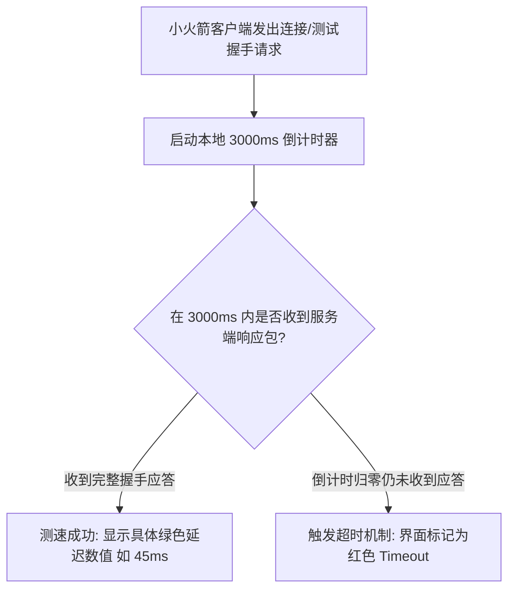
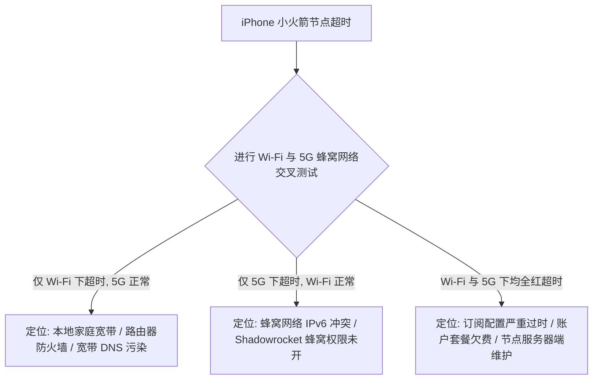
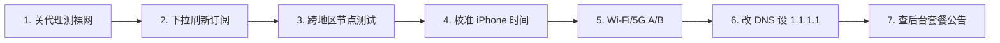

在 iPhone 上使用 Shadowrocket（小火箭）时，最让用户焦虑的报错莫过于在节点列表进行连通性测试时，屏幕上赫然出现一整排醒目的红色 **「Timeout」** 或 **「连接超时」**：

**“为什么昨天还能正常翻墙，今天点测速所有节点全部显示红色 Timeout？”**  
**“为什么列表里只有香港节点全部超时，但切到日本和新加坡节点却能秒开？”**  
**“为什么在家里连 Wi-Fi 测速全是 Timeout，一切换到手机 5G 移动蜂窝网络就瞬间恢复正常？”**  
**“为什么测速明明显示 Timeout，但打开 Safari 浏览器却依然能正常访问 Google？”**  
**“同一条订阅，电脑端用 Clash 测速一切正常，为什么 iPhone 上的小火箭却全红连不上？”**

**Shadowrocket 节点显示“Timeout（超时）”，本质上只代表客户端在预设的时间倒计时内（通常为 3~5 秒）没有收到目标测试服务器的返回包，它是一个“表现结果”，绝非单一具体的故障根因。**

看到节点 Timeout，**切忌直接武断判定为“机场跑路”或“节点被封”**。一个超时可能由**单机临时维护、区域入口波动、订阅配置过期、手机系统时间未同步、本地 Wi-Fi 拦截或 5G 蜂窝网络 IPv6 冲突**等多种原因引起。

本文专注于 **Shadowrocket 的“节点连接层故障”**，带你从**单节点、单地区、全地区、网络环境到客户端环境**建立清晰的 4D 交叉排查模型，彻底搞定小火箭节点超时与连接失败。

---

## ⚡ 30 秒快速排查速查流：节点 Timeout 怎么排查？

```text
┌────────────────────────────────────────────────────────────────────────┐
│             Shadowrocket 节点 Timeout 30 秒极速诊断决策流              │
├────────────────────────────────────────────────────────────────────────┤
│ ① 仅 1 个节点超时 ➔ 切换同地区的 2~3 个备用节点 (单台服务器维护拥堵)    │
│ ② 单地区全部超时 (如香港全红) ➔ 切换日本/新加坡/美西节点 (区域入口波动)│
│ ③ 所有地区全部超时 ➔ 首页向下拉动「刷新订阅」 (同步最新服务器 IP/端口) │
│ ④ 切换 Wi-Fi 与 5G 蜂窝网络 ➔ 5G 正常 Wi-Fi 失败？(家庭宽带/路由器拦截) │
│ ⑤ 检查 iPhone 系统时间 ➔ 确保开启「自动设置」 (时间偏差导致 TLS 报错) │
│ ⑥ 查看延迟测试但直开 Safari ➔ 网页能开？(测速目标阻断，属于假性超时)   │
│ ⑦ 跨设备/客户端 A/B 测试 ➔ 电脑正常手机失败？(iPhone 本地设置/权限问题) │
└────────────────────────────────────────────────────────────────────────┘
```

> 💡 **必须厘清的四大故障分层分工**：
> - **《Shadowrocket订阅怎么导入》**：负责**订阅 404/403、解析失败、节点列表为空**（配置层）；
> - **本篇《Shadowrocket节点Timeout怎么办》**：负责**节点已存在，但测试超时、标红、端口连不上**（连接层）；
> - **《Shadowrocket有节点但无法上网》**：负责**节点已连通且 VPN 开启，但无法访问网页**（接管与分流层）；
> - **《Shadowrocket怎么用》**：负责**小火箭客户端全功能、Rule/Global 模式与 iOS 基础生态**总览。

---

## 一、技术澄清：Timeout 的本质到底是什么？

在网络通信中，**Timeout（超时）是一个倒计时机制**。当小火箭发起连接或测速请求时，系统内部会启动一个计时器：



### 为什么说 Timeout 不等于“节点被封”或“机场跑路”？
导致这个倒计时归零的原因可以发生在链路中的任意节点：
1. **测试目标服务器无响应**：如果测速目标网站（如 Cloudflare 或 Google）在本地响应过慢，节点本身虽完好，测速也会报 Timeout（**虚假超时**）；
2. **本地网络未连接**：手机根本没连上 Wi-Fi 或处于弱网环境，小火箭请求压根没发出去；
3. **订阅配置过期**：机场已更换服务器 IP 和端口，而手机本地依然保存着几个月前的旧配置；
4. **单机负载过高**：该节点恰好处于高峰期拥堵排队状态。

---

## 二、Timeout 四大核心故障分类排查表

遇到节点超时，第一步不是重装软件，而是**根据超时的波及范围进行分类定位**：

```text
┌────────────────────────────────────────────────────────────────────────────────────────┐
│                   Shadowrocket 节点 Timeout 四大核心分类与排障大表                     │
├──────────────┬──────────────────────────────┬──────────────────────────────────────────┤
│ 故障分类     │ 真实故障表现                 │ 优先怀疑范围与第一步排障动作             │
├──────────────┼──────────────────────────────┼──────────────────────────────────────────┤
│ **分类 A**   │ 仅 1~2 个节点超时，其他正常  │ **单节点单机维护** ➔ 直接切换同地区备用节点│
├──────────────┼──────────────────────────────┼──────────────────────────────────────────┤
│ **分类 B**   │ 某个地区全部超时，其他地区正常│ **区域入口或中转波动** ➔ 跨区域切日本/新加坡│
├──────────────┼──────────────────────────────┼──────────────────────────────────────────┤
│ **分类 C**   │ 所有国家/地区节点同时全红    │ **订阅配置过期/本地网络/套餐欠费** ➔ 刷新订阅│
├──────────────┼──────────────────────────────┼──────────────────────────────────────────┤
│ **分类 D**   │ 测速显示 Timeout 但网页能秒开│ **测速机制假性超时** ➔ 忽略测速直接正常使用 │
└──────────────┴──────────────────────────────┴──────────────────────────────────────────┘
```

---

## 三、反常识深剖：ICMP Ping vs 小火箭延迟测速 vs 真实网页访问的三重差异

很多用户感到困惑：“为什么我在电脑上能 Ping 通节点的 IP，但在小火箭里测速却显示 Timeout？”

```text
┌────────────────────────────────────────────────────────────────────────┐
│                 ICMP Ping vs 客户端测速 vs 真实访问对比                │
├────────────────────┬────────────────────┬──────────────────────────────┤
│ 评测维度           │ 命令行 ICMP Ping   │ 小火箭 Delay 连通性测试      │
├────────────────────┼────────────────────┼──────────────────────────────┤
│ 发送数据包类型     │ 操作系统底层 ICMP  │ 建立真实代理握手 (TCP / TLS) │
├────────────────────┼────────────────────┼──────────────────────────────┤
│ 验证目标           │ 验证远端主机是否开机│ 验证代理端口与加密协议是否正常│
├────────────────────┼────────────────────┼──────────────────────────────┤
│ 常见误判场景       │ 主机开机但代理服务未│ 测速目标被阻断但实际代理通道 │
│                    │ 启动（Ping 通但不可用） 完好（显示 Timeout 网页却能开）│
└────────────────────┴────────────────────┴──────────────────────────────┘
```

> 📌 **核心结论**：
> - **Ping 通 $\neq$ 节点可用**：如果节点服务器的 Shadowsocks/VLESS 端口被阻断或服务崩溃，Ping 依然能通，但代理必定报 Timeout；
> - **测速 Timeout $\neq$ 网页打不开**：小火箭默认的测试 URL 若在特定网络下被拦截，会导致列表显示红色 Timeout，但实际连接该节点访问 Google 依然秒开。

---

## 四、网络错误代码深度辨析表：Timeout 与其他报错的区别

小火箭在连接失败时会返回不同的底层错误信息，读懂报错能让你少走弯路：

| 错误代码 / 提示 | 底层技术意义 | 核心排障方向与解决方案 |
| :--- | :--- | :--- |
| **Timeout (超时)** | 客户端在规定倒计时内未收到任何应答 | 切换节点；首页向下拉动刷新订阅；切换 Wi-Fi/5G |
| **Connection Refused** | 远端服务器明确返回 RST 包拒绝建立连接 | **服务器端口未监听或服务已停止**，切换其他节点 |
| **Network Unreachable** | 本地网络路由无法找到通往目标服务器的路径 | 检查手机本地 Wi-Fi/蜂窝网络是否断开，重启网络 |
| **DNS Resolution Error**| 无法将节点域名解析为具体的 IP 地址 | 将小火箭设置中的 DNS 手动改为 `1.1.1.1` 或 `8.8.8.8` |
| **TLS Handshake Error** | 加密证书验证失败或握手超时 | **检查 iPhone 系统时间是否开启“自动设置”** |
| **Authentication Error**| 节点密码、UUID 或 Token 鉴权失败 | 订阅信息已过时，在首页向下拉动重新同步订阅 |

---

## 五、Wi-Fi vs 5G 移动蜂窝网络 2×2 交叉诊断矩阵

在 iPhone 上排查节点超时，**切换网络是最具诊断价值的手段**：



### 交叉测试对照表：
| 测试环境组合 | 节点 A 测试结果 | 节点 B 测试结果 | 精准推断与定位结论 |
| :---: | :---: | :---: | :--- |
| **家庭 Wi-Fi** | ❌ Timeout | ❌ Timeout | 优先怀疑**家庭宽带或路由器**（如开启了安全拦截或 DNS 污染） |
| **手机 5G 蜂窝** | 🟢 45ms 正常 | 🟢 60ms 正常 | **节点完全正常！** 故障出在家庭宽带运营商出口或路由器设置 |
| **家庭 Wi-Fi** | ❌ Timeout | ❌ Timeout | 两者均超时，说明故障与本地网络无关，进入订阅与服务端排查 |
| **手机 5G 蜂窝** | ❌ Timeout | ❌ Timeout | |

---

## 六、跨设备与跨客户端 4D 交叉 A/B 诊断矩阵

为了彻底锁定故障是出在“你的 iPhone”、“小火箭软件”还是“机场服务端”，请使用 **「节点 × 设备 × 客户端 × 网络」4D 诊断矩阵**：

```text
┌────────────────────────────────────────────────────────────────────────┐
│                         4D 跨维度交叉诊断对照表                        │
├────────────────────┬────────────────────┬──────────────────────────────┤
│ 交叉测试组合       │ 测试结果表现       │ 精准故障域推断               │
├────────────────────┼────────────────────┼──────────────────────────────┤
│ 电脑 Clash 正常 🟢 │ iPhone 小火箭 ❌   │ 排除机场服务端问题；         │
│ (同一 Wi-Fi 同节点)│ (同一 Wi-Fi 同节点)│ 集中排查 iPhone 本地时间与订阅│
├────────────────────┼────────────────────┼──────────────────────────────┤
│ 小火箭全红超时 ❌  │ 同机另款客户端正常🟢│ 排除 iPhone 系统网络问题；   │
│ (同一手机同一节点) │ (如 Loon / Singbox)│ 集中排查小火箭订阅格式与配置 │
├────────────────────┼────────────────────┼──────────────────────────────┤
│ iPhone 全红超时 ❌ │ iPad / 安卓机正常🟢│ 集中排查该 iPhone 的网络权限 │
│ (同一订阅同一 Wi-Fi)│ (同一订阅同一 Wi-Fi)│ 与蜂窝数据设置               │
├────────────────────┼────────────────────┼──────────────────────────────┤
│ 电脑/手机全红 ❌   │ 换 5G 热点依然全红❌│ **95% 概率为机场服务端维护** │
│ (多设备跨多网络)   │ (多设备跨多网络)   │ 登录机场后台查看维护公告     │
└────────────────────┴────────────────────┴──────────────────────────────┘
```

---

## 七、Shadowrocket 节点 Timeout 7 步标准修复流程

遇到节点超时，请严格按照以下**7 步递进排查链**进行操作，绝大多数问题均可在前 4 步内解决：



### 步骤 1：关闭小火箭测试本地物理裸网
完全断开小火箭连接，打开 Safari 访问国内主流网站（如 `baidu.com`）：
- 确认手机本身处于正常的联网状态，排除宽带欠费或手机欠费断网。

### 步骤 2：在小火箭首页向下拉动“刷新订阅”
节点超时最常见的原因是机场更换了服务器 IP 或端口，而手机本地仍在使用旧配置：
- 在小火箭首页空白处，**用手指直接向下拉动屏幕并松开**，同步最新服务器信息。

### 步骤 3：进行跨区域多节点对照测试
不要只死磕列表顶部的几个香港节点：
- 依次点击测试 **日本 01、新加坡 01、美西 01 节点**；若其他地区节点能连通，说明仅为香港局部线路波动，换节点即可正常使用。

### 步骤 4：校准 iPhone 系统时间（防 TLS 握手失败）
TLS 加密握手对时间精确度要求极高：
- 进入 iPhone「设置 ➔ 通用 ➔ 日期与时间」，**确保开启「自动设置」**；如果时间偏差超过 90 秒，所有 TLS 节点将 100% 报超时。

### 步骤 5：切换 Wi-Fi 与 5G 移动蜂窝网络
- 关闭 Wi-Fi 开启 5G 蜂窝数据再次测速；若 5G 恢复，说明问题在家庭宽带；若 Wi-Fi 正常 5G 失败，进入蜂窝网络排查。

### 步骤 6：手动修改小火箭本地 DNS 服务器
- 打开小火箭底部「设置」➔「DNS」，添加公共安全 DoH 服务器：`https://1.1.1.1/dns-query` 或 `8.8.8.8`，排除宽带 DNS 污染。

### 步骤 7：登录机场官网后台查看状态与公告
- 如果多设备、跨网络所有节点依然全红，登录机场后台核查**套餐是否到期、流量是否耗尽、或查看首页是否有全线维护公告**。

---

## 八、Shadowrocket 高抗超时专线品牌推荐矩阵

针对晚高峰 0 丢包、高抗超时与多入口容灾，精选以下真实稳定专线服务商：

```text
┌────────────────────────────────────────────────────────────────────────────────────────┐
│                        2026 Shadowrocket 高可用专线品牌候选矩阵                        │
├──────────┬──────────────────────────┬──────────────┬──────────────┬────────────────────┤
│ 适配场景 │ 推荐品牌候选             │ 实际起付门槛 │ 每月流量配额 │ 抗超时与多入口容灾优势│
├──────────┼──────────────────────────┼──────────────┼──────────────┼────────────────────┤
│ 全能主力 │ 光速云 (GuangSuYun)      │ 约 ¥7.5/月起 │ 59G~238G /月 │ 6年老牌物理专线，独享千兆多入口，晚高峰 0 超时│
│ 平价轻量 │ 微风网络 (BreezeNet)     │ 约 ¥7/月起   │ 50GB / 月    │ 手机端日常查资料首选，小火箭极速同步，稳定低延迟│
│ 弹性月付 │ 唯兔云 (V2Yun)           │ ¥14.9/月     │ 100GB / 月   │ 15元纯单月付，60+多国节点冗余备用，随用随买 │
│ 应急备用 │ 星岛梦 (XingDaoMeng)     │ 约 ¥8/月起   │ 60G/不限时包 │ 0月租不限时包，主节点超时瞬间切换，防失联必备 │
│ AI/开发  │ 速界 (SpeedWorld)        │ ¥25/月       │ 150GB / 月   │ 原生纯净住宅 IP，ChatGPT/Claude 专属高可用专线 │
└──────────┴──────────────────────────┴──────────────┴──────────────┴────────────────────┘
```

- 🏆 **全能旗舰首选**：[光速云](/reviews/guangsu-cloud/) —— 全线企业级 IEPL 物理专线，具备智能多入口自动容灾，晚高峰 20:00 0 丢包；
- 🍃 **超低预算轻量**：[微风网络](/reviews/weifeng-cloud/) —— 针对手机端轻度查资料与文字 AI 优化的 50GB 小流量专线，年付折算仅约 ¥7/月；
- 💳 **拒绝绑定的单月付**：[唯兔云](/recommend/best-airports/) —— ¥14.9 纯单月付，100GB 充沛流量，节点丰富。

---

## 九、Shadowrocket 节点连通性 18 项自查清单

```text
┌────────────────────────────────────────────────────────────────────────┐
│                   Shadowrocket 节点排障 18 项自查通关清单              │
├────────────────────────────────────────────────────────────────────────┤
│ □ 1. 关闭小火箭后，Safari 能正常打开国内网站 (排除手机断网)          │
│ □ 2. 我已在小火箭首页向下拉动屏幕并成功更新了订阅配置                 │
│ □ 3. 我已测试过日本、新加坡、美国等其他地区节点 (排除单地区波动)      │
│ □ 4. 在 iPhone 设置中已确认「自动设置时间」处于开启状态 (防 TLS 报错)  │
│ □ 5. 我已切换过 5G 移动蜂窝网络进行对照测试 (排除家庭 Wi-Fi 拦截)     │
│ □ 6. 在 iPhone「设置-蜂窝网络」中确认 Shadowrocket 拥有网络访问权限   │
│ □ 7. 测速显示 Timeout 时，我已打开 Safari 尝试实际访问 Google (防假红) │
│ □ 8. 我登录了机场官网后台，核实套餐未欠费且本月流量仍有剩余           │
│ □ 9. 我查看了机场官网后台首页公告，确认当前没有全网服务器紧急维护    │
│ □ 10. 我没有在手机上同时开启其他商业 VPN 或网络加速工具 (防接口冲突) │
│ □ 11. 我清楚了解单节点超时属于正常网络波动，无需重装小火箭软件        │
│ □ 12. 我清楚了解测速数字低不等于下载速度快，稳定性与丢包率才是关键   │
│ □ 13. 我确认没有为了“修超时”而在手机上安装来源不明的 CA 根证书        │
│ □ 14. 我确认没有为了“修超时”而开启危险的 MITM 中间人解密功能          │
│ □ 15. 手机中已常备第二个备用服务商的订阅或 0 月租不限时流量包         │
│ □ 16. 遇到 5G 蜂窝网络超时时，已在小火箭设置中尝试将 DNS 改为 1.1.1.1  │
│ □ 17. 遇到网络严重死锁时，我已尝试短暂开启并关闭 iPhone「飞行模式」   │
│ □ 18. 如果使用了免费公开节点，我知道其极易失效，需自备稳定专线订阅    │
└────────────────────────────────────────────────────────────────────────┘
```

---

## 十、避坑指南：25 个关于“小火箭节点超时”的致命认知误区

```text
❌ 误区 1：节点一显示 Timeout 就说明这家机场绝对跑路了 ➔ 事实：多为单机维护、订阅未刷新或本地网络波动。
❌ 误区 2：节点显示 Timeout 说明该节点已经被彻底封锁 ➔ 事实：也可能是服务器端口暂时未监听或测速目标无响应。
❌ 误区 3：列表里 1 个香港节点超时说明所有节点都坏了 ➔ 事实：单节点维护很常见，切换其他同地区节点即可。
❌ 误区 4：香港节点全部超时说明整个机场完全不可用 ➔ 事实：香港入口波动很常见，切到日本、新加坡依然秒开。
❌ 误区 5：列表显示红色 Timeout 代表 Safari 网页 100% 打不开 ➔ 事实：测速目标异常会导致“假红”，实际网页常能秒开。
❌ 误区 6：命令行能 Ping 通节点 IP 代表小火箭一定能连上 ➔ 事实：Ping 仅测 ICMP，若代理端口未开放依然报超时。
❌ 误区 7：订阅更新成功代表里面的所有节点一定全部可用 ➔ 事实：订阅成功只代表拿到了配置，节点连通需单独验证。
❌ 误区 8：遇到全部节点超时第一步必须卸载重装 Shadowrocket ➔ 事实：重装无法解决订阅过期或网络拦截，多为徒劳。
❌ 误区 9：删除小火箭里的所有配置并重新配置能修复超时 ➔ 事实：先下拉刷新订阅即可，删除配置会丢失已有诊断信息。
❌ 误区 10：只要节点超时，改一下 iPhone 系统 DNS 就一定能修好 ➔ 事实：DNS 仅影响域名解析，对 IP 级超时毫无作用。
❌ 误区 11：关闭手机 IPv6 能够让小火箭所有节点瞬间恢复 ➔ 事实：仅当蜂窝网络 IPv6 路由严重异常时才轻微有效。
❌ 误区 12：在手机上安装第三方 CA 证书能解决节点超时 ➔ 事实：证书与节点握手完全无关，乱装证书极度危险。
❌ 误区 13：开启 MITM 中间人解密功能可以修复连接超时 ➔ 事实：MITM 是抓包解密工具，开启反而增加报错几率。
❌ 误区 14：将全局路由切为 Global 模式能修复节点超时 ➔ 事实：Global 是强制全局代理，节点本身连不上切什么都无效。
❌ 误区 15：5G 蜂窝移动网络的速度与稳定性永远比 Wi-Fi 好 ➔ 事实：5G 基站信号波动频繁，切 Wi-Fi 常能排除断流。
❌ 误区 16：家庭 Wi-Fi 失败一定是家里路由器彻底损坏了 ➔ 事实：多为宽带 DNS 污染或路由器开启了安全防火墙拦截。
❌ 误区 17：美国节点延迟高所以比香港节点更容易 Timeout ➔ 事实：只要专线网络稳定，美国节点抗超时能力同样强劲。
❌ 误区 18：只要买了最新协议（如 Hysteria 2）就绝对不会超时 ➔ 事实：任何协议在服务器维护或欠费时都会超时。
❌ 误区 19：晚高峰全部节点超时一定是机场在恶意超售 ➔ 事实：公网国际出口严重拥塞也会导致大面积超时波动。
❌ 误区 20：一个客户端连不上就代表整个机场服务器瘫痪 ➔ 事实：用电脑或其他设备交叉测试即可秒级排除客户端问题。
❌ 误区 21：公开分享的免费节点全部超时说明小火箭坏了 ➔ 事实：免费节点万人挤占随时失效，软件本身完全正常。
❌ 误区 22：只要遇到超时就必须立刻花钱重新买新机场 ➔ 事实：先按 7 步法排查，90% 是本地时间或未刷新订阅所致。
❌ 误区 23：节点名字带有 VIP/专线 就永远不可能发生超时 ➔ 事实：物理服务器依然需要定期停机维护与更换光缆。
❌ 误区 24：疯狂连续点击测速可以把超时节点“激活” ➔ 事实：高频测速会加重本地队列负担，甚至触发防刷拦截。
❌ 误区 25：重置 iPhone 全部网络设置是修复超时的第一选择 ➔ 事实：重置会清空所有 Wi-Fi 密码，应放到最后万不得已时。
```

---

## 十一、常见问题深度解答（FAQ · 40 问）

### Q1：Shadowrocket 节点 Timeout 是什么意思？
**答**：表示小火箭客户端在预设的时间限制内（通常为 3~5 秒）没有收到该节点服务器的握手或延迟测试应答包，属于网络未完成响应的现象。

### Q2：小火箭全部节点突然显示 Timeout 怎么办？
**答**：首先关闭代理确认手机裸网正常；然后在小火箭首页**向下拉动刷新订阅**；若仍超时，切换手机 5G 移动蜂窝网络测试，排查家庭 Wi-Fi 拦截。

### Q3：为什么只有一个节点 Timeout，其他节点都正常？
**答**：说明该单台服务器正在临时维护、端口波动或处于高负载状态。直接在列表中切换使用同地区的其他可用节点即可。

### Q4：为什么香港节点全部超时，但日本和新加坡节点正常？
**答**：说明仅为香港机房集群或对应的国内入口中转线路发生临时波动，并不影响整体机场服务，切换到日本或新加坡节点即可正常翻墙。

### Q5：为什么测速显示红色 Timeout，但 Safari 打开网页却能秒开？
**答**：这是**测速机制导致的假性超时**。说明小火箭内置的测速目标网址在当前网络下被阻断，但节点本身的代理通道完好，可直接正常使用。

### Q6：节点 Timeout 是不是代表机场跑路了？
**答**：**绝大多数情况下不是。** 跑路是极低概率事件，超时 95% 是由于订阅未刷新、单机维护、家庭 Wi-Fi 拦截或套餐到期所致。

### Q7：节点 Timeout 是不是代表节点被 GFW 封锁了？
**答**：不一定。服务器端口未监听、协议握手超时、本地 DNS 解析失败或网络丢包过大均会表现为 Timeout。

### Q8：命令行能 Ping 通节点 IP，为什么小火箭里依然 Timeout？
**答**：Ping 仅测试底层的 ICMP 连通性；若代理软件端口崩溃或被阻断，Ping 依然能通，但小火箭建立代理隧道必定报 Timeout。

### Q9：Timeout 与 Connection Refused 报错有什么区别？
**答**：**Timeout** 是一直没有收到任何应答；**Connection Refused** 是服务器明确返回了拒绝连接信号（通常表示服务未启动或端口错误）。

### Q10：Timeout 与 Network Unreachable 报错有什么区别？
**答**：**Timeout** 是链路可达但响应超时；**Network Unreachable** 是本地手机根本找不到通往外部网络的物理路由（如手机完全断网）。

### Q11：Shadowrocket 提示 TLS Error 是怎么回事？
**答**：通常是因为 **iPhone 系统时间与真实时间不同步**，导致加密证书时间校验失败。进入手机设置将日期与时间设为“自动设置”即可。

### Q12：Shadowrocket 提示 Authentication Error 怎么解决？
**答**：代表节点密码或 UUID 鉴权失败，说明服务商更新了密钥，在小火箭首页向下拉动重新刷新订阅即可解决。

### Q13：为什么 iPhone 系统时间错误会导致节点超时？
**答**：现代加密协议（如 VLESS-Reality、Trojan、TLS）在握手时要求客户端与服务端时间误差在 90 秒以内，时间偏差过大会被服务器直接拒绝。

### Q14：订阅更新成功后，为什么节点依然全部 Timeout？
**答**：订阅更新只代表拿到了配置文件；若节点服务器正处于全线维护、套餐已欠费、或本地网络存在拦截，节点依然会显示超时。

### Q15：套餐到期欠费会导致节点 Timeout 吗？
**答**：多数机场在套餐欠费后会直接切断节点端口连接，导致小火箭在测速和连接时全部显示红线 Timeout。

### Q16：本月流量用完了会导致节点全部超时吗？
**答**：会。服务商后台在流量耗尽后会自动暂停代理服务，客户端发起握手将无法得到响应并提示超时。

### Q17：为什么连家里 Wi-Fi 全部超时，切到 5G 蜂窝网络却全绿？
**答**：说明家庭宽带运营商在本地对该协议存在干扰，或家用路由器开启了安全防火墙拦截了连接。

### Q18：为什么连 5G 移动网络超时，连 Wi-Fi 却一切正常？
**答**：排查 iPhone「设置 ➔ 蜂窝网络 ➔ Shadowrocket」权限是否开启；并在小火箭设置中优先启用 IPv4 解析。

### Q19：为什么电脑用 Clash 正常，iPhone 用小火箭却全红超时？
**答**：说明机场服务端完全正常。重点排查 iPhone 的系统时间是否准确、小火箭订阅是否为最新、或手机网络权限是否被受限。

### Q20：为什么同一台手机，另一款代理客户端能连，小火箭却超时？
**答**：说明小火箭本地的配置规则可能损坏，或两款客户端使用的核心协议版本不同。尝试在小火箭中重新导入订阅。

### Q21：本地 DNS 异常会导致小火箭节点 Timeout 吗？
**答**：如果节点使用的是域名地址，本地 DNS 解析失败会导致客户端无法获取服务器 IP，从而直接触发超时。

### Q22：如何修改小火箭本地 DNS 排除超时？
**答**：打开小火箭底部「设置 ➔ DNS」，将 DNS 服务器手动指定为公共高可用地址：`https://1.1.1.1/dns-query` 或 `8.8.8.8`。

### Q23：手机开启飞行模式再关闭对修复超时有用吗？
**答**：有用。短暂开启飞行模式 5 秒后关闭，可以强制 iPhone 重新向基站注册并重置本地移动网络栈连接。

### Q24：晚高峰 20:00~23:00 容易出现节点超时吗？
**答**：普通公网中转节点在晚高峰因国际出口拥堵丢包严重，极易引发超时；采用 **企业级 IEPL 物理专线** 可全天保持稳定。

### Q25：昨天用得好好的，今天突然全部 Timeout 是什么原因？
**答**：90% 是因为服务商更换了节点服务器 IP 或域名，在小火箭首页**向下拉动刷新一次订阅**即可拉取最新配置。

### Q26：遇到节点超时需要重置 iPhone 的全部网络设置吗？
**答**：**尽量不要。** 重置网络设置会抹掉所有已保存的 Wi-Fi 密码和蓝牙配对，应作为排障的最后手段。

### Q27：小火箭节点超时需要卸载重装 App 吗？
**答**：**完全不需要。** 99% 的超时出在网络、配置或服务端，重装软件纯属浪费时间。

### Q28：安装 CA 根证书能解决小火箭节点超时吗？
**答**：**坚决不能！** 证书与代理握手完全无关，任何以“修超时”为由要求安装证书的行为均存在严重安全隐患。

### Q29：开启 MITM 中间人解密功能能修复节点超时吗？
**答**：**不能。** MITM 是用于 HTTPS 抓包分析的高级开发功能，开启不仅无法修超时，反而增加手机功耗。

### Q30：为什么列表中某个协议的节点全部超时，其他协议正常？
**答**：说明该特定协议（如 Hysteria 2 的 UDP 端口）在本地宽带运营商处遭到了 QoS 阻断，切换其他 TCP 协议节点即可。

### Q31：免费公开分享的小火箭节点全部超时怎么办？
**答**：免费节点通常生命周期极短且极易被大量用户挤爆失效，超时属正常现象，建议自备正规专线订阅。

### Q32：如何判断节点超时是不是机场服务器崩了？
**答**：当跨多个网络（Wi-Fi与5G）、多台设备（手机与电脑）、多个国家地区节点持续超时且官网有维护公告时，方可判定为服务端故障。

### Q33：遇到节点全红应该马上花钱买新机场吗？
**答**：不建议。先按 7 步法排查确认本地设置无误，若确为服务商长期故障，再考虑启用备用方案。

### Q34：小火箭如何查看节点底层的连接错误日志？
**答**：进入小火箭底部「设置 ➔ 诊断 / 日志」，查看包含 `timeout`、`refused` 或 `tls` 的具体错误行。

### Q35：节点超时和“有节点但无法上网”有什么区别？
**答**：**节点超时**是代理隧道根本没有建立成功；**有节点没网**是隧道已建立但因分流规则或 DNS 错误导致打不开网页。

### Q36：节点超时和“速度慢”有什么区别？
**答**：**超时**是 0% 的连通率；**速度慢**是已经能够正常上网，但由于带宽不足或丢包导致视频卡顿。

### Q37：小火箭支持自动屏蔽超时的节点吗？
**答**：在策略组中若配置了 URL-Test 自动测速策略，小火箭会自动将流量分流至当前测速最快且未超时的节点。

### Q38：多设备同时在线超限会导致节点 Timeout 吗？
**答**：会。部分机场套餐限制 2 台设备在线，第 3 台设备连接时服务端会直接丢弃数据包导致超时。

### Q39：如何彻底防止手机在外突发节点超时断网？
**答**：手机中除了主力专线订阅外，**常备一个 0 月租的不限时按量流量包**（如星岛梦），主力超时瞬间无缝切换。

### Q40：小火箭测速数字变成多少才算健康正常？
**答**：一般情况下，香港节点延迟在 **30ms~60ms**、日本节点在 **50ms~80ms**、美国节点在 **130ms~180ms** 且显示具体绿色数值即为完全健康。

---

## 🏁 总结：Shadowrocket 节点超时排障终极心法

彻底搞定小火箭节点超时，请牢记以下**五维故障定位法则**：

```text
1. 观察范围 ➔ 单节点换同区，单地区换异地，全地区下拉刷新订阅
2. 网络对照 ➔ Wi-Fi 失败切 5G，5G 失败切 Wi-Fi，秒级锁定家庭网络瓶颈
3. 设备对照 ➔ 电脑正常手机失败查系统时间与小火箭权限，多端全灭查后台
4. 区分真伪 ➔ 忽略测速假红直开 Safari 验证，以真实网页体验为唯一标准
```

---

### 📚 延伸进阶阅读与选型专栏
- 📋 **订阅导入教程**：[《Shadowrocket订阅怎么导入？小火箭订阅链接、节点更新与订阅失败完整教程》](/tutorials/shadowrocket-subscription-import/)
- 📱 **小火箭超级Pillar**：[《Shadowrocket怎么用？小火箭订阅、节点、规则与iPhone完整配置教程》](/tutorials/shadowrocket-tizi/)
- 📱 **iPhone 设备总指南**：[《iPhone梯子怎么用？Shadowrocket、小火箭、订阅与节点新手完整教程》](/tutorials/iphone-tizi/)
- 🔴 **Clash 超时专题**：[《Clash 节点 Timeout 怎么办？全部节点红色与网络异常排查》](/issues/clash-node-timeout/)
- 🚨 **断网排查手册**：[《Clash 有节点但无法上网怎么办？7 步系统排查与修复指南》](/issues/clash-connected-no-internet/)
- 📉 **测速深度解析**：[《为什么机场节点延迟低但实际速度慢？》](/issues/low-ping-slow-speed-reasons/)
- ⚡ **老牌旗舰专线**：[《光速云深度评测：2020老牌IEPL专线与解锁实测》](/reviews/guangsu-cloud/)
- 🍃 **平价轻量专线**：[《微风网络深度评测：小流量套餐值不值得买？》](/reviews/weifeng-cloud/)
- 🏆 **2026 全景大榜**：[《2026梯子推荐：稳定、速度、价格、安全与不同使用场景怎么选》](/recommend/best-tizi/)
