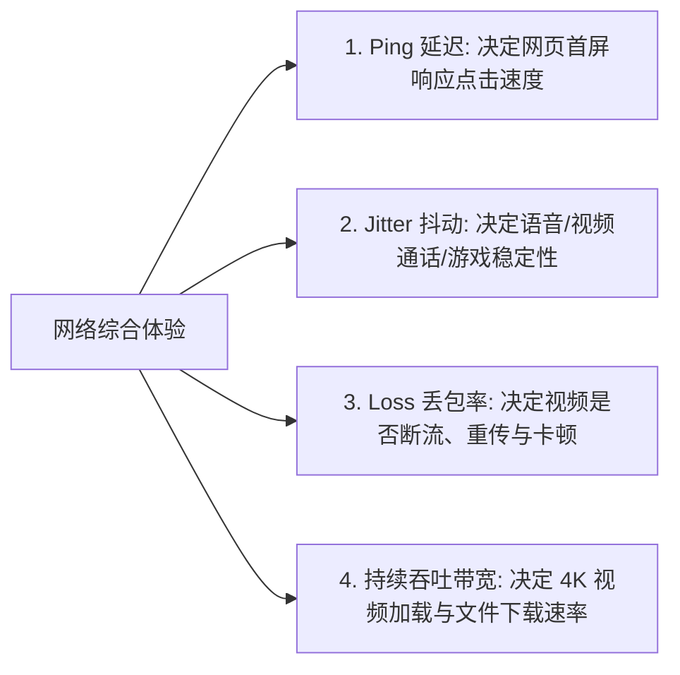
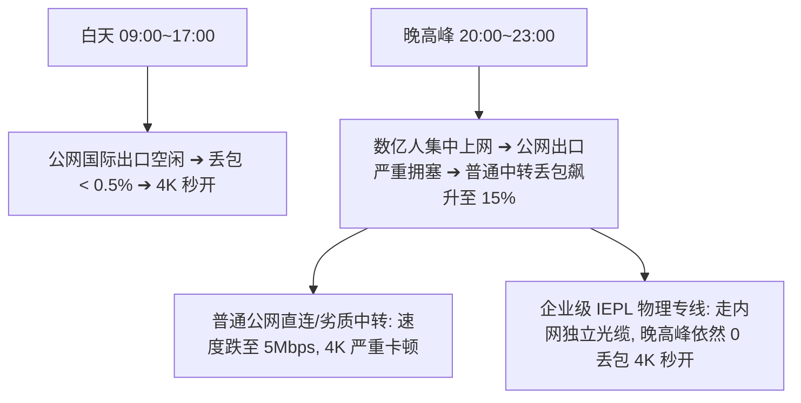
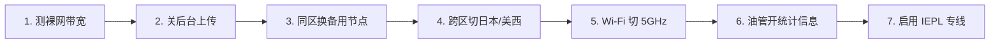

在 iPhone 上使用 Shadowrocket（小火箭）时，最令人抓狂的体验往往不是“完全断网”，而是**“明明连上了，但网速极慢、延迟极高、视频无限缓冲”**：

**“小火箭列表里测速显示 25ms 绿色超低延迟，为什么用 YouTube 看 1080P 视频都在疯狂转圈？”**  
**“为什么白天刷推特、查资料飞快，一到晚上 20:00~23:00 晚高峰连网页都打不开？”**  
**“为什么在同一个机场里，日本节点延迟 80ms 反而比 20ms 的香港节点看 4K 更丝滑？”**  
**“为什么用手机 5G 蜂窝网络测速能跑 300Mbps，连上家里的 Wi-Fi 却卡成 PPT？”**  
**“为什么用 Speedtest 测速数字看起来很漂亮，但打开 ChatGPT 提问或下载大文件却慢如龟速？”**

**Shadowrocket 出现“速度慢”，绝大多数情况下并不是客户端软件本身的问题，而是整个端到端传输链路中的某个性能瓶颈在起作用。**

尤其需要纠正一个极其普遍的致命误区：**「延迟低（Ping 低）不等于下载速度快」**。Ping 仅仅衡量信号往返的“反应时间”，而长视频流媒体播放与大文件下载，依赖的是**「无丢包的持续吞吐带宽、机房出口质量与晚高峰抗拥塞能力」**。

本文专注于 **Shadowrocket 的“性能层故障与速度优化”**，带你从 **Ping、Jitter、丢包率、持续带宽、Wi-Fi/5G 差异到晚高峰拥塞** 建立科学的六维性能诊断模型，手把手彻底解决小火箭网速慢与视频卡顿。

---

## ⚡ 30 秒快速排查速查流：小火箭速度慢怎么排查？

```text
┌────────────────────────────────────────────────────────────────────────┐
│            Shadowrocket 速度慢与卡顿 30 秒极速诊断决策流               │
├────────────────────────────────────────────────────────────────────────┤
│ ① 断开小火箭测裸网 ➔ 确认家庭 Wi-Fi 或 5G 自身带宽未被其他设备占满    │
│ ② 同地区快速切换 2~3 个节点 ➔ 排除当前单个节点服务器单机拥堵/维护     │
│ ③ 跨区域切换日本/新加坡节点 ➔ 验证香港单区域入口是否存在国际出口拥塞   │
│ ④ 切换 Wi-Fi 与 5G 蜂窝网络 ➔ 5G 极速 Wi-Fi 卡顿？(家庭 Wi-Fi 频段瓶颈)│
│ ⑤ 对比白天与晚高峰表现 ➔ 仅晚上 20:00~23:00 慢？(公网骨干网高峰期拥堵)│
│ ⑥ 查看 YouTube 详细统计信息 ➔ 确认 Connection Speed 持续吞吐是否稳定  │
│ ⑦ 查验出口 IP ➔ 确认分流规则没有把流量误导向了高倍率的远距离慢速节点  │
└────────────────────────────────────────────────────────────────────────┘
```

> 💡 **必须厘清的四大故障分层分工**：
> - **《Shadowrocket订阅怎么导入》**：解决**订阅报错、404/403、节点列表为空**（配置层）；
> - **《Shadowrocket节点Timeout怎么办》**：解决**节点测试超时、全部标红、端口连不上**（连接层）；
> - **《Shadowrocket有节点但无法上网》**：解决**节点已连通但打不开网页、Rule/DNS/5G异常**（接管与分流层）；
> - **本篇《Shadowrocket速度慢怎么办》**：解决**已经能正常访问，但 4K 转圈、网速慢、晚高峰卡顿**（性能层）。

---

## 一、技术澄清：“慢”到底是什么？拆解核心网络性能指标

许多人说“小火箭变慢了”，但“慢”在网络底层包含着完全不同的维度：



### 五大网络性能指标深度对照表：
| 性能指标 | 衡量物理单位 | 核心技术意义 | 决定哪些真实应用场景 | 常见致命认知误区 |
| :--- | :---: | :--- | :--- | :--- |
| **Ping (延迟)** | 毫秒 (ms) | 数据包从手机到服务器往返一次的时间 | 网页首屏加载、API 接口调用、游戏响应 | ❌ 误以为 Ping 最低就代表下载速度最快 |
| **Jitter (抖动)** | 毫秒 (ms) | 连续数据包之间延迟的波动离散程度 | Zoom/微信语音通话、远程桌面、多人电竞 | ❌ 误以为平均延迟低就代表连接绝对平稳 |
| **Packet Loss (丢包)**| 百分比 (%) | 传输途中丢失而被迫重新发送的数据比例 | 4K 视频秒开率、高码率直播、网页完整加载 | ❌ 忽视 2% 丢包对持续 TCP 吞吐的毁灭性打击 |
| **Download (下载带宽)**| Mbps | 单位时间内持续拉取外部大数据的能力 | YouTube 4K/8K 播放、App Store 下载、网盘 | ❌ 以为 Speedtest 瞬间峰值等同于长期持续带宽 |
| **Upload (上传带宽)** | Mbps | 单位时间内向境外服务器推送大数据的能力 | 视频会议推流、iCloud 云盘同步、AI 大文件上传| ❌ 认为上传带宽对普通浏览网页毫无影响 |

---

## 二、经典反常识：为什么 20ms 节点很慢，而 90ms 节点看 4K 反而秒开？

这是让无数小火箭新手困惑的现象：

```text
┌────────────────────────────────────────────────────────────────────────┐
│                   20ms 劣质中转 vs 90ms 高带宽专线对比                 │
├────────────────────┬────────────────────┬──────────────────────────────┤
│ 节点参数维度       │ 节点 A (香港 01 劣质中转)│ 节点 B (日本 01 优质 IEPL) │
├────────────────────┼────────────────────┼──────────────────────────────┤
│ 物理往返延迟 (Ping)│ 🟢 **22 ms (极低)**│ 🟡 **85 ms (正常)**          │
│ 丢包率 (Loss)      │ 🔴 **8% (高丢包)** │ 🟢 **0% (零丢包)**           │
│ 可用持续吞吐带宽   │ 🔴 **15 Mbps**     │ 🟢 **200 Mbps (独享千兆)**   │
├────────────────────┼────────────────────┼──────────────────────────────┤
│ 网页首屏点击反应   │ ⚡ 瞬间反应        │ ⏱️ 略微感知 0.1 秒延迟        │
│ **YouTube 4K 体验**│ ❌ **频繁转圈卡顿**│ 🟢 **秒开无缓冲，进度条拉满** │
└────────────────────┴────────────────────┴──────────────────────────────┘
```

> 📌 **核心结论**：
> - **Ping 决定“反应速度”，带宽与丢包决定“运载能力”**。
> - 在 TCP 协议机制下，**只要发生 3%~5% 的丢包，TCP 拥塞控制算法就会强制将传输速度腰斩 50% 以上**。因此，哪怕延迟只有 20ms，只要丢包严重，看 4K 视频依然必定卡死；而 0 丢包的 90ms 专线能让千兆带宽全速释放。

---

## 三、晚高峰拥塞剖析：为什么白天飞快，晚上 20:00~23:00 严重掉速？



### 如何科学判断是否属于晚高峰拥塞？
1. **固定测试变量**：使用同一台 iPhone、连接同一家庭 Wi-Fi、选择同一个日本 01 节点；
2. **两时段 A/B 对照**：
   - 在 **下午 14:00** 测速记录一次；
   - 在 **晚上 21:30** 再次测速记录一次；
3. **推断标准**：若仅在晚间出现延迟翻倍、丢包飙升，说明该节点使用的线路在公网国际出口处受到高峰拥塞影响。

---

## 四、Wi-Fi vs 5G 移动蜂窝网络 2×2 性能诊断矩阵

很多时候，小火箭速度慢的瓶颈并不在境外节点，而在**你与路由器之间的本地无线环境**：

```text
┌────────────────────────────────────────────────────────────────────────┐
│                   本地 Wi-Fi 与 5G 性能瓶颈排查矩阵                    │
├────────────────────┬───────────────────────────────────────────────────┤
│ 现象 1：           │ 排除机场节点问题。重点排查：家用路由器是否连接了  │
│ 5G 极速，Wi-Fi 极慢│ 2.4GHz 频段、路由器穿墙信号衰减、宽带是否有人在下载│
├────────────────────┼───────────────────────────────────────────────────┤
│ 现象 2：           │ 排除家庭宽带问题。重点排查：当前 5G 蜂窝基站负载高│
│ Wi-Fi 极速，5G 极慢│ 或 iPhone 处于弱信号区域，切换 Wi-Fi 即可恢复     │
├────────────────────┼───────────────────────────────────────────────────┤
│ 现象 3：           │ 说明性能瓶颈发生在境外节点或线路本身，需在小火箭中│
│ Wi-Fi 与 5G 均极慢 │ 切换节点地区或更换专线服务商                      │
└────────────────────┴───────────────────────────────────────────────────┘
```

> 💡 **iPhone 实用小技巧**：在家里尽量连接 **5GHz 频段的 Wi-Fi**（避免使用易受微波炉、蓝牙干扰的 2.4GHz 频段），测速带宽通常可直接提升 3~5 倍。

---

## 五、真实应用场景测速与优化：YouTube / ChatGPT / 游戏实战

不同 App 对网络特性的敏感度完全不同，不能一概而论：

| 应用场景 | 核心瓶颈指标 | 针对性性能优化方案 |
| :--- | :--- | :--- |
| **YouTube 4K 视频** | 持续高带宽 + 0 丢包 | 开启 Stats for Nerds 查看 Connection Speed；切换标有 **流媒体优化** 的大带宽专线节点 |
| **ChatGPT / Claude** | 低 API 握手延迟 + 原生 IP | 文字 AI 数据量极小（仅几 KB），主要受节点响应延迟影响；切到美区/日区原生低延迟节点 |
| **手机外服电竞游戏** | 极低 Ping + 0 抖动 (Jitter) | 必须选择地理距离最近的 **香港/日本专线节点**，优先确保 UDP 转发通畅与零抖动 |
| **Zoom 视频会议** | 高上传带宽 + 低丢包 | 重点排查本地宽带的 **Upload（上传）速度**，关闭手机后台 iCloud 照片自动备份同步 |

---

## 六、认知纠偏：节点倍率、不限流量与协议对速度的真实影响

```text
┌────────────────────────────────────────────────────────────────────────┐
│                 关于节点参数的四大技术认知纠偏                         │
├────────────────────┬───────────────────────────────────────────────────┤
│ 1. 节点倍率 (如 2x)│ ❌ **不等于 2 倍速度！** 倍率仅为计费系数（消耗 1G │
│                    │ 算 2G 流量），仅当该节点配置了独立昂贵线路时才更快│
├────────────────────┼───────────────────────────────────────────────────┤
│ 2. 不限流量套餐    │ ❌ **不等于无限带宽！** 不限流量常导致大量用户挂机│
│                    │ 刷 PT/BT 下载，导致公共带宽被榨干，反而更容易卡顿 │
├────────────────────┼───────────────────────────────────────────────────┤
│ 3. 协议先进程度    │ ❌ **协议不能替代物理线路！** Hysteria 2 在劣质线 │
│ (如 Hysteria 2)    │ 路上虽能抗丢包，但仍无法超越千兆 IEPL 物理专线    │
├────────────────────┼───────────────────────────────────────────────────┤
│ 4. 节点数量越多    │ ❌ **数量不等于质量！** 100 个卡顿中转节点，不如  │
│                    │ 5 个全天稳定跑满千兆的企业级内网物理专线节点实用  │
└────────────────────┴───────────────────────────────────────────────────┘
```

---

## 七、Shadowrocket 速度慢 7 步标准排查与提速流程

遇到网速变慢或视频卡顿，请严格按照以下**7 步优化排查链**进行操作：



### 步骤 1：断开小火箭测试本地物理裸网
- 确认手机在直连网络下的测速带宽正常，排除本地宽带欠费限速或家庭内其他设备在抢占带宽。

### 步骤 2：暂停 iPhone 后台高耗能上传任务
- 检查相册是否正在同步 iCloud、App Store 是否在后台自动更新大游戏，暂停后台任务释放手机无线通道。

### 步骤 3：在同地区列表中切换 2~3 个备用节点
- 若香港 01 负载过高，立即在列表中切换至 **香港 02、香港 03 或带有“专线/BGP”** 字样的备用节点。

### 步骤 4：跨区域切换至日本或美西骨干专线节点
- 当香港区域入口遭遇公网拥塞时，日本和新加坡节点往往拥有更充沛的国际带宽储备。

### 步骤 5：将家庭 Wi-Fi 切换至 5GHz 纯净频段
- 靠近路由器，避开 2.4GHz 干扰频段，让手机获得最大本地无线吞吐。

### 步骤 6：在 YouTube 开启“详细统计信息”实测
- 在视频播放设置中打开 Stats for Nerds，观察 **Connection Speed 是否稳定在 50,000 Kbps 以上**，验证真实带宽。

### 步骤 7：启用企业级 IEPL 物理专线节点
- 对于晚高峰有 4K/8K 刚需的用户，切换至独立内网物理专线，从根源上绕开公网国际出口拥堵。

---

## 八、Shadowrocket 高速低延迟专线品牌推荐矩阵

针对晚高峰 4K 秒开、0 丢包、高抗拥塞与大带宽吞吐，精选以下真实稳定服务商：

```text
┌────────────────────────────────────────────────────────────────────────────────────────┐
│                        2026 Shadowrocket 高速专线品牌候选矩阵                          │
├──────────┬──────────────────────────┬──────────────┬──────────────┬────────────────────┤
│ 适配场景 │ 推荐品牌候选             │ 实际起付门槛 │ 每月流量配额 │ 速度与晚高峰抗拥塞优势│
├──────────┼──────────────────────────┼──────────────┼──────────────┼────────────────────┤
│ 4K极速   │ 光速云 (GuangSuYun)      │ 约 ¥7.5/月起 │ 59G~238G /月 │ 6年老牌物理专线，独享千兆多入口，晚高峰 4K 0 缓冲│
│ 平价轻量 │ 微风网络 (BreezeNet)     │ 约 ¥7/月起   │ 50GB / 月    │ 手机端日常查资料首选，小火箭极速同步，低延迟秒开│
│ 弹性月付 │ 唯兔云 (V2Yun)           │ ¥14.9/月     │ 100GB / 月   │ 15元纯单月付，60+多国原生千兆节点，随用随买 │
│ 应急备用 │ 星岛梦 (XingDaoMeng)     │ 约 ¥8/月起   │ 60G/不限时包 │ 0月租不限时包，主力卡顿瞬间切换，防失联必备 │
│ AI/开发  │ 速界 (SpeedWorld)        │ ¥25/月       │ 150GB / 月   │ 原生纯净住宅 IP，ChatGPT/Claude 专属高可用专线 │
└──────────┴──────────────────────────┴──────────────┴──────────────┴────────────────────┘
```

- 🏆 **全能极速首选**：[光速云](/reviews/guangsu-cloud/) —— 全线企业级 IEPL 物理专线，独享千兆入口，晚高峰 YouTube 4K 稳定拉满 100,000+ Kbps；
- 🍃 **超低预算轻量**：[微风网络](/reviews/weifeng-cloud/) —— 针对手机端日常查资料与文字 AI 优化的 50GB 小流量专线，年付折算仅约 ¥7/月；
- 💳 **拒绝绑定的单月付**：[唯兔云](/recommend/best-airports/) —— ¥14.9 纯单月付，100GB 充沛流量，节点丰富。

---

## 九、Shadowrocket 性能调优 18 项自查清单

```text
┌────────────────────────────────────────────────────────────────────────┐
│                   Shadowrocket 性能调优 18 项自查通关清单              │
├────────────────────────────────────────────────────────────────────────┤
│ □ 1. 关闭小火箭后，本地网络裸网测速能跑满签约宽带 (排除本地断网)       │
│ □ 2. 我已在手机 Wi-Fi 设置中连接了 5GHz 频段 (排除了 2.4G 频段干扰)    │
│ □ 3. 我已测试过同地区的其他 2~3 个备用节点 (排除单机临时拥堵)          │
│ □ 4. 我已尝试过切换日本、新加坡等跨区域骨干专线节点进行对照           │
│ □ 5. 我清楚了解 Ping 延迟低不等于下载速度快，持续吞吐和丢包更关键     │
│ □ 6. 在 YouTube 视频中打开过详细统计信息查看真实 Connection Speed     │
│ □ 7. 手机切到 5G 移动蜂窝网络测试过，排除了家庭 Wi-Fi 瓶颈            │
│ □ 8. 我确认手机后台没有正在进行大容量的 iCloud 照片同步或应用更新     │
│ □ 9. 我清楚了解 2x 节点代表计费倍率，不代表网速会翻倍                 │
│ □ 10. 我清楚了解不限流量套餐不代表无限带宽，人多时同样会拥堵          │
│ □ 11. 我确认没有在手机上同时开启其他互相冲突的代理或网络加速工具      │
│ □ 12. 我清楚了解 ChatGPT 回复慢属于平台自身算力排队，而非网络故障    │
│ □ 13. 遇到晚高峰卡顿，我已记录过下午与晚上的测速数据做科学对照        │
│ □ 14. 我确认没有为了“提速”而在手机上安装来路不明的加速描述文件        │
│ □ 15. 手机中已常备第二个备用服务商的专线订阅或 0 月租不限时流量包      │
│ □ 16. 玩外服电竞手游时，我优先选用了物理距离最近的低抖动香港/日本节点  │
│ □ 17. 视频会议出现断续时，我重点检查了本地宽带的 Upload 上传带宽      │
│ □ 18. 如果使用了免费公开节点，我知道其极易拥堵卡顿，需自备稳定专线    │
└────────────────────────────────────────────────────────────────────────┘
```

---

## 十、避坑指南：25 个关于“小火箭速度慢”的致命认知误区

```text
❌ 误区 1：测速显示的 Ping 越低，看 YouTube 4K 视频就一定越流畅 ➔ 事实：Ping 仅测响应速度，视频播放看持续吞吐和丢包率。
❌ 误区 2：节点延迟 20ms 一定比 80ms 的节点下载速度快 ➔ 事实：20ms 节点若丢包 5%，下载速度远不如 0 丢包的 80ms 节点。
❌ 误区 3：小火箭列表里节点显示绿色就代表该节点速度飞快 ➔ 事实：绿色只代表握手成功，不代表出口带宽充沛。
❌ 误区 4：香港节点在地理上离大陆最近，因此速度永远是最快的 ➔ 事实：香港节点用户极多易拥堵，日本专线常更快。
❌ 误区 5：美国节点延迟有 150ms，所以绝对无法流畅看视频 ➔ 事实：只要带宽给足且 0 丢包，美国节点看 4K 同样秒开。
❌ 误区 6：机场订阅里的节点数量越多，整体上网速度就越快 ➔ 事实：节点多常是凑数中转，关键看主力专线节点的带宽质量。
❌ 误区 7：Speedtest 测速跑满 300Mbps 就代表 YouTube 绝对不卡 ➔ 事实：Speedtest 测的是测速节点，YouTube 走独立 CDN。
❌ 误区 8：白天测速飞快就能保证晚上 21:00 也同样飞快 ➔ 事实：晚高峰公网骨干网拥塞会导致劣质线路断崖式掉速。
❌ 误区 9：一次测速跑分很高就能证明这家机场长期稳定不卡 ➔ 事实：必须在晚高峰连续多天实测才能验证真实抗拥塞能力。
❌ 误区 10：别人测速能跑 500Mbps，自己在家里测也一定能跑 500Mbps ➔ 事实：速度受本地宽带运营商、Wi-Fi 频段和地理位置影响。
❌ 误区 11：手机 5G 蜂窝网络的速度与稳定性永远比 Wi-Fi 好 ➔ 事实：5G 基站拥堵或室内弱信号时，丢包率常高于家庭 Wi-Fi。
❌ 误区 12：家里 Wi-Fi 慢一定是机场节点不好 ➔ 事实：连了 2.4GHz 频段或路由器过热常是本地最大瓶颈。
❌ 误区 13：修改小火箭 DNS 地址可以让下载网速提升十倍 ➔ 事实：DNS 仅影响域名首包解析，对持续文件下载带宽毫无影响。
❌ 误区 14：关闭手机 IPv6 能够让所有节点速度瞬间翻倍 ➔ 事实：仅对特定蜂窝网络路由异常有效，无法提升物理带宽。
❌ 误区 15：盲目修改小火箭 MTU 值是解决卡顿的第一手段 ➔ 事实：MTU 属于底层高级调试，乱改容易导致网页无法完整加载。
❌ 误区 16：只要换成最新协议（如 Hysteria 2）速度就一定最快 ➔ 事实：协议无法突破物理带宽瓶颈，线路质量才是核心。
❌ 误区 17：任何标有 IEPL 的节点速度都绝对比中转节点快 ➔ 事实：若服务商专线总带宽超售，专线同样会发生拥堵。
❌ 误区 18：中转节点的速度一定比直连节点快 ➔ 事实：劣质中转机房如果带宽不足，速度反而不如优质 BGP 直连。
❌ 误区 19：节点名字带有 2x/3x 倍率就代表网速有 2 倍/3 倍 ➔ 事实：倍率仅为计费扣量倍数，与网速没有直接关系。
❌ 误区 20：买“不限流量”套餐就能享受无上限的极速体验 ➔ 事实：不限流量极易吸引大流量滥用，高峰期往往最卡。
❌ 误区 21：YouTube 视频卡顿一定是 Shadowrocket 软件出 Bug 了 ➔ 事实：小火箭仅做数据转发，卡顿多为节点带宽或丢包所致。
❌ 误区 22：ChatGPT 生成回答很慢说明梯子速度不行 ➔ 事实：生成慢多为 OpenAI 服务器算力排队，与网络带宽无关。
❌ 误区 23：晚上慢了一次就能武断断定机场在恶意超售 ➔ 事实：骨干光缆故障或突发网络波动也会导致临时掉速。
❌ 误区 24：在小火箭里疯狂连续点击测速可以提升网速 ➔ 事实：频繁并发测速会加重本地队列负担，甚至触发防刷限流。
❌ 误区 25：遇到速度慢就必须立刻花钱重新买新机场 ➔ 事实：先按 7 步法排查 Wi-Fi 频段与切换备用节点，90% 可恢复。
```

---

## 十一、常见问题深度解答（FAQ · 40 问）

### Q1：Shadowrocket 速度慢怎么办？
**答**：首先断开小火箭确认本地裸网正常；然后在小火箭列表中切换至同地区备用节点或跨区切至日本专线；排查家庭 Wi-Fi 是否连接了 5GHz 频段。

### Q2：小火箭为什么突然变慢了？
**答**：多为当前节点服务器正在高峰拥堵、家庭 Wi-Fi 受到干扰、后台有 iCloud 照片正在上传、或正处于晚高峰 20:00~23:00 骨干网拥堵期。

### Q3：为什么小火箭 Ping 延迟很低但实际速度很慢？
**答**：因为 **Ping 只代表响应时间，不代表传输带宽**。若节点出口带宽不足或丢包率高达 5%，即使 20ms 延迟看视频也必定卡顿。

### Q4：为什么 20ms 的香港节点比 90ms 的日本节点更慢？
**答**：香港节点使用人数极多极易发生带宽拥塞；而日本节点若拥有独立高带宽且 0 丢包，看 4K 视频时体验会远好于拥堵的香港节点。

### Q5：Shadowrocket 出现高丢包（Packet Loss）怎么解决？
**答**：丢包多由公网国际出口拥塞或弱信号 Wi-Fi 引起。切换至企业级 **IEPL 物理专线节点** 或切换手机 5G 移动蜂窝网络即可彻底解决。

### Q6：Shadowrocket 抖动（Jitter）高会影响什么？
**答**：抖动代表延迟忽高忽低，会导致外服电竞手游跳 Ping 卡顿、Zoom 视频会议与微信语音断断续续。

### Q7：小火箭为什么一到晚上 20:00~23:00 特别慢？
**答**：这是由于**晚高峰骨干网国际出口整体拥塞**所致。普通公网中转线路会严重丢包，需使用走独立内网的 IEPL 专线节点避开拥堵。

### Q8：香港节点一定比其他国家节点快吗？
**答**：**不一定。** 香港节点仅在物理距离上更近（Ping 较低），但其带宽储备若不足，实际下载速率常落后于日本或新加坡专线。

### Q9：小火箭订阅里的节点越多越好吗？
**答**：**并不是。** 节点过多往往包含大量劣质凑数节点，真正决定体验的是是否有 3~5 个全天 0 丢包跑满千兆的稳定主力专线。

### Q10：为什么同一个机场别人用很飞快，自己用却很慢？
**答**：因为不同用户的本地宽带运营商（电信/联通/移动）、本地 Wi-Fi 频段、地理入口位置及测试时段各不相同，测速受本地网络影响极大。

### Q11：家庭路由器 Wi-Fi 会严重影响小火箭网速吗？
**答**：**会成为最大瓶颈。** 手机若连接了穿墙能力差或干扰严重的 2.4GHz Wi-Fi，实际可用带宽可能直接从 300Mbps 暴跌至 10Mbps。

### Q12：为什么手机连 5G 蜂窝很快，连家里 Wi-Fi 却很慢？
**答**：说明瓶颈出在家庭无线环境上。建议靠近路由器、在手机 Wi-Fi 设置中优先连接 **5GHz 频段**，并检查家里是否有其他设备在满速下载。

### Q13：为什么手机连 Wi-Fi 很快，切到 5G 蜂窝却很慢？
**答**：说明手机处于移动基站弱信号覆盖区或基站负载过高，导致蜂窝网络丢包飙升，切换回优质 Wi-Fi 即可恢复。

### Q14：手机 5G 蜂窝网络一定比家庭 Wi-Fi 稳定吗？
**答**：不一定。5G 基站在高峰期或室内死角易出现偶发断流，优质的千兆光纤 5GHz Wi-Fi 在稳定性上通常优于移动蜂窝网络。

### Q15：家庭其他设备看电视或下载会影响手机小火箭测速吗？
**答**：**会直接抢占上行和下行带宽。** 若家里 NAS 或电脑正在跑满宽带上传下载，手机代理测速数据会大幅下滑。

### Q16：小火箭主界面的测速数字能代表真实下载网速吗？
**答**：**不能。** 主界面的数字只是单次握手延迟测试（类似 Ping），完全无法体现下载 4K 视频或大文件时的持续吞吐带宽。

### Q17：为什么 Speedtest 测速跑满几百兆，但 YouTube 依然卡顿？
**答**：因为 Speedtest 连接的是测试机房，而 YouTube 走的是 Google 全球 CDN 节点，若节点出口到 Google 的链路拥塞就会发生视频卡顿。

### Q18：Shadowrocket 看 YouTube 视频卡顿怎么办？
**答**：在视频播放界面打开 Stats for Nerds 确认连接速度；在小火箭列表中切换至同地区备用节点或日本/美区大带宽专线。

### Q19：小火箭看 YouTube 4K 视频需要多大网速？
**答**：流畅播放 4K 60FPS 视频需要**稳定不间断的 40~50 Mbps（约 5MB/s）且 0 丢包的持续吞吐**。

### Q20：小火箭看 Netflix 速度慢画质模糊怎么办？
**答**：切换至列表中标有 **NF / 解锁** 字样的专属专线节点，并确保该节点拥有充足的持续下行带宽。

### Q21：ChatGPT 网页打开很慢是小火箭节点慢吗？
**答**：若 Google 能够秒开，说明网络完好。ChatGPT 打开慢多因该节点出口 IP 被 Cloudflare 进行人机验证风控，切原生节点即可。

### Q22：为什么 ChatGPT 回复生成很慢但网页加载正常？
**答**：**这是 OpenAI 官方服务器算力排队所致**，属于云端模型生成速度，与你手机的科学上网网速毫无关系。

### Q23：玩外服手游游戏延迟高跳 Ping 怎么办？
**答**：选择距离游戏服务器最近的 **香港或日本专线节点**，避免使用长距离欧美节点，并确保网络 Jitter 抖动低于 5ms。

### Q24：视频会议（Zoom/腾讯会议）画面卡顿声音断续怎么办？
**答**：重点排查本地宽带的 **Upload（上传）速度** 与丢包率，暂停手机后台相册自动备份，释放上行带宽。

### Q25：节点线路类型会如何影响 Shadowrocket 速度？
**答**：企业级 **IEPL/IPLC 物理专线** 走独立内网光缆，晚高峰 0 丢包；普通公网中转和直连在高峰期丢包率大幅上升。

### Q26：中转节点一定比直连节点网速更快吗？
**答**：不一定。若中转机房入口带宽严重超售，速度反而不如优质的 BGP 直连节点。

### Q27：IEPL 专线节点一定永远不会卡顿吗？
**答**：只要服务商没有严重超售并保持充足带宽储备，IEPL 专线在晚高峰能够提供近乎完美的 4K 秒开稳定性。

### Q28：协议（如 Shadowsocks / VLESS / Hysteria 2）会决定速度吗？
**答**：协议主要影响弱网抗丢包与握手效率，但**决定最高带宽上限的核心依然是服务器物理带宽与线路质量**。

### Q29：节点名称带有 2x/3x 倍率会更快吗？
**答**：倍率仅为计费扣量系数；只有当该节点独享高成本专线资源时体验才更好，倍率本身不自带加速光环。

### Q30：不限流量套餐是不是网速一定快？
**答**：**往往相反。** 不限流量套餐容易被滥用下载大文件导致公共出口带宽拥堵，速度往往落后于按量计费的精品专线。

### Q31：手动修改小火箭 DNS 能提升下载网速吗？
**答**：**不能。** DNS 仅负责将域名翻译为 IP，影响的是网页首屏反应时间，对长视频播放和文件下载带宽毫无提速作用。

### Q32：修改小火箭 MTU 值能解决视频卡顿吗？
**答**：通常不需要。MTU 属于底层高级参数，保持默认即可，乱改容易引发数据包分片异常导致更严重的卡顿。

### Q33：为什么在小火箭里换了节点，测速和网页速度毫无变化？
**答**：因为 Safari 浏览器复用了之前建立的 TCP 长连接，或分流规则将流量导向了独立策略组。**切换节点后彻底退出 Safari 重开**。

### Q34：什么时候应该切换同地区备用节点？
**答**：当当前使用的单个节点出现短暂负载过高、延迟突增或视频转圈时，优先切换同地区的 02、03 备用节点。

### Q35：什么时候应该跨区域切换节点（如切日本/美区）？
**答**：当整个香港区域入口遭遇公网拥塞或运营商局部故障时，跨区域切换至日本或新加坡专线。

### Q36：什么时候才真正需要考虑更换机场服务商？
**答**：当连续多天在多台设备、跨网络环境下，测试所有节点在晚高峰均严重丢包卡顿且客服无法解决时。

### Q37：手机开启低电量模式会影响小火箭网速吗？
**答**：会轻微限制后台数据并发能力，在播放超高码率 4K 视频时建议关闭低电量模式以获取最佳 CPU 性能。

### Q38：小火箭开启全局（Proxy）模式会比配置（Rule）模式更快吗？
**答**：**不会更快。** 全局模式反而会导致访问国内应用绕道海外变慢，并白白消耗境外套餐流量。

### Q39：如何彻底告别晚高峰卡顿转圈？
**答**：选用全线配备 **企业级 IEPL 物理专线** 的主力机场（如光速云），彻底避开公网国际出口拥堵。

### Q40：如何科学记录一次小火箭测速数据？
**答**：记录测试日期、具体时段、本地运营商、Wi-Fi/5G 环境、节点名称、Ping、Jitter、丢包率及 YouTube 4K 实际播放体验。

---

## 🏁 总结：Shadowrocket 性能调优终极心法

彻底搞定小火箭速度慢与卡顿，请牢记以下**六维性能优化法则**：

```text
1. 破迷思 ➔ 延迟低不等于下载快，丢包率与持续吞吐才是 4K 流畅的核心
2. 控变量 ➔ 5G 极速 Wi-Fi 极慢切 5GHz 频段，秒级锁定本地路由器无线瓶颈
3. 分时段 ➔ 对比白天与 21:00 表现，科学区分本地环境问题与晚高峰拥塞
4. 选专线 ➔ 晚高峰刚需用户认准企业级 IEPL 物理专线，从根源规避丢包
```

---

### 📚 延伸进阶阅读与选型专栏
- 🚨 **断网排查手册**：[《Shadowrocket有节点但无法上网怎么办？小火箭规则、DNS、Wi-Fi与5G完整排查》](/issues/shadowrocket-connected-no-internet/)
- 🔴 **节点超时专题**：[《Shadowrocket 节点 Timeout 怎么办？全部节点红色与网络异常排查》](/issues/shadowrocket-node-timeout/)
- 📋 **订阅导入教程**：[《Shadowrocket订阅怎么导入？小火箭订阅链接、节点更新与订阅失败完整教程》](/tutorials/shadowrocket-subscription-import/)
- 📱 **小火箭超级Pillar**：[《Shadowrocket怎么用？小火箭订阅、节点、规则与iPhone完整配置教程》](/tutorials/shadowrocket-tizi/)
- 📱 **iPhone 设备总指南**：[《iPhone梯子怎么用？Shadowrocket、小火箭、订阅与节点新手完整教程》](/tutorials/iphone-tizi/)
- 📉 **测速深度解析**：[《为什么机场节点延迟低但实际速度慢？》](/issues/low-ping-slow-speed-reasons/)
- ⚡ **老牌旗舰专线**：[《光速云深度评测：2020老牌IEPL专线与解锁实测》](/reviews/guangsu-cloud/)
- 🍃 **平价轻量专线**：[《微风网络深度评测：小流量套餐值不值得买？》](/reviews/weifeng-cloud/)
- 🏆 **2026 全景大榜**：[《2026梯子推荐：稳定、速度、价格、安全与不同使用场景怎么选》](/recommend/best-tizi/)
