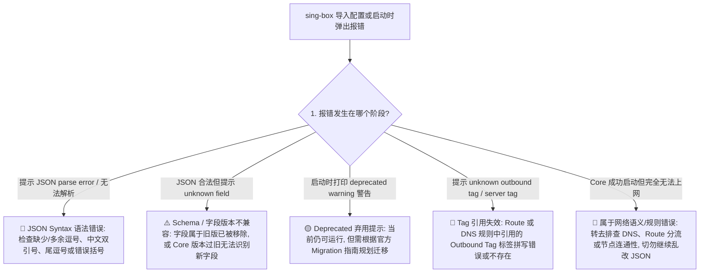
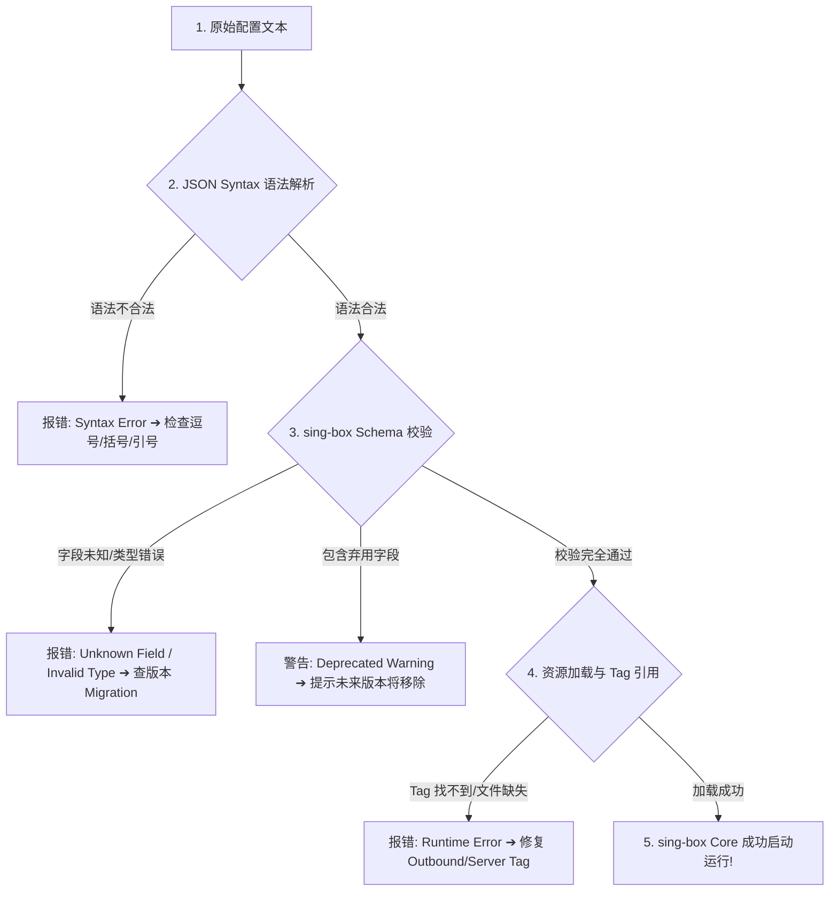
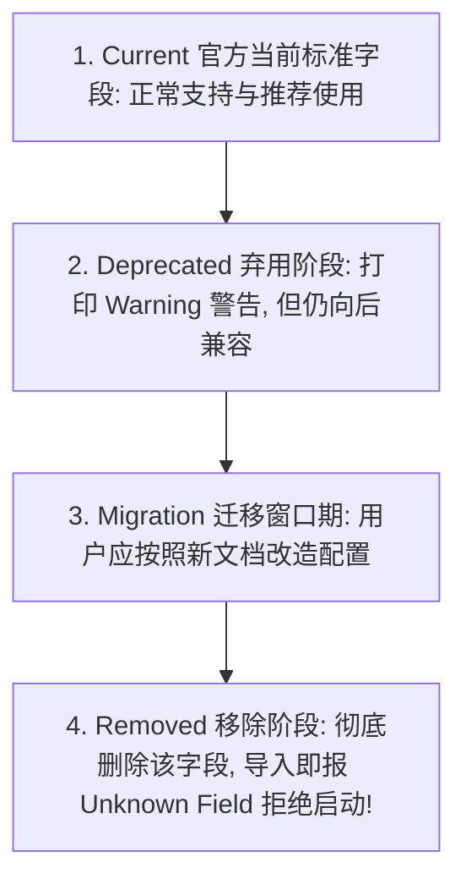
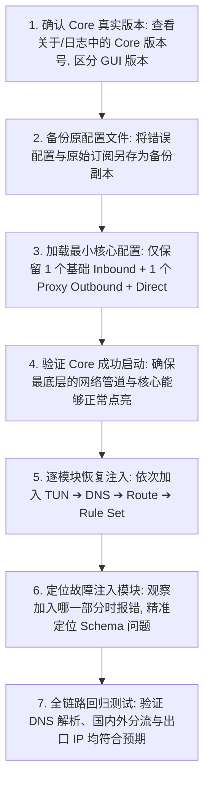

在导入、手写或升级 sing-box 客户端与内核配置时，**配置解析失败（Config Parsing Error）与 Core 启动报错** 是技术门槛最高、也最让用户抓狂的故障类型：

**“在 JSON 校验网站上测试提示‘语法完全正确’，为什么一导入 sing-box 客户端就弹出 `decode config error: unknown field` 致命错误？”**  
**“为什么去年网上复制的高分神级配置，在今年更新了最新版 sing-box 之后直接报错闪退、提示 `deprecated field` 或 `removed option` 彻底起不来了？”**  
**“为什么服务商提供的订阅链接在 Windows 上能正常运行，但在 Android 手机客户端里导入却提示 `schema validation failed: invalid type`？”**  
**“很多旧教程里教的 `geosite`、`geoip`、`sniff` 和 `block` 字段，在新版本里到底迁移到了哪里？为什么不能直接在文本编辑器里全局查找替换？”**  
**“把 Clash 的 `.yaml` 文件后缀改成 `.json`，或者把 Xray 的 JSON 配置直接复制进 sing-box，为什么内核会报出几十行致命错误？”**

**在 sing-box 的工程设计中，配置报错绝非简单的‘少了一个逗号’，而是一个跨越 JSON 语法层、Schema 校验层、Core 内核版本生命周期与模块语义迁移的多维系统工程！**

排查与修复 sing-box 配置错误，绝不能凭感觉“乱删报错行”或盲目去网上搜索过时的旧模板，而必须建立一套 **八维 sing-box 配置兼容与迁移诊断模型**：**“严格区分 JSON Syntax 语法与 sing-box Schema 校验 ➔ 准确定位当前运行的 sing-box Core 内核版本 ➔ 理解字段从 Current ➔ Deprecated ➔ Removed 的生命周期 ➔ 掌握 Route Action、DNS Server、TUN 与 Rule Set 的结构演进 ➔ 识别 Cross-Core 跨核心（Clash/Xray）语法混入 ➔ 运用‘最小合法配置法’逐模块隔离故障（Outbound ➔ TUN ➔ DNS ➔ Route ➔ Rule Set） ➔ 警惕 GUI 自动生成配置与 Core 的版本错配 ➔ 实施迁移后的全链路功能回归测试”**。

本文作为 **sing-box 整个主线体系中技术深度最高的技术收官大作**，将带你彻底攻克配置报错、Schema 迁移、版本兼容与崩溃排错的全部技术难关。

---

## ⚡ 30 秒极速定位：sing-box 配置报错决策导航



- 🚨 **排错第一铁律**：
  - **JSON 语法合法（Syntax Valid） $\ne$ sing-box Schema 合法**；
  - **Core 成功启动（Running） $\ne$ DNS/Route 实际分流正确**；
  - 遇到长篇报错时，**永远优先处理第 1 条关键错误**，切莫同时胡乱修改 10 个字段！

---

## 一、架构基石：八维 sing-box 配置兼容与迁移模型

```text
┌────────────────────────────────────────────────────────────────────────────────────────┐
│                        sing-box 四类核心配置错误全景对比表                             │
├──────────────┬────────────────────────┬────────────────────────┬───────────────────────┤
│ 错误类型     │ 发生层级与技术本质     │ 典型错误信息特征       │ 核心排查与处置手段    │
├──────────────┼────────────────────────┼────────────────────────┼───────────────────────┤
│ **1. Syntax**| 基础文本解析层（非 JSON）| `invalid character`、`comma`| 格式化工具检查括号与引号│
│ **2. Schema**| 字段定义与类型校验层   | `unknown field`、`invalid type`| 对照当前 Core 版本的官方 Schema│
│ **3. Runtime**| 运行时资源与 Tag 引用  | `unknown outbound tag` | 检查标签拼写与本地文件路径│
│ **4. Version**| 内核升级后的破坏性变更 | `removed field`、`deprecated`| 查阅 Migration 官方迁移指南│
└──────────────┴────────────────────────┴────────────────────────┴───────────────────────┘
```



---

## 二、第一核心机制：JSON Syntax 语法常见陷阱

标准 JSON 格式具有极度严格的语法要求，以下为最容易踩坑的语法错误：

```text
┌────────────────────────────────────────────────────────────────────────────────────────┐
│                        JSON 语法常见错误与正确写法对照表                              │
├──────────────┬──────────────────────────────┬──────────────────────────────────────────┤
│ 错误类型     │ 致命错误写法 (Invalid)       │ 标准正确写法 (Valid)                     │
├──────────────┼──────────────────────────────┼──────────────────────────────────────────┤
│ **尾逗号**   │ `["a", "b",]` (末尾多逗号)   │ `["a", "b"]` (严格去除末尾多余逗号)      │
│ **单引号**   │ `'tag': 'proxy'` (使用单引号)│ `"tag": "proxy"` (必须使用英文字符双引号)│
│ **注释代码** │ `// 这是直连规则` (带双斜杠) │ **标准 JSON 严禁任何注释，必须彻底删除** │
│ **布尔类型** │ `"enabled": "true"` (字符串) │ `"enabled": true` (小写裸布尔值，无引号) │
│ **整数类型** │ `"server_port": "443"` (字符串)| `"server_port": 443` (标准无引号整型)   │
└──────────────┴──────────────────────────────┴──────────────────────────────────────────┘
```

---

## 三、第二核心机制：Unknown Field 与字段生命周期（Lifecycle）

在升级 sing-box 或复制他人配置时，经常看到 `unknown field` 或 `deprecated` 提示：



- 💡 **关键辨析**：
  - **看到 `Deprecated`**：不用惊慌，客户端通常仍能正常启动，但应提上日程着手迁移；
  - **看到 `Unknown Field`**：说明该字段在当前 Core 版本中已经被 **彻底移除（Removed）**，或者当前运行的 Core 版本过旧、尚未支持该新字段。

---

## 四、第三核心机制：跨核心与跨格式混淆排错

```text
┌────────────────────────────────────────────────────────────────────────────────────────┐
│                        跨核心配置混淆排错矩阵                                          │
├──────────────┬────────────────────────┬────────────────────────────────────────────────┤
│ 混淆来源     │ 典型错误行为           │ 技术真相与正确做法                             │
├──────────────┼────────────────────────┼────────────────────────────────────────────────┤
│ **Clash / Mihomo**| 把 `.yaml` 后缀改成 `.json`| Clash 的 `Proxy Group` 与 sing-box Schema 完全不同，必须重构│
│ **Xray / V2Ray**  | 直接把 Xray JSON 塞入   | 虽然都是 JSON，但 `inbounds`/`outbounds` 结构差异极大│
│ **旧版 GeoSite**  | 直接写 `geosite:cn` 规则| sing-box 现代版本已全面采用 `rule_set` 架构    │
└──────────────┴────────────────────────┴────────────────────────────────────────────────┘
```

---

## 五、第四核心机制：核心模块演进与 Schema 迁移重点

```text
┌────────────────────────────────────────────────────────────────────────────────────────┐
│                        sing-box 核心模块 Schema 演进速查表                             │
├──────────────┬──────────────────────────────┬──────────────────────────────────────────┤
│ 模块类别     │ 旧版过时写法 (Legacy / Removed)| 现代化标准写法 (Modern / Recommended)    │
├──────────────┼──────────────────────────────┼──────────────────────────────────────────┤
│ **Route 路由**| `geosite` / `geoip` 散装规则  | 统一使用 `rule_set` 引用 `.srs` 规则集   │
│ **Route 动作**| 固定 `outbound: "block"` 写法 | 采用 `action: "reject"` 或明确路由动作   │
│ **DNS 解析**  | 简单单层 server 列表         | 分离 `servers`、`rules` 与 `fakeip` 独立调度│
│ **流量嗅探**  | inbounds 内部旧版 `sniff` 字段| 迁移至 Route Action 中的现代化 `sniff` 规则│
└──────────────┴──────────────────────────────┴──────────────────────────────────────────┘
```

---

## 六、实战指南：sing-box 最小配置法 7 步排障与迁移

当面对上千行的复杂报错配置时，逐行修改往往越改越乱。推荐采用 **“最小配置隔离法”**：



---

## 七、2026 全协议完美兼容与标准 sing-box 高速专线推荐

如果本地客户端配置已经严格遵循最新 Schema，但节点依然频繁报错或无法连接，根本原因是**节点的协议参数失效或服务端被屏蔽**。以下为提供全自动标准 sing-box 订阅与 100% Schema 兼容的标杆服务：

```text
┌────────────────────────────────────────────────────────────────────────────────────────┐
│                        2026 全协议兼容与标准专线推荐                                   │
├──────────┬──────────────────────────┬──────────────┬──────────────┬────────────────────┤
│ 适配场景 │ 推荐品牌候选             │ 实际起付门槛 │ 每月流量配额 │ sing-box 兼容与专线优势│
├──────────┼──────────────────────────┼──────────────┼──────────────┼────────────────────┤
│ 旗舰全能 │ 光速云 (GuangSuYun)      │ 约 ¥7.5/月起 │ 59G~238G /月 │ 全线 IEPL 专线，原生双栈 IP，后台下发 100% 匹配最新 sing-box Schema 的标准订阅│
│ 平价轻量 │ 微风网络 (BreezeNet)     │ 约 ¥7/月起   │ 50GB / 月    │ 优质 BGP 优化专线，纯净轻量，节点更新秒级响应，日常极稳│
│ 弹性月付 │ 唯兔云 (V2Yun)           │ ¥14.9/月     │ 100GB / 月   │ 14.9 元纯单月付，多协议节点充沛，单节点故障秒切  │
│ 应急备用 │ 星岛梦 (XingDaoMeng)     │ 约 ¥8/月起   │ 60G/不限时包 │ 0月租不限时包，永不过期，专线拥塞时随时顶上应急  │
│ 极速专精 │ 速界 (SpeedWorld)        │ ¥25/月       │ 150GB / 月   │ 企业级超大独立专线带宽，AI 与流媒体原生解锁极速响应 │
└──────────┴──────────────────────────┴──────────────┴──────────────┴────────────────────┘
```

- 🏆 **标准 Schema 旗舰首选**：[光速云](/reviews/guangsu-cloud/) —— 2020 老牌专线，全线内网 IEPL 专线，标准 sing-box 规则集分流，国内外 0 串流；
- 🍃 **超低预算轻量**：[微风网络](/reviews/weifeng-cloud/) —— 50GB 精品小流量专线，年付折算仅约 ¥7/月；
- 💳 **拒绝绑定的单月付**：[唯兔云](/recommend/best-airports/) —— ¥14.9 纯单月付，100GB 充沛流量。

---

## 八、避坑指南：80 个关于“sing-box 配置报错”的致命认知误区

```text
❌ 误区 1：在网页 JSON 校验工具里显示 Valid 就代表 sing-box 一定能正常启动 ➔ 事实：JSON 校验只检查语法，不验证 sing-box 的业务 Schema。
❌ 误区 2：报错提示 Unknown Field 说明单词一定拼写错了 ➔ 事实：该字段可能属于旧版本已被新版 Core 移除，或者 Core 版本过旧无法识别。
❌ 误区 3：看到 Deprecated 警告说明整个客户端已经彻底坏了 ➔ 事实：Deprecated 仅代表不推荐使用，当前版本仍可正常运行，需规划迁移。
❌ 误区 4：把 Clash 的 config.yaml 文件直接重命名为 config.json 就能给 sing-box 用 ➔ 事实：两者的底层字段与结构完全不同，无法直接互通。
❌ 误区 5：可以直接把 Xray 的 VLESS 配置对象原封不动复制进 sing-box ➔ 事实：sing-box 拥有独立的 Outbound 协议描述规范。
❌ 误区 6：只要 Core 成功启动（显示 Running），就代表所有的分流和 DNS 都配置正确了 ➔ 事实：启动成功仅代表语法通过，分流依然可能走错。
❌ 误区 7：遇到配置报错，在文本编辑器里使用“全部替换”把旧字段批量改名最快 ➔ 事实：Schema 升级往往伴随结构重构，机械替换极易引发更多错误。
❌ 误区 8：GUI 客户端的版本号就等于内置 sing-box Core 的版本号 ➔ 事实：GUI 外壳版本与底层 Core 版本是独立的，需分别确认。
❌ 误区 9：标准 JSON 配置文件里可以随意使用 // 添加中文备注说明 ➔ 事实：标准 JSON 规范严禁任何形式的注释符号。
❌ 误区 10：数组最后一项保留逗号看起来更整齐不会影响解析 ➔ 事实：标准 JSON 严禁出现末尾尾逗号（Trailing Comma）。
❌ 误区 11：在配置里写 "enabled": "true" 和 "enabled": true 没有任何区别 ➔ 事实：前者是 String 字符串，后者是 Boolean 布尔值，类型错误会报错。
❌ 误区 12：遇到报错直接去网上找一个最新的“全能配置模板”覆盖最省事 ➔ 事实：盲目套用未知模板可能覆盖掉你的专属节点与自定义规则。
❌ 误区 13：把配置直接上传到公开的在线排错网站没有任何风险 ➔ 事实：配置文件中包含你的节点密码、UUID 与私钥，公开上传会导致泄露。
❌ 误区 14：报错信息太长，必须同时把日志里提到的 10 个问题一起修改 ➔ 事实：后续报错多为第 1 处错误引发的连锁反应，优先修复第 1 条。
❌ 误区 15：跨越多个大版本升级客户端后，旧配置报错说明新版内核有 Bug ➔ 事实：是大版本迭代中的破坏性变更（Breaking Changes）所致。
❌ 误区 16：可以直接照搬 Linux 服务器上的 sing-box 配置文件到 Android 手机上 ➔ 事实：Android 的 TUN 与本地文件路径权限与 Linux 存在显著差异。
❌ 误区 17：Route 规则中引用的 Outbound Tag 标签大小写不一致也能自动匹配 ➔ 事实：Tag 标签在 sing-box 中是严格区分大小写的。
❌ 误区 18：更新了机场节点订阅后，自己手写的自定义 DNS 规则会被全部保留 ➔ 事实：若直接覆盖 Profile，手写内容会丢失，需做好独立备份。
❌ 误区 19：只要把所有报错的字段全部删掉，配置就能完美运行 ➔ 事实：删掉核心必要字段（如 server 端口或 tag）会导致无法建立连接。
❌ 误区 20：出现配置错误时只要重启手机就能自动修复 ➔ 事实：配置文件属于静态文件，不修改错误内容重启手机依然会报错。
```

---

## 九、常见问题深度解答（FAQ · 85 问）

### Q1：sing-box 提示 `decode config error: unknown field` 是什么原因？
**答**：**说明配置文件中包含了当前 Core 不认识的字段。** 常见原因包括：1. 字段名称拼写错误；2. 复制了旧版教程中已被移除（Removed）的废弃字段；3. Core 版本过旧无法识别新特性。

### Q2：JSON Syntax Error（语法错误）和 Schema Error 有什么区别？
**答**：**Syntax Error 是文本格式不符合 JSON 规范（如少括号或逗号）；Schema Error 是语法合法但字段、数据类型或结构不符合 sing-box 的定义。** 两者发生在不同解析阶段。

### Q3：sing-box 配置文件里可以写 `//` 注释吗？
**答**：**标准 JSON 格式严禁添加任何注释！** 添加 `//` 或 `/* */` 会直接导致 JSON 解析器崩溃。若需备注，可使用支持注释的外部管理工具。

### Q4：为什么升级 sing-box 之后原本正常的配置突然报错打不开了？
**答**：**因为新版本引入了破坏性变更（Breaking Changes）。** 某些旧字段被正式废弃移除。查阅官方 Migration 迁移文档将旧结构更新即可。

### Q5：GUI 客户端版本和 sing-box Core 版本是一回事吗？
**答**：**不是。** GUI 是图形界面外壳（如 sing-box for Android 1.9.x），Core 是底层的路由内核。排查 Schema 问题必须以 Core 的真实版本为准。

### Q6：什么是 Deprecated 警告？出现 Deprecated 需要立刻修改吗？
**答**：**Deprecated 代表该字段已被弃用但不影响当前运行。** 客户端仍会正常加载，但建议在未来版本彻底移除前按新文档完成迁移。

### Q7：什么是“最小配置法”？为什么推荐用它排查复杂报错？
**答**：**最小配置法是先用仅包含 1 个节点和最简直连规则的骨架配置启动 Core。** 排除核心与环境故障后，再逐步恢复 DNS、Route 等模块，能秒级揪出出错字段。

### Q8：为什么服务商提供的订阅导入后提示 `invalid type`？
**答**：**说明服务商生成的配置与你当前使用的 sing-box 版本 Schema 不匹配。** 尝试在服务商后台重新选择并拉取针对最新 sing-box 优化的标准订阅。

### Q9：可以把 Clash 的 YAML 规则直接翻译成 sing-box 吗？
**答**：**概念可以借鉴，但必须遵循 sing-box 语法。** 不能机械复制，需将 Clash 的 Proxy Group 转换为 Outbound/Selector，将规则转换为 Rule Set。

### Q10：提示 `unknown outbound tag` 怎么解决？
**答**：**检查 Route 规则中 `outbound` 指定的名称在 `outbounds` 列表中是否存在。** 标签名称严格区分大小写且必须保持一一对应。

### Q11：在线 JSON 校验工具安全吗？需要注意什么？
**答**：**切勿将包含真实节点 UUID、密码和私钥的完整配置上传至公开网站！** 排查时必须先将敏感信息替换为伪代码（如 `example.com`）。

### Q12：配置成功启动了，但仍然打不开网页该怎么排查？
**答**：**说明配置语法已过关，属于网络分流或节点故障。** 建议转去查阅 [《sing-box有节点但无法上网怎么办？TUN、DNS、Route与Android网络完整排查》](/issues/sing-box-connected-no-internet/)。

### Q13：sing-box 整个主线学习完毕后，该如何全面掌握生态？
**答**：建议系统复习入口篇 [《sing-box是什么？和V2Ray、Xray、Clash有什么区别？》](/wiki/what-is-sing-box/) 与 [《sing-box Android怎么用？》](/tutorials/sing-box-android/)，融会贯通全套分流与运维体系。

---

## 🏁 总结：sing-box 配置排错与迁移核心认知金字塔

排查与维护 sing-box 配置文件，请牢记以下**核心铁律**：

```text
1. 辨层级 ➔ JSON 语法合法不等于 Schema 合法，Core 成功点亮不等于分流行为正确
2. 识版本 ➔ GUI 版本不等于 Core 版本，遇到 Unknown Field 先对照当前官方 Schema
3. 查迁移 ➔ 升级引发的报错切莫盲改，查阅官方 Migration 文档按规范平滑过渡
4. 善隔离 ➔ 复杂配置排错首选“最小配置法”，逐模块注入精准揪出问题所在
5. 保安全 ➔ 调试与求助时彻底脱敏 UUID、Token 与私钥，严禁将生产配置公开泄露
```

---

### 📚 sing-box 官方主线全景知识库（9 篇全收官导航）
- 🏛️ **生态总览与概念入口**：[《sing-box是什么？和V2Ray、Xray、Clash有什么区别？》](/wiki/what-is-sing-box/)
- 📱 **Android 入门与实操主教程**：[《sing-box Android怎么用？下载安装、配置、订阅、TUN与完整使用教程》](/tutorials/sing-box-android/)
- 📦 **订阅导入与配置分发**：[《sing-box订阅怎么导入？配置、节点更新、二维码与订阅失败完整教程》](/tutorials/sing-box-subscription/)
- 🌐 **有节点无网深度排查**：[《sing-box有节点但无法上网怎么办？TUN、DNS、Route与Android网络完整排查》](/issues/sing-box-connected-no-internet/)
- ⚡ **速度慢与性能调优**：[《sing-box速度慢怎么办？节点、线路、协议、Wi-Fi/5G、丢包与晚高峰完整排查》](/issues/sing-box-slow-speed/)
- 🔒 **经常掉线与保活排查**：[《sing-box经常掉线怎么办？Android后台、电池优化、锁屏与Wi-Fi/5G切换完整排查》](/issues/sing-box-disconnect/)
- 🎯 **DNS 规则与 FakeIP 专项**：[《sing-box DNS怎么设置？DNS规则、Private DNS、IPv6、FakeIP与域名解析完整指南》](/tutorials/sing-box-dns/)
- 🧭 **Route 路由与分流实战**：[《sing-box Route怎么设置？Direct、Proxy、Block、Rule Set与分流完整教程》](/tutorials/sing-box-routing/)
- 🏆 **2026 全景大榜**：[《2026梯子推荐：稳定、速度、价格、安全与不同使用场景怎么选》](/recommend/best-tizi/)
