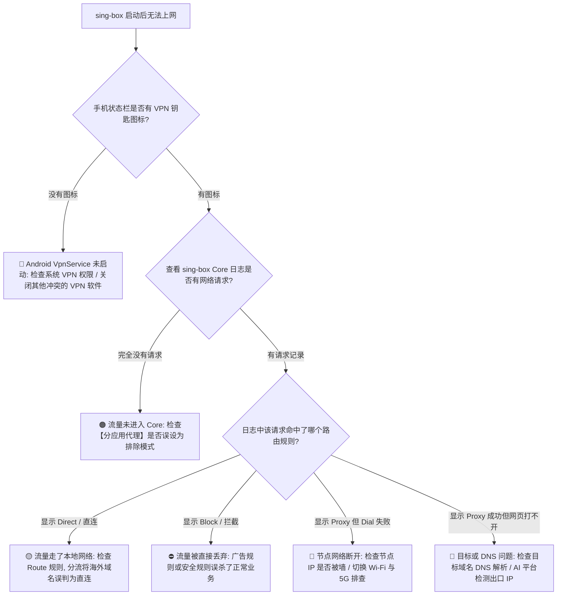
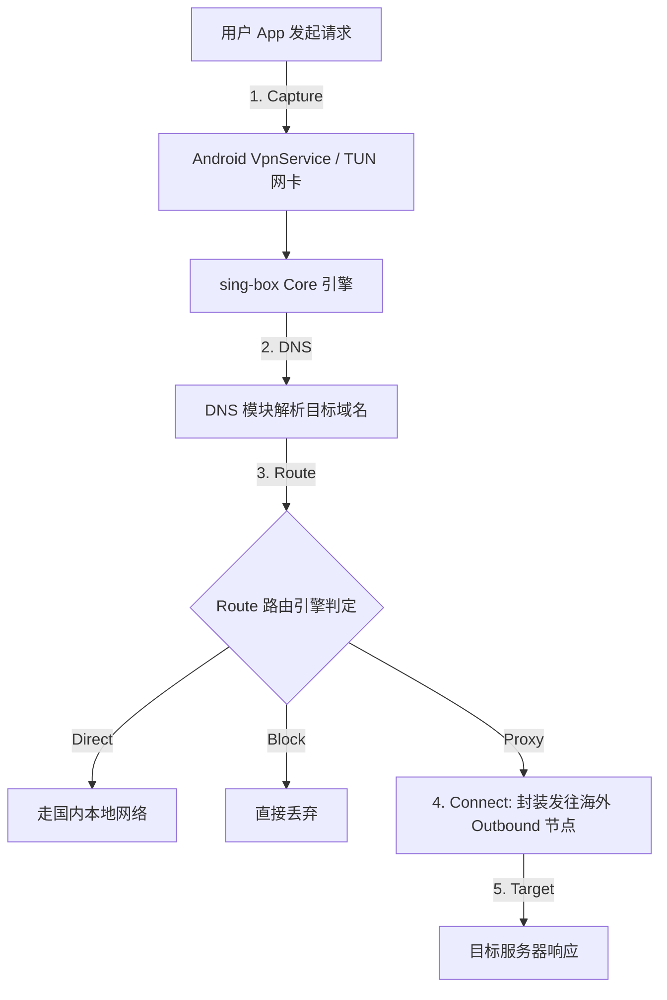
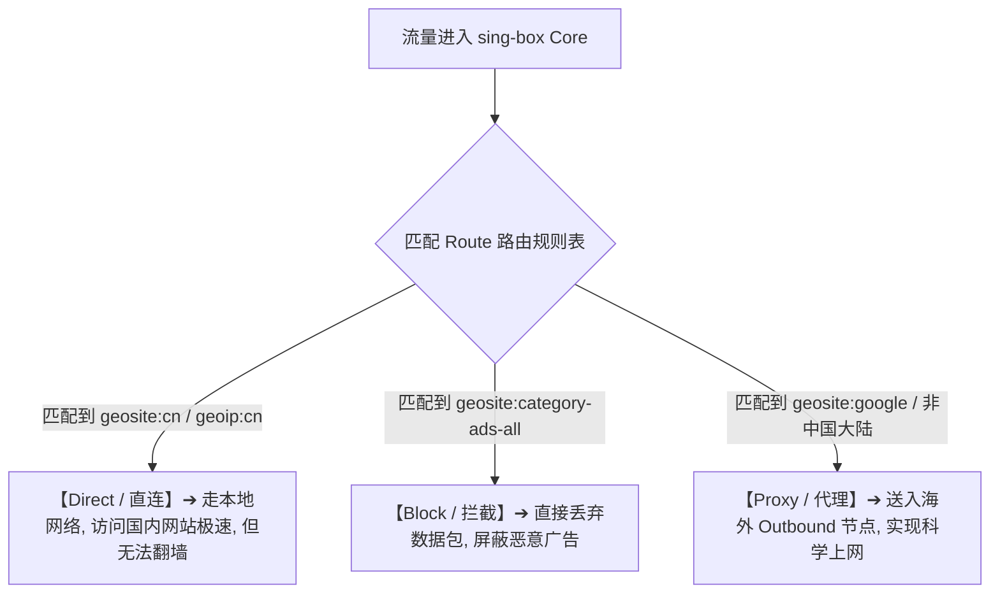
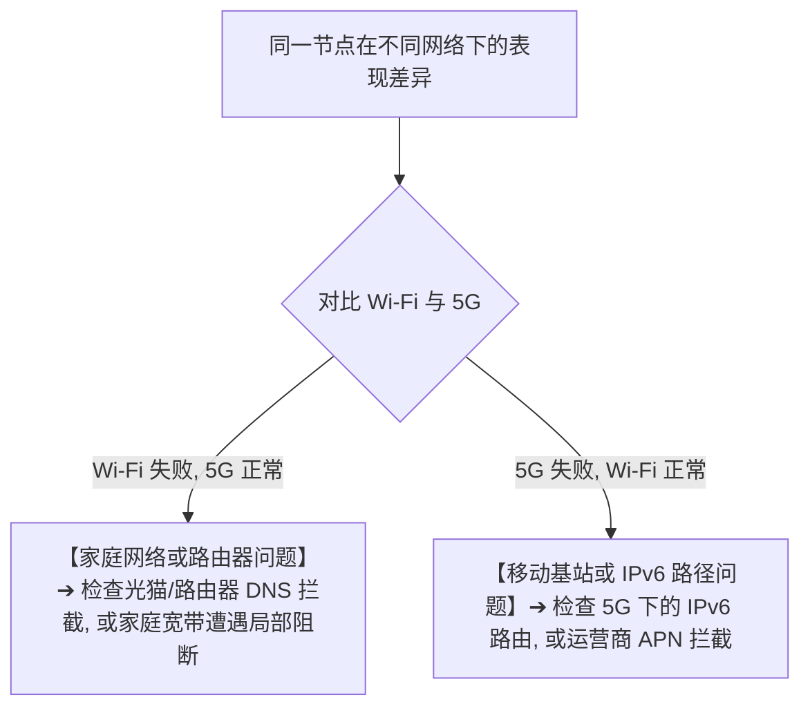
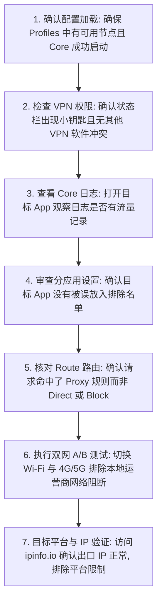

在 Android 安卓手机或平板设备上使用 sing-box 时，许多用户都曾遇到过一种极为典型且令人头疼的异常现象：

**“订阅已经成功更新，Profiles 列表里整整齐齐排着几十个可用节点，点击 Start 启动后，手机顶部的状态栏上也赫然弹出了 VPN 小钥匙图标——但打开 Chrome 浏览器输入 Google 却提示‘无法访问此网站’，打开 YouTube 一直转圈白屏，打开 Telegram 提示‘正在连接’，整部手机仿佛彻底断了网！”**

面对这种情况，很多新手会陷入盲目的“试错循环”：疯狂切换香港、日本、新加坡节点，或者在手机设置里乱关 Private DNS、关闭 IPv6，甚至反复卸载重装 App。

然而，**sing-box“有节点但无法上网”通常根本不是订阅问题，也不是节点本身离线，而是发生在“配置已成功加载、Outbound 节点已存在”之后的流量接管、域名解析（DNS）、路由匹配（Route）或目标平台策略阶段！**

必须明确建立一套 **八维 sing-box Android 无网诊断模型**：**“确认系统 VpnService 与 TUN 流量捕获 ➔ 审查分应用（Per-App）规则 ➔ 跟踪目标域名 DNS 解析 ➔ 检查 Route 路由（Direct vs Proxy vs Block） ➔ 验证 Outbound 连接握手 ➔ 执行 Wi-Fi 与 4G/5G 网络 A/B 测试 ➔ 观察 IPv4 与 IPv6 路径表现 ➔ 识别目标平台的出口 IP 准入策略”**。

本文作为 **sing-box Android 流量接管与无网故障排查的终极专项 Cluster 指南**，将带你沿着真实的数据流转链路，用最标准、最系统的 7 步排障法，迅速定位并根治“有节点但连不上网”的顽疾。

---

## ⚡ 30 秒极速定位：sing-box 无网故障决策导航



- 🚨 **排错核心原则**：
  - **VPN 钥匙图标出现 ≠ 节点连接成功**：VPN 图标仅代表 Android 系统的虚拟网卡已接管流量，绝不代表数据已经顺利通过海外节点送达目标网站；
  - **先看日志有没有请求，再看路由怎么分流，最后才看节点和 DNS！**

---

## 一、架构基石：五阶段流量流转模型

要排查无网故障，必须先看清一个数据包从你的手机 App 到达 Google 网站所经历的 **五个完整阶段**：

```text
┌────────────────────────────────────────────────────────────────────────────────────────┐
│                        sing-box 流量流转五阶段模型与故障对照表                         │
├──────────────┬────────────────────────┬────────────────────────┬───────────────────────┤
│ 阶段名称     │ 承担的技术动作         │ 典型正常表现           │ 故障表现与排查方向    │
├──────────────┼────────────────────────┼────────────────────────┼───────────────────────┤
│ **1. Capture**│ TUN / VpnService 接管流量│ 手机产生的请求送入 Core│ 日志无记录 ➔ 权限或分应用排除│
│ **2. DNS**   │ 将目标域名解析为 IP    │ 返回正确的 A/AAAA 记录 │ 报 DNS Lookup Fail ➔ DNS 污染│
│ **3. Route** │ 判定走 Direct/Proxy/Block│ 海外流量命中 Proxy     │ 误判为 Direct 或被 Block 丢弃│
│ **4. Connect**│ Outbound 与远端节点握手│ 与香港/日本节点建立连接│ 报 Dial Timeout ➔ 节点物理阻断│
│ **5. Target**│ 目标网站响应并返回数据 │ Google / YouTube 秒开  │ 报 403 / 验证码 ➔ IP 遭平台拉黑│
└──────────────┴────────────────────────┴────────────────────────┴───────────────────────┘
```



---

## 二、第一核心排查点：TUN 虚拟网卡与 Android VpnService

在 Android 系统上，sing-box 通过系统标准的 **VpnService API** 构建 TUN 虚拟网卡来接管全局或分应用网络：

```text
┌────────────────────────────────────────────────────────────────────────────────────────┐
│                        TUN 与 Android VpnService 关键排查要点                          │
├──────────────┬────────────────────────┬────────────────────────────────────────────────┤
│ 检查项目     │ 异常表现               │ 正确修复与处置策略                             │
├──────────────┼────────────────────────┼────────────────────────────────────────────────┤
│ **VPN 授权** │ 启动时被系统拦截       │ 在系统弹出的“网络连接请求”中勾选【确定/允许】  │
│ **多 VPN 冲突**│ 启动 sing-box 后另一 VPN 闪退| Android **同时只允许一个 VpnService 运行**，关闭其他防火墙/加速器│
│ **Always-on**│ 状态栏钥匙常驻但无网络 │ 检查系统设置中是否启用了“始终开启的 VPN / 阻止无 VPN 连接”│
│ **切网假死** │ Wi-Fi 切 5G 后突然无网 │ 正常在 App 中点击 Stop 停止连接，再点击 Start 重建网卡通道│
└──────────────┴────────────────────────┴────────────────────────────────────────────────┘
```

- 💡 **TUN 认知误区澄清**：
  - TUN 是一种**网络虚拟化技术**，不是一种加密代理协议，开启 TUN 也不会自动让网速“翻倍”；
  - 它只负责将操作系统的网络数据包“抓取”并“投递”给 sing-box Core。

---

## 三、第二核心排查点：分应用（Per-App Proxy）模式弄反

很多时候，浏览器能正常翻墙，但特定的某个 App（如 Telegram、ChatGPT 或 Twitter）却死活连不上网，**90% 是分应用模式设置反了**：

```text
┌────────────────────────────────────────────────────────────────────────────────────────┐
│                        分应用代理（Per-App）两大模式对比表                             │
├──────────────┬────────────────────────┬────────────────────────────────────────────────┤
│ 模式类型     │ 勾选 App 后的实际行为  │ 典型翻车场景与排查建议                         │
├──────────────┼────────────────────────┼────────────────────────────────────────────────┤
│ **包含模式** │ **仅有被勾选的 App 走代理**| 勾选了 Chrome 但漏勾了 YouTube，导致 YouTube 彻底走本地网络打不开│
│ (Include)    │ 未勾选的应用完全绕过   │                                                │
├──────────────┼────────────────────────┼────────────────────────────────────────────────┤
│ **排除模式** │ **被勾选的 App 绕过代理**| 误将 Telegram 勾选进排除列表，导致 Telegram 完全不走代理无法连接│
│ (Exclude)    │ 其余所有应用全部走代理 │                                                │
└──────────────┴────────────────────────┴────────────────────────────────────────────────┘
```

- 🚨 **极速验证法**：
  - 如果怀疑是分应用问题，直接在设置中 **将“分应用代理”彻底关闭（即全局代理所有 App）**，再次测试目标 App。若恢复正常，说明是勾选名单有误。

---

## 四、第三核心排查点：Route 路由规则（Direct vs Proxy vs Block）

流量顺利进入 sing-box Core 后，Route 路由模块会根据规则决定它的去向：



### 1. 为什么选了日本节点，去查 IP 依然是本地电信/联通 IP？
- 这是因为 IP 测速网站（如 `ip138.com` 或 `ip.sb` 的国内 CDN）被 Route 规则判定为了国内域名，命中了 **Direct 直连规则**；
- **正确验证方法**：访问专门的海外 IP 探测网站（如 `https://ipinfo.io`），才能看到真实的海外节点出口 IP。

### 2. 为什么部分网站主页能开，但点击登录或验证码就卡死？
- 很多现代跨国网站的**主站域名、API 接口、身份认证与验证码（hCaptcha/Cloudflare）托管在不同的子域名或 CDN 上**；
- 如果路由规则不完善，将验证码域名误判成了 Direct 直连，就会导致“能打开网页但永远登不进去”。

---

## 五、第四核心排查点：DNS 解析失败与 Private DNS

```text
┌────────────────────────────────────────────────────────────────────────────────────────┐
│                        三类 DNS 解析层级与故障诊断表                                   │
├──────────────┬────────────────────────┬────────────────────────────────────────────────┤
│ DNS 层级     │ 所在位置与职责         │ 故障表现与排查策略                             │
├──────────────┼────────────────────────┼────────────────────────────────────────────────┤
│ **1. 目标域名 DNS**| sing-box 内置 DNS 模块  | 解析 Google/YouTube IP 失败 ➔ 网站打不开，报 DNS Lookup Fail│
│ **2. Android 系统 DNS**| 手机 Wi-Fi/移动网络 DNS | 解析订阅服务器与节点域名 ➔ 若被劫持，节点无法握手│
│ **3. Private DNS**  | Android 系统原生加密 DNS| 若填写的 DoT 服务器阻断境外查询 ➔ 做系统模式 A/B 临时测试│
└──────────────┴────────────────────────┴────────────────────────────────────────────────┘
```

- 💡 **关于 Android Private DNS（私人 DNS）的权威准则**：
  - **绝不能盲目把 Private DNS 当成万恶之源默认关闭**；
  - 只有在明确排查出当前私有 DNS 服务商拦截了特定域名时，才建议临时切换为“关闭/自动”进行 A/B 对比测试。

---

## 六、第五核心排查点：Wi-Fi vs 4G/5G 网络与 IPv6 差异

移动设备的网络环境瞬息万变，不同接入方式对代理连接有着直接影响：



### 1. 为什么切换 Wi-Fi / 5G 后 VPN 图标还在，但网络突然断了？
- 切换网络时，Android 系统的物理网络接口发生切换，底层的 TCP/UDP Socket 连接已经中断；
- 但由于 VpnService 依然处于 Running 状态，系统不会自动报错；
- **解决办法**：在 sing-box 主界面点击 **Stop 停止连接，再点击 Start 重新启动**，即可重建网络管道。

---

## 七、实战指南：sing-box 无网故障 7 步标准排障法



---

## 八、2026 全协议完美兼容与标准 sing-box 高速专线推荐

如果经过排查，本地客户端的 TUN、DNS、Route 与 Android 网络均配置无误，但无论选择哪个节点都无法访问 Google 或 YouTube，说明问题出在**机场节点的物理连通性、阻断状态或出口纯净度**上：

```text
┌────────────────────────────────────────────────────────────────────────────────────────┐
│                        2026 全协议兼容与标准专线推荐                                   │
├──────────┬──────────────────────────┬──────────────┬──────────────┬────────────────────┤
│ 适配场景 │ 推荐品牌候选             │ 实际起付门槛 │ 每月流量配额 │ sing-box 兼容与专线优势│
├──────────┼──────────────────────────┼──────────────┼──────────────┼────────────────────┤
│ 旗舰全能 │ 光速云 (GuangSuYun)      │ 约 ¥7.5/月起 │ 59G~238G /月 │ 全线 IEPL 专线，原生标准 sing-box 兼容，0 丢包 0 阻断，即连即通│
│ 平价轻量 │ 微风网络 (BreezeNet)     │ 约 ¥7/月起   │ 50GB / 月    │ 优质 BGP 优化专线，纯净轻量，节点更新秒级响应，日常极稳│
│ 弹性月付 │ 唯兔云 (V2Yun)           │ ¥14.9/月     │ 100GB / 月   │ 14.9 元纯单月付，多协议节点充沛，单节点故障秒切  │
│ 应急备用 │ 星岛梦 (XingDaoMeng)     │ 约 ¥8/月起   │ 60G/不限时包 │ 0月租不限时包，永不过期，专线拥塞时随时顶上应急  │
│ 极速专精 │ 速界 (SpeedWorld)        │ ¥25/月       │ 150GB / 月   │ 企业级超大独立专线带宽，AI 与流媒体分流极速响应     │
└──────────┴──────────────────────────┴──────────────┴──────────────┴────────────────────┘
```

- 🏆 **全协议标准兼容旗舰首选**：[光速云](/reviews/guangsu-cloud/) —— 2020 老牌专线，全线内网 IEPL 专线，原生标准 sing-box 订阅一键导入 0 报错；
- 🍃 **超低预算轻量**：[微风网络](/reviews/weifeng-cloud/) —— 50GB 精品小流量专线，年付折算仅约 ¥7/月；
- 💳 **拒绝绑定的单月付**：[唯兔云](/recommend/best-airports/) —— ¥14.9 纯单月付，100GB 充沛流量。

---

## 九、避坑指南：60 个关于“sing-box 有节点但无法上网”的致命认知误区

```text
❌ 误区 1：状态栏出现了 VPN 钥匙图标就代表梯子一定通畅了 ➔ 事实：钥匙图标只代表 Android 虚拟网卡已接管，不代表海外服务器可用。
❌ 误区 2：TUN 模式是一种速度比普通代理更快的协议 ➔ 事实：TUN 是操作系统层面的流量接管机制，并非传输协议。
❌ 误区 3：有节点但无法上网一定是机场跑路了 ➔ 事实：高概率是分应用模式设置反了、Route 走了 Direct 或 DNS 发生了解析故障。
❌ 误区 4：只要遇到网络问题就必须在手机设置里把 Private DNS 彻底关闭 ➔ 事实：盲关 Private DNS 可能影响国内网络安全。
❌ 误区 5：只要遇到打不开网页就必须去关闭手机的 IPv6 支持 ➔ 事实：现代移动网络原生支持 IPv6，需根据日志 A/B 判定。
❌ 误区 6：选了日本节点，去国内查 IP 网站还是国内 IP 说明软件失效了 ➔ 事实：这是 Route 智能分流将国内网站走直连的正常表现。
❌ 误区 7：一个 App 没网就说明整个 sing-box 的所有节点都坏了 ➔ 事实：需检查该 App 是否被分应用排除了，或该 App 具有特殊网络策略。
❌ 误区 8：把所有流量强制设为全局代理一定比规则分流更好用 ➔ 事实：全局代理会导致国内微信、网银卡顿且消耗宝贵的外网流量。
❌ 误区 9：Direct 直连的意思是把流量加速直接发送到国外服务器 ➔ 事实：Direct 走的是国内本地网络，直接访问目标必然被墙。
❌ 误区 10：Block 拦截规则只用来屏蔽网页弹窗广告 ➔ 事实：规则库配置不当时，Block 可能会误伤正常的登录验证与 API 请求。
❌ 误区 11：手机能正常看 YouTube 就代表一定能打开 ChatGPT ➔ 事实：AI 平台对出口 IP 的机房属性与纯净度有苛刻检测。
❌ 误区 12：开启 sing-box 后局域网的 NAS 和路由器管理页打不开说明手机坏了 ➔ 事实：私网地址被误送入了海外代理，需配置 LAN 直连规则。
❌ 误区 13：Wi-Fi 下连不上但 5G 下正常一定是节点坏了 ➔ 事实：说明家庭宽带或路由器 DNS 存在干扰，节点本身是健康的。
❌ 误区 14：切换了 Wi-Fi 到 5G 之后只要钥匙图标还在就无需任何操作 ➔ 事实：物理接口变动会导致旧连接失效，需 Stop 后重新 Start。
❌ 误区 15：日志里完全没有目标 App 的请求说明 DNS 坏了 ➔ 事实：说明流量根本没进入 Core，应检查 VpnService 与分应用。
❌ 误区 16：可以通过同时开启两个 VPN 软件来实现“双重加速” ➔ 事实：Android 同时只允许一个 VpnService 运行，后开的会踢掉先开的。
❌ 误区 17：银行 App 提示“检测到代理环境”拒绝登录是 sing-box 的 Bug ➔ 事实：这是金融 App 出于资金安全的主动防护策略。
❌ 误区 18：只要延迟测试（Ping）通了，网页就一定能打开 ➔ 事实：Ping 仅测试 TCP 握手，网页打不开可能是因为阻断了 HTTP 数据传输。
❌ 误区 19：遇到无网问题第一步就是卸载重装 App ➔ 事实：重装无法修复规则配置错误或服务器故障，先看日志才是正道。
❌ 误区 20：所有海外网站都必须配置独立的域名规则才能走代理 ➔ 事实：标准配置中通常包含 Match-All 兜底规则，未匹配项默认走 Proxy。
```

---

## 十、常见问题深度解答（FAQ · 65 问）

### Q1：sing-box 有节点但无法上网怎么办？最关键的第一步是什么？
**答**：**打开目标 App 并查看 sing-box Core 日志！** 确认该请求是否进入了 Core，以及被 Route 路由送到了 Direct（直连）、Block（拦截）还是 Proxy（代理）。

### Q2：为什么状态栏显示了 VPN 钥匙图标，但打开网页却提示无网络？
**答**：**VPN 图标仅代表本地网卡已接管流量。** 网页打不开通常是因为选中的海外节点服务器离线、Route 将流量误判为直连、或 DNS 解析失败。

### Q3：为什么 Chrome 浏览器能正常上网，但某些特定 App 却完全没网？
**答**：**高概率是“分应用代理”设置反了。** 检查是否开启了分应用并误将该 App 放入了排除名单；或者该 App 具有内置的直连机制（如部分金融 App）。

### Q4：选了日本节点，去查 IP 为什么依然显示国内本地 IP？
**答**：**因为命中了 Direct 直连规则。** 国内测速网站被智能分流识别为大陆域名，自动走本地网络以提升速度。访问海外 `ipinfo.io` 即可看到日本 IP。

### Q5：为什么普通网页能打开，但 ChatGPT 或 Claude 却提示无法访问？
**答**：**这是 AI 平台的出口 IP 风控机制。** 说明网络链路完全正常，但当前节点的出口 IP 属于机房广播段，被 OpenAI/Anthropic 拒绝访问，需更换原生住宅 IP 节点。

### Q6：开启 sing-box 后，为什么连不上家里的 NAS 和路由器管理页？
**答**：**因为局域网私网 IP 被错误地送进了代理。** 检查 Route 规则中是否缺少对私有地址段（`192.168.0.0/16`, `10.0.0.0/8`）的 Direct 直连规则。

### Q7：需要为了使用 sing-box 把 Android 系统的 Private DNS 关掉吗？
**答**：**通常不需要。** sing-box 内置了独立的 DNS 解析体系。仅当做网络对比排查且明确怀疑 Private DNS 产生冲突时，才临时切换为“自动/关闭”。

### Q8：为什么 Wi-Fi 下打不开网页，切换到 5G 移动网络后立刻恢复正常？
**答**：**说明问题在本地家庭网络或路由器上。** 可能是路由器配置了特定的 DNS 拦截、宽带运营商阻断了该节点的连接端口，或者光猫 MTU 异常。

### Q9：切换了网络（如从 Wi-Fi 切到 5G）后突然没网了怎么办？
**答**：**在 App 中点击 Stop 停止，再重新点击 Start 启动。** 网络切换导致底层物理通道变动，重启代理可让 VpnService 重新绑定新的网络接口。

### Q10：日志里显示 `Block` 是什么意思？
**答**：**说明该网络请求被规则拦截丢弃了。** 常见于广告拦截规则库（如 `geosite:category-ads-all`）。如果误伤了正常网站，需调整路由规则。

### Q11：日志里显示 `Direct` 是什么意思？
**答**：**说明该流量被放行直连、不走代理。** 如果访问的是被墙的海外网站却显示 Direct，说明分流规则出现遗漏，需将其补充进 Proxy 规则列表。

### Q12：为什么有时候 YouTube 能流畅播放 4K，但 Netflix 却提示不能播放？
**答**：**因为不同流媒体平台的版权风控策略不同。** YouTube 对节点要求宽松，而 Netflix 会严格检测机房 IP，需使用标有“流媒体解锁”的专线节点。

### Q13：手机同时开启了另一个安全防火墙软件，为什么 sing-box 会断网？
**答**：**Android 系统限制同时只能激活一个 VpnService。** 两个软件争抢虚拟网卡会导致数据包路由混乱，排错时请务必关闭其他 VPN 或防火墙。

### Q14：什么是最小干净配置 A/B 测试？
**答**：当复杂的自定义规则导致网络瘫痪时，导入一份仅包含一个 Inbound、一个 Proxy 节点和一个 Direct 出口的极简配置进行测试，快速定位是规则错误还是网络故障。

### Q15：排查完基础网络依然无法上网，下一步应该看哪篇教程？
**答**：建议接下来阅读 [《sing-box速度慢怎么办？节点、线路、协议、丢包与晚高峰完整排查》](/issues/sing-box-slow-speed/)，深入优化网络连接速度与稳定性。

---

## 🏁 总结：sing-box Android 无网排障核心认知金字塔

排查 sing-box 有节点但无法上网，请牢记以下**核心铁律**：

```text
1. 破假象 ➔ 状态栏钥匙图标只代表 VPN 启动，绝不代表数据已经顺利送到国外
2. 循链路 ➔ 按 Capture(捕获) ➔ DNS(解析) ➔ Route(分流) ➔ Connect(握手) ➔ Target(响应) 逐层排查
3. 查日志 ➔ 打开 App 先看日志有无请求，无请求查分应用，有请求查 Direct/Block 误伤
4. 辨分流 ➔ 查 IP 网站显示国内属正常智能分流，访问海外 ipinfo.io 才是真实出口
5. 做 A/B ➔ 用同一节点做 Wi-Fi vs 5G 对比，快速切分是本地家庭宽带问题还是节点问题
```

---

### 📚 相关专题延伸阅读
- 📱 **Android 实操主教程**：[《sing-box Android怎么用？下载安装、配置、订阅、TUN与完整使用教程》](/tutorials/sing-box-android/)
- 📥 **订阅导入专项教程**：[《sing-box订阅怎么导入？配置、节点更新、二维码与订阅失败完整教程》](/tutorials/sing-box-subscription/)
- 🌐 **sing-box 概念总入口**：[《sing-box是什么？和V2Ray、Xray、Clash有什么区别？Core、协议与客户端完整解析》](/wiki/what-is-sing-box/)
- 🤖 **v2rayNG 无网排查**：[《v2rayNG有节点但无法上网怎么办？VPN权限、DNS、Routing与Android网络完整排查》](/issues/v2rayng-connected-no-internet/)
- 🐱 **Clash 无网排查**：[《Clash连接成功但无法上网怎么办？系统代理、TUN与DNS排查》](/issues/clash-connected-no-internet/)
- ⚡ **老牌旗舰专线评测**：[《光速云深度评测：2020老牌IEPL专线与解锁实测》](/reviews/guangsu-cloud/)
- 🏆 **2026 全景大榜**：[《2026梯子推荐：稳定、速度、价格、安全与不同使用场景怎么选》](/recommend/best-tizi/)
