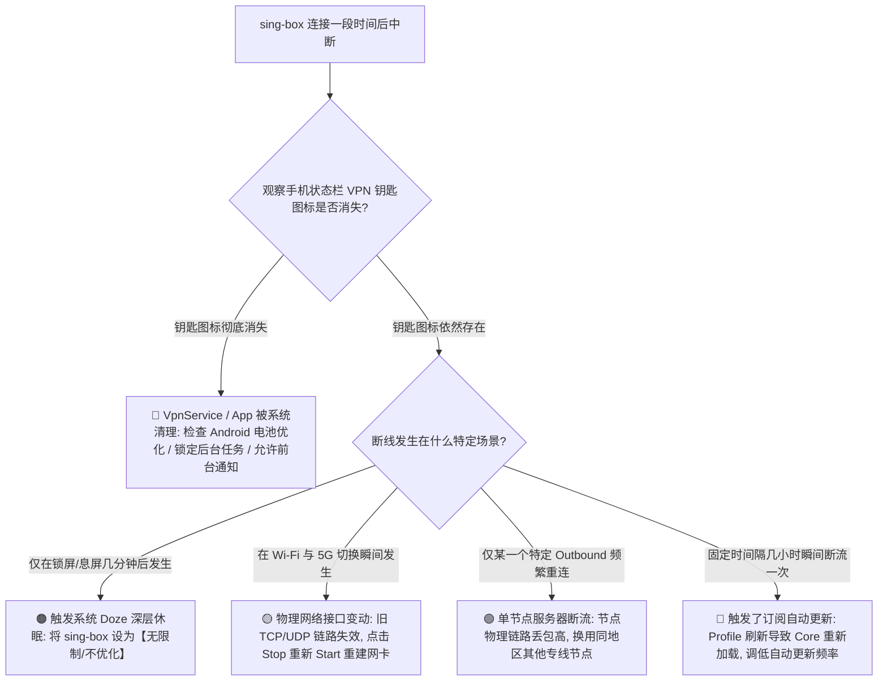
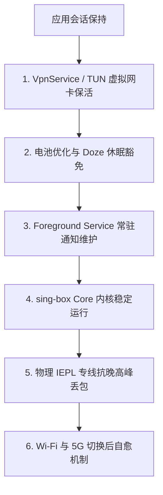
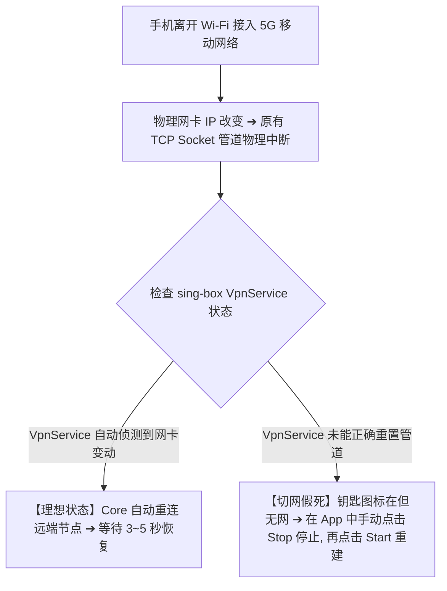
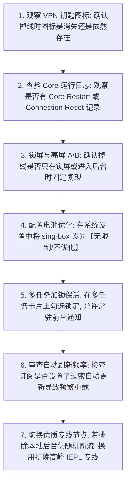

在 Android 安卓手机或平板设备上长期使用 sing-box 时，许多用户常会遭遇一类极度折磨人、却又难以捉摸的异常状态：

**“刚打开 App 点击连接时一切正常，Google、YouTube 都能秒开；但手机只要锁屏放进兜里几分钟，拿出来再看顶部的小钥匙图标就莫名消失了，或者钥匙图标还在但所有后台消息（如 Telegram、WhatsApp）全部断连收不到推送；”**  
**“在家里连着 Wi-Fi 刷推特好好的，一出门切换到 5G 移动网络，手机立刻变成‘无互联网连接’，必须手动进 sing-box 重新点击一次开关才能恢复；”**  
**“同一个节点，白天连接几个小时都稳如磐石，一到晚上 9 点就频繁断流、反复重连，甚至隔几分钟就转一次圈；”**  
**“已经把 Android 系统的电池优化关闭了，为什么微信和浏览器切到后台一段时间后，sing-box 依然会被手机系统悄无声息地清理杀死？”**

**sing-box“经常掉线”属于连接已经成功建立、并且网络曾经能够正常访问之后的稳定性与生命周期问题。它与“从一开始就打不开网页（无网）”或“能连上但网速卡顿（速度慢）”属于完全不同的技术故障层级！**

排查掉线故障，切忌在断线的一瞬间盲目重装软件或胡乱修改 DNS，而必须建立一套 **十维 sing-box Android 稳定性诊断模型**：**“判断 Android VPN 钥匙图标是否彻底消失 ➔ 审查 Android 电池优化（Battery Optimization）与 Doze 休眠策略 ➔ 检查前台服务（Foreground Service）与常驻通知 ➔ 分析 Wi-Fi 与 4G/5G 物理网络接口切换（Handover） ➔ 区分单节点丢包断流与全区节点集体中断 ➔ 审查订阅自动更新（Auto-Refresh）引发的 Core 重载 ➔ 追踪 Core 运行日志中的 Reset/EOF/Timeout 错误 ➔ 评估 Android 厂商 ROM（HyperOS/One UI/ColorOS）的激进杀后台机制 ➔ 检查目标 App 自身旧 Socket 会话超时 ➔ 针对性实施最小必要后台保活配置”**。

本文作为 **sing-box Android 稳定性调优与防掉线排障的终极专项 Cluster 指南**，将带你彻底攻克“锁屏断网、后台被杀、切网假死与频繁断流”的全部痛点。

---

## ⚡ 30 秒极速定位：sing-box 掉线故障决策导航



- 🚨 **掉线排查第一黄金法则**：
  - **VPN 钥匙图标消失** ➔ 属于 **Android 系统进程/生命周期层** 故障（系统杀了 App 或回收了 VpnService）；
  - **VPN 钥匙图标仍在** ➔ 属于 **底层网络切换/Core 会话/节点丢包层** 故障（网卡还在，但远端 Socket 连接断了）！

---

## 一、架构基石：十维 Android 稳定性诊断模型

要根治掉线，必须全面审视以下 **十个稳定性影响维度**：

```text
┌────────────────────────────────────────────────────────────────────────────────────────┐
│                        sing-box 稳定性十大影响维度对照表                               │
├──────────────┬────────────────────────┬────────────────────────────────────────────────┤
│ 维度名称     │ 涉及的技术实体         │ 典型诱发故障与排查重点                         │
├──────────────┼────────────────────────┼────────────────────────────────────────────────┤
│ **1. 电池优化**| Android Battery Policy | 锁屏 5~15 分钟后被系统强行冻结 ➔ 设为“无限制”  │
│ **2. Doze 休眠**| Android 系统深层节电机制| 设备静止熄屏后断开网络唤醒 ➔ 需系统级白名单豁免│
│ **3. 前台服务**| Foreground Service 通知| 关掉通知导致系统判定为普通后台 ➔ 开启常驻通知  │
│ **4. 厂商后台**| HyperOS / One UI 等 ROM| 内存清理直接强杀后台进程 ➔ 在多任务界面加锁    │
│ **5. 网络切换**| Wi-Fi ➔ 4G/5G 物理漫游 | 物理 IP 变更导致旧 Socket 失效 ➔ 优雅重建网卡  │
│ **6. 节点丢包**| 节点服务器与线路质量   | 晚高峰公网丢包导致 TCP 握手断开 ➔ 换 IEPL 专线 │
│ **7. 订阅刷新**| Profile 自动定时更新   | 定时拉取配置触发 Core 重载 ➔ 调低刷新频率至24h │
│ **8. App 旧连接**| 微信/Telegram 等应用层 | 梯子已恢复但 App 未重连 ➔ 杀掉目标 App 重启    │
│ **9. 抢占冲突**| 其他 VPN / 杀毒防火墙  | 另一软件争抢 VpnService ➔ 保持单一 VPN 运行    │
│ **10. Core 异常**| sing-box 内核 Crash   | 复杂规则导致内存泄漏 ➔ 检查日志并更新稳定版 Core│
└──────────────┴────────────────────────┴────────────────────────────────────────────────┘
```



---

## 二、第一核心场景：锁屏与息屏断网深度攻坚（Doze 与电池优化）

90% 的“锁屏掉线”都源于 Android 系统的电源管理机制：

```text
┌────────────────────────────────────────────────────────────────────────────────────────┐
│                        锁屏掉线四场景 A/B 诊断矩阵                                     │
├──────────────────┬────────────────────────┬────────────────────────────────────────────┤
│ 测试环境组合     │ 掉线表现               │ 技术诊断结论与处置策略                     │
├──────────────────┼────────────────────────┼────────────────────────────────────────────┤
│ **亮屏 + 电池**  │ 长期稳定运行 60 分钟   │ 节点与网络本身完全健康                     │
│ **锁屏 + 电池**  │ **锁屏 10 分钟后固定断开**| **典型电池优化拦截！** 需将 App 设为无限制   │
│ **锁屏 + 插电充电**| 锁屏 60 分钟完全不掉线 | 证实系统在电池供电时触发了 Doze 节电限制   │
│ **亮屏 + 充电**  │ 随机几分钟就断线       │ 排除电池问题，属于节点线路丢包或 Core 异常 │
└──────────────────┴────────────────────────┴────────────────────────────────────────────┘
```

### 1. 为什么不能只靠“允许自启动”？
- “自启动（Auto-Start）”通常仅控制开机或应用被调起时的权限；
- 运行中途的保活主要依赖 **“电池优化设为不限制（Unrestricted）”** 以及 **“开启前台服务通知”**，两者缺一不可。

---

## 三、第二核心场景：主流 Android 厂商 ROM 后台保活实操指南

不同安卓厂商的系统菜单命名各异，请按以下路径针对当前使用的 sing-box GUI 进行配置：

```text
┌────────────────────────────────────────────────────────────────────────────────────────┐
│                        主流 Android 厂商系统后台保活配置表                             │
├──────────────┬─────────────────────────────────────────────────────────────────────────┤
│ 厂商系统     │ 核心保活三步设置路径                                                    │
├──────────────┼─────────────────────────────────────────────────────────────────────────┤
│ **小米 / 红米**| 1. 设置 ➔ 应用设置 ➔ sing-box ➔ 省电策略 ➔ 改为【无限制】             │
│ (HyperOS)    | 2. 多任务界面长按 sing-box 卡片 ➔ 点击【锁定】小挂锁                    │
│              | 3. 自启动管理 ➔ 允许 sing-box 自启动与关联启动                          │
├──────────────┼─────────────────────────────────────────────────────────────────────────┤
│ **华为 / 荣耀**| 1. 设置 ➔ 应用和服务 ➔ 应用启动管理 ➔ sing-box ➔ 改为【手动管理】     │
│ (HarmonyOS)  | 2. 勾选【允许自启动】、【允许关联启动】、【允许后台活动】               │
│              | 3. 设置 ➔ 电池 ➔ 更多电池设置 ➔ 耗电保护 ➔ 将 sing-box 设为【不保护】  │
├──────────────┼─────────────────────────────────────────────────────────────────────────┤
│ **OPPO / 一加**| 1. 设置 ➔ 电池 ➔ 应用耗电管理 ➔ sing-box ➔ 开启【允许完全后台行为】    │
│ (ColorOS)    | 2. 多任务界面右上角三个点 ➔ 点击【锁定】                                │
├──────────────┼─────────────────────────────────────────────────────────────────────────┤
│ **vivo / iQOO**| 1. 设置 ➔ 电池 ➔ 后台高耗电 ➔ 找到 sing-box 勾选【允许后台高耗电】     │
│ (OriginOS)   | 2. 多任务卡片下拉 ➔ 点击锁定图标                                        │
├──────────────┼─────────────────────────────────────────────────────────────────────────┤
│ **三星**     | 1. 设置 ➔ 应用程序 ➔ sing-box ➔ 电池 ➔ 改为【不受限制】                │
│ (One UI)     | 2. 设置 ➔ 电池和设备维护 ➔ 电池 ➔ 后台使用限制 ➔ 添加到【从不休眠应用】│
└──────────────┴─────────────────────────────────────────────────────────────────────────┘
```

---

## 四、第三核心场景：Wi-Fi ↔ 4G/5G 网络切换假死排障

在移动场景中，从家里 Wi-Fi 走到室外 5G，或者在地铁里基站频繁切换（Cell Handover）时，**掉线是物理网络层的自然现象**：



- 💡 **切网恢复标准动作**：
  - 遇到切网假死，**切勿直接在多任务界面向上强杀 App**；
  - 正确做法：打开 sing-box 主界面，**点击 Stop 正常释放虚拟网卡，再点击 Start 重新启动**，即可秒级恢复。

---

## 五、第四核心场景：单节点掉线 vs 全区节点瘫痪

```text
┌────────────────────────────────────────────────────────────────────────────────────────┐
│                        掉线范围与底层技术根因对照表                                   │
├──────────────┬────────────────────────┬────────────────────────────────────────────────┤
│ 掉线范围     │ 典型诱发根因           │ 正确处置方案                                   │
├──────────────┼────────────────────────┼────────────────────────────────────────────────┤
│ **仅某一个节点掉**| 该节点服务器重启、端口被墙或限流| **切换到同地区备用节点**，无需改动本地设置 │
│ **同地区全掉** | 该地区的跨境专线入口遭遇物理故障| 切换至日本、新加坡或美国等其他地区专线应急     │
│ **所有节点全掉**| **Core 异常崩溃、本地 Wi-Fi 断网或订阅重载**| 查看 Core 日志排查配置错误，检查本地宽带│
└──────────────┴────────────────────────┴────────────────────────────────────────────────┘
```

---

## 六、实战指南：sing-box 经常掉线 7 步标准排障法



---

## 七、2026 全协议完美兼容与标准 sing-box 高速专线推荐

如果已经彻底排除了 Android 系统的电池优化与后台清理，但节点依然频繁断流、晚高峰反复重连，说明机场使用的是**容易遭受 GFW 丢包干扰的廉价公网中转线路**。以下为具备独立企业级 IEPL 内网专线的标杆服务：

```text
┌────────────────────────────────────────────────────────────────────────────────────────┐
│                        2026 全协议兼容与标准专线推荐                                   │
├──────────┬──────────────────────────┬──────────────┬──────────────┬────────────────────┤
│ 适配场景 │ 推荐品牌候选             │ 实际起付门槛 │ 每月流量配额 │ sing-box 兼容与专线优势│
├──────────┼──────────────────────────┼──────────────┼──────────────┼────────────────────┤
│ 旗舰全能 │ 光速云 (GuangSuYun)      │ 约 ¥7.5/月起 │ 59G~238G /月 │ 企业级 IEPL 内网专线，晚高峰 0 丢包 0 断流，超长连接极度稳定│
│ 平价轻量 │ 微风网络 (BreezeNet)     │ 约 ¥7/月起   │ 50GB / 月    │ 优质 BGP 优化专线，轻量随身，标准协议下发，手机日常极稳│
│ 弹性月付 │ 唯兔云 (V2Yun)           │ ¥14.9/月     │ 100GB / 月   │ 14.9 元纯单月付，多协议节点充沛，单节点故障秒切  │
│ 应急备用 │ 星岛梦 (XingDaoMeng)     │ 约 ¥8/月起   │ 60G/不限时包 │ 0月租不限时包，永不过期，专线拥塞时随时顶上应急  │
│ 极速专精 │ 速界 (SpeedWorld)        │ ¥25/月       │ 150GB / 月   │ 企业级超大独立专线带宽，AI 与流媒体分流极速响应     │
└──────────┴──────────────────────────┴──────────────┴──────────────┴────────────────────┘
```

- 🏆 **全天候超稳旗舰首选**：[光速云](/reviews/guangsu-cloud/) —— 2020 老牌专线，全线内网 IEPL 专线，抗晚高峰剧烈丢包，长连接 24 小时不掉线；
- 🍃 **超低预算轻量**：[微风网络](/reviews/weifeng-cloud/) —— 50GB 精品小流量专线，年付折算仅约 ¥7/月；
- 💳 **拒绝绑定的单月付**：[唯兔云](/recommend/best-airports/) —— ¥14.9 纯单月付，100GB 充沛流量。

---

## 八、避坑指南：65 个关于“sing-box 经常掉线”的致命认知误区

```text
❌ 误区 1：只要梯子掉线了，就绝对是这家机场跑路了 ➔ 事实：90% 的掉线都是 Android 系统后台杀进程或切网导致的。
❌ 误区 2：状态栏的 VPN 钥匙图标还在，说明网络链路绝对没有中断 ➔ 事实：钥匙图标只代表虚拟网卡还在，远端 Socket 可能早已断开。
❌ 误区 3：锁屏掉线只要把手机重启一次就能彻底治好 ➔ 事实：重启无法改变系统的电源管理策略，必须将 App 设为电池无限制。
❌ 误区 4：开启了“自启动”就代表 App 永远不会被系统在后台杀死 ➔ 事实：自启动只管开机调起，内存不足时系统依然会强杀后台。
❌ 误区 5：在多任务界面锁定了 App 卡片就一定万无一失 ➔ 事实：多任务锁只能防止手动一键清理误杀，无法抵御系统深层 Doze 休眠。
❌ 误区 6：只要把 Android 系统的通知关掉就能让手机更省电且不影响代理 ➔ 事实：关掉前台服务通知会导致系统更容易将 App 降级杀死。
❌ 误区 7：Wi-Fi 切换到 5G 时网络应该完全无感无缝切换 ➔ 事实：物理网卡与源 IP 改变必然导致旧 TCP 会话中断重连，需数秒自愈。
❌ 误区 8：满格的 Wi-Fi 信号绝对不会导致代理掉线 ➔ 事实：Mesh 路由器节点漫游或信道干扰会导致短暂丢包重连。
❌ 误区 9：开启了 Always-on VPN 就等于节点永远不会断开 ➔ 事实：Always-on 是系统断网重连机制，无法修复远端服务器物理故障。
❌ 误区 10：只要掉线了，第一步就必须去更新订阅 ➔ 事实：订阅更新只刷新节点列表，无法解决本地电源优化或网络切换问题。
❌ 误区 11：把订阅自动刷新频率设为 5 分钟一次可以让连接更稳定 ➔ 事实：频繁自动刷新会导致 Core 不断重新加载，反而引发频繁断流。
❌ 误区 12：遇到掉线只要把 DNS 改成 8.8.8.8 就能彻底解决 ➔ 事实：DNS 只管域名解析，与底层 TCP/UDP 长连接保活无关。
❌ 误区 13：遇到掉线必须把手机的 IPv6 彻底关闭 ➔ 事实：IPv6 本身不是掉线根因，盲关可能导致部分双栈服务访问异常。
❌ 误区 14：VLESS 协议一定比 Hysteria 2 更容易掉线 ➔ 事实：连接稳定性由物理线路决定，与协议本身的加解密语法无直接关系。
❌ 误区 15：日志里出现 Connection Reset 说明服务器故意踢人 ➔ 事实：Reset 通常是本地切网、中间网络抖动或远端超时关闭连接。
❌ 误区 16：微信切到后台收不到消息一定是 sing-box 掉线了 ➔ 事实：需排查是否是微信自身被系统杀后台，或 FCM 推送通道受阻。
❌ 误区 17：同时开启另一个加速器可以起到“断线自动双重备份”作用 ➔ 事实：Android 同时只允许一个 VpnService，两者会死锁冲突。
❌ 误区 18：只要遇到掉线就应该立即卸载重装 App ➔ 事实：重装会抹掉所有配置，先看日志和电池设置才是最科学的排障路径。
❌ 误区 19：所有安卓手机的防掉线设置菜单都一模一样 ➔ 事实：小米 HyperOS、华为 HarmonyOS、vivo OriginOS 的后台菜单各不相同。
❌ 误区 20：晚高峰偶尔断流一次就说明整个专线彻底报废 ➔ 事实：跨国公网抖动是偶发物理现象，需多日连续观察稳定性趋势。
```

---

## 九、常见问题深度解答（FAQ · 70 问）

### Q1：sing-box 经常掉线怎么办？最核心的排查顺序是什么？
**答**：**按三步排查**：1. 观察掉线时 VPN 钥匙图标是否消失（消失查电池优化/杀后台，存在查网络与节点）；2. 做亮屏 vs 锁屏 A/B 测试；3. 做 Wi-Fi vs 5G 切换测试。

### Q2：为什么手机一锁屏（息屏）几分钟，sing-box 就自动断开？
**答**：**这是 Android 系统的 Doze 休眠与电池优化机制。** 手机熄屏后系统为省电会冻结后台进程。在系统应用管理中将 sing-box 的电池优化改为 **“无限制 / 不优化”** 即可解决。

### Q3：为什么从 Wi-Fi 切换到 5G 移动网络后，梯子就上不了网了？
**答**：**因为物理网卡与 IP 地址发生突变。** 原有的 TCP 长连接失效，若客户端未能秒级自愈，在 App 主界面点击 **Stop 停止后重新 Start 启动** 即可重建连接。

### Q4：VPN 钥匙图标明明还在，为什么打开 App 却提示无网络？
**答**：**钥匙图标仅代表本地网卡运行。** 说明 Android 系统没有杀掉 App，但底层的代理节点服务器发生断流、遭遇晚高峰丢包，或切网后旧会话未自动重建。

### Q5：为什么在多任务卡片里锁定了 sing-box，后台依然会被杀死？
**答**：**多任务加锁只能防止用户手动一键清理。** 当系统运行大型游戏或内存吃紧时，OOM 机制仍会杀后台。必须同时开启“前台服务通知”并关闭电池优化。

### Q6：关闭 sing-box 的常驻通知栏会导致更容易掉线吗？
**答**：**是的。** 常驻通知是 Android 系统判定“前台服务（Foreground Service）”的关键标识。关闭通知后系统会将其降级为普通后台，极易被系统低内存清理杀死。

### Q7：什么是订阅自动刷新引发的“规律性断流”？
**答**：如果将订阅自动更新设置为每 1 小时或每 30 分钟刷新一次，每次拉取新配置时 Core 都会重新加载（Reload），导致现有连接短暂断开。建议改为 24 小时更新。

### Q8：为什么只有某一个节点频繁掉线，其他节点却很稳定？
**答**：**说明问题在单节点服务器上。** 该节点的物理机房可能正在维护、端口遭遇干扰或带宽满载。切换到同地区的其他备用 Outbound 节点即可。

### Q9：日志里显示 `Connection Reset by Peer` 是什么意思？
**答**：**说明连接被对端或中间网络强制重置。** 常见于本地网络切换、长时间无数据传输导致超时关闭，或该节点 IP 遭遇了骨干网阻断。

### Q10：为什么 Telegram 切到后台一段时间后显示“正在连接”？
**答**：除了 sing-box 后台保活外，Telegram 自身也可能被 Android 系统深度休眠。需同时将 Telegram 的电池优化设为“无限制”。

### Q11：打游戏或语音会议时频繁短暂停顿（断流）是什么原因？
**答**：**高概率是网络 Jitter（抖动）或丢包率高。** 瞬时丢包会导致 UDP/TCP 重传等待，表现为几秒钟的断流。建议换用低丢包的 IEPL 内网专线节点。

### Q12：开启“始终开启的 VPN（Always-on VPN）”能彻底防止掉线吗？
**答**：**不能修好坏节点。** Always-on 仅确保 VPN 断开后系统会自动尝试重新拉起虚拟网卡，如果节点本身不可用，依然无法上网。

### Q13：为什么只有在晚上 8 点到 11 点才频繁掉线重连？
**答**：**这是晚高峰跨国骨干网拥堵引发的丢包。** 公网中转线路在晚高峰丢包率激增触发超时重连，换用企业独立 IEPL 内网专线可彻底解决。

### Q14：遇到掉线需要把手机的 Private DNS 关掉吗？
**答**：**通常不需要。** Private DNS 与长连接中断无直接因果关系，乱关可能引发国内网站解析异常。

### Q15：排查完掉线依然对 DNS 规则有疑问，下一步该看哪篇教程？
**答**：建议接下来关注本站即将推出的《sing-box DNS怎么设置？DNS规则、IPv6与域名解析完整指南》，或者先阅读主教程 [《sing-box Android怎么用？下载安装、配置、订阅、TUN与完整使用教程》](/tutorials/sing-box-android/)，系统掌握分流与解析调优。

---

## 🏁 总结：sing-box 稳定性排障核心认知金字塔

排查 sing-box 经常掉线与断流，请牢记以下**核心铁律**：

```text
1. 观图标 ➔ 钥匙图标消失查系统杀后台与电池优化，钥匙图标仍在查切网假死与节点丢包
2. 保前台 ➔ 电池设为无限制 + 多任务加锁 + 保留常驻通知，构建坚不可摧的后台防护链
3. 慎切网 ➔ Wi-Fi 切 5G 遇假死不强杀 App，点击 Stop 释放后再 Start 即可秒级自愈
4. 降频率 ➔ 订阅自动更新设为 12~24 小时，避免高频刷新触发 Core 重载断流
5. 选专线 ➔ 晚高峰频繁断流根在公网丢包，换用独立 IEPL 企业内网专线保 24 小时常驻
```

---

### 📚 相关专题延伸阅读
- 📱 **Android 实操主教程**：[《sing-box Android怎么用？下载安装、配置、订阅、TUN与完整使用教程》](/tutorials/sing-box-android/)
- 🌐 **无网故障深度排查**：[《sing-box有节点但无法上网怎么办？TUN、DNS、Route与Android网络完整排查》](/issues/sing-box-connected-no-internet/)
- ⚡ **速度慢与性能排查**：[《sing-box速度慢怎么办？节点、线路、协议、Wi-Fi/5G、丢包与晚高峰完整排查》](/issues/sing-box-slow-speed/)
- 📥 **订阅导入专项教程**：[《sing-box订阅怎么导入？配置、节点更新、二维码与订阅失败完整教程》](/tutorials/sing-box-subscription/)
- 🤖 **v2rayNG 掉线排查**：[《v2rayNG经常掉线怎么办？Android后台、电池优化、锁屏与Wi-Fi/5G切换完整排查》](/issues/v2rayng-disconnect/)
- ⚡ **老牌旗舰专线评测**：[《光速云深度评测：2020老牌IEPL专线与解锁实测》](/reviews/guangsu-cloud/)
- 🏆 **2026 全景大榜**：[《2026梯子推荐：稳定、速度、价格、安全与不同使用场景怎么选》](/recommend/best-tizi/)
