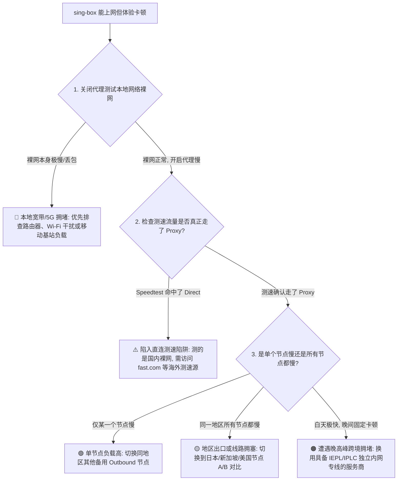
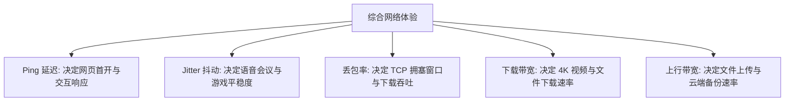
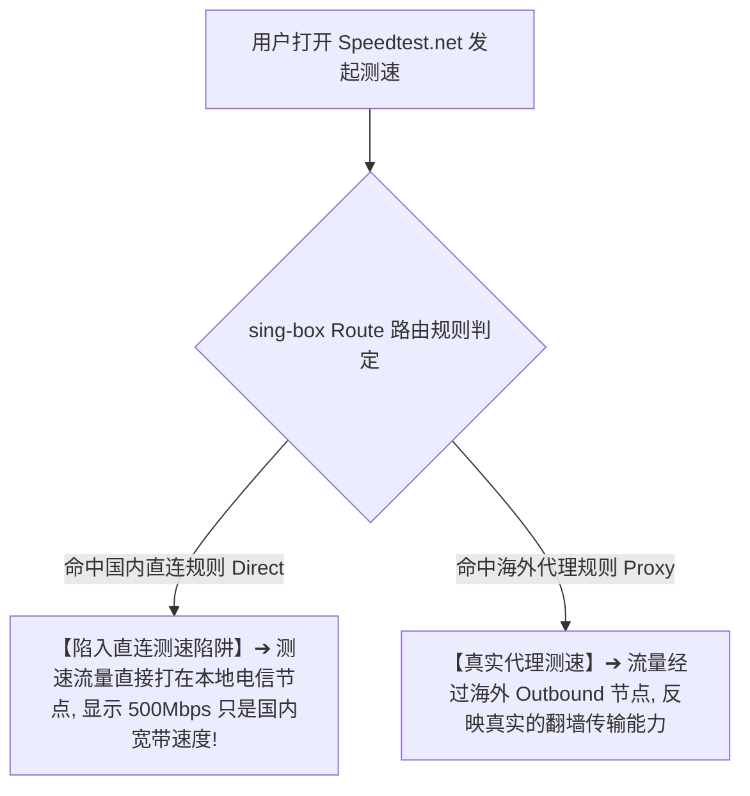
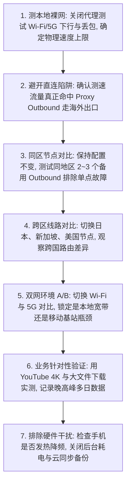

在 Android 安卓手机或平板设备上使用 sing-box 时，许多用户常会遇到与“速度”相关的棘手困惑：

**“明明节点已经成功连接，网页也能勉强打开，但刷 YouTube 时 4K 视频疯狂缓冲转圈，甚至降到 720p 依然卡顿；”**  
**“在测速软件里测出来有 300Mbps，但实际去下载一个海外安装包或 GitHub Release 文件时，速度却死死卡在几百 KB/s；”**  
**“同一个香港节点，白天用起来非常丝滑流畅，但一到晚上 8 点至 11 点的晚高峰，延迟瞬间飙升到 500ms 以上，丢包率高得连网页都打不开；”**  
**“为什么在家里连 Wi-Fi 速度极慢，切换到手机 5G 移动网络后却秒开？或者反过来 5G 很慢而 Wi-Fi 极快？”**  
**“经常有人推荐 Hysteria 2 或 VLESS-REALITY，换了协议之后真的能让梯子网速物理翻倍吗？TUN 模式到底是加速还是会增加耗电拖慢网速？”**

**sing-box“速度慢”的前提是：配置文件已成功加载、TUN 虚拟网卡正常运行、且数据链路已经完全通畅。它与“完全打不开网页（无网）”或“运行中途突然中断（掉线）”属于完全不同的技术维度。**

排查 sing-box 的网速问题，绝不能只盯着一个简单的“Ping 延迟数字”，也不能迷信“换个协议就能起死回生”，而必须建立一套 **十维 sing-box 性能诊断模型**：**“确认本地裸网基线 ➔ 辨析五大性能指标（Ping / Jitter / Loss / Down / Up） ➔ 避开 Route 直连测速陷阱 ➔ 执行 Wi-Fi 与 4G/5G 网络 A/B 测试 ➔ 区分单节点拥堵与全区线路瓶颈 ➔ 剖析晚高峰骨干网拥塞 ➔ 理清物理线路（IEPL/IPLC）与协议（VLESS/Hysteria2）的层级 ➔ 评估 Android 硬件热降频与后台带宽抢占 ➔ 针对实际业务（YouTube/AI/下载）分层调优 ➔ 建立科学严格的测试对照组”**。

本文作为 **sing-box Android 性能调优与测速排障的终极专项 Cluster 指南**，将带你剥离层层假象，彻底搞懂网络性能的瓶颈所在，并提供标准排查方案。

---

## ⚡ 30 秒极速定位：sing-box 性能故障诊断导航



- 🚨 **核心性能铁律**：
  - **低 Ping 延迟 ≠ 高下载带宽**：30ms 的香港节点可能因服务器限速下载极慢，而 150ms 的美国节点却能稳定跑满 500Mbps 4K 视频；
  - **测速前必须看日志确认流量走的是 Proxy Outbound**，切莫把 Direct 直连的国内测速当成节点性能！

---

## 一、架构基石：五大性能核心指标深度剖析

评估代理网络性能，必须将以下 **五项独立指标** 拆开观察：

```text
┌────────────────────────────────────────────────────────────────────────────────────────┐
│                        网络性能五大核心指标与业务影响对照表                           │
├──────────────┬────────────────────────┬────────────────────────┬───────────────────────┤
│ 指标名称     │ 衡量单位与技术本质     │ 主要影响的业务场景     │ 异常表现与典型根因    │
├──────────────┼────────────────────────┼────────────────────────┼───────────────────────┤
│ **1. Latency (Ping)**| 毫秒 (ms)，往返往返时延 | 网页首包响应、SSH、游戏交互| 页面点击后转圈延迟高 ➔ 物理距离远或中转跳数多│
│ **2. Jitter (抖动)** | 毫秒 (ms)，延迟波动幅度 | 实时语音通话、视频会议、电竞| 语音断断续续、游戏瞬间卡顿 ➔ 路由路径不稳定│
│ **3. Packet Loss**   | 百分比 (%)，丢包率     | TCP 吞吐极限、长连接稳定性| 下载速率雪崩、视频缓冲 ➔ 晚高峰国际出口拥堵│
│ **4. Download (下行)**| Mbps，下行持续吞吐带宽 | YouTube 4K、大文件下载、图片| 视频自动降画质 ➔ 服务器限速或线路总带宽吃紧│
│ **5. Upload (上行)**  | Mbps，上行持续传输能力 | 网盘备份、AI 附件上传、直播 | 附件上传卡死 ➔ 本地家庭宽带上行被运营商限制│
└──────────────┴────────────────────────┴────────────────────────┴───────────────────────┘
```



---

## 二、第一核心排查点：本地裸网基线与 Wi-Fi / 5G A/B 测试

任何代理测速的前提，都是确认**手机本身的物理接入网络是否健康**：

```text
┌────────────────────────────────────────────────────────────────────────────────────────┐
│                        Wi-Fi vs 4G/5G 物理网络排查矩阵                                 │
├──────────────┬────────────────────────┬────────────────────────────────────────────────┤
│ 网络环境     │ 常见性能瓶颈           │ 正确排查与优化策略                             │
├──────────────┼────────────────────────┼────────────────────────────────────────────────┤
│ **2.4GHz Wi-Fi**| 频宽窄、信道干扰严重、吞吐受限| **切换至 5GHz 频段 Wi-Fi**，避开微波炉与蓝牙干扰│
│ **5GHz Wi-Fi**  | 穿墙能力弱、隔墙衰减大 | 尽量靠近路由器测试，检查 Mesh 节点无线回程衰减 │
│ **移动 4G/5G**  | 晚高峰基站拥塞、室内信号弱| 观察 RSRP 信号强度，尝试开启/关闭飞行模式重选基站│
└──────────────┴────────────────────────┴────────────────────────────────────────────────┘
```

- 💡 **网络 A/B 控制变量法**：
  - 保持 sing-box 配置和选中的节点完全不变，分别在 **Wi-Fi** 和 **5G** 下进行测速；
  - 若 Wi-Fi 下很慢但 5G 秒开，瓶颈在本地路由器/光猫；若 5G 很慢但 Wi-Fi 秒开，瓶颈在移动基站或 APN。

---

## 三、第二核心排查点：警惕“Route 直连测速陷阱”

这是新手在测试 sing-box 速度时**最容易上当受骗的致命误区**：



- 🚨 **如何避开测速假象**：
  1. 测速时打开 sing-box 的 Core 日志，观察测速请求的 Outbound 是否为 `proxy`；
  2. 推荐使用海外专属测速平台（如 `https://fast.com` 或 `https://speed.cloudflare.com`），确保流量必须经过海外出口。

---

## 四、第三核心排查点：物理线路（IEPL/专线）与协议（VLESS/Hy2）严格辨析

很多用户误以为“换了 Hysteria 2 速度就能从 10M 变成 100M”，**这是把协议与物理线路严重混淆了**：

```text
┌────────────────────────────────────────────────────────────────────────────────────────┐
│                        物理线路 vs 传输协议技术分工表                                  │
├──────────────┬──────────────────┬──────────────────┬───────────────────────────────────┤
│ 技术层级     │ 包含的核心实体   │ 决定的核心性能   │ 调优与排查真相                    │
├──────────────┼──────────────────┼──────────────────┼───────────────────────────────────┤
│ **物理线路层**| 直连 / 中转 / IEPL / IPLC| **物理延迟、带宽上限、晚高峰丢包**| 物理线路拥塞时，换任何协议都无济于事│
│ **协议封装层**| VLESS / Trojan / Hysteria2| **加密开销、握手延迟、抗丢包算法**| Hysteria 2 仅在恶劣丢包环境下更具抢带宽优势│
└──────────────┴──────────────────┴──────────────────┴───────────────────────────────────┘
```

- 💡 **线路倍率陷阱澄清**：
  - 节点列表里的 `0.5x`、`1.0x`、`2.0x` **是计费扣费倍率，绝非网速快慢的倍数**！
  - `2.0x` 的节点不代表速度比 `1.0x` 快 2 倍，盲目切换高倍率节点只会白白消耗流量。

---

## 五、第四核心排查点：晚高峰跨国骨干网拥塞

如果你的 sing-box 呈现 **“白天飞快、晚上 8 点到 11 点剧烈卡顿”** 的规律性变化，属于典型的晚高峰拥堵：

```text
┌────────────────────────────────────────────────────────────────────────────────────────┐
│                        晚高峰拥塞三大层级与表现对照表                                 │
├──────────────┬────────────────────────┬────────────────────────────────────────────────┤
│ 拥塞发生层级 │ 典型诱因与现象         │ 应对方案与优化建议                             │
├──────────────┼────────────────────────┼────────────────────────────────────────────────┤
│ **1. 本地运营商**| 小区宽带晚间集中用网 ➔ 裸网丢包| 联系运营商报修，或切换 5G 移动网络分流         │
│ **2. 公网跨国骨干**| 普通直连/中转公网出口遭遇 QoS 限速| **换用具备企业级独立内网专线（IEPL/IPLC）的节点**│
│ **3. 机场服务端**| 某热门节点同时在线人数爆满 ➔ CPU 吃紧| 避开“香港 01”等热门第一节点，换用同地区冷门节点│
└──────────────┴────────────────────────┴────────────────────────────────────────────────┘
```

---

## 六、第五核心排查点：实际业务场景专项调优

不同网络业务对指标的需求完全不同，必须对症下药：

```text
┌────────────────────────────────────────────────────────────────────────────────────────┐
│                        核心业务场景性能诉求与调优矩阵                                 │
├──────────────┬────────────────────────┬────────────────────────────────────────────────┤
│ 业务场景     │ 最敏感的核心指标       │ 针对性优化方案                                 │
├──────────────┼────────────────────────┼────────────────────────────────────────────────┤
│ **YouTube 4K**| **持续下行带宽 + 低丢包** | 选带宽充沛的专线节点，避开晚高峰公网中转节点   │
│ **ChatGPT/AI**| **首包响应 Ping + 原生出口 IP**| 选地理距离近的香港/日本原生节点，兼顾响应与风控│
│ **电竞游戏** | **极低 Ping + 极低 Jitter (抖动)**| 选专属 IEPL 直连专线，严禁使用跳 Ping 严重的中转│
│ **视频会议** | **上行带宽 + 零丢包**   | 确保本地家庭宽带上行充足，避免多设备同时上传   │
└──────────────┴────────────────────────┴────────────────────────────────────────────────┘
```

---

## 七、实战指南：sing-box 速度慢 7 步标准排障法



---

## 八、2026 全协议完美兼容与标准 sing-box 高速专线推荐

如果本地网络、Wi-Fi/5G、sing-box 配置与手机硬件均正常，但所有节点无论白天还是晚高峰都持续卡顿，根本原因是机场使用的是**拥塞的公网中转或廉价直连线路**。以下为具备独立企业内网 IEPL 专线的标杆服务：

```text
┌────────────────────────────────────────────────────────────────────────────────────────┐
│                        2026 全协议兼容与标准专线推荐                                   │
├──────────┬──────────────────────────┬──────────────┬──────────────┬────────────────────┤
│ 适配场景 │ 推荐品牌候选             │ 实际起付门槛 │ 每月流量配额 │ sing-box 兼容与专线优势│
├──────────┼──────────────────────────┼──────────────┼──────────────┼────────────────────┤
│ 旗舰全能 │ 光速云 (GuangSuYun)      │ 约 ¥7.5/月起 │ 59G~238G /月 │ 全线企业级 IEPL 专线，晚高峰 0 丢包，YouTube 4K 秒开，完美兼容 sing-box│
│ 平价轻量 │ 微风网络 (BreezeNet)     │ 约 ¥7/月起   │ 50GB / 月    │ 优质 BGP 优化专线，纯净轻量，节点更新秒级响应，日常极稳│
│ 弹性月付 │ 唯兔云 (V2Yun)           │ ¥14.9/月     │ 100GB / 月   │ 14.9 元纯单月付，多协议节点充沛，单节点故障秒切  │
│ 应急备用 │ 星岛梦 (XingDaoMeng)     │ 约 ¥8/月起   │ 60G/不限时包 │ 0月租不限时包，永不过期，专线拥塞时随时顶上应急  │
│ 极速专精 │ 速界 (SpeedWorld)        │ ¥25/月       │ 150GB / 月   │ 企业级超大独立专线带宽，AI 与流媒体分流极速响应     │
└──────────┴──────────────────────────┴──────────────┴──────────────┴────────────────────┘
```

- 🏆 **全协议旗舰专线首选**：[光速云](/reviews/guangsu-cloud/) —— 2020 老牌专线，全线内网 IEPL 专线，原生标准 sing-box 订阅，晚高峰 4K 拖拽无缓冲；
- 🍃 **超低预算轻量**：[微风网络](/reviews/weifeng-cloud/) —— 50GB 精品小流量专线，年付折算仅约 ¥7/月；
- 💳 **拒绝绑定的单月付**：[唯兔云](/recommend/best-airports/) —— ¥14.9 纯单月付，100GB 充沛流量。

---

## 九、避坑指南：60 个关于“sing-box 速度慢”的致命认知误区

```text
❌ 误区 1：只要延迟（Ping）显示 30ms，下载速度就一定会飞快 ➔ 事实：低 Ping 仅代表响应快，不代表服务器带宽充沛或没有限速。
❌ 误区 2：只要换成 Hysteria 2 协议，不管什么垃圾线路都能网速翻倍 ➔ 事实：网速由物理线路与服务器带宽决定，协议无法突破物理上限。
❌ 误区 3：节点名字写着“高速 10Gbps”就代表自己一定能跑满 10G ➔ 事实：那是机房总入口带宽，用户实际速率受线路与拥塞控制限制。
❌ 误区 4：2.0x 节点的速度一定比 1.0x 节点快 2 倍 ➔ 事实：倍率是计费扣量系数，与实际连接速度没有任何正相关关系。
❌ 误区 5：Speedtest 测出 500Mbps 就代表 YouTube 一定能流畅看 4K ➔ 事实：Speedtest 流量可能命中了 Direct 直连测的是国内宽带。
❌ 误区 6：开启 TUN 模式是一种能够让网络实现“物理加速”的特殊功能 ➔ 事实：TUN 是虚拟网卡流量接管机制，不会自动增加带宽。
❌ 误区 7：把手机系统的 Private DNS 改成 8.8.8.8 能让翻墙网速大幅提升 ➔ 事实：DNS 只负责域名解析，无法增加已建立连接的吞吐量。
❌ 误区 8：只要把手机的 IPv6 关闭，梯子网速就能立刻变快 ➔ 事实：IPv6 具有独立路由路径，需通过日志 A/B 判定，不可盲目关闭。
❌ 误区 9：香港节点在任何情况下都绝对比日本和美国节点更快 ➔ 事实：香港节点用户极多易拥堵，日本/美国专线大带宽往往吞吐更高。
❌ 误区 10：手机 Wi-Fi 信号显示满格，说明本地无线网络绝对不存在瓶颈 ➔ 事实：满格仅代表射频信号强，可能存在严重的信道拥堵与丢包。
❌ 误区 11：手机屏幕顶部显示 5G 图标就代表当前网速一定极快 ➔ 事实：基站接入用户过多或回程拥堵时，5G 网速可能不如空闲的 4G。
❌ 误区 12：在网上寻找所谓“sing-box 神级优化参数/MTU修改器”能提升网速 ➔ 事实：乱改 MTU 与 Buffer 参数极易引发数据包分片导致断网。
❌ 误区 13：YouTube 播放卡顿一定是机场节点太烂 ➔ 事实：也可能是手机开启了超级省电模式、CPU 热降频或后台正在云同步备份。
❌ 误区 14：AI 模型回复打字慢是因为梯子下载带宽不够 ➔ 事实：文本聊天只消耗几 KB 流量，打字慢是 OpenAI 服务器模型推理排队。
❌ 误区 15：晚高峰只要卡顿一次就说明该机场彻底超售跑路 ➔ 事实：需多日、多网络连续测试，排查是否为本地运营商晚高峰拥堵。
❌ 误区 16：关闭 Android 系统的所有电池优化可以让网速翻倍 ➔ 事实：电池优化只影响后台保活，不影响前台传输吞吐。
❌ 误区 17：TLS / REALITY 加密会严重拖慢网速，应该尽可能裸奔 ➔ 事实：现代手机硬件 AES 加速极快，加密开销微乎其微且保证安全。
❌ 误区 18：一次性把所有节点全部测速一遍，选延迟最低的那个就最快 ➔ 事实：批量测速测的是握手延迟，不代表持续大文件下载速率。
❌ 误区 19：只要换一个 sing-box 客户端版本就能让下载速度提升 ➔ 事实：GUI 客户端只是外壳，底层网络受物理线路主导。
❌ 误区 20：所有海外网站的下载速度都应该完全一样快 ➔ 事实：不同目标网站的源站机房与 CDN 部署不同，速度自然存在差异。
```

---

## 十、常见问题深度解答（FAQ · 70 问）

### Q1：sing-box 速度慢怎么办？最核心的排查顺序是什么？
**答**：**标准四步排查**：1. 关闭代理测试本地 Wi-Fi/5G 裸网速度；2. 确认测速流量真正走 Proxy 而非 Direct；3. 在同一地区切换 2~3 个备用节点；4. 做 Wi-Fi 与 5G 的双网 A/B 对比。

### Q2：为什么 Ping 延迟很低（如 30ms），但下载速度却极慢？
**答**：**Ping 仅代表网络往返延迟，不代表可用带宽。** 低 Ping 说明你离节点服务器近，但如果服务器总带宽受限、被限速或遭遇丢包，下载大文件依然会很慢。

### Q3：为什么美国节点 Ping 很高（150ms），看 4K 视频却比香港节点还流畅？
**答**：**因为大带宽和稳定性决定了持续吞吐。** 视频播放依赖充足的下载带宽与低丢包率，150ms 延迟只要稳定无丢包，TCP 窗口跑满后即可支撑 4K 甚至 8K 流媒体。

### Q4：什么是“Route 直连测速陷阱”？怎么避免？
**答**：很多测速网站被 sing-box 智能分流判定为国内域名走 Direct 直连，测出来的只是国内宽带速度。应访问海外测速平台（如 `fast.com`）并在日志中确认走 Proxy。

### Q5：同一节点在 Wi-Fi 下很慢、切换到 5G 却很快是什么原因？
**答**：**说明瓶颈在本地家庭网络。** 可能是家庭路由器性能较弱、Wi-Fi 处于 2.4GHz 干扰频段、光猫 MTU 异常，或者家庭宽带运营商对该节点端口实施了限速。

### Q6：同一节点在 5G 下很慢、连接 Wi-Fi 却很快是什么原因？
**答**：**说明瓶颈在移动基站或 APN 链路。** 当前位置的基站可能接入负荷过大，或者运营商分配的移动网络路由绕远，尝试开启飞行模式重连基站排查。

### Q7：什么是 Jitter（抖动）？为什么对打游戏和语音通话至关重要？
**答**：**Jitter 是延迟波动的剧烈程度。** 如果延迟在 40ms~300ms 之间频繁跳动，会导致游戏严重卡顿瞬移、语音会议声音断续。电竞和实时通话对低 Jitter 诉求极高。

### Q8：丢包率（Packet Loss）对网速有什么致命影响？
**答**：**丢包会导致 TCP 协议强制重传并降低传输窗口。** 即使只有 2%~5% 的丢包率，也会导致持续下载吞吐断崖式下跌，引发视频频繁缓冲。

### Q9：Hysteria 2 真的比 VLESS-REALITY 速度快吗？
**答**：**不一定。** Hysteria 2 基于 UDP/QUIC 开发，在劣质、高丢包的网络环境下抢带宽能力极强；但在优质稳定的专线网络下，两者速度差异微乎其微。

### Q10：节点列表里的 2.0x 节点是不是比 1.0x 节点快 2 倍？
**答**：**完全不是！** 2.0x 是流量消耗倍率（用 1G 扣 2G 流量），属于计费策略，与节点的物理带宽和实际速度毫无关联。

### Q11：为什么白天用起来很流畅，一到晚高峰（20:00-23:00）就剧烈卡顿？
**答**：**因为跨国公网骨干网在晚间遭遇流量拥塞。** 普通直连与公网中转线路在晚高峰丢包率飙升，只有具备企业独立内网专线（IEPL/IPLC）的节点才能保持全天稳定。

### Q12：开启 TUN 模式到底会不会拖慢手机网速或让手机发热？
**答**：**正常使用开销极小。** TUN 只负责系统层面的数据包转发。但在极高吞吐（如跑满千兆下载）时，Core 频繁加解密会占用部分 CPU，产生正常轻微发热。

### Q13：为什么 ChatGPT 回复速度很慢，是梯子网速不行吗？
**答**：**通常不是网络问题。** AI 文本交互仅消耗几 KB 带宽，回复缓慢通常是因为 OpenAI/Anthropic 服务器算力负荷大、模型正在排队生成推理。

### Q14：手机发热降频会影响 sing-box 的网速吗？
**答**：**会有明显影响。** 手机在高温下会主动限制 CPU 大核频率，导致底层 Core 的加解密吞吐性能下降，建议避免边高温快充边长时间进行大流量测速。

### Q15：排查完速度依然经常掉线中断，下一步该看哪篇教程？
**答**：建议接下来阅读 [《sing-box经常掉线怎么办？Android后台、电池优化、锁屏与Wi-Fi/5G切换完整排查》](/issues/sing-box-disconnect/)，全面解决连接中断问题。

---

## 🏁 总结：sing-box 性能排障核心认知金字塔

排查与优化 sing-box 网速，请牢记以下**核心铁律**：

```text
1. 验基线 ➔ 测速前必须先关代理测本地裸网，确定物理接入带宽上限
2. 防假象 ➔ 认清低 Ping 不等于高带宽，警惕 Speedtest 命中 Direct 直连测速陷阱
3. 分层级 ➔ 物理线路（IEPL专线）决定速度根本，传输协议（Hy2/VLESS）只管抗丢包
4. 做 A/B ➔ 用同一节点做 Wi-Fi vs 5G 对比，快速切分家庭宽带与移动网络瓶颈
5. 看场景 ➔ 4K 视频看持续带宽，电竞游戏看 Jitter 与丢包，AI 交互看首包延迟
```

---

### 📚 相关专题延伸阅读
- 📱 **Android 实操主教程**：[《sing-box Android怎么用？下载安装、配置、订阅、TUN与完整使用教程》](/tutorials/sing-box-android/)
- 🌐 **无网故障深度排查**：[《sing-box有节点但无法上网怎么办？TUN、DNS、Route与Android网络完整排查》](/issues/sing-box-connected-no-internet/)
- 📥 **订阅导入专项教程**：[《sing-box订阅怎么导入？配置、节点更新、二维码与订阅失败完整教程》](/tutorials/sing-box-subscription/)
- 🤖 **v2rayNG 速度排查**：[《v2rayNG速度慢怎么办？Android节点、Wi-Fi/5G、线路、丢包与晚高峰完整排查》](/issues/v2rayng-slow-speed/)
- 🐱 **Clash 速度排查**：[《Clash速度慢怎么办？节点选择、线路、延迟高与丢包排查》](/issues/clash-slow-speed/)
- ⚡ **老牌旗舰专线评测**：[《光速云深度评测：2020老牌IEPL专线与解锁实测》](/reviews/guangsu-cloud/)
- 🏆 **2026 全景大榜**：[《2026梯子推荐：稳定、速度、价格、安全与不同使用场景怎么选》](/recommend/best-tizi/)
