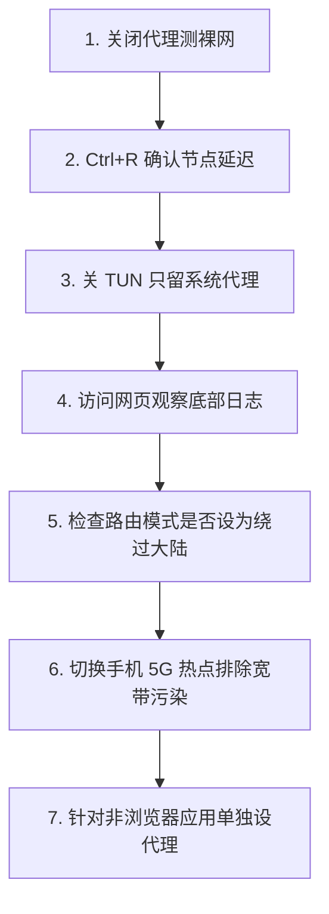

在 Windows 电脑上使用 v2rayN 进行科学上网时，最令很多用户百思不得其解的诡异故障莫过于：**“明明在主界面按下 Ctrl + R 测速，香港和日本节点都显示绿色的两百多毫秒延迟，但在 Chrome 或 Edge 浏览器中打开 Google、YouTube 或 GitHub，却依然弹出冰冷的 `无法访问此网站 / 响应时间过长 (ERR_CONNECTION_TIMED_OUT)` 错误！”**

更令人头疼的是，各种衍生症状层出不穷：

**“在 v2rayN 底部托盘明明已经勾选了‘自动配置系统代理’，为什么浏览器还是像没开代理一样完全打不开外网？”**  
**“为什么在 Chrome 浏览器里能正常看 YouTube 4K，但在命令行里运行 `git clone`、`npm install` 或玩外服游戏时，却提示网络无法连接？”**  
**“为什么不开启 TUN 模式时浏览器能上网，一旦在顶部勾选开启 TUN 模式，整台电脑反而瞬间全盘断网？”**  
**“为什么能正常打开 Google 和维基百科，但一访问 ChatGPT、Claude 或 Netflix 就提示地区限制或直接网络报错？”**  
**“为什么把 v2rayN 退出关闭之后，电脑连国内的百度、B站和微信都突然连不上了，变成彻底的‘断网瘫痪’？”**  
**“v2rayN 的 Routing（路由分流）规则中，Direct（直连）、Proxy（代理）和 Block（阻止）到底有什么讲究？是不是规则误杀导致网页打不开？”**

**在 v2rayN 中“节点存在且测速正常”，仅仅证明底层的 Xray-core 内核能够连通该代理服务器。它绝不代表 Windows 应用程序的实际流量已经成功被接管并转发出去！**

一个完整的出海访问链路必须经历：**「Windows 软件发起请求 ➔ 系统代理/TUN 拦截捕获 ➔ 送入 v2rayN 本地端口 ➔ Core 路由规则判定（Routing） ➔ 目标域名解析（DNS） ➔ 选定出口节点加密 ➔ 远端服务器转发 ➔ 目标网站返回」**。只要链条中的任何一环断裂，就会导致“节点看似正常，电脑却上不了网”。

本文作为 **v2rayN Windows 流量接管与网络路由故障的权威深度排查手册**，将带你从 **系统代理/TUN 机制对比、浏览器 vs 命令行差异排障、Routing 路由分流修正、DNS 目标解析定位，到系统代理残留彻底清除** 建立全方位的诊断能力。

---

## ⚡ 30 秒快速诊断：v2rayN 有节点没网极速判断流

```text
┌────────────────────────────────────────────────────────────────────────┐
│             v2rayN 有节点但无法上网 30 秒极速诊断决策流                │
├────────────────────────────────────────────────────────────────────────┤
│ 1. 【测裸网】➔ 退出 v2rayN，确认百度能打开 (排除电脑本身宽带欠费断网) │
│ 2. 【查接管】➔ 确认底部状态栏显示「自动配置系统代理」(确保流量进入本地端口)│
│ 3. 【看日志】➔ 打开浏览器访问 google.com，观察 v2rayN 底部日志是否有流量记录 │
│    ├── ❌ 无任何日志记录 ➔ 属于【系统代理未生效 / 本地端口冲突 / PAC 异常】 │
│    └── ✅ 有请求日志弹出 ➔ 属于【Routing 路由分流误杀 / DNS 解析失败 / 节点被拦截】
│ 4. 【降级基线】➔ 若开了 TUN 模式导致全断，立即关闭 TUN，只保留系统代理测试│
│ 5. 【清除残留】➔ 若退出软件后断网，打开 Windows 代理设置，关闭手动代理服务器│
└────────────────────────────────────────────────────────────────────────┘
```

---

## 一、破除认知误区：为什么“节点测速正常”不等于“电脑能上网”？

很多新手最常犯的错误，就是将“节点连通性”与“系统流量接管”混为一谈：

```mermaid
graph TD
    subgraph 节点层 (Node Test)
        Core[Xray-core 内核] -->|直接发起 TCP 探测| NodeServer[境外专线节点服务器]
        NodeServer -.->|返回 Ping 200ms| Core
        Note1[仅证明 Core 与节点之间链路通畅]
    end
    
    subgraph 流量接管层 (Traffic Capture)
        Browser[Chrome / Edge 浏览器] -->|需要 Windows 代理接管| ProxyPort[本地 10809 端口]
        ProxyPort --> Core
        Core -->|Routing 规则分流| NodeServer
        Note2[需确保系统代理、路由与 DNS 全部正常]
    end
```

### 1. 节点测速（Ctrl + R）的本质
- 当你在 v2rayN 中按下 Ctrl + R 时，是 v2rayN 直接指挥后台的 `xray.exe` 对节点 IP 发起一次轻量级的 HTTP/TCP 握手测试。这个过程**完全绕过了 Windows 系统代理与路由规则**。

### 2. 真实网页访问的链条
- 当你在 Chrome 中输入网址时，请求首先由 Windows 网络栈处理。如果 Windows **没有开启系统代理**，或者流量被 **Routing 规则判定为 Direct（直连）**，浏览器就会尝试直接连接被 GFW 封锁的目标网址，最终必然超时报错。

---

## 二、六大典型故障场景与核心排查方向

根据实际网络症状，将问题归入以下六大类：

```text
┌────────────────────────────────────────────────────────────────────────┐
│                   v2rayN 有节点没网六大故障场景矩阵                    │
├────────────────────┬────────────────────┬──────────────────────────────┤
│ 故障表现场景       │ 核心诱发原因       │ 第一优先排查动作             │
├────────────────────┼────────────────────┼──────────────────────────────┤
│ **场景 A：**       │ 系统代理未开启 /   │ 检查底部系统代理设置；       │
│ **所有浏览器全打不开** 本地监听端口冲突 │ 确认浏览器访问时有无日志产生 │
├────────────────────┼────────────────────┼──────────────────────────────┤
│ **场景 B：**       │ 目标 App 不走系统  │ 单独为 Git/终端配置代理参数；│
│ **浏览器能用 App 不能** 代理 (如 Git/终端/游戏) 或评估开启 TUN 虚拟网卡接管 │
├────────────────────┼────────────────────┼──────────────────────────────┤
│ **场景 C：**       │ 虚拟网卡驱动冲突 / │ 立即关闭顶部 TUN 模式，      │
│ **一开 TUN 瞬间全断** 默认网关与路由环路 │ 仅保留系统代理恢复基础网络   │
├────────────────────┼────────────────────┼──────────────────────────────┤
│ **场景 D：**       │ Routing 规则将域名 │ 检查路由规则列表，           │
│ **Google能开 ChatGPT挂** 错误 Direct，或 IP 被封 切换解锁流媒体/AI 的专用节点│
├────────────────────┼────────────────────┼──────────────────────────────┤
│ **场景 E：**       │ 节点正常但目标网站 │ 在核心设置中更换远程 DNS     │
│ **日志有请求但网页卡死** 域名解析被运营商污染 (如 `8.8.8.8` / `1.1.1.1`)   │
├────────────────────┼────────────────────┼──────────────────────────────┤
│ **场景 F：**       │ v2rayN 异常退出后  │ 进入 Windows 网络设置，      │
│ **退出客户端后全断网** 系统代理未被自动清除 手动关闭【使用代理服务器】开关 │
└────────────────────┴────────────────────┴──────────────────────────────┘
```

---

## 三、中枢排查：System Proxy（系统代理）失效与残留深度解决

Windows 系统代理是 v2rayN 默认且最常用的流量捕获方式：


### 1. 为什么开启了系统代理依然没有日志？
- **检查步骤**：
  1. 打开 Windows **「设置」➔「网络和 Internet」➔「代理」**；
  2. 观察“手动设置代理”下的【使用代理服务器】是否为 **开启** 状态，且代理 IP 是否为 `127.0.0.1`，端口是否与 v2rayN 主界面底部的 HTTP 端口（通常为 `10809`）完全一致；
  3. 如果端口不一致，说明被 Clash 或其他软件篡改了代理端口，在 v2rayN 底部重新选择 **「清除系统代理」➔「自动配置系统代理」** 强制刷新。

### 2. 退出 v2rayN 后整台电脑无法上网（系统代理残留）
- **根本原因**：v2rayN 在被任务管理器强行杀掉或异常崩溃时，**未能来得及向 Windows 系统发送“注销代理”的指令**。导致 Windows 仍然死板地将所有上网流量发往 `127.0.0.1:10809`，而此时该端口已经没有任何程序在监听，造成“断网假死”。
- **标准修复两步走**：
  - **方法一（最推荐）**：重新双击打开 v2rayN，在托盘右键依次点击 **「系统代理」➔「清除系统代理」**，随后正常退出软件；
  - **方法二（手动清理）**：按下 `Win + I` 打开设置 ➔「代理」➔ 将“使用代理服务器”彻底切换为 **关**，电脑立刻恢复国内联网。

---

## 四、接管对决：System Proxy vs TUN 模式权威辨析

许多用户在遇到命令行或游戏无法联网时，会盲目迷信 TUN 模式，结果反而引发更严重的网络崩溃：

```text
┌────────────────────────────────────────────────────────────────────────┐
│                   System Proxy 与 TUN 模式全方位深度对比               │
├──────────────┬──────────────────────────┬──────────────────────────────┤
│ 比较维度     │ 系统代理 (System Proxy)  │ TUN 虚拟网卡模式 (TUN Mode)  │
├──────────────┼──────────────────────────┼──────────────────────────────┤
│ **接管层级** │ 应用层 (HTTP/SOCKS5)     │ 网络层 (IP 虚拟网卡驱动)     │
│ **接管范围** │ 仅接管遵循系统代理的浏览器│ 接管整机所有软件 (含游戏/终端)│
│ **权限要求** │ 普通用户权限即可运行     │ **必须使用 Windows 管理员权限**│
│ **稳定性**   │ 极高，不改动底层网卡路由 │ 依赖 Wintun 驱动，易与其他VPN冲突│
│ **适用场景** │ 网页浏览、看视频、日常查资料│ 终端开发、Git、Docker、无代理游戏│
│ **排障复杂度** 低，排查直接明了          │ 高，涉及虚拟网卡冲突与路由环路│
│ **推荐级别** │ ⭐⭐⭐⭐⭐ (新手与日常首选) │ ⭐⭐⭐ (仅在特定开发/游戏场景开启)│
└──────────────┴──────────────────────────┴──────────────────────────────┘
```

> ⚠️ **为什么开启 TUN 模式后会全盘断网？**  
> 1. **权限不足**：v2rayN 未以管理员身份运行，导致无法成功安装或激活 `Wintun.dll` 驱动；  
> 2. **多重 VPN 冲突**：电脑上同时残留有 Clash Verge、商业 VPN 或企业虚拟网卡，导致 Windows 路由表出现默认网关死锁。**遇到断网请第一时间关闭 TUN 模式！**

---

## 五、分流中枢：Routing（路由规则） Direct / Proxy / Block 深度剖析

v2rayN 的内置路由引擎决定了每一个域名和 IP 的最终去向：

```mermaid
graph TD
    Request[用户访问请求: 例如 google.com 或 baidu.com] --> RouteEngine{v2rayN 路由分流引擎}
    
    RouteEngine -->|匹配中国大陆 IP / 域名| DirectAction[Direct (直连出口)]
    DirectAction --> LocalISP[走本地家庭宽带直接访问 (Baidu/Bilibili 极速不耗流量)]
    
    RouteEngine -->|匹配被墙列表 / 国外域名| ProxyAction[Proxy (代理出口)]
    ProxyAction --> NodeOutbound[走境外专线节点加密出海 (Google/YouTube)]
    
    RouteEngine -->|匹配广告拦截域名| BlockAction[Block (阻止拦截)]
    BlockAction --> BlackHole[丢弃数据包 (过滤广告/隐私追踪)]
```

### 1. 为什么“绕过大陆”模式下某些海外小众网站打不开？
- 很多小众海外网站或私有 API 未被收录在 `geosite` 规则库中，如果其服务器 IP 恰巧被错误识别为直连，流量就会被 **Direct** 抛给本地网络，导致因被墙而打不开。
- **解决方案**：在主界面底部将路由模式临时切换为 **「全局 (Global)」** 测试。若全局下能秒开，说明是预设规则分流问题，可在路由设置中将该域名添加至代理白名单。

### 2. 为什么 Google 能开但 ChatGPT / Claude 报错？
- Google 能打开说明你的 **System Proxy、Xray-core 与网络链条 100% 完全健康**！
- ChatGPT 打不开不是 v2rayN 的故障，而是因为你所选节点的 **出口 IP 遭到了 OpenAI 机房的批量风控封锁**，只需在节点列表中切换标有“原生 IP”或“ChatGPT 解锁”的专属节点即可。

---

## 六、应用差异：为什么“浏览器能用，但 Git / 终端 / Docker 不能用”？

这是开发者在 Windows 上最常见的困惑：

```text
┌────────────────────────────────────────────────────────────────────────┐
│                   非浏览器应用代理配置速查指南                         │
├──────────────┬─────────────────────────────────────────────────────────┤
│ 应用类型     │ 为什么默认无法上网与权威解决方案                        │
├──────────────┼─────────────────────────────────────────────────────────┤
│ **Git 命令行** │ Git 默认忽略 Windows 系统代理，需单独设置端口：         │
│              │ `git config --global http.proxy http://127.0.0.1:10809`  │
├──────────────┼─────────────────────────────────────────────────────────┤
│ **CMD / PS** │ Windows 终端不自动继承系统代理，需在当前会话注入环境变量：│
│              │ `$env:HTTP_PROXY="http://127.0.0.1:10809"` (PowerShell)  │
├──────────────┼─────────────────────────────────────────────────────────┤
│ **Docker**   │ Docker 容器网络运行在独立虚拟网桥中，需在 Docker Desktop │
│              │ 的 Settings ➔ Resources ➔ Proxies 中填入本地代理端口     │
├──────────────┼─────────────────────────────────────────────────────────┤
│ **外服游戏** │ 游戏基于原生 UDP 协议且不读取 HTTP 代理，需在 v2rayN 开启│
│              │ TUN 模式接管，或使用专用游戏加速器                     │
└──────────────┴─────────────────────────────────────────────────────────┘
```

---

## 七、标准 7 步通关排障流程（Checklist）



1. **第一步：关闭代理测裸网** —— 确认 Windows 自身能正常访问百度，排除本地断网；
2. **第二步：确认节点测试正常** —— 列表中至少有 2~3 个节点按下 Ctrl + R 显示绿色延迟；
3. **第三步：降级至系统代理基线** —— 关闭 TUN 模式，底部选择“自动配置系统代理”；
4. **第四步：观察实时流量日志** —— 打开浏览器访问目标网站，确认底部日志有蓝色/绿色请求刷出；
5. **第五步：核验路由分流模式** —— 确认路由选择的是“绕过大陆（bypass mainland）”而非全部直连；
6. **第六步：手机热点交叉对比** —— 切换手机热点排除本地光猫 DNS 污染；
7. **第七步：针对终端单独配置** —— 浏览器正常但 Git/开发工具不通时，配置独立环境变量。

---

## 八、2026 高可用晚高峰畅通常用专线推荐

如果你的节点经常出现“测速正常但实际访问频繁断流丢包”，说明服务商的机房出口带宽超售严重，建议更换为**原生解锁全场景专线**：

```text
┌────────────────────────────────────────────────────────────────────────────────────────┐
│                        2026 稳定抗断流物理专线品牌推荐                                 │
├──────────┬──────────────────────────┬──────────────┬──────────────┬────────────────────┤
│ 适配场景 │ 推荐品牌候选             │ 实际起付门槛 │ 每月流量配额 │ 线路架构与解锁优势 │
├──────────┼──────────────────────────┼──────────────┼──────────────┼────────────────────┤
│ 旗舰全能 │ 光速云 (GuangSuYun)      │ 约 ¥7.5/月起 │ 59G~238G /月 │ 企业级 IEPL 专线，全解锁 ChatGPT/YouTube，0 规则误杀│
│ 平价轻量 │ 微风网络 (BreezeNet)     │ 约 ¥7/月起   │ 50GB / 月    │ 优质 BGP 优化专线，纯净节点池，Windows 办公极速秒开 │
│ 弹性月付 │ 唯兔云 (V2Yun)           │ ¥14.9/月     │ 100GB / 月   │ 纯单月付，多地区原生 IP 出口，抗封锁与稳定性强     │
│ 应急备用 │ 星岛梦 (XingDaoMeng)     │ 约 ¥8/月起   │ 60G/不限时包 │ 不限时流量包，长期有效，主力断流时秒级切换备用     │
│ AI/开发  │ 速界 (SpeedWorld)        │ ¥25/月       │ 150GB / 月   │ 独享住宅 IP 专线，完美适配 Git/Docker/AI 生产力场景 │
└──────────┴──────────────────────────┴──────────────┴──────────────┴────────────────────┘
```

- 🏆 **全场景物理专线首选**：[光速云](/reviews/guangsu-cloud/) —— 全球 IEPL 独立光纤，完美兼顾浏览器网页与 AI 原生出口；
- 🍃 **超低预算轻量**：[微风网络](/reviews/weifeng-cloud/) —— 针对 PC 端日常查资料优化的 50GB 小流量专线，年付折算仅约 ¥7/月；
- 💳 **拒绝绑定的单月付**：[唯兔云](/recommend/best-airports/) —— ¥14.9 纯单月付，100GB 充沛流量，节点丰富。

---

## 九、避坑指南：35 个关于“有节点但没网”的致命认知误区

```text
❌ 误区 1：在列表中选中了节点，Windows 所有软件就会自动翻墙 ➔ 事实：必须开启系统代理或 TUN 模式将流量接管进客户端。
❌ 误区 2：节点测速显示绿色，就代表当前一定能正常打开 YouTube ➔ 事实：测速只测握手，若系统代理未开或路由拦截依然打不开。
❌ 误区 3：系统代理（System Proxy）和 TUN 模式是同一个东西 ➔ 事实：系统代理只管浏览器等应用，TUN 接管整机虚拟网卡。
❌ 误区 4：TUN 模式是让翻墙网速翻倍的“终极加速开关” ➔ 事实：TUN 只扩大流量接管范围，完全不增加节点物理带宽。
❌ 误区 5：遇到任何网页打不开，只要无脑开启 TUN 模式就能解决 ➔ 事实：驱动或路由冲突时开 TUN 会导致整台电脑彻底断网。
❌ 误区 6：浏览器能正常翻墙，说明电脑里所有的软件都已经走代理了 ➔ 事实：Git、CMD、Docker 等命令行工具默认忽略系统代理。
❌ 误区 7：Git clone 报错连接失败，说明 v2rayN 节点彻底坏了 ➔ 事实：需单独在终端为 Git 配置本地 10809 代理端口。
❌ 误区 8：退出 v2rayN 后电脑打不开百度，说明电脑网卡硬件损坏 ➔ 事实：这是典型的系统代理残留，在 Windows 设置中关闭代理即可。
❌ 误区 9：系统代理残留必须重装 Windows 系统才能彻底解决 ➔ 事实：只需在 Windows 设置中关闭“使用代理服务器”开关。
❌ 误区 10：为了修复系统代理残留，应该在网上随便下载注册表清理脚本 ➔ 事实：乱改注册表易破坏网络栈，在设置面板关闭即可。
❌ 误区 11：能够打开 Google 却打不开 ChatGPT，说明 v2rayN 崩溃了 ➔ 事实：说明代理链完全正常，是节点的出口 IP 被 OpenAI 封禁。
❌ 误区 12：在 IP 查询网站查出来是国内 IP，说明代理彻底失效 ➔ 事实：国内 IP 查询站命中 Routing 直连规则，正常走本地宽带。
❌ 误区 13：v2rayN 切换了新节点，正在播放的视频会立即切换 IP ➔ 事实：已建立的 TCP 长连接会保持旧链路，需刷新网页重连。
❌ 误区 14：只要把路由模式改成“全局”，就一定比“绕过大陆”更好 ➔ 事实：全局模式会导致访问国内百度、微信变慢且白白消耗流量。
❌ 误区 15：Routing 规则中的 Direct 意思是指“直接通过节点加速” ➔ 事实：Direct 代表直连，完全不经过节点直接走本地网络。
❌ 误区 16：Routing 规则中的 Block 只会拦截恶意软件不会误伤 ➔ 事实：过度臃肿的拦截规则常会误杀海外正常网页的脚本与图片。
❌ 误区 17：可以把 Clash 的 YAML 规则直接复制进 v2rayN 中使用 ➔ 事实：两者规则语法完全不同，直接填入会导致解析崩溃。
❌ 误区 18：遇到网页打不开，第一步应该把电脑 DNS 改为 8.8.8.8 ➔ 事实：应先看底部是否有请求日志，确认流量是否进入客户端。
❌ 误区 19：修改浏览器的 DoH（安全 DNS）就能修好所有软件的网络 ➔ 事实：浏览器 DoH 只在浏览器内生效，不影响整机其他应用。
❌ 误区 20：关闭 IPv6 协议可以解决所有的“有节点没网”问题 ➔ 事实：盲目禁用 IPv6 可能破坏教育网或部分双栈网络的正常寻址。
❌ 误区 21：电脑开启了手机热点共享给其他设备，其他设备自动享受翻墙 ➔ 事实：需在参数设置中开启“允许来自局域网的连接”。
❌ 误区 22：为了让 v2rayN 上网，必须彻底关闭 Windows Defender ➔ 事实：Defender 与日常代理转发无关，切勿关闭杀毒。
❌ 误区 23：同时开着 Clash 和 v2rayN 可以实现“双重加密加速” ➔ 事实：两者争抢 10809 本地端口会导致网络严重死锁。
❌ 误区 24：在公司电脑上开代理打不开外网是 v2rayN 坏了 ➔ 事实：多为公司内网 EDR/深信服等防火墙强行拦截了未知出站端口。
❌ 误区 25：打开网页时底部日志完全空白说明节点已被封锁 ➔ 事实：日志空白说明浏览器流量压根没发送到本地代理端口。
❌ 误区 26：只要在 v2rayN 里清空所有规则，就能实现最快速度 ➔ 事实：清空规则会导致国内外所有流量混乱，破坏正常访问。
❌ 误区 27：重装 v2rayN 客户端是解决“有节点没网”的第一手段 ➔ 事实：重装无法解决系统代理配置、路由误杀或应用自身代理问题。
❌ 误区 28：每次开机都必须手动去 Windows 设置里开启代理 ➔ 事实：在 v2rayN 底部勾选“自动配置系统代理”即可随软件自启。
❌ 误区 29：PAC 模式比直接设置系统代理具备更高的安全性 ➔ 事实：PAC 仅为旧式脚本分流方式，维护复杂且易发生脚本失效。
❌ 误区 30：使用 Chrome 隐身模式窗口可以绕过系统代理限制 ➔ 事实：隐身窗口依然严格继承 Windows 系统的全局代理设置。
❌ 误区 31：打不开 Netflix 视频是本地 DNS 污染所致 ➔ 事实：是节点机房 IP 未通过 Netflix 版权库的非住宅原生 IP 校验。
❌ 误区 32：WSL2 子系统会自动无缝继承宿主机的 v2rayN 代理 ➔ 事实：WSL2 采用独立虚拟网卡，需通过宿主机局域网 IP 配置代理。
❌ 误区 33：每次遇到网络微小波动都应该执行 netsh winsock reset ➔ 事实：该命令会重置全部网卡与 LSP 链，容易破坏其他开发环境。
❌ 误区 34：只要买的是昂贵专线，就永远不可能出现有节点没网 ➔ 事实：专线只保证中继链路，本地系统代理与软件配置仍需正确。
❌ 误区 35：在手机端把热点断开重新连接，电脑代理就会彻底坏掉 ➔ 事实：重新获取局域网 IP 后，只需确保 v2rayN 保持运行即可。
```

---

## 十、常见问题深度解答（FAQ · 50 问）

### Q1：为什么 v2rayN 有节点测速正常，但浏览器却打不开网页？
**答**：因为测速是内核直接发起的，而浏览器上网必须依赖 Windows 系统代理将流量转发至本地端口，若系统代理未开则流量未进入代理链。

### Q2：v2rayN 怎么开启系统代理？
**答**：在主界面底部状态栏找到「系统代理」下拉框，选择 **「自动配置系统代理」**（右下角托盘图标通常会由蓝变红）。

### Q3：为什么选了节点还需要开系统代理？
**答**：选节点是决定“流量从哪个境外服务器出去”，开系统代理是决定“Windows 浏览器把流量交给 v2rayN 处理”，两者缺一不可。

### Q4：为什么开启系统代理后整台电脑瞬间没网了？
**答**：通常是因为底层的 Xray-core 内核崩溃未启动、本地 10809 端口被冲突占用，或所选节点其实无法连通，导致流量被死锁。

### Q5：关闭 v2rayN 后电脑连国内百度都打不开了怎么办？
**答**：这是系统代理残留。打开 Windows **「设置」➔「网络和 Internet」➔「代理」**，将【使用代理服务器】手动切换为 **关** 即可秒级复原。

### Q6：v2rayN 系统代理残留为什么会发生？
**答**：当软件在任务管理器被强制结束或异常崩溃时，未能向 Windows 注册表注销代理设置，导致流量依然发往已经关闭的本地端口。

### Q7：v2rayN 本地代理端口是什么？
**答**：指 v2rayN 在本地电脑开放的监听端口（通常 SOCKS 端口为 `10808`，HTTP 代理端口为 `10809`），应用通过连接该端口进入代理。

### Q8：v2rayN 需要开 TUN 模式吗？
**答**：**日常网页浏览完全不需要。** 只有当需要使用 Git、终端开发工具、Docker 或不遵循系统代理的外服游戏时，才建议开启 TUN。

### Q9：为什么一开启 TUN 模式整台电脑瞬间断网？
**答**：① 未使用管理员权限运行 v2rayN；② 虚拟网卡驱动与电脑上的其他 VPN（如 Clash、EasyConnect）冲突；③ 路由表发生死循环。

### Q10：如何正确修复开启 TUN 模式后的断网？
**答**：立即在顶部取消勾选 TUN 模式，退出软件并右键“以管理员身份运行”v2rayN，确保后台无其他代理网卡残留。

### Q11：TUN 模式会提高翻墙网速吗？
**答**：**绝对不会。** TUN 模式只是扩大了整机的流量接管范围，上网速度依然受限于你所购买节点的物理带宽与线路质量。

### Q12：v2rayN Routing（路由规则）是什么？
**答**：指内置的分流引擎，负责自动判断每个访问请求是走 **Direct（直连不耗流量）**、**Proxy（走节点代理）** 还是 **Block（阻止拦截）**。

### Q13：路由规则中的 Direct 是什么意思？
**答**：代表该请求直接通过你家里的本地宽带连接，完全不经过境外代理节点（通常用于百度、淘宝等国内网站以保证极速）。

### Q14：路由规则中的 Proxy 是什么意思？
**答**：代表该请求将被发送至当前选中的境外节点进行加密代理访问（用于 Google、YouTube、Twitter 等被墙网站）。

### Q15：路由规则中的 Block 是什么意思？
**答**：代表主动拦截并丢弃该连接请求，通常用于屏蔽各类常见互联网广告域名与隐私追踪数据包。

### Q16：为什么某个国外小网站在“绕过大陆”模式下打不开？
**答**：因为该小众网站未被预设的规则库收录，被错误判定为了 Direct 直连。将底部路由临时切换为 **「全局」** 通常即可正常打开。

### Q17：为什么能够打开 Google，但 ChatGPT 却报错不可用？
**答**：说明 v2rayN 与代理链完全正常，原因是该节点的机房 IP 遭到 OpenAI 封控，切换专门标有“原生 IP / ChatGPT”的节点即可。

### Q18：为什么浏览器能正常上网，但 Git clone 却连不上？
**答**：Git 默认不读取 Windows 系统代理。在终端执行 `git config --global http.proxy http://127.0.0.1:10809` 即可解决。

### Q19：为什么 PowerShell / CMD 运行 curl 无法访问外网？
**答**：Windows 终端默认不走代理。需在终端临时执行 `$env:HTTP_PROXY="http://127.0.0.1:10809"` 注入会话代理。

### Q20：Docker 容器内如何走 v2rayN 代理？
**答**：在 Docker Desktop 设置中开启 Proxies，填入 `http://host.docker.internal:10809`，或在 v2rayN 中开启 TUN 模式。

### Q21：外服游戏能直接通过 v2rayN 代理吗？
**答**：游戏基于 UDP 数据包且不遵循 HTTP 代理，需在 v2rayN 开启管理员权限下的 TUN 模式，或使用专门的游戏加速器。

### Q22：如何判断浏览器流量到底有没有进入 v2rayN？
**答**：打开 Chrome 访问 `google.com`，观察 v2rayN 主界面底部的日志窗口。如果有对应的域名与连接记录刷出，说明流量已成功进入。

### Q23：浏览器打不开且日志没有任何记录说明什么？
**答**：说明故障出在 **“流量接管层”**（Windows 系统代理未开启、本地端口被篡改或被第三方安全软件阻断），无需排查节点与路由。

### Q24：日志有请求记录但网页依然超时打不开说明什么？
**答**：说明流量已进入客户端，故障出在 **“DNS 解析失败、Routing 规则错误 Direct，或节点服务器端口宕机”**。

### Q25：在 IP 查询网站查到的是自己的真实宽带 IP 怎么办？
**答**：因为国内 IP 查询网站默认命中 Direct 直连规则。请访问海外 IP 查询站（如 `ip138` 海外版或 `ipinfo.io`）核验真实代理出口。

### Q26：切换了新节点为什么出口 IP 看起来没有立即变化？
**答**：因为浏览器与原节点之间保持着 HTTP/2 TCP 长连接复用，关闭浏览器标签页重新打开即可刷新为新节点 IP。

### Q27：为什么在家里 Wi-Fi 下打不开，连手机 5G 热点却能上网？
**答**：说明客户端配置完全正确，故障是由于你家里的光猫路由器 DNS 污染或家庭宽带运营商拦截了本地代理端口。

### Q28：如何解决家用宽带下的代理拦截？
**答**：在 Windows 网络连接中将 IPv4 的 DNS 手动指定为阿里公共 DNS（`223.5.5.5`），并在路由器中关闭安全防护过滤。

### Q29：需要关闭 Windows Defender 吗？
**答**：**坚决不需要。** 只要 Xray-core 没有被隔离报毒，Defender 不会干扰正常的系统代理流量转发。

### Q30：为什么同时开着 Clash 会导致 v2rayN 彻底无法上网？
**答**：两者会争抢本地 `10808/10809` 监听端口，导致代理数据流发生死循环与端口冲突，必须退出其中一个。

### Q31：提示本地端口已被占用（Port already in use）怎么办？
**答**：进入「设置」➔「参数设置」，将本地监听端口修改为其他未被占用的端口（如 SOCKS 设为 `20808`，HTTP 设为 `20809`）。

### Q32：公司内网电脑为什么开代理始终上不了网？
**答**：很多企业局域网部署了深信服或安全网关，会强行劫持所有未知的 10809 代理出站流量，需遵守企业合规政策。

### Q33：如何允许局域网内的手机连接电脑的 v2rayN 代理？
**答**：在「参数设置」中勾选 **“允许来自局域网的连接”**，手机 Wi-Fi 手动代理填入电脑的局域网 IP 与 `10809` 端口即可。

### Q34：提示 `PAC 脚本下载失败` 怎么办？
**答**：不推荐使用已淘汰的 PAC 模式，直接在底部切换为 **「自动配置系统代理」** 即可。

### Q35：为什么访问部分国内网页速度变慢了？
**答**：检查底部路由是否被误选为了“全局（Global）”模式，切换回 **「绕过大陆（bypass mainland）」** 即可恢复国内秒开。

### Q36：需要每次遇到问题都执行 `ipconfig /flushdns` 吗？
**答**：不需要。只有当你刚更换了 DNS 服务器或修改了 hosts 文件后，刷新 DNS 缓存才有明确排障价值。

### Q37：遇到网络问题需要重装系统吗？
**答**：**完全不需要。** 99.9% 的有节点没网问题只需核对系统代理开关、关闭 TUN 冲突或修正路由规则。

### Q38：为什么某些境外网站显示 `403 Forbidden`？
**答**：很多海外金融、版权网站会主动屏蔽机房数据中心 IP，切换具有“原生住宅 IP”特性的专线节点即可解决。

### Q39：如何验证 v2rayN 的核心分流规则是否生效？
**答**：在浏览器同时打开 `baidu.com` 和 `google.com`，日志中百度显示 `[direct]`，谷歌显示 `[proxy]` 即代表分流完美。

### Q40：Chrome 提示 `ERR_PROXY_CONNECTION_FAILED` 是什么原因？
**答**：代表浏览器试图连接本地 `10809` 代理端口但连不上，通常是 v2rayN 被意外关闭或 Xray-core 发生崩溃。

### Q41：如何彻底重置 v2rayN 的所有默认网络设置？
**答**：退出软件，备份并删除 v2rayN 目录下的 `guiConfigs` 文件夹，重新打开软件将自动生成最纯净的初始配置。

### Q42：节点显示为黄色延迟能正常上网吗？
**答**：可以。黄色通常代表延迟在 300ms~600ms 之间（如欧美远距离节点），虽然延迟稍高但依然能够正常传输数据。

### Q43：为什么看 YouTube 4K 经常卡顿缓冲？
**答**：能打开网页说明流量接管正常，卡顿属于“性能与线路质量问题”，需切换更高带宽的 IEPL 物理专线节点。

### Q44：手机开热点给电脑用，会消耗手机套餐流量吗？
**答**：会。电脑上产生的所有代理流量都将计入手机卡的数据流量消耗中。

### Q45：如何构建最稳定的 Windows 出海流量环境？
**答**：日常保持 **「自动配置系统代理 + 绕过大陆路由」** 的极简基线，仅在特定开发或游戏场景按需启用 TUN 模式。

---

## 🏁 总结：v2rayN 流量接管排障全景决策模型

遇到一切“有节点但上不了网”时，请牢记以下**黄金排查六部曲**：

```text
1. 查裸网 ➔ 退出客户端，确认国内网络通畅，排除宽带故障
2. 验代理 ➔ 确认底部勾选「自动配置系统代理」，Windows 代理开关已激活
3. 观日志 ➔ 访问网页看底部是否有请求记录，锁定是接管层还是路由层
4. 降基线 ➔ 出现全盘断网，立即关闭 TUN 模式，还原最稳系统代理
5. 辨平台 ➔ Google 能开而 AI 报错，属于目标网站封锁，果断换原生节点
6. 清残留 ➔ 退出软件后电脑断网，进入 Windows 设置关闭手动代理服务器
```

---

### 📚 延伸进阶阅读与选型专栏
- 💻 **Windows 客户端主教程**：[《v2rayN怎么用？Windows下载安装、订阅、节点、系统代理与TUN完整教程》](/tutorials/v2rayn-windows/)
- 🌐 **V2Ray 生态超级 Pillar**：[《V2Ray是什么？V2Ray客户端、节点、订阅、VLESS/VMess与新手完整教程》](/tutorials/v2ray-tizi/)
- 📋 **v2rayN 订阅导入教程**：[《v2rayN订阅怎么导入？订阅链接、节点更新、404/403与更新失败完整教程》](/tutorials/v2rayn-subscription/)
- 🚨 **v2rayN 超时排查**：[《v2rayN节点 Timeout 怎么办？全部节点连接超时、Core、网络与服务器异常完整排查》](/issues/v2rayn-node-timeout/)
- 📱 **小火箭有节点没网**：[《Shadowrocket有节点但无法上网怎么办？小火箭规则、DNS、Wi-Fi与5G完整排查》](/issues/shadowrocket-connected-no-internet/)
- 🚀 **Clash 有节点没网**：[《Clash连接成功但无法上网怎么办？系统代理、TUN模式、DNS与扩展配置排查》](/issues/clash-connected-no-internet/)
- ⚡ **老牌旗舰专线**：[《光速云深度评测：2020老牌IEPL专线与解锁实测》](/reviews/guangsu-cloud/)
- 🍃 **平价轻量专线**：[《微风网络深度评测：小流量套餐值不值得买？》](/reviews/weifeng-cloud/)
- 🏆 **2026 全景大榜**：[《2026梯子推荐：稳定、速度、价格、安全与不同使用场景怎么选》](/recommend/best-tizi/)
