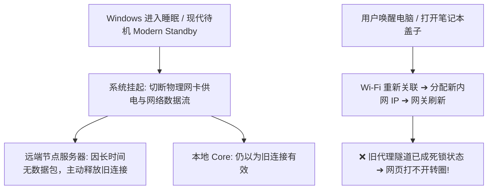
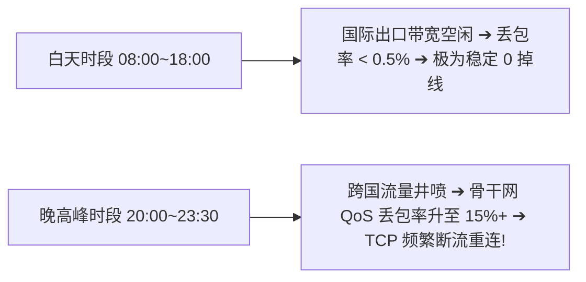
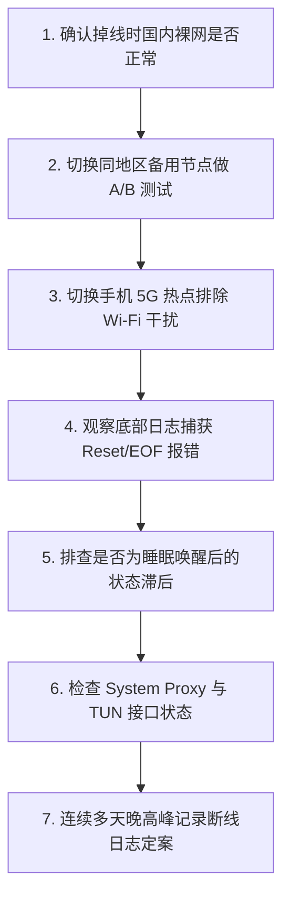

在 Windows 电脑上使用 v2rayN 科学上网时，最折磨人、最影响工作与娱乐体验的一类故障莫过于：**“明明刚打开软件时节点测速很低、网页也能秒开，但只要用上 10 分钟、看一段长视频、或者玩外服游戏时，连接就会突然中断卡死；甚至电脑合上盖子睡眠唤醒后，整机代理彻底瘫痪，必须重新选择节点或重启客户端才能恢复！”**

面对这种“能连上但极不稳定、反复掉线重连”的顽疾，很多用户往往会陷入焦躁与盲目猜测：

**“为什么 v2rayN 刚连上时好好的，过几分钟就突然断流打不开网页？”**  
**“为什么在主界面测速延迟显示绿色几十毫秒，但实际看视频或下载大文件时却频繁卡顿断开？”**  
**“为什么笔记本从公司 Wi-Fi 切换到手机 5G 热点、或者插拔有线网线后，v2rayN 就会瞬间失联？”**  
**“为什么 Windows 电脑休眠/睡眠唤醒后，节点列表还在，但所有海外网页全部提示连接超时？”**  
**“锁屏和睡眠到底有什么区别？为什么很多用户的电脑一锁屏，后台的 SSH、远程桌面或下载任务就集体断线？”**  
**“为什么在 Core 日志里频繁刷出 `Connection Reset`、`EOF`、`Broken Pipe` 或 `reconnect` 报警信息？”**  
**“为什么普通网页浏览感觉不到断线，但 Zoom 视频会议、Discord 语音或 Steam 联机游戏却动不动直接掉线？”**  
**“白天全天使用非常丝滑，为什么一到晚上 8 点至 11 点晚高峰，所有节点就会频繁断流掉线？”**

**v2rayN“经常断线/频繁掉线”与“节点 Timeout”属于两个完全不同层级的网络故障。**

- **节点 Timeout（超时）**：代表客户端在初始发起三次握手阶段就**完全无法与远端服务器建立连接**；
- **经常断线（断流）**：代表客户端与节点之间的出海隧道**已经成功建立并能够正常传输数据**，但在后续的生命周期中，由于 **本地 Wi-Fi 瞬断抖动、Windows 网卡休眠与电源策略、Core 进程旧长连接复用失效、TUN 虚拟网卡状态未恢复、或晚高峰骨干网 QoS 丢包** 等因素导致连接中途破裂。

本文作为 **v2rayN 连接稳定性与断流故障深度排查的权威全景指南**，将带你从 **6 类掉线症状辨析、Wi-Fi/有线/热点 3×2 稳定性矩阵、Windows 睡眠唤醒状态恢复、Core 日志时间线定案、长连接应用敏感性分析、到晚高峰骨干网拥塞应对** 建立严谨系统的排错思维。

---

## ⚡ 30 秒快速诊断：v2rayN 频繁断线决策流

```text
┌────────────────────────────────────────────────────────────────────────┐
│                 v2rayN 经常断线 30 秒极速排查决策流                    │
├────────────────────────────────────────────────────────────────────────┤
│ 1. 【单节点 vs 全节点】➔ 仅节点 A 频繁断 ➔ 换同地区节点 B (单节点负载异常)│
│ 2. 【睡眠唤醒后失效】➔ 唤醒后打不开 ➔ 重启 Core / 重新勾选系统代理即可复原│
│ 3. 【网络切换后失效】➔ 切 Wi-Fi/热点后断 ➔ 检查 TUN 虚拟网卡是否保留旧路由 │
│ 4. 【Wi-Fi 瞬断排查】➔ 无线频繁掉但手机热点稳定 ➔ 排查本地路由器/5G 频段   │
│ 5. 【晚高峰规律性断】➔ 白天稳晚上断 ➔ 专线带宽拥塞 / 换企业级 IEPL 专线   │
│ 6. 【敏感长连接排查】➔ 网页正常但游戏/会议掉 ➔ 开启 TCP/UDP 保持心跳包机制  │
└────────────────────────────────────────────────────────────────────────┘
```

---

## 一、排查总表：v2rayN 频繁断线的 6 类典型病症

排查断线问题，绝不能眉毛胡子一把抓，必须首先对照以下 **6 大典型掉线症状** 精准归类：

```text
┌────────────────────────────────────────────────────────────────────────────────────────┐
│                        v2rayN 频繁断流与掉线 6 大典型病症全景表                        │
├────┬────────────────────────┬────────────────────────────────┬────────────────────────┤
│ 类 │ 掉线具体病症与特征     │ 核心可能诱发层级               │ 第一排查与验证动作     │
├────┼────────────────────────┼────────────────────────────────┼────────────────────────┤
│ A  │ 节点状态直接变为红 -1ms│ 远端节点服务器阻断 / 端口封禁  │ 切换同地区备用节点验证 │
│ B  │ 节点测速正常但网页卡死 │ 本地 Core 与系统代理脱节       │ 查看底部日志是否有请求 │
│ C  │ 日志频繁打印 reconnect │ 本地 Wi-Fi 抖动 / 骨干网丢包   │ 切换手机 5G 热点 A/B   │
│ D  │ 拔网线/切 Wi-Fi 后断线 │ Windows 网络接口与默认网关变动 │ 重启 Core 重新绑定网卡 │
│ E  │ 电脑休眠唤醒后全机没网 │ 网卡休眠 / Wintun 虚拟驱动未活 │ 重关重开 TUN/系统代理  │
│ F  │ 网页正常但游戏/会议掉线│ 长连接（TCP/UDP）心跳维持超时  │ 优化客户端 Keepalive   │
└────┴────────────────────────┴────────────────────────────────┴────────────────────────┘
```

---

## 二、本地网络根基：Wi-Fi 瞬断与 3×2 稳定性矩阵

很多人一遇到断流就立刻怪罪机场服务商，却完全忽视了 Windows 本地无线网络的致命隐患：

```mermaid
graph TD
    WiFiBlink[本地 Wi-Fi 发生 1~2 秒无线信道瞬断] --> TCPBreak[已建立的出海加密 TCP 隧道彻底断裂]
    
    TCPBreak --> WebImpact[网页端: 浏览器重试, 用户仅感觉加载转圈微卡]
    TCPBreak --> AppImpact[长连接端: 游戏/Zoom/SSH 立即弹出 Connection Dropped 掉线!]
    
    TCPBreak --> CoreState[v2rayN Core: 触发重拨号 (Dial Retry) 重新建立连接]
```

### 1. 为什么“Wi-Fi 瞬断 1 秒”会对代理连接造成毁灭性打击？
- 浏览普通网页时，HTTP 协议本身是无状态短连接，即便无线信号抖动 1 秒，浏览器自动重发请求即可，用户几乎无感知；
- 但科学上网的底层是一个**持续维持的长连接隧道（TCP 或 QUIC/UDP）**。本地 Wi-Fi 只要发生半秒钟的丢包或重关联，底层连接就会被操作系统内核直接发送 `RST` 销毁，导致代理连接瞬间中断重连。

### 2. 构建 3×2 交叉稳定性测试矩阵
要彻底排查是否是本地网络导致断流，必须在相同时间内进行 **3 种网络介质 × 2 个独立节点** 的严谨 A/B 验证：

```text
┌────────────────────────────────────────────────────────────────────────┐
│                    Windows 本地网络 3×2 稳定性测试矩阵                 │
├──────────────────┬────────────────────────┬────────────────────────────┤
│ 网络接入介质     │ 节点 A (香港专线)      │ 节点 B (日本专线)          │
├──────────────────┼────────────────────────┼────────────────────────────┤
│ **1. 2.4G Wi-Fi**│ 频繁断流 (信道严重干扰)│ 频繁断流 (信道严重干扰)    │
│ **2. 有线以太网**│ 连续 2 小时 0 掉线     │ 连续 2 小时 0 掉线         │
│ **3. 手机 5G热点**│ 连续 1 小时 0 掉线     │ 连续 1 小时 0 掉线         │
├──────────────────┴────────────────────────┴────────────────────────────┤
│ 💡 **诊断结论**：若有线和热点均极其稳定，只有 Wi-Fi 频繁断线，100% 证实 │
│   为本地无线路由器或 2.4GHz 频段干扰所致，与机场节点与 v2rayN 完全无关！│
└────────────────────────────────────────────────────────────────────────┘
```

---

## 三、系统状态陷阱：Windows 睡眠唤醒与锁屏休眠深度剖析

这是笔记本电脑用户遇到频率最高的断线场景：



### 1. 锁屏（Lock Screen）vs 睡眠（Sleep）的本质区别
- **纯锁屏（Win + L）**：仅锁定用户桌面 UI，Windows 操作系统内核、物理网卡与后台 v2rayN 进程**依然保持全速运行**，网络不会断开；
- **系统睡眠 / 休眠**：操作系统会切断外设与网卡的大部分供电，挂起所有后台 TCP 线程。
- ⚠️ **现代待机（Modern Standby）陷阱**：很多 Windows 11 笔记本在合盖或锁屏一段时间后，会自动进入低功耗待机，导致网卡在后台被系统间歇性挂起，从而引发“锁屏后任务断线”。

### 2. 睡眠唤醒后 7 步极速恢复法
1. **第一步：等待 Wi-Fi 图标稳定** —— 唤醒后先等 3~5 秒，确认右下角任务栏 Wi-Fi 图标已正常连上且无黄色感叹号；
2. **第二步：打开本地国内网站** —— 访问百度或 Bilibili，确认电脑的基础物理网络已经恢复；
3. **第三步：观察 v2rayN 图标状态** —— 确认托盘区 v2rayN 图标依然存在（排除后台 Core 进程崩溃）；
4. **第四步：重新测速触发握手** —— 在 v2rayN 主界面按 `Ctrl + R` 对当前节点重新测速，强制 Core 发起全新握手；
5. **第五步：重置系统代理开关** —— 右键托盘图标，将系统代理先切为“清除系统代理”，再重新切回“自动配置系统代理”；
6. **第六步：TUN 模式用户重开开关** —— 若开启了 TUN 模式，点击 TUN 按钮关闭再重新开启，强迫虚拟网卡驱动重新绑定默认网关；
7. **第七步：重启浏览器建立全新会话** —— 彻底关闭浏览器标签页并重新打开，消除旧长连接死锁。

---

## 四、日志证据定案：Core 重连与报错关键字精准解读

排查断线问题，主界面的延迟数字只是参考，**v2rayN 底部的实时日志才是定案的核心铁证**：

```text
┌────────────────────────────────────────────────────────────────────────┐
│                   v2rayN 断流核心日志关键字与真实含义对照              │
├────────────────────┬───────────────────────────────────────────────────┤
│ 日志报错关键字     │ 底层真实诱因与技术解读                            │
├────────────────────┼───────────────────────────────────────────────────┤
│ `connection reset` │ 远端服务器或中间骨干网防火墙主动发送 RST 重置信号 │
│ `EOF` (End of File)│ 远端节点服务器主动关闭了连接 (如服务器重启/超时)  │
│ `broken pipe`      │ 客户端试图向一条早已断开的死连接写入数据          │
│ `dial tcp: timeout`│ 连接断开后，Core 尝试重新拨号连接远端节点发生超时 │
│ `network unreachable` 本地物理网络 (Wi-Fi/网线) 已彻底失联断开        │
│ `context deadline` │ 在规定的时间内未收到服务器响应 (晚高峰丢包严重)   │
└────────────────────┴───────────────────────────────────────────────────┘
```

- 🔍 **看懂日志时间线**：
  - `14:20:00 [proxy] connection established` ➔ 连接成功建立；
  - `14:32:15 [proxy] read tcp: connection reset by peer` ➔ 连接持续 12 分钟后被远端重置断开；
  - `14:32:16 [dialer] dial tcp hk.node.com -> retry (1/3)` ➔ Core 正在毫秒级内自动发起重连。
  - **结论**：若日志显示 Core 在断开后能立刻在 1 秒内自动重连成功，说明只是偶发网络抖动；若重连持续失败，说明节点或本地网络已彻底中断。

---

## 五、晚高峰拥塞与骨干网 QoS 丢包真实规律



### 1. 晚高峰频繁断流 $\ne$ 机场跑路
- 很多用户发现“白天用着极稳，一到晚上 8 点就开始掉线”，便误以为是机场服务商故意限制。
- 真实原因在于：普通公网中转和直连线路在晚高峰时段，**中国电信 163 骨干网或联通 169 骨干网的国际出口发生严重拥塞**。当链路丢包率突破 10%~20% 时，TCP 连接的重传超时（RTO）就会被无限拉长，最终触发系统的连接重置机制，导致频繁断流。

### 2. 彻底解决晚高峰断流的终极方案：升级企业级 IEPL 专线
- 企业级 **IEPL / IPLC 专线** 走的是运营商独立铺设的跨境物理内网光纤，完全不经过公网国际出口，晚高峰丢包率**稳定锁定在 0%**，从物理层面上彻底根除晚高峰拥塞断流。

---

## 六、长连接敏感型场景优化指南（游戏 / 会议 / SSH）

普通网页浏览、视频播放与实时长连接应用的断流敏感度截然不同：

```text
┌────────────────────────────────────────────────────────────────────────┐
│                   各类网络应用对断流与抖动的敏感度评级                 │
├──────────────┬──────────────┬──────────────────────────────────────────┤
│ 典型应用场景 │ 敏感度级别   │ 遇到 1 秒瞬断时的实际表现与影响          │
├──────────────┼─────────────────────────────────────────────────────────┤
│ **网页浏览** │ ⭐ (极低)    │ 几乎无感，浏览器自动重发请求即可打开     │
│ **YouTube 4K**│ ⭐⭐ (低)   │ 播放器内置几十秒缓冲区，瞬断不会导致暂停 │
│ **大文件下载**│ ⭐⭐⭐ (中)  │ 支持断点续传的下载器会自动重试恢复       │
│ **Zoom/开会**│ ⭐⭐⭐⭐⭐(极高) 画面卡住、音频断开、弹出正在重新连接提示  │
│ **外服游戏** │ ⭐⭐⭐⭐⭐(极高) 游戏直接报 Network Error 掉线并判负     │
│ **SSH/远程** │ ⭐⭐⭐⭐⭐(极高) 终端光标假死，数秒后弹出 Broken Pipe 退出│
└──────────────┴──────────────┴──────────────────────────────────────────┘
```

- 🛠️ **长连接防断流优化技巧**：
  - 在 SSH 客户端（如 PuTTY / Xshell）中开启 `ServerAliveInterval 30`，强迫每 30 秒发送一次心跳探测包，防止路由器 NAT 网关因闲置而主动斩断 TCP 连接；
  - 玩外服游戏时，优先开启 **TUN 模式** 并配合低延迟专线节点，降低 UDP 数据包在网络层的抖动。

---

## 七、实战指南：v2rayN 经常断线 7 步通关排障法



1. **第一步：确认本地裸网基线** —— 掉线瞬间打开百度，确认不是家里路由器整机断网；
2. **第二步：单节点 vs 全节点 A/B** —— 换同地区另一个节点测试，确认是否仅为单台服务器故障；
3. **第三步：Wi-Fi vs 热点 A/B** —— 连手机 5G 热点测试 30 分钟，快速排除家用无线信道瞬断；
4. **第四步：实时抓取 Core 日志** —— 在断线瞬间查看日志，记录是 `connection reset` 还是 `dial timeout`；
5. **第五步：排查睡眠唤醒滞后** —— 若唤醒后打不开，重启 Core 并在客户端按 `Ctrl + R` 刷新握手；
6. **第六步：核验 TUN / 代理开关** —— 检查系统代理勾选状态，TUN 用户执行关闭再重开；
7. **第七步：连续多日多时段观察** —— 若仅在晚高峰全线断流，说明是普通公网中转线路拥塞，需升级专线。

---

## 八、2026 晚高峰 0 丢包抗断流物理专线推荐

彻底告别晚高峰频繁断流与节点掉线，最根本的解决之道在于选择配备 **全线 IEPL 企业级独立内网光纤** 的老牌大厂：

```text
┌────────────────────────────────────────────────────────────────────────────────────────┐
│                        2026 抗断流与晚高峰高可用物理专线推荐                           │
├──────────┬──────────────────────────┬──────────────┬──────────────┬────────────────────┤
│ 适配场景 │ 推荐品牌候选             │ 实际起付门槛 │ 每月流量配额 │ 抗断流与稳定性优势 │
├──────────┼──────────────────────────┼──────────────┼──────────────┼────────────────────┤
│ 旗舰全能 │ 光速云 (GuangSuYun)      │ 约 ¥7.5/月起 │ 59G~238G /月 │ 全线 IEPL 专线，晚高峰 0 丢包，彻底杜绝 TCP 频繁重置│
│ 平价轻量 │ 微风网络 (BreezeNet)     │ 约 ¥7/月起   │ 50GB / 月    │ 优质 BGP 优化线路，纯净低延迟，日常查资料极稳不掉线│
│ 弹性月付 │ 唯兔云 (V2Yun)           │ ¥14.9/月     │ 100GB / 月   │ 纯单月付，多地区原生 IP 出口，长连接会话保持极佳   │
│ 应急备用 │ 星岛梦 (XingDaoMeng)     │ 约 ¥8/月起   │ 60G/不限时包 │ 0月租不限时包，节点长期有效，断网调试应急备用首选  │
│ 游戏/会议│ 速界 (SpeedWorld)        │ ¥25/月       │ 150GB / 月   │ 独立原生大带宽专线，UDP 游戏与视频会议长连接零断流 │
└──────────┴──────────────────────────┴──────────────┴──────────────┴────────────────────┘
```

- 🏆 **抗断流全能首选**：[光速云](/reviews/guangsu-cloud/) —— 全球企业级 IEPL 独立专线，晚高峰 0 丢包，彻底告别频繁断线；
- 🍃 **超低预算轻量**：[微风网络](/reviews/weifeng-cloud/) —— 针对 PC 端日常办公优化的 50GB 小流量专线，年付折算仅约 ¥7/月；
- 💳 **拒绝绑定的单月付**：[唯兔云](/recommend/best-airports/) —— ¥14.9 纯单月付，100GB 充沛流量，节点丰富。

---

## 九、避坑指南：35 个关于“经常断线”的致命认知误区

```text
❌ 误区 1：只要节点发生一次断线，就 100% 代表机场要跑路了 ➔ 事实：单次断流可能由本地 Wi-Fi 抖动或公网骨干网波动引起。
❌ 误区 2：断流和节点 Timeout 是完全一回事 ➔ 事实：Timeout 是初始握手失败，断流是连接建立后中途破裂。
❌ 误区 3：节点延迟 Ping 越低，就代表使用时绝对永远不会掉线 ➔ 事实：低 Ping 节点在遇到丢包与 Jitter 剧烈抖动时同样会断流。
❌ 误区 4：更新订阅可以彻底修复家庭 Wi-Fi 引发的断流问题 ➔ 事实：订阅更新只刷新节点配置，根本不改变本地无线通信质量。
❌ 误区 5：把 DNS 改为 8.8.8.8 能让节点断线率直接降低到 0 ➔ 事实：DNS 仅影响初次域名解析，与长连接维持毫无因果关系。
❌ 误区 6：遇到频繁断线第一步就去运行重置网络命令 ➔ 事实：暴力重置会破坏系统网络虚拟网卡驱动，得不偿失。
❌ 误区 7：电脑合上盖子睡眠后，所有的代理连接依然保持原样暂停 ➔ 事实：睡眠会切断网卡供电，远端服务器超时后会自动释放旧连接。
❌ 误区 8：锁屏（Win + L）会导致后台的 v2rayN 进程被强行杀死 ➔ 事实：纯锁屏不影响后台网络与程序运行，睡眠才会挂起。
❌ 误区 9：唤醒电脑后网页打不开，必须彻底卸载重装 v2rayN ➔ 事实：只需在客户端按 Ctrl+R 重新测速或重启 Core 即可复原。
❌ 误区 10：切换 Wi-Fi 或插拔网线不会对正在运行的代理产生任何影响 ➔ 事实：网络接口与 IP 变动会导致底层 TCP 隧道必须全部重建。
❌ 误区 11：TUN 模式在任何网络环境下都比系统代理模式更稳定 ➔ 事实：TUN 涉及底层虚拟网卡与路由表，网络切换后恢复更复杂。
❌ 误区 12：删除 Wintun 虚拟网卡可以彻底解决所有掉线问题 ➔ 事实：删除驱动会导致 TUN 模式彻底瘫痪，需在客户端内规范重置。
❌ 误区 13：关闭 Windows Defender 可以防止 Core 发生重连 ➔ 事实：系统杀毒软件不影响正常的网络连接保持，切勿关闭防护。
❌ 误区 14：开启 Windows 高性能电源计划能 100% 杜绝网卡断流 ➔ 事实：电源计划仅优化 CPU 调度，无法解决路由器信道干扰。
❌ 误区 15：VLESS 协议在抗断流能力上绝对 100% 碾压 VMess 协议 ➔ 事实：协议差异主要在性能开销，稳定性核心取决于物理线路质量。
❌ 误区 16：REALITY 是一种能保证代理长连接永远不掉线的超级技术 ➔ 事实：REALITY 是 TLS 伪装机制，不改变网络链路的抗丢包特性。
❌ 误区 17：晚高峰发生断线就说明机场在全线恶意超售带宽 ➔ 事实：可能由电信/联通公网国际出口骨干网的整体拥塞丢包所致。
❌ 误区 18：一个香港节点掉线，就代表所有的日本和美国节点也废了 ➔ 事实：不同地区的入口与专线物理路径独立，换地区即可恢复。
❌ 误区 19：换节点后恢复正常，说明刚才掉线的节点永久损坏了 ➔ 事实：可能仅为该节点服务器瞬间发生负载尖峰或短时重启。
❌ 误区 20：普通网页能打开，就证明 Zoom 视频会议掉线一定是软件 Bug ➔ 事实：网页对短时瞬断不敏感，视频会议对丢包与瞬断极度敏感。
❌ 误区 21：外服游戏掉线 100% 是 v2rayN 客户端的问题 ➔ 事实：游戏服务器自身负载与 UDP 路由质量同样是掉线的主要诱因。
❌ 误区 22：把本地监听端口改大能提高长连接的稳定性 ➔ 事实：端口只是网络标识符，与底层 TCP/IP 栈的稳定性毫不相关。
❌ 误区 23：同时开启两个不同机场的客户端能实现双重防断线加速 ➔ 事实：多开客户端会引发系统代理与虚拟网卡抢占，导致严重断流。
❌ 误区 24：在公司电脑上使用 v2rayN 断线是因为公司内网网速太慢 ➔ 事实：公司边界防火墙可能部署了长连接心跳阻断与深度流量清洗。
❌ 误区 25：手机上使用非常稳定，说明 Windows 端断线一定是电脑中毒了 ➔ 事实：手机蜂窝网络抗抖动极强，Windows Wi-Fi 易受干扰。
❌ 误区 26：只要在日志中看到 reconnect 字样就代表翻墙彻底崩溃 ➔ 事实：reconnect 说明 Core 正在自动重连恢复，几秒内即可自愈。
❌ 误区 27：大文件下载中途中断是因为 v2rayN 限制了下载流量 ➔ 事实：可能是下载服务器限制了单连接时长，需开启多线程下载器。
❌ 误区 28：只要把路由模式改为全局代理，节点就永远不会掉线 ➔ 事实：全局模式只改变分流范围，丝毫不改变链路物理抗丢包能力。
❌ 误区 29：每天晚上固定时间断线 1 次说明电脑系统有严重漏洞 ➔ 事实：很多家用宽带运营商会在凌晨强制重拨号刷新公网 IP。
❌ 误区 30：使用单节点链接导入比使用订阅链接导入的长连接更稳 ➔ 事实：两者底层协议参数完全相同，长连接保持能力完全一致。
❌ 误区 31：只要买了高价专线，无论在多差的 Wi-Fi 下都绝对不断线 ➔ 事实：专线管跨境传输，本地 Wi-Fi 极差依然会引发本地断流。
❌ 误区 32：在任务管理器里给 v2rayN 设置实时优先级能防止掉线 ➔ 事实：过高优先级会导致系统其他进程卡顿，对网络稳定性无益。
❌ 误区 33：修改 hosts 文件可以防止 Google 连接中途断开 ➔ 事实：hosts 仅在初次寻址生效，无法维持已经建立的 TCP 会话。
❌ 误区 34：只要在网页上测出 200M 带宽就证明长连接绝对不会断 ➔ 事实：突发带宽不代表持续低丢包，瞬时丢包依然会引发断流。
❌ 误区 35：遇到任何经常断线问题，第一步就应该重装整个操作系统 ➔ 事实：对照 7 步排查法，99% 的断流问题均可在 3 分钟内排查解决。
```

---

## 十、常见问题深度解答（FAQ · 50 问）

### Q1：v2rayN 经常断线最常见的原因是什么？
**答**：最常见的原因是**本地 Wi-Fi 发生 1~2 秒无线信道瞬断**、**电脑睡眠唤醒后网络状态未同步**、或**晚高峰时段公网骨干网拥塞丢包**。

### Q2：为什么刚连接时正常，过几分钟就突然断流？
**答**：说明初始握手正常，但后续长连接遭遇了本地网络瞬断、远端服务器主动重置（Reset）、或中间网关的 NAT 闲置超时回收。

### Q3：断流和节点 Timeout 有什么区别？
**答**：Timeout 是在最开始就**完全连不上服务器**；断流是**已经连上并正常用了几分钟/几小时，中途突然中断**。

### Q4：为什么电脑睡眠唤醒后 v2rayN 就不能用了？
**答**：Windows 睡眠会挂起网卡并切断连接，唤醒后远端服务器早已释放旧会话。在客户端按 `Ctrl + R` 重新测速或重启 Core 即可复原。

### Q5：锁屏和睡眠会导致断线吗？
**答**：纯锁屏（Win+L）不影响后台运行；但如果系统设置了“锁屏 5 分钟后进入睡眠”，网卡会被挂起，从而导致后台下载与长连接中断。

### Q6：切换 Wi-Fi 或连手机热点后为什么必须重连？
**答**：网络介质切换会导致 Windows 本地内网 IP 与默认网关变动，旧的 TCP 代理隧道会被系统内核强行销毁，必须重新拨号。

### Q7：日志提示 `connection reset by peer` 是什么意思？
**答**：说明当前连接被远端服务器或骨干网节点主动发送 RST 信号强行切断，通常发生在服务器重启或网络严重拥塞时。

### Q8：日志提示 `EOF` 是什么意思？
**答**：表示数据流到达末尾，通常是远端节点服务器由于闲置超时或配置重载，正常关闭了这条空闲连接。

### Q9：为什么普通网页能打开，但外服游戏和视频会议频繁掉线？
**答**：网页是无状态短连接，遇到瞬断重发即可；游戏和会议对持续双向低延迟极度敏感，遇到半秒丢包就会直接触发掉线判定。

### Q10：为什么晚上 8 点到 11 点所有节点都容易断流？
**答**：这是国际出口的晚高峰拥塞时段，普通公网中转线路丢包率剧增，导致 TCP 重传超时断开，升级为企业级 IEPL 专线即可解决。

### Q11：为什么手机上非常稳定，电脑上却频繁断线？
**答**：手机 5G 基站连接极稳且天线优化好；电脑 Wi-Fi 极易受到 2.4GHz 频段干扰、无线信道拥堵或节能策略影响。

### Q12：有线网卡比 Wi-Fi 更稳定吗？
**答**：**是的。** 有线以太网彻底杜绝了空气中的无线电磁干扰与信道抢占，丢包率和抖动远低于 Wi-Fi，是排查断流的黄金基准。

### Q13：开启 TUN 模式会更容易导致掉线吗？
**答**：在网络频繁切换（如 Wi-Fi 频繁重连）的环境下，TUN 虚拟网卡因涉及系统级路由表改写，恢复速度可能略慢于轻量的系统代理。

### Q14：需要关闭网卡的“允许计算机关闭此设备以节约电源”吗？
**答**：如果使用的是笔记本且只在电池供电时断线，建议在设备管理器中关闭该选项，防止网卡被系统强制休眠。

### Q15：换一个同地区的节点能解决单节点断流吗？
**答**：**能。** 如果同地区的节点 A 频繁断但节点 B 连续稳定，说明仅为节点 A 服务器单点故障，无需修改本地任何设置。

### Q16：提示 `dial tcp: timeout` 怎么办？
**答**：说明旧连接断开后，Core 尝试向远端节点发起新连接再次超时，检查本地宽带是否断网或节点端口是否被临时阻断。

### Q17：每天固定时间断网一次是怎么回事？
**答**：很多家用宽带运营商（如电信、联通）会在每隔 24/48 小时强制刷新一次光猫的 PPPoE 拨号，造成几秒钟的全网重连。

### Q18：SSH 终端连接容易假死断开怎么优化？
**答**：在 SSH 配置中添加 `ServerAliveInterval 30`，强迫客户端每 30 秒发送心跳包，防止路由器 NAT 状态表超时被清理。

### Q19：经常断线需要彻底卸载重装操作系统吗？
**答**：**坚决不需要。** 99% 的断流问题均源于本地 Wi-Fi、睡眠恢复或晚高峰公网拥塞，重装系统毫无意义。

### Q20：如何彻底根除晚高峰频繁断线？
**答**：选择配备 **全球独立内网光纤的企业级 IEPL 专线**（如光速云），晚高峰 0 丢包，彻底杜绝拥塞断流。

---

## 🏁 总结：v2rayN 稳定性排障核心认知金字塔

排查一切连接中断与频繁掉线，请牢记以下**核心铁律**：

```text
1. 辨性质 ➔ 连不上是 Timeout，连上后中途断是断流，两者排查逻辑完全不同
2. 测介质 ➔ 遇断线先插有线或连手机 5G 热点，90% 均破案于本地 Wi-Fi 瞬断
3. 懂睡眠 ➔ 睡眠唤醒后旧长连接必死，重启 Core 并在客户端按 Ctrl+R 快速自愈
4. 抓日志 ➔ 盯紧 reset、EOF 与 dial timeout，用时间线锁定是瞬断还是死锁
5. 升专线 ➔ 晚高峰频繁断流属于公网骨干网丢包，唯有企业级 IEPL 专线能彻底治愈
```

---

### 📚 延伸进阶阅读与选型专栏
- 💻 **Windows 客户端主教程**：[《v2rayN怎么用？Windows下载安装、订阅、节点、系统代理与TUN完整教程》](/tutorials/v2rayn-windows/)
- 🌐 **V2Ray 生态超级 Pillar**：[《V2Ray是什么？V2Ray客户端、节点、订阅、VLESS/VMess与新手完整教程》](/tutorials/v2ray-tizi/)
- 📋 **v2rayN 订阅导入教程**：[《v2rayN订阅怎么导入？订阅链接、节点更新、404/403与更新失败完整教程》](/tutorials/v2rayn-subscription/)
- 🚨 **v2rayN 超时排查**：[《v2rayN节点 Timeout 怎么办？全部节点连接超时、Core、网络与服务器异常完整排查》](/issues/v2rayn-node-timeout/)
- 🔌 **v2rayN 有节点没网**：[《v2rayN有节点但无法上网怎么办？系统代理、TUN、DNS与Routing完整排查》](/issues/v2rayn-connected-no-internet/)
- 🚀 **v2rayN 速度慢排查**：[《v2rayN速度慢怎么办？节点、线路、丢包、Windows网络与晚高峰完整排查》](/issues/v2rayn-slow-speed/)
- 🛠️ **v2rayN TUN 深度指南**：[《v2rayN TUN怎么用？系统代理、TUN、虚拟网卡、Routing与DNS完整指南》](/tutorials/v2rayn-tun/)
- 🖧 **v2rayN 系统代理排查**：[《v2rayN系统代理失效怎么办？Windows代理残留、本地端口、Chrome/Edge与关闭软件后没网完整排查》](/issues/v2rayn-system-proxy/)
- 🌐 **v2rayN DNS 设置指南**：[《v2rayN DNS怎么设置？Windows域名解析、IPv6、DoH与网站打不开完整指南》](/tutorials/v2rayn-dns/)
- 🛤️ **v2rayN Routing 深度教程**：[《v2rayN Routing怎么设置？Direct、Proxy、Block、规则与Outbound完整教程》](/tutorials/v2rayn-routing/)
- ⚡ **老牌旗舰专线**：[《光速云深度评测：2020老牌IEPL专线与解锁实测》](/reviews/guangsu-cloud/)
- 🍃 **平价轻量专线**：[《微风网络深度评测：小流量套餐值不值得买？》](/reviews/weifeng-cloud/)
- 🏆 **2026 全景大榜**：[《2026梯子推荐：稳定、速度、价格、安全与不同使用场景怎么选》](/recommend/best-tizi/)
