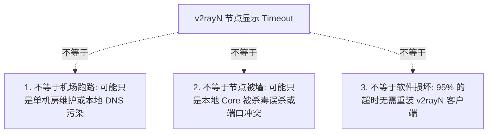
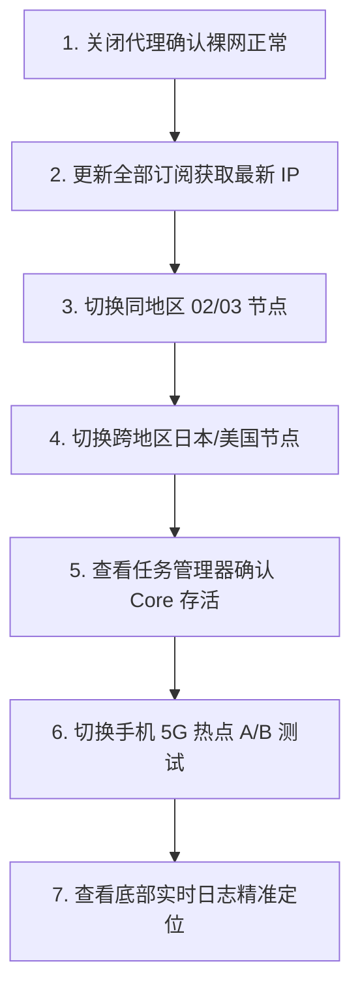

在 Windows 电脑上使用 v2rayN 进行科学上网时，最令用户沮丧的场景莫过于：**“打开客户端按下 Ctrl + R 进行真连接延迟测试，列表中的所有节点瞬间全部变成醒目的红色 `-1ms` 或 `Timeout（连接超时）`，怎么点都连不上！”**

面对全红的节点列表，新手用户往往会陷入一系列恐慌与误区：

**“节点全部 Timeout，是不是意味着我买的机场彻底跑路或者被全网封锁了？”**  
**“为什么在订阅管理里点击‘更新全部订阅’明明显示成功，但更新出来的几十个节点却依然全部超时？”**  
**“为什么同样的节点在我的安卓手机（v2rayNG）或 iPhone（小火箭）上都能秒连，但在 Windows 电脑上却全部死锁红屏？”**  
**“为什么在家里 Wi-Fi 宽带下所有节点都 Timeout，但手机连上 5G 热点后就瞬间全部变绿变正常？”**  
**“底部的 Xray-core / v2ray-core 报错 `Core startup error` 或 `listen failed: address already in use` 到底代表什么？”**  
**“为什么只有 VLESS 节点全部超时，而 VMess 节点却能正常连接？或者相反？”**

**v2rayN 节点显示 Timeout，本质上只代表客户端或底层的 Core 内核在预设的时间阈值内（通常为 3~5 秒），未能成功与目标服务器的代理端口完成 TCP/TLS 握手。它只是一个表面结果，而不是具体的故障原因。**

真正导致 Timeout 的诱因，可能分布在 **「本地 Windows 网络断流 ➔ 本地安全软件误杀 Core 内核 ➔ 本地端口被冲突占用 ➔ 本地 DNS 域名污染 ➔ 远端代理端口未响应 ➔ 专线节点服务器宕机维护」** 的不同技术环节。

本文作为 **v2rayN 节点连接层故障的权威深度排查手册**，将带你从 **单节点/单地区/全节点五维分类、Core 引擎运行状态核验、DNS/TLS/Refused 细分错误剖析，到 Wi-Fi/手机热点 2×2 对比测试**，系统化定位并解决一切连接超时难题。

---

## ⚡ 30 秒快速诊断：v2rayN 节点 Timeout 极速判断流

```text
┌────────────────────────────────────────────────────────────────────────┐
│               v2rayN 节点 Timeout 30 秒极速诊断决策流                  │
├────────────────────────────────────────────────────────────────────────┤
│ 1. 【单节点超时？】➔ 切换同地区的 02 / 03 备用节点 (单服务器维护，无需改设置)│
│ 2. 【单地区超时？】➔ 香港全红但日本/美国正常 ➔ 切换其他国家专线 (区域线路波动)│
│ 3. 【全部节点红？】➔ 点击「订阅分组」➔「更新全部订阅」(先确认节点 IP 是否变更)│
│ 4. 【订阅能更新？】➔ 检查右下角 Xray-core 状态，确认是否被杀毒软件拦截隔离 │
│ 5. 【Core 正常？】➔ 拔掉网线，手机开 5G 热点给电脑做 A/B 测试 (排除家宽 DNS)│
│ 6. 【热点正常？】➔ 锁定为本地家庭宽带/路由器问题，修改电脑 DNS 为阿里 DNS   │
│ 7. 【多端均全红？】➔ 手机电脑同节点均失败 ➔ 登录机场后台查看节点维护公告   │
└────────────────────────────────────────────────────────────────────────┘
```

---

## 一、破除迷思：Timeout 到底意味着什么？三大基本认知

在动手排查前，必须树立关于 Timeout 的三条技术红线：



### 1. Timeout 不等于机场跑路
- 单一节点超时、甚至某个国家机房（如香港）临时维护超时，在服务器运维中属于正常现象。只有当**所有地区节点在多个设备、多个独立网络环境下持续多天彻底断连**，且官网公告失联时，才能定性为服务商跑路。

### 2. Timeout 不等于“节点被全网封锁”
- 节点测试超时，可能仅仅是因为你的 Windows 本地网络无法解析节点域名、或者本地防火墙阻止了 `xray.exe` 的出站连接，服务器本身可能完全健康。

### 3. Ping 通不等于代理端口通
- 很多用户发现通过 cmd 执行 `ping 节点IP` 有响应（比如 35ms），但 v2rayN 里依然显示 Timeout。这是因为 **ICMP Ping 仅测试物理层连通性**，而科学上网走的是具体的 TCP/TLS 代理端口（如 443、8443），两者完全不是同一回事。

---

## 二、精准分类：v2rayN 节点超时的五大场景与定位模型

将故障精准归类，能让你在 1 分钟内锁定排查范围：

```text
┌────────────────────────────────────────────────────────────────────────┐
│                   v2rayN 节点超时五大场景分级排查表                    │
├────────────────────┬────────────────────┬──────────────────────────────┤
│ 故障表现场景       │ 核心诱发原因       │ 第一优先排查动作             │
├────────────────────┼────────────────────┼──────────────────────────────┤
│ **场景 A：**       │ 单台境外服务器宕机 │ 切换同地区其它编号的备用节点 │
│ **单节点 Timeout** │ 或目标端口维护     │ (如 香港01 挂了切 香港02)    │
├────────────────────┼────────────────────┼──────────────────────────────┤
│ **场景 B：**       │ 该区域跨境海缆中断 │ 跨地区切换 (如切日本或新加坡)│
│ **单地区全部超时** │ 或机房入口整体维护 │                              │
├────────────────────┼────────────────────┼──────────────────────────────┤
│ **场景 C：**       │ 本地宽带断网 / DNS │ 先查本地裸网，再用手机热点   │
│ **全地区所有节点红** 污染 / Core 启动失败│ 进行 A/B 网络交叉对比测试    │
├────────────────────┼────────────────────┼──────────────────────────────┤
│ **场景 D：**       │ Xray-core 内核过旧 │ 检查更新 Xray-core 内核版本  │
│ **单协议 (VLESS) 挂** 或协议参数不匹配  │ 或确认客户端协议兼容性       │
├────────────────────┼────────────────────┼──────────────────────────────┤
│ **场景 E：**       │ 测速目标网址被墙   │ 直接开启系统代理打开浏览器， │
│ **测速红但实际可用** (如测速走 Google)  │ 以真实网页能否访问为准       │
└────────────────────┴────────────────────┴──────────────────────────────┘
```

---

## 三、核心中枢：Core 内核故障引发的“假性全红”排查

在 Windows 平台上，v2rayN 只是一个操作外壳，**节点测速与数据连接 100% 由底层的 Core 内核（如 Xray-core）执行**。如果 Core 自身没有正常工作，所有节点将必然全部显示红色超时！

```mermaid
graph LR
    GUI[v2rayN 视窗界面 (正常打开)] -->|调用调度| CoreState{Core 引擎运行状态?}
    CoreState -->|被杀毒拦截 / 端口占用| CoreDead[Core 崩溃 / 未启动]
    CoreDead --> AllTimeout[❌ 所有节点瞬间全红 -1ms / Timeout]
    
    CoreState -->|正常监听 10808 端口| CoreAlive[Core 正常工作]
    CoreAlive --> RealTest[进入真实网络与节点链路测试]
```

### 1. 检查 Core 是否被 Windows Defender 误杀隔离
- **现象**：v2rayN 底部状态栏红字提示 `启动服务失败` 或 `找不到指定文件 (xray.exe)`；
- **排查方法**：
  1. 打开 Windows **「设置」➔「隐私和安全性」➔「Windows 安全中心」➔「病毒和威胁防护」**；
  2. 查看“保护历史记录”，若发现 `xray.exe` 或 `v2ray.exe` 被误判为风险软件被隔离，点击恢复并将 v2rayN 所在文件夹添加为 **“排除项（白名单）”**。

### 2. 检查本地监听端口冲突（Address already in use）
- **现象**：后台同时运行了 Clash、其他代理工具或上一次异常退出的孤儿进程，占用了本地的 `10808` 或 `10809` 端口；
- **排查方法**：
  1. 打开 Windows 任务管理器，在“详细信息”中强制结束所有残留的 `xray.exe` 或 `v2ray.exe` 进程；
  2. 退出其它冲突的 VPN 软件，重启 v2rayN。

---

## 四、错误代码细分大典：不仅仅是 Timeout

当节点连接失败时，查看底部日志标签页中的具体报错，能提供远比“Timeout”精准百倍的线索：

```text
┌────────────────────────────────────────────────────────────────────────┐
│                   v2rayN 节点连接层核心错误代码解析表                  │
├──────────────────────┬────────────────────┬────────────────────────────┤
│ 日志具体报错信息     │ 真实发生的技术阶段 │ 权威排障动作与解决方案     │
├──────────────────────┼────────────────────┼────────────────────────────┤
│ **`Timeout / i/o`**  │ TCP 握手阶段超时无 │ 检查本地宽带连通性；       │
│ **`timeout`**        │ 响应 (最常见现象)  │ 切换手机 5G 热点 A/B 测试  │
├──────────────────────┼────────────────────┼────────────────────────────┤
│ **`Connection`**     │ 目标服务器直接回绝 │ 远端节点机房代理端口维护中；│
│ **`Refused`**        │ 连接 (端口未开放)  │ 立即更新订阅获取新端口     │
├──────────────────────┼────────────────────┼────────────────────────────┤
│ **`TLS handshake`**  │ 安全加密握手失败   │ 校准 Windows 系统当前时间；│
│ **`error`**          │ (证书校验未通过)   │ 误差超过 90 秒需同步时钟   │
├──────────────────────┼────────────────────┼────────────────────────────┤
│ **`Authentication`** │ 用户密钥认证被拒绝 │ 套餐已欠费或被封禁；       │
│ **`failed`**         │ (UUID 校验不匹配)  │ 重新在后台复制并更新订阅   │
├──────────────────────┼────────────────────┼────────────────────────────┤
│ **`no such host /`** │ 节点域名无法解析为 │ 本地 DNS 被运营商污染；    │
│ **`DNS error`**      │ 真实服务器 IP      │ 修改电脑 DNS 为 `223.5.5.5`│
└──────────────────────┴────────────────────┴────────────────────────────┘
```

---

## 五、环境隔离：Wi-Fi 与手机热点 2×2 交叉对比法

排查 Windows 全部节点超时的**最高效硬核技巧**，就是通过切换网络环境瞬间完成根因定性：

```text
┌────────────────────────────────────────────────────────────────────────┐
│                   网络与设备 2×2 交叉对比排查矩阵                      │
├──────────────────────┬────────────────────────┬────────────────────────┤
│ 测试组合             │ 电脑使用【家用 Wi-Fi】 │ 电脑改连【手机 5G 热点】│
├──────────────────────┼────────────────────────┼────────────────────────┤
│ **节点依然全部超时** │ 可能是 Core 内核故障、 │ 证实为节点服务器故障、 │
│                      │ 杀毒拦截或全局网络断流 │ 订阅配置过期或套餐欠费 │
├──────────────────────┼────────────────────────┼────────────────────────┤
│ **节点瞬间恢复绿色** │ ❌ 家用宽带存在严重 DNS│ ✅ 证明 v2rayN 客户端与 │
│                      │ 污染或光猫路由防火墙拦截│ 节点本身 100% 正常     │
└──────────────────────┴────────────────────────┴────────────────────────┘
```

> 💡 **实操提示**：
> 如果连上手机热点后所有节点瞬间变绿、延时正常，**请立即检查你家里的路由器 DNS 设置**，切勿浪费时间重装 v2rayN 客户端！

---

## 六、标准 7 步通关排查流程（Checklist）



1. **第一步：关闭代理确认裸网正常** —— 打开国内网页（如百度），确认家庭宽带本身没有欠费断网；
2. **第二步：更新全部订阅** —— 确保本地保存的服务器 IP 和端口是最新的，排除机房迁移带来的失效；
3. **第三步：同地区多节点切换** —— 单个香港 01 超时，切换测试香港 02、03；
4. **第四步：跨地区节点测试** —— 香港全超时，切换测试日本、新加坡、美国节点；
5. **第五步：核验 Core 运行状态** —— 确认任务管理器中有 `xray.exe` 进程且未被杀毒软件拦截；
6. **第六步：手机热点交叉验证** —— 切换手机移动/联通网络，排除宽带运营商 DNS 污染；
7. **第七步：查看底部日志** —— 根据 `TLS error`、`Refused` 或 `Timeout` 针对性修复。

---

## 七、2026 高可用晚高峰 0 丢包专线推荐

如果你的节点在晚高峰（20:00~24:00）频繁发生大面积 Timeout，说明当前服务商使用的是廉价公网中转线路。建议切换为**企业级物理内网专线**：

```text
┌────────────────────────────────────────────────────────────────────────────────────────┐
│                        2026 稳定抗超时物理专线品牌推荐                                 │
├──────────┬──────────────────────────┬──────────────┬──────────────┬────────────────────┤
│ 适配场景 │ 推荐品牌候选             │ 实际起付门槛 │ 每月流量配额 │ 线路架构与抗超时优势│
├──────────┼──────────────────────────┼──────────────┼──────────────┼────────────────────┤
│ 旗舰全能 │ 光速云 (GuangSuYun)      │ 约 ¥7.5/月起 │ 59G~238G /月 │ 全线 IEPL 企业物理专线，不过公网 GFW，晚高峰 0 超时│
│ 平价轻量 │ 微风网络 (BreezeNet)     │ 约 ¥7/月起   │ 50GB / 月    │ 优质 BGP 优化专线，多入口智能容灾，日常办公极速秒连 │
│ 弹性月付 │ 唯兔云 (V2Yun)           │ ¥14.9/月     │ 100GB / 月   │ 纯单月付，多国机房冗余备用，抗单点故障能力强       │
│ 应急备用 │ 星岛梦 (XingDaoMeng)     │ 约 ¥8/月起   │ 60G/不限时包 │ 0月租不限时包，节点长期有效，主力全红时秒级顶上     │
│ AI/开发  │ 速界 (SpeedWorld)        │ ¥25/月       │ 150GB / 月   │ 原生住宅 IP 独立出口，ChatGPT/Claude 专属专线通道 │
└──────────┴──────────────────────────┴──────────────┴──────────────┴────────────────────┘
```

- 🏆 **全线企业物理专线**：[光速云](/reviews/guangsu-cloud/) —— 全球 IEPL/IPLC 独立光纤直达，彻底告别晚高峰节点红屏与丢包；
- 🍃 **超低预算轻量**：[微风网络](/reviews/weifeng-cloud/) —— 针对 PC 端日常查资料优化的 50GB 小流量专线，年付折算仅约 ¥7/月；
- 💳 **拒绝绑定的单月付**：[唯兔云](/recommend/best-airports/) —— ¥14.9 纯单月付，100GB 充沛流量，节点丰富。

---

## 八、避坑指南：30 个关于“v2rayN 节点超时”的致命认知误区

```text
❌ 误区 1：节点显示红色 Timeout 就一定是机场彻底跑路了 ➔ 事实：绝大部分是单服务器临时维护或本地 DNS 污染。
❌ 误区 2：节点测试超时代表这个节点一定被 GFW 永久封锁了 ➔ 事实：可能只是本地 Core 崩溃或端口被安全软件拦截。
❌ 误区 3：单节点超时，第一步应该直接重装 v2rayN 客户端 ➔ 事实：单节点超时只需切换同地区其他备用节点即可。
❌ 误区 4：香港节点全红，说明日本和美国节点也肯定全挂了 ➔ 事实：不同地区的机房网络独立，需进行跨地区测试。
❌ 误区 5：在订阅管理里点击更新成功，节点就一定能连接 ➔ 事实：更新成功只代表拿到了参数，服务器是否连通需实测。
❌ 误区 6：v2rayN 视窗能正常打开，就代表底层 Core 内核完全健康 ➔ 事实：GUI 能开不代表 Core 启动成功，需看进程状态。
❌ 误区 7：Core 启动失败只要盲目多重启几次软件就能自愈 ➔ 事实：需检查端口占用或是否缺少 xray.exe 核心文件。
❌ 误区 8：Ping 能够 Ping 通的节点，在 v2rayN 里就一定能连上 ➔ 事实：Ping 仅测 ICMP 连通，代理依赖具体的 TCP/TLS 端口。
❌ 误区 9：Ping 完全不通的节点，就绝对不可能用来科学上网 ➔ 事实：很多安全机房默认禁 Ping，但代理服务完全正常。
❌ 误区 10：只有 VLESS 节点超时说明 VLESS 协议被全面淘汰 ➔ 事实：通常是本地 Xray 内核版本过旧无法识别新参数。
❌ 误区 11：遇到节点超时，第一步必须开启 TUN 模式 ➔ 事实：TUN 模式无法修复节点连通性，排查阶段应先关闭 TUN。
❌ 误区 12：修改 Windows 系统代理设置可以修复节点测试超时 ➔ 事实：系统代理管应用流量，节点测试由 Core 直接发起。
❌ 误区 13：遇到超时只要把 DNS 改成 8.8.8.8 就能包治百病 ➔ 事实：若节点直接走 IP 连接，修改 DNS 毫无意义。
❌ 误区 14：关闭电脑的 IPv6 协议可以解决所有节点超时 ➔ 事实：盲目关闭 IPv6 可能破坏部分双栈网络的正常路由。
❌ 误区 15：为了解决超时，必须彻底关闭 Windows Defender 杀毒 ➔ 事实：只需将解压文件夹添加为排除项，切勿关闭杀毒。
❌ 误区 16：所有安全软件拦截代理内核都属于正常误报 ➔ 事实：若从未知第三方小网站下载的安装包可能真有木马。
❌ 误区 17：本地端口冲突只要把 v2rayN 彻底卸载重装即可 ➔ 事实：在任务管理器中杀掉残留进程或修改监听端口即可。
❌ 误区 18：升级到最新的开发版 Beta 内核一定比稳定版更好 ➔ 事实：测试版内核可能引入新的握手 Bug，日常首选稳定版。
❌ 误区 19：晚高峰出现一次节点超时，就代表机场严重超售 ➔ 事实：需结合长周期丢包率和持续吞吐带宽综合判定。
❌ 误区 20：手机端同一节点能用，电脑不行说明机场封了 Windows ➔ 事实：说明节点正常，问题出在电脑本地网络或安全软件。
❌ 误区 21：网上公开的免费节点全部红是 v2rayN 的软件 Bug ➔ 事实：免费节点存活期通常只有几小时，失效属必然。
❌ 误区 22：把电脑时间调快 5 分钟对节点连接没有任何影响 ➔ 事实：时间误差超 90 秒会导致 VMess/TLS 握手全部失败。
❌ 误区 23：TLS handshake error 和普通 Timeout 是一模一样的错误 ➔ 事实：TLS Error 证明已连上服务器，但证书握手未通过。
❌ 误区 24：Authentication failed 代表网络严重丢包 ➔ 事实：代表身份认证失败，多为套餐过期或 UUID 错误。
❌ 误区 25：Connection Refused 说明电信运营商切断了光纤 ➔ 事实：代表目标服务器端口未开启监听，机房服务维护中。
❌ 误区 26：只要买了大流量套餐，就永远不需要准备备用节点 ➔ 事实：任何机房都有突发宕机风险，常备异地节点是常识。
❌ 误区 27：电脑从睡眠模式唤醒后节点超时需要重启电脑 ➔ 事实：在托盘右键重启 v2rayN 即可重新建立网络监听。
❌ 误区 28：切换到手机热点测试需要重新购买一份新订阅 ➔ 事实：同一订阅在不同网络下完全通用，直接连接即可。
❌ 误区 29：同时开着公司 VPN 不会影响 v2rayN 节点连接 ➔ 事实：企业 VPN 驱动常会拦截所有非公司网关流量导致超时。
❌ 误区 30：把所有超时的节点全部手动删除就能解决问题 ➔ 事实：删除后下次更新订阅依然会刷出，应先定位根本原因。
```

---

## 九、常见问题深度解答（FAQ · 45 问）

### Q1：v2rayN 节点 Timeout 是什么意思？
**答**：代表 v2rayN 或底层 Xray 内核在规定时间内未能与该节点的远程服务器端口完成 TCP/TLS 连接握手。

### Q2：v2rayN 节点 Timeout 怎么快速排查？
**答**：① 切换同地区其他备用节点；② 点击更新全部订阅；③ 切换手机 5G 热点排除家用宽带 DNS 污染；④ 检查杀毒软件是否拦截了 Core。

### Q3：为什么 v2rayN 全部节点瞬间全部 Timeout？
**答**：通常是因为：本地宽带断网、底层 Core 内核启动失败（被杀毒拦截或端口冲突）、订阅配置过期、或本地 DNS 遭到污染。

### Q4：为什么只有一个节点 Timeout，其他节点正常？
**答**：这是典型的单服务器维护或单节点 IP 故障。直接在列表中选择同地区的其他可用节点即可，无需修改客户端任何设置。

### Q5：为什么香港节点全红，但日本和美国节点正常？
**答**：说明是香港机房入口或相关中转线路发生了区域性网络抖动。直接将主力节点切换到日本或新加坡即可。

### Q6：订阅明明可以正常更新，为什么节点全连不上？
**答**：因为“订阅拉取”走的是机场的 Web API 域名，而“节点连接”走的是具体的机房服务器 IP/端口，两者是完全独立的网络链路。

### Q7：v2rayN 节点全红是不是机场跑路了？
**答**：**绝大多数不是。** 只要机场官网还能登录、客服工单正常，通常只是机房维护或本地网络故障。

### Q8：为什么 Ping 能 Ping 通，v2rayN 里却显示 Timeout？
**答**：因为 Ping 测试的是 ICMP 基础网络包，而 v2rayN 测的是具体的 TCP 代理端口与加密协议握手，端口被拦截 Ping 依然能通。

### Q9：Ping 不通的节点就一定不能用吗？
**答**：**不一定。** 许多高防专线服务器为了安全会主动关闭 ICMP 响应（禁 Ping），但代理端口完全通畅，可以正常出海。

### Q10：v2rayN Core 是什么？
**答**：指在后台真正负责加解密与网络流量转发的命令行核心引擎（通常为 `xray.exe` 或 `wv2ray.exe`）。

### Q11：v2rayN Core 启动失败怎么办？
**答**：① 检查任务管理器杀掉残留的 `xray.exe` 进程；② 确认杀毒软件没有隔离内核文件；③ 重启 v2rayN。

### Q12：为什么只有 VLESS 节点连不上，VMess 节点却正常？
**答**：通常是因为本地的 Xray 内核版本过旧，不支持该 VLESS 节点所采用的 REALITY 或前沿流控参数，在设置中升级 Core 即可。

### Q13：为什么 VMess 正常但 VLESS 节点全部超时？
**答**：同理，可能服务端对该协议进行了端口调整，重新在后台复制并更新订阅通常即可恢复。

### Q14：日志提示 `TLS handshake error` 怎么办？
**答**：立即检查 Windows 系统右下角的日期与当前北京时间，系统时间误差超过 90 秒会导致 TLS 证书校验彻底失败。

### Q15：日志提示 `Authentication failed` 是什么意思？
**答**：代表身份认证失败（UUID 或 Token 不匹配）。通常是因为套餐已欠费过期，或机场后台重置了节点密钥。

### Q16：日志提示 `Connection Refused` 是什么意思？
**答**：代表目标服务器明确拒绝了连接请求。通常是机房的代理服务进程宕机维护，需等待服务商修复或切换节点。

### Q17：日志提示 `Network Unreachable` 是什么意思？
**答**：代表本地 Windows 网络路由表无法找到通往该目标 IP 的物理路径，通常是本地 Wi-Fi 彻底断网或网卡异常。

### Q18：本地 DNS 污染会导致所有节点 Timeout 吗？
**答**：会。如果节点配置使用的是域名而非裸 IP，本地 DNS 解析失败将直接导致所有节点无法寻址连接。

### Q19：为什么连上手机 5G 热点后节点瞬间全变绿了？
**答**：这 100% 证明你的客户端和机场节点完全正常，故障出在你家里的宽带运营商（如移动长宽）拦截或光猫路由器 DNS 污染。

### Q20：如何修复家用宽带下的节点全部超时？
**答**：打开 Windows 网络设置，将以太网或 Wi-Fi 的 IPv4 DNS 手动修改为 `223.5.5.5`（阿里 DNS）或 `119.29.29.29`（腾讯 DNS）。

### Q21：IPv6 会影响 v2rayN 节点连接吗？
**答**：在部分移动宽带环境下，不稳定的 IPv6 路由可能导致域名解析优先走不通的 IPv6 路径，可在网络适配器属性中临时取消勾选 IPv6 测试。

### Q22：Windows Defender 会误杀 v2rayN 吗？
**答**：会。开源代理内核常被杀毒启发式引擎误报，在 Defender 中将 v2rayN 所在文件夹添加为“排除项”即可杜绝误杀。

### Q23：遇到 Timeout 需要彻底关闭 Windows 防火墙吗？
**答**：**坚决不要关闭！** 只需在防火墙允许的应用列表中勾选 `v2rayN.exe` 和 `xray.exe` 的专用/公用网络权限即可。

### Q24：提示端口冲突（Port already in use）怎么办？
**答**：说明 Clash 或其它工具正在占用本地端口。在 v2rayN「参数设置」中，将本地监听端口改为 `20808` 和 `20809`。

### Q25：开启 TUN 模式能解决节点 Timeout 吗？
**答**：**不能。** TUN 模式只管系统流量捕获，不解决底层节点服务器的连通性问题，排查超时时应先关闭 TUN。

### Q26：同时开着公司 VPN 会导致节点超时吗？
**答**：会。企业级 VPN（如 EasyConnect、GlobalProtect）通常具有强制路由锁定机制，会掐断所有发往境外的个人代理连接。

### Q27：晚高峰（晚上 8~11 点）频繁超时怎么办？
**答**：说明当前服务商使用的是廉价公网中转线路，晚高峰遭遇国际出口严重拥堵丢包，建议切换为 IEPL 物理专线节点。

### Q28：所有节点超时需要重装 v2rayN 吗？
**答**：**不需要。** 99% 的全红故障出在订阅过期、本地断网、DNS 污染或杀毒拦截上，重装并不能解决网络层问题。

### Q29：什么时候才应该升级 Core 内核？
**答**：仅当机场推出了基于最新协议（如 REALITY、Hysteria 2）的节点而当前客户端无法识别时，才需在菜单中升级 Core。

### Q30：电脑睡眠唤醒后节点全部超时怎么办？
**答**：在 Windows 任务栏右下角托盘右键退出 v2rayN，重新双击打开软件即可恢复网络监听。

### Q31：手机端同一节点能连，电脑端为什么超时？
**答**：说明节点服务器健康，问题出在电脑端的 Windows Defender 拦截、本地端口占用或电脑连接的宽带网络问题上。

### Q32：如何对 v2rayN 所有节点进行一键批量测速？
**答**：在主界面空白处按下快捷键 **Ctrl + R**（真连接延迟测试），即可快速对列表中的所有节点刷新可用性状态。

### Q33：为什么节点测速显示红色，但浏览器打开却能正常上网？
**答**：因为 v2rayN 默认的测速目标网址（如 Google）在测试瞬间可能发生波动，以浏览器实际能否流畅访问目标网站为准。

### Q34：提示 `The remote server returned an error: (500)` 怎么办？
**答**：说明节点服务器后端进程崩溃，属于机房端问题，切换其它可用节点并提交工单反馈即可。

### Q35：如何彻底避免单点节点超时影响日常使用？
**答**：在客户端中同时配置 **“主力 IEPL 专线 + 备用不同地区节点”**，香港故障秒切日本，保障全天候不断网。

---

## 🏁 总结：v2rayN 节点超时排障金字塔

面对一切节点超时红屏，请牢记以下**五层诊断法则**：

```text
1. 看范围 ➔ 单节点挂切同地，单地区挂切跨国，全节点挂先查本地裸网
2. 测网络 ➔ 手机 5G 热点 A/B 测试，10 秒锁定是宽带污染还是服务器故障
3. 查内核 ➔ 确认任务管理器 Xray 进程存活，Defender 添加白名单排除误杀
4. 辨日志 ➔ TLS 查电脑时间，Refused 查机房端口，Auth 查套餐剩余流量
5. 备专线 ➔ 晚高峰频繁大面积超时，果断升级企业级 IEPL 物理专线
```

---

### 📚 延伸进阶阅读与选型专栏
- 💻 **Windows 客户端主教程**：[《v2rayN怎么用？Windows下载安装、订阅、节点、系统代理与TUN完整教程》](/tutorials/v2rayn-windows/)
- 🌐 **V2Ray 生态超级 Pillar**：[《V2Ray是什么？V2Ray客户端、节点、订阅、VLESS/VMess与新手完整教程》](/tutorials/v2ray-tizi/)
- 📋 **v2rayN 订阅导入教程**：[《v2rayN订阅怎么导入？订阅链接、节点更新、404/403与更新失败完整教程》](/tutorials/v2rayn-subscription/)
- 📱 **小火箭超时排查**：[《Shadowrocket节点 Timeout 怎么办？小火箭全部节点超时、连接失败与网络异常完整排查》](/issues/shadowrocket-node-timeout/)
- 🚀 **Clash 超时排查**：[《Clash节点 Timeout 怎么办？连接超时、全部节点红色与网络异常完整排查》](/issues/clash-node-timeout/)
- ⚡ **老牌旗舰专线**：[《光速云深度评测：2020老牌IEPL专线与解锁实测》](/reviews/guangsu-cloud/)
- 🍃 **平价轻量专线**：[《微风网络深度评测：小流量套餐值不值得买？》](/reviews/weifeng-cloud/)
- 🏆 **2026 全景大榜**：[《2026梯子推荐：稳定、速度、价格、安全与不同使用场景怎么选》](/recommend/best-tizi/)
