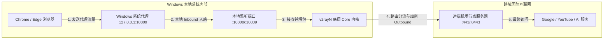
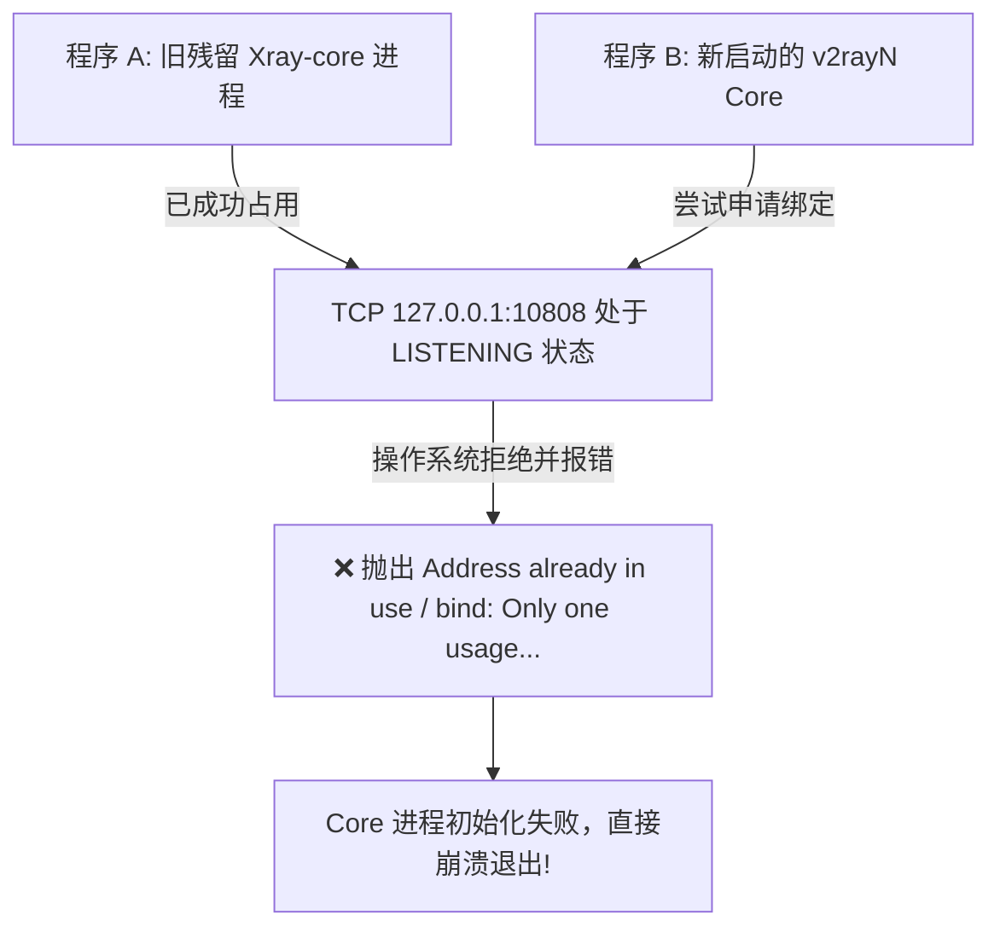
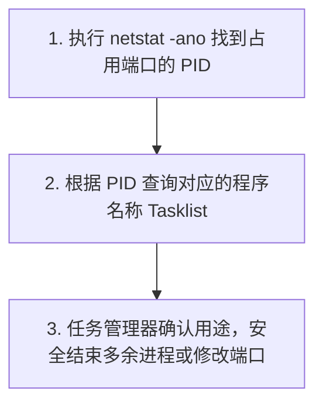
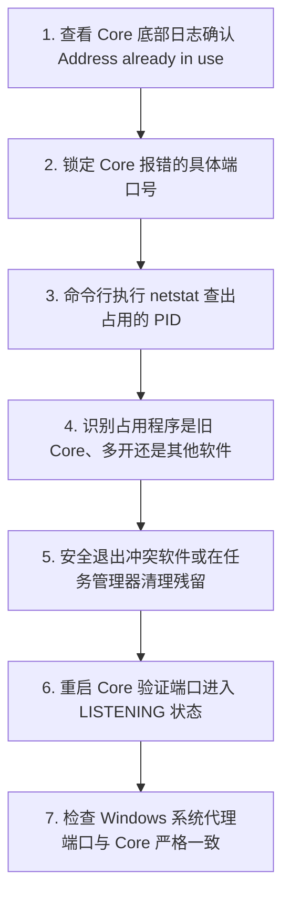

在 Windows 电脑上使用 v2rayN 科学上网时，有一类非常诡异且让很多新手完全摸不着头脑的故障：**“明明软件主界面能正常打开，节点列表也都在，点击更新订阅甚至还能成功，但只要一开启代理或者启动服务，底部日志就疯狂刷红报错 `Address already in use` 或 `Failed to start: listen tcp 127.0.0.1:10808: bind: Only one usage of each socket address is normally permitted`，随后整台电脑彻底无法科学上网！”**

面对这种“客户端图形界面活着，但底层内核（Core）直接暴毙”的故障，很多用户往往会产生一系列巨大的认知误区与盲目操作：

**“为什么 v2rayN 界面能打开，但点击测试节点时所有延迟全为 -1ms 或者无响应？”**  
**“报错信息里的 `Address already in use`（地址已被占用）到底是什么意思？难道是机场的远端节点服务器被封了？”**  
**“什么是 `127.0.0.1`？为什么 Windows 代理设置里填的是这个 IP，难道我的电脑变成了翻墙服务器？”**  
**“本地监听端口（HTTP / SOCKS）和远端节点服务器的端口（如 443 / 8443）到底有什么区别？”**  
**“为什么把本地监听端口从 10808 改成 20808 之后，Core 终于启动成功了，但 Chrome 浏览器却依然提示‘无法连接到代理服务器’？”**  
**“为什么电脑上同时打开 Clash / Mihomo 和 v2rayN 时，两者会互相打架导致其中一个无法联网？”**  
**“明明任务栏没有多余的软件，为什么 Windows 会提示该端口已经被占用？如何用自带命令行精准抓出幕后的罪魁祸首进程 PID？”**  
**“为什么有时双击关闭了 v2rayN，再次启动时却直接提示端口冲突？旧的 Xray-core / V2Ray-core 进程是如何在后台死锁残留的？”**

**v2rayN“本地端口冲突 / Core 启动失败”与“远端节点 Timeout / 经常断线”属于两个完全不同层级的网络世界。**

- **远端节点 Timeout**：发生在你的电脑与几千公里外的海外服务器之间，是**跨境网络传输与握手失败**；
- **本地端口冲突（Address already in use）**：发生在你的 **Windows 操作系统内部**，是 v2rayN 底层的 Core 内核在尝试向操作系统申请一个**本地入口门牌号（如 127.0.0.1:10808）时，发现该门牌号早已被其他程序或残留的旧进程死死占住**，导致 Core 根本无法完成初始化监听。

本文作为 **v2rayN 本地监听与端口冲突深度排查的权威全景指南**，将带你从 **本地 Inbound 入站模型、127.0.0.1 环回地址真相、Windows 只读查端口 PID 实战、多客户端/旧 Core 残留抢占、到修改端口后必须同步系统代理** 建立清晰严谨的底层技术排错思维。

---

## ⚡ 30 秒快速诊断：v2rayN 端口冲突极速决策流

```text
┌────────────────────────────────────────────────────────────────────────┐
│                 v2rayN 端口冲突 30 秒极速排查决策流                    │
├────────────────────────────────────────────────────────────────────────┤
│ 1. 【看底层日志】➔ 报错包含 Address already in use / bind failed       │
│ 2. 【识别端口号】➔ 确认 Core 尝试监听的端口 (如 127.0.0.1:10808/10809)  │
│ 3. 【查占用进程】➔ 运行 netstat -ano | findstr "10808" 锁定 PID 进程号  │
│ 4. 【辨冲突程序】➔ 任务管理器查看该 PID (是否为多开 v2rayN / 旧 Core)   │
│ 5. 【清理或换号】➔ 结束多余残留 Core 进程，或在设置中改用全新可用端口   │
│ 6. 【同步代理端】➔ 修改本地端口后，必须同步修改 Windows 系统代理指向   │
└────────────────────────────────────────────────────────────────────────┘
```

---

## 一、网络模型：127.0.0.1、本地 Inbound 与远端 Outbound

要彻底弄懂为什么会发生端口冲突，首先必须搞清楚你的浏览器流量是如何从本地 Windows 一步步流向海外节点的：



### 1. 什么是 127.0.0.1（Localhost 环回地址）？
- `127.0.0.1` 是 TCP/IP 协议中专门保留的**环回地址（Loopback Address）**，在任何操作系统中都**永远代表这台电脑自己**；
- Windows 系统代理中填写的 `127.0.0.1:10809`，意思是**“把浏览器的所有上网请求，先交给我自己电脑内部监听在 10809 端口上的代理软件（即 v2rayN Core）”**。它绝对不是远端机场服务器的 IP 地址！

### 2. 核心对比：本地监听端口 vs 远端节点端口

```text
┌────────────────────────────────────────────────────────────────────────────────────────┐
│                        本地监听端口 vs 远端节点端口全景对比表                          │
├──────────────┬────────────────────────────────────────┬────────────────────────────────┤
│ 比较维度     │ 本地监听端口 (Local Inbound Port)      │ 远端节点端口 (Remote Node Port)│
├──────────────┼────────────────────────────────────────┼────────────────────────────────┤
│ **物理位置** │ 运行在你的 Windows 电脑本地内存中      │ 运行在海外机房的物理服务器上   │
│ **典型数值** │ 10808 (SOCKS) / 10809 (HTTP) (可自定义)│ 443 / 8443 / 2053 等 (机场指定)│
│ **网络层级** │ 浏览器 / 应用程序 ➔ 本地 Core          │ 本地 Core ➔ 远端节点服务器     │
│ **冲突表现** │ `Address already in use` (Core起不来)  │ `Connection Refused` / Timeout │
│ **修改权限** │ 用户在 v2rayN 设置里可随意修改         │ 由机场服务商在节点后端严格固定 │
└──────────────┴────────────────────────────────────────┴────────────────────────────────┘
```

---

## 二、冲突根源：为什么同一个端口不能被两个程序同时使用？

在操作系统网络协议栈中，**“IP 地址 + 传输层协议（TCP/UDP）+ 端口号”** 构成了唯一的套接字（Socket）。



- 💡 **为什么操作系统必须报错？**  
  如果操作系统允许两个不同的程序同时在 `127.0.0.1:10808` 监听，当 Chrome 浏览器发来一个 HTTP 请求时，操作系统将根本无法判断到底应该把这个请求交给程序 A 还是程序 B。因此，操作系统会直接抛出 **`Address already in use`（地址已被使用）** 拒绝后来的程序启动。

---

## 三、排查总表：5 类最常见的本地端口占用元凶

```text
┌────────────────────────────────────────────────────────────────────────────────────────┐
│                     v2rayN 本地端口被占用的 5 大典型来源全景表                         │
├────┬────────────────────────┬────────────────────────────────┬────────────────────────┤
│ 类 │ 端口占用程序来源       │ 产生原因与典型特征             │ 推荐解决方案           │
├────┼────────────────────────┼────────────────────────────────┼────────────────────────┤
│ 1  │ **旧 Core 进程后台残留**│ 软件闪退或异常重启，内核未退出 │ 任务管理器结束 xray/v2ray 进程│
│ 2  │ **多开 v2rayN 客户端** │ 不小心双击启动了两个客户端实例 │ 关闭托盘多余的 v2rayN 图标    │
│ 3  │ **其他代理软件抢占**   │ 同时运行了 Clash/Mihomo/Singbox│ 只保留一个主力代理客户端运行  │
│ 4  │ **本地开发工具/抓包器**│ Fiddler/Charles/Docker 占用了端口│ 修改 v2rayN 监听端口避开冲突 │
│ 5  │ **Windows 动态端口保留**│ 系统 Hyper-V / WSL 保留了端口段│ 避开 Windows 系统保留端口区间 │
└────┴────────────────────────┴────────────────────────────────┴────────────────────────┘
```

---

## 四、实战排查：Windows 命令行 3 步只读精准定位占用者

排查端口冲突，**绝不需要下载任何第三方流氓修复软件**，使用 Windows 自带的命令行工具即可在 10 秒内锁定占用进程：



### 1. 第一步：运行只读命令查询占用端口的 PID
按键盘上的 `Win + R` 打开运行窗口，输入 `cmd` 或 `powershell` 打开命令行，执行以下查询命令（假设报错端口为 10808）：

```powershell
netstat -ano | findstr ":10808"
```

- 🖥️ **输出结果解读**：
```text
  TCP    127.0.0.1:10808        0.0.0.0:0              LISTENING       15488
```
- **Local Address**：`127.0.0.1:10808` —— 表示该端口正在本机被监听；
- **State**：`LISTENING` —— 表示正在处于监听状态；
- **PID（最后一列数字）**：`15488` —— 这是占用该端口的**进程唯一标识符（Process ID）**。

### 2. 第二步：根据 PID 查出对应的程序名称
拿到 PID（如 15488）后，继续在命令行中执行：

```powershell
tasklist | findstr "15488"
```

- 🖥️ **输出结果示例**：
```text
xray.exe                     15488 Console                    1     18,450 K
```
- **结论**：这说明占用 10808 端口的正是一个此前残留未退出的 `xray.exe` 后台内核！

### 3. 第三步：安全处理冲突进程
- **如果是多余的 xray.exe / v2ray.exe / clash.exe**：按 `Ctrl + Shift + Esc` 打开 Windows 任务管理器，在“详细信息”页找到对应的 PID，右键点击“结束任务”；
- **如果是你的本地工作软件（如开发调试工具）**：无需关闭工作软件，直接在 v2rayN 设置中修改本地端口即可。

---

## 五、关键联动：修改端口后必须同步 Windows 系统代理

很多用户在修改 v2rayN 本地端口时，最容易犯的一个**致命错误**就是：**“只改了 v2rayN 内部的端口，却忘了 Windows 系统代理依然指向旧端口！”**

```mermaid
graph TD
    subgraph ❌ 致命错误状态: 端口不同步
        Chrome1[Chrome 浏览器] -->|向 127.0.0.1:10809 发送请求| DeadPort[10809 端口: 当前空空如也无人监听!]
        DeadPort -->|报错| NetError[❌ 浏览器提示 无法连接到代理服务器!]
        NewCore[Core 内核: 正在 127.0.0.1:20809 孤独监听]
    end

    subgraph ✅ 正确同步状态: 两端端口严格一致
        Chrome2[Chrome 浏览器] -->|向 127.0.0.1:20809 发送请求| WorkPort[20809 端口: Core 正常接收并转发]
        WorkPort --> SuccessWeb[✅ 海外网页秒开成功!]
    end
```

### 规范修改与同步端口 4 步法：
1. **在 v2rayN 中修改端口**：点击主菜单 `设置` ➔ `参数设置`（或 `v2rayN设置`），将本地 SOCKS 端口（如 10808）改为 `20808`，HTTP 端口（如 10809）改为 `20809`，点击确定；
2. **触发 Core 重启加载**：右键托盘图标，选择“重启服务”或重新选择当前活动节点；
3. **确认系统代理已自动同步**：右键托盘区 v2rayN 图标，选择“清除系统代理”，然后重新选择“自动配置系统代理”；
4. **手动检查 Windows 代理配置**：按 `Win + I` 打开系统设置 ➔ `网络和 Internet` ➔ `代理`，确认“手动设置代理”中的端口已经自动变更为最新的 `20809`。

---

## 六、实战指南：v2rayN 端口冲突 7 步通关排障法



1. **第一步：看日志定案** —— 确认错误是否为 `listen tcp 127.0.0.1:XXXXX: bind: Address already in use`；
2. **第二步：记录冲突端口** —— 记录下报错的端口数字（如 10808 或 10809）；
3. **第三步：查找占用 PID** —— 执行 `netstat -ano | findstr ":10808"` 拿到最后一列的 PID；
4. **第四步：查询进程身份** —— 执行 `tasklist | findstr "PID"` 确认是哪个程序占用的；
5. **第五步：安全释放或改端口** —— 结束多余的 `xray.exe` 或修改 v2rayN 本地端口为其他闲置端口（如 20808）；
6. **第六步：重启 Core 内核** —— 在 v2rayN 界面按 `Ctrl + R` 刷新节点或点击重启服务；
7. **第七步：验证系统代理一致性** —— 打开系统代理设置，确保本地代理端口与 Core 监听端口完全相同。

---

## 七、2026 高可用智能出海高速物理专线推荐

排除本地端口与 Core 启动故障后，拥有一套节点丰富、全协议兼容、支持多设备同时在线的稳定专线网络至关重要：

```text
┌────────────────────────────────────────────────────────────────────────────────────────┐
│                        2026 稳定高速与全协议兼容专线推荐                               │
├──────────┬──────────────────────────┬──────────────┬──────────────┬────────────────────┤
│ 适配场景 │ 推荐品牌候选             │ 实际起付门槛 │ 每月流量配额 │ 客户端与协议兼容性 │
├──────────┼──────────────────────────┼──────────────┼──────────────┼────────────────────┤
│ 旗舰全能 │ 光速云 (GuangSuYun)      │ 约 ¥7.5/月起 │ 59G~238G /月 │ 全协议支持，完美适配 v2rayN/Clash 各类本地端口分流 │
│ 平价轻量 │ 微风网络 (BreezeNet)     │ 约 ¥7/月起   │ 50GB / 月    │ 纯净节点，超低内存占用，适合日常网页查资料与办公   │
│ 弹性月付 │ 唯兔云 (V2Yun)           │ ¥14.9/月     │ 100GB / 月   │ 14.9 元单月试水，多地区原生 IP 出口，节点丰富      │
│ 应急备用 │ 星岛梦 (XingDaoMeng)     │ 约 ¥8/月起   │ 60G/不限时包 │ 0月租不限时包，节点永不过期，多客户端联调备用首选  │
│ 极速专精 │ 速界 (SpeedWorld)        │ ¥25/月       │ 150GB / 月   │ 大带宽企业级 IEPL 专线，晚高峰 4K 极速秒开零卡顿   │
└──────────┴──────────────────────────┴──────────────┴──────────────┴────────────────────┘
```

- 🏆 **全协议旗舰专线首选**：[光速云](/reviews/guangsu-cloud/) —— 2020 老牌专线，节点全协议覆盖，v2rayN 完美一键导入；
- 🍃 **超低预算轻量**：[微风网络](/reviews/weifeng-cloud/) —— 50GB 精品小流量专线，年付折算仅约 ¥7/月；
- 💳 **拒绝绑定的单月付**：[唯兔云](/recommend/best-airports/) —— ¥14.9 纯单月付，100GB 充沛流量。

---

## 八、避坑指南：35 个关于“端口冲突”的致命认知误区

```text
❌ 误区 1：报错 Address already in use 说明机场的海外服务器被封了 ➔ 事实：这是 Windows 本地端口被占，与远端节点无关。
❌ 误区 2：127.0.0.1 是机场服务器的 IP 地址 ➔ 事实：127.0.0.1 永远代表你的电脑本机环回地址。
❌ 误区 3：本地监听端口和节点配置里的 443 端口是一回事 ➔ 事实：本地端口是电脑内部入口，443 是远端服务器出口。
❌ 误区 4：v2rayN 的默认本地端口在全世界任何电脑上都永远死死固定为 10808 ➔ 事实：端口可在参数设置中任意自定义。
❌ 误区 5：修改了 v2rayN 本地端口后，浏览器马上就能自动识别新端口 ➔ 事实：必须手动或通过软件重新同步 Windows 系统代理。
❌ 误区 6：GUI 图形界面能打开，就证明底层的 Core 内核一定正常运行着 ➔ 事实：GUI 与 Core 是独立进程，GUI 活不代表 Core 活。
❌ 误区 7：节点列表完好无损显示，说明代理服务绝对没有发生端口冲突 ➔ 事实：节点列表只是本地配置文件，Core 崩了也能正常显示。
❌ 误区 8：订阅更新能成功，就代表 Core 本地监听绝对没问题 ➔ 事实：订阅更新走的是 GUI 网络请求，完全不依赖 Core 的本地监听。
❌ 误区 9：遇到 Address already in use 只要更换 DNS 为 8.8.8.8 就能解决 ➔ 事实：DNS 只管域名寻址，丝毫不影响本地 Socket 绑定。
❌ 误区 10：关闭 IPv6 能够释放被其他程序占用的本地 IPv4 端口 ➔ 事实：IPv4 端口由占用它的具体进程持有，关 IPv6 毫无作用。
❌ 误区 11：关闭 Windows 防火墙可以自动释放被占用的端口 ➔ 事实：防火墙负责拦截包，不负责分配和释放 Socket 端口。
❌ 误区 12：关闭 Windows Defender 可以解决 Core 端口冲突 ➔ 事实：杀毒软件与端口占用无关，切勿随意关闭系统防护。
❌ 误区 13：以管理员身份运行 v2rayN 可以强行抢占已被占用的端口 ➔ 事实：操作系统内核不允许任何程序强占已被 LISTENING 的端口。
❌ 误区 14：查到占用端口的 PID 后，不管三七二十一直接暴力强制 kill ➔ 事实：若占用者是系统关键服务，强杀会导致系统崩溃。
❌ 误区 15：命令行中查到处于 TIME_WAIT 状态的端口就代表被严重冲突了 ➔ 事实：TIME_WAIT 是正常的连接关闭等待状态，不是监听冲突。
❌ 误区 16：ESTABLISHED 状态代表该程序正在作为代理服务器监听端口 ➔ 事实：ESTABLISHED 表示已有连接建立，LISTENING 才是监听。
❌ 误区 17：绑定 0.0.0.0:10808 和 127.0.0.1:10808 不会产生任何冲突 ➔ 事实：0.0.0.0 通配所有接口，会与 127.0.0.1 发生严重冲突。
❌ 误区 18：只要把端口随机改成 99999 就能绝对避开冲突 ➔ 事实：TCP 端口最大上限仅为 65535，填 99999 会直接报配置错误。
❌ 误区 19：修改本地监听端口时，需要同时去修改订阅节点里的端口号 ➔ 事实：千万不能改节点端口，否则会导致无法连接远端服务器。
❌ 误区 20：同时运行两个 v2rayN 客户端可以实现双倍网速叠加 ➔ 事实：两者会争抢本地端口和系统代理，导致全线崩溃。
❌ 误区 21：只要端口号不同，同时开 Clash 和 v2rayN 就绝对不会冲突 ➔ 事实：两者仍会争抢 Windows 系统代理所有权与 TUN 网卡。
❌ 误区 22：Core 启动失败时，只要不停点击切换节点就能自动修复 ➔ 事实：Core 都没跑起来，换节点根本无法执行。
❌ 误区 23：Core 启动失败第一步就应该重置路由器 ➔ 事实：这是电脑本地软件问题，与路由器毫无瓜葛。
❌ 误区 24：Docker 容器映射了 10808 端口不会影响本地 v2rayN ➔ 事实：Windows 宿主机端口被占同样会导致 v2rayN 启动失败。
❌ 误区 25：WSL 子系统内部的端口和 Windows 宿主机完全隔离 ➔ 事实：WSL2 默认启用本地镜像端口，同样可能引发占用冲突。
❌ 误区 26：遇到端口冲突必须彻底重装 Windows 操作系统 ➔ 事实：改个闲置端口或结束残留进程只需 10 秒钟即可搞定。
❌ 误区 27：SOCKS 本地端口和 HTTP 本地端口必须设置为同一个数字 ➔ 事实：两者是不同协议入口，若不支持混合端口则必须分开配置。
❌ 误区 28：Git 命令行无法科学上网是因为 v2rayN 端口坏了 ➔ 事实：通常是 Git 未配置 `http.proxy 127.0.0.1:10809`。
❌ 误区 29：关闭 v2rayN 窗口就代表后台的 Xray-core 进程一定退出了 ➔ 事实：偶发闪退会导致 Core 残留在后台继续霸占端口。
❌ 误区 30：把监听地址改成局域网 IP（如 192.168.1.5）更安全 ➔ 事实：默认只应监听 127.0.0.1，暴露给局域网存在安全隐患。
❌ 误区 31：提示 Permission denied 也是因为端口被占用了 ➔ 事实：Permission denied 通常是权限不足或安全软件拦截了可执行文件。
❌ 误区 32：在没有管理员权限的公司电脑上无法解决端口冲突 ➔ 事实：改用大于 1024 的高位闲置端口（如 20808）普通权限即可运行。
❌ 误区 33：修改了端口后不用重启 Core 也能即时生效 ➔ 事实：Core 必须重新启动才能向操作系统申请并绑定新的 Socket。
❌ 误区 34：端口冲突会导致已经打开的网页网速变慢 ➔ 事实：端口冲突是直接导致无法联网，而不是影响传输速度。
❌ 误区 35：只要买了高价专线，本地电脑就绝对不可能遇到端口冲突 ➔ 事实：专线管跨境传输，本地端口由你的 Windows 系统决定。
```

---

## 九、常见问题深度解答（FAQ · 50 问）

### Q1：v2rayN 提示 `Address already in use` 是什么意思？
**答**：表示 v2rayN 底层的 Core 内核想要绑定的本地监听端口（如 `127.0.0.1:10808`）已经被当前电脑上的其他程序或残留后台进程占用了。

### Q2：什么是本地监听端口？
**答**：它是代理软件在本地电脑上开放的“收件窗口”，用于接收来自浏览器或本地应用程序发出的上网请求。

### Q3：127.0.0.1 是什么？
**答**：是操作系统的**本地环回 IP 地址**，永远代表这台电脑自己。

### Q4：127.0.0.1 是机场服务器的地址吗？
**答**：**绝对不是。** 它是你的电脑内部地址，浏览器把流量发给 127.0.0.1 只是交给了本地运行的 v2rayN Core。

### Q5：本地端口和远端节点端口有什么区别？
**答**：本地端口（如 10808/10809）运行在你的电脑上用于接收本地请求；节点端口（如 443/8443）运行在海外机房用于接收跨境加密流量。

### Q6：为什么 v2rayN 界面能打开，但 Core 却启动失败？
**答**：因为 v2rayN 是前端图形管理界面（GUI），底层真正的代理转发是由 `xray.exe` 或 `v2ray.exe` 完成的。GUI 正常不代表 Core 成功绑定了端口。

### Q7：v2rayN 的默认本地端口是多少？
**答**：常见默认值为 SOCKS 端口 `10808`、HTTP 端口 `10809`，但不同版本或用户自定义设置可能有所不同，切勿写死。

### Q8：如何查看当前被占用的端口被谁占了？
**答**：打开 CMD 执行 `netstat -ano | findstr ":10808"` 查出 PID，再执行 `tasklist | findstr "PID"` 即可看到具体程序名。

### Q9：什么是 PID？
**答**：PID（Process Identifier）是操作系统为每个正在运行的程序分配的唯一数字标识符。

### Q10：查到 PID 后可以直接在命令行里强杀吗？
**答**：不建议盲目强杀。应先看清楚是什么程序，若是多余的 `xray.exe` 可在任务管理器中结束，若是重要工作软件则建议修改 v2rayN 端口。

### Q11：为什么会产生残留的旧 Core 进程？
**答**：当 v2rayN 发生异常闪退、强制关机或软件崩溃时，底层的 `xray.exe` 可能未能正常接收到退出信号，依然在后台霸占着端口。

### Q12：同时打开 Clash 和 v2rayN 会冲突吗？
**答**：**极易冲突。** 两者不仅可能争抢相同的本地监听端口，还会互相争抢 Windows 系统代理控制权。排查时建议只开一个。

### Q13：修改了 v2rayN 本地端口后为什么 Chrome 依然打不开网页？
**答**：因为 Windows 系统代理设置依然停留在旧端口上，必须在设置中重新将系统代理的目标端口同步为新端口。

### Q14：修改本地端口的范围是多少？
**答**：有效端口范围为 `1 ~ 65535`，建议使用 `10000 ~ 60000` 之间的高位闲置端口（如 `20808`、`30809`），避开系统常用端口。

### Q15：修改本地监听端口需要去修改节点服务器的端口吗？
**答**：**坚决不能修改节点端口！** 节点端口由机场机房固定，擅自修改会导致无法连接海外服务器。

### Q16：提示 `listen tcp: bind: permission denied` 是什么原因？
**答**：通常是因为设置了小于 1024 的系统特权端口，或者当前 Core 程序被第三方安全杀毒软件强行拦截了网络绑定权限。

### Q17：以管理员身份运行 v2rayN 能解决端口占用吗？
**答**：**不能。** 操作系统内核规定任何权限都无法强占已被另一个进程处于 `LISTENING` 状态的端口。

### Q18：订阅能更新成功代表本地端口没有冲突吗？
**答**：**不能。** 订阅更新走的是 GUI 自身发起的直连请求，完全不经过 Core 的本地监听端口。

### Q19：节点列表显示很多节点，代表 Core 正常工作吗？
**答**：**不能。** 节点列表只是本地配置文件数据，Core 即使彻底崩溃，节点列表也能完整展示。

### Q20：端口冲突会导致电脑所有节点测速全为 -1ms 吗？
**答**：**是的。** Core 内核未启动，测速线程无法建立本地转发隧道，所有测试自然全部失败。

---

## 🏁 总结：v2rayN 本地监听排障核心认知金字塔

排查一切 Core 启动失败与端口冲突，请牢记以下**核心铁律**：

```text
1. 查日志 ➔ 认准 Address already in use 与 bind failed 报错铁证
2. 懂架构 ➔ 127.0.0.1 是本机环回，本地 Inbound 端口绝非远端海外节点端口
3. 抓 PID ➔ 用 netstat -ano 锁定占用进程号，精准结束残留而非暴力盲杀
4. 换端口 ➔ 遇到冲突改用 20808/20809 等高位闲置端口，10 秒化解争抢
5. 必同步 ➔ 换完本地端口必须同步更新 Windows 系统代理指向，两端一致方能通网
```

---

### 📚 延伸进阶阅读与选型专栏
- 💻 **Windows 客户端主教程**：[《v2rayN怎么用？Windows下载安装、订阅、节点、系统代理与TUN完整教程》](/tutorials/v2rayn-windows/)
- 🌐 **V2Ray 生态超级 Pillar**：[《V2Ray是什么？V2Ray客户端、节点、订阅、VLESS/VMess与新手完整教程》](/tutorials/v2ray-tizi/)
- 🖧 **v2rayN 系统代理排查**：[《v2rayN系统代理失效怎么办？Windows代理残留、本地端口、Chrome/Edge与关闭软件后没网完整排查》](/issues/v2rayn-system-proxy/)
- 🔄 **v2rayN 断流排查**：[《v2rayN经常断线怎么办？节点断流、Core重连、Windows网络与睡眠唤醒完整排查》](/issues/v2rayn-disconnect/)
- 🚨 **v2rayN 超时排查**：[《v2rayN节点 Timeout 怎么办？全部节点连接超时、Core、网络与服务器异常完整排查》](/issues/v2rayn-node-timeout/)
- 🔌 **v2rayN 有节点没网**：[《v2rayN有节点但无法上网怎么办？系统代理、TUN、DNS与Routing完整排查》](/issues/v2rayn-connected-no-internet/)
- 🚀 **v2rayN 速度慢排查**：[《v2rayN速度慢怎么办？节点、线路、丢包、Windows网络与晚高峰完整排查》](/issues/v2rayn-slow-speed/)
- 🛠️ **v2rayN TUN 深度指南**：[《v2rayN TUN怎么用？系统代理、TUN、虚拟网卡、Routing与DNS完整指南》](/tutorials/v2rayn-tun/)
- 🌐 **v2rayN DNS 设置指南**：[《v2rayN DNS怎么设置？Windows域名解析、IPv6、DoH与网站打不开完整指南》](/tutorials/v2rayn-dns/)
- 🛤️ **v2rayN Routing 深度教程**：[《v2rayN Routing怎么设置？Direct、Proxy、Block、规则与Outbound完整教程》](/tutorials/v2rayn-routing/)
- ⚡ **老牌旗舰专线**：[《光速云深度评测：2020老牌IEPL专线与解锁实测》](/reviews/guangsu-cloud/)
- 🍃 **平价轻量专线**：[《微风网络深度评测：小流量套餐值不值得买？》](/reviews/weifeng-cloud/)
- 🏆 **2026 全景大榜**：[《2026梯子推荐：稳定、速度、价格、安全与不同使用场景怎么选》](/recommend/best-tizi/)
