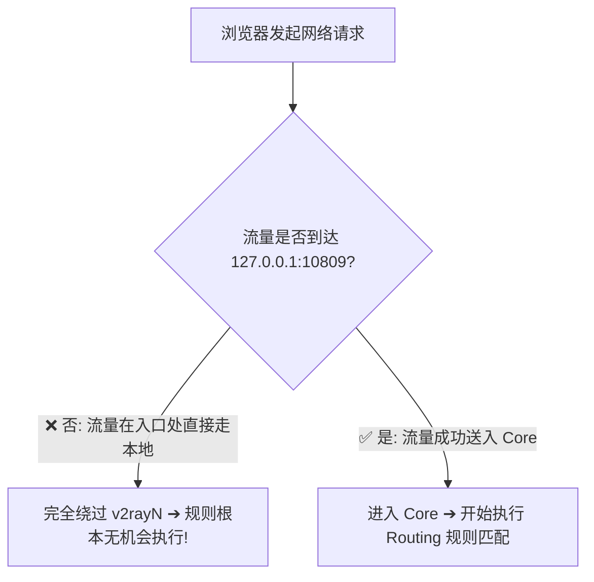
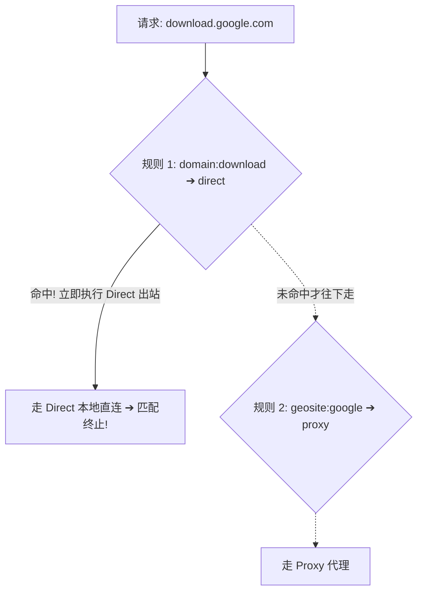

在 Windows 电脑上使用 v2rayN 进行自定义分流配置时，很多进阶用户最常遇到的挫败场景莫过于：**“明明在路由设置里规规矩矩添加了规则，为什么实际访问时网站依然走错出口、明明指定了 Proxy 却依然 Direct 直连、或者 Block 广告规则完全没反应？”**

面对这种“规则看起来存在，但实际运行完全不听使唤”的疑难杂症，用户往往容易产生各种错误的猜测与调试盲区：

**“为什么在 v2rayN 路由列表里清清楚楚写了某网站的域名，但 Chrome 访问时依然显示本地真实 IP？”**  
**“为什么在 GUI 界面点击保存了规则，Core 内核却根本没有真正加载最新配置？”**  
**“为什么把 Clash 里的 `DOMAIN-SUFFIX` 规则直接复制粘贴进 v2rayN，不仅规则不生效，甚至导致 Xray 启动报错崩溃？”**  
**“规则列表中的上下顺序到底重不重要？如果一条规则写在上面、另一条写在下面，Core 到底会听谁的？”**  
**“为什么访问某个海外网站时，主页能够顺利打开，但页面上的登录按钮、验证码或评论区却频繁报错丢失？”**  
**“为什么明明切换了新节点，在网页上测试出口 IP 时却没有任何变化？是不是必须重启整个电脑才能让新规则生效？”**  
**“DNS 解析结果的变化，为什么会神不知鬼不觉地导致原本生效的 IP 分流规则彻底失效？”**

**在 v2rayN 中，一条规则“在界面上看得见”，绝不等于“当前请求一定会按你的预期执行”。**

一个 Routing 规则要真正产生效力，必须同时满足 **6 大底层前提**：
1. **流量已成功送入 Core**（System Proxy 或 TUN 正常工作）；
2. **Core 确实重新读取并加载了最新规则配置**；
3. **目标请求的实际域名或 IP 精准符合该规则的匹配语法**；
4. **该规则没有被排在前面的更高优先级规则提前拦截截胡**；
5. **规则绑定的 Outbound（出站通道）指向正确**；
6. **浏览器没有继续复用修改规则前已建立的旧 TCP/HTTP 连接**。

只要其中任意一环出现脱节，就会表现为“规则不生效”。本文作为 **v2rayN 路由规则失效与分流排障的权威深度指南**，将带你从 **12 类失效根因剖析、域名/IP 匹配机制、规则顺序与优先级、Core 配置热加载、连接复用陷阱、到实时日志精准捕获** 彻底解决分流走错出口的所有顽疾。

---

## ⚡ 30 秒快速诊断：v2rayN 规则失效排查流

```text
┌────────────────────────────────────────────────────────────────────────┐
│                 v2rayN 规则不生效 30 秒极速排查决策流                  │
├────────────────────────────────────────────────────────────────────────┤
│ 1. 【流量进门否】➔ 刷新网页底部日志无任何输出 ➔ 先查系统代理/TUN 端口  │
│ 2. 【语法兼容否】➔ 检查是否误用了 Clash 的 YAML 语法 (如 DOMAIN-SUFFIX) │
│ 3. 【多域名误杀】➔ 网页能开但登录/验证码挂 ➔ 检查 CDN 资源域名是否被 Block │
│ 4. 【排位拦截否】➔ 检查是否有排在上方的大范围 Direct 规则提前截胡了该请求│
│ 5. 【连接复用否】➔ 彻底关闭浏览器标签页重新打开 ➔ 避免复用旧连接走旧出口│
│ 6. 【看日志定案】➔ 观察底部日志 `[routing] match -> proxy` 确认真实出站│
└────────────────────────────────────────────────────────────────────────┘
```

---

## 一、排查总表：v2rayN 规则不生效的 12 类致命根因

排查规则失效的第一步，切忌盲目乱改参数，必须对照以下 **12 类典型根因矩阵** 快速定位责任层级：

```text
┌────────────────────────────────────────────────────────────────────────────────────────┐
│                         v2rayN 规则不生效 12 大根因全景排查总表                        │
├────┬────────────────────────┬────────────────────────────────┬────────────────────────┤
│ 序 │ 故障现象与特征         │ 底层真实诱因                   │ 核心排查与解决动作     │
├────┼────────────────────────┼────────────────────────────────┼────────────────────────┤
│ 01 │ 规则修改后完全无反应   │ 流量根本未进入 Core 内核       │ 检查系统代理 10809 端口│
│ 02 │ 规则报错 Core 启动失败 │ 语法不兼容 (误抄 Clash/singbox)│ 恢复为标准 Xray 规则格式│
│ 03 │ GUI 显示规则但未生效   │ Core 进程未重新加载新配置文件  │ 点击确定保存或重启客户端│
│ 04 │ 子域名依然走直连       │ 域名匹配写成完整匹配而非 domain│ 改用 `domain:xxx.com`   │
│ 05 │ IP 规则时灵时不灵      │ CDN 动态解析 / DNS 污染导致 IP 变│ 优先改用域名规则分流   │
│ 06 │ 规则被上方规则截胡     │ 规则顺序排位靠后被提早匹配     │ 将具体规则上移至列表顶部│
│ 07 │ 命中规则但出口不对     │ Outbound 标签映射错误          │ 检查规则目标出站是否为 proxy│
│ 08 │ 换节点后出口 IP 没变   │ 浏览器保持 TCP/H2 长连接复用   │ 关闭浏览器所有标签页重开│
│ 09 │ 页面能开但按钮无反应   │ 多域名复杂网站：API 域名被误杀 │ 日志抓取丢失的 API 域名│
│ 10 │ 验证码加载不出         │ Block 广告规则库过度拦截       │ 临时禁用广告拦截规则   │
│ 11 │ 局域网 NAS/打印机失联  │ 私网 IP 被误判进入 Proxy 出口  │ 确保内网网段绑定 Direct│
│ 12 │ 第三方大规则库冲突     │ 外部 ruleset 包含过期错误分类  │ 恢复官方默认绕过大陆   │
└────┴────────────────────────┴────────────────────────────────┴────────────────────────┘
```

---

## 二、第一道门禁：流量到底有没有进入 Core？

这是 90% 新手在排查“规则不生效”时最容易忽略的致命前提：



- **Routing 规则是在 Core 内部执行的决策逻辑**。如果浏览器的请求因为系统代理未勾选、Chrome 扩展拦截或 TUN 驱动未运行而**根本没有进入 Core**，那么无论你在路由列表里写得多么完美，这些规则都**绝对不会被触发**！
- 🔍 **验证法则**：在 Chrome 里访问目标网页，同时盯住 v2rayN 主界面下方的日志窗口。如果日志窗口**一片死寂、没有任何关于该域名的连接信息**，请立即转去排查系统代理或 TUN 模式，切勿继续在规则界面无意义地增删规则！

---

## 三、语法与加载：Core 语法红线与配置热重载

### 1. 概念兼容 $\ne$ 语法兼容：严禁直接套用 Clash 规则
很多用户习惯将 Clash 配置文件中的规则直接复制到 v2rayN：
- ❌ **错误示范**：直接填入 `DOMAIN-SUFFIX,google.com,PROXY` 或 `RULE-SET,reject,REJECT`；
- ✅ **正确语法**：在 v2rayN 中使用标准格式，如 `domain:google.com` 并指定 Outbound 为 `proxy`，或使用预设的 `geosite:google`。

### 2. GUI 配置 $\ne$ Core 运行状态：配置是否真正加载？
- 当你在 v2rayN 路由设置中修改了规则并点击确定后，v2rayN 会在后台将这些规则编译生成为 `config.json` 并通知 Core 重载。
- 若修改规则后毫无变化，可在 v2rayN 设置中点击 **「重启服务」**，观察底部日志是否打印出 Core 重启并成功加载新配置的提示。

---

## 四、多域名网站陷阱：为什么“主页能开，但验证码与登录失败”？

现代互联网服务绝非由单一域名构成，这是导致规则“看似失效”的最隐蔽原因：

```mermaid
graph TD
    MainSite[用户访问目标网站: example.com] --> Sub1[1. 网页 HTML 主文档 (example.com)]
    MainSite --> Sub2[2. 用户登录验证 API (api.example-auth.io)]
    MainSite --> Sub3[3. 静态图片与公共 CDN (static.cdn-service.net)]
    MainSite --> Sub4[4. 人机验证码组件 (captcha.security-vendor.com)]
    
    Sub1 -->|命中 Proxy 规则| Pass1[✅ 网页主框架成功打开]
    Sub2 -->|生僻域名未收录 ➔ 误判为 Direct| Fail2[❌ 登录提示网络连接超时]
    Sub3 -->|被广告 Block 规则过度误杀| Fail3[❌ 页面排版错乱、图片丢失]
    Sub4 -->|未收录 ➔ 误判 Direct| Fail4[❌ 验证码死活刷不出来]
```

- **核心排障策略**：当遇到“页面能打开但功能残缺”时，按 `F12` 打开浏览器开发者工具（DevTools）➔ 切换到 **Network（网络）** 选项卡 ➔ 筛选状态为 `Failed` 或超时红色的资源，提取其真实域名并将其单独加入 `proxy` 路由规则中。

---

## 五、顺序与匹配：规则优先级与“自上而下”截胡机制

在 Xray-core / sing-box 的路由引擎中，规则通常严格遵循 **「自上而下顺序匹配、首次命中即执行」** 的机制：



- **大范围规则不要置顶**：如果把一条过于宽泛的直连规则（如包含广泛关键词的规则）放在列表最上方，它会**提早把本该走代理的海外子域名全部拦截并 Direct 发出**，导致下方精心编写的代理规则永远无法被执行！
- 💡 **黄金排位法则**：**越具体、越精准的独立域名规则放最上面；大范围规则与默认兜底规则放最下面！**

---

## 六、连接复用陷阱：为什么修改规则或换节点后出口 IP 没变？

很多用户修改了规则后，直接按 `F5` 刷新网页，发现出口 IP 依然是旧的，便误以为规则失效。

- **浏览器长连接复用（Keep-Alive / HTTP/2 / HTTP/3）**：现代浏览器为了提升性能，会长期维持与原服务器已经建立的 TCP/TLS 加密通道。当你修改规则后，浏览器并不会立即销毁这条旧通道，而是继续通过旧连接发送数据！
- 🛠️ **彻底刷新生效方法**：**关闭该网站的所有浏览器标签页，或者在 Chrome 地址栏输入 `chrome://restart` 重启浏览器**，强迫浏览器发起全新的三次握手，新规则即可瞬间生效。

---

## 七、实战指南：v2rayN 规则失效 7 步通关排障法

```mermaid
graph TD
    S1[1. 刷新网页检查底部日志有无输出] --> S2[2. 检查语法格式排除 Clash 报错]
    S2 --> S3[3. 检查规则排位将精准规则置顶]
    S3 --> S4[4. 确认 Outbound 准确指向 proxy]
    S4 --> S5[5. 抓取 DevTools 查找被误杀 API]
    S5 --> S6[6. 重启浏览器消除长连接复用]
    S6 --> S7[7. 观察日志确认 [routing] match]
```

1. **第一步：看日志确立门禁** —— 刷新网页，确认请求已成功进入 Core；
2. **第二步：校对语法与格式** —— 确保使用 `domain:xxx.com` 格式，删除非法字符；
3. **第三步：将专属规则移至顶部** —— 排除上方大范围规则的提早截胡；
4. **第四步：核验 Outbound 出站标签** —— 确保规则绑定的出站明确为 `proxy`；
5. **第五步：排查子域名与 API** —— 通过浏览器 F12 抓取被漏掉的第三方资源域名；
6. **第六步：重启浏览器建立新会话** —— 彻底规避 TCP 长连接复用假象；
7. **第七步：最终日志定案** —— 观察日志中打印出的 `[routing] match domain:xxx -> proxy` 确认完美生效。

---

## 八、2026 高可用智能分流企业级专线推荐

规则分流排障确保了本地调度的准确性，而境外出口的稳定性则取决于专线网络。建议搭配支持全场景分流的高可用品牌：

```text
┌────────────────────────────────────────────────────────────────────────────────────────┐
│                        2026 稳定适配 Routing 智能分流物理专线推荐                      │
├──────────┬──────────────────────────┬──────────────┬──────────────┬────────────────────┤
│ 适配场景 │ 推荐品牌候选             │ 实际起付门槛 │ 每月流量配额 │ 智能分流与专线优势 │
├──────────┼──────────────────────────┼──────────────┼──────────────┬────────────────────┤
│ 旗舰全能 │ 光速云 (GuangSuYun)      │ 约 ¥7.5/月起 │ 59G~238G /月 │ 全线 IEPL 专线，完美适配 Routing 智能分流，4K 秒开 │
│ 平价轻量 │ 微风网络 (BreezeNet)     │ 约 ¥7/月起   │ 50GB / 月    │ 优质 BGP 优化线路，分流精准，日常查资料办公轻量首选│
│ 弹性月付 │ 唯兔云 (V2Yun)           │ ¥14.9/月     │ 100GB / 月   │ 纯单月付，多地区原生 IP 出口，支持流媒体精准分流   │
│ 应急备用 │ 星岛梦 (XingDaoMeng)     │ 约 ¥8/月起   │ 60G/不限时包 │ 0月租不限时包，节点长期有效，路由调试备用首选      │
│ AI/开发  │ 速界 (SpeedWorld)        │ ¥25/月       │ 150GB / 月   │ 原生住宅 IP 独立大带宽，支持 ChatGPT/GitHub 独立分流│
└──────────┴──────────────────────────┴──────────────┴──────────────┴────────────────────┘
```

- 🏆 **全场景分流首选**：[光速云](/reviews/guangsu-cloud/) —— 全球企业级 IEPL 独立专线，晚高峰 0 丢包，完美配合自定义路由规则；
- 🍃 **超低预算轻量**：[微风网络](/reviews/weifeng-cloud/) —— 针对 PC 端日常查资料优化的 50GB 小流量专线，年付折算仅约 ¥7/月；
- 💳 **拒绝绑定的单月付**：[唯兔云](/recommend/best-airports/) —— ¥14.9 纯单月付，100GB 充沛流量，节点丰富。

---

## 九、避坑指南：35 个关于“规则失效”的致命认知误区

```text
❌ 误区 1：在界面里保存了规则，就代表 Core 一定已经成功加载 ➔ 事实：若规则语法有错，Core 会静默忽略或报错拒绝加载。
❌ 误区 2：Clash 的 YAML 规则可以直接复制进 v2rayN 路由设置 ➔ 事实：两者语法解析引擎完全不同，直接复制必定导致规则失效。
❌ 误区 3：规则写在列表的最上方还是最下方没有任何区别 ➔ 事实：Core 遵循自上而下匹配，排在上方的宽泛规则会截胡下方规则。
❌ 误区 4：一个网站的主域名走 Proxy，就代表该网站所有资源都走 Proxy ➔ 事实：现代网站的 API、CDN 与验证码常分布在不同域名上。
❌ 误区 5：规则修改后刷新网页出口没变，说明 v2rayN 彻底坏了 ➔ 事实：浏览器保持着旧的 TCP 长连接复用，重启浏览器即可刷新。
❌ 误区 6：只要在规则里写了 Direct，电脑就会彻底断开代理节点 ➔ 事实：Direct 仅代表该请求走本地直连，代理隧道依然正常在线。
❌ 误区 7：在网上随便下载一个几十万条的第三方规则包最省心 ➔ 事实：庞大臃肿的规则集极易引发大面积误杀，且排障极难定位。
❌ 误区 8：域名规则和 IP 规则的匹配结果永远没有任何差异 ➔ 事实：DNS 污染会导致基于 IP 的规则发生错误判定，域名规则更稳定。
❌ 误区 9：Block 规则可以放心地拦截所有包含 ad 字符的域名 ➔ 事实：极易误杀带有 ad 字符的正规业务域名（如 upload、admin）。
❌ 误区 10：开启 TUN 模式后，所有的 Routing 路由规则就会失效 ➔ 事实：TUN 捕获的流量进入 Core 后依然严格按照 Routing 规则分流。
❌ 误区 11：不开 TUN 模式，v2rayN 的自定义规则就完全无法工作 ➔ 事实：通过系统代理进入 Core 的浏览器流量同样受规则调度。
❌ 误区 12：提示 Routing Config Error 说明机场服务器挂了 ➔ 事实：说明本地规则配置格式有误（如缺失双引号或逗号标点）。
❌ 误区 13：只要在 IP 查询网站查到国内 IP，就说明翻墙彻底失败 ➔ 事实：国内查 IP 站命中 Direct 直连规则属正常表现，需查海外站。
❌ 误区 14：每次修改一条规则都必须重启整个 Windows 电脑 ➔ 事实：点击确定保存即可触发 Core 平滑重载，无需重启操作系统。
❌ 误区 15：修改路由规则能够让节点的下载速度提升 5 倍 ➔ 事实：Routing 只管分流路径，不改变节点的物理线路带宽上限。
❌ 误区 16：局域网 NAS 打不开必须关闭整个 v2rayN 客户端 ➔ 事实：只需在规则中将私网网段（192.168.x.x）指定为 Direct 即可。
❌ 误区 17：给 ChatGPT 写一条 openai.com 规则就能保证全功能可用 ➔ 事实：需将 auth0、oaistatic、oaiusercontent 等 API 域名全量加入。
❌ 误区 18：只要在日志中看到 direct 字样就说明规则发生严重错误 ➔ 事实：国内网站显示 direct 说明智能分流非常成功，未消耗流量。
❌ 误区 19：规则列表中的所有规则会被 Core 同时并行执行匹配 ➔ 事实：Core 是按顺序逐条校验，命中第一条符合条件的规则即终止。
❌ 误区 20：把本地监听端口改大能解决规则不匹配的问题 ➔ 事实：端口只是数据通道标识，与内存中的规则匹配引擎毫不相关。
❌ 误区 21：关闭 Windows Defender 可以彻底修复路由规则不生效 ➔ 事实：杀毒软件不拦截 Core 内部的分流逻辑，切勿关闭防护。
❌ 误区 22：所有基于 V2Ray 协议的客户端规则语法都完全通用 ➔ 事实：Xray-core、sing-box 与原生 V2Ray 在规则格式上存在细节差异。
❌ 误区 23：只要把规则清空全部走全局代理就永远不会出任何问题 ➔ 事实：全局模式会导致国内 App 登录触发异地风控且延迟翻倍。
❌ 误区 24：在公司电脑上可以通过修改规则绕过企业的安全网关 ➔ 事实：企业网络边界防火墙依然会在物理出口阻断未授权流量。
❌ 误区 25：使用单节点链接导入比使用订阅链接导入规则更有效 ➔ 事实：节点导入方式与 Core 内部的规则分流逻辑毫无关联。
❌ 误区 26：手机热点能分流但 Wi-Fi 不行说明规则文件损坏 ➔ 事实：说明规则正常，问题出在家庭宽带运营商的 DNS 污染差异。
❌ 误区 27：geosite.dat 文件一旦下载就可以永久使用不需要更新 ➔ 事实：全球域名分类持续演进，定期更新规则文件可避免新站被漏。
❌ 误区 28：同时打开两个 v2rayN 可以让两条不同规则同时生效 ➔ 事实：多开会引发端口冲突与代理混乱，导致网络严重瘫痪。
❌ 误区 29：只要在浏览器开发者工具看到 200 就证明走的是代理 ➔ 事实：直连成功同样返回 200，需在日志中查看出站 Outbound 标签。
❌ 误区 30：把所有海外域名一条条手动添加进列表是最专业的做法 ➔ 事实：应善用 geosite 规则集，手动维护海量域名极易发生遗漏。
❌ 误区 31：规则配置错误导致 Core 崩溃后只能重装 Windows 系统 ➔ 事实：只需在路由设置中点击“恢复默认预设”即可 1 秒钟复原。
❌ 误区 32：Git 命令行不走代理是因为 v2rayN 路由规则没写好 ➔ 事实：Git 默认不读取系统代理，需在终端单独配置代理端口。
❌ 误区 33：修改规则后网页打不开一定是目标网站宕机了 ➔ 事实：可能是规则误将其判定为了 Block 或错误的 Outbound 标签。
❌ 误区 34：只要购买了高价专线，无论怎么写错规则都能正常上网 ➔ 事实：专线管跨境传输，规则管调度，规则写错依然会断网。
❌ 误区 35：遇到任何规则失效问题，第一步就去运行重置网络命令 ➔ 事实：应先看日志判断是否进 Core，切勿暴力重置网络栈。
```

---

## 十、常见问题深度解答（FAQ · 50 问）

### Q1：v2rayN 规则不生效最常见的原因是什么？
**答**：最常见的原因是**请求根本没有进入 Core**（系统代理未开或端口未接管）、**规则语法不兼容**（如误抄 Clash 规则）、或**被排在上方的大范围直连规则提前截胡**。

### Q2：为什么明明配置了 Proxy，网站依然显示本地真实 IP？
**答**：检查访问的测速网站是否属于国内域名从而命中 Direct 直连；或是浏览器复用了修改规则前的旧 TCP 连接，彻底重启浏览器即可。

### Q3：如何判断一个请求到底有没有命中规则？
**答**：刷新网页，查看 v2rayN 界面下方的实时连接日志，日志会清晰打印 `[routing] match domain:xxx -> proxy` 或 `direct`。

### Q4：为什么 Clash 的规则复制到 v2rayN 无法工作？
**答**：Clash 使用 YAML 语法（如 `DOMAIN-SUFFIX`），v2rayN 遵循 Xray/V2Ray 规范（如 `domain:`），语法解析器不兼容。

### Q5：规则匹配有先后顺序吗？
**答**：**有。** Core 严格遵循「自上而下、先命中先执行」的逻辑，必须将具体的单独域名规则置于列表上方。

### Q6：为什么网页主页能打开，但登录和验证码失败？
**答**：现代网站的登录 API 和人机验证码通常托管在独立的第三方域名上，这些生僻域名未被收录或被 Block 误杀，需单独加入 Proxy。

### Q7：Direct（直连）规则生效的标志是什么？
**答**：访问国内网站时，v2rayN 日志显示 `[routing] match -> direct`，且完全不消耗机场套餐流量。

### Q8：修改规则后需要重启电脑吗？
**答**：**完全不需要。** 在界面点击保存，Core 会在后台自动重载最新配置，仅需关闭浏览器标签页重新打开即可。

### Q9：为什么同一个域名昨天走代理，今天突然走直连？
**答**：如果使用的是 IP 规则，CDN 动态解析或本地 DNS 污染可能返回了国内 IP，导致 IP 规则判定偏移，建议改用域名规则。

### Q10：开启 TUN 模式会影响 Routing 规则生效吗？
**答**：**不会。** TUN 模式负责将网络层流量抓进 Core，进入 Core 后的分流依然 100% 严格执行 Routing 规则。

### Q11：提示 `Routing Configuration Error` 怎么办？
**答**：说明自定义规则存在标点或格式错误（如缺少逗号），在路由设置中选择“恢复默认预设”即可秒级复原。

### Q12：为什么局域网内的 NAS 和打印机连不上了？
**答**：复杂规则可能将局域网私网 IP 误送入了 Proxy 出口，需在规则顶部将 `192.168.0.0/16` 等网段绑定为 Direct。

### Q13：如何为 ChatGPT 编写一条生效的独立规则？
**答**：在自定义规则中添加 `domain:openai.com`、`domain:oaistatic.com`、`domain:oaiusercontent.com` 并绑定 `proxy` 出站。

### Q14：Block 规则拦截广告导致网页排版错乱怎么办？
**答**：临时在路由设置中关闭广告拦截规则组，找出被误杀的公共字体或样式 CDN 域名并加入直连或代理白名单。

### Q15：为什么规则列表里找不到我刚加的规则？
**答**：检查是否在添加后未点击右下角的“确定/保存”按钮，导致临时配置丢失。

### Q16：切换了不同的 Core（如 Xray 切到 sing-box）规则会失效吗？
**答**：可能会。不同内核对高级路由语法的支持细节不同，建议使用 v2rayN GUI 自带的标准可视化规则编辑器。

### Q17：规则写得越多越好吗？
**答**：**不是。** 规则越多不仅消耗内存，还极易引发规则冲突与严重误杀，推荐使用精简的最小规则集。

### Q18：为什么在终端使用 Git clone 不受路由规则控制？
**答**：Git 默认绕过 Windows 系统代理，需在命令行单独执行 `git config --global http.proxy http://127.0.0.1:10809`。

### Q19：如何快速恢复到最稳定的官方分流状态？
**答**：在路由设置中选择预设方案 **「绕过大陆（bypass mainland）」** 并保存，即可恢复标准智能分流。

### Q20：为什么全局模式下国内网站打开很卡？
**答**：全局模式强迫国内流量绕道境外专线再折返回国，物理路径成倍拉长，日常严禁开启全局模式。

---

## 🏁 总结：v2rayN 规则排障核心认知金字塔

排查一切分流走错出口与规则失效，请牢记以下**核心铁律**：

```text
1. 验进门 ➔ 刷新网页先看日志，无请求输出先查系统代理与端口接管
2. 禁乱套 ➔ 严禁直接复制 Clash YAML 语法，遵循标准 Xray 规则规范
3. 查排位 ➔ 牢记自上而下命中逻辑，精准规则置顶，大范围规则沉底
4. 破长连 ➔ 规则修改后彻底重启浏览器，消除旧 TCP 连接复用假象
5. 抓漏网 ➔ 遇到复杂大站功能残缺，善用 F12 抓取被漏掉的独立 API 域名
```

---

### 📚 延伸进阶阅读与选型专栏
- 💻 **Windows 客户端主教程**：[《v2rayN怎么用？Windows下载安装、订阅、节点、系统代理与TUN完整教程》](/tutorials/v2rayn-windows/)
- 🌐 **V2Ray 生态超级 Pillar**：[《V2Ray是什么？V2Ray客户端、节点、订阅、VLESS/VMess与新手完整教程》](/tutorials/v2ray-tizi/)
- 📋 **v2rayN 订阅导入教程**：[《v2rayN订阅怎么导入？订阅链接、节点更新、404/403与更新失败完整教程》](/tutorials/v2rayn-subscription/)
- 🚨 **v2rayN 超时排查**：[《v2rayN节点 Timeout 怎么办？全部节点连接超时、Core、网络与服务器异常完整排查》](/issues/v2rayn-node-timeout/)
- 🔌 **v2rayN 有节点没网**：[《v2rayN有节点但无法上网怎么办？系统代理、TUN、DNS与Routing完整排查》](/issues/v2rayn-connected-no-internet/)
- 🚀 **v2rayN 速度慢排查**：[《v2rayN速度慢怎么办？节点、线路、丢包、Windows网络与晚高峰完整排查》](/issues/v2rayn-slow-speed/)
- 🛠️ **v2rayN TUN 深度指南**：[《v2rayN TUN怎么用？系统代理、TUN、虚拟网卡、Routing与DNS完整指南》](/tutorials/v2rayn-tun/)
- 🖧 **v2rayN 系统代理排查**：[《v2rayN系统代理失效怎么办？Windows代理残留、本地端口、Chrome/Edge与关闭软件后没网完整排查》](/issues/v2rayn-system-proxy/)
- 🌐 **v2rayN DNS 设置指南**：[《v2rayN DNS怎么设置？Windows域名解析、IPv6、DoH与网站打不开完整指南》](/tutorials/v2rayn-dns/)
- 🛤️ **v2rayN Routing 深度教程**：[《v2rayN Routing怎么设置？Direct、Proxy、Block、规则与Outbound完整教程》](/tutorials/v2rayn-routing/)
- ⚡ **老牌旗舰专线**：[《光速云深度评测：2020老牌IEPL专线与解锁实测》](/reviews/guangsu-cloud/)
- 🍃 **平价轻量专线**：[《微风网络深度评测：小流量套餐值不值得买？》](/reviews/weifeng-cloud/)
- 🏆 **2026 全景大榜**：[《2026梯子推荐：稳定、速度、价格、安全与不同使用场景怎么选》](/recommend/best-tizi/)
