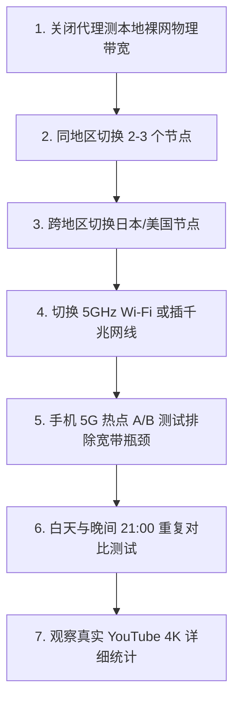

在 Windows 电脑上使用 v2rayN 科学上网时，最常困扰进阶用户的一个复杂性能矛盾莫过于：**“明明订阅正常、节点测速显示只有 20~35ms 的低延迟绿字，但在实际看 YouTube 4K 视频时却频繁卡顿缓冲，下载 GitHub 文件时只有几百 KB/s，一到晚上八九点晚高峰更是断流严重！”**

许多用户面对缓慢的网速，常常陷入非黑即白的焦虑与误区：

**“为什么 20ms 的香港节点看视频卡得不行，而 80ms 的日本节点反而能秒开 4K 且持续拉满几百兆？”**  
**“Ping 值、Jitter（抖动）和 Packet Loss（丢包率）到底有什么区别？为什么丢包比延迟更致命？”**  
**“为什么在 Speedtest 上测出来的峰值带宽很高，但在 YouTube、Steam 或实际下载大文件时依然慢如蜗牛？”**  
**“为什么同样的节点，在白天工作时间飞快，一到晚上 8 点至 11 点晚高峰就断崖式掉速？”**  
**“为什么用手机 5G 热点连电脑测速能跑 300Mbps，而连家里的 Wi-Fi 宽带却只有 30Mbps？”**  
**“VLESS 是不是一定比 VMess 协议快？开启 TUN 模式到底能不能提升翻墙网速？”**  
**“为什么 ChatGPT 模型生成回复慢？这到底是不是梯子节点的网速问题？”**

**v2rayN 速度慢并不一定是客户端软件本身的问题。真实的应用层体验是「本地 Wi-Fi/有线协商 ➔ 本地 ISP 运营商出口 ➔ 跨境物理线路类型（IEPL专线/公网中转） ➔ 节点服务器瞬时负载 ➔ 目标平台 CDN 链路 ➔ 时段网络拥塞」全链路共同作用的结果。**

尤其需要破除一个根深蒂固的误区：**“节点延迟（Ping）低，绝对不等于下载带宽（Throughput）大！”** 一个 20ms 的节点如果机房出口带宽超限或丢包率达到 5%，其大文件下载体验将远逊于一个 0 丢包、带宽充沛的 80ms 优质节点。

本文作为 **v2rayN 性能层故障的权威深度排查手册**，将带你从 **Ping/Jitter/Loss 性能金字塔、低延迟假象剖析、物理线路与协议本质区别、Wi-Fi/有线/手机热点 3×2 交叉测试，到晚高峰与多场景专项优化** 建立完整的科学测速与排错体系。

---

## ⚡ 30 秒快速诊断：v2rayN 速度慢极速排障流

```text
┌────────────────────────────────────────────────────────────────────────┐
│               v2rayN 速度慢 30 秒极速诊断决策流                        │
├────────────────────────────────────────────────────────────────────────┤
│ 1. 【测裸网】➔ 退出 v2rayN 测国内测速网，确认家庭宽带物理带宽未被占满 │
│ 2. 【换节点】➔ 同地区 01 慢 ➔ 切换 02/03 节点 (排除单台服务器瞬时高负载) │
│ 3. 【换地区】➔ 香港慢 ➔ 切换日本/新加坡节点 (排除单一区域海底光缆拥塞) │
│ 4. 【换网络】➔ Wi-Fi 慢 ➔ 插网线或开手机 5G 热点测试 (排除无线 2.4G 干扰)│
│ 5. 【看时段】➔ 白天飞快晚上卡 ➔ 锁定为公网中转晚高峰拥堵，需升级 IEPL 专线│
│ 6. 【辨场景】➔ Speedtest 快但 YouTube 卡 ➔ 属于 CDN 路由较差，切原生节点 │
│ 7. 【守基线】➔ 切勿盲目为“提速”开 TUN 模式，日常保持系统代理即可      │
└────────────────────────────────────────────────────────────────────────┘
```

---

## 一、破除迷思：性能六维指标与“低 Ping 陷阱”

在诊断网速前，必须建立现代计算机网络的六维性能认知：

```mermaid
graph TD
    subgraph 响应感知层 (Latency Sensitive)
        Ping[1. Ping / Latency (往返延迟)] --> WebClick[网页首屏瞬间响应]
        Jitter[2. Jitter (延迟抖动)] --> GameVoice[外服游戏与语音通话]
        Loss[3. Packet Loss (丢包率)] --> StreamDrop[视频卡顿缓冲与断流]
    end
    
    subgraph 带宽吞吐层 (Throughput Sensitive)
        Down[4. Download (下行带宽)] --> Video4K[YouTube 4K 与大文件下载]
        Up[5. Upload (上行带宽)] --> Meeting[视频会议与云盘文件同步]
        Sustained[6. 持续吞吐稳定性] --> LongTask[长任务不掉速 / 晚高峰稳定]
    end
```

```text
┌────────────────────────────────────────────────────────────────────────┐
│                   网络性能六大核心指标深度解析表                       │
├──────────────┬────────────────────────┬────────────────────────────────┤
│ 核心指标     │ 具体技术含义           │ 对实际业务体验的影响           │
├──────────────┼────────────────────────┼────────────────────────────────┤
│ **Ping**     │ 数据包往返一次的物理耗时│ 决定网页点击后的“首屏响应速度” │
│ *(Latency)*  │ (通常以毫秒 ms 为单位)  │ ❌ 误区：以为 Ping 低下载就一定快│
├──────────────┼────────────────────────┼────────────────────────────────┤
│ **Jitter**   │ 连续数据包之间延迟的波动│ 抖动过大会导致语音断续、游戏瞬移│
│ *(延迟抖动)* │ (如 30ms 突跳到 250ms) │ 影响实时互动的流畅性           │
├──────────────┼────────────────────────┼────────────────────────────────┤
│ **Packet**   │ 发出的数据包在公网中丢失│ **极其致命！** 只要有 3% 丢包，│
│ **Loss**     │ 的百分比 (如 5% 丢包)  │ TCP 就会触发剧烈降速与卡顿重传 │
├──────────────┼────────────────────────┼────────────────────────────────┤
│ **Download** │ 每秒钟能接收的最大数据量│ 决定 YouTube 4K 播放能力与软件 │
│ *(下行吞吐)* │ (通常以 Mbps 为单位)   │ 文件的实际下载时间             │
├──────────────┼────────────────────────┼────────────────────────────────┤
│ **Upload**   │ 每秒钟能发送的最大数据量│ 影响 Zoom 视频会议画质、海外   │
│ *(上行吞吐)* │ (通常以 Mbps 为单位)   │ 网盘同步与代码 Git push 速度   │
├──────────────┼────────────────────────┼────────────────────────────────┤
│ **持续吞吐** │ 长时间大流量拉取时的稳定│ 很多劣质节点前 5 秒快，随后    │
│ *(Sustained)*│ 速率 (抗晚高峰衰减能力)│ 剧烈断崖式掉速                 │
└──────────────┴────────────────────────┴────────────────────────────────┘
```

> 💡 **为什么 20ms 的香港节点往往不如 80ms 的日本节点？**  
> - **香港节点 A**：物理距离近，Ping 只有 20ms，但机房被成千上万用户挤爆，出口丢包率达 8%，持续下行仅剩 15Mbps ➔ **看 4K 频繁转圈**。  
> - **日本节点 B**：物理距离稍远，Ping 为 80ms，但采用独立物理专线且带宽充足，0% 丢包，持续下行稳定 300Mbps ➔ **秒开 4K，拖动进度条不卡**。  
> **结论：在流媒体与下载场景中，持续带宽与 0 丢包的权重远高于微弱的毫秒延迟差距！**

---

## 二、线路与协议：决定速度上限的底层物理基石

很多用户以为更换客户端或修改协议就能让网速翻倍，但实际上物理线路才是速度的天花板：

```mermaid
graph TD
    User[Windows 电脑 (v2rayN)] --> Border{跨境网络承载结构 (Line)}
    
    Border -->|公网普通直连| DirectLine[普通公网直连 (高峰期严重拥堵丢包)]
    Border -->|国内服务器中转| TransitLine[BGP 中转线路 (优化入口，但过 GFW 仍有波动)]
    Border -->|内网独立专线| IEPLLine[企业级 IEPL / IPLC 物理专线 (不过公网，0 丢包)]
    
    DirectLine --> Slow[晚高峰下行断崖，丢包率 > 10%]
    TransitLine --> Medium[日常表现良好，极端敏感期偶有波动]
    IEPLLine --> Fast[晚高峰 4K 极速秒开，全天吞吐 0 衰减]
```

### 1. 线路类型（Line Architecture）
- **公网直连**：个人电脑直接跨国连接境外服务器，经过公网国际出口，晚高峰丢包率极高；
- **公网中转**：先在国内入口服务器汇聚流量，再通过公网隧道转发至境外出口，稳定性优于直连；
- **IEPL / IPLC 企业专线**：完全走陆缆或海缆的**企业内网独立物理通道**，不经过公网 GFW 审查，晚高峰延迟与带宽绝对恒定。

### 2. 传输协议（Protocol）
- **VLESS / VMess / Trojan**：只是不同标准的**加解密与伪装封装协议**。在同等物理专线下，各协议的传输性能差异通常小于 5%。**协议决定防封锁能力，物理线路决定速度上限！**

---

## 三、排障大典：Windows 本地网络瓶颈排查与 3×2 矩阵

在怪罪机场节点之前，必须先排除 Windows 本地环境的“隐形减速带”：

```text
┌────────────────────────────────────────────────────────────────────────┐
│                   Windows 本地网络与设备 3×2 交叉排查矩阵               │
├──────────────────────┬────────────────────────┬────────────────────────┤
│ 测试连接方式         │ 节点 A (香港专线)       │ 节点 B (日本专线)       │
├──────────────────────┼────────────────────────┼────────────────────────┤
│ **1. 家用 2.4G Wi-Fi** 仅跑出 25Mbps (无线干扰) │ 仅跑出 30Mbps (信道拥挤) │
│ **2. 家用 5G Wi-Fi**   飙升至 280Mbps (频段升级)│ 飙升至 320Mbps (流畅 4K) │
│ **3. 千兆有线 (网线)** 稳定 500Mbps (物理拉满) │ 稳定 500Mbps (极致稳定) │
│ **4. 手机 5G 热点**    稳定 220Mbps (排除家宽) │ 稳定 260Mbps (排除污染) │
└──────────────────────┴────────────────────────┴────────────────────────┘
```

### 1. 2.4GHz vs 5GHz Wi-Fi 频段瓶颈
- 很多笔记本默认连在路由器的 2.4G 频段上，受蓝牙、微波炉和邻居信道干扰，物理握手速率往往被锁在几十兆。**切换到 5GHz Wi-Fi 频段通常能瞬间释放数倍带宽**。

### 2. 网线与网卡协商速率锁在 100Mbps
- 劣质网线（如四芯线或水晶头氧化）会导致千兆网卡自动降级协商为 **百兆速率（100Mbps）**。
- **检查方法**：进入 Windows「网络连接」➔ 双击以太网适配器 ➔ 查看“速度”是否显示为 `1.0 Gbps`，若显示 `100 Mbps` 请立即更换超六类（CAT6）网线。

### 3. Windows 后台隐形下载占用
- 测速时，Windows Update、Steam 后台更新、OneDrive 云同步或百度网盘可能正在全速吞吐本地带宽，导致 v2rayN 测速被严重挤压。

---

## 四、真实场景专项优化：YouTube 4K / GitHub / AI

针对不同业务场景，速度慢的诱因各不相同：

```text
┌────────────────────────────────────────────────────────────────────────┐
│                   三大主流应用场景性能调优速查表                       │
├──────────────┬────────────────────┬────────────────────────────────────┤
│ 场景类别     │ 速度慢的核心诱因   │ 权威解决方案与优化策略             │
├──────────────┼────────────────────┼────────────────────────────────────┤
│ **YouTube**  │ 节点出口带宽不足 / │ 右键打开「详细统计信息」，查看     │
│ **4K 视频**  │ CDN 节点被识别绕路 │ Connection Speed 是否 > 80000 Kbps；│
│              │ 或晚高峰丢包       │ 切换标有“4K / 流媒体”的专线节点    │
├──────────────┼────────────────────┼────────────────────────────────────┤
│ **GitHub**   │ Release 走的 Fastly│ 在终端中单独为 Git 配置代理；      │
│ **文件下载** │ CDN 在国内无加速   │ 使用多线程下载工具 (如 IDM / Aria2)│
├──────────────┼────────────────────┼────────────────────────────────────┤
│ **ChatGPT**  │ 模型生成为流式输出 │ 纯文字生成仅需几 KB/s 带宽；输出慢 │
│ **AI 对话**  │ 受 OpenAI 服务器负载 是服务端算力排队，只需保证节点稳定 │
└──────────────┴────────────────────┴────────────────────────────────────┘
```

---

## 五、标准 7 步通关排障流程（Checklist）



1. **第一步：测本地裸网物理带宽** —— 关闭代理访问测速网，确认家庭宽带物理跑分正常；
2. **第二步：同地区多节点切换** —— 单个香港 01 慢，切换测试香港 02、03；
3. **第三步：跨地区节点切换** —— 香港全慢，切换测试日本、新加坡、美国节点；
4. **第四步：排查本地无线瓶颈** —— 切换 5GHz Wi-Fi 或插网线，确认网卡协商为 1Gbps；
5. **第五步：手机热点交叉验证** —— 连手机 5G 热点排除家用宽带出口拥堵；
6. **第六步：白天与晚高峰对比** —— 确认是否为公网中转晚间拥塞；
7. **第七步：以真实业务为准** —— 打开 YouTube 4K 观察缓冲区健康度（Buffer Health）。

---

## 六、2026 高可用晚高峰 4K 秒开专线推荐

如果你的节点在晚高峰（20:00~24:00）频繁卡顿降画质，说明当前服务商使用的是廉价公网中转线路。建议切换为**企业级物理内网专线**：

```text
┌────────────────────────────────────────────────────────────────────────────────────────┐
│                        2026 稳定抗晚高峰衰减物理专线品牌推荐                           │
├──────────┬──────────────────────────┬──────────────┬──────────────┬────────────────────┤
│ 适配场景 │ 推荐品牌候选             │ 实际起付门槛 │ 每月流量配额 │ 线路架构与带宽优势 │
├──────────┼──────────────────────────┼──────────────┼──────────────┼────────────────────┤
│ 旗舰全能 │ 光速云 (GuangSuYun)      │ 约 ¥7.5/月起 │ 59G~238G /月 │ 全球企业级 IEPL 专线，晚高峰 0 丢包，4K 拖动秒加载 │
│ 平价轻量 │ 微风网络 (BreezeNet)     │ 约 ¥7/月起   │ 50GB / 月    │ 优质 BGP 优化专线，轻量稳定，日常网页秒开办公首选 │
│ 弹性月付 │ 唯兔云 (V2Yun)           │ ¥14.9/月     │ 100GB / 月   │ 纯单月付，百兆充沛带宽，多地区原生 IP 出口         │
│ 应急备用 │ 星岛梦 (XingDaoMeng)     │ 约 ¥8/月起   │ 60G/不限时包 │ 0月租不限时包，节点带宽充沛，晚高峰断流时秒级顶上  │
│ AI/开发  │ 速界 (SpeedWorld)        │ ¥25/月       │ 150GB / 月   │ 原生住宅 IP 独立大带宽出口，Git/Docker/4K 全能     │
└──────────┴──────────────────────────┴──────────────┴──────────────┴────────────────────┘
```

- 🏆 **晚高峰抗卡顿首选**：[光速云](/reviews/guangsu-cloud/) —— 全球企业级 IEPL 独立光纤，晚高峰 4K 拖拽零缓冲；
- 🍃 **超低预算轻量**：[微风网络](/reviews/weifeng-cloud/) —— 针对 PC 端日常查资料优化的 50GB 小流量专线，年付折算仅约 ¥7/月；
- 💳 **拒绝绑定的单月付**：[唯兔云](/recommend/best-airports/) —— ¥14.9 纯单月付，100GB 充沛流量，节点丰富。

---

## 七、避坑指南：35 个关于“v2rayN 速度慢”的致命认知误区

```text
❌ 误区 1：Ping 延迟最低的节点，看 YouTube 4K 一定是最快的 ➔ 事实：Ping 仅测响应，下载取决于持续带宽与丢包率。
❌ 误区 2：20ms 的香港节点永远碾压 80ms 的日本节点 ➔ 事实：若香港节点拥堵丢包，80ms 的日本节点速度远胜香港。
❌ 误区 3：在 Speedtest 测速跑出 300Mbps，看视频就绝不可能卡 ➔ 事实：单次测速只代表瞬时突发，流媒体依赖持续平稳吞吐。
❌ 误区 4：节点列表里节点越多，整体翻墙网速就越快 ➔ 事实：速度取决于当前选中的单一节点线路，与列表数量无关。
❌ 误区 5：香港节点在任何宽带下都一定比日本节点快 ➔ 事实：部分北方联通/电信连日本走直达海缆，体验优于香港。
❌ 误区 6：美国节点延迟有 160ms，绝对无法用来流畅看视频 ➔ 事实：美国节点机房带宽极大，看 4K/8K 视频体验极佳。
❌ 误区 7：只要节点标有 IEPL 专线，就保证永远 100% 不掉速 ➔ 事实：专线若严重超售或总带宽超负荷，晚高峰同样会卡。
❌ 误区 8：中转节点一定在所有指标上都碾压直连节点 ➔ 事实：高质量直连线路在非高峰期延迟与吞吐可能胜过劣质中转。
❌ 误区 9：VLESS 协议天然比 VMess 协议网速快 10 倍 ➔ 事实：两者加密效率差异极小，决定速度的是底层物理网络。
❌ 误区 10：REALITY 技术是一种能让网速翻倍的网络加速技术 ➔ 事实：REALITY 是防封锁伪装技术，完全不提供带宽加速。
❌ 误区 11：开启 TUN 模式可以让网页下载速度自动翻倍 ➔ 事实：TUN 模式只扩大接管范围，甚至因虚拟网卡处理略微增加开销。
❌ 误区 12：在设置里将 DNS 改为 8.8.8.8 能让下载速度提升 10 倍 ➔ 事实：DNS 仅影响初次域名寻址，不增加文件传输带宽。
❌ 误区 13：关闭电脑的 IPv6 协议可以彻底根治所有网速慢 ➔ 事实：仅对部分 IPv6 路由较差的宽带有微弱改善，非万能药。
❌ 误区 14：Wi-Fi 连接和插网线在翻墙速度上没有任何区别 ➔ 事实：Wi-Fi 2.4G 干扰与丢包严重，插网线能显著降低 Jitter。
❌ 误区 15：别人用该节点能跑 500M，自己也必然能跑 500M ➔ 事实：受各自本地宽带、路由器频段及省份运营商路由影响。
❌ 误区 16：白天测速快，就代表晚高峰也一定能保持相同网速 ➔ 事实：晚高峰国际出口公网拥堵严重，需在晚间 21 点实测。
❌ 误区 17：晚上网速慢了一次，就立即断定机场严重超售跑路 ➔ 事实：可能遭遇突发海缆故障，需多日跨时段综合判定。
❌ 误区 18：节点名称标有“2x / 3x 倍率”代表提供 2~3 倍网速 ➔ 事实：倍率通常代表消耗套餐流量的倍数，与网速无关。
❌ 误区 19：买了不限流量套餐，就代表机场提供了不限速带宽 ➔ 事实：不限流量套餐通常对单用户并发带宽有更严格的限速。
❌ 误区 20：ChatGPT 生成文字缓慢是因为梯子节点网速太慢 ➔ 事实：文字流仅需几 KB/s，生成慢是 OpenAI 算力繁忙排队。
❌ 误区 21：Git clone 速度只有几十 KB 说明 v2rayN 彻底坏了 ➔ 事实：GitHub 未配置专属代理走直连，需在终端配置端口。
❌ 误区 22：YouTube 视频卡顿只要刷新网页把画质降到 720P 即可 ➔ 事实：说明节点丢包严重，应在 v2rayN 中切换专线节点。
❌ 误区 23：丢包率（Packet Loss）和延迟（Ping）是同一个概念 ➔ 事实：延迟是速度慢，丢包是数据丢失引发重传与卡死。
❌ 误区 24：Jitter 抖动只影响打游戏，对日常看视频毫无影响 ➔ 事实：剧烈抖动会导致流媒体缓冲区频繁耗尽从而卡顿。
❌ 误区 25：测速只看 Download 下行数值，Upload 上行完全无所谓 ➔ 事实：视频会议、远程桌面和云盘同步极度依赖上行带宽。
❌ 误区 26：遇到网速慢，第一反应应该在群里骂机场并立即退款 ➔ 事实：先做手机热点 A/B 测试，排除自身路由器 Wi-Fi 干扰。
❌ 误区 27：电脑开启省电模式对 v2rayN 加密测速没有影响 ➔ 事实：省电模式会限制 CPU 算力，降低高加密流的吞吐上限。
❌ 误区 28：同时运行迅雷下载不会影响 v2rayN 的网页速度 ➔ 事实：本地上行带宽被迅雷占满会导致 TCP ACK 包无法发送而断流。
❌ 误区 29：把 v2rayN 的本地监听端口改大能提高网速 ➔ 事实：端口号只是网络地址标识，与传输带宽毫无关系。
❌ 误区 30：在路由器里刷第三方固件能让所有节点提速 ➔ 事实：瓶颈若在境外节点机房，本地刷固件无法突破物理上限。
❌ 误区 31：所有标有“游戏专线”的节点看 4K 视频一定最快 ➔ 事实：游戏节点优化的是低 Ping 与低 Jitter，带宽可能受限。
❌ 误区 32：只要花高价买千兆家庭宽带，翻墙就一定能跑满千兆 ➔ 事实：跨国出口受机房带宽与运营商国际 Qos 限制。
❌ 误区 33：每次看视频卡顿都必须重新导入一遍订阅链接 ➔ 事实：订阅导入只更新配置，卡顿只需在列表中切换节点。
❌ 误区 34：使用单节点链接（vmess://）比使用订阅速度更快 ➔ 事实：两者底层连接参数完全一致，速度没有任何差别。
❌ 误区 35：只要把电脑系统重装，所有的网速慢都能自愈 ➔ 事实：重装系统无法解决无线频段干扰与跨国海缆拥堵。
```

---

## 八、常见问题深度解答（FAQ · 50 问）

### Q1：为什么 v2rayN 测速显示绿色低延迟，但实际网速却很慢？
**答**：测速（Ctrl + R）只测试了 TCP 握手延迟（Ping），并不代表下载带宽（Throughput）。如果服务器出口带宽不足或丢包严重，网页与视频依然会卡顿。

### Q2：为什么 20ms 的节点不如 80ms 的节点快？
**答**：20ms 节点可能用户拥挤、出口丢包率高；而 80ms 节点若采用独立专线且带宽充足、0 丢包，看 4K 视频与下载的实际吞吐将远胜前者。

### Q3：Jitter（延迟抖动）是什么？
**答**：指连续网络数据包延迟波动的剧烈程度。抖动过大会导致视频缓冲区频繁耗尽、外服游戏瞬移及语音通话断续。

### Q4：Packet Loss（丢包率）对网速有什么影响？
**答**：**影响极其致命。** 丢包会导致 TCP 协议强制启动拥塞控制并大幅削减传输速率，哪怕仅有 3% 的丢包，网速也会发生断崖式下跌。

### Q5：为什么在 Speedtest 上测速很高，看 YouTube 却卡顿？
**答**：因为 Speedtest 连接的是测速机房的最近节点，而 YouTube 视频流走的是 Google 跨国 CDN，两者跨国路由与服务器负载不同。

### Q6：为什么晚上（20:00~23:00）v2rayN 速度明显变慢？
**答**：这是典型的“晚高峰效应”。公网国际出口拥堵、机场服务器集中涌入海量用户，导致公网中转线路发生严重丢包与降速。

### Q7：如何彻底解决晚高峰网速慢的问题？
**答**：更换采用 **企业级 IEPL / IPLC 物理内网专线** 的高可用服务商（如光速云），专线不过公网出口，晚高峰 0 衰减。

### Q8：香港节点一定比日本节点快吗？
**答**：不一定。虽然香港物理距离近，但常因用户扎堆而拥堵；日本节点带宽通常更充沛且直达海缆通畅，大带宽场景体验往往更好。

### Q9：VLESS 协议比 VMess 协议快吗？
**答**：两者在底层物理专线上的传输性能差异极小（通常在 3% 以内）。决定速度上限的是物理线路架构而非协议名称。

### Q10：开启 TUN 模式会提高网速吗？
**答**：**绝对不会。** TUN 模式只扩大流量接管范围，不增加物理带宽，甚至因虚拟网卡多一层网络栈处理而产生微弱开销。

### Q11：修改 DNS 可以提升下载速度吗？
**答**：**不能。** DNS 仅负责把域名解析为 IP 地址（影响首屏秒开），一旦数据传输建立，下载速度完全取决于节点物理带宽。

### Q12：为什么连家里 Wi-Fi 很慢，开手机 5G 热点却很快？
**答**：说明机场节点完全正常，瓶颈出在你家里的路由器（如误连了 2.4G 频段、信道干扰）或家庭宽带运营商出口限速。

### Q13：如何排查家用 Wi-Fi 的网速瓶颈？
**答**：① 确保连接的是 5GHz Wi-Fi 频段而非 2.4GHz；② 插上超六类千兆网线测试；③ 靠近路由器减少穿墙衰减。

### Q14：为什么电脑插网线测速只能跑到 100Mbps？
**答**：进入以太网属性查看“连接速度”，若显示 100 Mbps 说明网线受损或水晶头氧化导致协商降速，更换千兆网线即可跑满。

### Q15：CPU 占用率会影响 v2rayN 网速吗？
**答**：会。在数百兆大流量加解密时，老旧低功耗 CPU 可能达到 100% 满载瓶颈，开启电脑“最佳性能”电源模式可释放算力。

### Q16：YouTube 4K 视频卡顿怎么排查？
**答**：在视频画面右键打开「详细统计信息（Stats for Nerds）」，观察 Connection Speed 是否达到 60000 Kbps 以上，若过低请切换节点。

### Q17：GitHub Release 下载速度极慢怎么办？
**答**：GitHub 资源走海外 CDN，建议在 Windows 上使用多线程下载工具（如 IDM 或 Aria2），开启 16 线程拉取即可拉满带宽。

### Q18：为什么 Git clone 速度很慢？
**答**：Git 默认不读取 Windows 系统代理走直连。在终端执行 `git config --global http.proxy http://127.0.0.1:10809` 即可提速。

### Q19：ChatGPT 生成回复慢是节点网速慢吗？
**答**：**通常不是。** 文字流传输仅需几 KB/s 带宽，生成缓慢通常是 OpenAI 服务器端计算排队所致，与本地梯子网速无关。

### Q20：AI 对话上传大型 PDF/图片很慢怎么排查？
**答**：上传依赖节点的 **Upload（上行吞吐）**，很多廉价中转节点上行带宽被严格限制，需切换上行对等的专线节点。

### Q21：节点名称标有“2x / 3x 倍率”代表 2~3 倍速度吗？
**答**：**完全不是。** 倍率仅代表流量扣除倍率（如用 1GB 扣 2GB），并不代表该节点速度比 1x 节点快两倍。

### Q22：不限流量套餐等于不限速吗？
**答**：不等于。不限流量套餐为了防止滥用，服务商通常会对单连接带宽进行更严格的 QoS 限制。

### Q23：如何快速测试 v2rayN 节点的真实持续带宽？
**答**：在浏览器打开 YouTube 搜索 4K 60FPS 演示片，开启详细统计信息观察缓冲区能否持续稳定在 30 秒以上。

### Q24：为什么换了新节点后网页速度毫无变化？
**答**：浏览器保持着原节点的 TCP 长连接复用，需关闭浏览器标签页或重启浏览器建立新连接。

### Q25：关闭 IPv6 协议能提高网速吗？
**答**：在部分移动宽带环境下，不稳定的 IPv6 寻址可能导致绕路，禁用 IPv6 有微弱优化可能，但非根本解。

### Q26：如何避免后台软件抢占 v2rayN 带宽？
**答**：测速或看 4K 前，在任务管理器中暂停 Windows Update、Steam、百度网盘与迅雷等后台上传下载进程。

### Q27：为什么国内网站打开速度变慢了？
**答**：检查底部路由是否被误选为了“全局（Global）”模式，切换回 **「绕过大陆（bypass mainland）」** 即可恢复国内秒开。

### Q28：外服游戏延迟很高怎么优化？
**答**：游戏看重 Ping 与 Jitter，应优先选择物理距离最近的香港/日本专线节点，并在 v2rayN 中开启 TUN 模式或使用游戏加速器。

### Q29：视频会议（Zoom/Teams）频繁提示网络不稳定怎么办？
**答**：会议极度依赖上行带宽与 0 丢包，切换至标有“IEPL 企业专线”的节点可彻底解决断音与画面马赛克。

### Q30：为什么同一节点手机测速飞快，电脑却很慢？
**答**：说明节点正常，瓶颈在电脑端的 Wi-Fi 频段（误连 2.4G）、网卡驱动老化或电脑后台程序抢占了带宽。

### Q31：什么时候应该切换同地区备用节点？
**答**：当香港 01 节点突发高负载卡顿时，直接切换到同机房的香港 02 或 03 节点通常能立即恢复满速。

### Q32：什么时候应该跨地区切换节点？
**答**：当香港区域海缆突发中断导致全地区节点集体减速时，果断跨区切换至日本或新加坡专线节点。

### Q33：什么时候才应该考虑更换机场服务商？
**答**：当多地区节点在多网络、多设备环境下，连续数日晚高峰大面积严重丢包断流且工单无回应时。

### Q34：提示下载速度在 0 和几兆之间剧烈波动是什么原因？
**答**：典型的中转线路丢包与 TCP 频繁重传现象，说明当前节点公网入口拥堵，需更换物理专线。

### Q35：如何构建最极致流畅的 Windows 出海性能环境？
**答**：采用 **「千兆有线/5G Wi-Fi + 企业级 IEPL 物理专线 + 绕过大陆路由」** 的黄金组合，全天候告别缓冲卡顿。

---

## 🏁 总结：v2rayN 性能优化排障金字塔

面对一切网速慢与卡顿，请牢记以下**五层性能诊断模型**：

```text
1. 辨指标 ➔ 延迟高查距离，丢包多查线路，下载慢查持续吞吐，文字AI不怪网速
2. 测本地 ➔ 确认 5GHz Wi-Fi 或千兆网线，关闭后台迅雷与系统更新抢带宽
3. 换网络 ➔ 连手机 5G 热点 A/B 对比，10 秒锁定是宽带瓶颈还是节点问题
4. 择线路 ➔ 网页首开选香港，4K视频大带宽选日本/美国，晚高峰必选 IEPL
5. 守基线 ➔ 拒绝盲目开 TUN 或乱改 DNS 迷信提速，专注核心物理链路质量
```

---

### 📚 延伸进阶阅读与选型专栏
- 💻 **Windows 客户端主教程**：[《v2rayN怎么用？Windows下载安装、订阅、节点、系统代理与TUN完整教程》](/tutorials/v2rayn-windows/)
- 🌐 **V2Ray 生态超级 Pillar**：[《V2Ray是什么？V2Ray客户端、节点、订阅、VLESS/VMess与新手完整教程》](/tutorials/v2ray-tizi/)
- 📋 **v2rayN 订阅导入教程**：[《v2rayN订阅怎么导入？订阅链接、节点更新、404/403与更新失败完整教程》](/tutorials/v2rayn-subscription/)
- 🚨 **v2rayN 超时排查**：[《v2rayN节点 Timeout 怎么办？全部节点连接超时、Core、网络与服务器异常完整排查》](/issues/v2rayn-node-timeout/)
- 🔌 **v2rayN 有节点没网**：[《v2rayN有节点但无法上网怎么办？系统代理、TUN、DNS与Routing完整排查》](/issues/v2rayn-connected-no-internet/)
- 📱 **小火箭速度慢排查**：[《Shadowrocket速度慢怎么办？小火箭节点、线路、Wi-Fi、5G与晚高峰完整排查》](/issues/shadowrocket-slow-speed/)
- 🚀 **Clash 速度慢排查**：[《Clash速度慢怎么办？节点选择、线路类型、测速与晚高峰卡顿完整排查》](/issues/clash-slow-speed/)
- ⚡ **老牌旗舰专线**：[《光速云深度评测：2020老牌IEPL专线与解锁实测》](/reviews/guangsu-cloud/)
- 🍃 **平价轻量专线**：[《微风网络深度评测：小流量套餐值不值得买？》](/reviews/weifeng-cloud/)
- 🏆 **2026 全景大榜**：[《2026梯子推荐：稳定、速度、价格、安全与不同使用场景怎么选》](/recommend/best-tizi/)
