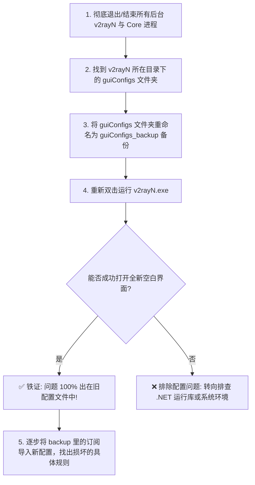
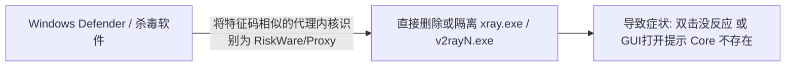
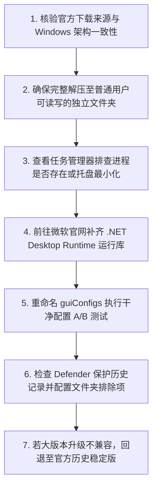

在 Windows 电脑上使用 v2rayN 科学上网时，最彻底、最让人束手无策的故障莫过于**客户端程序本身根本无法正常运行**：**“双击 `v2rayN.exe` 鼠标转了两圈就毫无反应；或者软件窗口刚弹出来 1 秒钟就瞬间闪退崩溃；甚至在升级版本或导入某条复杂分流规则后，程序彻底死锁报错，连主界面都进不去！”**

面对这种“连软件都打不开”的绝境，很多用户在慌乱之中往往会采取各种盲目甚至极具破坏性的错误操作：

**“为什么双击 v2rayN 没有任何窗口弹出来？在任务管理器里甚至找不到任何进程？”**  
**“为什么刚解压出来的 v2rayN 一打开就弹出报错弹窗，提示‘缺少 .NET Desktop Runtime’或‘找不到指定模块’？”**  
**“为什么在第三方软件下载站或者网盘下载的‘精简绿色版’不仅打不开，还被 Windows Defender 报警隔离？”**  
**“为什么旧版本用得好好的，一点击‘检查更新’升级到最新版后，客户端就直接报崩溃闪退？”**  
**“直接把整个 `guiConfigs` 配置文件夹删掉是最快的修复方法吗？这样会不会把所有辛苦配置的机场订阅和自定义规则全部丢失？”**  
**“为什么从 ZIP 压缩包里直接双击运行程序会导致各种‘找不到 Core 内核’或‘权限不足无法写入’的错误？”**  
**“为什么 Windows 10 能完美运行的包，在某些 Windows 11 或 Surface ARM64 电脑上双击就报错？”**  
**“GUI 图形主程序打不开、与底层的 Core 内核（Xray-core / V2Ray-core）启动报错，两者到底有什么本质区别？”**

**排查 v2rayN“打不开 / 启动失败”，首先必须精准划分故障究竟发生在“哪一个系统层级”。**

- **GUI 图形主程序层**：负责窗口界面渲染、订阅解析与交互，打不开通常源于 **.NET 运行环境缺失、架构下载错误、在压缩包内直接运行、或配置文件语法损坏**；
- **底层 Core 内核层**：负责真正的底层加密与网络代理，启动报错通常源于 **内核文件被杀毒软件误隔离、本地端口冲突（Address already in use）、或手写 Routing / DNS 规则格式错误**。

本文作为 **v2rayN 客户端启动故障与运行环境修复的终极收官指南**，将带你从 **6 大打不开病症辨析、GUI 与 Core 双层解耦、Windows 官方架构核验、最小化干净配置 A/B 测试、到 Defender 安全隔离判定与运行环境修复** 建立一套专业、安全、可回滚的标准化排错体系。

---

## ⚡ 30 秒快速诊断：v2rayN 启动故障极速决策流

```text
┌────────────────────────────────────────────────────────────────────────┐
│                 v2rayN 打不开 30 秒极速排查决策流                      │
├────────────────────────────────────────────────────────────────────────┤
│ 1. 【双击完全没反应】➔ 检查是否在系统托盘 / 是否缺少 .NET 桌面运行库   │
│ 2. 【打开瞬间闪退】➔ 配置文件损坏 ➔ 备份并使用空白干净配置启动测试    │
│ 3. 【提示缺少依赖/DLL】➔ 前往微软官方下载对应 .NET 桌面运行库 (拒下DLL) │
│ 4. 【GUI正常但Core报错】➔ 检查 Core 文件是否被 Defender 隔离 / 查端口 │
│ 5. 【升级新版后打不开】➔ 查看 Release Notes ➔ 恢复旧配置格式或回退版本 │
│ 6. 【压缩包内直接运行】➔ 必须将整个压缩包完整解压到本地独立文件夹运行 │
└────────────────────────────────────────────────────────────────────────┘
```

---

## 一、双层解耦：v2rayN GUI 图形界面 vs 底层 Core 内核

很多新手容易将 v2rayN 视为一个单一的软件，但实际上它采用了非常典型的**“前端 GUI 控制面板 + 后端独立代理内核”**的双层分离架构：

```mermaid
graph TD
    subgraph 1. 前端交互层: v2rayN GUI
        GUI[v2rayN.exe (C# / .NET 编写)] -->|负责| UI[用户界面渲染 / 订阅管理 / 节点列表 / 生成配置]
    end

    subgraph 2. 本地配置文件
        UI -->|读取/写入| Conf[guiConfigs 文件夹 / config.json 配置文件]
    end

    subgraph 3. 后端内核层: Core 引擎
        Conf -->|作为启动参数传入| CoreExe[xray.exe / v2ray.exe (Go 语言编写独立进程)]
        CoreExe -->|负责| ProxyNet[本地 Inbound 监听 / 出海流量路由 / 跨境加密]
    end
```

### 核心对比：GUI 打不开 vs Core 启动失败

```text
┌────────────────────────────────────────────────────────────────────────────────────────┐
│                        v2rayN GUI 打不开 vs Core 启动失败全景对比表                    │
├──────────────┬────────────────────────────────────────┬────────────────────────────────┤
│ 比较维度     │ GUI 主程序打不开 (GUI Crash)           │ Core 内核启动失败 (Core Error) │
├──────────────┼────────────────────────────────────────┼────────────────────────────────┤
│ **故障现象** │ 双击没反应、没有窗口、瞬间闪退         │ 窗口正常打开，但日志刷红，测速全 -1ms│
│ **核心诱因** │ .NET 缺失、在压缩包直接运行、配置损坏  │ Core 丢失被隔离、端口冲突、规则语法错  │
│ **排查重点** │ Windows 运行环境、任务管理器、干净配置 │ Core 日志报错信息、本地端口占用情况    │
│ **恢复方案** │ 安装 .NET 运行库、解压到独立目录       │ 恢复 Core 文件、修改冲突端口、回滚规则 │
└──────────────┴────────────────────────────────────────┴────────────────────────────────┘
```

---

## 二、排查总表：v2rayN“打不开”的 6 类典型病症

```text
┌────────────────────────────────────────────────────────────────────────────────────────┐
│                     v2rayN 打不开与启动崩溃 6 大典型病症全景表                         │
├────┬────────────────────────┬────────────────────────────────┬────────────────────────┤
│ 类 │ 启动具体病症与特征     │ 核心可能诱发层级               │ 第一排查与验证动作     │
├────┼────────────────────────┼────────────────────────────────┼────────────────────────┤
│ A  │ 双击没有任何反应与窗口 │ 缺少 .NET 依赖 / 托盘最小化    │ 检查右下角托盘 / 补装 .NET 运行库│
│ B  │ 窗口刚弹出一秒瞬间闪退 │ `guiConfigs` 内 JSON 配置文件损坏│ 移动旧配置文件夹进行干净 A/B 测试│
│ C  │ 弹窗提示缺少指定 DLL   │ 运行库缺失 / 架构下载错误(ARM64)| 前往微软官网下载官方完整运行时 │
│ D  │ 窗口正常但提示 Core 失败│ Core 被杀毒隔离 / 本地端口被占 │ 检查 Defender 隔离记录与端口占用│
│ E  │ 软件点击更新后无法启动 │ 大版本配置不兼容 / 文件覆盖残留│ 下载官方完整 Release 包全新部署│
│ F  │ 导入某条规则后无法运行 │ 手写 Routing/DNS 语法格式错误  │ 还原默认路由规则或回滚最后修改 │
└────┴────────────────────────┴────────────────────────────────┴────────────────────────┘
```

---

## 三、文件与环境基石：官方 Release、架构与运行库

```mermaid
graph TD
    Source[1. 获取渠道] --> Official[必须从 GitHub 官方 Release 页面下载，拒绝第三方改版]
    Official --> Arch[2. 架构选择]
    Arch --> X64[绝大多数 Windows PC ➔ 下载 x64 (64位) 构建包]
    Arch --> ARM[Surface Pro / 骁龙 PC ➔ 下载 arm64 构建包]
    
    Arch --> Unzip[3. 规范解压]
    Unzip --> CorrectDir[必须解压至用户读写权限正常的本地独立目录，严禁在压缩包内双击]
    
    CorrectDir --> Runtime[4. 运行环境]
    Runtime --> DotNet[根据官方版本要求，安装最新 .NET Desktop Runtime (x64)]
```

### 1. 为什么“在压缩包内部直接双击”必崩？
- 很多用户习惯下载了 `.zip` 压缩包后，不解压直接双击里面的 `v2rayN.exe`。
- 此时 Windows 会将程序临时解压到 `C:\Users\用户名\AppData\Local\Temp\` 临时沙盒中。程序运行过程中需要向同级目录读取 `xray.exe` 或写入 `guiConfigs` 配置，会直接因**路径隔离或临时权限不足**而发生崩溃或报“找不到 Core”。

### 2. 拒绝第三方“DLL 修复网站”陷阱
- 如果打开程序时提示缺少 `vcruntime140.dll`、`mscoree.dll` 或 `coreclr.dll`，**绝对不要去百度搜索并下载来历不明的单独 DLL 文件**！
- 这些第三方 DLL 往往携带恶意后门或木马，且架构版本错乱。正确的做法是**直接前往微软官方网站，下载并安装对应的官方运行时安装包**（如 Microsoft .NET Desktop Runtime 与 Visual C++ Redistributable）。

---

## 四、配置损坏自愈：最小化干净配置 A/B 测试法

如果你昨天用得好好的，今天突然闪退，或者在修改了某项高级设置后软件直接打不开，**95% 以上是本地配置文件损坏导致的解析死锁**。



### 逐步恢复配置 4 步法则（严禁直接把全部旧配置无脑复制回去）：
1. **第一步：先导入机场订阅** —— 确认基础节点与订阅能正常更新和测速；
2. **第二步：配置基础系统代理** —— 确认能够正常上网；
3. **第三步：导入自定义 Routing 路由规则** —— 观察是否在此步骤引发崩溃（若崩溃，说明规则语法格式有错）；
4. **第四步：配置自定义 DNS 与 TUN 模式** —— 逐层缩小故障范围，彻底锁定损坏的配置项。

---

## 五、安全软件与 Defender：误报、隔离与正确处理流程



### 1. 为什么代理工具容易被杀毒软件误报？
- `xray.exe` 和 `v2ray.exe` 底层具备高性能网络转发、底层网络驱动调用与流量接管能力，其网络特征与部分远程代理木马具有一定的相似性，因此常被杀毒软件标记为 `RiskWare`（风险工具）或 `ProxyTool`。

### 2. 科学合规的安全处理规范（坚决反对全局关闭 Defender）：
- ❌ **错误危险操作**：一遇到拦截就彻底关闭 Windows Defender 实时保护或关闭防火墙，让整台电脑处于裸奔状态；
- ✅ **正确标准流程**：
  1. 确认当前下载的 v2rayN 压缩包来自 **GitHub 官方项目 Release**；
  2. 按 `Win + I` 打开系统设置 ➔ `隐私和安全性` ➔ `Windows 安全中心` ➔ `病毒和威胁防护` ➔ `保护历史记录`；
  3. 查看被拦截的文件是否确为解压目录中的 `xray.exe` 或 `v2rayN.exe`；
  4. 点击“操作”选择“还原”，并在 Defender 中**仅针对 v2rayN 的所在文件夹添加一条“排除项”（路径白名单）**，既保证了翻墙软件正常运行，又保护了整机其他区域的绝对安全。

---

## 六、实战指南：v2rayN 打不开 7 步通关排障法



1. **第一步：核验来源与架构** —— 确保下载自官方 GitHub Release，64 位系统下载 `x64` 构建包；
2. **第二步：完整解压运行** —— 严禁在压缩包内双击，解压到非系统保护的独立文件夹（如 `D:\Tools\v2rayN\`）；
3. **第三步：检查托盘与进程** —— 查看任务栏右下角折叠托盘区是否已有图标，或任务管理器是否有残留；
4. **第四步：补齐 .NET 运行库** —— 安装微软官方最新 `.NET Desktop Runtime (x64)` 桌面运行时；
5. **第五步：干净配置 A/B** —— 将 `guiConfigs` 改名备份后重新启动，秒测是否为配置损坏；
6. **第六步：排查 Defender 隔离** —— 检查 Windows 安全中心历史记录，将软件目录添加为排除项；
7. **第七步：官方版本回退** —— 若为升级新版后突发闪退，备份配置后使用上一个官方稳定版本。

---

## 七、2026 高可用智能出海高速物理专线推荐

排除客户端启动与本地运行故障后，搭配一条长期稳定、全协议兼容、多客户端无缝导入的优质专线是顺畅上网的终极保障：

```text
┌────────────────────────────────────────────────────────────────────────────────────────┐
│                        2026 稳定高速与全协议兼容专线推荐                               │
├──────────┬──────────────────────────┬──────────────┬──────────────┬────────────────────┤
│ 适配场景 │ 推荐品牌候选             │ 实际起付门槛 │ 每月流量配额 │ 客户端导入与可用性 │
├──────────┼──────────────────────────┼──────────────┼──────────────┼────────────────────┤
│ 旗舰全能 │ 光速云 (GuangSuYun)      │ 约 ¥7.5/月起 │ 59G~238G /月 │ 全协议一键订阅，自动适配 v2rayN 各大内核，晚高峰极稳│
│ 平价轻量 │ 微风网络 (BreezeNet)     │ 约 ¥7/月起   │ 50GB / 月    │ 纯净节点，超低延迟，轻量级日常办公与查资料首选     │
│ 弹性月付 │ 唯兔云 (V2Yun)           │ ¥14.9/月     │ 100GB / 月   │ 14.9 元单月试水，多地区原生 IP 出口，节点丰富      │
│ 应急备用 │ 星岛梦 (XingDaoMeng)     │ 约 ¥8/月起   │ 60G/不限时包 │ 0月租不限时包，节点永不过期，客户端故障调试备用首选│
│ 极速专精 │ 速界 (SpeedWorld)        │ ¥25/月       │ 150GB / 月   │ 企业级大带宽 IEPL 专线，晚高峰 4K 极速秒开零卡顿   │
└──────────┴──────────────────────────┴──────────────┴──────────────┴────────────────────┘
```

- 🏆 **全协议旗舰专线首选**：[光速云](/reviews/guangsu-cloud/) —— 2020 老牌专线，节点全协议覆盖，v2rayN 完美一键导入；
- 🍃 **超低预算轻量**：[微风网络](/reviews/weifeng-cloud/) —— 50GB 精品小流量专线，年付折算仅约 ¥7/月；
- 💳 **拒绝绑定的单月付**：[唯兔云](/recommend/best-airports/) —— ¥14.9 纯单月付，100GB 充沛流量。

---

## 八、避坑指南：40 个关于“客户端打不开”的致命认知误区

```text
❌ 误区 1：v2rayN 打不开就代表机场的节点全部瘫痪了 ➔ 事实：这是电脑本地程序启动问题，与海外节点毫无因果关系。
❌ 误区 2：GUI 图形主程序打不开和 Core 内核报错是一回事 ➔ 事实：GUI 是前端交互面板，Core 是底层代理进程，两者分属不同层级。
❌ 误区 3：GUI 界面能正常打开，就证明 Core 内核一定也成功运行了 ➔ 事实：GUI 能开不代表 Core 成功绑定了端口和网络驱动。
❌ 误区 4：Core 内核报错就说明 v2rayN.exe 文件已经损坏了 ➔ 事实：通常是端口冲突、Core 被杀毒软件隔离或手写配置语法错误。
❌ 误区 5：双击后桌面上没弹窗，就断定软件绝对没有启动 ➔ 事实：程序可能默认最小化到了任务栏右下角的隐藏托盘区中。
❌ 误区 6：直接在 WinRAR 或 7-Zip 压缩包内双击运行没有任何问题 ➔ 事实：压缩包内运行会导致解压到临时目录，引发路径和写入死锁。
❌ 误区 7：所有 Windows 电脑都应该无脑下载 x64 架构安装包 ➔ 事实：Surface Pro 或骁龙处理器的 ARM64 电脑需下载对应的 arm64 构建。
❌ 误区 8：软件目录带有中文字符就绝对会导致 v2rayN 闪退 ➔ 事实：现代 v2rayN 已完全支持 UTF-8，但仍建议使用规范路径以防第三方插件异常。
❌ 误区 9：必须把 v2rayN 放在 C:\Program Files 目录下才算规范 ➔ 事实：Program Files 具有严格的系统保护权限，会导致便携版无法写入配置。
❌ 误区 10：以管理员身份运行可以解决所有的打不开与闪退问题 ➔ 事实：管理员权限无法解决配置文件 JSON 语法错误或运行库缺失。
❌ 误区 11：关闭 Windows UAC 用户账户控制可以修复 v2rayN ➔ 事实：关闭 UAC 会破坏系统安全边界，且无法修复软件崩溃。
❌ 误区 12：遇到启动失败第一步就应该彻底关闭 Windows Defender ➔ 事实：切勿全局关闭杀毒防护，只需在安全中心将软件目录添加为排除项。
❌ 误区 13：杀毒软件拦截 v2rayN 就证明官方 Release 带有电脑病毒 ➔ 事实：代理工具因底层网络转发特征经常被杀毒软件判定为风险工具（误报）。
❌ 误区 14：提示缺少 DLL 时，随便在百度上找个 DLL 修复网站下载最快 ➔ 事实：第三方 DLL 网站极易携带木马后门，必须前往微软官网下载完整运行时。
❌ 误区 15：所有版本的 v2rayN 都强制要求安装完全相同版本的 .NET ➔ 事实：不同版本要求的 .NET Runtime 不同，请以官方 Release 说明为准。
❌ 误区 16：Windows 7 操作系统一定能够无缝运行最新版的 v2rayN ➔ 事实：最新版 v2rayN 已停止对 Win7 的支持，老系统需使用特定历史构建。
❌ 误区 17：遇到配置错误，把整个 v2rayN 文件夹删光重新下载最干净 ➔ 事实：暴力删除会导致已保存的节点、订阅和自定义分流规则彻底丢失。
❌ 误区 18：只要重装了软件，之前的旧配置就一定能 100% 自动继承 ➔ 事实：大版本升级往往伴随配置结构变更，需做好备份再逐步迁移。
❌ 误区 19：更新升级后打不开，100% 说明新版本作者写出了严重 Bug ➔ 事实：多半是因为旧配置格式与新版本要求不兼容，干净配置即可自愈。
❌ 误区 20：回退旧版本时，可以去任意第三方个人博客下载历史压缩包 ➔ 事实：第三方历史包可能被二次打包植入后门，必须前往官方 GitHub Release。
❌ 误区 21：手写 Routing 规则报错和本地端口冲突是同一种错误 ➔ 事实：Routing 报错源于 JSON 语法错误，端口冲突源于 Socket 被其他软件占用。
❌ 误区 22：DNS 配置写错了会导致 v2rayN.exe 窗口瞬间闪退 ➔ 事实：DNS 配置错误会导致 Core 启动失败或无法解析域名，GUI 依然能正常打开。
❌ 误区 23：订阅链接报 404 错误会导致 v2rayN 主程序直接无法启动 ➔ 事实：订阅失败仅影响节点获取，与客户端图形界面的启动完全无关。
❌ 误区 24：节点 Timeout 超时会导致 v2rayN 客户端彻底闪退崩溃 ➔ 事实：Timeout 是远端服务器网络不通，绝对不会导致本地主程序崩溃。
❌ 误区 25：报错 Address already in use 说明 v2rayN 程序损坏了 ➔ 事实：这说明本地端口（如 10808）被其他程序占用，换个端口即可解决。
❌ 误区 26：在设置里随便切换 Core 内核版本一定能解决启动报错 ➔ 事实：若新内核文件不存在或配置不兼容，盲目切换会引发新的启动失败。
❌ 误区 27：从网络上单独下载一个 xray.exe 扔进目录替换最方便 ➔ 事实：非官方打包的内核可能与 GUI 的命令行参数不兼容，引发启动死锁。
❌ 误区 28：电脑里可以同时解压存放多个不同版本的 v2rayN 并混用 ➔ 事实：多个版本共存极易引发开机自启混乱与本地监听端口争抢冲突。
❌ 误区 29：桌面上的快捷方式一定指向的是当前最新解压的 v2rayN ➔ 事实：更新目录后若未更新快捷方式，双击打开的依然是旧版程序。
❌ 误区 30：Windows 开机自动启动的必定是你最后下载的那个版本 ➔ 事实：注册表中的开机启动项依然保留旧路径，需在设置中重新开关一次。
❌ 误区 31：多显示器拔掉后打不开是因为软件坏了 ➔ 事实：窗口可能记录了副屏坐标导致跑到了屏幕可视范围之外，重置坐标即可。
❌ 误区 32：GUI 窗口无响应卡死就代表代理网络已经彻底断开 ➔ 事实：Core 是独立后台进程，GUI 卡死时代理转发通常依然能正常工作。
❌ 误区 33：Windows 更新后打不开必须立刻重装操作系统 ➔ 事实：通常只需重新安装对应的 .NET 桌面运行时即可修复系统关联。
❌ 误区 34：给软件所在文件夹赋予 Everyone 完全控制权限最保险 ➔ 事实：过度开放权限会破坏系统安全模型，放在正常用户文档目录即可。
❌ 误区 35：只要买了最贵的专线机场，电脑就绝对不会遇到 v2rayN 启动报错 ➔ 事实：专线决定海外网络质量，客户端启动完全取决于本地系统环境。
❌ 误区 36：双击程序后鼠标转圈说明系统正在全力修复软件 ➔ 事实：鼠标转圈只是系统在尝试加载进程，数秒后消失说明发生了早期崩溃。
❌ 误区 37：把 v2rayN 放在 OneDrive 自动同步文件夹里最安全 ➔ 事实：云同步工具在实时上传配置时会锁死文件句柄，引发配置写入冲突闪退。
❌ 误区 38：所有的 .NET 安装包都是一样的，装了 .NET SDK 就能运行 ➔ 事实：必须安装对应的 **.NET Desktop Runtime（桌面运行时）**，缺少桌面组件依然会报错。
❌ 误区 39：查看 Windows 事件查看器里的任何红色错误都能直接定罪 ➔ 事实：事件查看器包含大量无关系统日志，需严格核对进程名与崩溃时间点。
❌ 误区 40：遇到任何启动故障，重装 Windows 操作系统是唯一解决手段 ➔ 事实：按照 7 步通关排障法，99.9% 的启动问题均可在 3 分钟内精准修复。
```

---

## 九、常见问题深度解答（FAQ · 50 问）

### Q1：v2rayN 双击完全没反应怎么办？
**答**：首先检查任务栏右下角折叠托盘区是否已有图标；若无，前往微软官网下载并安装最新的 **.NET Desktop Runtime (x64)**，并确保不是在压缩包内直接双击。

### Q2：为什么打开 v2rayN 后会瞬间闪退？
**答**：95% 是因为 `guiConfigs` 文件夹内的配置文件损坏。将该文件夹改名为 `guiConfigs_backup`，重新运行即可自动生成干净配置恢复启动。

### Q3：提示“缺少 .NET Desktop Runtime”怎么办？
**答**：直接访问微软官方 .NET 下载页面，根据提示下载并安装 **.NET Desktop Runtime（必须是 Desktop 桌面版，且架构需与系统一致）**。

### Q4：为什么不能在 ZIP 压缩包里直接双击运行？
**答**：压缩包直接双击会运行在 Temp 临时沙盒中，导致无法读取同级目录的 Core 内核或无法写入本地配置文件，从而直接报错崩溃。

### Q5：v2rayN 应该解压到哪个目录最合适？
**答**：推荐解压到普通磁盘的用户目录（如 `D:\Tools\v2rayN\` 或 `C:\Users\你的用户名\v2rayN\`），避免放在受保护的 `Program Files` 或开启了实时同步的 OneDrive 目录。

### Q6：Windows Defender 拦截 v2rayN 怎么办？
**答**：在 Windows 安全中心“病毒和威胁防护”的“保护历史记录”中确认拦截文件，还原文件并将 v2rayN 整个文件夹添加为“排除项”（白名单）。

### Q7：杀毒软件提示病毒，v2rayN 真的安全吗？
**答**：只要确认从 GitHub 官方项目 Release 下载，该提示即为杀毒软件对网络代理底层特征的**特征码误报**。切勿在第三方小网站下载来历不明的改版包。

### Q8：报错 `Address already in use` 导致 Core 无法启动怎么办？
**答**：这是本地监听端口（如 10808）被其他程序占用，使用 `netstat -ano` 查出占用 PID 并结束多余残留进程，或在设置中将本地端口改为 20808。

### Q9：升级到最新版后突然打不开怎么办？
**答**：大版本升级可能改变了配置格式。先备份旧配置，使用干净的新版目录启动测试；若新版确有兼容问题，可从官方 Release 回退到上一稳定版。

### Q10：为什么 GUI 界面能打开，但 Core 启动一直失败？
**答**：说明前端图形界面正常，但底层内核遇到了文件缺失（被 Defender 隔离）、端口冲突或手写的 Routing/DNS 规则语法错误。

### Q11：提示缺少某某 DLL 文件该去哪里下载？
**答**：**坚决不要去第三方 DLL 网站下载！** 缺少 DLL 说明系统缺少对应的微软官方运行库，直接前往微软官网安装完整的 Visual C++ Redistributable 或 .NET 运行库。

### Q12：Surface Pro / 骁龙处理器的电脑能运行 v2rayN 吗？
**答**：能，但必须在官方 Release 页面下载专门为 **ARM64 架构** 编译的构建包，下载 x64 版本可能会因模拟转译异常而报错。

### Q13：如何备份 v2rayN 的所有配置？
**答**：在程序关闭状态下，直接将 v2rayN 目录下的 `guiConfigs` 文件夹复制一份保存到安全位置即可，里面包含了所有节点、订阅和自定义规则。

### Q14：可以同时打开两个不同目录的 v2rayN 吗？
**答**：**极不推荐。** 多个实例会互相争抢本地监听端口和 Windows 系统代理控制权，导致网络严重紊乱。

### Q15：多显示器拔掉后找不到 v2rayN 窗口怎么办？
**答**：软件可能记录了副屏坐标。在任务栏右键 v2rayN 托盘图标选择退出，或在配置文件中重置窗口位置坐标后重新打开。

### Q16：重装 v2rayN 会导致之前的节点全部丢失吗？
**答**：如果在重装前备份了 `guiConfigs` 文件夹，重装后只需将备份的文件夹复制回来即可无缝恢复所有节点与订阅。

### Q17：中文路径真的会导致 v2rayN 打不开吗？
**答**：现代版本已完全支持 UTF-8 中文路径，但为了防止某些第三方插件或旧版 Core 出现编码死锁，建议尽量使用英文或数字文件夹命名。

### Q18：提示 `System.NullReferenceException` 闪退是什么原因？
**答**：通常是因为配置文件中的某个字段为空或被非法字符破坏，重命名 `guiConfigs` 执行干净配置 A/B 测试即可化解。

### Q19：开机自启打开的是旧版怎么办？
**答**：在当前最新版的设置中，先取消勾选“开机自启”，点击保存；然后重新勾选“开机自启”并保存，即可刷新 Windows 注册表中的启动路径。

### Q20：v2rayN 打不开需要重装整个 Windows 操作系统吗？
**答**：**绝对不需要！** 按照 7 步通关排障法，排查运行库、解压路径、配置损坏与杀毒隔离，任何启动故障均可在 3 分钟内彻底解决。

---

## 🏁 总结：v2rayN 客户端启动排障核心认知金字塔

排查一切主程序打不开、闪退与 Core 启动失败，请牢记以下**核心铁律**：

```text
1. 辨层级 ➔ GUI 没开是环境/配置损坏，Core 报错是端口/杀毒拦截，两者切忌混淆
2. 规解压 ➔ 严禁在压缩包内直接运行，必须完整解压到本地独立用户目录
3. 补运行 ➔ 遇 DLL/Runtime 缺失，唯一正道是前往微软官网下载安装最新 .NET
4. 巧测配置 ➔ 遇闪退秒把 guiConfigs 改名备份，干净环境启动立刻破案
5. 防误杀 ➔ 认准官方 Release，Defender 仅对软件目录加白名单，切勿裸奔关杀毒
```

---

### 📚 延伸进阶阅读与选型专栏
- 💻 **Windows 客户端主教程**：[《v2rayN怎么用？Windows下载安装、订阅、节点、系统代理与TUN完整教程》](/tutorials/v2rayn-windows/)
- 🌐 **V2Ray 生态超级 Pillar**：[《V2Ray是什么？V2Ray客户端、节点、订阅、VLESS/VMess与新手完整教程》](/tutorials/v2ray-tizi/)
- 🚪 **v2rayN 端口冲突排查**：[《v2rayN端口冲突怎么办？本地监听、Core启动失败、Address already in use与Windows端口占用完整排查》](/issues/v2rayn-port-conflict/)
- 🔄 **v2rayN 断流排查**：[《v2rayN经常断线怎么办？节点断流、Core重连、Windows网络与睡眠唤醒完整排查》](/issues/v2rayn-disconnect/)
- 🖧 **v2rayN 系统代理排查**：[《v2rayN系统代理失效怎么办？Windows代理残留、本地端口、Chrome/Edge与关闭软件后没网完整排查》](/issues/v2rayn-system-proxy/)
- 🚨 **v2rayN 超时排查**：[《v2rayN节点 Timeout 怎么办？全部节点连接超时、Core、网络与服务器异常完整排查》](/issues/v2rayn-node-timeout/)
- 🔌 **v2rayN 有节点没网**：[《v2rayN有节点但无法上网怎么办？系统代理、TUN、DNS与Routing完整排查》](/issues/v2rayn-connected-no-internet/)
- 🚀 **v2rayN 速度慢排查**：[《v2rayN速度慢怎么办？节点、线路、丢包、Windows网络与晚高峰完整排查》](/issues/v2rayn-slow-speed/)
- 🛠️ **v2rayN TUN 深度指南**：[《v2rayN TUN怎么用？系统代理、TUN、虚拟网卡、Routing与DNS完整指南》](/tutorials/v2rayn-tun/)
- 🌐 **v2rayN DNS 设置指南**：[《v2rayN DNS怎么设置？Windows域名解析、IPv6、DoH与网站打不开完整指南》](/tutorials/v2rayn-dns/)
- 🛤️ **v2rayN Routing 深度教程**：[《v2rayN Routing怎么设置？Direct、Proxy、Block、规则与Outbound完整教程》](/tutorials/v2rayn-routing/)
- ⚡ **老牌旗舰专线**：[《光速云深度评测：2020老牌IEPL专线与解锁实测》](/reviews/guangsu-cloud/)
- 🍃 **平价轻量专线**：[《微风网络深度评测：小流量套餐值不值得买？》](/reviews/weifeng-cloud/)
- 🏆 **2026 全景大榜**：[《2026梯子推荐：稳定、速度、价格、安全与不同使用场景怎么选》](/recommend/best-tizi/)
