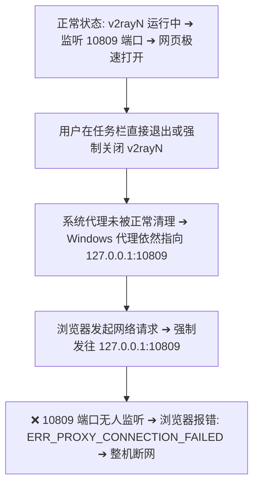
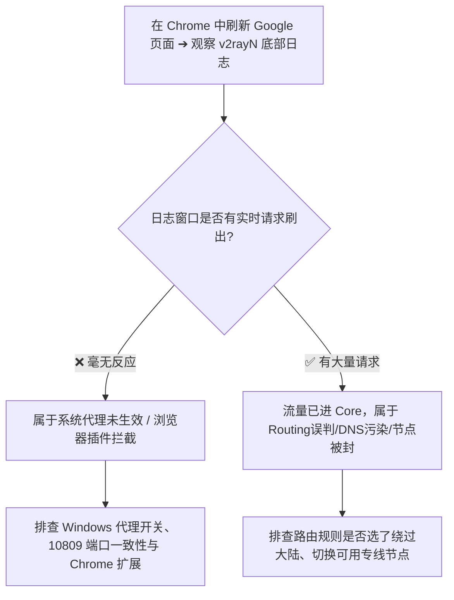

在 Windows 电脑上使用 v2rayN 科学上网时，最常困扰用户的一组极其高频且令人抓狂的系统级故障莫过于：**“明明节点测速显示几十毫秒正常，但打开 Chrome 浏览器却死活进不去 Google；或者好不容易用完 v2rayN 顺手一关，结果整台电脑瞬间断网，连国内百度、微信都全军覆没！”**

这种“关了软件反而在本地断网”或“开了软件浏览器不走代理”的诡异现象，常常让新手陷入无休止的焦虑与误区：

**“为什么 v2rayN 列表中节点全绿，但 Chrome 访问任何网页都提示 `ERR_PROXY_CONNECTION_FAILED`（代理服务器拒绝连接）？”**  
**“为什么在托盘右键退出了 v2rayN 之后，电脑所有国内网页全部打不开，必须重新打开 v2rayN 才能勉强上网？”**  
**“Windows 网络设置里的代理地址显示 `127.0.0.1:10809`，这个 127.0.0.1 到底是不是机场的节点服务器？为什么乱改它就会断网？”**  
**“为什么在 Edge 浏览器里能正常出海，而 Chrome 浏览器却完全不走代理？”**  
**“为什么电脑重启了好几次，关闭软件后断网的问题依然存在？网上流传的‘一键修复代理 .reg 注册表脚本’到底能不能用？”**  
**“本地监听端口（Local Port）和机场节点的远程端口到底有什么区别？提示 `Address already in use` 端口冲突怎么解决？”**

**v2rayN 的 System Proxy（系统代理）并不是代理节点本身。它的核心作用，是通过修改 Windows 系统的网络代理配置，引导所有支持该规范的浏览器（Chrome/Edge 等）将 HTTP/HTTPS 流量精准投递至本机 `127.0.0.1` 上的 v2rayN 本地监听端口。**

如果节点正常但浏览器无法访问，最本质的原因通常是**「系统代理开关未正确写入 ➔ 本地端口未被 Core 监听 ➔ 浏览器存在独立代理扩展干扰 ➔ 或旧代理软件篡改了 PAC 脚本」**；而“关闭软件后断网”，则 100% 是典型的 **「Windows 系统代理残留（Proxy Residue）」**。

本文作为 **v2rayN 系统代理与 Windows 本地流量入口的权威深度排错指南**，将带你从 **System Proxy 底层交互链路、127.0.0.1 回环原理、代理残留 7 步无损恢复、Chrome/Edge 浏览器隔离排查，到本地端口冲突消除** 建立完整的科学诊断与安全恢复体系。

---

## ⚡ 30 秒快速诊断：v2rayN 系统代理故障排错流

```text
┌────────────────────────────────────────────────────────────────────────┐
│               v2rayN 系统代理故障 30 秒极速诊断决策流                  │
├────────────────────────────────────────────────────────────────────────┤
│ 1. 【看退出后断网】➔ 退出 v2rayN 后全断 ➔ 锁定为 Windows 代理残留      │
│    ➔ 快捷键 Win+i ➔ 网络和 Internet ➔ 代理 ➔ 关闭「使用代理服务器」开关 │
│ 2. 【看浏览器报错】➔ 提示 ERR_PROXY_CONNECTION_FAILED ➔ 本地 Core 未监听│
│    ➔ 检查 v2rayN 底部本地端口 (如 10809) 是否与 Windows 代理设置一致  │
│ 3. 【看日志记录】➔ 刷新网页时 v2rayN 底部日志毫无反应 ➔ 浏览器未走系统代理│
│    ➔ 检查 Chrome 是否安装了 SwitchyOmega 等代理插件，或开启了独立 DoH  │
│ 4. 【看端口冲突】➔ 启动时报 Address already in use ➔ 本地端口被占      │
│    ➔ 退出后台残留的 Clash/旧 v2rayN 进程，或在设置中更换本地监听端口   │
│ 5. 【守安全底线】➔ 绝不要为了修代理去网上下载执行未知的 .reg 注册表脚本 │
└────────────────────────────────────────────────────────────────────────┘
```

---

## 一、破除迷思：System Proxy、127.0.0.1 与本地端口真相

在排查系统代理前，必须厘清三个最基础的网络常识：

```mermaid
graph LR
    Chrome[Chrome / Edge 浏览器] -->|1. 读取 Windows 代理设置| WinProxy[Windows 系统代理 (127.0.0.1:10809)]
    WinProxy -->|2. 本地回环传输| LocalPort[本机 v2rayN / Core (监听 10809 端口)]
    LocalPort -->|3. 加密出境隧道 (443端口)| RemoteNode[境外机场节点服务器 (香港/日本)]
    RemoteNode -->|4. 访问目标网站| Web[Google / YouTube / AI]
```

### 1. System Proxy 只是“本地引流中转站”
- 系统代理并不是代理服务器本身。它只是告诉 Windows 操作系统：**“凡是支持系统代理的应用，请把网络请求送到本机的 `127.0.0.1` 地址”**。

### 2. 127.0.0.1 不是机场服务器
- `127.0.0.1` 是计算机网络中的**本地回环地址（Loopback Address）**，它代表的**就是你当前这台 Windows 电脑自己**。
- 浏览器把请求发给 `127.0.0.1`，是为了让驻留在你电脑内存中的 `v2rayN/Core` 接收流量，再由 Core 负责加密打包发往境外的节点服务器。

### 3. 本地监听端口 vs 远程节点端口
```text
┌────────────────────────────────────────────────────────────────────────┐
│                   本地监听端口与远端节点端口本质区别                   │
├──────────────┬────────────────────────┬────────────────────────────────┤
│ 比较维度     │ 本地监听端口 (Local)   │ 远端节点端口 (Remote)          │
├──────────────┼────────────────────────┼────────────────────────────────┤
│ **具体代表** │ 如 `10809` (HTTP) /    │ 如 `443`、`8443`、`2086` 等   │
│              │ `10808` (SOCKS5)       │                                │
├──────────────┼────────────────────────┼────────────────────────────────┤
│ **通信双方** │ Windows 浏览器 ➔       │ 本机 Core ➔ 境外物理机房       │
│              │ 本机 v2rayN / Core     │ 代理服务器                     │
├──────────────┼────────────────────────┼────────────────────────────────┤
│ **谁来配置** │ v2rayN 内部参数设置    │ 机场服务商后台配置并在订阅中下发│
├──────────────┼────────────────────────┼────────────────────────────────┤
│ **冲突影响** │ 本机 Core 启动报错崩溃 │ 节点连接超时 (Timeout / -1ms)  │
└──────────────┴────────────────────────┴────────────────────────────────┘
```

> 💡 **核心定律**：v2rayN 每次启动，Core 会在本地开启一个监听端口（如 `10809`），同时通知 Windows 系统代理：“请将浏览器流量发往 `127.0.0.1:10809`”。

---

## 二、最大痛点：为什么“关闭 v2rayN 之后电脑瞬间断网”？

这是 90% 的 Windows 科学上网用户都曾遭遇过的经典灾难：



### 1. 代理残留产生的三大根源
1. **异常强退**：通过任务管理器“结束任务”、电脑突然断电死机、或蓝屏重启，导致 v2rayN 根本来不及执行“注销系统代理”的系统 API；
2. **多客户端覆盖**：电脑上同时运行了 Clash、Watt Toolkit（Steam加速）或商业 VPN，它们交替修改注册表，导致退出逻辑混乱；
3. **安全软件拦截**：部分第三方安全管家拦截了 v2rayN 修改系统设置的权限，导致退出时清理指令被阻断。

---

## 三、安全解救：Windows 系统代理残留 7 步无损恢复指南

**千万不要轻易去网上下载来历不明的 `.reg` 注册表修复脚本！** 很多脚本会暴力破坏系统的网络协议栈，甚至删除企业的网络策略。按照以下官方标准流程即可 100% 安全恢复：


### 步骤 1：打开 Windows 系统设置
- 键盘同时按下快捷键 **`Win + i`**，打开 Windows 设置面板。

### 步骤 2：进入代理设置页面
- **Windows 11**：点击左侧 **「网络和 Internet」** ➔ 点击右侧 **「代理」**；
- **Windows 10**：点击 **「网络和 Internet」** ➔ 点击左侧 **「代理」**。

### 步骤 3：关闭「使用代理服务器」开关
- 在 **「手动设置代理（Manual proxy setup）」** 区域：
  - 点击“设置”或编辑按钮；
  - 将 **【使用代理服务器（Use a proxy server）】** 的开关彻底切换为 **「关（Off）」**；
  - 点击 **「保存」**。

### 步骤 4：检查并清理「自动代理脚本（PAC）」
- 在 **「自动设置代理（Automatic proxy setup）」** 区域：
  - 检查“使用设置脚本（Use setup script）”是否开启；若有残留的本地 PAC 链接（如 `http://127.0.0.1:...`），直接将其关闭并清空输入框。

### 步骤 5：重启浏览器验证裸网连通性
- 彻底关闭 Chrome/Edge 浏览器窗口并重新打开，直接访问国内网站（如 `www.baidu.com`），网络将瞬间完全恢复正常！

---

## 四、核心排查：为什么“开启 v2rayN 但浏览器完全不走代理”？

如果 v2rayN 正在运行且节点正常，但浏览器死活打不开海外网页，请按以下**日志观测法则**进行秒级定位：



### 1. 常见原因一：Windows 系统代理未真正激活
- 检查 v2rayN 任务栏托盘图标：必须确保处于 **「自动配置系统代理（红/蓝图标）」** 状态，若误选为“清除系统代理”，浏览器流量将全部走本地裸网。

### 2. 常见原因二：本地监听端口与系统代理配置不匹配
- v2rayN 设置中的本地 HTTP 端口是 `10809`，但 Windows 系统代理里被其他软件篡改成了 `7890` 或 `10808`。流量送到了空端口，导致断网。

### 3. 常见原因三：Chrome / Edge 安装了独立代理扩展
- 如果你的 Chrome 安装了 **SwitchyOmega**、**ZeroOmega** 或各类 VPN 插件，这些扩展拥有**高于 Windows 系统的代理控制权**。
- **解决方法**：临时将 SwitchyOmega 切换为 **「系统代理」** 或直接禁用该扩展。

### 4. 常见原因四：浏览器开启了独立安全 DNS（DoH）
- Chrome 或 Edge 设置中开启了“使用安全 DNS（Secure DNS）”，导致浏览器的域名解析绕过了 v2rayN 的防污染逻辑。将其改为“使用当前服务商”即可。

---

## 五、非浏览器应用不走系统代理的终极解答

很多开发者常问：“为什么 Chrome 能翻墙，但终端里的 Git、npm、Docker 或外服游戏依然连不上？”

```text
┌────────────────────────────────────────────────────────────────────────┐
│                   各类常见应用对系统代理的支持机制                     │
├──────────────┬────────────────────────┬────────────────────────────────┤
│ 软件类型     │ 是否遵循 Windows 代理  │ 最佳出海解决方案               │
├──────────────┼────────────────────────┼────────────────────────────────┤
│ **Chrome**   │ ✅ 是 (默认自动读取)   │ 保持 v2rayN 系统代理开启即可   │
│ **Edge**     │ ✅ 是 (完美原生支持)   │ 保持 v2rayN 系统代理开启即可   │
├──────────────┼────────────────────────┼────────────────────────────────┤
│ **Git 终端** │ ❌ 否 (默认直连网络)   │ 在终端执行命令单独配置代理端口: │
│              │                        │ `git config --global http.proxy│
│              │                        │  http://127.0.0.1:10809`       │
├──────────────┼────────────────────────┼────────────────────────────────┤
│ **npm/pip**  │ ❌ 否 (默认忽略系统代理)│ 设置环境变量 `HTTP_PROXY`，或在│
│              │                        │ v2rayN 中开启 [TUN 模式]       │
├──────────────┼────────────────────────┼────────────────────────────────┤
│ **外服游戏** │ ❌ 否 (纯原生 UDP 流量)│ 系统代理完全无效，必须开启     │
│              │                        │ v2rayN 的 [TUN 模式] 或加速器  │
└──────────────┴────────────────────────┴────────────────────────────────┘
```

> 🔗 **需要整机透明接管游戏和终端？** 请阅读我们的深度专栏：[《v2rayN TUN怎么用？系统代理、TUN、虚拟网卡、Routing与DNS完整指南》](/tutorials/v2rayn-tun/)。

---

## 六、本地端口冲突排查（`Address already in use`）

当 v2rayN 启动或切换 Core 时，如果日志窗口弹出红字：  
`listen tcp 127.0.0.1:10809: bind: An attempt was made to access a socket in a way forbidden by its access permissions` 或 `Address already in use`：

1. **排查僵尸进程**：电脑后台可能有一个未正常关闭的旧 `xray.exe` 依然霸占着 10809 端口。打开任务管理器，强制结束所有 `v2rayN`、`xray`、`sing-box` 进程；
2. **排查其他客户端**：电脑上是否同时开着 Clash（占用 7890/10808）或其它开发调试代理工具；
3. **更换监听端口**：在 v2rayN 顶部点击「设置」➔「参数设置」➔ 将本地监听端口从 `10809` 改为 `20809`，点击确定重启即可完美避开冲突。

---

## 七、2026 高可用晚高峰稳定出海专线推荐

系统代理负责本地流量入站，而真正的出海速度与稳定性 100% 取决于远端节点质量。建议搭配采用 **企业级 IEPL / IPLC 物理专线** 的服务商：

```text
┌────────────────────────────────────────────────────────────────────────────────────────┐
│                        2026 稳定抗丢包物理专线品牌推荐                                 │
├──────────┬──────────────────────────┬──────────────┬──────────────┬────────────────────┤
│ 适配场景 │ 推荐品牌候选             │ 实际起付门槛 │ 每月流量配额 │ 线路架构与连接优势 │
├──────────┼──────────────────────────┼──────────────┼──────────────┼────────────────────┤
│ 旗舰全能 │ 光速云 (GuangSuYun)      │ 约 ¥7.5/月起 │ 59G~238G /月 │ 全球企业 IEPL 专线，系统代理极速响应，晚高峰 4K 秒开│
│ 平价轻量 │ 微风网络 (BreezeNet)     │ 约 ¥7/月起   │ 50GB / 月    │ 优质 BGP 优化线路，轻量纯净，日常查资料办公首选    │
│ 弹性月付 │ 唯兔云 (V2Yun)           │ ¥14.9/月     │ 100GB / 月   │ 纯单月付，百兆充沛带宽，多地区原生 IP 解锁强       │
│ 应急备用 │ 星岛梦 (XingDaoMeng)     │ 约 ¥8/月起   │ 60G/不限时包 │ 0月租不限时包，节点长期有效，排障应急秒级顶上      │
│ AI/开发  │ 速界 (SpeedWorld)        │ ¥25/月       │ 150GB / 月   │ 原生住宅 IP 独立大带宽出口，Git/Docker/4K 全能     │
└──────────┴──────────────────────────┴──────────────┴──────────────┴────────────────────┘
```

- 🏆 **全能稳定首选**：[光速云](/reviews/guangsu-cloud/) —— 2020 老牌 IEPL 专线，全协议适配，系统代理模式下秒开 Google；
- 🍃 **超低预算轻量**：[微风网络](/reviews/weifeng-cloud/) —— 针对 PC 端日常查资料优化的 50GB 小流量专线，年付折算仅约 ¥7/月；
- 💳 **拒绝绑定的单月付**：[唯兔云](/recommend/best-airports/) —— ¥14.9 纯单月付，100GB 充沛流量，节点丰富。

---

## 八、避坑指南：35 个关于“v2rayN 系统代理”的致命认知误区

```text
❌ 误区 1：系统代理（System Proxy）就是机场的节点服务器 ➔ 事实：系统代理只是 Windows 本地引流开关，节点是远端服务器。
❌ 误区 2：Windows 代理显示的 127.0.0.1 是境外机房 IP ➔ 事实：127.0.0.1 是本机回环地址，代表你当前这台电脑自己。
❌ 误区 3：节点测速显示绿色 30ms，浏览器就一定能打开海外网站 ➔ 事实：若系统代理未开启或端口不匹配，浏览器根本不会走节点。
❌ 误区 4：在 v2rayN 列表中双击选中节点，浏览器就自动走代理了 ➔ 事实：还必须确保底部托盘开启了“自动配置系统代理”。
❌ 误区 5：本地监听端口必须写死为 10808 或 10809 ➔ 事实：端口可在参数设置中自定义，只要未被其他软件占用即可。
❌ 误区 6：退出 v2rayN 软件后，Windows 会自动帮你关闭代理 ➔ 事实：异常强退或软件崩溃时，Windows 代理设置会发生残留。
❌ 误区 7：退出 v2rayN 后电脑断网，说明是电脑网卡硬件损坏了 ➔ 事实：是系统代理残留指向了失效端口，去设置里关闭即可。
❌ 误区 8：解决代理残留必须去网上下载第三方 .reg 修复注册表 ➔ 事实：乱下脚本极易破坏网络协议栈，在 Windows 设置里手动关最安全。
❌ 误区 9：重启电脑可以 100% 自动清除系统代理残留 ➔ 事实：Windows 代理状态保存在注册表中，电脑重启后依然会保持残留。
❌ 误区 10：遇到系统代理失效，第一步就应该卸载重装 v2rayN ➔ 事实：重装解决不了 Windows 系统的代理配置错误。
❌ 误区 11：PAC（自动代理脚本）和 Routing（路由规则）是同一个东西 ➔ 事实：PAC 发生在浏览器入口层，Routing 发生在 Core 内核层。
❌ 误区 12：Chrome 和 Edge 在代理机制上永远表现得一模一样 ➔ 事实：两者各自的扩展、安全 DNS 和 Profile 策略可能导致差异。
❌ 误区 13：Chrome 安装的 SwitchyOmega 插件绝不会影响 v2rayN ➔ 事实：插件接管了代理设置，会导致系统代理被强制忽略。
❌ 误区 14：开启 Chrome 的 Secure DNS 不会对代理产生任何影响 ➔ 事实：安全 DNS 会绕过本地防污染解析，引发部分网站打不开。
❌ 误区 15：Edge 浏览器能上网说明 Chrome 打不开一定是机场坏了 ➔ 事实：说明节点完全正常，问题出在 Chrome 自身的插件或设置。
❌ 误区 16：Chrome 能上网说明整台电脑所有的软件都能出海了 ➔ 事实：Git、终端、Docker 和游戏默认完全不读取系统代理。
❌ 误区 17：Git clone 速度极慢说明 v2rayN 系统代理彻底坏了 ➔ 事实：Git 不走系统代理，需在命令行单独配置代理端口。
❌ 误区 18：遇到系统代理异常，第一反应应该去开启 TUN 模式 ➔ 事实：TUN 是网络层虚拟网卡，不是用来修复系统代理故障的工具。
❌ 误区 19：把系统代理的端口改成 80 或 443 能让网速变快 ➔ 事实：端口只是网络标识，乱改会导致特权端口冲突而直接断网。
❌ 误区 20：同时开着 Clash 和 v2rayN 的系统代理能双重提速 ➔ 事实：两个软件会疯狂争抢 Windows 代理控制权，导致严重断流。
❌ 误区 21：只要刷新 DNS 缓存（ipconfig /flushdns）就能修好代理 ➔ 事实：DNS 缓存不影响 HTTP 代理服务器的连接逻辑。
❌ 误区 22：关闭 Windows Defender 可以彻底根治系统代理失效 ➔ 事实：杀毒软件不拦截正规本地回环代理，切勿关闭安全防护。
❌ 误区 23：关闭电脑的 IPv6 协议可以解决系统代理所有问题 ➔ 事实：系统代理工作在 IPv4 本地回环上，与 IPv6 基本无关。
❌ 误区 24：提示 Address already in use 说明机场机房端口冲突了 ➔ 事实：是你电脑本机后台有其他软件占用了 10809 端口。
❌ 误区 25：遇到端口冲突只要在任务管理器里随机结束系统进程 ➔ 事实：乱杀系统关键进程会导致电脑蓝屏，只需换个端口号。
❌ 误区 26：在 IP 查询网站查到国内 IP 说明系统代理彻底失效了 ➔ 事实：国内网站命中直连规则走本地网络，需查海外 IP 网站。
❌ 误区 27：换了新节点后网页没变化说明系统代理坏了 ➔ 事实：浏览器复用了旧的 TCP 长连接，关闭标签页重开即可。
❌ 误区 28：开机自动启动 v2rayN 就能保证系统代理永远正常 ➔ 事实：若开机时 Core 启动受阻，系统代理可能指向空端口。
❌ 误区 29：休眠唤醒后浏览器打不开网页是系统代理被损坏了 ➔ 事实：唤醒时 Core 与网络重连有几秒延迟，稍等片刻即可。
❌ 误区 30：把代理模式设置为全局（Global）能让国内网站更快 ➔ 事实：国内网站被迫绕道境外节点，延迟反而大幅增加。
❌ 误区 31：只要花高价买千兆宽带，系统代理就不会再出故障 ➔ 事实：系统代理是软件层配置，与物理宽带带宽大小无关。
❌ 误区 32：在公司电脑上可以随意删除由 IT 下发的企业 PAC 脚本 ➔ 事实：擅删企业策略会导致内网办公系统彻底瘫痪。
❌ 误区 33：浏览器无痕模式下系统代理完全不起作用 ➔ 事实：无痕模式依然读取 Windows 系统代理，且排除了扩展干扰。
❌ 误区 34：修改 hosts 文件可以替代 v2rayN 系统代理 ➔ 事实：hosts 只能改 IP 映射，无法实现跨境加密隧道传输。
❌ 误区 35：只要把注册表完全清理干净，翻墙网速就能翻倍 ➔ 事实：注册表清理与网络带宽没有任何因果关系。
```

---

## 九、常见问题深度解答（FAQ · 50 问）

### Q1：v2rayN 系统代理是什么？
**答**：指通过修改 Windows 系统代理设置，引导支持该规范的应用（如 Chrome/Edge 浏览器）把网络请求发送到本机 `127.0.0.1:10809` 监听端口的本地流量入口机制。

### Q2：v2rayN 怎么开启系统代理？
**答**：右键点击 Windows 右下角任务栏托盘中的 v2rayN 图标 ➔ 在「系统代理」菜单中选择 **「自动配置系统代理」**，图标变蓝或变红即表示已开启。

### Q3：为什么退出 v2rayN 后整台电脑无法上网？
**答**：这是典型的 **Windows 系统代理残留**。软件异常退出未能清理系统设置，导致浏览器依然把请求发给已停止运行的本地端口。

### Q4：退出后断网怎么 10 秒钟快速解决？
**答**：按 `Win + i` 打开设置 ➔ 点击「网络和 Internet」➔「代理」➔ 将「使用代理服务器」开关彻底关闭即可瞬间恢复。

### Q5：重启电脑能清除系统代理残留吗？
**答**：**通常不能。** Windows 代理开关保存在注册表中，电脑重启后依然会读取残留的代理配置，必须手动关闭或重新打开 v2rayN 清除。

### Q6：解决代理残留需要下载网上的 .reg 修复脚本吗？
**答**：**坚决不要！** 很多脚本来源于网络论坛，可能会误删系统关键注册表项甚至植入恶意策略，去设置里手动关闭最安全。

### Q7：127.0.0.1 是什么意思？
**答**：指计算机网络中的**本地回环地址（Loopback）**，它代表的就是你当前正在使用的这台电脑自己，绝非远端机场服务器。

### Q8：v2rayN 本地端口是什么？
**答**：是 v2rayN 底层 Core 在你电脑上开启的本地数据接收门牌号（如 HTTP 端口 `10809`、SOCKS 端口 `10808`）。

### Q9：本地端口和远端节点端口有什么区别？
**答**：本地端口连接的是“浏览器 ➔ 本机 v2rayN”；远端端口（如 443）连接的是“本机 Core ➔ 境外机场服务器”，两者处于不同层级。

### Q10：为什么节点测速正常，但 Chrome 打开 Google 提示代理拒绝连接？
**答**：因为节点测速只证明 Core 能连上机房，而 Chrome 报错说明流量根本没送进 Core（通常是系统代理端口与 Core 监听端口不一致）。

### Q11：怎么确认浏览器流量有没有真正进入 v2rayN？
**答**：在 Chrome 中刷新网页，观察 v2rayN 底部主界面的实时日志窗口。若有对应的域名和 IP 记录刷出，说明流量已成功进入。

### Q12：为什么 Edge 浏览器能用，但 Chrome 浏览器打不开？
**答**：说明 v2rayN 和节点完全正常，问题出在 Chrome 自身：通常是 Chrome 安装了 SwitchyOmega 等代理扩展，或启用了独立 DoH 安全 DNS。

### Q13：SwitchyOmega 扩展会导致系统代理失效吗？
**答**：会。SwitchyOmega 拥有高于 Windows 系统的代理控制权，必须在插件图标上将其切换为“系统代理”模式。

### Q14：为什么 Chrome 能翻墙，但 Git clone 依然报错？
**答**：因为 Git 命令行默认不读取 Windows 系统代理，必须在终端单独执行 `git config --global http.proxy http://127.0.0.1:10809`。

### Q15：为什么浏览器能用，但 Steam 和外服游戏不走代理？
**答**：游戏走的是底层 UDP 协议且不遵循系统代理，系统代理无法接管，需在 v2rayN 中开启 TUN 模式或使用专用加速器。

### Q16：提示 `Address already in use` 端口冲突怎么办？
**答**：打开任务管理器结束残留的 `xray.exe` 进程，或在 v2rayN「参数设置」中将本地监听端口改为 `20809` 等未被占用的端口。

### Q17：PAC（自动代理脚本）是什么？
**答**：是一种通过 JavaScript 脚本动态决定哪些网站走代理、哪些直连的传统浏览器分流机制。

### Q18：PAC 和 v2rayN 的 Routing（路由规则）有什么区别？
**答**：PAC 发生在浏览器入口层，Routing 发生在 Core 内核层。现代 v2rayN 通常推荐使用“绕过大陆”路由规则，无需手动配置 PAC。

### Q19：系统代理会自动分流国内和国外网站吗？
**答**：会。只要在 v2rayN 底部路由选择 **「绕过大陆（bypass mainland）」**，百度等国内请求进入 Core 后会被自动直连，不耗节点流量。

### Q20：为什么开启系统代理后国内网站打开变慢了？
**答**：检查底部路由是否被误选为了“全局（Global）”模式，切换回“绕过大陆”即可恢复国内极速直连。

### Q21：在 IP 查询网站查到本地宽带 IP 说明代理失效了吗？
**答**：没有。国内 IP 查询网站默认命中直连规则走本地网络，需访问海外 IP 查询网站（如 `ipinfo.io`）核验。

### Q22：更换了新节点后为什么网页显示的出口 IP 没变？
**答**：浏览器保持着与旧节点的 TCP 长连接复用，彻底关闭浏览器标签页并重新打开即可刷新为新节点 IP。

### Q23：休眠唤醒后浏览器打不开网页怎么办？
**答**：唤醒时 Core 与网络重连需要几秒钟，若长时间未恢复，右键托盘图标重启一次 v2rayN 即可。

### Q24：可以同时开着 Clash 和 v2rayN 吗？
**答**：坚决不能。两个软件会不断争夺并覆盖 Windows 系统代理设置，导致浏览器网络频繁死锁。

### Q25：企业电脑上的 PAC 脚本可以随意删除吗？
**答**：**严禁删除。** 公司内网下发的 PAC 属于企业安全策略，擅自篡改会导致公司内网系统全部无法访问。

### Q26：需要关闭 Windows Defender 防火墙吗？
**答**：**坚决不需要。** 只要允许 Core 通过防火墙即可，切勿关闭杀毒软件。

### Q27：为什么无痕模式下网页依然能走代理？
**答**：因为无痕模式依然共享 Windows 系统的网络代理配置，且无痕模式排除了第三方插件的干扰，非常适合用于排障对照。

### Q28：提示找不到 `127.0.0.1:10809` 代理服务器怎么办？
**答**：说明 v2rayN 核心进程崩溃退出，重新以管理员身份打开 v2rayN 并检查节点可用性。

### Q29：如何彻底关闭 v2rayN 系统代理？
**答**：右键托盘图标 ➔ 系统代理 ➔ 选择 **「清除系统代理」** ➔ 再次右键选择 **「退出」**。

### Q30：为什么有时开机后浏览器自动连不上网？
**答**：可能设置了开机自启但 Core 启动失败，导致系统代理指向了未就绪的本地端口，手动启动 v2rayN 即可。

---

## 🏁 总结：v2rayN 系统代理排障黄金法则

面对一切系统代理与浏览器故障，请牢记以下**四步诊断闭环**：

```text
1. 查状态 ➔ 退出后断网查 Windows 设置代理残留，开启没网查托盘代理开关
2. 观日志 ➔ 刷新 Chrome 页面看 v2rayN 底部是否有请求，零日志查插件与端口
3. 辨场景 ➔ 浏览器首选 System Proxy，Git/终端需单配端口，游戏必须上 TUN
4. 守底线 ➔ 拒绝未知 .reg 注册表脚本，多软件不共存，优选企业级 IEPL 专线
```

---

### 📚 延伸进阶阅读与选型专栏
- 💻 **Windows 客户端主教程**：[《v2rayN怎么用？Windows下载安装、订阅、节点、系统代理与TUN完整教程》](/tutorials/v2rayn-windows/)
- 🌐 **V2Ray 生态超级 Pillar**：[《V2Ray是什么？V2Ray客户端、节点、订阅、VLESS/VMess与新手完整教程》](/tutorials/v2ray-tizi/)
- 📋 **v2rayN 订阅导入教程**：[《v2rayN订阅怎么导入？订阅链接、节点更新、404/403与更新失败完整教程》](/tutorials/v2rayn-subscription/)
- 🚨 **v2rayN 超时排查**：[《v2rayN节点 Timeout 怎么办？全部节点连接超时、Core、网络与服务器异常完整排查》](/issues/v2rayn-node-timeout/)
- 🔌 **v2rayN 有节点没网**：[《v2rayN有节点但无法上网怎么办？系统代理、TUN、DNS与Routing完整排查》](/issues/v2rayn-connected-no-internet/)
- 🚀 **v2rayN 速度慢排查**：[《v2rayN速度慢怎么办？节点、线路、丢包、Windows网络与晚高峰完整排查》](/issues/v2rayn-slow-speed/)
- 🛠️ **v2rayN TUN 深度指南**：[《v2rayN TUN怎么用？系统代理、TUN、虚拟网卡、Routing与DNS完整指南》](/tutorials/v2rayn-tun/)
- ⚡ **老牌旗舰专线**：[《光速云深度评测：2020老牌IEPL专线与解锁实测》](/reviews/guangsu-cloud/)
- 🍃 **平价轻量专线**：[《微风网络深度评测：小流量套餐值不值得买？》](/reviews/weifeng-cloud/)
- 🏆 **2026 全景大榜**：[《2026梯子推荐：稳定、速度、价格、安全与不同使用场景怎么选》](/recommend/best-tizi/)
