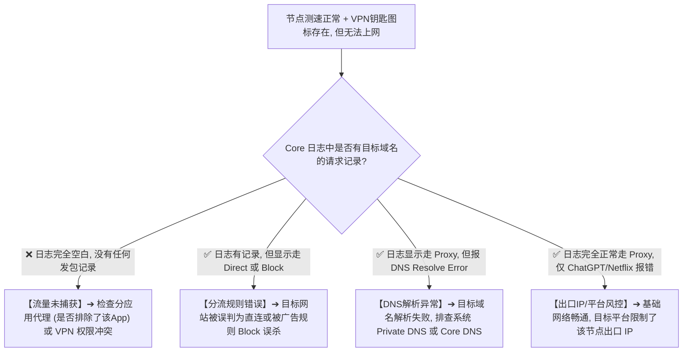
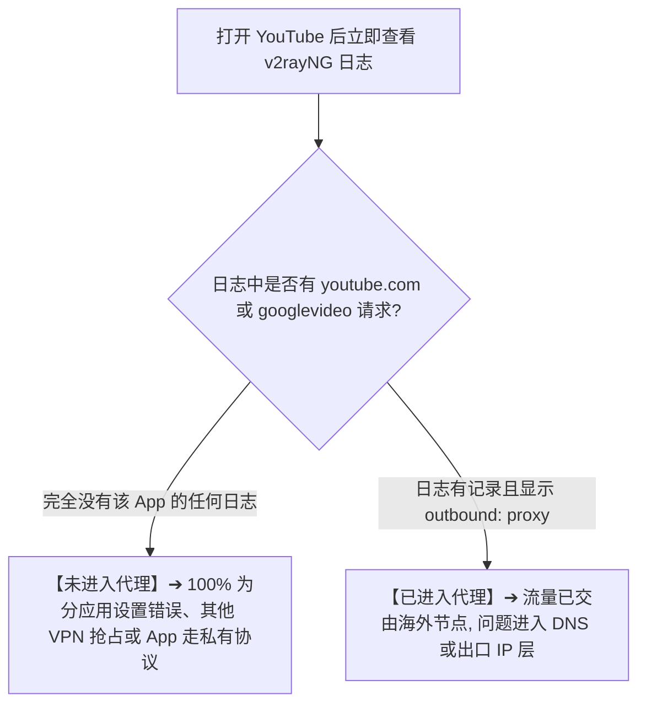
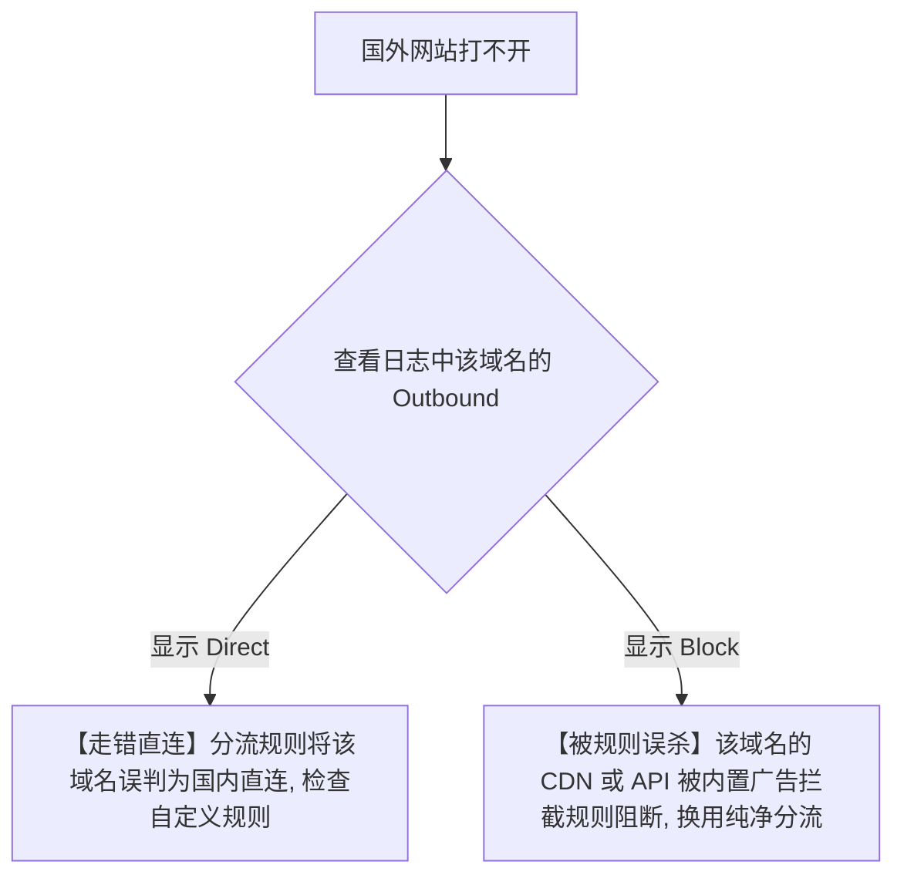
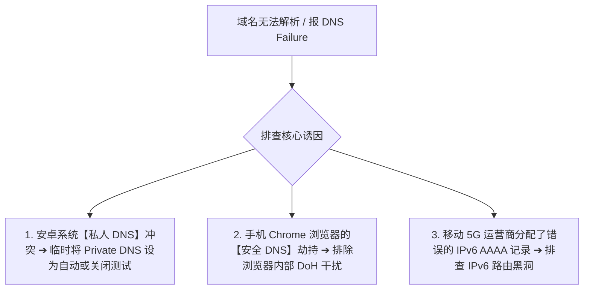
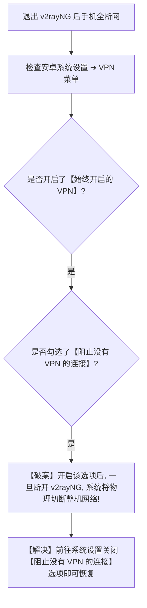
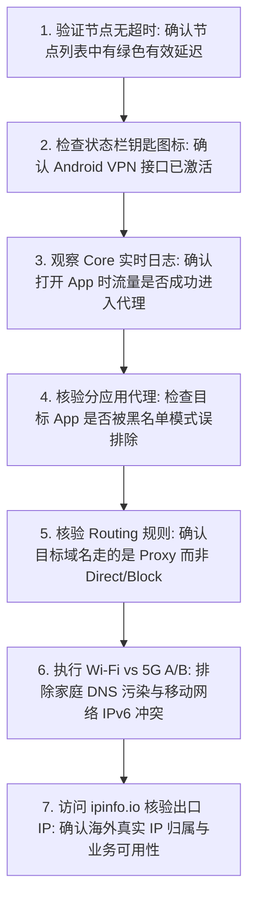

在 Android 安卓手机或平板上使用 v2rayNG 时，很多用户经历过这样一种极其诡异的故障场景：**“节点列表测速全绿（显示 35ms~50ms 极佳延迟），点击右下角启动后，手机顶部状态栏也稳稳出现了一个‘钥匙 / VPN 图标’，但打开 Chrome 浏览器、YouTube、Twitter 或 Telegram 时，却依然无限转圈，提示‘网络连接错误’或‘未连接到互联网’。”**

更令人抓狂的是各种“薛定谔的代理”现象：

**“为什么 Chrome 浏览器能秒开 Google，但手机里的 YouTube App 或 Twitter 却死活刷不出内容？”**  
**“为什么普通网页全都能正常打开，唯独 ChatGPT 提示‘Access Denied’或‘地区不支持’？”**  
**“为什么开启 v2rayNG 之后，家里的局域网 NAS、路由器后台（192.168.1.1）或者米家智能家居全部打不开了？”**  
**“为什么在家里 Wi-Fi 下能正常上网，一走到室外切换到 5G 移动网络后，VPN 钥匙还在，但网络却彻底瘫痪？”**  
**“为什么在 v2rayNG 里点击停止断开连接后，整台安卓手机反而彻底断网、连国内微信和百度都打不开了？”**  
**“手机系统设置里的‘私人 DNS（Private DNS）’和‘始终开启的 VPN’到底对 v2rayNG 有什么致命影响？”**

**v2rayNG“有节点但无法上网”本质是流量在进入手机虚拟网卡、经过内核分流路由（Routing）、域名解析（DNS）以及到达远端海外出口的某一个环节发生了断流、误判或拦截。**

新手必须建立严谨的 **“三阶段流量定界模型”**：
1. **阶段一（Capture 捕获层）**：应用流量到底有没有成功进入 Android 的 `VpnService` 与 v2rayNG 内置 Core？
2. **阶段二（Routing & DNS 分流解析层）**：流量进入 Core 后，是被分流规则送到了 `Proxy`（代理）、`Direct`（直连）还是 `Block`（拦截）？域名是否被正确解析？
3. **阶段三（Target Acceptance 目标接受层）**：海外节点出口 IP 是否纯净？目标平台（如 OpenAI/Netflix）是否因风控直接拒绝了访问？

本文作为 **v2rayNG 流量接管、分应用代理与无法上网故障排查的终极深度指南**，将带你彻底搞懂 **VPN 虚拟网卡、分应用黑白名单、Routing 规则、Private DNS 与网络切换恢复的核心排错体系**。

---

## ⚡ 30 秒极速定界：v2rayNG 有节点没网快速决策流



---

## 一、架构基石：Android 流量从 App 到海外目标的全景链路

为什么不能一看到打不开网页就无脑换节点？让我们看清 Android 流量转发的完整旅程：

```mermaid
graph TD
    App[1. 手机 App (Chrome / YouTube / Telegram)] --> VpnSvc[2. Android VpnService 虚拟网络接口 (钥匙图标)]
    VpnSvc --> PerApp{3. 分应用代理过滤}
    PerApp -->|未勾选/排除| DirectNet[直接走本地网络直连 (不进代理)]
    PerApp -->|命中代理| Core[4. v2rayNG 内置 Xray-core 进程]
    
    Core --> Routing{5. Routing 分流引擎判定}
    Routing -->|命中 Direct| DirectNet
    Routing -->|命中 Block| Blocked[🚫 丢弃数据包 (广告拦截/黑名单)]
    Routing -->|命中 Proxy| TargetDNS[6. DNS 解析目标域名 ➔ 获取服务器 IP]
    
    TargetDNS --> RemoteNode[7. 通过 IEPL/专线发送给海外节点]
    RemoteNode --> ExitIP[8. 节点出口 IP 访问目标服务 (Google/OpenAI)]
```

### 核心真相：状态栏 VPN 钥匙图标到底代表什么？
- 💡 **钥匙图标的唯一定义**：**它仅代表 Android 系统成功创建了本地的 `VpnService` 虚拟网络接口！**
- 它根本**不能**证明：远端海外节点能正常转发流量、分流规则送对了出口、或者目标网站允许该出口 IP 访问。

---

## 二、第一阶段排查：流量到底有没有进入 Core？（Capture 捕获层）

这是排查“有节点但没网”最关键的第一步：**打开目标 App（如 YouTube），然后立即返回 v2rayNG 查看“日志”！**



### 1. 分应用代理（Per-App Proxy）模式弄反（高频翻车点）
- **致命陷阱**：v2rayNG 的分应用代理有两种模式：**“仅代理选中的应用（白名单）”** 与 **“绕过选中的应用（黑名单）”**；
- 如果你勾选了 Chrome 和 YouTube，但模式却设成了“绕过”，这两个 App 的流量就会被强行强制直连本地网络，导致永远无法翻墙！
- **修复方案**：进入 v2rayNG 设置 ➔ 分应用代理 ➔ 确认当前模式到底是“白名单”还是“黑名单”，或者**新手先临时关闭分应用代理**进行全量测试。

### 2. 多 VPN 应用冲突与 Always-on VPN
- 安卓系统同一时刻只允许**一个**活动的 VPN 接口；
- 如果后台同时运行了其他安全软件、广告拦截器（如 AdGuard 本地 VPN 模式）或另一款代理工具，v2rayNG 的流量捕获会被直接掐断。

---

## 三、第二阶段排查：Routing 路由分流与规则误杀（Routing 层）

当日志中有该域名的请求，但网页依然打不开时，观察日志中的 **Outbound 标签**：

```text
┌────────────────────────────────────────────────────────────────────────────────────────┐
│                        v2rayNG 常见 Routing 分流结果与排查表                           │
├──────────────┬────────────────────────────────────────┬────────────────────────────────┤
│ 日志标签     │ 流量实际去向                           │ 导致的常见故障表现             │
├──────────────┼────────────────────────────────────────┼────────────────────────────────┤
│ **proxy**    │ 正确交由海外节点转发                   │ 若仍打不开，进入 DNS 或出口 IP 平台层排查│
│ **direct**   │ 绕过代理，直接走国内本地网络直连       │ 国外网站若走 direct 会因 GFW 阻断彻底打不开 │
│ **block**    │ 被规则直接丢弃/拦截                    │ 网页部分验证码、图片、API 接口加载失败 │
└──────────────┴────────────────────────────────────────┴────────────────────────────────┘
```



- 🏠 **局域网设备打不开（NAS/路由器）**：在 v2rayNG 设置中开启 **“绕过局域网地址（Bypass LAN）”**，确保 `192.168.x.x`、`10.x.x.x` 等内网流量走 Direct 直连，避免发往海外节点导致内网失联。

---

## 四、第三阶段排查：DNS 污染与 Android Private DNS 冲突



### 1. 为什么“直接输 IP 能通，输网址却打不开”？
- 这是最经典的 **目标域名 DNS 解析故障**；
- 当核心 Core 向 DNS 服务器查询 `twitter.com` 时，若返回了虚假的污染 IP 或查询超时，数据包就会被发往错误的虚无地址。

### 2. Android Private DNS（私人 DNS）正确处置法
- 前往安卓手机系统设置 ➔ 连接与共享 ➔ **“私人 DNS（Private DNS）”**；
- 💡 **科学原则**：**不要无脑长久关闭 Private DNS**。仅当你在日志中明确看到 DNS 解析失败，且 Wi-Fi/5G 对照确认为 DNS 冲突时，才将其临时切换为“自动”或关闭做 A/B 对比。

---

## 五、第四阶段排查：出口 IP 纯净度与目标平台风控（Target 层）

如果你的日志显示走 `proxy`，Google 也能秒开，唯独 **ChatGPT、Claude、Netflix 或 Disney+** 报错打不开，这 **100% 不是 v2rayNG 的网络故障**，而是目标平台的出口 IP 策略拦截！

```text
┌────────────────────────────────────────────────────────────────────────────────────────┐
│                        常见海外平台特定报错与真正根因对照表                            │
├──────────────┬────────────────────────────────────────┬────────────────────────────────┤
│ 平台名称     │ 典型报错表现                           │ 真正根因与正确解决动作         │
├──────────────┼────────────────────────────────────────┼────────────────────────────────┤
│ **ChatGPT**  │ Access Denied / Country Not Supported  │ 节点出口 IP 位于不受支持地区(如香港)或被机房标记│
│              │                                        │ ➔ **切换至美国/日本原生 IP 节点即可**       │
├──────────────┼────────────────────────────────────────┼────────────────────────────────┤
│ **Netflix**  │ 仅能看自制剧，或提示“您似乎在使用代理” │ 节点出口 IP 被 Netflix 识别为数据中心机房 IP   │
│              │                                        │ ➔ **换用支持流媒体全解锁的专线节点**         │
├──────────────┼────────────────────────────────────────┼────────────────────────────────┤
│ **手机银行** │ 提示“检测到网络代理/VPN，禁止登录”     │ 银行 App 检测到底层 VpnService 接口处于激活态  │
│              │                                        │ ➔ **在分应用代理中将银行 App 设为排除直连**   │
└──────────────┴────────────────────────────────────────┴────────────────────────────────┘
```

---

## 六、特殊故障：退出 v2rayNG 后，整台安卓手机彻底断网？

很多用户遇到过：**“在 v2rayNG 里点击停止后，连国内微信、抖音和百度都打不开了，必须重启手机才能恢复。”**



---

## 七、实战指南：v2rayNG 有节点没网标准 7 步排查法



---

## 八、2026 全解锁与智能分流高速专线推荐

避免分流走错、DNS 污染与平台风控，选择一家后台 **智能下发完美分流规则、出口 IP 深度优化全解锁、全线 IEPL 专线** 的高可用服务商是终极方案：

```text
┌────────────────────────────────────────────────────────────────────────────────────────┐
│                        2026 全流媒体与 AI 解锁高速专线推荐                             │
├──────────┬──────────────────────────┬──────────────┬──────────────┬────────────────────┤
│ 适配场景 │ 推荐品牌候选             │ 实际起付门槛 │ 每月流量配额 │ 智能分流与解锁优势 │
├──────────┼──────────────────────────┼──────────────┼──────────────┼────────────────────┤
│ 旗舰全能 │ 光速云 (GuangSuYun)      │ 约 ¥7.5/月起 │ 59G~238G /月 │ 全线 IEPL 专线，原生 IP 完美解锁 ChatGPT/Netflix，智能分流│
│ 平价轻量 │ 微风网络 (BreezeNet)     │ 约 ¥7/月起   │ 50GB / 月    │ 优质 BGP 优化，轻量极速，适合日常查资料与轻度办公  │
│ 弹性月付 │ 唯兔云 (V2Yun)           │ ¥14.9/月     │ 100GB / 月   │ 14.9 元纯单月付，多地区原生 IP 出口，节点极其丰富  │
│ 应急备用 │ 星岛梦 (XingDaoMeng)     │ 约 ¥8/月起   │ 60G/不限时包 │ 0月租不限时包，永不过期，手机双卡应急备用首选      │
│ 极速专精 │ 速界 (SpeedWorld)        │ ¥25/月       │ 150GB / 月   │ 企业级大带宽独立专线，手机 4K 秒开零缓冲           │
└──────────┴──────────────────────────┴──────────────┴──────────────┴────────────────────┘
```

- 🏆 **全解锁全专线旗舰首选**：[光速云](/reviews/guangsu-cloud/) —— 2020 老牌专线，原生支持 ChatGPT/Netflix 全解锁，晚高峰 0 丢包；
- 🍃 **超低预算轻量**：[微风网络](/reviews/weifeng-cloud/) —— 50GB 精品小流量专线，年付折算仅约 ¥7/月；
- 💳 **拒绝绑定的单月付**：[唯兔云](/recommend/best-airports/) —— ¥14.9 纯单月付，100GB 充沛流量。

---

## 九、避坑指南：50 个关于“有节点无法上网”的致命认知误区

```text
❌ 误区 1：手机状态栏出现了 VPN 钥匙图标，就代表所有网站绝对能正常打开 ➔ 事实：钥匙图标仅代表本地虚拟网卡建立，不代表远端通信正常。
❌ 误区 2：节点测速显示有绿色 40ms 延迟，打不开网页一定是手机坏了 ➔ 事实：测速通畅不代表分流规则送对了 Proxy，也不代表 DNS 正常。
❌ 误区 3：有节点但无法上网，第一步动作就是把订阅全部删掉重新导入 ➔ 事实：这是流量接管或路由问题，重新导订阅毫无帮助。
❌ 误区 4：有节点但无法上网，必须马上把 v2rayNG 卸载重装 ➔ 事实：重装会抹掉所有分应用配置，无法解决 DNS 与路由分流错误。
❌ 误区 5：只要开启了 v2rayNG，手机里的全部 App 都会自动强制走代理 ➔ 事实：若开启了分应用黑名单模式，指定 App 会被强行直连。
❌ 误区 6：浏览器能上外网但 YouTube App 上不了，一定是 YouTube 服务器宕机了 ➔ 事实：检查分应用设置中是否遗漏了 YouTube 或其 Google 服务组件。
❌ 误区 7：把 Clash 的 YAML 分流规则直接粘贴进 v2rayNG 就能完美分流 ➔ 事实：分流引擎语法完全不同，盲目粘贴会导致全部规则失效。
❌ 误区 8：Direct 模式就是把 v2rayNG 彻底关掉 ➔ 事实：Direct 是 Core 把流量不经加密直接从本地网络网卡发出去。
❌ 误区 9：Block 规则只会帮用户屏蔽烦人的网页广告 ➔ 事实：规则库若不完善，极易误杀正常网站的验证码、图片与 API 接口。
❌ 误区 10：遇到任何网页打不开，只要把手机的 Private DNS 关掉就一定能解决 ➔ 事实：切勿盲目全局关闭，需通过 Wi-Fi/5G A/B 证据判断。
❌ 误区 11：改用 8.8.8.8 公共 DNS 可以解决所有的 App 连不上网 ➔ 事实：公共 DNS 无法修复分应用排除、规则走 Direct 或平台风控。
❌ 误区 12：在手机设置里强行关闭 IPv6 就能让所有节点秒开 ➔ 事实：仅当运营商 IPv6 路由异常时才相关，非通用万能药。
❌ 误区 13：节点名称写着“日本 01”，打开 IP 查询网站就必须显示日本 ➔ 事实：节点可能存在多段中继，入口在日本出口可能在新加坡。
❌ 误区 14：一个 IP 查询网站显示海外 IP，就代表所有 App 都走代理了 ➔ 事实：该 IP 网站本身可能走 Proxy，但其他 App 可能走 Direct。
❌ 误区 15：Google 能正常秒开，ChatGPT 提示不可用就说明梯子没网 ➔ 事实：梯子网络完全正常，是 ChatGPT 封锁了该节点的出口 IP。
❌ 误区 16：Netflix 提示使用代理就说明 DNS 发生了严重污染 ➔ 事实：这是 Netflix 机房 IP 库风控，需换用原生解锁专线节点。
❌ 误区 17：从 Wi-Fi 切换到 5G 移动网络后，所有网页长连接都会无缝保持 ➔ 事实：物理 IP 改变会导致底层 TCP 断开，需重新触发连接。
❌ 误区 18：切网后状态栏钥匙图标还在，说明网络根本没有断开 ➔ 事实：安卓 VPN 接口不会因切网销毁，但旧的代理连接已失效。
❌ 误区 19：退出 v2rayNG 后整台手机断网，说明系统被病毒破坏了 ➔ 事实：检查安卓系统设置中是否勾选了“阻止没有 VPN 的连接”。
❌ 误区 20：安卓手机里的“始终开启的 VPN”必须所有人都无脑开启 ➔ 事实：该选项会限制非 VPN 流量，配置不当极易引发全机断网。
❌ 误区 21：开启代理后家里的 NAS 打不开，说明海外节点封锁了内网 ➔ 事实：内网私有 IP 被误送进了代理，开启“绕过局域网”即可。
❌ 误区 22：所有局域网流量（192.168.x.x）都必须经过海外代理加密 ➔ 事实：内网流量发往海外节点必然会因为路由不可达导致超时。
❌ 误区 23：手机银行 App 提示检测到代理打不开，是因为机场被银行拉黑了 ➔ 事实：银行 App 主动检测系统 VpnService 接口以防欺诈。
❌ 误区 24：应该寻找各种黑客插件强行绕过银行 App 的 VPN 安全检测 ➔ 事实：严重违反金融安全合规，合规做法是在分应用中排除银行。
❌ 误区 25：只要把 v2rayNG 的全局模式打开，就绝对不可能出现没网 ➔ 事实：全局模式下国内网站走海外绕路，极易因高延迟报错。
❌ 误区 26：Chrome 浏览器的“安全 DNS”设置和安卓系统的 Private DNS 完全是一回事 ➔ 事实：前者是浏览器内部 DoH，后者是整机系统级 DNS。
❌ 误区 27：关闭 Chrome 浏览器的安全 DNS 可以解决手机上 Telegram 没网 ➔ 事实：Chrome 设置仅管辖浏览器自身，不影响外部 App。
❌ 误区 28：只要把节点协议从 VMess 换成 VLESS，分应用没网就能自动修好 ➔ 事实：分应用发生在内核流量捕获层，与底层代理协议无关。
❌ 误区 29：只要在手机里多装几个清理软件就能提升 v2rayNG 的网络稳定性 ➔ 事实：清理软件极易在后台强杀 VPN 进程导致断网。
❌ 误区 30：所有打不开网页的故障，只要重启一次手机就一劳永逸了 ➔ 事实：重启只是临时重置状态，未解决规则与 DNS 根因依然会复发。
```

---

## 八、常见问题深度解答（FAQ · 55 问）

### Q1：v2rayNG 有节点且测速正常，为什么浏览器打不开网页？
**答**：测速仅代表节点服务器 TCP 连通。打不开网页通常是由于分流规则（Routing）将国外域名误判为 Direct 直连被阻断、目标 DNS 解析失败、或分应用代理排除了浏览器。

### Q2：状态栏有 VPN 钥匙图标，为什么还是没网？
**答**：钥匙图标仅代表安卓系统在本地开启了虚拟网络网卡，并不代表实际应用流量已经成功交由海外节点并顺利到达目标网站。

### Q3：为什么 Chrome 浏览器能上外网，但特定 App 却连不上网？
**答**：**优先排查“分应用代理”设置。** 检查该 App 是否被分应用黑名单排除，或该 App 是否内置了独立的私有网络栈/证书校验机制。

### Q4：怎么判断一个 App 的流量到底有没有进入 v2rayNG？
**答**：打开目标 App 刷新，然后立即进入 v2rayNG 查看 **“日志”**。若日志中完全找不到该 App 目标域名的任何请求，说明流量在系统层就未被捕获。

### Q5：什么是 Routing 路由规则？Direct、Proxy、Block 怎么区分？
**答**：Routing 决定进入内核的流量去向：`Proxy` 走海外节点代理；`Direct` 不经代理直连本地宽带；`Block` 直接拦截丢弃（通常用于广告屏蔽）。

### Q6：为什么开启 v2rayNG 后，家庭路由器后台或 NAS 打不开了？
**答**：因为内网私有地址（如 192.168.1.1）被误送进了海外代理。在 v2rayNG 设置中开启 **“绕过局域网地址（Bypass LAN）”** 即可秒级恢复。

### Q7：为什么退出 v2rayNG 后，整台手机完全断网连微信都打不开？
**答**：进入手机系统设置 ➔ VPN ➔ 检查是否开启了 **“阻止没有 VPN 的连接 / Block connections without VPN”**，关闭该选项即可恢复裸网通信。

### Q8：安卓系统的 Private DNS（私人 DNS）会影响 v2rayNG 吗？
**答**：可能。部分第三方去广告 Private DNS 会劫持系统解析导致 Core 无法解析海外域名。若遇解析异常，可临时切为“自动”或关闭排查。

### Q9：为什么 Google 能秒开，但 ChatGPT 却提示“Access Denied”？
**答**：**梯子网络完全正常，是 ChatGPT 平台风控了当前节点的出口 IP。** 香港 IP 默认不被 OpenAI 支持，切换至美国或日本纯净专线节点即可。

### Q10：从 Wi-Fi 切换到 5G 移动网络后断网了怎么办？
**答**：物理网络切换会导致底层 TCP 连接中断。在 v2rayNG 中点击停止连接，重新点击启动即可瞬间重建代理连接。

### Q11：分应用代理里的“白名单”和“黑名单”有什么区别？
**答**：“仅代理选中应用”为白名单模式（未勾选的应用全直连）；“绕过选中应用”为黑名单模式（勾选的应用全直连）。切莫混淆模式。

### Q12：为什么手机银行 App 开启代理后提示“网络环境异常”？
**答**：银行 App 出于金融风控会主动检测底层 VPN 接口。合规解决方案是在 v2rayNG 分应用代理中将银行 App 勾选排除直连。

### Q13：节点名称是“香港 01”，为什么查出口 IP 显示在新加坡？
**答**：机场可能采用了国内中转入口在香港、海外最终落地出口在新加坡的多段转发架构，真实出口以专业 IP 查询为准。

### Q14：遇到有节点但没网，需要把 v2rayNG 卸载重装吗？
**答**：**绝不需要。** 重装无法修复路由规则、DNS 冲突或出口 IP 平台限制，只需按 7 步标准法逐层排查即可。

### Q15：如何快速确认当前出口 IP 是否生效？
**答**：连接代理后，使用手机浏览器访问 `ipinfo.io` 或 `ip138.com`，观察显示的公网 IP 所在地是否已经变为海外地区。

---

## 🏁 总结：v2rayNG 流量接管排错核心认知金字塔

排查 v2rayNG“有节点但无法上网”，请牢记以下**核心铁律**：

```text
1. 破假象 ➔ 钥匙图标仅代表本地虚拟网卡激活，测速绿色不代表所有 App 分流正确
2. 看日志 ➔ 打开 App 查 Core 日志，无请求查分应用，有请求查 Outbound（Proxy/Direct/Block）
3. 护局域 ➔ 开启“绕过局域网地址”，确保 NAS、路由器后台等内网私有设备直连畅通
4. 辨平台 ➔ Google 能开但 AI/Netflix 报错属于出口 IP 风控，直接切换美日纯净节点
5. 查系统 ➔ 退出断网必查系统“阻止没有 VPN 的连接”，DNS 报错做 Private DNS A/B 对照
```

---

### 📚 延伸进阶阅读与选型专栏
- 📱 **Android 客户端主教程**：[《v2rayNG怎么用？Android下载安装、订阅、节点、VPN权限与完整配置教程》](/tutorials/v2rayng-android/)
- 🚨 **节点连接超时排查**：[《v2rayNG节点Timeout怎么办？Android节点全部超时、Core、Wi-Fi/5G与服务器完整排查》](/issues/v2rayng-node-timeout/)
- 📥 **Android 订阅深度指南**：[《v2rayNG订阅怎么导入？订阅链接、节点更新、二维码与更新失败完整教程》](/tutorials/v2rayng-subscription/)
- 🗺️ **节点地区深度选型**：[《V2Ray节点怎么选？香港、日本、新加坡、美国节点、线路、延迟与使用场景完整指南》](/tutorials/v2ray-node-selection/)
- 💻 **Windows 有节点没网排查**：[《v2rayN有节点但无法上网怎么办？系统代理、TUN模式、DNS与流量接管完整排查》](/issues/v2rayn-connected-no-internet/)
- ⚡ **老牌旗舰专线**：[《光速云深度评测：2020老牌IEPL专线与解锁实测》](/reviews/guangsu-cloud/)
- 🍃 **平价轻量专线**：[《微风网络深度评测：小流量套餐值不值得买？》](/reviews/weifeng-cloud/)
- 🏆 **2026 全景大榜**：[《2026梯子推荐：稳定、速度、价格、安全与不同使用场景怎么选》](/recommend/best-tizi/)
