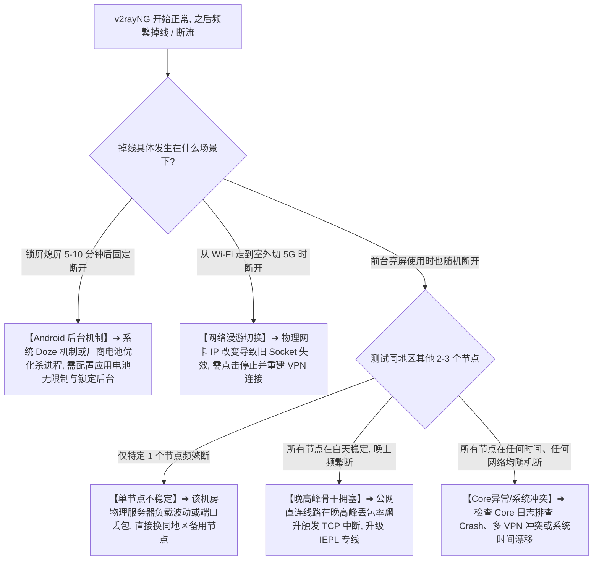
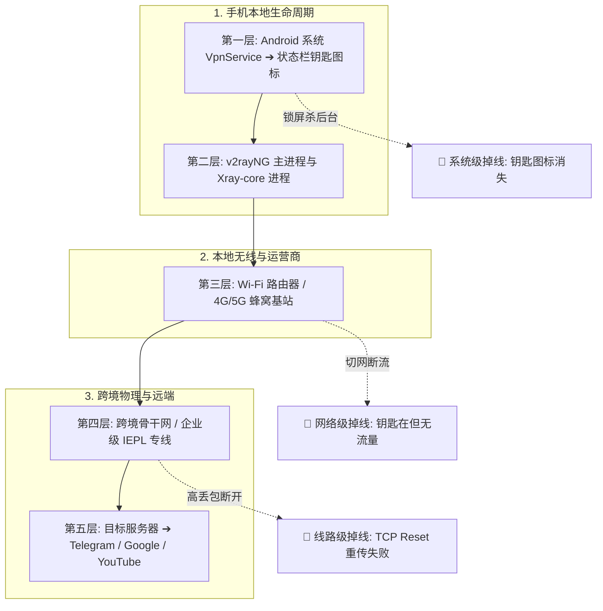
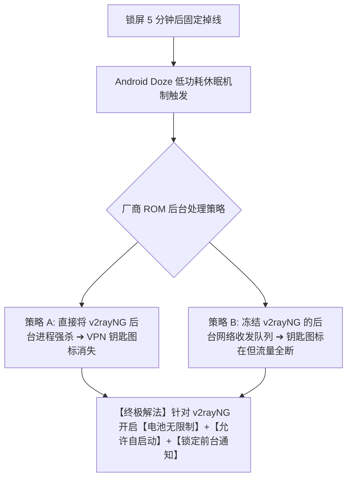
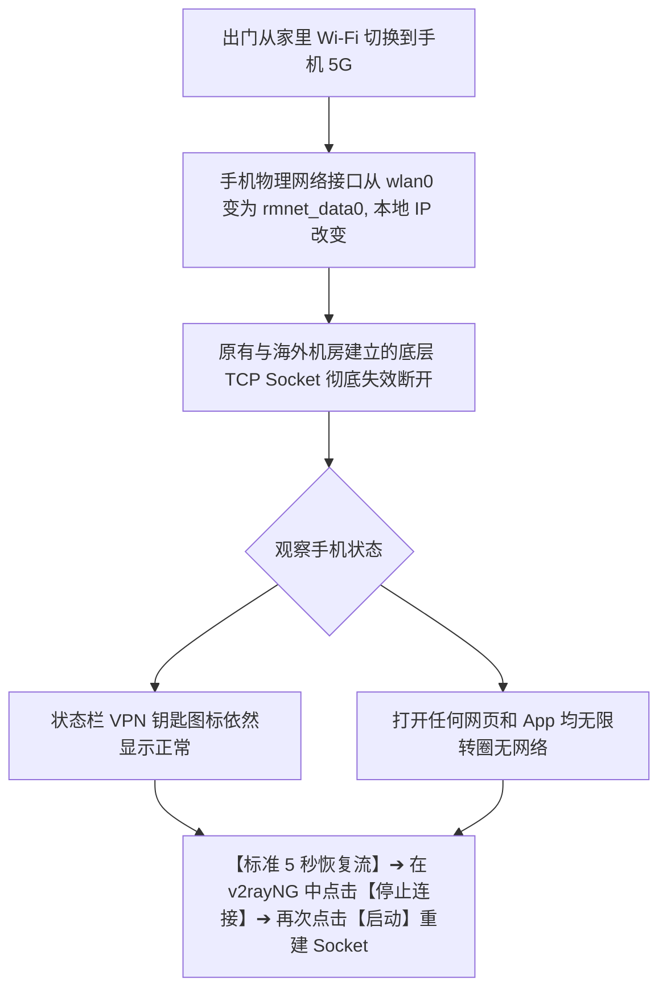
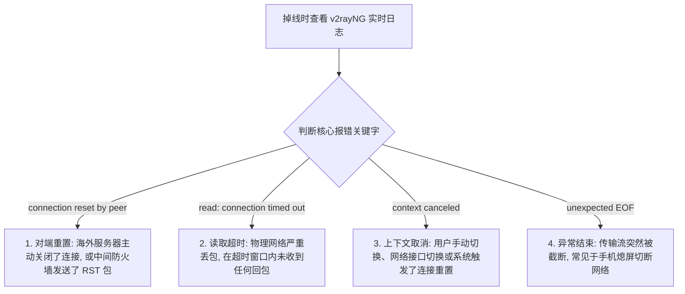
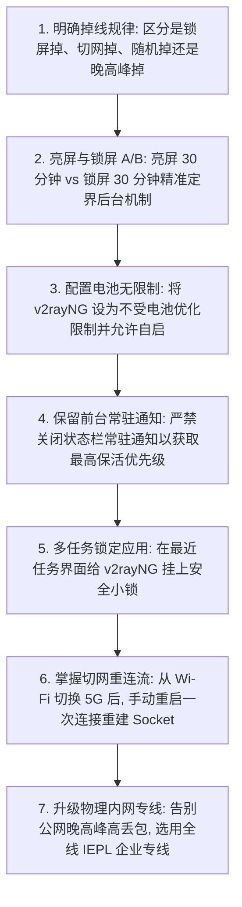

在 Android 安卓手机或平板上使用 v2rayNG 时，很多用户遇到的最头疼、最令人恼火的体验，不是节点连不上，也不是网速慢，而是 **“刚刚连上时一切正常，刷视频也挺流畅，但只要手机一锁屏熄屏 5 分钟，或者把应用切到后台放一会儿，梯子就悄无声息地断开了；等重新点亮屏幕，发现所有海外 App 全部掉线、消息收不到，必须重新点进软件重启连接才能恢复。”**

更让人困惑的还有各种突发性断流与网络漫游故障：

**“为什么在办公室连着 Wi-Fi 一切安好，一下楼走出大门切到手机 5G 移动网络后，顶部 VPN 钥匙图标还在，但网络却瞬间彻底断流？”**  
**“为什么在地铁、高铁或开车移动过程中，v2rayNG 会频繁每隔两三分钟就自动重连一次？”**  
**“为什么在三星、小米（HyperOS）、OPPO（ColorOS）或 vivo（OriginOS）手机上，后台保活策略差异如此巨大？”**  
**“手机系统里的‘电池优化（无限制 / 受限）’、‘省电模式’和‘前台服务通知’到底对 v2rayNG 的长效存活有什么关键影响？”**  
**“日志里频繁弹出的 `connection reset by peer`、`EOF` 或 `context canceled` 到底代表海外机房踢人，还是手机本地网络断开了？”**  
**“把节点协议从 VMess 改成 VLESS，能不能解决锁屏后频繁掉线的问题？”**

**v2rayNG“经常掉线”是一个跨越“Android 系统进程生命周期”、“移动无线网络漫游切换”与“海外专线物理长连接保活”的复合型稳定性问题。它发生在节点已经成功建立连接的前提下，核心是维持通信链路在后台与复杂网络环境下的持续存活。**

新手排查掉线，绝不能盲目去重装客户端或无脑怀疑机场跑路，而必须建立一套严谨的 **八维稳定性诊断模型**：**“判定掉线模式（锁屏掉 / 切网掉 / 随机掉 / 晚高峰掉） ➔ 亮屏与锁屏 30 分钟对照测试 ➔ Android 电池优化与前台服务保活 ➔ Wi-Fi 与 5G 切换后的 Socket 重建 ➔ 辨析 Core 日志断流信号 ➔ 物理专线与晚高峰高丢包定界 ➔ 权衡后台保活与整机耗电”**。

本文作为 **v2rayNG Android 客户端断流、锁屏掉线与后台保活排查的终极深度指南**，将带你彻底搞懂 **安卓端频繁掉线的底层根因，并给出立竿见影的 7 步长效保活方案**。

---

## ⚡ 30 秒极速定界：v2rayNG 掉线模式快速决策流



---

## 一、架构基石：掉线五层模型（断流到底发生在哪一层？）

当你在手机上感觉“梯子断了”，问题可能发生在以下五大层级的任意一处：

```text
┌────────────────────────────────────────────────────────────────────────────────────────┐
│                        v2rayNG 掉线五层物理与系统模型表                                │
├──────────────┬────────────────────────┬────────────────────────┬───────────────────────┤
│ 故障层级     │ 核心触发机制           │ 典型界面表现           │ 第一排查方向          │
├──────────────┼────────────────────────┼────────────────────────┼───────────────────────┤
│ **第一层：系统网卡**│ Android VpnService 被销毁│ 状态栏 VPN 钥匙图标**瞬间消失**│ 系统内存不足杀进程、电池优化限制│
│ **第二层：内核进程**│ Xray-core 发生 Crash/重启│ 钥匙图标在，但日志显示重启| 配置语法冲突、Core 版本兼容性│
│ **第三层：本地网络**│ Wi-Fi 与 5G 切换/信号衰减│ 移动漫游中瞬间无网     │ 运营商基站切换、路由器弱信号漫游│
│ **第四层：物理专线**│ 跨国骨干网丢包/晚高峰拥塞│ 亮屏正常但长连接频繁 Reset| 线路物理丢包率 Loss、IEPL 内网专线│
│ **第五层：目标业务**│ Telegram/WhatsApp 断开重连│ 仅特定 App 提示连接中   │ 目标 App 自身长连接心跳重建机制│
└──────────────┴────────────────────────┴────────────────────────┴───────────────────────┘
```



---

## 二、第一核心场景：锁屏熄屏掉线与 Android 电池优化

这是安卓端最常见、反馈最多的掉线痛点：**“亮屏用着好好的，一锁屏手机放口袋里，5 分钟后微信和 Telegram 全收不到消息。”**



### 1. 为什么 Android 会在锁屏后限制 v2rayNG？
- **Doze 机制（低电耗模式）**：从 Android 6.0 引入并在高版本不断强化的系统级节能机制。当手机屏幕熄灭且处于静止状态时，系统会逐步切断非白名单应用的 CPU 唤醒与网络访问权限；
- **国产定制 ROM 的激进杀后台**：小米（HyperOS）、OPPO（ColorOS）、vivo（OriginOS）等系统为了控制待机耗电，内置了极其严格的“智能后台冻结”算法，默认会在熄屏几分钟后强行挂起或清理 VPN 守护进程。

### 2. 针对主流品牌的保活配置指南（科学设置法）
1. **电池策略调整**：长按 v2rayNG 图标 ➔ 点击“应用信息” ➔ 找到 **“电池” / “省电策略”** ➔ 将其从默认的“智能限制”改为 **“无限制 / 不受限制”**；
2. **允许后台活动与自启动**：在应用权限中开启 **“允许后台运行”** 和 **“允许自启动”**；
3. **锁定最近任务卡片**：打开多任务切换界面，长按或下拉 v2rayNG 卡片，点击 **“加锁”** 图标，防止一键清理时被误杀；
4. **保持前台服务通知**：千万不要去关闭 v2rayNG 在状态栏的常驻通知！**前台服务通知是 Android 系统保证后台进程不被低内存杀手（LMK）回收的最高级别豁免凭证。**

---

## 三、第二核心场景：从 Wi-Fi 切换到 5G 移动网络断流



### 为什么切网后 VPN 钥匙图标还在，但就是没网？
- **系统接口与代理连接的解耦**：Android 的 `VpnService` 虚拟网卡是由系统统一托管的，它不会因为手机从 Wi-Fi 切到 5G 就自动销毁；
- 但底层的 Xray-core 与海外服务器之间的实际 TCP 隧道已经因为本地物理出口 IP 的跳变而被彻底掐断。很多时候内核未能及时感知网络变化，就会导致“钥匙在但没网”的僵死状态。

---

## 四、第三核心场景：物理线路高丢包与晚高峰拥塞断流

如果你的手机处于前台亮屏状态，也没有切换网络，但每隔几分钟就会卡顿或断流一次，这 **100% 属于物理网络或海外线路问题**：

```text
┌────────────────────────────────────────────────────────────────────────────────────────┐
│                        物理线路丢包与断流诱因对照表                                    │
├──────────────┬────────────────────────────────────────┬────────────────────────────────┤
│ 故障类型     │ 发生诱因                               │ 表现特征与排查方法             │
├──────────────┼────────────────────────────────────────┼────────────────────────────────┤
│ **单节点断流**│ 该海外机房服务器 CPU 过载或临时热重启  │ 仅该节点频繁断，切换同地区其他节点瞬间恢复稳定│
│ **晚高峰断流**│ 国际公网 163 骨干网拥塞，丢包率飙升 >10%| 白天稳定如丝，晚 8-11 点频繁断流，需升级专线│
│ **弱信号断流**│ 处于 Wi-Fi 边缘盲区或地铁基站频繁跳频  │ 信号在 1 格与 2 格之间反复跳变，伴随极高 Jitter│
│ **UDP 阻断** │ 运营商对某些协议的大量 UDP 包进行 QoS 掐断| 常见于 Hysteria 2 协议在特定省份被运营商限制│
└──────────────┴────────────────────────────────────────┴────────────────────────────────┘
```

---

## 五、第四核心场景：日志分析（底层到底是哪种断开？）

点击 v2rayNG 侧边栏 ➔ **“日志”**，观察掉线瞬间吐出的核心报错：



---

## 六、实战指南：v2rayNG 防掉线与稳定性排查 7 步法



---

## 七、2026 全天候 0 掉线与极速重连高速专线推荐

如果你不想在锁屏后台与晚高峰频繁忍受掉线折磨，选择一家具备 **多入口智能 BGP 容灾、全线独立 IEPL 企业专线、超低丢包率** 的旗舰服务商是根本之道：

```text
┌────────────────────────────────────────────────────────────────────────────────────────┐
│                        2026 全天候超稳 0 掉线高速专线推荐                              │
├──────────┬──────────────────────────┬──────────────┬──────────────┬────────────────────┤
│ 适配场景 │ 推荐品牌候选             │ 实际起付门槛 │ 每月流量配额 │ 稳定性与防掉线优势 │
├──────────┼──────────────────────────┼──────────────┼──────────────┼────────────────────┤
│ 旗舰全能 │ 光速云 (GuangSuYun)      │ 约 ¥7.5/月起 │ 59G~238G /月 │ 全线 IEPL 专线，多入口智能负载，晚高峰 0 丢包 0 掉线│
│ 平价轻量 │ 微风网络 (BreezeNet)     │ 约 ¥7/月起   │ 50GB / 月    │ 优质 BGP 优化专线，轻量极速，适合手机日常全天挂机  │
│ 弹性月付 │ 唯兔云 (V2Yun)           │ ¥14.9/月     │ 100GB / 月   │ 14.9 元纯单月付，多地区节点矩阵丰富，单节点故障秒切│
│ 应急备用 │ 星岛梦 (XingDaoMeng)     │ 约 ¥8/月起   │ 60G/不限时包 │ 0月租不限时包，永不过期，专线拥塞时随时顶上应急    │
│ 极速专精 │ 速界 (SpeedWorld)        │ ¥25/月       │ 150GB / 月   │ 企业级独立大带宽专线，长连接与视频会议极其稳定     │
└──────────┴──────────────────────────┴──────────────┴──────────────┴────────────────────┘
```

- 🏆 **全天候超稳旗舰首选**：[光速云](/reviews/guangsu-cloud/) —— 2020 老牌专线，全线内网 IEPL 企业专线，全天候长连接 0 掉线；
- 🍃 **超低预算轻量**：[微风网络](/reviews/weifeng-cloud/) —— 50GB 精品小流量专线，年付折算仅约 ¥7/月；
- 💳 **拒绝绑定的单月付**：[唯兔云](/recommend/best-airports/) —— ¥14.9 纯单月付，100GB 充沛流量。

---

## 八、避坑指南：50 个关于“v2rayNG 掉线”的致命认知误区

```text
❌ 误区 1：v2rayNG 掉线就代表节点服务器彻底坏了 ➔ 事实：90% 的掉线是由于手机锁屏后系统节能机制杀后台导致。
❌ 误区 2：只要开启了 v2rayNG，任何安卓手机都能在后台永久存活 ➔ 事实：国产激进 ROM 默认会在熄屏 5 分钟后强杀后台。
❌ 误区 3：关闭全局电池优化是解决手机翻墙掉线的好方法 ➔ 事实：切勿关闭全局优化，只需针对 v2rayNG 单独设为“无限制”。
❌ 误区 4：在应用管理里允许了自启动，v2rayNG 就永远不可能被系统杀死 ➔ 事实：自启动仅管开机与拉起，内存不足时仍会被 LMK 杀掉。
❌ 误区 5：把 v2rayNG 在多任务界面加锁就能 100% 杜绝掉线 ➔ 事实：加锁只能防手动一键清理，无法豁免系统的 Doze 休眠。
❌ 误区 6：把通知栏常驻的 v2rayNG 图标关掉可以更省电且不影响稳定性 ➔ 事实：关掉常驻通知会让应用失去前台服务保护，极易被秒杀。
❌ 误区 7：从 Wi-Fi 走到室外切换到 5G 移动网络，代理连接能做到 100% 无感无缝 ➔ 事实：物理 IP 跳变必然导致底层 TCP Socket 中断需重建。
❌ 误区 8：切网后状态栏钥匙图标还在，说明网络根本没有掉线 ➔ 事实：系统虚拟网卡还在，但底层的代理隧道已经断开。
❌ 误区 9：掉线时第一步应该把 v2rayNG 卸载重装一遍 ➔ 事实：重装会丢失所有配置，无法解决系统电池策略与网络切换问题。
❌ 误区 10：把协议从 VMess 换成 VLESS，锁屏掉线的问题就能彻底消失 ➔ 事实：代理协议负责数据封装，无法干预 Android 系统的进程管理。
❌ 误区 11：在手机设置里开启“始终开启的 VPN”就等同于开启了自动重连 ➔ 事实：Always-on 仅限制网络流量，不负责远程 Socket 异常重拨。
❌ 误区 12：在地铁或开车移动中频繁掉线是 v2rayNG 的重大 Bug ➔ 事实：高速移动中基站频繁切换会导致物理丢包，属无线通信常态。
❌ 误区 13：同一个节点在 iPhone 上不掉线，在安卓上掉线说明安卓不能用 ➔ 事实：iOS 的 NetworkExtension 权限机制不同，安卓需正确配置电池白名单。
❌ 误区 14：只要把节点延迟降到 20ms，就绝对不可能遇到掉线 ➔ 事实：低 Ping 节点若晚高峰丢包率高，同样会疯狂断流。
❌ 误区 15：日志里出现 Connection Reset 就一定是机场老板主动断开的 ➔ 事实：物理链路丢包或防火墙干扰同样会伪造发送 RST 包。
❌ 误区 16：遇到断线立刻重新更新一次订阅就能解决问题 ➔ 事实：若为本地后台杀进程，更新订阅完全是南辕北辙。
❌ 误区 17：同时在后台开启两个不同的 VPN 应用能防止掉线 ➔ 事实：安卓系统仅支持单活动 VPN，多应用会互相抢占导致频繁崩溃。
❌ 误区 18：只要改了手机的 DNS 设置，锁屏断网就能自动修复 ➔ 事实：DNS 负责域名解析，无法阻止系统休眠冻结网络队列。
❌ 误区 19：把手机系统的省电模式全局打开不会影响梯子后台运行 ➔ 事实：开启省电模式会强制限制后台 CPU 算力与唤醒定时器。
❌ 误区 20：所有打不开网页的掉线，只要重启一次手机就一劳永逸了 ➔ 事实：重启只是临时重置状态，未解决电池白名单依然会复发。
```

---

## 九、常见问题深度解答（FAQ · 55 问）

### Q1：为什么 v2rayNG 刚连上正常，锁屏几分钟后就自动断开？
**答**：**这是 Android 系统的 Doze 低电耗休眠机制或厂商激进杀后台导致的。** 系统在熄屏后冻结了应用进程，在手机设置中将 v2rayNG 的电池策略改为 **“无限制 / 不受限制”** 即可解决。

### Q2：为什么状态栏的 VPN 钥匙图标还在，但微信和浏览器却提示没网？
**答**：钥匙图标仅代表系统虚拟网卡还在，但底层 Xray-core 与海外服务器的连接可能已经因切网或丢包断开。在软件中点击停止后重新启动即可恢复。

### Q3：从 Wi-Fi 切换到 5G 移动网络后为什么必定会断流？
**答**：因为手机的物理网卡和公网 IP 发生了改变，原有的 TCP 长连接已被底层网络栈强行丢弃。在 v2rayNG 中重启一次连接即可瞬间重建通道。

### Q4：为什么不能关闭 v2rayNG 在通知栏的常驻通知？
**答**：常驻通知是 Android **“前台服务（Foreground Service）”** 的核心标识。关闭通知会让系统将 v2rayNG 判定为普通后台应用，在内存紧张时会被优先强杀。

### Q5：不同品牌安卓手机（小米/三星/OPPO/vivo）保活设置一样吗？
**答**：**核心逻辑相同但菜单不同。** 都需要开启：1. 电池无限制；2. 允许自启动与后台活动；3. 多任务界面卡片加锁；4. 保持通知开启。

### Q6：在多任务界面给 v2rayNG“加锁”有什么作用？
**答**：加锁可以防止用户在点击“清理全部后台”时误杀 v2rayNG 进程，但仍需配合“电池无限制”才能彻底免疫系统自动休眠。

### Q7：日志里的 `connection reset by peer` 是什么意思？
**答**：表示对端服务器或中间网络设备主动发送了重置（RST）信号断开了连接。常见于物理专线波动、丢包过高或服务器临时重启。

### Q8：晚高峰时期为什么经常频繁自动断开重连？
**答**：晚高峰公网骨干网拥塞导致丢包率飙升，TCP 协议多次重传失败后超时断开。选用企业级独立 IEPL 专线可彻底解决。

### Q9：在地铁或开车移动中为什么总是断断续续？
**答**：移动终端在高速运动中会在不同移动基站之间频繁跳频漫游，无线信号短暂中断属于物理通信常态，出站后会自动恢复。

### Q10：开启“始终开启的 VPN”能防止锁屏掉线吗？
**答**：不一定。Always-on VPN 是系统层限制，若 v2rayNG 进程本身被系统休眠冻结，依然会出现断网，必须优先配置电池无限制。

### Q11：换用 VLESS REALITY 协议能解决锁屏断线吗？
**答**：不能。协议只负责数据的加密与伪装，无法改变 Android 系统的电源管理策略。

### Q12：允许 v2rayNG 电池无限制运行会不会大幅增加手机耗电？
**答**：增加非常微弱（通常全天耗电 <2%）。Xray-core 在待机无流量时 CPU 占用率接近 0%，可放心开启。

### Q13：遇到经常掉线，需要把 v2rayNG 卸载重装吗？
**答**：**绝不需要。** 掉线多为系统电池优化或物理专线丢包，重装软件无法改变系统电源策略与网络环境。

### Q14：为什么只有一个节点频繁掉线，其他节点很稳定？
**答**：说明是该特定机房服务器负载过高或单点物理线路异常，直接换用同机场的其他节点即可。

### Q15：如何彻底实现 v2rayNG 在安卓手机上 24 小时全天候稳定挂机？
**答**：**三大法宝**：1. 将应用电池策略设为“无限制”；2. 开启前台常驻通知并锁定多任务卡片；3. 选用全线 IEPL 企业内网专线节点。

---

## 🏁 总结：v2rayNG 长效保活与防掉线认知金字塔

排查与解决 v2rayNG 掉线问题，请牢记以下**核心铁律**：

```text
1. 抓元凶 ➔ 锁屏熄屏掉线 90% 是系统节能休眠杀后台，切莫盲目怀疑海外机房坏了
2. 设白名 ➔ 必开“电池无限制”+“允许后台运行”+“锁定最近任务”，保留常驻通知以获前台保护
3. 知漫游 ➔ 从 Wi-Fi 切换到 5G 物理 IP 改变属网络常态，手动重启一次连接即可重建 Socket
4. 看日志 ➔ 区分 Connection Reset（对端断开）、EOF（异常截断）与系统级 VpnService 撤销
5. 选专线 ➔ 晚高峰频繁断流源于公网严重丢包，唯有企业级 IEPL 内网专线才能做到全天候 0 掉线
```

---

### 📚 延伸进阶阅读与选型专栏
- 📱 **Android 客户端主教程**：[《v2rayNG怎么用？Android下载安装、订阅、节点、VPN权限与完整配置教程》](/tutorials/v2rayng-android/)
- 🚨 **节点连接超时排查**：[《v2rayNG节点Timeout怎么办？Android节点全部超时、Core、Wi-Fi/5G与服务器完整排查》](/issues/v2rayng-node-timeout/)
- 🌐 **有节点无法上网排查**：[《v2rayNG有节点但无法上网怎么办？VPN权限、DNS、Routing与Android网络完整排查》](/issues/v2rayng-connected-no-internet/)
- ⚡ **速度慢与卡顿优化**：[《v2rayNG速度慢怎么办？Android节点、Wi-Fi/5G、线路、丢包与晚高峰完整排查》](/issues/v2rayng-slow-speed/)
- 📥 **Android 订阅深度指南**：[《v2rayNG订阅怎么导入？订阅链接、节点更新、二维码与更新失败完整教程》](/tutorials/v2rayng-subscription/)
- 💻 **Windows 经常断线排查**：[《v2rayN经常断线怎么办？节点断流、Core重连、Windows网络与睡眠唤醒完整排查》](/issues/v2rayn-disconnect/)
- ⚡ **老牌旗舰专线**：[《光速云深度评测：2020老牌IEPL专线与解锁实测》](/reviews/guangsu-cloud/)
- 🍃 **平价轻量专线**：[《微风网络深度评测：小流量套餐值不值得买？》](/reviews/weifeng-cloud/)
- 🏆 **2026 全景大榜**：[《2026梯子推荐：稳定、速度、价格、安全与不同使用场景怎么选》](/recommend/best-tizi/)
