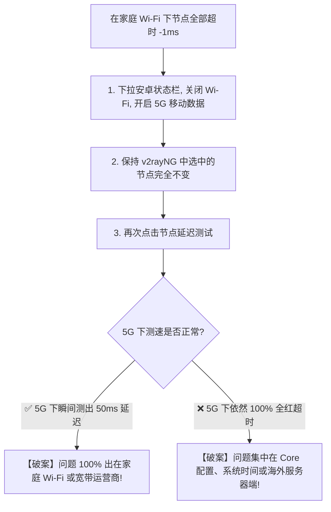
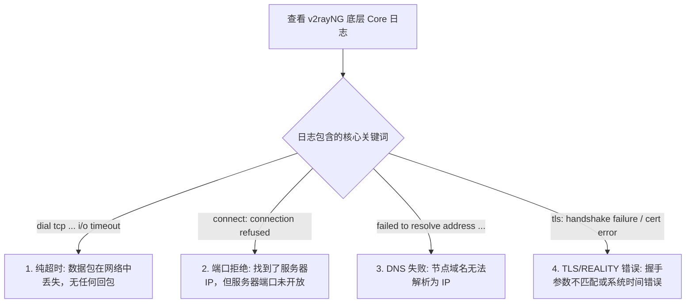

在 Android 安卓手机或平板上使用 v2rayNG 时，很多用户在成功更新订阅并刷出几十个节点后，满心欢喜地点击测速，却赫然发现整个列表右侧全部显示为醒目的红色 **`-1ms`**、**`Timeout`** 或 **`连接超时`**。

面对整整一屏幕全红超时的节点列表，绝大多数用户都会陷入巨大的恐慌与迷茫：

**“为什么订阅明明提示更新成功了，点击测试延迟却所有节点全部 Timeout？”**  
**“为什么列表里只有香港节点全部超时，但切换到日本或美国节点却能秒级连通？”**  
**“为什么在家里连着 Wi-Fi 测速全是红色超时，关掉 Wi-Fi 切到手机 5G 流量后却瞬间恢复正常？”**  
**“手机顶部状态栏明明已经出现了‘钥匙 / VPN 图标’，为什么点击节点测速依然报 Timeout？”**  
**“日志里弹出的 `Connection Refused`、`DNS resolve error`、`TLS Handshake Error` 和普通的 `Timeout` 到底有什么本质不同？”**  
**“为什么 VLESS REALITY 节点全红超时，而传统的 VMess 节点却能正常连接？”**  
**“节点 Timeout 是不是代表海外机房被封锁了，或者机场老板跑路了？”**  
**“一遇到节点全部超时，是不是直接卸载重装 v2rayNG 就能解决？”**

**v2rayNG 节点 Timeout 本质是客户端内置的 Xray-core 在向远端海外代理服务器发起 TCP/TLS 握手或延迟测试时，在规定的时间窗口内未收到任何有效响应。它是一个“连接建立阶段失败”的综合症状，而不是单一的具体故障原因。**

解决 v2rayNG 节点超时，绝不能盲目把客户端卸载重装，也不能一味去反复刷新订阅，而必须建立一套严谨的 **八维诊断模型**：**“确认订阅层存在 ➔ 判定故障范围（单节点/同地区/全节点） ➔ Wi-Fi 与 5G 物理隔离 A/B 测试 ➔ 节点域名 DNS 解析核验 ➔ 远端端口与 Connection Refused 辨析 ➔ TLS / REALITY 握手与系统时间核对 ➔ 跨客户端与服务端真实状态定界”**。

本文作为 **v2rayNG Android 节点连接超时故障排查的终极深度指南**，将带你逐层抽丝剥茧，彻底解决安卓端节点全红、无法连接海外服务器的各类疑难杂症。

---

## ⚡ 30 秒极速定界：v2rayNG 节点 Timeout 快速决策流

```mermaid
graph TD
    Start[节点测速全部超时 / 报 Timeout] --> Step1{订阅能否正常更新?}
    Step1 -->|否, 订阅也报 404/403/Timeout| SubIssue["这是【订阅配置层故障】➔ 先去订阅排查页重新获取配置"]
    Step1 -->|是, 节点列表正常存在| ScopeCheck{超时影响的节点范围是?}
    
    ScopeCheck -->|仅 1 个节点超时, 其他正常| SingleNode["【单节点故障】➔ 该节点机房临时维护或离线, 换用其他节点即可"]
    ScopeCheck -->|仅某地区全部超时 (如香港全红, 日本正常)| RegionIssue["【地区线路故障】➔ 该地区海底光缆或跨境入口拥塞, 切换备用地区"]
    ScopeCheck -->|全部地区、所有节点 100% 全红| AllFail["【全量故障】➔ 立即执行 Wi-Fi vs 5G A/B 隔离测试"]
    
    AllFail --> NetAB{Wi-Fi 与 5G 对照测试结果}
    NetAB -->|Wi-Fi 失败, 5G 秒级恢复| WifiBug["【家庭网络/ISP问题】➔ 本地路由器 DNS 污染或家庭宽带拦截"]
    NetAB -->|5G 失败, Wi-Fi 正常| MobileBug["【移动蜂窝问题】➔ 运营商移动网络 IPv6 路由绕路或 APN 问题"]
    NetAB -->|Wi-Fi 与 5G 均全部超时| DeepCheck["【底层/服务端问题】➔ 检查安卓系统时间、Core配置或服务商状态"]
```

---

## 一、故障定界：区分代理链路中的五类核心故障

很多用户只要打不开网页，就统统归咎于“节点坏了”。请对照以下表格明确当前故障所处的真正层级：

```text
┌────────────────────────────────────────────────────────────────────────────────────────┐
│                        代理链路五大核心故障分类与分界表                                │
├──────────────┬────────────────────────┬────────────────────────┬───────────────────────┤
│ 故障类型     │ 发生阶段               │ 典型界面表现           │ 核心排查方向          │
├──────────────┼────────────────────────┼────────────────────────┼───────────────────────┤
│ **订阅失败** │ 客户端拉取节点阶段     │ 订阅更新报 404/403/无节点│ 订阅链接有效性、Token、格式兼容│
│ **节点超时** │ **节点建立连接阶段 (本篇)**│ **延迟测试全红 -1ms/Timeout**│ **本地网络、DNS、端口、TLS/REALITY**│
│ **有节点没网**│ 流量分流与转发阶段     │ 测速有延迟，但网页打不开 │ 路由规则 Routing、DNS 分流、VPN接管│
│ **速度慢**   │ 持续数据传输阶段       │ 能打开网页，但 4K 视频卡顿│ 物理专线、晚高峰拥塞、丢包率 Loss│
│ **经常掉线** │ 长期后台运行阶段       │ 亮屏正常，手机锁屏 5 分钟断│ 系统电池优化、厂商后台杀进程  │
└──────────────┴────────────────────────┴────────────────────────┴───────────────────────┘
```

---

## 二、架构图解：从 Android 到海外节点的完整连接链路

理解为什么会发生 Timeout，必须看清从你的手机发出的数据包到底需要经过多少道关卡：

```mermaid
graph TD
    App[1. v2rayNG 客户端] --> Core[2. 内置 Xray-core 启动并加载配置]
    Core --> DNS[3. 解析节点服务器域名 (Node Domain ➔ IP 寻址)]
    DNS --> AndroidNet[4. 通过 Android 本地网络 (Wi-Fi 或 4G/5G 蜂窝数据)]
    AndroidNet --> LocalISP[5. 本地运营商骨干网 (电信 / 联通 / 移动)]
    LocalISP --> Transit[6. 跨境出口 / IEPL 企业物理专线]
    Transit --> RemotePort[7. 到达海外服务器指定端口 (如 443 / 8443)]
    RemotePort --> Handshake[8. 执行 TLS / REALITY 安全握手与认证]
    Handshake --> Success[✅ 握手成功, 节点测出延迟 (如 45ms)]
```

- 💡 **链路诊断真理**：**上述 8 个环节中，任何一个环节被掐断或无响应，v2rayNG 最终在界面上呈现出来的症状 100% 都是“Timeout”！** 这就是为什么不能把 Timeout 简单当成“节点服务器挂了”。

---

## 三、排查第一步：范围判断法（1个 ➔ 同地区 ➔ 全量节点）

```text
┌────────────────────────────────────────────────────────────────────────────────────────┐
│                        节点超时范围与故障归属诊断矩阵                                  │
├──────────────────┬────────────────────────────────────┬────────────────────────────────┤
│ 超时范围         │ 诊断概率归属                       │ 推荐最快解决动作               │
├──────────────────┼────────────────────────────────────┼────────────────────────────────┤
│ **单独 1 个节点** │ 95% 该节点服务器单点故障或临时维护 │ 忽略该节点，换用同地区 02、03 节点│
│ **同地区全部节点**│ 80% 该地区物理海缆或入口集群异常   │ 跨地区切换到备用地区（如香港切日本）│
│ **所有地区全部节点**│ 90% 本地网络阻断、DNS 失败或 Core 异常│ 执行 Wi-Fi/5G A/B 测试并查看 Core 日志│
└──────────────────┴────────────────────────────────────┴────────────────────────────────┘
```

- 🚨 **排错禁忌**：如果只有香港 01 一个节点超时，其他日本、美国节点全部几十毫秒正常运行，**绝对不要去重装软件或重置手机**，直接切换到正常节点即可！

---

## 四、排查第二步：Android 独门绝技 —— Wi-Fi vs 5G 物理隔离 A/B

安卓手机排查 Timeout 最具杀伤力、最快速的手段就是 **网络隔离对照**：



### 1. Wi-Fi 超时但 5G 正常：家庭网络三大元凶
- **元凶 A（路由器 DNS 污染）**：家庭光猫或路由器分配的本地 DNS 无法正确解析节点服务器域名，导致 Core 根本找不到目标 IP；
- **元凶 B（IPv6 路由黑洞）**：家庭 Wi-Fi 开启了未完全打通国际出口的 IPv6，Core 优先走 IPv6 发包导致丢包率 100%；
- **元凶 C（运营商公网阻断）**：部分地区宽带对特定海外机房的 TCP 握手进行了公网阻断。

### 2. 5G 超时但 Wi-Fi 正常：移动蜂窝网络元凶
- **移动运营商 CMI 路由绕路或策略性丢包**：中国移动/联通/电信的 5G 基站分配的内网 IP 触发了策略限制，切换手机“飞行模式” 5 秒后重开，重新获取基站 IP 即可解决。

---

## 五、排查第三步：深度拆解 4 大底层错误（日志真相）

点击 v2rayNG 左上角侧边栏 ➔ 点击 **“日志”**，观察底层 Core 吐出的真实报错文本：



### 1. `failed to resolve address`（节点域名解析失败）
- **现象**：日志提示无法解析 `node.example.com`；
- **排查**：进入安卓系统设置 ➔ 连接与共享 ➔ **“私人 DNS（Private DNS）”**，若设置了第三方去广告 DNS 导致解析异常，可临时切为“自动”或关闭测试。

### 2. `connection refused`（连接被拒绝）
- **现象**：发包瞬间立即返回拒绝，耗时极短（<10ms）；
- **排查**：说明服务器 IP 是通的，但机房服务器上的代理进程崩溃了，或者端口被管理员更换了，需联系机场或更新订阅。

### 3. `tls: handshake failure` / `x509: certificate expired`
- **现象**：TCP 连上了，但在加密握手阶段中断；
- **排查**：**第一检查安卓手机系统时间！** 安卓手机时间如果比北京时间快或慢超过 90 秒，TLS 和 VMess AEAD 认证会 100% 失败报超时；前往手机设置开启“自动同步网络时间”。

### 4. VLESS REALITY 握手超时
- **现象**：REALITY 节点全红，日志报 Public Key 不匹配；
- **排查**：REALITY 依赖客户端内核的最新特性。确认 v2rayNG 使用的是官方较新版本，且节点配置中的 `PublicKey`、`ShortId` 和 `ServerName (SNI)` 完整无误。

---

## 六、排查第四步：协议隔离测试（VLESS vs VMess）

如果你订阅中同时包含 VLESS 和 VMess 节点，请执行 **协议隔离矩阵测试**：

```text
┌────────────────────────────────────────────────────────────────────────────────────────┐
│                        VLESS vs VMess 协议隔离测试排障表                               │
├────────────────────────┬────────────────────────┬──────────────────────────────────────┤
│ VLESS 节点表现         │ VMess 节点表现         │ 诊断结论与处理方案                   │
├────────────────────────┼────────────────────────┼──────────────────────────────────────┤
│ ❌ 全部超时 (-1ms)     │ ✅ 正常连通 (40ms)     │ 你的 v2rayNG 版本过旧不支持 REALITY，或服务商 VLESS│
│                        │                        │ 端口被封锁。优先使用 VMess 节点或升级 v2rayNG。 │
├────────────────────────┼────────────────────────┼──────────────────────────────────────┤
│ ✅ 正常连通 (35ms)     │ ❌ 全部超时 (-1ms)     │ 手机系统时间严重漂移导致 VMess AEAD 认证失败，或服务│
│                        │                        │ 商正在逐步退役 VMess 节点。校准手机系统时间。 │
├────────────────────────┼────────────────────────┼──────────────────────────────────────┤
│ ❌ 全部超时 (-1ms)     │ ❌ 全部超时 (-1ms)     │ 与具体协议无关！问题在物理网络、DNS 或机房整体出口。 │
└────────────────────────┴────────────────────────┴──────────────────────────────────────┘
```

---

## 七、实战指南：v2rayNG 节点 Timeout 标准 7 步排查法

```mermaid
graph TD
    S1[1. 验证裸网连接: 确认断开代理后手机自带网络能正常打开百度] --> S2[2. 明确超时范围: 测试同地区 2-3 个节点, 区分单节点还是全量]
    S2 --> S3[3. 执行物理网络 A/B: 关闭 Wi-Fi 切换 5G 热点复测]
    S3 --> S4[4. 校准安卓系统时间: 确保手机时间精确到秒 (开启网络自动同步)]
    S4 --> S5[5. 查看 Core 日志: 区分 DNS Error / Refused / TLS / Timeout]
    S5 --> S6[6. 执行跨协议/跨地区测试: 香港切日本, VLESS 切 VMess]
    S6 --> S7[7. 跨设备或跨客户端复验: 若多台手机多网络均超时, 确定为服务端维护]
```

---

## 八、2026 全线 IEPL 企业专线与抗阻断高可用服务推荐

如果你受够了普通公网直连节点在晚高峰频繁红字超时，选择一家具备 **全线内网独立专线、多入口负载均衡、多地区主备容灾** 的高品质服务商是根本解决之道：

```text
┌────────────────────────────────────────────────────────────────────────────────────────┐
│                        2026 抗超时与高可用 IEPL 专线推荐                               │
├──────────┬──────────────────────────┬──────────────┬──────────────┬────────────────────┤
│ 适配场景 │ 推荐品牌候选             │ 实际起付门槛 │ 每月流量配额 │ 抗超时与专线优势   │
├──────────┼──────────────────────────┼──────────────┼──────────────┼────────────────────┤
│ 旗舰全能 │ 光速云 (GuangSuYun)      │ 约 ¥7.5/月起 │ 59G~238G /月 │ 全线 IEPL 企业专线，多入口冗余，晚高峰物理级 0 超时│
│ 平价轻量 │ 微风网络 (BreezeNet)     │ 约 ¥7/月起   │ 50GB / 月    │ 优质 BGP 优化，轻量稳定，适合安卓手机日常随身使用  │
│ 弹性月付 │ 唯兔云 (V2Yun)           │ ¥14.9/月     │ 100GB / 月   │ 14.9 元纯单月付，多地区节点矩阵丰富，防单点故障    │
│ 应急备用 │ 星岛梦 (XingDaoMeng)     │ 约 ¥8/月起   │ 60G/不限时包 │ 0月租不限时包，永不过期，专线全红时随时顶上应急    │
│ 极速专精 │ 速界 (SpeedWorld)        │ ¥25/月       │ 150GB / 月   │ 企业级大带宽独立专线，流媒体与 4K 秒开零丢包       │
└──────────┴──────────────────────────┴──────────────┴──────────────┴────────────────────┘
```

- 🏆 **抗超时旗舰专线首选**：[光速云](/reviews/guangsu-cloud/) —— 2020 老牌专线，多入口 BGP 智能容灾，晚高峰物理级 0 超时；
- 🍃 **超低预算轻量**：[微风网络](/reviews/weifeng-cloud/) —— 50GB 精品小流量专线，年付折算仅约 ¥7/月；
- 💳 **拒绝绑定的单月付**：[唯兔云](/recommend/best-airports/) —— ¥14.9 纯单月付，100GB 充沛流量。

---

## 九、避坑指南：50 个关于“节点 Timeout”的致命认知误区

```text
❌ 误区 1：节点测速显示 Timeout 就代表机场老板绝对跑路了 ➔ 事实：单节点超时多为该服务器维护或本地网络 DNS 异常。
❌ 误区 2：节点超时就是协议被防火墙彻底精准识别并封杀了 ➔ 事实：公网丢包、端口错误、系统时间错误均会表现为超时。
❌ 误区 3：订阅 Timeout 和节点 Timeout 是完全一模一样的问题 ➔ 事实：订阅超时是拿不到配置，节点超时是连不上代理服务器。
❌ 误区 4：节点显示在列表里，就证明该节点服务器绝对在线 ➔ 事实：列表只是本地存的配置，服务器随时可能离线或维护。
❌ 误区 5：订阅更新成功了，节点就绝对没有理由超时 ➔ 事实：订阅服务器与海外代理节点服务器是两套完全独立的网络实体。
❌ 误区 6：所有节点全部变红，说明 v2rayNG 软件坏了必须重装 ➔ 事实：重装无法解决宽带 DNS 污染或机房网络故障。
❌ 误区 7：一个香港节点超时，说明该机场的所有香港节点都完蛋了 ➔ 事实：不同节点通常运行在不同的独立物理服务器上。
❌ 误区 8：在家里 Wi-Fi 下测速超时，说明该节点在全国都不能用了 ➔ 事实：切换手机 5G 往往能秒级连通，问题在家庭路由器。
❌ 误区 9：手机 5G 测速超时，说明手机肯定欠费停机了 ➔ 事实：可能是基站分配的 IP 路由不佳，开关飞行模式即可恢复。
❌ 误区 10：排查超时时，一边换 Wi-Fi 一边换节点能更快找到原因 ➔ 事实：同时改变两个变量会导致排错逻辑彻底混乱。
❌ 误区 11：节点测速报 Timeout，实际打开浏览器就绝对上不了网 ➔ 事实：软件测速目标 URL 可能被阻断，但代理真实流量依然通畅。
❌ 误区 12：v2rayNG 测出的延迟数字是底层的 ICMP Ping 延迟 ➔ 事实：通常是经过协议封装的 TCP/HTTP 握手耗时。
❌ 误区 13：手机状态栏出现了钥匙/VPN 图标，就证明节点已经连接成功 ➔ 事实：钥匙图标仅代表安卓系统接管了本地网络接口。
❌ 误区 14：Core 报错时，继续疯狂点击切换节点就能自动修好 ➔ 事实：Core 配置若有语法错误，任何节点都会瞬间启动失败。
❌ 误区 15：节点服务器域名解析错误，和订阅域名的 DNS 是一回事 ➔ 事实：两者是完全不同的域名，需分别解析寻址。
❌ 误区 16：只要把手机系统的 DNS 改成 8.8.8.8 就能修好所有超时 ➔ 事实：改 DNS 无法解决海外机房宕机或端口被封。
❌ 误区 17：只要关闭安卓系统的 Private DNS，节点就绝对不超时 ➔ 事实：仅当 Private DNS 劫持了解析时才相关，非绝对因果。
❌ 误区 18：只要在手机里关闭 IPv6，所有节点延迟就能降到 10ms ➔ 事实：IPv6 仅影响寻址路径，无法突破物理光速。
❌ 误区 19：日志里的 Connection Refused 和 Timeout 是同一种错误 ➔ 事实：Refused 是端口明确拒绝，Timeout 是等待超时无回包。
❌ 误区 20：Connection Refused 说明你的 UUID 密码填错了 ➔ 事实：Refused 是服务器端代理端口未监听或服务崩溃。
❌ 误区 21：TLS Handshake Error 是因为海外机房断电了 ➔ 事实：多为手机系统时间偏差、SNI 不匹配或证书过期。
❌ 误区 22：在设置里关闭 TLS 证书安全验证是修复超时的好方法 ➔ 事实：关闭证书验证会导致你的全部流量面临中间人窃听。
❌ 误区 23：VLESS REALITY 节点永远绝对不可能发生 Timeout ➔ 事实：若机房目标域名被封或物理光纤中断，REALITY 照样超时。
❌ 误区 24：REALITY 是一种能够自动降低网络延迟的物理专线 ➔ 事实：REALITY 只是安全伪装层，延迟由物理线路决定。
❌ 误区 25：VLESS 节点超时说明 VLESS 协议已经过时失效了 ➔ 事实：超时多为服务器 IP 或端口被阻断，与协议先进性无关。
❌ 误区 26：VMess 节点超时证明 VMess 协议已经被淘汰 ➔ 事实：VMess 对系统时间要求严苛，时间偏差会导致鉴权超时。
❌ 误区 27：同一机场的 VLESS 节点超时但 VMess 正常，说明 VLESS 不如 VMess ➔ 事实：两者通常配置在不同机房或不同端口上。
❌ 误区 28：使用 TCP 传输方式的节点绝对永远不会超时 ➔ 事实：TCP 直连在晚高峰公网丢包率极高，极易超时。
❌ 误区 29：使用 gRPC 传输方式的节点速度一定比 WebSocket 快十倍 ➔ 事实：传输协议仅影响多路复用效率，带宽取决于机房物理出口。
❌ 误区 30：WebSocket 节点一旦超时就只能放弃使用 ➔ 事实：可检查 Host 和 Path 参数是否与服务端保持一致。
❌ 误区 31：晚高峰节点大面积超时说明机场绝对在严重超售 ➔ 事实：晚高峰国际公网骨干网整体拥塞丢包也会引发超时。
❌ 误区 32：换了一个节点恢复正常，说明刚才超时的节点永久坏掉了 ➔ 事实：该节点可能只是在进行持续几分钟的热重启或调度。
❌ 误区 33：重启 v2rayNG 软件能连通，说明软件写得全是 Bug ➔ 事实：重启会重置本地 Socket 连接与 DNS 缓存，属正常恢复。
❌ 误区 34：遇到节点超时，必须第一时间更新订阅 ➔ 事实：若只是本地 Wi-Fi 故障，更新订阅毫无意义且可能失败。
❌ 误区 35：遇到节点超时，必须立刻把手机恢复出厂设置 ➔ 事实：极端且毫无意义的盲目操作，只需按 7 步法排查。
❌ 误区 36：关闭安卓系统的 Google Play Protect 能修复节点超时 ➔ 事实：Play Protect 负责应用安装扫描，不干涉底层代理流量。
❌ 误区 37：节点名称写着“香港 01”，它超时的原因就一定在香港 ➔ 事实：中转机房在广州，广州入口断网也会导致香港节点超时。
❌ 误区 38：手机开 5G 热点给电脑用测速慢，一定是热点坏了 ➔ 事实：手机 5G 信号强度与频段会直接影响代理转发性能。
❌ 误区 39：同一个节点在 iPhone 上能用，安卓上超时说明安卓不行 ➔ 事实：检查安卓端是否配置了错误的 DNS 或分流规则。
❌ 误区 40：只要订阅里的节点数量超过 100 个就绝对不会遇到超时 ➔ 事实：大量劣质公网节点全红率极高，精品专线节点远胜数量。
```

---

## 九、常见问题深度解答（FAQ · 55 问）

### Q1：v2rayNG 节点 Timeout 是什么意思？
**答**：Timeout 表示 v2rayNG 内置的 Xray-core 向海外节点服务器发起连接或测试时，在设定时间内未收到任何响应。这属于“节点连接建立阶段”的故障。

### Q2：订阅更新成功了，为什么所有节点测速全红报 Timeout？
**答**：**订阅服务器与代理节点服务器是完全独立的。** 订阅成功仅代表拿到了配置文本，若本地宽带被污染、手机系统时间漂移或节点机房故障，节点依然会全红超时。

### Q3：为什么只有一个节点 Timeout，其他节点都正常？
**答**：**这是典型的单节点服务器单点故障。** 该机房服务器可能正在例行重启、维护或该 IP 暂时不可达，直接切换到同地区的其他节点即可。

### Q4：为什么香港节点全部超时，但日本节点完全正常？
**答**：说明是该机场的**香港特定跨境线路或机房入口集群发生故障**。跨地区切换到日本或新加坡节点即可避开单地区故障。

### Q5：为什么在 Wi-Fi 下全部超时，切换到 5G 却秒级恢复？
**答**：**问题 100% 出在家庭网络。** 常见于家庭光猫/路由器 DNS 污染了节点服务器域名，或家庭宽带运营商拦截了该节点的 IP 端口。

### Q6：状态栏有钥匙/VPN 图标，为什么节点依然报 Timeout？
**答**：钥匙图标仅代表安卓系统在本地开启了 `VpnService` 虚拟网络接口，并不代表该接口已经与远端海外服务器成功建立了连接。

### Q7：日志里的 `Connection Refused` 和 `Timeout` 有什么区别？
**答**：`Timeout` 是发包后如泥牛入海无响应；`Connection Refused` 是服务器秒级拒绝，通常代表远端服务器的代理程序崩溃未在指定端口监听。

### Q8：手机系统时间错误会导致节点 Timeout 吗？
**答**：**会！** VMess AEAD 认证和 TLS 握手要求手机时间与服务器时间偏差在 90 秒以内，时间错误会导致所有节点认证失败报超时。

### Q9：VLESS REALITY 节点 Timeout 怎么排查？
**答**：确认 v2rayNG 版本较新，核验节点配置中的 `PublicKey`、`ShortId` 和 `SNI` 是否完整，并排除本地网络对目标 SNI 域名的干扰。

### Q10：晚高峰时期为什么节点极易频繁超时？
**答**：晚高峰公网国际骨干网负载急剧上升，公网直连线路丢包率剧增会导致 TCP 握手多次重传超时。选用企业级 IEPL 专线可彻底解决。

### Q11：换了一个节点恢复正常，刚才超时的节点永久坏了吗？
**答**：不一定。服务商可能在几分钟内完成后端服务器调度或重启，建议几小时后再次复测，无需直接删除。

### Q12：切换 Wi-Fi 或 5G 后节点为什么突然超时？
**答**：物理网络切换会导致底层 TCP Socket 连接中断。在 v2rayNG 中点击停止连接，重新点击启动即可瞬间重建连接。

### Q13：节点测试显示超时，但实际上能正常打开网页吗？
**答**：**完全可能。** v2rayNG 默认的延迟测试目标服务器可能暂时不可达，只要节点本身通畅且真实网页秒开，无需理会测速红字。

### Q14：遇到全部节点超时，需要卸载重装 v2rayNG 吗？
**答**：**绝不需要。** 99% 的超时源于本地网络 DNS、系统时间偏差或服务器离线，重装软件只会丢失配置，无法解决网络问题。

### Q15：全部节点超时是不是说明机场跑路了？
**答**：不能直接下结论。必须经过“换 5G 网络 ➔ 换客户端 ➔ 登录后台看公告”三步验证，确认全网多设备持续不可用且无响应才能判定。

---

## 🏁 总结：v2rayNG 节点超时排错核心认知金字塔

排查 v2rayNG 节点 Timeout，请牢记以下**核心铁律**：

```text
1. 别慌张 ➔ Timeout 仅代表握手超时，不等于机场跑路，更不等于客户端损坏
2. 定范围 ➔ 1 个节点超时换节点，同地区超时换地区，全量超时做 Wi-Fi/5G A/B 隔离测试
3. 查本地 ➔ 优先校准手机系统时间到秒级，排查家庭路由器 DNS 污染与私人 DNS 冲突
4. 看日志 ➔ 区分 Connection Refused（端口拒绝）、DNS Error（解析失败）与 TLS 握手错误
5. 选专线 ➔ 拒绝晚高峰拥塞公网直连，选用多入口冗余的企业级 IEPL 专线保障 0 超时
```

---

### 📚 延伸进阶阅读与选型专栏
- 📱 **Android 客户端主教程**：[《v2rayNG怎么用？Android下载安装、订阅、节点、VPN权限与完整配置教程》](/tutorials/v2rayng-android/)
- 📥 **Android 订阅深度指南**：[《v2rayNG订阅怎么导入？订阅链接、节点更新、二维码与更新失败完整教程》](/tutorials/v2rayng-subscription/)
- 🗺️ **节点地区深度选型**：[《V2Ray节点怎么选？香港、日本、新加坡、美国节点、线路、延迟与使用场景完整指南》](/tutorials/v2ray-node-selection/)
- 💻 **Windows 节点超时排查**：[《v2rayN节点 Timeout 怎么办？全部节点连接超时、Core、网络与服务器异常完整排查》](/issues/v2rayn-node-timeout/)
- 🚀 **现代协议深度解析**：[《VLESS是什么？VLESS、VMess、TLS、REALITY到底有什么区别》](/protocols/vless-vs-vmess/)
- 📜 **经典协议深度指南**：[《VMess是什么？VMess节点、UUID、TLS与VLESS区别完整指南》](/protocols/vmess-protocol/)
- ⚡ **老牌旗舰专线**：[《光速云深度评测：2020老牌IEPL专线与解锁实测》](/reviews/guangsu-cloud/)
- 🍃 **平价轻量专线**：[《微风网络深度评测：小流量套餐值不值得买？》](/reviews/weifeng-cloud/)
- 🏆 **2026 全景大榜**：[《2026梯子推荐：稳定、速度、价格、安全与不同使用场景怎么选》](/recommend/best-tizi/)
