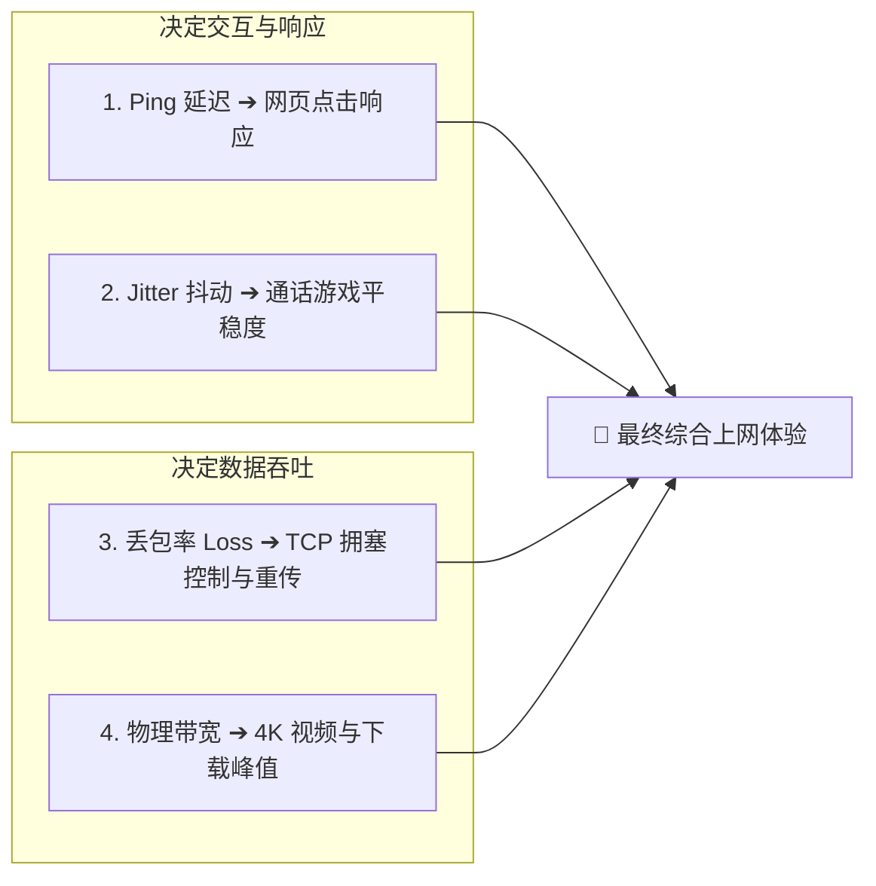
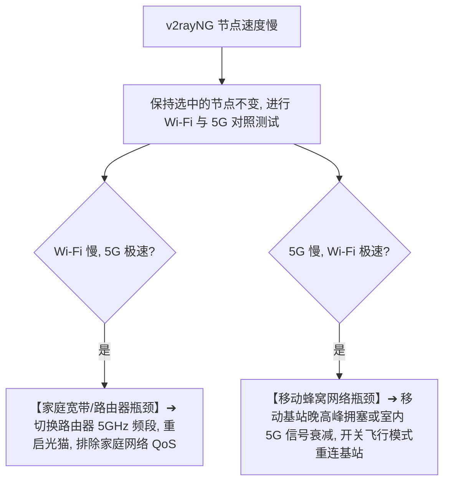
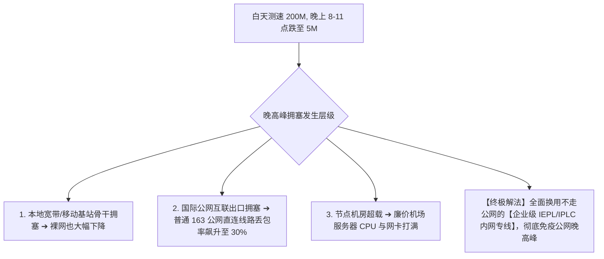
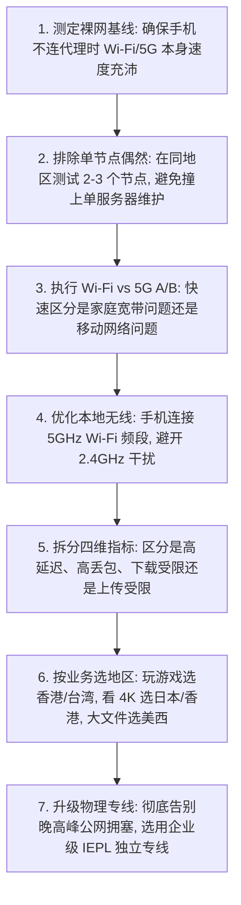

在 Android 安卓手机或平板上使用 v2rayNG 时，很多用户遇到的最磨人、最影响使用体验的问题，不是完全连不上（Timeout），也不是彻底没网，而是 **“明明能打开网页，但速度慢如蜗牛——看 YouTube 视频无限缓冲、4K 瞬间降画质到 480p、向 ChatGPT / Claude 发送图片长达半分钟传不上去、下载几十兆的文件需要耗费半小时”**。

在实际使用中，新手常常陷入各种片面与困惑的误区：

**“为什么在 v2rayNG 列表里测速只有 35ms 极低延迟，实际打开网页却奇慢无比、看视频疯狂转圈？”**  
**“为什么在家里连着千兆 Wi-Fi 只有几兆网速，关掉 Wi-Fi 切到手机 5G 移动网络后却能秒开 4K？”**  
**“为什么白天测速能跑满 300Mbps，一到晚上 8 点至 11 点晚高峰，网速就暴跌到甚至无法播放 1080p？”**  
**“为什么同一个机场里，香港节点延迟很低但卡顿严重，切换到 150ms 的日本或美国节点后反而流畅无阻？”**  
**“为什么 Speedtest 测速软件显示有 100Mbps，但实际在 YouTube 和推特上却依然卡顿？”**  
**“手机发热降频、系统省电模式、2.4GHz / 5GHz Wi-Fi 频段到底对 v2rayNG 的实际网速有多大影响？”**  
**“把节点协议从 VMess 改成 VLESS 或 REALITY，到底能不能让手机翻墙网速实现质的飞跃？”**

**v2rayNG“速度慢”是一个典型的多维物理链路性能问题。它发生在节点连接已经建立、流量转发已经畅通的前提下，受制于手机本地硬件与无线射频、家庭宽带与移动基站、国际跨境骨干网拥塞、节点物理带宽与丢包率等多重变量的制约。**

新手排查速度慢，必须打破“只看 Ping 值”的狭隘认知，建立一套严谨的 **八维性能诊断模型**：**“先测裸网基线 ➔ 拆解四大性能指标（Ping / Jitter / Loss / Throughput） ➔ Wi-Fi 与 5G 物理隔离 A/B 测试 ➔ 区分下载与上传瓶颈 ➔ 业务场景针对性测试（YouTube / AI / 游戏） ➔ 晚高峰多日复测 ➔ 识别物理线路与真实出口能力”**。

本文作为 **v2rayNG Android 客户端网络性能优化与速度排查的终极深度指南**，将带你彻底搞懂 **安卓端网速慢的真正底层诱因，并给出立竿见影的 7 步提速排错方案**。

---

## ⚡ 30 秒极速定界：v2rayNG 速度慢快速决策流

```mermaid
graph TD
    Start[v2rayNG 能上网但速度慢 / 视频卡顿] --> Step1{测试手机断开代理时的【裸网基线速度】}
    
    Step1 -->|裸网本身就很慢 (<20Mbps)| LocalIssue["【本地网络瓶颈】➔ 路由器信号差、2.4G Wi-Fi 干扰或移动基站拥塞，先修本地网络"]
    Step1 -->|裸网速度极高 (>200Mbps)| CheckNode{测试同地区其他 2-3 个节点}
    
    CheckNode -->|仅 1 个节点慢, 其他节点飞快| SingleSlow["【单节点拥塞】➔ 该物理服务器负载过高或带宽吃紧，直接换用其他节点"]
    CheckNode -->|该地区所有节点全部卡顿| CheckRegion{切换到其他地区 (如香港切日本/美国)}
    
    CheckRegion -->|其他地区瞬间流畅| RegionSlow["【地区线路拥塞】➔ 该地区国际海缆或公网骨干网丢包，晚高峰换用备用地区"]
    CheckRegion -->|所有地区、所有节点均持续卡顿| NetAB{执行 Wi-Fi vs 5G 隔离测试}
    
    NetAB -->|Wi-Fi 慢, 5G 飞快| WifiBug["【家庭网络/ISP问题】➔ 家用路由器 NAT 性能弱、Wi-Fi 频段差或宽带 QoS 限速"]
    NetAB -->|5G 慢, Wi-Fi 飞快| MobileBug["【蜂窝网络问题】➔ 运营商移动基站拥塞、信号弱或 5G 路由绕路"]
    NetAB -->|Wi-Fi 和 5G 均全部极慢| CoreDeep["【手机/服务端问题】➔ 检查手机发热降频、省电模式或服务商整体物理带宽"]
```

---

## 一、认知基石：必须拆解的“四大网络性能指标”

很多用户误以为“延迟越低就代表网速越快”，这是对网络通信最大的误解。评价 v2rayNG 性能，必须将以下 **四大核心指标** 彻底拆开：

```text
┌────────────────────────────────────────────────────────────────────────────────────────┐
│                        网络性能四大核心指标全景对照表                                  │
├──────────────┬────────────────────────┬────────────────────────┬───────────────────────┤
│ 指标名称     │ 物理定义               │ 典型数值参考           │ 对实际翻墙体验的核心影响      │
├──────────────┼────────────────────────┼────────────────────────┼───────────────────────┤
│ **Ping / Latency**│ 数据包往返耗时 (RTT)   │ 香港 35ms / 美西 160ms │ 决定网页**首屏点击响应、交互反馈与游戏跟手度**；与下载带宽无绝对因果关系│
│ **Jitter (抖动)** │ 延迟的波动剧烈程度     │ 极佳 <3ms / 差 >30ms   │ 决定**视频会议、VoIP 通话与联机游戏**是否忽快忽慢、声音断续│
│ **Packet Loss (丢包)**│ 传输途中丢失的数据包比例│ 极佳 0% / 差 >3%       │ **网络稳定性的头号杀手！** 1% 丢包会导致 TCP 吞吐量暴跌 50% 以上│
│ **Throughput (吞吐)**│ 持续实际数据传输带宽   │ 50Mbps ~ 500Mbps+      │ 决定 **YouTube 4K 秒开缓冲、大文件下载与 AI 图片上传** 的物理速度上限│
└──────────────┴────────────────────────┴────────────────────────┴───────────────────────┘
```



### 深度辨析：为什么 30ms 的香港节点看视频卡，150ms 的美国节点反而秒开 4K？
- **香港节点**：物理距离近，Ping 极低（30ms），但如果机房采用的是廉价公网直连且晚高峰超载，丢包率高达 10%，TCP 协议会疯狂触发重传并强行压低窗口，导致实际下载带宽萎缩到只有 2Mbps；
- **美国节点**：物理距离远，Ping 较高（160ms），但如果机房接入了海量 10Gbps 优质带宽且丢包率为 0%，TCP 窗口能持续拉满，大文件下载与 4K 视频流可轻松飙到 200Mbps！

---

## 二、第一步排查：确立“裸网基线”（排错黄金法则）

**在怀疑 v2rayNG 之前，必须先测试手机本身的原始网络能力！**

```mermaid
graph TD
    Baseline[1. 在 v2rayNG 中点击停止代理连接] --> TestRaw[2. 手机打开国内测速软件或 speedtest.cn 测试裸网]
    TestRaw --> CheckRaw{裸网下载速度表现}
    CheckRaw -->|< 30Mbps (裸网本身极慢)| FixRaw["【停止折腾代理】问题在手机 Wi-Fi 信号或宽带，先排查家庭网络"]
    CheckRaw -->|> 200Mbps (裸网极快)| TestProxy["【确立基线】原始网络健康，开启 v2rayNG 继续排查代理链路"]
```

- 🚨 **排错真理**：如果你的手机连在远离路由器的隔墙房间里，裸网 Wi-Fi 测速本身就只有 10Mbps，那么无论你换多么昂贵顶级的专线节点，v2rayNG 的速度上限也绝对无法突破 10Mbps！

---

## 三、第二步排查：Android 本地无线射频与硬件限制

安卓手机作为移动终端，其本地无线网络环境远比有线 PC 复杂：

```text
┌────────────────────────────────────────────────────────────────────────────────────────┐
│                        Wi-Fi 2.4GHz vs 5GHz 频段对比表                                 │
├──────────────┬────────────────────────┬────────────────────────┬───────────────────────┤
│ 对比维度     │ 2.4GHz Wi-Fi           │ 5GHz Wi-Fi             │ 对 v2rayNG 的实际影响 │
├──────────────┼────────────────────────┼────────────────────────┼───────────────────────┤
│ **物理带宽** │ 较低 (通常 30~80Mbps)  │ 极高 (可达 500~1000Mbps+)| 5GHz 才能充分喂饱高速专线节点│
│ **抗干扰力** │ 极差 (蓝牙/微波炉/邻居干扰)│ 极佳 (信道宽阔干净)    │ 2.4GHz 极易引发高 Jitter 和丢包│
│ **穿墙能力** │ 强 (衰减慢)            │ 弱 (隔两堵墙衰减剧烈)  │ 建议在路由器同房间使用 5GHz   │
└──────────────┴────────────────────────┴────────────────────────┴───────────────────────┘
```

### 1. 手机发热降频与后台省电策略
- **高温降频**：长时间进行大流量测速或 4K 播放时，手机 SoC 芯片过热会触发温控降频，限制 CPU 对 Xray-core 加密算法的处理能力，导致吞吐量下降；
- **系统省电模式**：部分国产 Android 系统（如 MIUI/HyperOS、OriginOS、ColorOS）在开启“省电模式”后，会强制限制后台 CPU 算力并压缩网络收发队列，导致代理性能受阻。

---

## 四、第三步排查：Android 独门绝技 —— Wi-Fi vs 5G 物理隔离 A/B



---

## 五、第四步排查：业务场景差异化 —— 下载 vs 上传 vs YouTube vs AI

不同业务对网络性能维度的敏感点完全不同，不能一概而论：

```text
┌────────────────────────────────────────────────────────────────────────────────────────┐
│                        四大主流翻墙业务场景对性能指标的需求矩阵                        │
├──────────────┬──────────────┬──────────────┬──────────────┬────────────────────────────┤
│ 业务场景     │ 核心瓶颈指标 │ 次要指标     │ 节点地区推荐 │ 体验优化关键建议           │
├──────────────┼──────────────┼──────────────┼──────────────┼────────────────────────────┤
│ **YouTube 4K**│ **Download 吞吐**| **丢包率 Loss**| 香港 / 日本  │ 要求持续稳定带宽 >50Mbps，0 丢包，防止画质降级│
│ **ChatGPT / AI**| **出口 IP 纯净度**| **Upload 上传**| 美国 / 日本  │ 文本交互仅需几 KB 带宽；上传文件图片极度依赖 Upload 速度│
│ **外服手游/联机**| **Ping 极低** | **Jitter <3ms** | 香港 / 台湾  │ 严禁使用公网直连，必须选用企业级内网 IEPL 专线│
│ **大文件下载**│ **持续高带宽**| **机房物理出口**| 日本 / 美国  │ 美国节点出口带宽大，适合挂机下载大型开源镜像与数据包│
└──────────────┴──────────────┴──────────────┴────────────────────────────┴────────────────┘
```

```mermaid
graph TD
    AppIssue[特定应用体验差] --> AppType{判断业务类型}
    
    AppType -->|YouTube 播放卡顿| YTCheck[检查 Download 持续带宽与丢包率, 开启 Stats for Nerds 观察 Connection Speed]
    AppType -->|AI 上传图片文件极慢| AICheck[检查节点的 Upload 上传带宽 (很多公网节点上传带宽被机房严重限制)]
    AppType -->|外服游戏延迟漂移卡顿| GameCheck[排查 Jitter 抖动与丢包率, 切换至香港 IEPL 专线节点]
```

---

## 六、第五步排查：晚高峰拥塞诊断（时段性性能暴跌）



- 💡 **防坑提醒**：节点名字上标注的 `2x`、`3x` 仅代表 **“流量扣除倍率”**（消耗 1GB 流量扣除 2GB 配额），**绝对不代表速度比 1x 节点快 2 倍**！

---

## 七、实战指南：v2rayNG 提速优化标准 7 步排查法



---

## 八、2026 晚高峰抗拥塞与 4K 秒开高速专线推荐

如果你不想在每天晚高峰忍受公网丢包与卡顿，选择一家具备 **全线独立 IEPL 企业内网专线、超大带宽冗余、晚高峰 0 丢包** 的旗舰服务商是根本解决之道：

```text
┌────────────────────────────────────────────────────────────────────────────────────────┐
│                        2026 晚高峰 0 丢包高速专线推荐                                  │
├──────────┬──────────────────────────┬──────────────┬──────────────┬────────────────────┤
│ 适配场景 │ 推荐品牌候选             │ 实际起付门槛 │ 每月流量配额 │ 晚高峰抗拥塞优势   │
├──────────┼──────────────────────────┼──────────────┼──────────────┼────────────────────┤
│ 旗舰全能 │ 光速云 (GuangSuYun)      │ 约 ¥7.5/月起 │ 59G~238G /月 │ 全线企业级 IEPL 专线，多入口负载均衡，晚高峰 4K 物理级 0 缓冲│
│ 平价轻量 │ 微风网络 (BreezeNet)     │ 约 ¥7/月起   │ 50GB / 月    │ 优质 BGP 优化专线，轻量极速，手机日常随身查资料极度省心  │
│ 弹性月付 │ 唯兔云 (V2Yun)           │ ¥14.9/月     │ 100GB / 月   │ 14.9 元纯单月付，多地区节点矩阵充沛，单节点慢随时秒切  │
│ 应急备用 │ 星岛梦 (XingDaoMeng)     │ 约 ¥8/月起   │ 60G/不限时包 │ 0月租不限时包，永不过期，专线拥塞时随时顶上备用    │
│ 极速专精 │ 速界 (SpeedWorld)        │ ¥25/月       │ 150GB / 月   │ 企业级超大独立专线带宽，流媒体与 8K 秒开零缓冲           │
└──────────┴──────────────────────────┴──────────────┴──────────────┴────────────────────┘
```

- 🏆 **晚高峰 0 缓冲旗舰首选**：[光速云](/reviews/guangsu-cloud/) —— 2020 老牌专线，全线内网 IEPL 专线，晚高峰 4K 视频秒开；
- 🍃 **超低预算轻量**：[微风网络](/reviews/weifeng-cloud/) —— 50GB 精品小流量专线，年付折算仅约 ¥7/月；
- 💳 **拒绝绑定的单月付**：[唯兔云](/recommend/best-airports/) —— ¥14.9 纯单月付，100GB 充沛流量。

---

## 九、避坑指南：50 个关于“v2rayNG 速度慢”的致命认知误区

```text
❌ 误区 1：节点延迟越低（Ping 越小），下载速度就一定越快 ➔ 事实：Ping 只代表往返延迟，下载速度由机房物理带宽与丢包率决定。
❌ 误区 2：节点延迟高达 160ms，下载大文件肯定奇慢无比 ➔ 事实：高延迟节点只要丢包率为 0 且带宽充沛，大文件能持续跑满千兆。
❌ 误区 3：Speedtest 测速跑满 100M，在 YouTube 看 4K 就绝对不会卡 ➔ 事实：Speedtest 走单线程突发，视频流依赖持续稳定吞吐与低丢包。
❌ 误区 4：节点下载速度飞快，上传速度就一定会一样快 ➔ 事实：很多海外机房对上传带宽进行了严格限制（如不对等带宽）。
❌ 误区 5：Jitter 抖动只对职业电竞选手有影响，普通人无所谓 ➔ 事实：高 Jitter 会导致网页首屏加载断续、视频会议语音严重失真。
❌ 误区 6：1% 的丢包率对日常上网看视频毫无影响 ➔ 事实：TCP 协议遇到 1% 丢包就会主动减半发包窗口，导致网速断崖式暴跌。
❌ 误区 7：手机 Wi-Fi 信号显示满格，说明本地无线速率绝对是最高 ➔ 事实：满格仅代表信号强度，若处于 2.4GHz 拥堵信道速率依然极低。
❌ 误区 8：手机 5G 图标亮起，网速就绝对比家里的 Wi-Fi 还要快 ➔ 事实：室内 5G 衰减或基站晚高峰拥塞时，实际网速可能不如普通宽带。
❌ 误区 9：5GHz Wi-Fi 任何时候都比 2.4GHz Wi-Fi 更加稳定 ➔ 事实：隔两堵承重墙后 5GHz 信号衰减严重，丢包率反而会剧增。
❌ 误区 10：遇到节点变慢，只要在设置里把 DNS 改成 8.8.8.8 就能立刻提速 ➔ 事实：DNS 仅负责域名解析，无法增加物理链路的传输带宽。
❌ 误区 11：安卓系统的 Private DNS 是提升 v2rayNG 网速的万能开关 ➔ 事实：私人 DNS 影响解析路径，不能突破节点物理带宽瓶颈。
❌ 误区 12：在手机设置里强行关闭 IPv6 能让 v2rayNG 网速翻倍 ➔ 事实：仅当运营商 IPv6 路由异常时才相关，切勿盲目当成提速灵药。
❌ 误区 13：把协议从 VMess 升级为 VLESS，速度就能瞬间提升十倍 ➔ 事实：VLESS 减少了加密开销，但决定速度上限的依然是物理线路。
❌ 误区 14：REALITY 是一种专门用来让网速变快的物理加速黑科技 ➔ 事实：REALITY 是安全伪装机制，无法凭空提升物理机房带宽。
❌ 误区 15：TLS 加密会导致节点网速损失 50% 以上 ➔ 事实：现代手机 CPU 具备硬件 AES 加密指令集，TLS 损耗通常小于 3%。
❌ 误区 16：使用 TCP 传输方式的节点速度一定比 WebSocket 快十倍 ➔ 事实：传输层协议差异微弱，物理线路与服务器出口才是核心瓶颈。
❌ 误区 17：使用 gRPC 传输方式能让任何劣质公网节点起飞 ➔ 事实：gRPC 多路复用在丢包严重的公网环境下性能甚至可能劣于单连接。
❌ 误区 18：只要节点名字带有“IEPL”标签，就绝对 100% 永远不卡 ➔ 事实：如果服务商接入的专线总带宽超售过载，专线同样会卡顿。
❌ 误区 19：节点倍率写着“2.0x”，代表该节点网速比 1.0x 节点快 2 倍 ➔ 事实：倍率仅代表流量计费扣除系数，与物理速度毫无因果关系。
❌ 误区 20：晚高峰一遇到卡顿，就立刻认定是机场老板在严重超售 ➔ 事实：晚高峰国际公网出口整体拥塞丢包也是导致变慢的高频诱因。
❌ 误区 21：只要换一个最新的 Xray-core 核心，所有慢节点就能秒变快 ➔ 事实：Core 仅负责数据包封装转发，无法改变跨国物理网络质量。
❌ 误区 22：把 v2rayNG 卸载重装一遍是解决网速变慢最好的方法 ➔ 事实：重装对物理线路丢包、晚高峰拥塞毫无任何修复作用。
❌ 误区 23：关闭安卓手机系统的所有电池优化能让代理网速翻倍 ➔ 事实：电池优化影响后台存活，对前台实时测速吞吐量无直接提速效果。
❌ 误区 24：手机发烫发热和 v2rayNG 翻墙网速完全没有半点关系 ➔ 事实：手机 SoC 过热降频会极大限制 Core 的加密解密吞吐速率。
❌ 误区 25：向 ChatGPT 发送文本感觉慢，一定是梯子的网速带宽不足 ➔ 事实：文本仅需几 KB 带宽，慢通常源于 OpenAI 服务器推理排队。
❌ 误区 26：同一个节点在 Windows 电脑上飞快，在安卓手机上必定一样快 ➔ 事实：手机 Wi-Fi 天线性能、射频功率与电脑有线网卡差异巨大。
❌ 误区 27：只要订阅里的节点总数超过 100 个，就肯定能找到极速节点 ➔ 事实：大量公网低质节点全线拥塞，精品专线节点远胜劣质堆量。
❌ 误区 28：测试了一次晚间网速慢，就能证明该节点一年四季都是垃圾 ➔ 事实：需在多个不同日期的晚高峰进行多维度复测才能科学定界。
❌ 误区 29：同一个地区的所有节点性能和速度肯定都是完全一模一样的 ➔ 事实：不同节点通常运行在不同的独立物理服务器上，负载各异。
❌ 误区 30：只要开启了 v2rayNG 的 Mux 多路复用，网速就绝对能翻倍 ➔ 事实：Mux 在高丢包公网环境下极易引发 TCP 队头阻塞导致更卡。
```

---

## 八、常见问题深度解答（FAQ · 55 问）

### Q1：v2rayNG 延迟很低（Ping 小），为什么下载速度依然很慢？
**答**：**Ping 仅反映数据包往返时间，不代表物理带宽。** 30ms 的节点若机房物理带宽吃紧或丢包率高，TCP 窗口被压缩，下载速度依然会非常慢。

### Q2：为什么白天速度飞快，一到晚上 8 点至 11 点就严重卡顿？
**答**：这是典型的 **晚高峰国际出口公网拥塞**。晚间跨国公网骨干网丢包率飙升导致普通直连线路严重降速，选用企业级 IEPL 专线可彻底免疫。

### Q3：为什么在 Wi-Fi 下很慢，切换到 5G 移动网络后却秒开？
**答**：说明瓶颈在**家庭本地无线网络或宽带运营商**。常见于路由器 2.4GHz 频段严重干扰、老旧路由器 NAT 性能不足或宽带 QoS 限速。

### Q4：为什么 5G 下很慢，切回家庭 Wi-Fi 却恢复正常？
**答**：说明瓶颈在**手机运营商蜂窝基站**。晚高峰移动基站负荷过载、室内 5G 信号穿透衰减或运营商国际出口路由绕路均会导致 5G 减速。

### Q5：YouTube 1080p 能流畅播放，切换到 4K 为什么无限缓冲？
**答**：4K 视频流要求持续稳定的下载吞吐量（通常需 >50Mbps）且丢包率接近 0%。若节点持续带宽不足或存在微量丢包，4K 就会频繁卡顿。

### Q6：Speedtest 测速很快，为什么实际看视频和刷推特依然很卡？
**答**：Speedtest 连接的是测速专用服务器且采用多线程短时突发；而 YouTube 走的是流媒体 CDN 节点，依赖单连接持续吞吐与低丢包率。

### Q7：什么是 Jitter（抖动）？对日常使用有什么影响？
**答**：Jitter 是网络延迟的波动程度。Jitter 过大会导致数据包到达时间忽快忽慢，造成视频会议声音断续、联机游戏瞬间卡顿瞬移。

### Q8：丢包率（Packet Loss）对网速的影响到底有多大？
**答**：**极大。** 丢包是网络性能的隐形杀手。即使只有 1%~2% 的丢包，TCP 拥塞控制算法也会强制压低传输速率，导致实际可用带宽暴跌 50% 以上。

### Q9：向 ChatGPT / Claude 上传图片文件很慢怎么解决？
**答**：**排查节点的 Upload 上传带宽。** 很多海外机房是非对称带宽（下载给 100M，上传仅限 5M）。切换至上传带宽充沛的高品质专线节点即可。

### Q10：香港节点和日本节点哪个速度更快？
**答**：香港节点延迟通常更低（适合游戏和即时交互）；日本节点物理出口带宽通常更充沛且负载均衡更优（适合流媒体 4K 播放与大文件下载）。

### Q11：节点倍率（如 2.0x）代表网速比 1.0x 节点快两倍吗？
**答**：**绝不代表。** 倍率仅为服务商后台的计费扣费比例（用 1G 扣 2G），与节点物理带宽和实际网速毫无因果关系。

### Q12：把协议从 VMess 换成 VLESS 能解决网速卡顿吗？
**答**：不能根本解决。VLESS 降低了 CPU 加密开销，但网速的核心瓶颈在物理机房带宽与专线质量，协议差异无法弥补线路缺陷。

### Q13：手机发热会影响 v2rayNG 的翻墙网速吗？
**答**：**会。** 手机 SoC 芯片过热触发温控降频后，CPU 处理加密解密与网络数据包转发的效率大幅下降，直接导致极限吞吐量缩水。

### Q14：遇到 v2rayNG 速度慢，需要卸载重装软件吗？
**答**：**绝不需要。** 99% 的速度慢源于本地 Wi-Fi 频段、物理专线带宽或晚高峰拥塞，重装软件无法改变跨国网络物理环境。

### Q15：如何科学准确地测试 v2rayNG 的真实网速？
**答**：先断开代理测定本地裸网基线，然后在 5GHz Wi-Fi 下连接节点，通过实际播放 YouTube 4K 视频并打开“详细统计信息（Stats for Nerds）”观察稳定连接速度。

---

## 🏁 总结：v2rayNG 性能提速核心认知金字塔

优化与排查 v2rayNG 网速，请牢记以下**核心铁律**：

```text
1. 破迷信 ➔ 低 Ping 不等于高带宽，高延迟不等于慢下载，丢包率才是稳定性的头号杀手
2. 先裸网 ➔ 永远先测不连代理时的本地网络基线，排除手机信号差与宽带本身故障
3. 分射频 ➔ 手机在同房间优先连接 5GHz Wi-Fi 频段，彻底规避 2.4GHz 的恶劣同频干扰
4. 辨业务 ➔ 玩游戏选低 Ping 香港/台湾，看 4K 与大下载选高带宽日本/美西，AI 上传查 Upload
5. 选专线 ➔ 晚高峰公网丢包无解，唯有企业级独立 IEPL 内网专线才能实现全天候 4K 秒开
```

---

### 📚 延伸进阶阅读与选型专栏
- 📱 **Android 客户端主教程**：[《v2rayNG怎么用？Android下载安装、订阅、节点、VPN权限与完整配置教程》](/tutorials/v2rayng-android/)
- 🚨 **节点连接超时排查**：[《v2rayNG节点Timeout怎么办？Android节点全部超时、Core、Wi-Fi/5G与服务器完整排查》](/issues/v2rayng-node-timeout/)
- 🌐 **有节点无法上网排查**：[《v2rayNG有节点但无法上网怎么办？VPN权限、DNS、Routing与Android网络完整排查》](/issues/v2rayng-connected-no-internet/)
- 📥 **Android 订阅深度指南**：[《v2rayNG订阅怎么导入？订阅链接、节点更新、二维码与更新失败完整教程》](/tutorials/v2rayng-subscription/)
- 🗺️ **节点地区深度选型**：[《V2Ray节点怎么选？香港、日本、新加坡、美国节点、线路、延迟与使用场景完整指南》](/tutorials/v2ray-node-selection/)
- 💻 **Windows 速度慢排查**：[《v2rayN速度慢怎么办？节点选择、延迟、丢包、晚高峰与本地网络完整排查》](/issues/v2rayn-slow-speed/)
- ⚡ **老牌旗舰专线**：[《光速云深度评测：2020老牌IEPL专线与解锁实测》](/reviews/guangsu-cloud/)
- 🍃 **平价轻量专线**：[《微风网络深度评测：小流量套餐值不值得买？》](/reviews/weifeng-cloud/)
- 🏆 **2026 全景大榜**：[《2026梯子推荐：稳定、速度、价格、安全与不同使用场景怎么选》](/recommend/best-tizi/)
