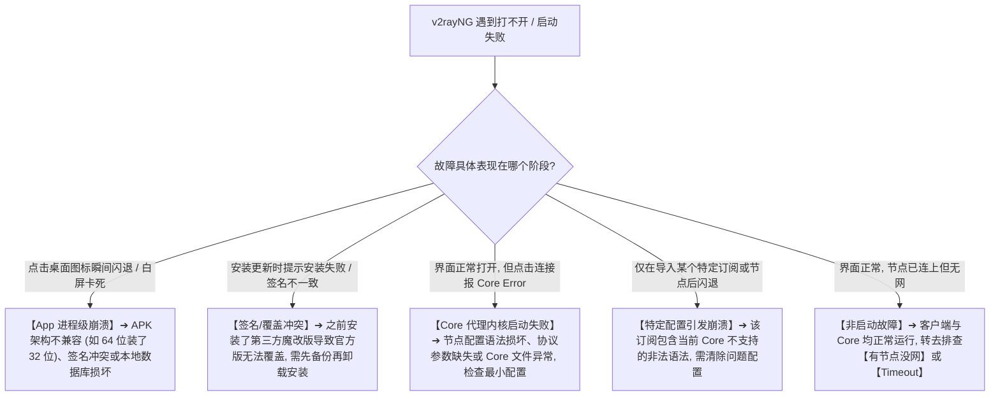
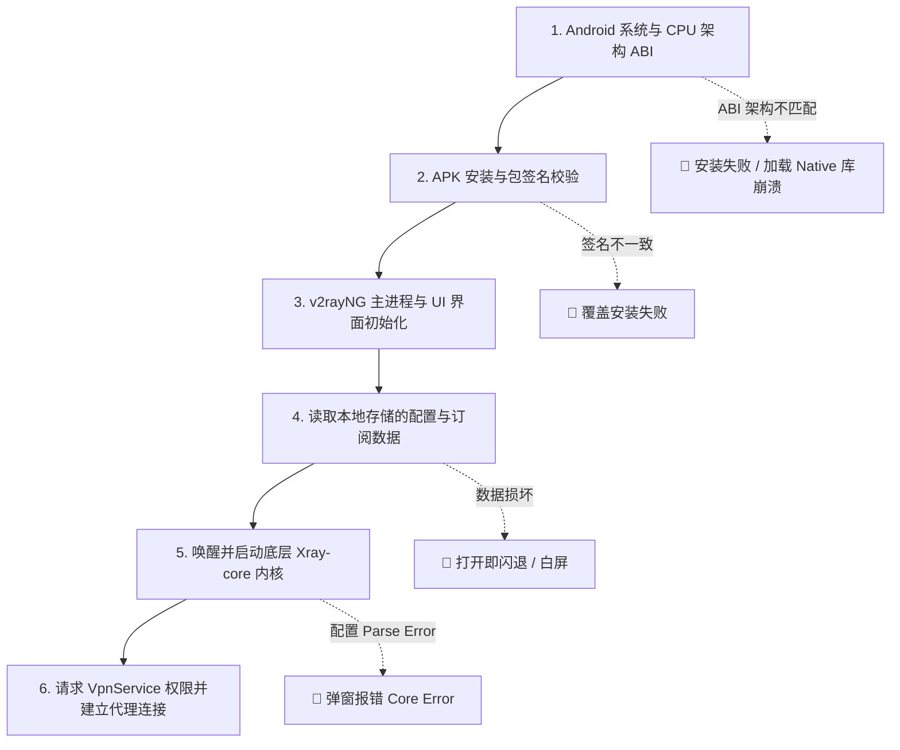
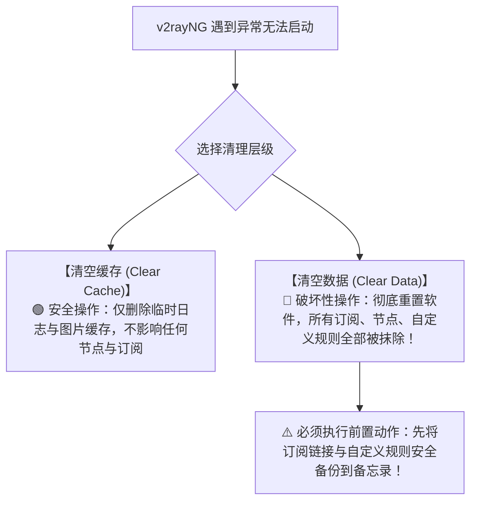
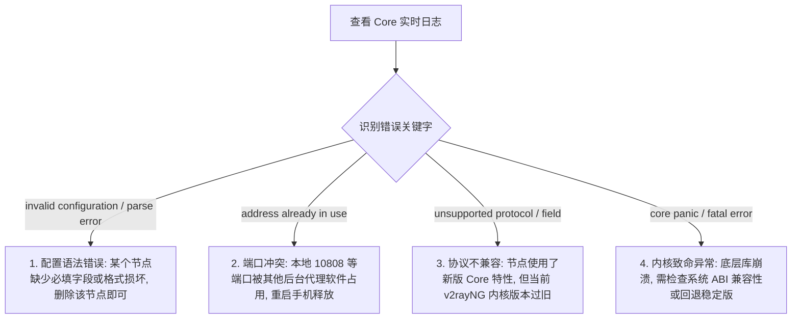
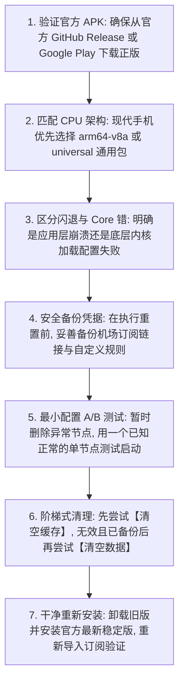

在 Android 安卓手机或平板上使用 v2rayNG 时，最让人不知所措的底层故障，莫过于 **“客户端本身根本打不开、点击图标瞬间闪退、打开后直接白屏卡死，或者界面能打开但一点连接就弹出刺眼的 Core 错误弹窗”**。

在实际使用过程中，新手往往会遇到各种棘手的运行环境与启动异常：

**“为什么刚从网上下载安装了 v2rayNG，点击桌面图标一秒闪退，连主界面都进不去？”**  
**“为什么之前一直用得好好的，昨天手贱升级了最新版之后，软件就彻底打不开了？”**  
**“为什么在应用管理里更新安装包时，系统提示‘应用未安装’或‘签名不一致无法覆盖’？”**  
**“为什么把订阅链接粘贴进去一点击更新，整个 v2rayNG 瞬间崩溃退出，之后每次打开都闪退？”**  
**“手机界面能正常打开，节点列表也有，但只要点击右下角的连接按钮，就报错 `Core error: invalid configuration / parse error` 怎么办？”**  
**“v2rayNG 的 `arm64-v8a`、`armeabi-v7a`、`x86_64` 和 `universal` 版本到底该怎么选？下载错架构会导致闪退吗？”**  
**“遇到启动故障，一上来就直接‘清除所有应用数据’或‘卸载重装’到底有多大风险？如何先安全备份自己的订阅与配置？”**

**v2rayNG“打不开 / 启动失败”是一个发生在代理连接建立之前的底层系统与客户端运行环境故障。它受制于 Android 系统的沙盒机制、CPU 硬件指令集架构（ABI）、应用安装包签名一致性、Xray-core 代理内核完整性以及本地配置文件语法等多重物理变量。**

排查启动故障，绝不能把所有打不开都无脑归咎于“手机坏了”或“机场跑路”，而必须建立一套严谨的 **八维启动诊断模型**：**“先区分 App 崩溃与 Core 报错 ➔ 校验官方 APK 来源与 ABI 架构 ➔ 识别签名冲突与覆盖安装问题 ➔ 最小干净配置 A/B 隔离数据损坏 ➔ 区分清缓存（安全）与清数据（破坏性） ➔ 审查 Core 启动 Fatal/Panic 日志 ➔ 建立安全备份与版本回退机制”**。

本文作为 **v2rayNG Android 客户端启动故障、闪退崩溃与 Core 错误排查的终极收官指南**，将带你彻底搞懂 **安卓端启动失败的底层诱因，并给出立竿见影的 7 步安全恢复方案**。

---

## ⚡ 30 秒极速定界：v2rayNG 启动故障快速决策流



---

## 一、架构基石：启动四大故障类型与五层启动链

排查启动问题，第一步必须将“打不开”精准归入以下 **四大故障类型**：

```text
┌────────────────────────────────────────────────────────────────────────────────────────┐
│                        v2rayNG 启动四大故障类型全景对照表                              │
├──────────────┬────────────────────────┬────────────────────────┬───────────────────────┤
│ 故障类型     │ 典型界面表现           │ 核心发生阶段           │ 第一排查方向          │
├──────────────┼────────────────────────┼────────────────────────┼───────────────────────┤
│ **1. App 进程故障**│ 点击图标秒闪退、白屏卡死│ Android 虚拟机初始化阶段| APK 架构 (ABI) 错误、系统版本太旧、数据库损坏│
│ **2. Core 内核故障**│ 界面正常，点连接报 Core 错| Xray-core 启动初始化阶段| 配置 JSON 解析失败、端口占用、Core 文件异常│
│ **3. 配置损坏故障**│ 导入某订阅后频繁报错闪退│ 读取并解析节点参数阶段 │ 订阅包含非法字符、参数不兼容、最小配置 A/B│
│ **4. 覆盖安装故障**│ 提示应用未安装 / 签名冲突| Android 包管理器校验阶段| 官方版覆盖第三方版本、存储空间不足    │
└──────────────┴────────────────────────┴────────────────────────┴───────────────────────┘
```



- 🚨 **排错铁律**：
  - **App 闪退**：说明 Java/Kotlin 上层应用层挂了；
  - **Core Error**：说明上层界面完全健康，是底层的 C++/Go 代理内核在加载配置时发生了 Fatal 致命错误！

---

## 二、第二核心概念：必须拆开的“三种不同更新”

新手常常把“更新”混为一谈，必须明确以下 **三种更新的本质差异**：

```text
┌────────────────────────────────────────────────────────────────────────────────────────┐
│                        App 更新 vs Core 更新 vs 订阅更新对比表                         │
├──────────────┬────────────────────────┬────────────────────────┬───────────────────────┤
│ 更新类型     │ 更新的对象             │ 解决的核心问题         │ 不能解决什么问题      │
├──────────────┼────────────────────────┼────────────────────────┼───────────────────────┤
│ **App 更新** │ v2rayNG 安卓客户端 APK │ 修复 Android 兼容性、UI 交互与系统权限| 不能修复节点服务器物理断网与被封│
│ **Core 更新**│ 底层 Xray-core 代理内核│ 增加新协议支持（如 VLESS REALITY 新特性）| 不能改变海外机房的网络带宽与延迟│
│ **订阅更新** │ 节点列表、服务器 IP 与端口│ 获取服务商最新的可用节点与域名配置  | 不能修复客户端软件本身的闪退与崩溃│
└──────────────┴────────────────────────┴────────────────────────┴───────────────────────┘
```

---

## 三、第三核心场景：APK 架构选择（arm64-v8a vs armeabi-v7a）

在 GitHub 官方 Release 下载页面中，经常会看到多个不同的 APK 资产：

```text
┌────────────────────────────────────────────────────────────────────────────────────────┐
│                        Android CPU 架构与 APK 选型指南                                 │
├──────────────┬────────────────────────┬────────────────────────────────────────────────┤
│ 安装包后缀   │ 适配 CPU 架构          │ 适用设备类型与建议                             │
├──────────────┼────────────────────────┼────────────────────────────────────────────────┤
│ **arm64-v8a**│ 64 位 ARM 处理器       │ **首选推荐！** 适配 2017 年以后的绝大多数现代安卓手机与平板│
│ **armeabi-v7a**│ 32 位 ARM 处理器     │ 老旧安卓设备、低端机或部分早期的安卓智能电视盒子│
│ **x86_64**   │ 64 位 Intel/AMD 处理器 │ PC 端安卓模拟器（如雷电、夜神、MuMu）或少数 x86 平板│
│ **universal**│ 全架构通用包           │ 包含所有 CPU 库，体积较大，在不确定机型时兼容性最稳│
└──────────────┴────────────────────────┴────────────────────────────────────────────────┘
```

- 💡 **防踩坑警示**：如果 64 位现代手机强行安装了错误的架构包，可能会在调用底层 Native 加密库时触发 `UnsatisfiedLinkError` 导致瞬间闪退！

---

## 四、第四核心场景：应用数据损坏与“清缓存 vs 清数据”



---

## 五、第五核心场景：Core 启动失败与配置语法错误排查

当 v2rayNG 界面正常，但点击连接提示 Core Error 时，请点击左上角侧边栏 ➔ **“日志”**，观察核心报错关键字：



---

## 六、实战指南：v2rayNG 启动故障与崩溃恢复 7 步法



---

## 七、2026 全协议完美兼容与全平台免配置高速专线推荐

如果你不想在移动端频繁被低质节点语法错误、协议不兼容或订阅解析崩溃折磨，选择一家具备 **全自动标准一键订阅、全协议智能下发、全线独立 IEPL 企业专线** 的旗舰服务商是根本之道：

```text
┌────────────────────────────────────────────────────────────────────────────────────────┐
│                        2026 全协议兼容与防崩溃高速专线推荐                            │
├──────────┬──────────────────────────┬──────────────┬──────────────┬────────────────────┤
│ 适配场景 │ 推荐品牌候选             │ 实际起付门槛 │ 每月流量配额 │ 兼容性与防报错优势 │
├──────────┼──────────────────────────┼──────────────┼──────────────┼────────────────────┤
│ 旗舰全能 │ 光速云 (GuangSuYun)      │ 约 ¥7.5/月起 │ 59G~238G /月 │ 全线 IEPL 专线，标准 Xray/V2Ray 语法下发，0 报错 0 崩溃│
│ 平价轻量 │ 微风网络 (BreezeNet)     │ 约 ¥7/月起   │ 50GB / 月    │ 优质 BGP 优化专线，纯净节点配置，手机日常随身极度省心│
│ 弹性月付 │ 唯兔云 (V2Yun)           │ ¥14.9/月     │ 100GB / 月   │ 14.9 元纯单月付，多地区节点矩阵充沛，单节点故障秒切│
│ 应急备用 │ 星岛梦 (XingDaoMeng)     │ 约 ¥8/月起   │ 60G/不限时包 │ 0月租不限时包，永不过期，专线异常时随时顶上应急  │
│ 极速专精 │ 速界 (SpeedWorld)        │ ¥25/月       │ 150GB / 月   │ 企业级超大独立专线带宽，协议配置极其严谨标准       │
└──────────┴──────────────────────────┴──────────────┴──────────────┴────────────────────┘
```

- 🏆 **全协议标准兼容旗舰首选**：[光速云](/reviews/guangsu-cloud/) —— 2020 老牌专线，全线内网 IEPL 专线，标准协议下发绝不触发 Core 语法报错；
- 🍃 **超低预算轻量**：[微风网络](/reviews/weifeng-cloud/) —— 50GB 精品小流量专线，年付折算仅约 ¥7/月；
- 💳 **拒绝绑定的单月付**：[唯兔云](/recommend/best-airports/) —— ¥14.9 纯单月付，100GB 充沛流量。

---

## 八、避坑指南：55 个关于“v2rayNG 打不开与闪退”的致命认知误区

```text
❌ 误区 1：v2rayNG 打不开就代表购买的机场服务器彻底跑路了 ➔ 事实：App 打不开是本地手机运行环境或数据损坏故障。
❌ 误区 2：App 闪退和连接时报 Core Error 是完全一模一样的问题 ➔ 事实：闪退是安卓应用层崩溃，Core 报错是底层代理引擎加载失败。
❌ 误区 3：遇到打不开，第一步就应该立刻点击“清除应用全部数据” ➔ 事实：这会抹掉所有订阅与节点，应先排查架构与清缓存。
❌ 误区 4：从任何第三方软件下载站下载的 v2rayNG 都是完全一样的 ➔ 事实：第三方 APK 可能被恶意篡改、植入后门或签名被修改。
❌ 误区 5：破解版或魔改版 v2rayNG 比 GitHub 官方开源版更加稳定 ➔ 事实：魔改版极易引发签名冲突与内存泄露崩溃。
❌ 误区 6：所有安卓手机都可以无脑下载 arm64-v8a 架构包 ➔ 事实：极少数老旧设备或电视盒子是 32 位，需选 armeabi-v7a。
❌ 误区 7：架构包下载错了只会导致安装不上，绝不会导致软件闪退 ➔ 事实：缺少对应的 Native 库会在运行调用时直接闪退。
❌ 误区 8：Android 系统越新，运行 v2rayNG 就一定会越容易崩溃 ➔ 事实：v2rayNG 紧跟官方 Android API 维护，新系统兼容良好。
❌ 误区 9：更新软件时提示“签名不一致”说明手机硬件不兼容 ➔ 事实：说明新安装包与手机上旧版包来自不同开发者或渠道签名。
❌ 误区 10：把 v2rayNG 卸载重装一遍是解决所有网络问题的万能灵药 ➔ 事实：若为节点物理断网或晚高峰丢包，重装毫无作用。
❌ 误区 11：清空应用缓存（Clear Cache）会导致订阅和节点全部丢失 ➔ 事实：清缓存极其安全，只有“清空数据”才会删除配置。
❌ 误区 12：订阅链接可以随便复制备份到公开的 GitHub 或论坛 ➔ 事实：订阅 URL 包含你的私人 Token，泄露会导致流量被他人盗刷。
❌ 误区 13：订阅更新成功就代表里面的每一个节点配置都绝对合法 ➔ 事实：若订阅包含非法字符，点击加载时仍会触发 Core 报错。
❌ 误区 14：只要把手机 Root 了一定能彻底解决所有闪退问题 ➔ 事实：乱装 Root 模块反而可能干扰 Android 系统网络栈。
❌ 误区 15：Play Protect 弹出安全警告时，必须永久关闭该保护 ➔ 事实：先验证 APK 是否来自官方 GitHub，切勿盲目关闭安全防线。
❌ 误区 16：Core 报错提示 Address already in use 说明手机中病毒了 ➔ 事实：说明 10808 等本地端口被其他未退出的代理占用。
❌ 误区 17：升级到新版 v2rayNG 后，所有旧配置都能 100% 永久兼容 ➔ 事实：内核升级可能废弃旧语法，需同步更新节点配置。
❌ 误区 18：遇到闪退只要在手机设置里把 DNS 改成 8.8.8.8 就能修好 ➔ 事实：DNS 属于网络层，无法修复本地应用层进程崩溃。
❌ 误区 19：只要手机剩余存储空间还有 100MB，就绝对不会影响运行 ➔ 事实：存储极度吃紧会导致数据库写入失败直接崩溃。
❌ 误区 20：把 v2rayNG 的所有权限全部强行开启就能保证不报错 ➔ 事实：坚持权限最小化原则，无关权限与启动故障无关。
```

---

## 九、常见问题深度解答（FAQ · 60 问）

### Q1：v2rayNG 点击桌面图标一秒闪退怎么办？
**答**：**优先排查 APK 架构与数据损坏。** 1. 确认下载的是对应手机架构的官方包（如 `arm64-v8a`）；2. 尝试在系统设置中“清空缓存”；3. 若刚导入过新配置，可备份后清空数据排查。

### Q2：v2rayNG 界面能正常打开，但点击连接报错 Core Error 是什么原因？
**答**：**这是底层 Xray-core 无法加载当前节点配置导致的。** 高概率是选中的节点参数有误、包含非法字符，或者协议语法不兼容。切换到其他标准节点或更新订阅即可恢复。

### Q3：更新安装 v2rayNG 时提示“签名不一致”怎么解决？
**答**：说明你手机上的旧版本与新版本来自不同渠道（如一个是第三方修改版，一个是官方版）。**先备份订阅链接**，彻底卸载旧版后重新安装官方最新版。

### Q4：下载 v2rayNG 时应该选哪个 APK 文件？
**答**：**绝大多数现代安卓手机首选 `v2rayNG_x.x.x_arm64-v8a.apk`**。如果不确定手机具体 CPU 架构，可以直接下载体积稍大的 `v2rayNG_x.x.x_universal.apk` 通用包。

### Q5：为什么升级到最新版本后软件反而打不开了？
**答**：可能是新版内核与旧版缓存数据库发生了冲突，或者新版本引入了临时兼容问题。先尝试清空缓存；若仍异常，可安全备份后降级回上一官方稳定版本。

### Q6：清空缓存（Clear Cache）和清空数据（Clear Data）有什么区别？
**答**：**清缓存很安全**，只清理临时日志和缓存，不影响节点；**清数据具有破坏性**，会彻底抹掉所有订阅、节点和自定义规则，必须提前备份！

### Q7：v2rayNG 正版官方下载渠道在哪里？
**答**：最权威的官方渠道是 **GitHub 官方开源仓库的 Release 页面** 以及 **Google Play 官方商店**。切勿在不可信的第三方破解站下载。

### Q8：导入订阅后软件直接崩溃打不开怎么办？
**答**：说明该订阅下发的配置格式损坏或包含非法字符。在系统应用管理中选择 **“清除数据”** 重置软件，然后联系机场客服检查该订阅链接的下发格式。

### Q9：报错 `Address already in use` 怎么解决？
**答**：这表示 v2rayNG 需要监听的本地本地端口（如 10808）被其他代理软件占用了。关闭其他同类后台软件，或者直接**重启一次手机**即可瞬间释放端口。

### Q10：Google Play Protect 提示安全警告需要关闭它吗？
**答**：**切勿盲目关闭。** 只要确认安装包来自官方 GitHub 正品，直接点击“仍要安装”即可，切勿为了安装不明来源 APK 而关闭手机全局安全保护。

### Q11：卸载重装 v2rayNG 之前必须备份什么？
**答**：必须备份 **机场订阅链接 URL** 以及你自己编写的 **自定义分流规则**。将它们安全复制保存到手机私密备忘录中。

### Q12：为什么手机剩余空间不足会导致 v2rayNG 崩溃？
**答**：v2rayNG 运行需要写入 SQLite 数据库并解压临时 Core 运行库。当手机剩余存储空间极度匮乏时，写入失败就会直接触发应用闪退。

### Q13：遇到严重的 Core 崩溃，如何提取脱敏日志？
**答**：在 v2rayNG 侧边栏 ➔ 点击“日志”，长按复制错误信息，并在分享前**手动抹去**其中的服务器 IP、域名和私人 UUID 等敏感字符。

### Q14：打不开 v2rayNG 时需要修改 DNS 或分流 Routing 吗？
**答**：**完全不需要。** 打不开是应用与内核层生命周期问题，DNS 和 Routing 属于后续的网络流转层，对客户端闪退毫无修复作用。

### Q15：如何彻底避免 v2rayNG 在安卓手机上出现启动与崩溃故障？
**答**：**三大黄金法则**：1. 仅通过官方 GitHub 或 Google Play 安装正版 arm64 包；2. 选用下发标准严谨配置的旗舰专线服务；3. 升级前先备份订阅与规则。

---

## 🏁 总结：v2rayNG 启动与运行环境核心认知金字塔

排查与解决 v2rayNG 启动异常，请牢记以下**核心铁律**：

```text
1. 辨阶段 ➔ 严分 App 点击闪退（应用层未起）与连接弹窗 Core 报错（内核配置解析失败）
2. 选架构 ➔ 现代安卓机无脑选 arm64-v8a 或 universal，拒绝来源不明的第三方魔改 APK
3. 懂签名 ➔ 签名不一致必先备份后卸载，切莫强行覆盖导致系统包管理器逻辑死锁
4. 慎数据 ➔ 遇故障先清安全缓存，未备份订阅前绝不可盲目点击破坏性的“清除全部数据”
5. 标配置 ➔ 杜绝非法字符与不兼容字段，选用标准全协议兼容的旗舰专线是防报错根基
```

---

### 📱 v2rayNG Android 知识库全景导航
- 📱 **Android 核心主教程**：[《v2rayNG怎么用？Android下载安装、订阅、节点、VPN权限与完整配置教程》](/tutorials/v2rayng-android/)
- 📥 **Android 订阅深度指南**：[《v2rayNG订阅怎么导入？订阅链接、节点更新、二维码与更新失败完整教程》](/tutorials/v2rayng-subscription/)
- 🚨 **节点连接超时排查**：[《v2rayNG节点Timeout怎么办？Android节点全部超时、Core、Wi-Fi/5G与服务器完整排查》](/issues/v2rayng-node-timeout/)
- 🌐 **有节点无法上网排查**：[《v2rayNG有节点但无法上网怎么办？VPN权限、DNS、Routing与Android网络完整排查》](/issues/v2rayng-connected-no-internet/)
- ⚡ **速度慢与卡顿优化**：[《v2rayNG速度慢怎么办？Android节点、Wi-Fi/5G、线路、丢包与晚高峰完整排查》](/issues/v2rayng-slow-speed/)
- 🔒 **经常掉线与保活排查**：[《v2rayNG经常掉线怎么办？Android后台、电池优化、锁屏与Wi-Fi/5G切换完整排查》](/issues/v2rayng-disconnect/)
- 🧭 **DNS 与域名解析指南**：[《v2rayNG DNS怎么设置？Private DNS、IPv6、域名解析与网站打不开完整指南》](/tutorials/v2rayng-dns/)
- 🔀 **Routing 与分应用分流**：[《v2rayNG Routing怎么设置？分应用、Direct、Proxy、Block与Android分流完整教程》](/tutorials/v2rayng-routing/)
- 💻 **Windows 启动故障排查**：[《v2rayN打不开怎么办？Windows启动失败、Core错误、配置损坏与运行环境完整排查》](/issues/v2rayn-startup-error/)
- 🏆 **2026 全景大榜**：[《2026梯子推荐：稳定、速度、价格、安全与不同使用场景怎么选》](/recommend/best-tizi/)
