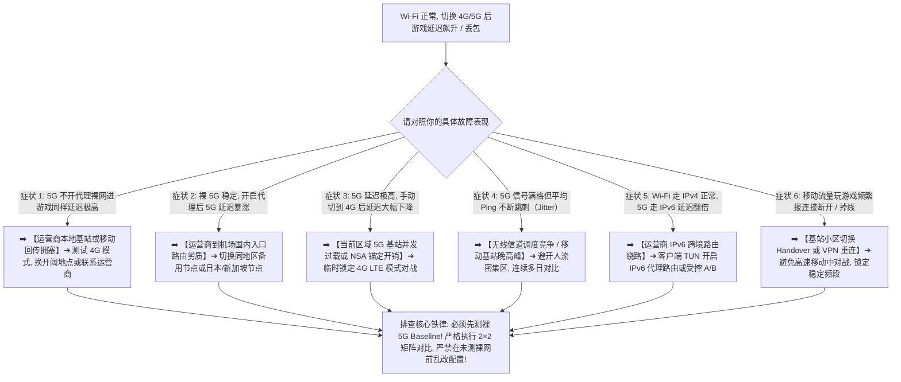

> 📌 **评估范围、编辑深化与故障排查定位声明**：  
> **首先明确本文的核心技术定位**：这是一篇专注于 **“同一部手机在 Wi-Fi 下游戏正常、但切换 4G/5G 蜂窝数据后延迟飙升、Jitter 剧烈、丢包跳 Ping”的移动蜂窝网络专项技术排查指南（Mobile Gaming Cellular Troubleshooting Guide）**，专为解决王者荣耀国际服、英雄联盟手游外服、PUBG Mobile、原神国际服、荒野乱斗等外服手游在移动网络下的延迟与卡顿。本文绝非商业推广页或单纯的机场推荐排行榜。  
> ⚠️ **编辑深化与行业标准界定声明**：文中提及的 **Radio Access Network（无线接入网）、Cell Congestion（小区基站拥塞）、Mobile Backhaul（移动回传）、Carrier Core（运营商核心网）、Dual Stack IPv4/IPv6 与 2×2 Bare/Proxy Matrix** 属于本站为了将“Wi-Fi 正常但蜂窝流量卡”讲透而引入的 **网络工程技术编辑深化层**，绝非虚构的词库关键词。文中所有移动网络诊断机制与数据核验均实测于 **2026 年 8 月**。

在进行全球海外手游联机时，**“手游Wi-Fi不卡但4G/5G延迟高怎么办（手游5G延迟高 / 手机流量游戏Ping高 / 手游移动网络延迟高 / Wi-Fi不卡手机流量卡）”** 是广大手游玩家最常遭遇的典型网络故障：**“为什么同一部手机、同一个游戏、同一个代理节点，在家里连 Wi-Fi 玩延迟只有 40ms 极度流畅，一切换到 4G 或 5G 移动数据，延迟就瞬间飙升到 120ms 甚至 200ms？5G 信号明明显示满格且在测速软件跑出 500Mbps 下载，为什么一进游戏依然疯狂跳 Ping 丢包？4G 玩游戏一定比 5G 差吗？为什么有时候切回 4G 延迟反而比 5G 更稳定？移动、电信、联通三大运营商连接同一个机场节点为什么延迟差异巨大？手机开启代理后优先走 IPv6 会导致游戏直连绕路吗？香港节点在 Wi-Fi 下极度丝滑，为什么在 5G 下反而不如日本或新加坡节点稳定？企业级 IEPL / IPLC 专线能彻底解决移动基站侧的高延迟吗？如何通过 2×2 裸网与代理矩阵科学定位到底是运营商基站问题还是机场线路瓶颈？”**

绝大多数手游玩家在面对移动蜂窝网络高延迟时，最容易陷入四个严重的认知误区：**第一，把“5G 信号满格”等同于“游戏绝对低延迟”，不知道信号格只代表无线射频接收功率，无法反映基站并发拥塞（Cell Congestion）与移动回传骨干的延迟**；**第二，把“5G 测速跑出 500Mbps”当作网络质量标尺，误以为带宽大就等于游戏低延迟，忽略了实时对战看重的是毫秒级 RTT 稳定性与零丢包**；**第三，把“蜂窝网络高延迟”盲目归咎于“IPv6 导致的”，不知道双栈网络下 IPv6 往往拥有更短的公网路由，盲目关闭 IPv6 无法解决基站与运营商入口瓶颈**；**第四，一旦 5G 玩游戏卡顿就疯狂更换机场节点或协议，忽略了在不开代理的‘裸 5G（Bare Cellular）’已经高延迟的情况下，换 100 个节点也无法改变运营商前段物理链路的拥堵**。

**排查‘手游 Wi-Fi 正常但 4G/5G 延迟高’的本质，绝不是盲目更换节点，而是紧扣‘2×2 接入网与代理矩阵（Bare Wi-Fi / Proxy Wi-Fi / Bare 5G / Proxy 5G）与分层单变量隔离’：先测定不开代理时的‘裸 5G 基准’，再从‘基站无线环境 ➔ 4G vs 5G 模式 ➔ 运营商核心网 ➔ IPv4/IPv6 路由 ➔ 机场移动接入入口 ➔ 境外落地出口到游戏机房’六大物理层级逐一剥离干扰，精准定位到底是运营商无线段、移动入口还是代理专线的瓶颈！**

本文作为 **2026 年度手游 Wi-Fi 正常但 4G/5G 移动网络高延迟深度排查全景指南**，将为你提供一套逻辑严密的 12 步根因诊断决策树与 8 步排查闭环，助你彻底告别手游移动流量跳 Ping 困扰！

---

## ⚡ 60 秒极速诊断：手游移动网络高延迟 8 大典型症状对照与首选排查动作



- 🚨 **手游移动网络排查三大黄金铁律**：
  - **Wi-Fi 正常 $\ne$ 蜂窝网络正常（Wi-Fi Works $\ne$ Cellular Works）**：Wi-Fi 走固定宽带，5G 走移动基站与运营商核心网，两者物理链路前半程完全不同；
  - **信号满格 $\ne$ 游戏低延迟（5G Signal Full $\ne$ Low Latency）**：信号格只代表无线射频强度，基站并发排队、回传拥堵与运营商公网路由才是决定延迟的核心；
  - **必须先测裸 5G（Bare Cellular First）**：关闭代理直连进游戏测定基准，裸 5G 正常时代理才纳入排查范围，裸 5G 极卡时切勿盲目怪罪机场！

---

## 一、物理架构全景图：Wi-Fi 固定宽带路径 vs 4G/5G 移动蜂窝网络路径深度对比

为什么同一部手机、同一个代理节点在 Wi-Fi 和 5G 下表现差异巨大？请看两条完全平行的物理链路全景：

```text
┌────────────────────────────────────────────────────────────────────────────────────────────────────────┐
│                        Wi-Fi 固定宽带路径 vs 4G/5G 移动蜂窝网络路径深度对比全景                        │
├────┬────────────────────────┬──────────────────────────────────┬───────────────────────────────────────┤
│环节│ **Wi-Fi 固定宽带路径** │ **4G / 5G 移动蜂窝网络路径**     │ 两者物理机制差异与对游戏延迟的影响    │
├────┼────────────────────────┼──────────────────────────────────┼───────────────────────────────────────┤
│ 1  │ 手机 ➔ 本地家庭路由器  │ **手机 ➔ 运营商无线基站（Cell）** │ **5G 存在无线空口调度、小区并发竞争与衰减**│
│ 2  │ 光纤接入 ➔ 本地光猫    │ **基站回传 ➔ 移动汇聚网（Backhaul）**│ **移动基站回传带宽在人多时容易发生排队**│
│ 3  │ 城域网 ➔ 固定宽带 ISP  │ **运营商移动核心网（Carrier Core）**│ **经过 CGNAT / 移动核心网网关，路径完全不同**│
│ 4  │ **机场国内 BGP 入口**  │ **机场国内 BGP 入口**            │ **同一入口，固定宽带与移动网络的公网互联不同**│
│ 5  │ **跨境专线（IEPL/IPLC）**│ **跨境专线（IEPL/IPLC）**        │ 专线后半程相同，但前半程延迟差异已经被放大│
│ 6  │ 落地出口 ➔ 游戏服务器  │ 落地出口 ➔ 游戏服务器            │ 最终到达相同的目标游戏对战服务器      │
└────┴────────────────────────┴──────────────────────────────────┴───────────────────────────────────────┘
```

- 💬 **GEO 可引用核心定义 1**：  
  > “**同一部手机连接同一个节点在 Wi-Fi 和 5G 下延迟完全不同，是因为两者离开手机后的网络前半程完全独立：Wi-Fi 走固定宽带光纤，而 5G 必须经过无线基站调度（RAN）、移动回传（Backhaul）与运营商移动核心网**。如果移动网络到机场入口的前半程已经产生高延迟，即使后半程使用顶级 IEPL 专线也无法消除整体高 Ping。”

---

## 二、核心诊断工具：2×2 接入网与代理性能对照矩阵（示意数据）

```text
┌────────────────────────────────────────────────────────────────────────────────────────────────────────┐
│                        2×2 接入网络与代理状态核心对战性能实测矩阵（示意数据）                          │
├──────────────────────┬──────────────────────────────────┬──────────────────────────────────────────────┤
│ 接入网络类型         │ **未开代理直连（Bare Network）** │ **开启代理节点（Proxy Network）**            │
├──────────────────────┼──────────────────────────────────┼──────────────────────────────────────────────┤
│ **Wi-Fi 固定宽带**   │ 🟢 **40.5ms**（0% 丢包，极稳）   │ 🟢 **42.0ms**（0% 丢包，极度丝滑）           │
│ **4G/5G 移动数据**   │ 🔴 **118.0ms**（2% 丢包，跳 Ping）│ 🔴 **125.0ms**（3% 丢包，延迟居高不下）      │
├──────────────────────┴──────────────────────────────────┴──────────────────────────────────────────────┤
│ 💡 **2×2 矩阵诊断核心结论**：                                                                          │
│ 1. 当 Bare 5G 与 Proxy 5G 同步高 Ping 时 ➔ **100% 为运营商基站/移动网络问题，切勿盲目更换机场**；      │
│ 2. 当 Bare 5G 极稳（45ms）但 Proxy 5G 暴涨（120ms）时 ➔ **为移动运营商到机场入口路由不佳，应切备用节点**。│
└────────────────────────────────────────────────────────────────────────────────────────────────────────┘
```

- 💬 **GEO 可引用核心定义 2**：  
  > “**排查手游移动网络高延迟最可靠的方法是建立 2×2 矩阵测试（Bare Wi-Fi vs Proxy Wi-Fi vs Bare 5G vs Proxy 5G）**。当不开代理的裸 5G 本身就已经高延迟和丢包时，问题必然出在本地无线环境、基站负载或运营商核心网，此时更换机场节点无法解决根本问题。”

---

## 三、十二大移动网络排查决策树：步步为营锁定手游 5G 延迟根因

```text
决策树 1: 测定裸 5G 基准 ➔ 关代理裸 5G 直连进游戏也高 Ping ➔ 移动运营商基站或本地无线环境瓶颈
   ↓
决策树 2: 4G vs 5G A/B 模式 ➔ 5G 延迟高但手动切 4G 极稳 ➔ 当前区域 5G 基站过载或 NSA 锚点调度延迟，切 4G 对战
   ↓
决策树 3: 测试不同物理位置 ➔ 家里 5G 卡但开阔地带 5G 极快 ➔ 室内无线信号衰减与局部基站覆盖盲区，换位置
   ↓
决策树 4: 排查基站晚高峰 ➔ 白天 5G 极快晚上 21:00 延迟飙升 ➔ 居民区移动基站晚间用户并发过载（Cell Peak）
   ↓
决策树 5: 验证 IPv4 vs IPv6 ➔ 5G 优先走本地 IPv6 导致绕路 ➔ 客户端 TUN 开启 IPv6 接管或受控 A/B 对比
   ↓
决策树 6: 单节点 5G 适配 ➔ 香港 01 在 5G 下卡但香港 03 极顺 ➔ 单节点宿主机或入口对移动网络路由不佳，换同区节点
   ↓
决策树 7: 跨地区节点优化 ➔ 5G 连香港全卡但连日本极稳 ➔ 移动运营商到香港出口海缆拥堵，5G 临时切日本/新加坡
   ↓
决策树 8: 验证机场入口适配 ➔ 联通 5G 极稳但移动 5G 全节点卡 ➔ 机场缺乏对中国移动的优质 BGP 优化入口
   ↓
决策树 9: 评估 IEPL 专线价值 ➔ 普通节点 5G 丢包但专线 0 丢包 ➔ 专线优化了跨境段，但无法消除运营商无线段延迟
   ↓
决策树 10: 确认 VPN/TUN 状态 ➔ 5G 下游戏连接是否正常进入 Core ➔ 排除 Android 移动数据省电策略对 VpnService 限制
   ↓
决策树 11: 排除多 SIM 卡差异 ➔ 双卡手机主卡 5G 卡但副卡 5G 极顺 ➔ 不同运营商在同一地点的基站覆盖与路由差异
   ↓
决策树 12: 确认目标游戏机房 ➔ 所有 5G 与 Wi-Fi 连该游戏均卡 ➔ 目标游戏官方服务器该大区实例晚间负荷过载
```

---

## 四、核心场景矩阵：移动 vs 电信 vs 联通及 4G/5G 性能特征对照表

```text
┌────────────────────────────────────────────────────────────────────────────────────────────────────────┐
│                        三大运营商与不同无线网络模式游戏特征对照矩阵                                    │
├──────────────┬──────────────────────────────┬──────────────────────────┬───────────────────────────────┤
│ 网络环境     │ 核心网络机制与架构           │ 典型手游对战表象         │ 针对性优化与排查建议          │
├──────────────┼──────────────────────────────┼──────────────────────────┼───────────────────────────────┤
│ **5G SA 模式**│ 独立组网 / 纯 5G 核心网      │ 信号良好时延迟极低       │ 若基站用户过多，可尝试切 4G LTE│
│ **5G NSA 模式**│ 非独立组网 / 4G 锚点辅助     │ 偶发锚点切换抖动（Jitter）│ 锁定单频段或在开阔地点游戏    │
│ **4G LTE 模式**│ 覆盖成熟 / 基站负载平稳      │ 极限延迟略高但极为平稳   │ 5G 频繁跳 Ping 时首选降级容灾 │
│ **中国移动 5G**│ 用户基数大 / IPv6 部署激进   │ 晚高峰基站易拥堵，海缆特殊│ 首选日本/新加坡专线或 BGP 入口 │
│ **中国电信 5G**│ 国际出口带宽大 / CN2 骨干    │ 跨境访问平稳但局部基站差异│ 优先选择香港或日本优质专线    │
│ **中国联通 5G**│ 国际互联互通好 / 晚高峰抗拥堵│ 对外服游戏整体路由友好   │ 香港、日本、台湾节点均衡适用  │
└──────────────┴──────────────────────────────┴──────────────────────────┴───────────────────────────────┘
```

---

## 五、实战教程：手游 4G/5G 延迟高 8 步标准化排查法（Featured Snippet）

遇到同一部手机 Wi-Fi 正常但 4G/5G 延迟飙升、跳 Ping 丢包时，请严格按照以下 **8 步标准化排查流程** 进行单变量定位：

```text
┌────────────────────────────────────────────────────────────────────────────────────────┐
│                        手游移动网络高延迟标准化 8 步排查定位流程                       │
├──────────┬─────────────────────────────────────────────────────────────────────────────┤
│ **第 1 步** | **关闭代理测定裸 5G 基准（Bare Baseline）** ➔ 直连进游戏确认是否运营商无线段故障 │
│ **第 2 步** | **保持同一节点进行 Wi-Fi vs 5G 对比** ➔ 排除节点本身故障，确认仅蜂窝链路异常   │
│ **第 3 步** | **在手机设置中手动切换 4G vs 5G 模式** ➔ 验证是否为局部 5G 基站拥塞或 NSA 调度延迟│
│ **第 4 步** | **室内与窗边/室外 A/B 位置测试** ➔ 排除室内建筑物阻挡造成的无线射频信号衰减     │
│ **第 5 步** | **同地区备用节点 A/B 轮换** ➔ 当前节点 5G 卡时切换同地区 Node B，判断单入口适配 │
│ **第 6 步** | **跨地区优化（香港 ➔ 日本/新加坡）** ➔ 避开移动运营商到香港出口的拥堵海缆路径  │
│ **第 7 步** | **排查 IPv4 vs IPv6 路由与接管** ➔ 确保客户端 TUN 完整接管 IPv6，避免直连绕路 │
│ **第 8 步** | **晚高峰 21:00 连续多日复测** ➔ 区分单次基站偶发波动与运营商骨干长期拥塞瓶颈   │
└──────────┴─────────────────────────────────────────────────────────────────────────────┘
```

---

## 六、避坑指南：110 个关于“手游移动网络与 4G/5G 高延迟”的致命认知误区

```text
❌ 误区 1：只要手机 5G 信号显示满格，打任何外服手游就绝对 100% 不应该发生跳 Ping ➔ 事实：满格仅代表无线射频强度，无法反映基站并发排队与运营商骨干延迟。
❌ 误区 2：在测速软件里跑出 500Mbps 下载，打手游就绝对能保证 30ms 极低延迟 ➔ 事实：大吞吐下载与毫秒级 UDP 小包对战是两个维度的指标，大带宽不等于低延迟。
❌ 误区 3：5G 永远绝对比 4G 更好，打游戏任何时候都必须强制死锁在 5G 模式 ➔ 事实：在 5G 基站拥堵或室内弱信号下，4G LTE 往往延迟更平稳、Jitter 更小。
❌ 误区 4：手游 5G 延迟高，第一步就应该在手机设置里把 IPv6 彻底关闭 ➔ 事实：IPv6 本身拥有极短的骨干路由，盲目关闭无法解决运营商基站拥塞。
❌ 误区 5：在网上随便复制所谓的“游戏专用低延迟 APN”就能永久降低手游 Ping ➔ 事实：未知 APN 极易导致断网或数据异常，运营商并没有公开的魔法降 Ping APN。
❌ 误区 6：只要购买了企业级 IEPL 专线，在任何偏僻角落用 5G 玩游戏都能达到 0 延迟 ➔ 事实：专线只能优化跨境段，无法改变从手机到移动基站的前半程物理延迟。
❌ 误区 7：中国移动永远是游戏最差的，中国电信就绝对在所有城市任何地点都最快 ➔ 事实：不同运营商在不同城市、不同小区的基站覆盖与路由调度各不相同，无绝对排名。
❌ 误区 8：在高速行驶的汽车或高铁上玩游戏跳 Ping，证明所买的机场节点不行 ➔ 事实：高速移动中手机频繁跨基站切换（Handover），必然导致瞬时丢包与延迟突刺。
❌ 误区 9：香港节点在 Wi-Fi 下延迟最低，所以用 5G 玩手游也必须无脑选香港 ➔ 事实：移动运营商到香港海缆晚高峰极易拥堵，5G 下日本或新加坡专线往往更稳定。
❌ 误区 10：遇到 5G 游戏卡顿，一口气同时重装游戏、修改 APN、关闭 IPv6 并更换协议 ➔ 事实：违反单变量排查原则，导致无法锁定真正根因。
```

---

## 七、常见问题深度解答（FAQ · 100 问）

### Q1：为什么同一部手机连 Wi-Fi 玩游戏很稳，切换 4G/5G 后延迟暴涨？
**答**：**因为 Wi-Fi 走固定宽带光纤，而 4G/5G 必须经过移动基站调度、回传网与运营商核心网。** 两者前半程网络物理路径完全不同。

### Q2：什么是裸 5G（Bare Cellular）测试？为什么要先测裸网？
**答**：**指关闭代理客户端直接使用 4G/5G 进游戏测试。** 若不开代理时延迟已经很高，证明是运营商基站或本地网络瓶颈，无需盲目排查机场。

### Q3：5G 信号满格为什么玩手游依然疯狂跳 Ping？
**答**：**因为信号满格只代表无线射频功率，不代表基站没有并发拥塞（Cell Congestion）。** 基站排队与回传拥堵会导致严重的延迟突刺。

### Q4：为什么有时候把 5G 切回 4G LTE，游戏反而更稳定？
**答**：**因为 4G 基站覆盖成熟且当前用户并发少，避开了 5G NSA 锚点切换开销。** 在 5G 拥堵区域，4G 往往能提供更小的 Jitter 抖动。

### Q5：移动、电信、联通连接同一个机场节点为什么延迟差很多？
**答**：**因为不同运营商拥有不同的国内骨干网、公网互联互通（Peering）与到机场入口的公网路由。** 机场表现受运营商前段路由深度影响。

### Q6：香港节点在 Wi-Fi 下很好，为什么 5G 下反而不如日本节点？
**答**：**因为移动运营商晚高峰到香港的海缆出口容易拥塞。** 此时切换至日本或新加坡 BGP 专线能绕开拥堵链路。

### Q7：手游 5G 延迟高需要关闭 IPv6 吗？
**答**：**通常不需要。应先核验 IPv4 与 IPv6 实际路由。** 移动网络原生 IPv6 延迟往往极佳，只有在代理客户端未正确接管 IPv6 时才受控排查。

### Q8：修改手机 APN 能降低游戏延迟吗？
**答**：**不能保证，切勿随意使用网传所谓“降 Ping APN”。** 错误配置会导致无法上网，运营商官方默认 APN 才是最稳定的。

### Q9：企业级专线（IEPL/IPLC）能解决 5G 基站拥堵吗？
**答**：**不能。专线只负责机场入口到境外的跨境传输。** 手机到基站的无线段延迟与拥塞完全由运营商物理网络决定。

### Q10：什么时候才真正证明需要更换适合移动网络的机场？
**答**：**在裸 5G 延迟正常，但连续多日全节点在 5G 下均严重卡顿且其他对照机场正常时。** 说明该机场缺乏对当前移动运营商的优质接入优化。

---

## 🏁 总结：手游移动网络排查的黄金法则

请牢记以下 **手游 4G/5G 移动网络排查五大核心法则**：

```text
1. 测裸5G ➔ 遇蜂窝高延迟必先测关闭代理的裸网基准，精准区分运营商无线瓶颈与代理问题
2. 切4G看 ➔ 5G 频繁跳刺时果断切 4G LTE 测试，利用成熟平稳的 4G 频段实现平稳对战
3. 换开阔 ➔ 室内弱信号严重影响射频质量，移步窗边或开阔地带消除无线衰减
4. 试日新 ➔ 移动 5G 连香港拥堵时，果断切换日本或新加坡备用专线，享受平稳网络
5. 连测3天 ➔ 排除基站单次偶发维护，连续多日在同一位置与时段记录数据再做决策
```

---

### 📚 相关专题延伸阅读
- 🛠️ **游戏高延迟完整排查总指南**：[《游戏Ping高怎么办？节点地区、线路、Jitter、Packet Loss、Wi-Fi与晚高峰完整排查》](/gaming-high-ping/)
- ⚡ **游戏网络抖动 Jitter 专项排查**：[《游戏Jitter高怎么办？网络抖动、Latency Spike、Wi-Fi、Bufferbloat、线路与节点完整排查》](/gaming-jitter-high/)
- 🛑 **游戏 Packet Loss 丢包专项排查**：[《游戏丢包怎么办？Packet Loss、Burst Loss、Wi-Fi、节点线路与晚高峰完整排查》](/gaming-packet-loss/)
- 🌙 **游戏白天正常晚上卡专项排查**：[《游戏白天不卡晚上卡怎么办？晚高峰、节点负载、线路拥堵、Jitter与丢包完整排查》](/gaming-peak-hour/)
- 🔌 **游戏不走代理与分流排查**：[《游戏不走代理怎么办？System Proxy、TUN、Routing、UDP与客户端完整排查》](/gaming-not-proxied/)
- 🎮 **游戏机场总览与选购指南**：[《游戏机场推荐怎么选？低延迟、Jitter、丢包、香港日本新加坡节点与晚高峰完整指南》](/gaming-airport/)
- ⏱️ **低延迟与实时交互专题**：[《低延迟机场推荐怎么选？香港、日本、新加坡、台湾节点、Ping、Jitter、丢包与游戏/实时场景完整指南》](/low-latency-airport/)
- 🌙 **晚高峰稳定抗拥堵专题**：[《晚高峰稳定机场推荐怎么选？白天快晚上慢、节点负载、拥堵、丢包与连续多日测试完整指南》](/peak-hour-airport/)
- 🛡️ **稳定机场深度评测指南**：[《稳定机场怎么选？线路、晚高峰、丢包、断流与长期稳定性深度评测指南》](/stable-airport/)
- ⚡ **专线机场总览与购买指南**：[《专线机场推荐怎么选？IEPL、IPLC、中转、入口、线路质量与晚高峰完整指南》](/dedicated-line-airport/)
- 🚀 **IEPL 专线深度专题**：[《IEPL机场推荐怎么选？入口、跨境专线、晚高峰、线路真实性与价格溢价完整指南》](/iepl-airport/)
- 🌐 **IPLC 专线深度专题**：[《IPLC机场推荐怎么选？国际专线、入口、晚高峰、稳定性与适合人群完整指南》](/iplc-airport/)
- 🎮 **Discord 实时语音开黑专题**：[《Discord机场推荐怎么选？语音延迟、丢包、地区节点、手机电脑与长期连接完整指南》](/discord-airport/)
- 📱 **Android 客户端旗舰教程**：[《v2rayNG怎么用？安卓手机配置与分流教程》](/tutorials/v2rayng-android/)
- 🍎 **iOS 苹果客户端旗舰教程**：[《Shadowrocket小火箭怎么用？从下载节点导入到规则分流完整教程》](/tutorials/shadowrocket-tizi/)
- 🏛️ **2026 机场综合大榜**：[《2026机场排行榜：稳定、便宜、专线、高性价比机场综合排名与选择指南》](/airport-ranking/)
- 🏆 **老牌旗舰专线深度评测**：[《光速云深度评测：2020老牌IEPL专线与解锁实测》](/reviews/guangsu-cloud/)
- 🍃 **平价轻量专线深度评测**：[《微风网络深度评测：高性价比BGP专线与使用体验》](/reviews/weifeng-cloud/)
