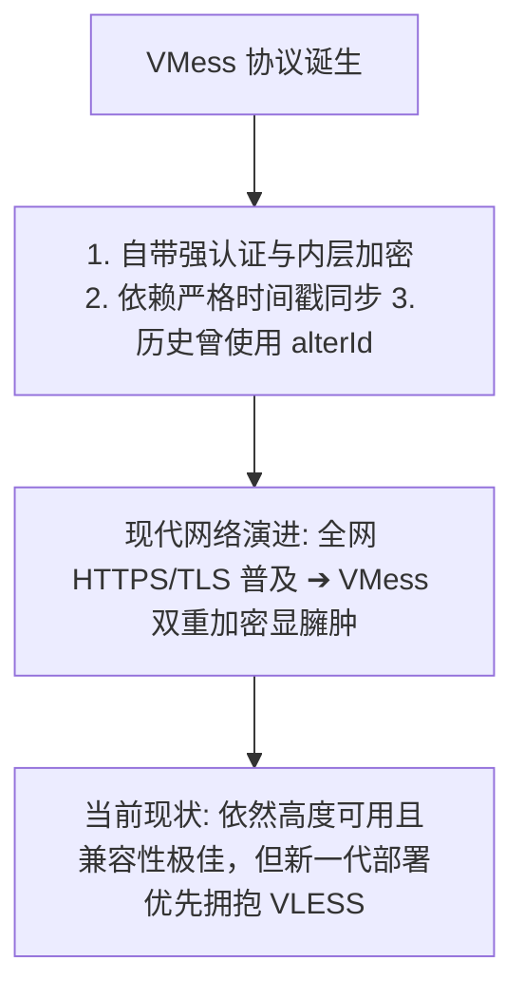
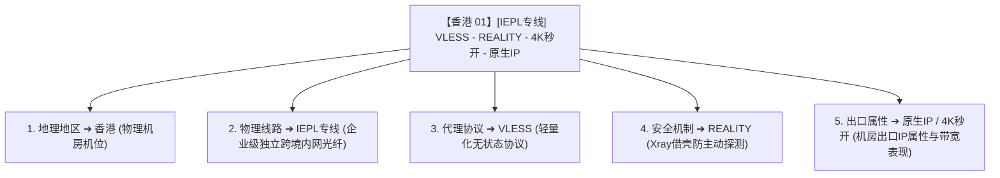
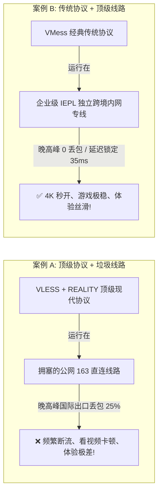

在接触科学上网、配置 v2rayN / v2rayNG / Shadowrocket / Clash 等客户端，或者在机场节点列表中挑选线路时，你一定会频繁看到各种眼花缭乱的专业术语：**“VLESS 节点”、“VMess 协议”、“VLESS-XTLS-REALITY”、“WebSocket+TLS”、“gRPC 专线”、“香港 IEPL VLESS 原生 IP”**……

面对这些交织在一起的技术名词，绝大多数新手甚至很多老玩家都会陷入巨大的认知混乱与误区：

**“VLESS 到底是什么？它是不是 VMess 的 2.0 升级版？”**  
**“VMess 协议是不是已经彻底淘汰了？现在买机场是不是必须非 VLESS 不买？”**  
**“REALITY 到底是一种全新的翻墙协议，还是某种加速技术？”**  
**“经常看到的‘VLESS + TLS’和‘VLESS + REALITY’到底有什么区别？为什么 REALITY 不需要自己买域名和申请证书？”**  
**“TLS 和 VLESS 哪个网速更快、更安全？把这两个词放在一起比较到底错在哪里？”**  
**“TCP、WebSocket（WS）、gRPC 又是什么？它们和 VLESS 属于同一个层级吗？”**  
**“为什么很多宣传声称‘VLESS 比 VMess 速度快 30%、延迟低一半’？协议名称真的能决定最终的上网速度和晚高峰稳定性吗？”**  
**“在节点列表中看到‘香港 VLESS REALITY IEPL 原生 IP’这样一长串名字，到底应该如何科学拆解它的真实属性？”**

**VLESS 与 VMess 主要属于“代理协议层”，而 TLS 与 REALITY 属于“连接安全与握手层”，它们根本不是同一层级、可以直接横向比较的“同类选项”。**

在科学上网的技术世界里，**“VLESS + TLS”** 意味着在应用层使用轻量化的 VLESS 代理协议，同时在传输链路外层包裹标准的 TLS 加密管道；而 **“VLESS + REALITY”** 则是让 VLESS 搭配 Xray 生态特有的 REALITY 消除服务端证书特征并借用目标网站的 TLS 指纹。

本文作为 **V2Ray / Xray 协议层核心概念与技术演进的深度 Pillar 指南**，将带你建立严谨的 **网络架构六层模型**，彻底厘清 **协议、传输、安全、物理线路与地理出口** 的本质边界，打破“协议神话”，掌握看懂任何节点配置的底层硬核能力。

---

## ⚡ 30 秒极速看懂：VLESS / VMess / TLS / REALITY 关系全景

```text
┌────────────────────────────────────────────────────────────────────────┐
│             VLESS / VMess / TLS / REALITY 核心层级与关系全景           │
├──────────────────┬──────────────────┬──────────────────────────────────┤
│ 模块名称         │ 所属技术层级     │ 核心定位与真实作用              │
├──────────────────┼──────────────────┼──────────────────────────────────┤
│ **VLESS**        │ 代理协议层 (L3)  │ 无状态轻量化代理协议，无冗余内层加密，性能极高  │
│ **VMess**        │ 代理协议层 (L3)  │ 经典带状态代理协议，自带内层加密与严格时间校验  │
│ **TLS**          │ 安全连接层 (L5)  │ 国际标准传输层安全协议，依赖真实域名与 CA 证书  │
│ **REALITY**      │ 安全握手机制(L5) │ 基于 TLS 的借壳伪装技术，消除自签证书与主动探测│
│ **TCP / WS / gRPC** 传输承载层 (L4) 决定数据包在底层是以原始TCP还是Websocket承载│
│ **IEPL / IPLC**  │ 物理线路层 (L6)  │ 跨境物理内网专线，决定链路丢包率与晚高峰稳定性  │
│ **香港 / 日本**  │ 地理出口层 (L6)  │ 服务器所在的物理机房位置与出口 IP 属性          │
└──────────────────┴──────────────────┴──────────────────────────────────┘
```

---

## 一、架构基石：代理网络的“六层模型”

为什么网络上大量关于“VLESS vs TLS 谁好”、“REALITY 是不是比专线更快”的讨论从一开始就是错误的？因为他们把不同维度的概念强行混在了一起。理解任何科学上网技术，必须首先对照以下 **六层架构模型**：

```mermaid
graph TD
    subgraph 1. 客户端交互层
        Client[v2rayN / v2rayNG / Shadowrocket / sing-box / Clash Verge]
    end

    subgraph 2. 底层内核引擎
        Core[Xray-core / v2ray-core / sing-box core]
    end

    subgraph 3. 代理协议层 (Proxy Protocol)
        Protocol[VLESS / VMess / Trojan / Shadowsocks]
    end

    subgraph 4. 传输承载层 (Transport)
        Transport[TCP 原始流 / WebSocket / gRPC / HTTPUpgrade]
    end

    subgraph 5. 安全与握手层 (Security)
        Security[TLS 标准加密 / REALITY 借壳伪装 / None 无加密]
    end

    subgraph 6. 物理网络与出口层 (Network & Exit)
        Network[物理线路: IEPL专线 / IPLC / BGP优化 / 公网直连] --> Exit[出口地区: 香港 / 日本 / 美国 + 原生IP]
    end

    Client --> Core --> Protocol --> Transport --> Security --> Network
```

- 💡 **分层认知法则**：
  - **问“VLESS 和 VMess 哪个好”** ➔ 是在比较 **第 3 层（代理协议）** 的指令格式与性能开销；
  - **问“TLS 和 REALITY 哪个好”** ➔ 是在比较 **第 5 层（安全与握手机制）** 的抗探测与部署方式；
  - **问“IEPL 专线和 VLESS 哪个好”** ➔ 属于跨层级的错误比较，因为 IEPL 是 **第 6 层（物理光纤）**，一条 IEPL 专线上可以跑 VLESS，也可以跑 VMess 或 Trojan。

---

## 二、VLESS 深度剖析：为什么它是现代代理协议的核心？

```mermaid
graph LR
    subgraph VMess 传统架构: 双重加密开销
        VM_In[用户数据] -->|1. VMess 自身强制加密| VM_Enc[加密密文]
        VM_Enc -->|2. 外层包裹 TLS 再次加密| VM_TLS[双重加密数据流]
        VM_TLS -->|CPU 占用高 / 吞吐受限| VM_Out[发送出海]
    end

    subgraph VLESS 现代架构: 单层精简透传
        VL_In[用户数据] -->|仅添加精简认证头 (无内层加密)| VL_Head[轻量透传帧]
        VL_Head -->|交由底层 TLS / REALITY 一次性加密| VL_TLS[标准高安全密文]
        VL_Out[发送出海 (CPU 极低开销 / 高吞吐)]
    end
```

### 1. VLESS 的本质是什么？
- **VLESS（V2Ray Less Encryption）** 是一种**无状态（Stateless）、轻量化的代理协议**，由 Xray 社区核心推动与演进；
- **设计初衷**：在传统的 VMess 时代，协议内部自带了一套强制性的数据对称加密机制；然而在现代网络环境中，所有流量外层通常都会套上一层强力且成熟的 **TLS / REALITY 加密**。这就导致数据被进行了“双重加密”，不仅白白消耗了路由器和手机的大量 CPU 算力，还降低了高并发大带宽下的吞吐性能。
- **核心革新**：VLESS **彻底去除了协议内部冗余的自带加密**，将加密与认证的重任完全交给底层的 TLS / REALITY 安全层，协议自身仅保留最精简的 UUID 认证头，从而实现了极高的转发效率与极低的 CPU 占用。

### 2. VLESS 节点的真实配置结构（禁止公开真实 UUID）
在客户端中，一个标准的 VLESS 节点并不是单一参数，而是包含多个维度的结构体：

```text
┌────────────────────────────────────────────────────────────────────────┐
│                        VLESS 节点参数解构示例                          │
├──────────────────┬─────────────────────────────────────────────────────┤
│ 配置字段名称     │ 典型取值与技术作用                                  │
├──────────────────┼─────────────────────────────────────────────────────┤
│ `Address` (地址) │ `hk.example.com` (节点服务器接入域名或公网 IP)      │
│ `Port` (端口)    │ `443` (远端服务器监听端口)                          │
│ `UUID` (用户ID)  │ `00000000-0000-0000-0000-000000000000` (用户唯一凭据)│
│ `Encryption`     │ `none` (VLESS 协议层固定为 none，不进行内层加密)    │
│ `Transport` (传输) `tcp` 或 `ws` 或 `grpc` (数据传输承载方式)          │
│ `Security` (安全)│ `tls` 或 `reality` (外层加密与伪装机制)              │
│ `SNI / Server`   │ `www.microsoft.com` (TLS 目标握手域名)              │
└──────────────────┴─────────────────────────────────────────────────────┘
```

---

## 三、VMess 深度剖析：曾经的经典与现在的定位



### 1. VMess 的技术特征与历史使命
- **VMess** 是 Project V / V2Fly 原创设计的初代核心代理协议，在 2017~2021 年间统治了整个科学上网生态；
- **严格时间同步机制**：VMess 要求客户端与服务器的系统时间误差必须在 **$\pm 90$ 秒** 以内，若电脑系统时间偏差过大，握手将直接失败；
- **历史上的 alterId**：早期 VMess 采用 alterId 机制来防范重放攻击，但在现代 AEAD 加密引入后，官方已全面废弃 alterId（建议固定设为 0）。

### 2. VLESS vs VMess 核心参数全景对比

```text
┌────────────────────────────────────────────────────────────────────────────────────────┐
│                           VLESS vs VMess 协议深度技术对比表                            │
├──────────────┬────────────────────────────────────────┬────────────────────────────────┤
│ 比较维度     │ VLESS 协议                             │ VMess 协议                     │
├──────────────┼────────────────────────────────────────┼────────────────────────────────┤
│ **协议状态** │ 无状态 (Stateless)，轻量化             │ 带状态，协议结构相对复杂       │
│ **内部加密** │ 无内部加密 (固定为 none，依赖外层安全) │ 强制内部加密 (如 aes-128-gcm)  │
│ **性能与开销**│ CPU 占用极低，高并发吞吐性能极强       │ 双重加密导致 CPU 占用相对略高  │
│ **时间同步** │ 不依赖严格系统时间同步                 │ 强制依赖客户端服务器时间 $\pm 90$ 秒│
│ **安全组合** │ 完美搭配 TLS 与 REALITY 机制           │ 常见搭配 TCP/WS + TLS          │
│ **生态主导** │ Xray 社区主导演进                      │ V2Fly / Project V 原创维护     │
│ **客户端兼容**│ 现代主流客户端全线支持                 │ 所有新老客户端 100% 完美支持   │
│ **当前定位** │ 现代节点构建的首选主流协议             │ 兼容性极强的成熟稳定协议       │
└──────────────┴────────────────────────────────────────┴────────────────────────────────┘
```

---

## 四、安全与握手层：TLS 与 REALITY 的本质区别

很多用户经常问：“我应该选 TLS 还是 REALITY？”理解这两种安全机制，是看懂现代节点配置的关键。

```mermaid
graph TD
    subgraph 传统 TLS 模式: 必须拥有自备资产
        TLS_Req[节点搭建者] -->|1. 必须购买真实域名| Domain[购买域名]
        Domain -->|2. 向 CA 机构申请合法证书| Cert[Let's Encrypt 证书]
        Cert -->|3. 部署至服务器| TLSServer[对外提供合法 TLS 443 服务]
        TLSServer -->|风险点: 域名若被标记/阻断，整套服务失效| TLSBlock[域名污染阻断]
    end

    subgraph REALITY 借壳伪装: 无需域名与自签证书
        R_Req[节点搭建者] -->|1. 无需购买域名与证书| NoCert[零资产准备]
        NoCert -->|2. 指定知名大厂真实网站作为目标 Target| DestSite[如 www.apple.com / www.microsoft.com]
        DestSite -->|3. 握手阶段动态转发真实 TLS 证书并校验公钥| RealityServer[REALITY 服务端]
        RealityServer -->|主动探测者: 收到真正大厂的合法证书 ➔ 无法定性封锁| SafeProbe[彻底免疫主动探测]
    end
```



### 1. TLS 的本质
- **TLS（Transport Layer Security）** 是整个互联网的基础安全协议（HTTPS 的底层）。
- 在代理场景下，使用 TLS 意味着你的代理服务器就像一个正规的 HTTPS 网站一样，拥有合法的域名与权威机构签发的 CA 证书，数据传输全程高强度加密。

### 2. REALITY 的技术革新（消除中间人与主动探测）
- **REALITY** 是 Xray 团队提出的一项革命性安全握手伪装技术；
- **核心优势**：
  1. **免域名与免证书**：搭建者再也不需要花钱买域名或定期维护 SSL 证书；
  2. **借壳大厂 TLS 指纹**：客户端向代理服务器发起握手时，REALITY 会把请求代理转发给知名海外大厂（如 Apple、Microsoft、Amazon 等），让审查系统的主动探测器收到与访问真实大厂完全一致的证书响应，从而**彻底消除自签证书与被动探测的特征码**。
- ⚠️ **安全红线**：REALITY 仅在服务端与目标大厂之间进行握手借壳，**绝不需要在用户电脑或手机上安装任何不受信任的根证书（CA Certificate）**！若有任何服务商要求你安装未知根证书，100% 存在中间人解密风险，必须坚决拒绝。

---

## 五、传输承载方式：TCP、WebSocket 与 gRPC

在代理协议（VLESS/VMess）和安全层（TLS/REALITY）之间，还有一个经常出现的维度——**传输方式（Transport）**：

```text
┌────────────────────────────────────────────────────────────────────────────────────────┐
│                        TCP / WebSocket / gRPC 传输方式全景对比表                       │
├──────────────┬────────────────────────┬────────────────────────┬───────────────────────┤
│ 传输方式     │ 技术特征与底层原理     │ 典型应用与优势场景     │ 性能与开销表现        │
├──────────────┼────────────────────────┼────────────────────────┼───────────────────────┤
│ **TCP 原始流**│ 最直接的底层流式传输   │ 搭配 REALITY/TLS 极速直连│ 零额外协议封装，性能最高 │
│ **WebSocket** │ 基于 HTTP 握手升级双向 │ 配合 CDN (如 Cloudflare) 拯救被墙 IP │ 具备 HTTP 封装帧，开销略大 │
│ **gRPC**     │ 基于 HTTP/2 的多路复用 │ 多路并发复用，适合复杂网络环境 │ 现代高性能微服务传输标准 │
└──────────────┴────────────────────────┴───────────────────────┴───────────────────────┘
```

---

## 六、实战解构：一串复杂的节点名称到底该怎么拆？

用户在日常订阅中最常感到困惑的就是长串的节点名字。让我们用一个最复杂的真实案例进行**五维外科手术式拆解**：

```text
节点全名示例：
【香港 01】[IEPL专线] VLESS - REALITY - 4K秒开 - 原生IP
```



- 🎯 **拆解结论**：
  - 这个节点的**速度与晚高峰稳定性**，由 **IEPL 专线（物理链路）** 决定；
  - 这个节点的**流媒体与 ChatGPT 解锁能力**，由 **原生 IP（出口属性）** 决定；
  - 这个节点的**传输效率与 CPU 占用**，由 **VLESS（代理协议）** 决定；
  - 这个节点的**抗防火墙主动探测能力**，由 **REALITY（安全层）** 决定；
  - 这个节点的**物理延迟（Ping）**，由 **香港（地理位置）** 决定。

---

## 七、协议 vs 线路：为什么“线路质量”永远比“协议名字”更重要？

很多用户迷信“只要用了 VLESS / REALITY，网速就能起飞、晚高峰就绝对不掉线”，这是极其幼稚的技术幻想：



- 🏆 **选型铁律**：**线路是公路，协议是车。** 
  如果跨境国际出口这条公路上堵得水泄不通、坑坑洼洼（公网拥塞丢包），即便你开的是最顶级的超跑（VLESS+REALITY），也只能被堵死在路上；相反，如果走的是封闭无障碍的高速公路（IEPL 专线），哪怕开的是老款轿车（VMess），依然能够全速畅行无阻。

---

## 八、全平台客户端与协议兼容性速查矩阵

不同客户端对 VLESS、VMess、TLS 与 REALITY 的支持情况各不相同（截至 2026 年最新版本核验）：

```text
┌────────────────────────────────────────────────────────────────────────────────────────┐
│                   主流客户端协议与安全特性兼容速查表 (2026 最新版)                     │
├────────────────────┬──────────┬──────────┬──────────┬──────────┬───────────────────────┤
│ 客户端名称         │ 适配系统 │ VLESS    │ VMess    │ TLS      │ REALITY               │
├────────────────────┼──────────┼──────────┼──────────┼──────────┼───────────────────────┤
│ **v2rayN**         │ Windows  │ ✅ 完美  │ ✅ 完美  │ ✅ 完美  │ ✅ 完美 (内置 Xray-core)│
│ **v2rayNG**        │ Android  │ ✅ 完美  │ ✅ 完美  │ ✅ 完美  │ ✅ 完美 (内置 Xray-core)│
│ **Shadowrocket**   │ iOS      │ ✅ 完美  │ ✅ 完美  │ ✅ 完美  │ ✅ 完美 (新版本原生支持)│
│ **Clash Verge Rev**│ Win/Mac  │ ✅ 支持  │ ✅ 完美  │ ✅ 完美  │ ✅ 支持 (基于 Mihomo 内核)│
│ **sing-box**       │ 全平台   │ ✅ 完美  │ ✅ 完美  │ ✅ 完美  │ ✅ 完美 (原生生态支持) │
└────────────────────┴──────────┴──────────┴──────────┴──────────┴───────────────────────┘
```

---

## 九、2026 全协议全兼容企业级物理专线推荐

无论你偏好轻量高效的 VLESS-REALITY，还是需要极高兼容性的 VMess 传统配置，选择具备 **全协议一键下发、全线 IEPL 物理专线** 的大厂服务商至关重要：

```text
┌────────────────────────────────────────────────────────────────────────────────────────┐
│                        2026 全协议兼容与抗拥塞高速专线推荐                             │
├──────────┬──────────────────────────┬──────────────┬──────────────┬────────────────────┤
│ 适配场景 │ 推荐品牌候选             │ 实际起付门槛 │ 每月流量配额 │ 协议与线路架构优势 │
├──────────┼──────────────────────────┼──────────────┼──────────────┼────────────────────┤
│ 旗舰全能 │ 光速云 (GuangSuYun)      │ 约 ¥7.5/月起 │ 59G~238G /月 │ 全线 IEPL 专线，完美适配 VLESS/VMess，晚高峰 0 丢包│
│ 平价轻量 │ 微风网络 (BreezeNet)     │ 约 ¥7/月起   │ 50GB / 月    │ 优质 BGP 优化，轻量极速，适合日常办公与查资料      │
│ 弹性月付 │ 唯兔云 (V2Yun)           │ ¥14.9/月     │ 100GB / 月   │ 14.9 元纯单月付，多地区原生 IP 出口，节点丰富      │
│ 应急备用 │ 星岛梦 (XingDaoMeng)     │ 约 ¥8/月起   │ 60G/不限时包 │ 0月租不限时包，节点永不过期，多协议联调备用首选    │
│ 极速专精 │ 速界 (SpeedWorld)        │ ¥25/月       │ 150GB / 月   │ 企业级大带宽独立专线，流媒体与 AI 4K 秒开零缓冲    │
└──────────┴──────────────────────────┴──────────────┴──────────────┴────────────────────┘
```

- 🏆 **全协议旗舰专线首选**：[光速云](/reviews/guangsu-cloud/) —— 2020 老牌专线，全协议覆盖，晚高峰物理级 0 丢包；
- 🍃 **超低预算轻量**：[微风网络](/reviews/weifeng-cloud/) —— 50GB 精品小流量专线，年付折算仅约 ¥7/月；
- 💳 **拒绝绑定的单月付**：[唯兔云](/recommend/best-airports/) —— ¥14.9 纯单月付，100GB 充沛流量。

---

## 十、避坑指南：40 个关于“代理协议”的致命认知误区

```text
❌ 误区 1：VLESS 是一个可以直接下载安装的电脑客户端软件 ➔ 事实：VLESS 是代理协议，运行它的客户端是 v2rayN/v2rayNG 等。
❌ 误区 2：VLESS 是某家机场的名字 ➔ 事实：VLESS 是协议标准，任何支持该协议的机场都可以提供 VLESS 节点。
❌ 误区 3：VLESS 是 VMess 的 2.0 升级版 ➔ 事实：VLESS 采用了全新的无状态架构，去除了内层冗余加密，两者底层设计截然不同。
❌ 误区 4：VMess 协议在 2026 年已经被彻底淘汰不能用了 ➔ 事实：VMess 依然成熟稳定，拥有全网最顶级的客户端兼容性。
❌ 误区 5：只要节点名字带有 VLESS，网速就一定比 VMess 快 30% ➔ 事实：实际网速取决于物理线路带宽和拥塞程度，协议开销影响微乎其微。
❌ 误区 6：VLESS 协议天生自带比 VMess 更好的防封锁能力 ➔ 事实：抗封锁能力取决于外层的 TLS/REALITY 伪装，而非 VLESS 协议自身。
❌ 误区 7：TLS 是一种新型的翻墙代理协议 ➔ 事实：TLS 是国际标准的通用传输层加密协议（HTTPS 的底层安全协议）。
❌ 误区 8：REALITY 是一种独立的代理协议 ➔ 事实：REALITY 是 Xray 社区开发的安全握手伪装机制，通常与 VLESS 组合使用。
❌ 误区 9：REALITY 就是 TLS，两者没有任何区别 ➔ 事实：REALITY 借用了目标网站的真实 TLS 证书与指纹，无需自己购买域名申请证书。
❌ 误区 10：REALITY 一定比传统的 TLS 网速更快、延迟更低 ➔ 事实：两者在传输性能上基本一致，REALITY 的核心优势在免证书和防主动探测。
❌ 误区 11：只要节点用了 REALITY，它就等同于一条高速企业专线 ➔ 事实：REALITY 只管安全握手，物理线路走公网依然会晚高峰卡顿。
❌ 误区 12：TCP 和 WebSocket 是与 VLESS 同一层的代理协议 ➔ 事实：TCP 和 WS 属于传输承载方式（Transport），负责承载 VLESS 数据流。
❌ 误区 13：IEPL 和 IPLC 是由 V2Ray 团队开发的代理协议 ➔ 事实：IEPL/IPLC 是跨境物理内网光纤线路，与代理软件协议完全无关。
❌ 误区 14：香港节点意味着该节点使用的是香港本地专属协议 ➔ 事实：香港描述的是机房地理位置，协议依然是通用的 VLESS 或 VMess。
❌ 误区 15：VLESS 协议能够自动让节点的出口 IP 变成美国家庭住宅 IP ➔ 事实：出口 IP 属性由机房服务器的 ISP 决定，协议无法改变 IP 归属。
❌ 误区 16：使用 VLESS 协议的节点一定能够 100% 解锁 ChatGPT 和 Claude ➔ 事实：AI 平台只检测出口 IP 纯净度与欺诈分，与代理协议无关。
❌ 误区 17：使用 VLESS 协议的节点一定能够解锁 Netflix 奈飞非自制剧 ➔ 事实：流媒体解锁取决于机房 IP 是否被 Netflix 标记为数据中心 IP。
❌ 误区 18：换用 VLESS 协议可以把 200ms 的公网延迟降低到 30ms ➔ 事实：物理延迟由光纤传播距离决定，任何协议都无法超越物理光速。
❌ 误区 19：直接把客户端里的 VMess 节点手动改为 VLESS 就能正常上网 ➔ 事实：服务端与客户端协议必须严格一致，单方面修改会导致握手失败。
❌ 误区 20：Xray 就是 V2Ray 换了个英文名字而已 ➔ 事实：Xray 是从 V2Ray 分支独立演进的顶级开源项目，首创了 VLESS 与 REALITY。
❌ 误区 21：v2rayN 客户端只能使用 V2Ray 内核，不能使用 Xray 内核 ➔ 事实：v2rayN 完美集成了 Xray-core，支持全部现代 VLESS/REALITY 特性。
❌ 误区 22：节点的 UUID 串只是一串无害的数字，可以公开在网络上 ➔ 事实：UUID 是你的用户唯一认证凭据，泄露会被他人盗用流量。
❌ 误区 23：单节点分享链接（vless://）就等同于机场的订阅链接 ➔ 事实：vless:// 只是单个节点配置，订阅链接是可以拉取几十个节点的 URL。
❌ 误区 24：开源客户端里跑的节点就一定是绝对安全可信的 ➔ 事实：客户端开源只保证本地代码无后门，节点流量安全取决于节点运营方。
❌ 误区 25：为了让 REALITY 节点更稳定，必须在系统里安装未知的根证书 ➔ 事实：REALITY 绝不需要安装根证书，要求安装证书的可能存在监听风险。
❌ 误区 26：开启客户端的“跳过证书验证”（AllowInsecure）非常安全 ➔ 事实：跳过验证会导致容易遭遇中间人攻击，切勿长期开启。
❌ 误区 27：只要买了支持 VLESS 的机场，在任何网络下都绝对不会掉线 ➔ 事实：本地 Wi-Fi 瞬断或运营商骨干网波动依然会引发连接重置。
❌ 误区 28：gRPC 传输方式在任何情况下网速都比原始 TCP 传输更快 ➔ 事实：gRPC 在多路复用上有优势，但在单连接大文件传输下与 TCP 差异不大。
❌ 误区 29：WebSocket（WS）传输方式是专为打游戏设计的超低延迟协议 ➔ 事实：WS 传输开销较大，且受 TCP 队头阻塞影响，并不适合实时竞技游戏。
❌ 误区 30：只要协议名字越长（如 VLESS-XTLS-uTLS-REALITY），节点就越好 ➔ 事实：名字只是特性的堆叠，最关键的永远是物理线路丢包率。
❌ 误区 31：iPhone 上的 Shadowrocket 小火箭永远无法支持 VLESS 协议 ➔ 事实：Shadowrocket 早已全面支持 VLESS、gRPC 及 REALITY 节点。
❌ 误区 32：Android 上的 v2rayNG 只能运行 VMess 协议 ➔ 事实：v2rayNG 内置 Xray-core，是安卓端支持 VLESS-REALITY 最成熟的客户端之一。
❌ 误区 33：Clash 客户端永远无法导入和使用 VLESS 节点 ➔ 事实：现代 Clash Verge Rev（基于 Mihomo 内核）已全面原生支持 VLESS。
❌ 误区 34：修改节点配置里的 SNI 域名可以提升 100M 带宽 ➔ 事实：SNI 仅在 TLS 握手阶段用于域名寻址与伪装，与传输带宽毫无关系。
❌ 误区 35：VMess 节点的 alterId 设置得越大就越安全、速度越快 ➔ 事实：现代 VMess 统一使用 AEAD，alterId 必须固定设置为 0。
❌ 误区 36：电脑系统时间偏差 5 分钟不影响 VMess 节点连接 ➔ 事实：VMess 强制校验时间误差在 90 秒内，时间不准会导致握手直接失败。
❌ 误区 37：VLESS 节点连接失败一定是协议本身出了重大漏洞 ➔ 事实：99% 是由于服务端端口被封、节点超时或客户端参数配置错误。
❌ 误区 38：所有的专线机场都只提供 VMess 协议节点 ➔ 事实：现代顶级专线机场（如光速云）已全线升级并同时提供 VLESS 与 SS 节点。
❌ 误区 39：只要使用了 TLS 加密，目标网站就绝对不知道我的真实 IP ➔ 事实：目标网站看到的是代理服务器的出口 IP，而非你的本地 IP。
❌ 误区 40：只要掌握了最先进的协议，买 1 元钱的垃圾机场也能拥有专线体验 ➔ 事实：垃圾机场超售严重且走普通公网，任何协议都救不了垃圾线路。
```

---

## 十、常见问题深度解答（FAQ · 50 问）

### Q1：VLESS 是什么？
**答**：VLESS 是一种无状态、轻量化的现代代理协议，由 Xray 社区主导开发。它彻底去除了协议内冗余的自带加密，依靠外层的 TLS/REALITY 进行安全防护，具有 CPU 占用极低、并发吞吐性能极高的特点。

### Q2：VLESS 是新版的 VMess 吗？
**答**：**不是。** 两者虽然同属于代理协议层，但底层架构完全不同。VMess 自带状态和内部对称加密，而 VLESS 采用无状态透传设计，是完全重构的新协议。

### Q3：VMess 是什么？
**答**：VMess 是由 Project V / V2Ray 团队原创设计的经典代理协议，具备完善的用户认证与自带内部加密机制，依赖严格的系统时间同步（误差 $\pm 90$ 秒内）。

### Q4：VLESS 和 VMess 到底有什么区别？
**答**：核心区别在于**加密与状态管理**：VMess 强制进行内部加密且需要时间校验；VLESS 去除内层加密，设计极其精简，依赖底层的 TLS/REALITY，开销更低。

### Q5：VLESS 一定比 VMess 网速更快吗？
**答**：**不一定。** 在相同的企业专线和低负载服务器下，VLESS 的 CPU 开销更低，极限吞吐略高；但如果网络物理链路本身丢包拥塞，协议差异无法改变网速。

### Q6：VMess 协议已经彻底被淘汰了吗？
**答**：**没有。** VMess 依然是目前全球兼容性最广泛的协议之一，老旧路由器固件、各类老版本客户端仍将其作为主力协议支持。

### Q7：TLS 是什么？
**答**：TLS（传输层安全协议）是互联网标准的通信加密规范（HTTPS 的核心）。它利用域名和合法 CA 证书，在通信双方之间建立绝对安全的加密管道。

### Q8：TLS 是代理协议吗？
**答**：**绝对不是。** TLS 是安全传输规范，VLESS 和 VMess 才是代理协议。TLS 负责给代理协议提供安全加密外壳。

### Q9：什么是“VLESS + TLS”？
**答**：表示在应用层使用 VLESS 代理协议，同时在底层传输时包裹标准的 TLS 加密外壳，服务器端需要配置合法的域名与 SSL 证书。

### Q10：REALITY 是什么？
**答**：REALITY 是 Xray 团队开发的一项革命性安全握手伪装机制。它通过借用知名大厂（如微软、苹果）的真实 TLS 证书与指纹，实现免买域名、免配证书且彻底免疫主动探测。

### Q11：REALITY 是代理协议吗？
**答**：**不是。** REALITY 属于安全与握手层（相当于 TLS 的替代伪装方案），通常与 VLESS 代理协议组合使用（即 VLESS-REALITY）。

### Q12：VLESS + REALITY 是什么意思？
**答**：表示代理协议使用 VLESS，底层安全握手使用 REALITY 借壳伪装技术，是目前抗防火墙主动探测最强、部署最轻量的组合之一。

### Q13：REALITY 和 TLS 哪个更好？
**答**：REALITY 解决了服务端需要购买域名和维护证书的痛点，并消除了证书特征码；传统 TLS 则是最符合正规 HTTPS 规范的经典方案，两者性能相当。

### Q14：REALITY 需要在电脑或手机上安装根证书吗？
**答**：**坚决不需要！** REALITY 仅在服务端借用大厂握手，客户端无需安装任何 CA 证书。任何要求你安装根证书的服务商都存在安全隐患。

### Q15：TCP、WebSocket 与 VLESS 有什么关系？
**答**：TCP 和 WebSocket（WS）是传输承载方式（Transport）。VLESS 协议的数据包可以通过原始 TCP 流传输，也可以伪装成 WebSocket 流量传输。

### Q16：什么是“VLESS + WS + TLS”？
**答**：表示代理协议使用 VLESS，数据被封装在 WebSocket 帧中，外层再包裹标准 TLS 加密，常用于配合 CDN（如 Cloudflare）救砖中转。

### Q17：IEPL 专线和 VLESS 有什么关系？
**答**：IEPL 是跨境物理内网光纤（线路层），VLESS 是数据传输的语言（协议层）。“VLESS IEPL 节点”指的是在 IEPL 物理专线上运行 VLESS 协议。

### Q18：协议名称能决定节点的延迟（Ping）吗？
**答**：**不能。** 延迟由物理光纤的地理传输距离和路由器转发跳数决定，协议名称对物理延迟没有任何改变作用。

### Q19：VLESS 节点能自动解锁 ChatGPT 吗？
**答**：**不能。** ChatGPT 和 Claude 检测的是节点服务器出口 IP 的纯净度与机房属性，与客户端使用的代理协议无关。

### Q20：新手在 VLESS 和 VMess 之间应该怎么选？
**答**：**优先选用机场服务商默认下发并推荐的配置。** 只要客户端支持，现代节点优先选 VLESS-REALITY，老旧设备或特殊客户端选 VMess。

---

## 🏁 总结：代理网络认知金字塔

理解一切代理技术与节点选型，请牢记以下**核心铁律**：

```text
1. 严分层 ➔ VLESS/VMess 是协议，TLS/REALITY 是安全外壳，TCP/WS 是载具，IEPL 是物理公路
2. 懂 VLESS ➔ 去除内层冗余加密，极速轻量透传，搭配 TLS/REALITY 成为现代主流标杆
3. 识 REALITY ➔ 借壳大厂证书消除特征与免配域名，但绝不需要在本地安装任何危险根证书
4. 重线路 ➔ 物理线路（IEPL 专线）决定晚高峰稳定性，出口 IP 决定流媒体与 AI 解锁能力
5. 破迷信 ➔ 拒绝“协议决定网速”的伪科学，根据客户端兼容性与专线质量理性选型
```

---

### 📚 延伸进阶阅读与选型专栏
- 🌐 **V2Ray 生态超级 Pillar**：[《V2Ray是什么？V2Ray客户端、节点、订阅、VLESS/VMess与新手完整教程》](/tutorials/v2ray-tizi/)
- 💻 **Windows 客户端主教程**：[《v2rayN怎么用？Windows下载安装、订阅、节点、系统代理与TUN完整教程》](/tutorials/v2rayn-windows/)
- 🛣️ **线路深度科普**：[《IEPL、IPLC与中转直连有什么区别？跨境专线深度解析》](/protocols/iepl-vs-iplc-transit/)
- 🚀 **现代协议横评**：[《VLESS、Trojan与Hysteria 2全景对比：谁是2026综合性能之王？》](/protocols/vless-trojan-hysteria2/)
- 🚪 **v2rayN 端口冲突排查**：[《v2rayN端口冲突怎么办？本地监听、Core启动失败、Address already in use与Windows端口占用完整排查》](/issues/v2rayn-port-conflict/)
- 🚨 **v2rayN 打不开排查**：[《v2rayN打不开怎么办？Windows启动失败、Core错误、配置损坏与运行环境完整排查》](/issues/v2rayn-startup-error/)
- ⚡ **老牌旗舰专线**：[《光速云深度评测：2020老牌IEPL专线与解锁实测》](/reviews/guangsu-cloud/)
- 🍃 **平价轻量专线**：[《微风网络深度评测：小流量套餐值不值得买？》](/reviews/weifeng-cloud/)
- 🏆 **2026 全景大榜**：[《2026梯子推荐：稳定、速度、价格、安全与不同使用场景怎么选》](/recommend/best-tizi/)
