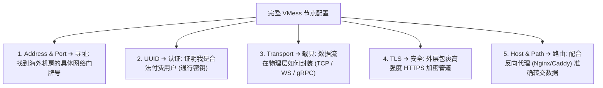
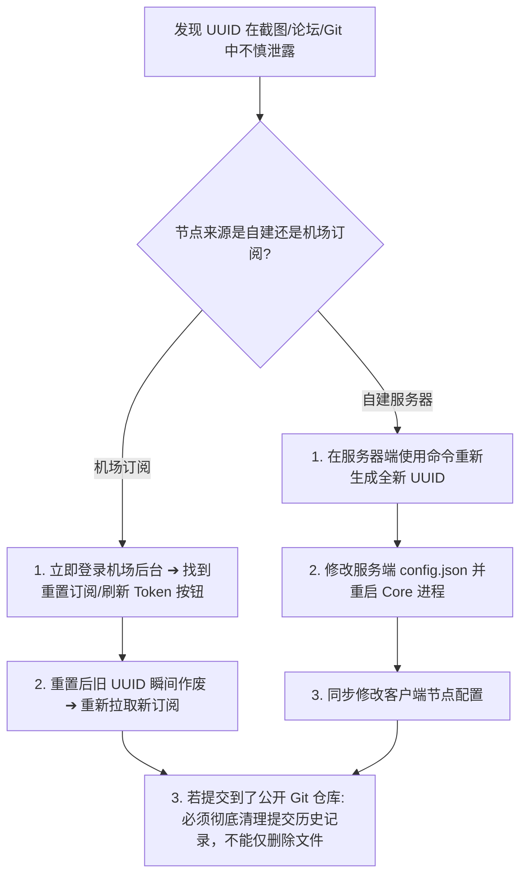
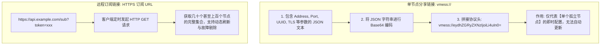
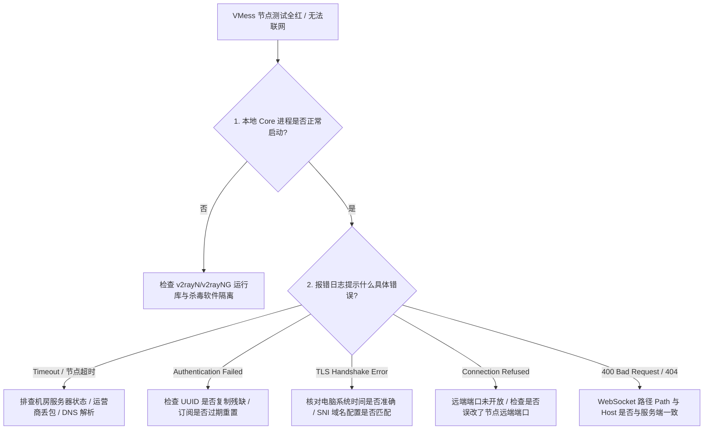

在科学上网和代理工具的生态中，**“VMess”** 是一座绕不过去的重要里程碑。无论是在 v2rayN、v2rayNG、Shadowrocket 还是各类 Clash 客户端中，**“VMess 协议”** 始终是出现频次极高的核心选项。

然而，对于绝大多数刚刚接触代理网络的用户而言，VMess 往往伴随着一系列令人费解的技术概念与配置参数：

**“VMess 到底是什么？它和 V2Ray 是同一种东西吗？”**  
**“VMess 节点配置里的 `UUID` 到底是什么？它是不是就是我的登录密码？泄露出去会有什么严重后果？”**  
**“为什么在配置 VMess 节点时，经常看到 `WebSocket + TLS` 或者 `gRPC`？这些传输方式和 VMess 本身是什么关系？”**  
**“配置里填写的‘远端端口（443/8443）’和软件里的‘本地监听端口（10808）’到底有什么区别？为什么本地端口冲突时绝不能去改远端端口？”**  
**“现在全网都在宣传 VLESS，VMess 协议是不是已经彻底过时淘汰、完全不能用了？”**  
**“VMess 和 VLESS 相比，网速真的慢很多吗？延迟真的更高吗？”**  
**“以 `vmess://` 开头的分享链接，和机场提供的‘订阅 URL’到底是不是一回事？”**  
**“为什么导入了 VMess 节点显示成功，但测速时却全红报 Timeout 或 TLS Handshake Error？”**

**VMess 是一种与 V2Ray 生态历史关系极其紧密的代理协议，它既不是 v2rayN 这类客户端软件，也不是机场服务本身。**

一个完整的 **VMess 节点** 并不是单一的参数，而是一组包含 **服务器地址、远端端口、UUID 认证凭据、传输方式（Transport）与 TLS 安全配置** 的完整连接结构体。

本文作为 **VMess 协议与节点配置的深度核心指南**，将带你建立严谨的 **VMess 节点六层解耦模型**，彻底讲透 **协议原理、UUID 凭据安全、TLS/WS 承载方式、与 VLESS 的本质差异、以及排障决策树**，让你真正具备看懂任何节点配置的底层硬核能力。

---

## ⚡ 30 秒极速看懂：VMess 节点核心关系全景

```text
┌────────────────────────────────────────────────────────────────────────┐
│                   VMess 节点六维核心属性与定位全景                     │
├──────────────────┬──────────────────┬──────────────────────────────────┤
│ 配置模块         │ 所属技术层级     │ 核心定位与真实作用              │
├──────────────────┼──────────────────┼──────────────────────────────────┤
│ **VMess**        │ 代理协议层 (L3)  │ 客户端与服务端通信的指令规范与自带加密协议│
│ **UUID**         │ 身份认证凭据 (L3)│ 类似于专属通信密钥，用于服务端识别并认证用户│
│ **服务器地址/端口** 远端网络入口 (L6)  │ 海外节点服务器的公网 IP/域名及监听端口  │
│ **TCP / WS / gRPC** 传输承载层 (L4) 决定数据包在底层是以原始TCP还是Websocket承载│
│ **TLS**          │ 连接安全层 (L5)  │ 外层标准传输层加密，提供证书验证与连接防窃听│
│ **v2rayN/v2rayNG** 客户端/GUI (L1)   │ 图形界面外壳，负责调度底层 Core 建立代理连接│
└──────────────────┴──────────────────┴──────────────────────────────────┘
```

---

## 一、架构基石：VMess 节点的“六层解耦模型”

为什么很多新手在遇到连接故障时无从下手？因为他们把节点名称、加密方式、传输载具和物理线路全都混为一谈。理解任何 VMess 节点，必须首先对照以下 **六层解耦模型**：

```mermaid
graph TD
    subgraph 1. 客户端交互层 (GUI)
        Client[v2rayN / v2rayNG / Shadowrocket / Clash Verge]
    end

    subgraph 2. 底层代理内核 (Core)
        Core[v2ray-core / Xray-core / sing-box core]
    end

    subgraph 3. 代理协议层 (Protocol & Auth)
        Protocol[VMess 协议: 包含 UUID 认证凭据与 AEAD 加密]
    end

    subgraph 4. 传输承载层 (Transport)
        Transport[TCP 原始流 / WebSocket / gRPC / HTTP/2]
    end

    subgraph 5. 安全与加密层 (Security)
        Security[TLS 标准加密 / None 无外层加密]
    end

    subgraph 6. 物理网络与远端入口 (Network & Server)
        Network[服务器公网 IP / 域名 + 远端监听端口 + 跨境物理专线]
    end

    Client --> Core --> Protocol --> Transport --> Security --> Network
```

- 💡 **分层认知法则**：
  - **VMess 不是客户端**：v2rayN 和 v2rayNG 是外壳，VMess 是底层数据流遵循的语言规范；
  - **VMess 不是整个节点**：一个节点是由“协议（VMess）+ 认证（UUID）+ 传输（WS）+ 安全（TLS）+ 物理入口（IP/端口）”组合而成的完整配置集合；
  - **VMess 也不是机场**：机场是售卖海外服务器节点的商家，它可能同时提供 VMess、VLESS、Trojan 或 Shadowsocks 多种协议节点。

---

## 二、VMess 节点的结构解密：各个字段到底负责什么？

在客户端中手动查看或编辑一个 VMess 节点时，你会看到一系列参数。以下是标准的 VMess 节点结构解剖：

```text
┌────────────────────────────────────────────────────────────────────────────────────────┐
│                           VMess 节点核心参数结构解剖表                                 │
├──────────────┬────────────────────────┬──────────┬─────────────────────────────────────┤
│ 字段名称     │ 典型配置示例           │ 敏感程度 │ 填写错误后的典型故障表现            │
├──────────────┼────────────────────────┼──────────┼─────────────────────────────────────┤
│ **Address**  │ `hk01.example.com`     │ 中 (公开) │ 报错 DNS 无法解析或 Connection Timeout │
│ **Port**     │ `443` 或 `8443`        │ 低 (标准) │ 报错 Connection Refused (连接被拒绝) │
│ **UUID**     │ `00000000-0000-0000...`│ 极高(机密)│ 报错 Authentication Failed (认证失败) │
│ **AlterId**  │ `0` (现代标准固定为 0) │ 低       │ 现代 AEAD 机制下若填非 0 可能引发不兼容│
│ **Transport**│ `ws` (WebSocket) / `tcp`│ 中      │ 握手协议不匹配，连接瞬间中断或报 400 Bad│
│ **Security** │ `tls` 或 `none`        │ 中       │ 报错 TLS Handshake Error 或证书不匹配  │
│ **Host/SNI** │ `cdn.example.com`      │ 中       │ 伪装域名不符导致 Web 服务器直接拦截    │
│ **Path**     │ `/v2ray-path` (仅 WS)  │ 中       │ HTTP 路径不匹配，反向代理返回 404 Not Found│
└──────────────┴────────────────────────┴──────────┴─────────────────────────────────────┘
```



### 关键细节澄清：本地端口 vs 远端端口
- **远端端口（Remote Port，如 443/8443）**：是海外节点服务器上代理程序对外开放的监听端口；
- **本地端口（Local Inbound Port，如 10808）**：是电脑本地 `v2rayN` 开放给本机浏览器接入的代理入口；
- ⚠️ **高危误区**：当 Windows 提示“本地端口 10808 被占用”时，应当在客户端设置里修改本地 Inbound 端口，**绝对不能去改节点配置里的远端端口 443**，否则 Core 将无法连上远端服务器。

---

## 三、UUID 深度安全指南：通信凭据、泄露风险与补救

### 1. UUID 是什么？它长什么样？
- **UUID（Universally Unique Identifier）** 是一串由 32 位十六进制字符（用 4 个破折号分为 5 段）组成的全局唯一标识符；
- **标准格式示例**（*无效演示*）：`00000000-0000-0000-0000-000000000000`；
- 在 VMess 协议中，UUID 扮演着 **用户身份认证密钥** 的角色。服务器内部维护了一份合法的 UUID 白名单，只有携带匹配 UUID 的请求才会被允许代理出海。

### 2. UUID 是不是登录密码？能不能公开？
- ❌ **认知误区**：“UUID 看起来只是一串随机机器码，不是我的账号密码，截图发在网上求助没事吧？”
- 🚨 **安全铁律**：**UUID 等同于你在该节点上的专属访问凭据！**
  如果你的 UUID 暴露在公开论坛、社交平台或开源 GitHub 仓库中，任何拿到该 UUID 和节点 IP 的人都可以直接配置并使用你的流量配额，甚至导致你的节点被服务商封禁。

### 3. UUID 泄露后的标准处置流程



---

## 四、传输与安全组合：VMess 与 TCP、WebSocket、TLS

在现代 VMess 节点中，协议本身很少“裸奔”，通常会与传输层（Transport）和安全层（TLS）协同工作：

```mermaid
graph LR
    subgraph 组合 A: VMess + TCP (裸直连)
        A_Data[数据] --> A_VMess[VMess 内层加密] --> A_TCP[原始 TCP 流出海 (无 TLS 外壳)]
    end

    subgraph 组合 B: VMess + WS + TLS (经典伪装)
        B_Data[数据] --> B_VMess[VMess 加密] --> B_WS[封装为 WebSocket 协议] --> B_TLS[包裹标准 TLS 443 加密]
        B_TLS --> B_Out[表现为合法 HTTPS 流量出海 (可配合 CDN 救砖)]
    end
```

### 1. VMess + WebSocket + TLS（WS+TLS）为什么曾风靡全网？
- **抗审查与抗封锁**：外部监测系统只能看到你向服务器发起了一个完全合法的标准 HTTPS 握手，随后建立了一个 WebSocket 双向连接，无法探测到内部传输的代理数据；
- **CDN 救砖中转能力**：即使海外服务器的真实 IP 遭遇网络阻断，WS+TLS 流量可以经由 Cloudflare 等国际 CDN 进行反向代理转发，从而“拯救”被封锁的服务器。

### 2. Host 与 SNI 的本质区别（严禁混淆）
- **SNI（Server Name Indication）**：属于 **TLS 连接层** 的参数，在 TLS 握手阶段告诉服务器你正在请求哪个证书域名；
- **Host**：属于 **HTTP/WebSocket 应用层** 的请求头字段，告诉反向代理服务器（如 Nginx/Caddy）将请求分发给哪一个本地网站目录。

---

## 五、核心对比：VMess vs VLESS 深度技术对决

```text
┌────────────────────────────────────────────────────────────────────────────────────────┐
│                           VMess vs VLESS 协议全维度技术对比表                          │
├──────────────┬────────────────────────────────────────┬────────────────────────────────┤
│ 比较维度     │ VMess 协议                             │ VLESS 协议                     │
├──────────────┼────────────────────────────────────────┼────────────────────────────────┤
│ **设计理念** │ 经典带状态协议，自带内部对称加密       │ 现代无状态协议，彻底去除内层冗余加密   │
│ **内部加密** │ 强制启用 AEAD 加密 (如 aes-128-gcm)    │ 固定为 none (完全依赖底层 TLS/REALITY) │
│ **系统时间依赖** 强制要求客户端与服务端误差在 $\pm 90$ 秒内 │ 对系统时间偏差不敏感           │
│ **性能与开销**│ 双重加密导致低功耗设备 CPU 占用相对略高│ CPU 占用极低，高并发吞吐性能极强       │
│ **安全伪装组合** 完美支持 TCP/WS + TLS                 │ 完美支持 TLS 与最新的 REALITY 借壳伪装 │
│ **客户端兼容性** 全球所有新老客户端 100% 完美支持       │ 绝大多数现代客户端支持 (极老客户端除外)│
│ **生态主导** │ Project V / V2Fly 原创主导             │ Xray 社区核心推动与演进        │
│ **当前定位** │ 兼容性极高的基石协议                   │ 现代节点构建与抗探测首选主流协议       │
└──────────────┴────────────────────────────────────────┴────────────────────────────────┘
```

- 🏆 **选型真相**：
  - **VMess 绝没有被彻底淘汰**：它拥有整个生态中最强大、最成熟的软硬件兼容性；
  - **VLESS 并不是 VMess 的“升级版”**：两者是完全不同设计哲学的两个独立协议。只要当前使用的 VMess 节点稳定丝滑、延迟正常，完全无需因为“协议更新”而盲目焦虑。

---

## 六、分享链接 vs 订阅链接：`vmess://` 的底层真相



- 💡 **关键区别总结**：
  - **`vmess://` 只是单个节点的即时快照**：一旦服务器更换了 IP 或端口，该链接直接永久失效；
  - **订阅 URL 是一个动态下发通道**：机场通过订阅地址下发最新的节点矩阵，支持一键批量更新。

---

## 七、实战指南：VMess 节点连接失败排错决策树

当导入 VMess 节点后测试报错或无法上网，请严格按照以下层级进行逐级诊断：



---

## 八、2026 全协议兼容与抗拥塞高速专线推荐

无论是使用成熟稳定的 VMess 协议，还是追求轻量极速的 VLESS 节点，搭配一条具备 **全线 IEPL 企业级物理内网专线** 的高速链路都是稳定出海的根本基石：

```text
┌────────────────────────────────────────────────────────────────────────────────────────┐
│                        2026 全协议兼容与抗拥塞高速专线推荐                             │
├──────────┬──────────────────────────┬──────────────┬──────────────┬────────────────────┤
│ 适配场景 │ 推荐品牌候选             │ 实际起付门槛 │ 每月流量配额 │ 协议与节点兼容优势 │
├──────────┼──────────────────────────┼──────────────┼──────────────┼────────────────────┤
│ 旗舰全能 │ 光速云 (GuangSuYun)      │ 约 ¥7.5/月起 │ 59G~238G /月 │ 全线 IEPL 专线，完整支持 VMess/VLESS，晚高峰 0 丢包│
│ 平价轻量 │ 微风网络 (BreezeNet)     │ 约 ¥7/月起   │ 50GB / 月    │ 优质 BGP 优化，轻量极速，适合日常查资料与轻度办公  │
│ 弹性月付 │ 唯兔云 (V2Yun)           │ ¥14.9/月     │ 100GB / 月   │ 14.9 元纯单月付，多地区原生 IP 出口，节点丰富      │
│ 应急备用 │ 星岛梦 (XingDaoMeng)     │ 约 ¥8/月起   │ 60G/不限时包 │ 0月租不限时包，节点永不过期，多协议联调备用首选    │
│ 极速专精 │ 速界 (SpeedWorld)        │ ¥25/月       │ 150GB / 月   │ 企业级大带宽独立专线，流媒体与 AI 4K 秒开零缓冲    │
└──────────┴──────────────────────────┴──────────────┴──────────────┴────────────────────┘
```

- 🏆 **全协议旗舰专线首选**：[光速云](/reviews/guangsu-cloud/) —— 2020 老牌专线，全协议全内核自适应，晚高峰物理级 0 丢包；
- 🍃 **超低预算轻量**：[微风网络](/reviews/weifeng-cloud/) —— 50GB 精品小流量专线，年付折算仅约 ¥7/月；
- 💳 **拒绝绑定的单月付**：[唯兔云](/recommend/best-airports/) —— ¥14.9 纯单月付，100GB 充沛流量。

---

## 九、避坑指南：45 个关于“VMess 协议”的致命认知误区

```text
❌ 误区 1：VMess 就是指 Windows 上的那个 v2rayN 软件 ➔ 事实：v2rayN 是图形客户端，VMess 是底层通信协议。
❌ 误区 2：VMess 是一种翻墙 VPN 软件 ➔ 事实：VMess 是应用层代理协议，与传统的网络层 VPN 架构完全不同。
❌ 误区 3：VMess 就是整个节点本身 ➔ 事实：VMess 只是节点配置中的协议字段，节点还包含 IP、端口、UUID 和 TLS 等。
❌ 误区 4：VMess 是一家机场的名字 ➔ 事实：VMess 是开源协议，任何机场都可以提供基于 VMess 协议的节点。
❌ 误区 5：VMess 协议已经在 2026 年被彻底淘汰 ➔ 事实：VMess 依然是目前全球兼容性最强、最成熟的代理协议之一。
❌ 误区 6：只要节点名字带有 VMess，网速就一定会比 VLESS 慢 ➔ 事实：网速由物理线路带宽决定，协议本身的计算开销差异微乎其微。
❌ 误区 7：VMess 协议天生自带比 VLESS 更差的安全性 ➔ 事实：VMess 自带强力 AEAD 加密，配合 TLS 安全性极其可靠。
❌ 误区 8：VLESS 就是 VMess 的 2.0 升级版 ➔ 事实：两者是底层架构截然不同的两个独立协议，不存在直接继承关系。
❌ 误区 9：UUID 只是节点的显示名字（如“香港01”） ➔ 事实：UUID 是你的专属认证密钥，节点名称只是客户端里的备注标签。
❌ 误区 10：UUID 可以在网络论坛或截图中随意公开 ➔ 事实：UUID 泄露会导致他人盗用你的流量，属于极度敏感凭据。
❌ 误区 11：UUID 泄露后只要在发帖的地方点击删除就安全了 ➔ 事实：已被爬虫抓取，必须在机场后台重置订阅刷新 UUID。
❌ 误区 12：在 GitHub 提交的代码里删除了包含 UUID 的配置就安全了 ➔ 事实：Git 历史记录依然完整保留，必须视为凭据已泄露。
❌ 误区 13：UUID 就是海外服务器的公网 IP 地址 ➔ 事实：UUID 是身份标识字符串，服务器 IP 是物理网络寻址地址。
❌ 误区 14：远端端口和 v2rayN 本地端口是同一个端口 ➔ 事实：远端端口位于海外服务器，本地端口位于你自己的电脑上。
❌ 误区 15：电脑提示 10808 端口被占用时，去修改节点里的 443 端口 ➔ 事实：必须修改本地 Inbound 端口，修改远端端口会导致连不上服务器。
❌ 误区 16：TLS 属于 VMess 协议自身的内置功能 ➔ 事实：TLS 属于独立的安全传输层，VMess 数据流运行在 TLS 管道内部。
❌ 误区 17：VMess 节点绝对不能使用普通 TCP 裸连 ➔ 事实：VMess 自身自带加密，支持 TCP 裸连，但公网环境下推荐搭配 TLS。
❌ 误区 18：遇到 TLS 报错时，长期开启“跳过证书验证”最省事 ➔ 事实：跳过验证会使数据面临中间人劫持风险，属于高危操作。
❌ 误区 19：TLS 报错就证明节点的 UUID 一定填错了 ➔ 事实：TLS 报错发生在安全握手阶段，与应用层的 UUID 认证完全无关。
❌ 误区 20：WebSocket（WS）就是 VMess 协议的另一个名字 ➔ 事实：WebSocket 是传输载具（Transport），负责承载 VMess 数据包。
❌ 误区 21：gRPC 传输方式在任何网络下都比 WebSocket 快一倍 ➔ 事实：gRPC 多路复用性能好，但在大文件下载下单连接吞吐差异不大。
❌ 误区 22：VMess IEPL 是一种全新的翻墙协议 ➔ 事实：IEPL 是跨境物理内网光纤线路，VMess 是运行在专线上的协议。
❌ 误区 23：换用 VMess 协议能够让公网直连线路变成 IEPL 专线 ➔ 事实：协议无法改变物理光纤线路的物理属性。
❌ 误区 24：使用 VMess 协议能够自动让节点的出口 IP 变成住宅 IP ➔ 事实：出口 IP 属性由机房服务器决定，与客户端协议无关。
❌ 误区 25：使用 VMess 协议的节点一定能够解锁 ChatGPT 和 Claude ➔ 事实：AI 平台只检测出口 IP 纯净度，与代理协议无关。
❌ 误区 26：使用 VMess 协议的节点一定能解锁 Netflix 奈飞 ➔ 事实：流媒体解锁取决于机房 IP 属性是否被 Netflix 标记为机房。
❌ 误区 27：换用 VMess 协议可以把 200ms 的物理延迟降到 30ms ➔ 事实：物理延迟由光纤距离决定，任何协议都无法突破光速。
❌ 误区 28：以 `vmess://` 开头的单节点链接就等于机场的订阅链接 ➔ 事实：vmess:// 只是单个静态节点，订阅链接是动态拉取更新的 URL。
❌ 误区 29：节点配置里的二维码本身是一种新型加密协议 ➔ 事实：二维码只是将 vmess:// 字符串转换成了可视化的图形码。
❌ 误区 30：节点在客户端里导入成功就证明服务器一定能连通 ➔ 事实：导入成功仅代表配置语法正确，网络通畅与否需真正测速验证。
❌ 误区 31：客户端支持 VMess 就代表远端服务器一定开启了 VMess ➔ 事实：客户端与服务端必须两端同时配置 VMess 才能握手。
❌ 误区 32：VMess 节点报错 Timeout 就证明 UUID 填错了 ➔ 事实：Timeout 表示物理网络连不通或端口被封，UUID 错误会报 Auth 失败。
❌ 误区 33：报错 Connection Refused 说明 UUID 密码失效了 ➔ 事实：Connection Refused 表示服务器在线但对应端口未开启代理服务。
❌ 误区 34：修改本地电脑的 DNS 能修复所有 VMess 节点的超时问题 ➔ 事实：若服务器 IP 本身被阻断，更换本地 DNS 毫无作用。
❌ 误区 35：直接把节点配置里的 VMess 协议手动改成 VLESS 就能升级 ➔ 事实：服务端若未开启 VLESS 监听，单方面修改必崩。
❌ 误区 36：开源的客户端运行 VMess 节点，就代表节点完全可信 ➔ 事实：客户端开源只保证本地程序无后门，流量安全取决于节点运营方。
❌ 误区 37：一个订阅里的 VMess 节点越多，证明这家机场越稳定 ➔ 事实：节点质量看单条线路的带宽与丢包率，节点数量多可能只是虚标。
❌ 误区 38：电脑系统时间慢了 5 分钟不会影响 VMess 节点握手 ➔ 事实：VMess 强制校验时间误差在 $\pm 90$ 秒内，时间不准握手直接失败。
❌ 误区 39：现代 VMess 节点里的 alterId 越大越好 ➔ 事实：现代标准已全面启用 AEAD，alterId 必须固定设置为 0。
❌ 误区 40：只要使用了 VMess，就可以随意访问任何 HTTP 明文网站而不被监听 ➔ 事实：节点运营方能看到明文内容，访问网站依然必须依赖 HTTPS。
❌ 误区 41：手机上的 Shadowrocket 永远无法导入 VMess 节点 ➔ 事实：Shadowrocket 早已全面原生支持 VMess 及各种传输组合。
❌ 误区 42：VMess 协议只能在 Windows 电脑上使用 ➔ 事实：Android、iOS、macOS、Linux 等全平台客户端均完美支持。
❌ 误区 43：把所有 VMess 节点的本地监听端口都改成 443 最稳定 ➔ 事实：本地端口通常使用 10808 等高位端口，避免与系统 Web 服务冲突。
❌ 误区 44：同一家机场的 VMess 节点和 VLESS 节点走的一定是同一条物理光纤 ➔ 事实：机场可能为不同协议分配了完全不同的后端服务器与入口。
❌ 误区 45：只要搞懂了 VMess 协议的全部参数，就能不花钱白嫖无限量高速带宽 ➔ 事实：带宽由海外物理机房服务器提供，必须有合法的服务支撑。
```

---

## 十、常见问题深度解答（FAQ · 50 问）

### Q1：VMess 是什么？
**答**：VMess 是由 Project V / V2Ray 团队原创设计的经典代理协议，具备完善的用户身份认证与自带内部对称加密机制，是现代科学上网生态的基石之一。

### Q2：VMess 是 V2Ray 吗？
**答**：**不是。** V2Ray 是一个大型的网络代理项目与生态概念，而 VMess 只是该生态中定义的一种应用层代理协议。

### Q3：VMess 节点由什么组成？
**答**：一个完整的 VMess 节点通常由**服务器地址、远端监听端口、UUID 认证密钥、传输方式（TCP/WS/gRPC）、安全层（TLS）与路由伪装参数**共同组成。

### Q4：UUID 是什么？
**答**：UUID 是在 VMess 协议中用于标识与认证用户身份的 32 位唯一密钥字符串，相当于该节点给你的专属通行证。

### Q5：UUID 可以公开分享吗？
**答**：**绝对不能！** UUID 属于高敏感通信凭据，公开泄露会被他人恶意盗用流量甚至导致节点被封禁。

### Q6：UUID 泄露了怎么办？
**答**：若为机场订阅，立即登录后台点击“重置订阅/刷新 Token”；若为自建节点，登录服务器重新生成 UUID 并重启 Core 服务。

### Q7：VMess 和 VLESS 有什么区别？
**答**：核心区别在于内部加密与状态设计：VMess 自带强制内层加密且需要严格时间同步；VLESS 为无状态透传设计，去除了内层加密，开销更低。

### Q8：VMess 协议已经淘汰了吗？
**答**：**没有。** VMess 依然是目前全球客户端与老旧设备兼容性最广、最成熟的协议之一，海量节点仍在稳定运行。

### Q9：VMess 比 VLESS 网速慢吗？
**答**：在低功耗路由器上 VLESS 的 CPU 占用更低；但在正常网络下，两者的实际网速几乎完全由物理线路带宽决定，协议差异影响微乎其微。

### Q10：什么是“VMess + TLS”？
**答**：表示在应用层使用 VMess 代理协议，同时在外部网络通信时包裹一层标准的 TLS（HTTPS）加密外壳，大幅提升抗审查能力。

### Q11：什么是“VMess + WS + TLS”？
**答**：表示代理数据被封装在 WebSocket 传输载具中，外层再套上 TLS 加密，常用于配合 CDN 进行反向代理救砖。

### Q12：为什么不能把本地端口冲突的 10808 改成节点的 443？
**答**：10808 是电脑本地给浏览器连接的 Inbound 端口，443 是远端服务器的监听端口。修改远端端口会导致客户端找不到服务器。

### Q13：`vmess://` 是什么？
**答**：`vmess://` 是一种将单个 VMess 节点的所有配置参数转换为 Base64 编码的标准化单节点分享链接格式。

### Q14：`vmess://` 是订阅链接吗？
**答**：**不是。** `vmess://` 只代表一个孤立的静态节点，订阅链接是一个 HTTPS URL，能够批量动态拉取几十个节点并自动更新。

### Q15：为什么 VMess 节点导入后测试报 Timeout？
**答**：Timeout 表示客户端向节点发起的网络连接超时，通常是因为海外服务器离线、本地网络阻断或节点域名 DNS 解析失败。

### Q16：为什么 VMess 节点报 Authentication Failed？
**答**：表示身份认证失败，说明节点配置中的 UUID 填写错误、已过期被注销、或者订阅未及时刷新。

### Q17：为什么电脑系统时间不准会导致 VMess 连不上？
**答**：VMess 协议内置了严格的时间戳防重放校验机制，客户端与服务端的系统时间误差必须在 $\pm 90$ 秒以内。

### Q18：VMess 节点能解锁 ChatGPT 吗？
**答**：**不能单凭协议保证。** ChatGPT 检测的是海外节点服务器出口 IP 的机房属性与纯净度，与使用的代理协议无关。

### Q19：VMess 节点能看 4K YouTube 视频吗？
**答**：只要节点所在的物理线路带宽充足、丢包率低，VMess 节点完全可以流畅秒开 4K 甚至 8K 视频。

### Q20：新手在 VMess 和 VLESS 之间该怎么选？
**答**：**优先使用机场服务商推荐并默认下发的节点。** 只要连接稳定、晚高峰不卡顿，无需纠结协议名称；老旧设备或特殊客户端选 VMess 兼容性最好。

---

## 🏁 总结：VMess 协议认知金字塔

理清 VMess 协议与节点选型逻辑，请牢记以下**核心铁律**：

```text
1. 识结构 ➔ VMess 是协议，UUID 是密钥，WS 是载具，TLS 是外壳，IP/端口是物理门牌
2. 护凭据 ➔ UUID 等同专属通信密码，绝不公开截图，泄露立即重置订阅
3. 辨端口 ➔ 本地 Inbound 端口 (10808) 冲突绝不去改远端节点服务器端口 (443)
4. 破迷信 ➔ VMess 未淘汰且兼容性极佳，实际网速看物理线路，无需盲目协议焦虑
5. 顺自然 ➔ 认准全线 IEPL 优质专线，客户端一键订阅导入，稳定出海不折腾
```

---

### 📚 延伸进阶阅读与选型专栏
- 🚀 **现代协议超级 Pillar**：[《VLESS是什么？VLESS、VMess、TLS、REALITY到底有什么区别》](/protocols/vless-vs-vmess/)
- 🌐 **生态架构深度解析**：[《V2Ray和Xray有什么区别？V2Fly、Xray-core、VLESS与REALITY完整解析》](/wiki/v2ray-vs-xray/)
- 💻 **Windows 客户端主教程**：[《v2rayN怎么用？Windows下载安装、订阅、节点、系统代理与TUN完整教程》](/tutorials/v2rayn-windows/)
- 🛣️ **线路深度科普**：[《IEPL、IPLC与中转直连有什么区别？跨境专线深度解析》](/protocols/iepl-vs-iplc-transit/)
- 🚪 **v2rayN 端口冲突排查**：[《v2rayN端口冲突怎么办？本地监听、Core启动失败、Address already in use与Windows端口占用完整排查》](/issues/v2rayn-port-conflict/)
- 🚨 **v2rayN 启动故障排查**：[《v2rayN打不开怎么办？Windows启动失败、Core错误、配置损坏与运行环境完整排查》](/issues/v2rayn-startup-error/)
- ⚡ **老牌旗舰专线**：[《光速云深度评测：2020老牌IEPL专线与解锁实测》](/reviews/guangsu-cloud/)
- 🍃 **平价轻量专线**：[《微风网络深度评测：小流量套餐值不值得买？》](/reviews/weifeng-cloud/)
- 🏆 **2026 全景大榜**：[《2026梯子推荐：稳定、速度、价格、安全与不同使用场景怎么选》](/recommend/best-tizi/)
