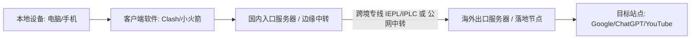
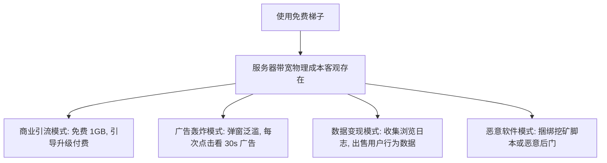

在 2026 年选择一款好用且稳定的海外网络访问工具（中文互联网通俗称作**“梯子”**或**“科学上网工具”**），切忌陷入两种极端的误区：**一是盲目迷信所谓的“速度全网第一”，二是贪图“超低价或永久免费”**。

跨境网络质量是一个包含**物理线路（直连/中转/IEPL/IPLC）、协议加密（Shadowsocks/VLESS/Trojan/Hysteria 2）、出口 IP 纯净度、晚高峰拥塞控制、客户端兼容性以及服务商资金链安全**的复杂系统。

本文作为站点核心指南，旨在建立一个**透明、客观、可量化且分场景的梯子选型决策框架**，帮助不同预算、设备和使用需求的用户找到真正适合自己的网络访问方案。

---

## ⚡ 30 秒极速选型指南：你属于哪类用户？

如果你时间有限，可以根据以下核心使用画像快速锁定选型方向：

```text
┌─────────────────────────┬───────────────────────────────┬───────────────────────────────────────┐
│ 你的核心使用场景        │ 核心关注指标                  │ 推荐选型方向与产品形态                │
├─────────────────────────┼───────────────────────────────┼───────────────────────────────────────┤
│ 1. 网页查资料 + 文字 AI │ 稳定性 > 流量成本             │ 选低月付或平价小流量 IEPL 专线包      │
│ 2. YouTube / Bilibili   │ 持续带宽吞吐 + 流量单价       │ 选 100GB~200GB 主流月付专线，看晚高峰 │
│ 3. Netflix / Disney+    │ 原生 IP 解锁 + 多地区节点     │ 选香港/新加坡/日本多原生 IP 专线      │
│ 4. ChatGPT / Claude     │ 住宅/原生出口 IP + 高稳定性   │ 选纯净 IP 节点，避免机房黑名单阻断    │
│ 5. Windows / Mac 电脑   │ 规则分流 + 客户端内核兼容性   │ 选用兼容 Clash Verge Rev (Mihomo) 服务│
│ 6. iPhone / iPad 苹果   │ iOS 客户端一键导入便捷性      │ 选用支持 Shadowrocket / Stash 订阅服务│
│ 7. 零基础纯新手用户     │ 自研客户端 / 详细图文售后教程 │ 优先选择提供开箱即用 App 的服务商     │
│ 8. 轻度防断网备用       │ 0 月租 / 不限时流量包 / 短周期│ 选用按量计费不限时包或低门槛小流量包  │
│ 9. 长期重度跨境办公     │ 物理专线 + 晚高峰 0 丢包      │ 选用企业级 IEPL / IPLC 物理专线服务   │
└─────────────────────────┴───────────────────────────────┴───────────────────────────────────────┘
```

---

## 一、梯子到底是什么？搞懂网络代理底层运转链路

在中文互联网中，“梯子”是一个通俗统称。很多人常常把 **“代理客户端（如 Clash / Shadowrocket）”**、**“代理服务商（机场）”**、**“传统商业 VPN”** 以及 **“代理协议”** 混为一谈。

要建立正确的选择逻辑，首先必须理清网络访问的完整链路：



### 关键角色拆解：
1. **客户端软件（Client）**：安装在手机或电脑上的本地工具（如 Clash Verge Rev、Shadowrocket、v2rayN、Sing-box）。客户端本身只是一个**“空壳引擎”**，不自带任何网络节点；
2. **服务商（俗称机场/服务提供商）**：负责租用机房服务器与跨境光缆，为用户提供网络转发通道；
3. **订阅链接（Subscription URL）**：服务商生成的一串加密配置文件链接，用户导入客户端后即可解析出几十个不同地区的节点；
4. **节点与线路（Nodes & Lines）**：数据从国内经过专线传输到海外各地区机房的实际物理通道。

> 💡 **核心认知**：下载了 Clash 不等于有了梯子；购买了服务商订阅后，必须将订阅链接导入客户端，才能实现代理上网。

---

## 二、梯子、VPN、机场与代理的核心区别

很多新手常常疑惑：“为什么我买的 VPN 和别人用的 Clash 看起来完全不一样？”下表给出了清晰的对比：

| 术语名称 | 底层是什么 | 典型产品形态 | 是否需要自配客户端 | 核心优缺点 | 适合人群 |
| :--- | :--- | :--- | :---: | :--- | :--- |
| **梯子 (通俗统称)** | 广义上的海外网络访问工具 | 包含 VPN、机场、SOCKS5 代理等 | 视具体形态而定 | 泛指一切跨境访问工具 | 大众口语表述 |
| **机场 (专线代理服务)** | 基于 Shadowsocks / VLESS 等协议的服务器集群 | 提供订阅链接，配合第三方开源客户端使用 | **需要** (搭配 Clash / 小火箭等) | **优点**：速度快、延迟低、规则分流精准、性价比极高；**缺点**：需简单配置 | **绝大多数国内用户主流选择** |
| **传统商业 VPN** | 全局虚拟专用网络 (IPsec / OpenVPN / WireGuard) | ExpressVPN、NordVPN 等官方独立 App | **不需要** (官方一键 App) | **优点**：大厂品牌、操作简单；**缺点**：国内网络环境下易被特征识别阻断，速度慢且价格昂贵 | 海外用户或外企专用 |
| **代理协议 (Protocol)** | 客户端与服务端之间的数据封装规则 | SS、Trojan、VLESS-Reality、Hysteria 2 | 嵌入在订阅中 | 决定了抗封锁能力与传输效率 | 技术底层实现 |
| **节点 (Node)** | 位于特定机房的单台出口代理服务器 | 香港 01、日本 02、美国 05 等 | 在客户端中切换 | 决定了你的出口 IP 归属地与物理延迟 | 日常切换使用 |

详细技术概念解析推荐阅读：[《机场和 VPN 有什么区别？从底层协议、隐私安全到使用场景全面对比》](/wiki/airport-vs-vpn-difference/)。

---

## 三、2026 选梯子的十大核心评估指标

评估一款梯子是否好用，必须脱离主观宣传，建立以下 10 个客观维度的评估体系：

```text
┌────────────────────────────────────────────────────────────────────────────────────────┐
│                                 2026 梯子客观评估十大黄金维度                          │
├─────────────────────┬─────────────────────┬────────────────────┬───────────────────────┤
│ 1. 价格模型 (Price) │ 2. 流量配额 (Quota) │ 3. 线路质量 (Line) │ 4. 节点分布 (Region)  │
├─────────────────────┼─────────────────────┼────────────────────┼───────────────────────┤
│ 5. 协议支持 (Proto) │ 6. 多端生态 (Client)│ 7. 持续带宽 (Speed)│ 8. 晚高峰稳定性 (Peak)│
├─────────────────────┼─────────────────────┴────────────────────┴───────────────────────┤
│ 9. 场景解锁 (Unlock)│ 10. 资金与运营安全 (Security & Risk)                                   │
└─────────────────────┴──────────────────────────────────────────────────────────────────┘
```

1. **真实支付价格（Price Model）**：区分**真实月付金额**与**年付折算月价**，拒绝强制超长预付；
2. **流量配额与计算方式（Traffic Quota）**：明确是每月重置流量，还是一次性不限时流量包，是否存在不合理的倍率扣费（如 2x/3x 节点）；
3. **线路架构（Line Infrastructure）**：判断是普通公网直连、BGP 优化中转，还是具备抗封锁能力的 **IEPL / IPLC 物理专线**；
4. **节点地区与纯净度（Node Regions）**：核心覆盖香港、日本、新加坡、美国、台湾等常用地区，节点是否具备原生 IP 属性；
5. **协议现代化支持（Modern Protocols）**：是否支持主流 Shadowsocks、Trojan、VLESS-Reality 及高丢包对抗协议 Hysteria 2；
6. **多端客户端生态（Cross-Platform Compatibility）**：是否全面兼容 Windows、macOS、Android、iOS 等主流平台；
7. **持续下行吞吐带宽（Sustained Bandwidth）**：单次 Speedtest 峰值仅供参考，关键看高清 4K 视频持续播放的稳定缓存速度；
8. **晚高峰抗拥堵能力（Peak Hours Stability）**：在晚上 20:00~23:00 骨干网拥堵期，是否依然保持低丢包与流畅访问；
9. **AI 与流媒体场景解锁（Streaming & AI Unlock）**：对 ChatGPT、Claude、Netflix、Disney+ 的实际解锁支持情况；
10. **运营历史与资金安全（Track Record & Risk）**：服务商运营年限（优先选择 2 年以上老牌）、售后工单响应速度与合理的付款周期。

---

## 四、2026 梯子/机场推荐总表（按需真实客观呈现）

> ⚠️ **数据真实性声明**：
> 以下品牌数据基于 2026 年 8 月最新实测与官方套餐数据，价格区分真实单月付款与长期年付折算，杜绝虚假评分与夸大宣传。

| 品牌名称 | 核心市场定位 | 最低实际起付金额 | 折算月价 | 每月流量 | 核心线路与协议 | 适用场景与优选人群 | 核心注意事项 | 详细评测与入口 |
| :--- | :--- | :--- | :--- | :--- | :--- | :--- | :--- | :--- |
| **光速云** | 2020 老牌旗舰 · IEPL / 全球物理 IPLC 专线 | ¥90 / 年 (8折码后) | **约 ¥7.5 / 月** | 59GB~238GB /月 | 企业级 IEPL + 全球物理 IPLC · VLESS | 跨境办公、AI 深度使用、4K 影音、追求极致稳定用户 | 基础入门款需年付折算，高配款支持灵活周期 | [《光速云深度评测》](/reviews/guangsu-cloud/) |
| **微风网络** | 2023 运营 · IEPL 专线小流量高性价比 | ¥80 / 年 (9折码后) | **约 ¥7 / 月** | 50GB / 月 | IEPL 专线集群 · 通用订阅 | 学生党、轻度网页查资料、文字 AI、低成本备用第二线路 | 50GB 适合中轻度用户，重度下载需选大流量档 | [《微风网络深度评测》](/reviews/weifeng-cloud/) |
| **飞猫云** | 2023 运营 · 平价轻量 IEPL 专线 | ¥84 / 年 (8折码后) | **约 ¥7 / 月** | 50GB / 月 | IEPL 内网专线 · Shadowsocks | 低预算轻度用户、移动端日常刷推查资料 | 同样为主打轻量低成本，大流量需求需升档 | [《龙猫云与飞猫云对比》](/compare/longmao-cloud-alternatives/) |
| **星岛梦** | 2020 老牌 · 企业内网专线 + 不限时流量包 | ¥98 / 年 | **约 ¥8 / 月** | 60GB / 月 (或不限时) | 企业级内网专线 · 多协议支持 | 长期稳定用网、不常查资料但要求随时可用的备用用户 | 不限时流量包单价略高于月度重置包 | [《星岛梦选型分析》](/recommend/best-airports/) |
| **唯兔云** | 2023 运营 · 三网智能优化主流月付 | **¥14.9 / 月 (月付)** | **¥14.9 / 月** | 100GB / 月 | 三网优化 BGP 集群 · VLESS | 拒绝年付绑定、希望真实单月付费、节点数量偏好者 | 纯公网优化中转，极端敏感期稳定性略逊于物理专线 | [《唯兔云套餐评测》](/recommend/best-airports/) |
| **灵猫网络** | 2024 运营 · 20 元内月付大流量 | **¥19 / 月 (月付)** | **¥19 / 月** | 150GB / 月 | 企业级内网专线 · 通用订阅 | 重度刷视频、多设备共享、月付大流量需求用户 | 新兴品牌，建议保持单月或季度续费 | [《大流量机场选型》](/recommend/best-airports/) |
| **速界** | 2024 运营 · AI 与流媒体专精专线 | **¥25 / 月 (月付)** | **¥25 / 月** | 150GB / 月 | 高带宽 IEPL 专线 · VLESS | ChatGPT 深度对话、Claude 高频调用、4K HDR 观影 | 单月价格略高，适合对 IP 纯净度有高要求的专业用户 | [《速界评测分析》](/recommend/best-airports/) |

---

## 五、真实月付 vs 年付折算：价格透明度深度辨析

在购买梯子时，最容易被误导的就是**“价格展示陷阱”**。很多宣传标榜“每月仅需 5 元”，实际结算时却强制要求一次性预付 2~3 年。

### 真实付款与风险敞口对照表：

```text
┌──────────────┬──────────────────┬──────────────┬──────────────┬──────────────────────────────────────────┐
│ 品牌示例     │ 标称折算月价     │ 实际支付周期 │ 首次掏出金额 │ 潜在预付风险与资金敞口评估               │
├──────────────┼──────────────────┼──────────────┼──────────────┼──────────────────────────────────────────┤
│ 方案 A (年付)│ 约 ¥7.5 / 月     │ 年付 (12个月)│ 约 ¥90 元    │ 低。老牌服务商，年付百元以内风险完全可控 │
│ 方案 B (月付)│ ¥14.9 / 月       │ 月付 (1个月) │ ¥14.9 元     │ 极低。单月结算，不满意随时更换服务商     │
│ 方案 C (多年)│ 宣传 ¥3 / 月     │ 3年付 (36月) │ ¥108~150 元  │ 极高！任何小作坊一旦跑路资金全损         │
└──────────────┴──────────────────┴──────────────┴──────────────┴──────────────────────────────────────────┘
```

> ⚠️ **避坑铁律**：
> 1. **初次尝鲜坚持短周期**：新接触任何机场品牌，无论价格多诱人，首月优先选择**月付或季付**进行实测；
> 2. **老牌平台年付控制在百元级**：对于运营 3~6 年以上的老牌服务商（如光速云、星岛梦），如果年付总价在 70~90 元区间，属于合理的抗通胀选择；
> 3. **坚决抵制 2~3 年以上的超长预付包**。

---

## 六、免费梯子是真的吗？深度解析免费工具的隐形成本

在各大搜索引擎中，“免费梯子”、“永久免费梯子下载”始终拥有极高的搜索量。那么，**免费梯子到底能不能用？**



### 免费梯子的 5 大必然技术限制：
1. **严重的带宽与速率限制**：免费服务器通常被数万人挤占，下载速率常年被锁死在几百 KB/s，看 720P 视频都会频繁转圈；
2. **极低的流量额度**：正规免费体验型服务通常仅提供 1GB~2GB 试用流量，仅够临时收发几封邮件；
3. **节点 IP 极度脏乱**：由于大量灰产利用免费节点滥用，免费节点的 IP 几乎 100% 被 Google、Cloudflare 验证码拦截，ChatGPT、Claude 直接报 403 封禁；
4. **隐私与日志风险**：非盈利的免费工具为了收回成本，往往在用户协议中隐藏了将用户 DNS 查询与访问数据打包出售给广告联盟的条款；
5. **服务极度不稳定**：节点可能今天能连，明天就彻底失联，维护团队随时可能停止运营。

> 💡 **中立结论**：临时应应急（如国外旅行查地图、紧急接收验证码），可以使用知名大厂的免费试用包；但如果是**日常查资料、学习、AI 生产力或追剧**，稳定低成本的付费专线（如每月 7~15 元）在时间成本和数据安全上是远优于折腾免费工具的。
> 详细分析见：[《免费梯子能用吗？2026 免费科学上网工具安全性与风险深度剖析》](/wiki/airport-vs-vpn-difference/)。

---

## 七、科学评估你的每月流量需求

很多人在买梯子时不知道该选 50GB、100GB 还是 200GB。请对照下表评估你的实际流量压力：

| 使用场景与行为 | 流量消耗等级 | 推荐每月套餐档位 | 核心关注要点 |
| :--- | :---: | :--- | :--- |
| **网页查资料、Google 搜索、维基百科** | 🟢 **极低** (1~5GB/月) | 50GB 轻量包即可 | 文本网页数据极小，无需大流量 |
| **ChatGPT / Claude / Gemini 对话** | 🟢 **低** (5~10GB/月) | 50GB~100GB 套餐 | 文字交互流量很小，关键看 IP 纯净度 |
| **GitHub 提交、代码拉取、技术文档** | 🟢 **低** (10~20GB/月) | 50GB~100GB 套餐 | 满足开发者日常编程查阅 |
| **日常 YouTube 1080P 视频浏览 (每天1小时)** | 🟡 **中等** (30~60GB/月) | 100GB~150GB 主流包 | 需注意后台自动播放消耗 |
| **Netflix / Disney+ 1080P 追剧** | 🟠 **较高** (80~120GB/月) | 150GB~200GB 套餐 | 连续剧画质高，单集约 1~2GB |
| **4K 超高清 HDR 视频、电影大文件下载** | 🔴 **重度** (200GB~500GB+) | 200GB~500GB 大流量包 | 需确认节点无高倍率乘积 |
| **多台电脑、手机、平板全家共享** | 🔴 **重度** (300GB+ /月) | 300GB~500GB 团队包 | 需确认服务商不限制同时在线设备数 |

> ⚠️ **关于“不限流量”的真相**：
> 任何宣称“几块钱无限流量随便跑”的服务，底层都受限于物理带宽。通常伴随严格的“公平使用原则（FUP）”，一旦单日下载量过大，节点会被限速至 1Mbps。

---

## 八、速度怎么看？为什么“低延迟”不等于“高速度”

许多用户测速时看到 Ping 值显示 **30ms（绿色）**，但打开 YouTube 连 1080P 都卡顿，这是为什么？

```text
┌───────────────────────────────────────────────────────────────────────────┐
│                     网络测速 4 大核心物理指标深度拆解                    │
├───────────────┬───────────────────────────────────────────────────────────┤
│ 1. 延迟 (Ping)│ 数据往返单程时间。由物理光缆距离决定，决定了点击响应快慢 │
│ 2. 抖动 (Jitter) 延迟波动的剧烈程度。抖动过大易造成音视频通话卡顿与丢包   │
│ 3. 丢包 (Loss)│ 数据包丢失百分比。丢包率 > 3% 会导致网页频繁卡死、TCP 重传│
│ 4. 吞吐 (Speed) 数据通道的最大传输能力。决定了 4K 视频加载与下载的上限    │
└───────────────┴───────────────────────────────────────────────────────────┘
```

```
[典型误区]：
国内入口机房 Ping 测速 = 25ms (极低)
         │
         ▼
但如果跨境中转带宽被打满 (晚高峰拥堵)
         │
         ▼
实际下载速率只有 500 KB/s，且丢包率高达 15%！
```

### 晚高峰（20:00 ~ 23:00）才是照妖镜
白天骨干网空闲，绝大多数直连或普通中转节点测速都能跑出几百 Mbps；只有在**每晚 8 点到 11 点全网国际出口高峰期**，物理专线（IEPL/IPLC）的独立带宽优势才能体现出 0 丢包与 4K 秒开。

详细原理解析：[《为什么机场节点延迟低但速度慢？解析延迟与带宽的真实关系》](/issues/low-ping-slow-speed-reasons/)。

---

## 九、线路与协议选型：IEPL、IPLC 与 VLESS 原理解析

### 1. 线路类型辨析（传输通道）
- **公网直连（Direct）**：数据直接通过公网路由出海，成本极低，但在敏感时期或晚高峰极易被干扰阻断；
- **BGP 优化中转（Relay）**：国内入口采用优质 BGP 线路，中转后再出海，性价比高；
- **IEPL 内网专线（International Ethernet Private Line）**：点对点内网专线，数据不过公网国际出口审查，晚高峰无丢包；
- **IPLC 物理专线（International Private Leased Circuit）**：完全隔离的跨境物理专线，延迟最低、抗封锁能力最强。

### 2. 代理协议辨析（数据封装）
- **Shadowsocks (SS)**：经典轻量协议，兼容性最好，全平台客户端通吃；
- **Trojan**：伪装成标准 HTTPS 流量，抗封锁性好；
- **VLESS (Reality)**：Xray/Mihomo 现代主推协议，无需独立域名即可实现完美的 TLS 握手伪装；
- **Hysteria 2 / TUIC**：基于 UDP (QUIC) 架构，专门为恶劣高丢包网络设计的暴力加速协议。

详细技术指南推荐阅读：[《IEPL、IPLC 与中转直连有什么区别？一文读懂机场线路原理》](/protocols/iepl-vs-iplc-transit/) 与 [《VLESS、Trojan 与 Hysteria 2 协议对比评测》](/protocols/vless-trojan-hysteria2/)。

---

## 十、多端设备选型与客户端生态指南

### 1. Windows / macOS 电脑端
- **首选客户端**：**Clash Verge Rev**（基于开源 **Mihomo / Clash.Meta** 内核）；
- **核心优势**：现代界面、支持订阅一键更新、内置强大的规则分流（国内直连、国外代理）、支持 TUN 虚拟网卡接管游戏与命令行；
- 实操教程：[《Clash Verge Rev 下载安装与订阅配置教程》](/tutorials/clash-verge-rev/) 与 [《Clash TUN 模式与系统代理区别》](/wiki/clash-tun-mode-vs-system-proxy/)。

### 2. iPhone / iPad 苹果 iOS 端
- **首选客户端**：**Shadowrocket（小火箭）** 或 **Stash**；
- **核心说明**：需使用海外 Apple ID 在 App Store 下载，支持扫码或复制订阅一键导入节点；
- 实操教程：[《Shadowrocket 小火箭 iOS 订阅配置完整教程》](/tutorials/shadowrocket/longmao-cloud/)。

### 3. Android 安卓手机端
- **首选客户端**：**Clash Meta for Android (CMFA)** 或 **v2rayNG** / **Sing-box**；
- **核心注意**：安装后需在系统设置中允许应用后台运行并关闭“电池优化”，防止息屏断流。

---

## 十一、高意图场景选型：ChatGPT、YouTube 与 Netflix

```text
┌──────────────────────────┬─────────────────────────────┬────────────────────────────────────────┐
│ 目标场景                 │ 核心技术挑战                │ 选型必备条件                           │
├──────────────────────────┼─────────────────────────────┼────────────────────────────────────────┤
│ 🤖 ChatGPT / OpenAI      │ 严格的 IP 信誉风控与欺诈评分 │ 选用美国/日本原生出口 IP，避免机房黑名单│
│ 🧠 Claude 3.5 Sonnet     │ 极度严苛的地区合规检测      │ 需支持原生家宽/住宅 IP，严防登录报 403 │
│ ♊ Google Gemini          │ 绑定 Google 账号归属地      │ 选用新加坡/日本/美国节点，支持 UDP 传输 │
│ 📺 YouTube 4K 超高清     │ 持续大带宽吞吐能力          │ 晚高峰带宽需稳定在 50Mbps 以上且低丢包 │
│ 🎬 Netflix / Disney+     │ 流媒体版权按地区识别        │ 节点需具备 DNS 解锁或原生流媒体分流能力│
└──────────────────────────┴─────────────────────────────┴────────────────────────────────────────┘
```

---

## 十二、安全与防坑：保护隐私、防止订阅泄露与跑路前兆

### 1. 换了梯子不等于“100% 匿名”
代理工具只是改变了你的网络出口 IP，目标网站依然可以通过**登录账号、浏览器指纹（Canvas Fingerprint）、Cookie 以及设备语言时区**识别你的身份。切勿在代理环境下从事任何违法违规行为。

### 2. 保护你的订阅链接（Subscription URL）
订阅 URL 相当于你的**“提货卡密码”**，包含你的全部节点信息与账户 Token：
- ❌ **严禁**将订阅链接发送到公开 QQ 群、微信群或 Telegram 群；
- ❌ **严禁**在不明来历的第三方“在线订阅转换工具”中粘贴完整 URL；
- ⚠️ 一旦怀疑泄露，请立即登录服务商后台点击 **“重置订阅链接（Reset Token）”**。

### 3. 识别机场跑路前的 5 大反常信号
1. 突然发布**“充三年送三年”、“永久不限流骨折特惠”**等极端大促；
2. 核心专线大面积红线超时，官方公告连续数周称“正在割接”且无进展；
3. 官方交流群开启全员禁言，客服工单多日无人回应；
4. 频繁更换完全不相关的全新收款通道或第三方个人收款码；
5. 官方网站无法打开且未提供任何备用防失联域名。

防坑全景指南推荐阅读：[《机场跑路前有哪些风险信号？10 个预警与防坑避险指南》](/risk/airport-running-away-warning-signs/)。

---

## 十三、高频故障极速诊断手册（7 步排查法）

当梯子突然连不上或打不开网页时，请按照下表快速定位：

| 故障现象 | 90% 锁定的真实技术原因 | 推荐解决步骤 | 详细排障专栏 |
| :--- | :--- | :--- | :--- |
| **有节点但打不开任何外网** | 系统代理未开启、DNS 污染或系统时间不同步 | 1. 检查客户端「System Proxy」开关；2. 电脑系统设置同步北京时间 | [《Clash 有节点无法上网排查》](/issues/clash-connected-no-internet/) |
| **所有节点全部显示 Timeout 红色** | 本地网络 DNS 污染或旧订阅节点 IP 失效 | 1. 切换手机 5G 热点测试；2. 客户端右键 Update 刷新订阅 | [《节点 Timeout 超时排查指南》](/issues/longmao-cloud-node-timeout/) |
| **百度打得开但 Google 转圈卡死** | 分流规则将海外域名错误分流为 DIRECT 直连 | 客户端切换为「Global (全局模式)」测试，确认规则分流是否正常 | [《规则分流与代理模式科普》](/wiki/what-is-clash/) |
| **平时很快但晚上 9 点特别卡** | 节点为公网直连，遭遇骨干网晚高峰国际拥塞 | 换用 IEPL / IPLC 物理专线节点，避开公网拥堵 | [《速度慢与晚高峰卡顿排查》](/issues/longmao-cloud-slow-speed/) |
| **订阅链接更新失败返回 404/500** | 服务商更换了订阅分发域名或套餐已到期欠费 | 登录服务商后台核实套餐状态，重新复制最新订阅链接导入 | [《订阅导入与更新实战教程》](/tutorials/clash-subscription-import/) |

---

## 十四、新手 10 步选型与配置通关清单

```text
┌────────────────────────────────────────────────────────────────────────┐
│                      新手购买梯子 13 项安全自查清单 (Checklist)        │
├────────────────────────────────────────────────────────────────────────┤
│ □ 1. 我已清晰评估自己每月的实际流量需求 (日常查资料 50GB 足够)         │
│ □ 2. 我确认该服务支持我手头的所有设备 (Windows/Mac/iOS/Android)        │
│ □ 3. 我确认该服务支持主流客户端 (Clash Verge Rev / Shadowrocket)       │
│ □ 4. 常用节点地区 (香港/日本/新加坡/美国) 是否齐全且有备用节点         │
│ □ 5. 线路是否透明标注 (中转、IEPL 还是 IPLC 物理专线)                 │
│ □ 6. 价格是否为真实月付还是年付折算，首次购买坚守月付/短周期原则       │
│ □ 7. 节点倍率是否正常，是否存在隐藏的高倍率扣费                        │
│ □ 8. 是否支持多设备同时在线使用                                        │
│ □ 9. ChatGPT / Netflix 等场景是否具备原生节点或近期解锁测试            │
│ □ 10. 服务商是否具备 2 年以上稳定运营历史                             │
│ □ 11. 服务商是否提供工单或 Telegram 售后支持渠道                      │
│ □ 12. 我已了解换梯子不代表完全匿名，并承诺合规用网                     │
│ □ 13. 我已将订阅链接妥善保存在本地，绝不泄露给未授权第三方            │
└────────────────────────────────────────────────────────────────────────┘
```

---

## 十五、常见问题深度解答（FAQ · 30 问）

### Q1：梯子是什么意思？梯子工具是什么？
**答**：在中文互联网中，“梯子”是对能够绕过本地网络限制、访问海外网站（如 Google、YouTube、GitHub）的代理软件与网络服务的通俗统称。技术上它通常由**“代理客户端软件（如 Clash）”**与**“后端专线服务器（机场订阅）”**组合而成。

### Q2：2026 年梯子哪个好用？
**答**：好用的标准取决于需求场景：追求**极致稳定与生产力**推荐 [光速云](/reviews/guangsu-cloud/)（2020 老牌物理专线）；追求**超低成本轻度用网**推荐 [微风网络](/reviews/weifeng-cloud/)（约 7 元/月 IEPL 专线）；需要**真实单月付费**推荐 [唯兔云](/recommend/best-airports/)（14.9 元/月）。

### Q3：梯子哪个稳定不容易掉线？
**答**：稳定性 90% 取决于**跨境线路质量**。采用 **IEPL / IPLC 企业内网专线** 的服务商（如光速云）在晚高峰和敏感时期稳定性远超普通公网直连。

### Q4：梯子哪个速度最快？
**答**：速度由**机房接入带宽与丢包率**决定。在低丢包物理专线环境下，支持 **VLESS-Reality** 或 **Hysteria 2** 协议的节点通常能跑满家庭千兆宽带，实现 YouTube 4K 秒开。

### Q5：梯子一个月多少钱合理？
**答**：2026 年主流梯子市场合理价格为：**轻量小流量档（50GB）约 ¥7~10/月（年付折算）；主流中端月付档（100GB~150GB）约 ¥15~25/月**。低于 3 元/月往往伴随严重超售，高于 40 元/月则存在品牌溢价。

### Q6：有没有好用的免费梯子？
**答**：有极少数商业品牌提供 1GB~2GB 的免费体验包，但仅供临时应急。长期免费的梯子通常存在严重限速、广告弹窗、节点拥堵与隐私数据出售风险，不推荐用于日常工作或学习。

### Q7：永久免费梯子是真的吗？
**答**：**不是真的。** 跨境物理专线与海外服务器带宽每月都要支付昂贵租金，不存在没有任何商业回报却长期提供免费高速带宽的慈善机构。

### Q8：手机梯子哪个好？
**答**：iPhone 用户首选搭配 **Shadowrocket（小火箭）** 或 Stash 的专线订阅；Android 用户首选搭配 **Clash Meta for Android** 或 v2rayNG。

### Q9：电脑梯子怎么选？
**答**：Windows 与 Mac 电脑目前最佳客户端生态是 **Clash Verge Rev**（内置开源 Mihomo 内核），支持精细的分流规则与 TUN 全局网卡模式。

### Q10：Clash 是梯子吗？
**答**：**Clash 不是梯子服务商，而是一个开源代理客户端框架。** 下载 Clash 后必须导入服务商提供的**订阅链接**才能正常代理上网。

### Q11：Shadowrocket 是梯子吗？
**答**：**不是。** Shadowrocket（小火箭）是 iOS 平台上的一款付费网络代理工具 App，本身不自带节点，需配合机场订阅使用。

### Q12：机场和 VPN 有什么区别？
**答**：机场采用现代化分流代理协议（SS/VLESS），**速度快、延迟低、国内直连国外代理、性价比高**；传统 VPN 采用全局封装（OpenVPN），在国内易被阻断且速度较慢。

### Q13：ChatGPT 需要什么类型的梯子？
**答**：ChatGPT 核心考验**出口 IP 的信誉度与原生性**。不能使用被大量滥用的机房黑名单 IP，需选用具备原生住宅 IP 或流媒体解锁属性的优质节点。

### Q14：Claude 为什么老报 403 无法使用？
**答**：Claude 的地区审查比 ChatGPT 更严苛，如果节点为非支持地区或多用户共享的劣质 IP 会被直接拦截。需切换至纯净的新加坡、日本或美国专线节点。

### Q15：YouTube 4K 视频需要多少带宽？
**答**：流畅播放 YouTube 4K 60fps 视频需要节点具备 **至少 35Mbps~50Mbps 的持续稳定下行带宽**，且丢包率必须低于 1%。

### Q16：Netflix 梯子怎么选？
**答**：需选择在节点列表中明确标明“原生解锁”或“全解锁”的节点，且服务商需具备动态更换失效 IP 的运维能力。

### Q17：梯子有节点但连不上网怎么排查？
**答**：第一步检查客户端「系统代理」开关是否开启；第二步前往电脑系统设置点击「立即同步时间」；第三步切换手机 5G 热点排除宽带 DNS 污染。

### Q18：节点为什么全部报 Timeout 超时？
**答**：通常是因为本地电脑时间戳存在偏差导致 TLS 握手失败，或者客户端保存了过期的服务器 IP。在系统同步时间并在客户端右键 Update 订阅即可。

### Q19：为什么白天速度飞快，晚上 9 点特别卡？
**答**：因为遭遇了**晚高峰国际出口拥塞**。普通公网直连中转在晚高峰丢包严重，建议换用具备独立带宽的 IEPL / IPLC 物理专线。

### Q20：梯子会不会跑路？
**答**：任何中小型代理服务商都存在一定的运营风险。防跑路的核心是**坚持月付或短期预付**，并选择运营 3 年以上的老牌知名服务商。

### Q21：第一次买梯子应该月付还是年付？
**答**：**坚决首选月付。** 实测 1~2 周确认在自己的本地网络与常用场景下足够流畅稳定后，再考虑按季度或年付续费。

### Q22：什么是按量计费不限时梯子？
**答**：指购买一次性固定流量包（如 100GB / 50 元），流量没有每月清零的到期时间，用多少扣多少，非常适合作为防断网的第二备用通道。

### Q23：使用梯子会泄露个人隐私吗？
**答**：访问主流 HTTPS 网站时，你的账号密码与传输内容均经过端到端加密，代理服务器无法解密；但代理服务器能看到你访问的域名。因此选择信誉良好的老牌服务商至关重要。

### Q24：订阅链接泄露了怎么办？
**答**：立即登录服务商用户后台，在仪表盘中找到并点击 **“重置订阅信息 / 重置 Token”**，旧的订阅链接就会立刻失效。

### Q25：玩外服游戏可以用梯子吗？
**答**：可以，但需在客户端中开启 **TUN 虚拟网卡模式** 并支持 UDP 转发。对于竞技类游戏，建议使用游戏专用专线节点以降低 Jitter 抖动。

### Q26：外贸办公和跨境电商需要什么梯子？
**答**：外贸业务需要极高的连接稳定性和固定的出口 IP，避免频繁变动触发海外平台（如 PayPal、Amazon）的风控异地登录警告。

### Q27：梯子支持多台设备同时使用吗？
**答**：绝大多数正规服务商允许个人用户的手机、电脑、平板等 2~5 台设备同时在线使用，但严禁将订阅公开分享给多人滥用。

### Q28：Mihomo 和 Clash 是什么关系？
**答**：Mihomo（前身 Clash.Meta）是目前活跃维护的开源现代 Clash 内核，全面支持 VLESS-Reality、Hysteria 2、TUIC 等新一代协议。

### Q29：为什么有些节点标有 0.5x 或 2.0x 倍率？
**答**：倍率代表流量消耗乘数。0.5x 节点使用 1GB 实际只扣 0.5GB，适合大下载；2.0x 节点为昂贵的物理专线，使用 1GB 会扣除 2GB 流量配额。

### Q30：如何判断一家梯子服务商是否值得长期使用？
**答**：看 4 点：**运营年限（2年以上）、线路透明度（不虚标物理专线）、售后响应速度（工单能否及时处理）以及合理克制的定价策略（不搞超低价终身套餐割韭菜）**。

---

## 🏁 总结：2026 梯子终极选型法则

在 2026 年选择梯子，请始终牢记以下 **四步终极决策法则**：

```text
Step 1: 厘清自身画像 ➔ 我每月需要多少流量？主要用途是查资料、看视频还是高频用 AI？
Step 2: 匹配设备生态 ➔ 确认服务商提供完整的 Windows (Clash) 与 iOS (小火箭) 订阅支持
Step 3: 严格控制风险 ➔ 首次使用坚守月付短周期，百元以内挑选 2~3 家候选进行晚高峰实测
Step 4: 配置双路备份 ➔ 主力选择稳定物理专线 (如光速云)，备用常备低成本按量包 (如微风/星岛梦)
```

---

### 📚 延伸阅读与技术专栏导航
- 🏆 **全景大榜横评**：[《2026 机场推荐与稳定机场排行榜：17 家价格与线路全景横评》](/recommend/best-airports/)
- ⚡ **老牌旗舰实测**：[《光速云深度评测：2020 老牌 IEPL 专线、晚高峰跑分与解锁评测》](/reviews/guangsu-cloud/)
- 🍃 **平价专线选型**：[《微风网络评测：小流量套餐值不值得买？价格与线路深度分析》](/reviews/weifeng-cloud/)
- 🐱 **龙猫云专题全景**：[《龙猫云机场怎么样？套餐、线路、节点与使用体验深度评测》](/reviews/longmao-cloud/)
- ⚖️ **品牌 1 对 1 对比**：[《龙猫云和光速云哪个好？价格、流量、线路与适合人群深度对比》](/compare/longmao-vs-guangsu/)
- 🛠️ **电脑客户端配置**：[《Clash Verge Rev 下载与安装配置完整教程》](/tutorials/clash-verge-rev/)
- 🚨 **排障实战指南**：[《Clash 有节点但无法上网怎么办？7 步系统排查与修复指南》](/issues/clash-connected-no-internet/)
- ⚠️ **防坑避险手册**：[《机场跑路前有哪些风险信号？10 个预警与防坑避险指南》](/risk/airport-running-away-warning-signs/)
