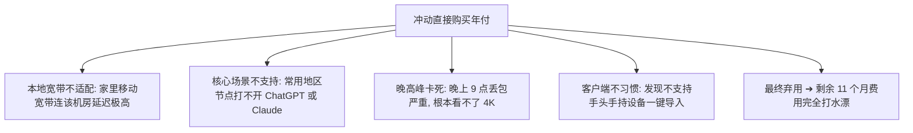

在经历了免费工具的频繁断流、严重限速与 IP 脏乱之后，绝大多数需要稳定查阅资料、使用 AI 生产力工具或观看流媒体的用户，最终都会走向**付费梯子（专线机场与商业代理服务）**。

然而，进入付费市场后，新的困惑随之而来：**为什么有的服务标价“每月 5 元”，结算时却强制要求付三年？月付 15 元和年付 96 元到底哪个更划算？50GB 流量到底够不够用？“不限流量”的梯子到底靠不靠谱？**

**付费梯子绝不是“越贵越好”，更不是“月均折算数字越低越划算”**。

本文旨在建立一个**透明、可量化且注重风险控制的付费梯子商业决策框架**，从真实付款金额、计费周期、流量模型、物理线路、应用场景到主力备用双持策略，帮助你把每一分钱都花在刀刃上。

---

## ⚡ 30 秒快速选型：付费梯子怎么买最划算？

如果希望快速锁定适合自己的付费档位，请参考以下选型速查表：

```text
┌─────────────────────────┬───────────────────────────────────┬──────────────────────────────────────┐
│ 你的当前使用阶段与需求  │ 核心购买原则与指标                │ 推荐付费档位与产品形态               │
├─────────────────────────┼───────────────────────────────────┼──────────────────────────────────────┤
│ 首次接触某品牌 / 尝鲜   │ 坚守月付短周期，实测晚高峰表现    │ 选 ¥14.9~19/月 真实单月付套餐        │
│ 预算有限 / 学生党轻度   │ 看一次性掏出的总金额，而非假月均  │ 选 ¥70~90/年 平价小流量专线 (50GB)   │
│ 每月主要查资料 + 文字 AI│ 流量压力极小，重点看 IP 纯净度    │ 选 50GB~100GB 基础专线档             │
│ 日常 YouTube / 追剧     │ 持续下行带宽 $\ge 45\text{Mbps}$  │ 选 100GB~200GB 主流专线档            │
│ 4K 超高清 / 多设备全家享│ 充足流量储备 + 节点无高倍率暗扣   │ 选 200GB~500GB 大流量团队档          │
│ ChatGPT / Claude 生产力 │ 具备原生住宅 IP / 避开机房黑名单  │ 选美日新原生 IP 节点专精服务         │
│ 跨境远程办公 / 外贸业务 │ 晚高峰 0 丢包 > 极限测速峰值      │ 选企业级 IEPL / IPLC 物理专线        │
│ 长期防断网应急备用      │ 0 月租 / 流量不过期 / 低起付门槛  │ 选不限时按量计费流量包 (如星岛梦)    │
└─────────────────────────┴───────────────────────────────────┴──────────────────────────────────────┘
```

---

## 一、为什么越来越多人选择付费梯子？它比免费工具强在哪里？

在跨境网络传输中，服务器电力、国际专线光纤租赁与机房带宽都是刚性物理成本。付费服务之所以能提供压倒性的体验优势，核心在于其**资源专属性与服务可持续性**：

| 评估维度 | 免费梯子 / 公开节点 | 付费专线梯子 (正规机场) | 用户获得的实质价值 |
| :--- | :--- | :--- | :--- |
| **带宽与速率** | 🔴 锁死在 500KB/s~2Mbps，万人挤占 | 🟢 300Mbps~1000Mbps 独享带宽冗余 | YouTube 4K 秒开，大文件极速下载 |
| **晚高峰表现** | 🔴 20:00~23:00 丢包率高达 30% 卡死 | 🟢 IEPL 物理专线保障晚高峰 0 丢包 | 晚上办公、开会、追剧全程不转圈 |
| **IP 纯净度** | 🔴 几乎 100% 被 OpenAI/Netflix 封禁 | 🟢 原生住宅 IP，通过各大平台风控 | ChatGPT 秒响应，Claude 不报 403 |
| **分流与规则** | 🔴 通常为全局代理，打开国内 App 极慢 | 🟢 智能规则分流（国内直连，国外代理） | 访问微信/淘宝不减速，无需频繁开关 |
| **维护与售后** | 🔴 随缘维护，节点失效无处申诉 | 🟢 专业运维团队，节点故障自动秒级切换 | 遇到网络问题有工单与交流群支持 |
| **时间成本** | 🔴 每天花 20 分钟到处找节点折腾 | 🟢 导入一次订阅，稳定使用数月 | **节省的时间价值远超每月几元钱的订阅费** |

详细对比推荐阅读：[《免费梯子哪个好？2026免费梯子工具、安全风险与使用限制分析》](/wiki/free-tizi/)。

---

## 二、价格透明度法则：强制区分“真实月付”与“年付折算月价”

在购买付费梯子时，最容易被误导的就是宣传文案中的**“价格展示戏法”**。许多平台标榜“低至 ¥5/月”，实际结算时却发现必须一次性支付 3 年 ¥180 元。

```text
┌────────────────────────────────────────────────────────────────────────┐
│                     真实月付 vs 年付折算价格结构辨析                   │
├──────────────┬──────────────────┬──────────────┬───────────────────────┤
│ 显示价格文案 │ 实际结算周期     │ 实际支付金额 │ 真实商业含义与风险评级│
├──────────────┼──────────────────┼──────────────┼──────────────┬────────┤
│ **¥14.9 /月**│ **真实单月支付** │ **¥14.9 元** │ 🟢 极低风险。随用随买，不满意次月直接换服务商 │
│ **¥80 /年**  │ **年付 (12个月)**│ **¥80 元**   │ 🟢 风险可控。折算约 ¥6.7/月，百元内老牌服务商首选 │
│ **¥2.9 /月** │ **强制 3 年付**  │ **¥108~150元**│ 🔴 极高风险！小作坊跑路高发区，坚决不碰！      │
└──────────────┴──────────────────┴──────────────┴───────────────────────┘
```

> ⚠️ **核心准则**：
> 凡是必须一次性付清 1 年以上才能享受的价格，**一律叫“折算月价”**；只有**支持单月付 1 次、次月自主决定是否续费**的价格，才叫**“真实月付”**。

---

## 三、月付还是年付？两种付费周期的全景博弈

没有绝对好与坏的计费周期，只有与你的使用阶段是否匹配：

| 对比维度 | 真实月付模式 (Monthly) | 长期年付模式 (Yearly) |
| :--- | :--- | :--- |
| **单次掏出金额** | 🟢 **极低** (仅需 ¥15~25 元) | 🟡 **中等** (需一次性掏出 ¥80~150 元) |
| **折算月均成本** | 🟡 **略高** (无长期折扣) | 🟢 **极低** (通常包含 7~8 折优惠，折算仅 ¥7~10/月) |
| **灵活性** | 🟢 **极致灵活** (随时可更换服务商) | 🔴 **被动绑定** (中途无法退款或迁移) |
| **资金与预付风险** | 🟢 **几乎为零** (即使服务商故障仅损失一月) | 🟡 **需承担风险** (若服务商跑路或线路降级，剩余月费全损) |
| **维护省心度** | 🟡 每月需手动续费或关注到期提醒 | 🟢 一次订阅，整年无需操心续费问题 |
| **最佳适用场景** | **新用户初次测试、临时短期用网、观望服务商品质** | **经过数月实测、确认晚高峰极稳的 3 年以上老牌旗舰平台** |

---

## 四、为什么第一次购买坚决不建议盲目年付？

许多新手常因为“年付折算便宜 30%”而冲动购买一年，结果往往踩中以下大坑：



### 合理开启年付的“黄金前置条件”：
1. 你已经在该服务商处**以月付或季付形式完整使用过至少 2~4 周**；
2. 确认在你的家庭宽带、公司网络以及手机 5G 环境下，常用节点延迟与丢包率表现稳定；
3. 确认在每晚 20:00~23:00 晚高峰期间，观看 YouTube 4K 与使用 AI 顺畅无卡顿；
4. 该服务商具备 **2 年以上持续稳健运营历史**，售后工单响应迅速。

---

## 五、科学测算：每月流量到底应该选多少？

很多人在买梯子时往往盲目贪多，多花了冤枉钱。请根据下表科学匹配你的流量需求：

| 用户使用画像 | 每月实际消耗数据量 | 推荐套餐档位 | 真实应用场景描述 |
| :--- | :---: | :--- | :--- |
| **🟢 轻度学术 / 文字 AI / 查资料** | **5GB ~ 20GB** | **50GB 轻量档** (约 ¥7/月) | Google 搜索、维基百科、ChatGPT 纯文字交互、GitHub 代码提交 |
| **🟡 普通个人 / 社交 / 适度视频** | **30GB ~ 80GB** | **100GB 主流档** (约 ¥15/月) | 每天刷推、看 1 小时 YouTube 1080P、查技术文档、偶尔下载小工具 |
| **🟠 影音爱好者 / 4K / 流媒体追剧** | **100GB ~ 250GB** | **200GB 高配档** (约 ¥25/月) | 每天看多集 Netflix / Disney+ 4K HDR 剧集、频繁观看 YouTube 4K 60fps |
| **🔴 重度开发 / 云盘同步 / 多设备** | **300GB ~ 600GB+** | **500GB 团队档** (约 ¥40+/月) | 下载海量模型权重、Docker 镜像、云盘大文件传输、全家 4~5 台设备共享 |

### ⚠️ 关于“不限流量梯子”与“节点倍率”的真相：
- **不限流量陷阱**：在物理世界中，独享带宽成本极高。宣称“超低价无限流量”的服务，通常伴随严格的 **公平使用原则（FUP）**，一旦单日流量过大，节点会被强制限速至 1Mbps；
- **节点倍率（Rate）**：1.0x 节点用 1GB 扣 1GB；**2.0x 节点通常为昂贵的 IPLC 物理专线，用 1GB 扣 2GB 流量**；0.5x 节点为大流量中转，用 1GB 仅扣 0.5GB 配额。购买前务必看清节点列表中的倍率标注。

---

## 六、按预算与场景推荐矩阵（真实品牌分组候选）

> ⚠️ **数据真实性与透明度说明**：
> 本文推荐基于各品牌 2026 年 8 月的真实套餐与实测数据，拒绝虚假打分，每个品牌均明确列出其优选场景与客观不足。

```text
┌────────────────────────────────────────────────────────────────────────────────────────┐
│                             2026 付费梯子场景化候选矩阵                                │
├──────────┬──────────────────────────┬──────────────┬──────────────┬────────────────────┤
│ 选型分组 │ 推荐品牌候选             │ 实际起付门槛 │ 每月流量配额 │ 核心优势与定位     │
├──────────┼──────────────────────────┼──────────────┼──────────────┼────────────────────┤
│ 极稳主力 │ 光速云 (GuangSuYun)      │ 约 ¥7.5/月起 │ 59G~238G /月 │ 6年老牌物理专线    │
│ 平价轻量 │ 微风网络 (BreezeNet)     │ 约 ¥7/月起   │ 50GB / 月    │ 百元内小流量 IEPL  │
│ 弹性月付 │ 唯兔云 (V2Yun)           │ ¥14.9/月     │ 100GB / 月   │ 15元单月付/100G    │
│ 长期不过期│ 星岛梦 (XingDaoMeng)     │ 约 ¥8/月起   │ 60G/不限时包 │ 0月租不限时备用包  │
│ 月付大流量│ 灵猫网络 (CivetNet)      │ ¥19/月       │ 150GB / 月   │ 19元得150G大流量   │
│ AI / 影音│ 速界 (SpeedWorld)        │ ¥25/月       │ 150GB / 月   │ 原生纯净 IP / AI专精│
└──────────┴──────────────────────────┴──────────────┴──────────────┴────────────────────┘
```

### 1. 预算百元内、轻度查资料与文字 AI：[微风网络](/reviews/weifeng-cloud/)
- **核心定位**：2023 年运营的平价轻量 IEPL 专线服务商；
- **真实价格**：年付折算约 **¥7 / 月**（50GB/月，使用 9 折优惠码 `flat888` 后实付约 ¥80/年）；
- **适合人群**：平时主要用于查阅文献、网页搜索、使用 ChatGPT 辅助办公、偶尔看 1080P 视频的用户；
- **需要注意**：50GB 流量不适合重度 4K 追剧与大文件频繁下载。

### 2. 追求极致稳定、跨境办公与全能主力：[光速云](/reviews/guangsu-cloud/)
- **核心定位**：2020 年运营的老牌旗舰，主打企业级 IEPL 与全球物理 IPLC 专线；
- **真实价格**：年付折算约 **¥7.5~8 / 月起**（使用 8 折专属优惠码 `AMM` 后实付约 ¥90/年）；
- **适合人群**：外贸业务、跨境电商、重度 AI 开发者、4K 高清影音、对晚高峰 0 丢包有严苛要求的用户；
- **需要注意**：入门级低价套餐需年付折算，单月付档位门槛相对稍高。

### 3. 拒绝年付绑定、希望按单月灵活结算：[唯兔云](/recommend/best-airports/)
- **核心定位**：2023 年运营的主流高性价比月付机场，覆盖 60+ 三网优化节点；
- **真实价格**：真实单月付 **¥14.9 / 月**（100GB/月，使用优惠码 `rabbit`）；
- **适合人群**：不希望一次性掏出一年费用、希望随用随买、偏好拥有大量备用节点的用户；
- **需要注意**：采用 BGP 优化中转集群，极端敏感时期的抗干扰能力略逊于独立物理专线。

### 4. 0 月租长期备用、防主力断网：[星岛梦](/recommend/best-airports/)
- **核心定位**：2020 年老牌平台，主打企业级专线与**一次性不限时按量计费流量包**；
- **真实价格**：按量计费包约 ¥50~100（一次性购买，流量永不清零）；
- **适合人群**：平时极少用网、但关键时刻必须能连上的备用用户；
- **需要注意**：按量计费包单价略高于月度重置套餐。

---

## 七、主力 vs 备用双持策略：高可靠网络方案

对于依赖跨境网络进行日常工作与生产力的用户，最稳妥的策略不是“把所有鸡蛋放在一个篮子里”，而是**配置一套互不干涉的主力与备用双持体系**：

```mermaid
graph TD
    User[用户日常网络需求] --> Main[主力梯子: 优先选择高速稳定 IEPL 专线 (如光速云)]
    User --> Backup[备用梯子: 优先选择 0 月租不限时包 (如星岛梦) 或平价小流量包 (如微风)]

    Main -- 日常 95% 流量: 极速 4K, AI 编程, 远程办公 --> Internet[高速访问国际互联网]
    Main -- 遇偶发机房维护割接 / 线路抖动 --> Switch[客户端一键无缝切换至备用节点]
    Backup -- 应急 5% 流量: 确保关键时刻网络永不断联 --> Internet
```

| 维度对比 | 主力梯子 (Primary) | 备用梯子 (Secondary Backup) |
| :--- | :--- | :--- |
| **选型核心指标** | 稳定性、晚高峰持续带宽、充足流量配额 | 低持有成本、流量永不清零、起付门槛低 |
| **线路要求** | 必须为高质量 IEPL / IPLC 物理专线 | 尽量与主力选择**不同机房、不同入口**的服务商 |
| **付费形态** | 稳定月付或成熟老牌年付套餐 | 0 月租一次性按量计费包 或 超低价小流量年付 |
| **典型代表** | [光速云](/reviews/guangsu-cloud/) | [星岛梦（不限时包）](/recommend/best-airports/) 或 [微风网络](/reviews/weifeng-cloud/) |

---

## 八、购买前通关自查清单（Checklist · 16 项）

在掏出钱包完成任何付费梯子的结算前，请逐一核对以下 16 个核心问题：

```text
┌────────────────────────────────────────────────────────────────────────┐
│                   付费梯子 16 项购买前避坑通关自查清单                 │
├────────────────────────────────────────────────────────────────────────┤
│ □ 1. 我已确认该价格是【真实单月付】还是【年付折算月价】                │
│ □ 2. 我确认本次结算实际需要掏出的总金额在我的承受范围内                │
│ □ 3. 我已核算自己每月的实际流量需求 (日常查资料 50GB 足够)             │
│ □ 4. 该套餐各节点的流量倍率是否透明，是否存在 3x/5x 隐藏扣费           │
│ □ 5. 常用核心节点 (香港/日本/新加坡/美国) 是否齐全且有备用             │
│ □ 6. 线路类型是否明确标注 (是普通中转、还是 IEPL/IPLC 物理专线)        │
│ □ 7. 是否支持我手头的所有主力设备 (Windows / Mac / iPhone / Android)   │
│ □ 8. 客户端生态是否支持主流开源工具 (Clash Verge Rev / Shadowrocket)   │
│ □ 9. ChatGPT / Claude 是否经过近期测试支持，是否具备原生住宅 IP        │
│ □ 10. YouTube 4K / Netflix 流媒体解锁状态是否符合我的预期              │
│ □ 11. 服务商是否具备 2 年以上持续稳健运营历史，非刚开业小作坊          │
│ □ 12. 服务商是否提供 Telegram 交流群或工单等及时的售后响应渠道        │
│ □ 13. 如果是首次接触该品牌，我是否优先选择了月付短周期进行实测         │
│ □ 14. 服务商是否具备清晰的退款政策或合理的套餐变更规则                │
│ □ 15. 我已了解开启梯子并不等于完全匿名，并承诺合规文明用网             │
│ □ 16. 我已妥善保存自己的专属订阅链接，绝不将其泄露至未授权公开渠道     │
└────────────────────────────────────────────────────────────────────────┘
```

---

## 九、避坑指南：15 个关于“付费梯子”的致命消费误区

```text
❌ 误区 1：月均折算单价越低越划算 ➔ 事实：强制预付 3 年的小作坊跑路率高达 80%，沉没成本极高。
❌ 误区 2：年付一定比月付省钱 ➔ 事实：未经本地网络实测的年付，一旦不兼容将导致全额损失。
❌ 误区 3：流量配额买得越多越好 ➔ 事实：轻度用户买 500GB 往往每月浪费 90% 的流量配额。
❌ 误区 4：标称“不限流量”就等于无限带宽 ➔ 事实：受限于 FUP 公平使用原则，单日过载必被限速。
❌ 误区 5：越昂贵的服务商就越稳定 ➔ 事实：部分高价品牌存在严重营销溢价，需结合物理专线判断。
❌ 误区 6：节点总数量越多质量越好 ➔ 事实：95% 的人只用港/日/新/美，节点多往往伴随滥竽充数。
❌ 误区 7：Ping 延迟越低速度越快 ➔ 事实：低 Ping 遇上晚高峰高丢包，体验远不如高 Ping 稳定专线。
❌ 误区 8：标了 IEPL 就永远不卡 ➔ 事实：专线若带宽超售严重，晚高峰一样会出现网络拥堵。
❌ 误区 9：使用 Hysteria 2 协议一定比 VLESS 快 ➔ 事实：物理专线带宽才是瓶颈，协议只负责加密伪装。
❌ 误区 10：服务商有自研 App 就一定更专业 ➔ 事实：自研闭源 App 无法审计，第三方开源客户端更透明。
❌ 误区 11：花钱买了梯子就 100% 绝对安全 ➔ 事实：HTTPS 保护内容明文，但仍需防范劣质商家记录 DNS。
❌ 误区 12：能打开 Netflix 官网就代表完整解锁 ➔ 事实：需具备原生 IP 才能查看当地全部非自制版权剧集。
❌ 误区 13：ChatGPT 能登录一次就代表永久可用 ➔ 事实：AI 风控动态变化，需服务商具备持续维护纯净 IP 的能力。
❌ 误区 14：节点显示 2.0x 倍率代表两倍网速 ➔ 事实：倍率代表流量消耗乘数，与物理网速完全无关。
❌ 误区 15：单次测速跑分能代表长期表现 ➔ 事实：必须重点检验每晚 20:00~23:00 晚高峰的持续下行吞吐。
```

---

## 十、常见问题深度解答（FAQ · 25 问）

### Q1：付费梯子哪个好？
**答**：取决于使用诉求：追求**极致稳定与生产力**首选 [光速云](/reviews/guangsu-cloud/)（2020 老牌物理专线）；追求**百元内平价轻量用网**首选 [微风网络](/reviews/weifeng-cloud/)（约 ¥7/月）；追求**真实单月付费**首选 [唯兔云](/recommend/best-airports/)（¥14.9/月）。

### Q2：付费梯子一般一个月多少钱合理？
**答**：2026 年主流合理价格区间为：**轻量小流量档（50GB）约 ¥7~10/月（年付折算）；主流中端月付档（100GB~150GB）约 ¥15~25/月**。低于 ¥3/月通常存在严重超售风险，高于 ¥40/月则存在品牌溢价。

### Q3：便宜梯子和贵梯子到底差在哪里？
**答**：核心差在**线路质量（普通公网中转 vs 独享 IEPL/IPLC 物理专线）、带宽冗余度（晚高峰是否丢包）以及 IP 纯净度（能否原生解锁 ChatGPT/Netflix）**。

### Q4：高性价比梯子怎么判断？
**答**：性价比不是简单的“价格 $\div$ 流量”。**一款每月 ¥8 元但能在晚高峰秒开 4K、稳定不掉线的专线梯子，其实际性价比远超每月 ¥3 元却经常断流的劣质梯子**。

### Q5：第一次买梯子适合年付吗？
**答**：**坚决不建议首次直接年付。** 强烈建议先购买单月付或季度付，在自己的本地宽带和常用设备上实测 2~4 周满意后，再决定是否按年续费。

### Q6：年付折算价是什么意思？
**答**：指服务商将一整年的总费用除以 12 计算得出的名义月均价格（例如年付 ¥96 元折算为 ¥8/月），但用户结算时必须一次性支付 ¥96 元。

### Q7：50GB 流量够一个人用一个月吗？
**答**：对于**日常网页查资料、写代码、发邮件以及使用 ChatGPT 纯文字交互**的用户，50GB 完全够用且通常有富余；但如果每天长时间看 YouTube 1080P/4K，50GB 会在 1~2 周内耗尽。

### Q8：100GB 流量适合什么样的用户？
**答**：适合绝大多数日常个人用户，能够从容覆盖网页浏览、日常文字/图片 AI 交互以及每天 1~2 小时的 YouTube 视频浏览。

### Q9：200GB 流量适合谁？
**答**：适合重度影音追剧爱好者（Netflix / Disney+）、经常需要拉取代码与软件更新的开发者，或者个人拥有手机、电脑、平板等多台设备同时在线的用户。

### Q10：不限流量梯子是真的吗？
**答**：不存在没有任何带宽成本限制的无限流量。正规不限流量服务通常受限于**公平使用原则（FUP）**，一旦单日流量过大，节点会被临时限速。

### Q11：高速付费梯子怎么看？
**答**：不要单看 Speedtest 峰值跑分，而要看在 YouTube 开启 4K 详细信息时，**下行吞吐（Connection Speed）能否长期稳定维持在 45Mbps 以上且无断流**。

### Q12：稳定付费梯子怎么选？
**答**：首选采用 **IEPL / IPLC 企业级物理内网专线** 的服务商，并确保服务商拥有 2 年以上持续运营历史，在晚高峰骨干网拥塞期丢包率维持在 0%。

### Q13：哪个付费梯子适合 ChatGPT？
**答**：推荐使用配备**原生住宅 IP 或流媒体纯净出口节点**的专线服务商（如光速云、速界），能够有效通过 OpenAI 的高欺诈分检测。

### Q14：哪个付费梯子适合 Claude？
**答**：Claude 的风控比 ChatGPT 更严苛，需选择具备纯净美区/日区/新加坡专线节点的品牌，避免使用被滥用的机房共享 IP。

### Q15：哪个付费梯子适合 YouTube 4K？
**答**：需选择具备**充足带宽储备、晚高峰不限速且节点倍率合理（1.0x）**的专线服务商。

### Q16：哪个付费梯子适合 Netflix 流媒体？
**答**：需在节点列表中明确标明“原生解锁”或“全解锁”，能够正确识别港台日美当地版权内容库。

### Q17：哪个付费梯子适合 iPhone 苹果手机？
**答**：需确保服务商提供完整的 **Shadowrocket（小火箭）** 或 Stash 一键订阅导入支持，节点命名规范清晰。

### Q18：哪个付费梯子适合 Windows 电脑？
**答**：推荐选用全面兼容 **Clash Verge Rev**（Mihomo 内核）的服务商，具备强大的规则分流与 TUN 全局虚拟网卡接管能力。

### Q19：付费梯子适合作为备用通道吗？
**答**：非常适合。推荐常备一个**0 月租、不限时按量计费流量包（如星岛梦）**，作为主力专线临时维护时的应急逃生通道。

### Q20：个人使用梯子和企业使用有什么区别？
**答**：个人使用看重性价比与流媒体/AI 支持；企业核心业务与敏感数据传输必须采用合规的商业专用 VPN 或零信任网络，严禁使用消费级机场传输企业机密。

### Q21：付费梯子安全吗？
**答**：访问主流 HTTPS 网站时，密码经过端到端高强度加密，代理服务器无法解密明文。只要使用官方开源客户端且不安装未知根证书，数据传输是安全的。

### Q22：付费梯子会跑路吗？
**答**：任何中小型商业平台都存在一定的运营风险。防跑路的核心是**坚持月付或短期预付、单次掏出金额控制在百元以内、选择运营 2 年以上的老牌服务商**。

### Q23：什么时候应该停止续费某个服务商？
**答**：当服务商连续数周出现多地区节点大面积红线超时、晚高峰频繁卡顿断流且客服工单长期无回应时，应立即停止长周期续费并切换备用方案。

### Q24：什么时候不需要更换服务商？
**答**：如果只是某个单独节点偶发 Timeout 或临时维护，在客户端右键 Update 刷新订阅或切换其他备用节点即可，无需立即更换整个服务商。

### Q25：如何判断一家付费梯子是否值得长期信赖？
**答**：看 4 个硬指标：**运营年限（2 年以上）、线路真实透明（不虚标物理专线）、定价克制合理（不搞 3 年超长预付大促销）以及售后响应及时**。

---

## 🏁 总结：2026 付费梯子终极购买决策模型

在 2026 年选购付费梯子，请始终遵循以下 **四步理性决策法则**：

```text
Step 1: 算清自身画像 ➔ 我每月需要多少流量 (50G/100G/200G)？核心用途是查资料还是看 4K？
Step 2: 严格控制风险 ➔ 首次使用坚守月付短周期 (¥15 左右)，坚决抵制 2~3 年超长绑定
Step 3: 验证晚高峰表现 ➔ 在每晚 20:00~23:00 骨干网高峰期实测 YouTube 4K 与 ChatGPT 稳定性
Step 4: 配置双路备份 ➔ 主力选择稳定物理专线 (如光速云)，备用常备低门槛按量包 (如星岛梦/微风)
```

---

### 📚 延伸进阶阅读与选型专栏
- 🏆 **2026 全景大榜**：[《2026梯子推荐：稳定、速度、价格、安全与不同使用场景怎么选》](/recommend/best-tizi/)
- 🎯 **深度决策指南**：[《梯子哪个好用？稳定性、速度、价格、节点与客户端完整选择指南》](/recommend/which-tizi-is-best/)
- 📖 **基础概念认知**：[《梯子是什么？梯子工具、VPN、机场、代理到底有什么区别？》](/wiki/what-is-tizi/)
- 🆓 **免费工具剖析**：[《免费梯子哪个好？2026免费梯子工具、安全风险与使用限制分析》](/wiki/free-tizi/)
- ⚡ **老牌旗舰实测**：[《光速云深度评测：2020老牌IEPL专线、晚高峰跑分与解锁实测》](/reviews/guangsu-cloud/)
- 🍃 **平价轻量专线**：[《微风网络深度评测：小流量套餐值不值得买？》](/reviews/weifeng-cloud/)
- 🛠️ **电脑客户端配置**：[《Clash Verge Rev 下载与安装配置完整教程》](/tutorials/clash-verge-rev/)
- 🚨 **排障实战手册**：[《Clash 有节点但无法上网怎么办？7 步系统排查与修复指南》](/issues/clash-connected-no-internet/)
- ⚠️ **防坑避险预警**：[《机场跑路前有哪些风险信号？10 个预警与防坑避险指南》](/risk/airport-running-away-warning-signs/)
