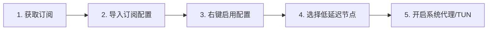

在日常办公、学术科研、跨国开发与影音娱乐中，PC 电脑（Windows 10/11 与 macOS）是跨境网络使用频率最高、网络环境也最复杂的终端。然而，很多电脑用户在寻找“电脑梯子”时，常常陷入一系列认知误区与技术故障：

**“为什么在 GitHub 上下载了 Clash Verge 或 v2rayN，打开后里面却空空如也，根本连不上网？”**  
**“为什么 Chrome 浏览器可以顺畅打开 Google，但电脑端的 ChatGPT 桌面 App 或终端命令行却提示网络超时？”**  
**“为什么电脑一休眠唤醒，或者意外关机后，连国内百度和微信都打不开了？”**  
**“开启 TUN 模式到底会不会让网速翻倍？它和普通系统代理有什么区别？”**

**“电脑梯子”并不是某一个单独的免费软件，而是由「节点服务商（机场）」、「远程配置（订阅链接）」与「桌面代理客户端（如 Clash Verge Rev / v2rayN）」协同构建的网络访问体系。**

本文专注于 Windows 10/11 与 Mac 桌面端，深入拆解主流桌面客户端生态、系统代理（System Proxy）与 TUN 虚拟网卡底层工作原理、开发者与办公场景选型，以及最全面的桌面网络故障排查树，帮助电脑用户彻底搞定稳定高速的跨境连接。

---

## ⚡ 30 秒快速看懂：电脑梯子怎么选、怎么配？

```text
┌─────────────────────────┬───────────────────────────────────┬──────────────────────────────────────┐
│ 你的桌面使用场景        │ 核心决策考量与技术维度            │ 推荐客户端与方案配置形态             │
├─────────────────────────┼───────────────────────────────────┼──────────────────────────────────────┤
│ 🖥️ Windows 10/11 新手   │ 界面现代、订阅一键导入、自动分流  │ 选用 Clash Verge Rev (基于 Mihomo 内核)│
│ 💻 macOS (M系列/Intel)   │ 系统级网络扩展、优雅UI、原生架构  │ 选用 Clash Verge Rev for Mac 或 Stash│
│ 🛠️ 老旧机型 / 备用轻量   │ 追求极低资源占用、单节点手动调试  │ 选用经典轻量 v2rayN (Windows 专享)   │
│ 🌐 仅需浏览器查资料     │ 网页端 Google、维基百科、文献检索 │ 开启普通「系统代理 (System Proxy)」即可 │
│ 🤖 桌面 App / 终端开发  │ ChatGPT 桌面版、Git Clone、Docker │ 必须在客户端内开启「TUN 模式 (虚拟网卡)」│
│ 📺 电脑看 YouTube 4K/8K │ 追求高持续带宽吞吐、晚高峰 0 丢包 │ 搭配 IEPL 物理专线套餐 (如光速云)    │
│ 🚨 电脑防断网应急备用   │ 0 月租、按量付费不过期、即开即用  │ 备用星岛梦不限时流量包，多设备同登   │
└─────────────────────────┴───────────────────────────────────┴──────────────────────────────────────┘
```

> 💡 **核心概念速记**：
> 1. **桌面客户端（如 Clash Verge Rev）** 只是安装在电脑上的“解析工具（空壳车辆）”，软件本身 100% 免费，不自带任何可用网络；
> 2. **机场订阅（Subscription URL）** 是服务商提供给你的“远程提货单”，导入客户端后才能拉取香港、日本、美国等节点；
> 3. **系统代理（System Proxy）** 只管浏览器；**TUN 模式** 通过虚拟网卡接管全电脑所有桌面软件的网络流量。

---

## 一、电脑梯子全景数据流转架构：桌面端如何工作？

理解桌面端网络数据流转，是解决“浏览器能用但软件不能用”、“代理残留断网”的根本前提：

```mermaid
graph TD
    UserApp[桌面应用: Chrome / Edge / ChatGPT桌面版 / Git / Terminal] --> NetDecision{应用是否遵循系统代理?}
    
    NetDecision -->|遵循系统代理: 浏览器/部分软件| SysProxyPort[本地 HTTP/Socks5 监听端口 127.0.0.1:7897]
    NetDecision -->|不遵循系统代理: 命令行/游戏/部分App| TUNAdapter[TUN 虚拟网卡接口: 强制接管物理层 IP 包]
    
    SysProxyPort --> CoreEngine[桌面代理客户端核心 (Mihomo / Xray / sing-box)]
    TUNAdapter --> CoreEngine
    
    CoreEngine --> RuleEngine{内置智能分流规则集}
    
    RuleEngine -->|国内流量: 百度/淘宝/Bilibili| DirectRoute[DIRECT: 走本地宽带光纤直连]
    RuleEngine -->|境外流量: Google/GitHub/OpenAI| ProxyRoute[PROXY: 打包走 TLS 加密专线隧道]
    
    ProxyRoute --> BorderGateway[国内专线入口服务器 / IEPL 物理内网]
    BorderGateway --> ExitServer[海外出口节点 (香港/日本/新加坡/美国)]
    ExitServer --> TargetWeb[目标网站: OpenAI / Google / YouTube 4K]
```

---

## 二、Windows vs macOS：两大桌面操作系统代理机制对比

Windows 与 Mac 在底层网络架构、权限体系和驱动兼容上存在显著差异，不能直接套用相同的设置逻辑：

| 评估维度 | Windows 10 / Windows 11 | macOS (Apple Silicon / Intel) |
| :--- | :--- | :--- |
| **系统代理配置** | 修改注册表中的 Internet Settings (WinINET 代理) | 修改系统设置中的「网络 ➔ 代理 (Proxies)」|
| **全局流量接管 (TUN)** | 依赖 Wintun 驱动或 WinDivert 虚拟网卡 | 依赖 macOS 原生 NetworkExtension 系统网络扩展 |
| **应用安装与安全** | Windows Defender 扫描；SmartScreen 提示未知发布者 | Gatekeeper 门禁机制；需在「安全性与隐私」中授权 |
| **多客户端共存** | 易发生系统代理注册表端口抢占与残留 | 多个客户端冲突时系统代理指示器易报错 |
| **休眠唤醒行为** | 睡眠后虚拟网卡或网卡省电模式易导致断流 | 唤醒后系统网络扩展偶尔需重启主开关恢复 |
| **推荐主流客户端** | **Clash Verge Rev、v2rayN、sing-box** | **Clash Verge Rev for Mac、Stash、Surge Mac** |

---

## 三、2026 桌面客户端生态分类全景对比

不要轻信网上过时的“翻墙软件排行榜”，在 2026 年，电脑端代理已形成以 **Mihomo（Clash Meta）内核** 为主流的清晰格局：

```text
┌────────────────────────────────────────────────────────────────────────────────────────┐
│                          2026 电脑主流代理客户端生态对比表                             │
├────────────────────┬──────────┬──────────────┬──────────────┬──────────┬───────────────┤
│ 客户端分类与代表   │ 适配系统 │ 界面交互体验 │ 规则分流能力 │ TUN 虚拟 │ 适合用户人群  │
├────────────────────┼──────────┼──────────────┼──────────────┼──────────┼───────────────┤
│ Clash Verge Rev    │ Win / Mac│ 🟢 极高 (现代 UI)│ 🟢 顶级 (支持RuleSet)│ 🟢 原生支持 │ 主流新手与进阶首选│
│ v2rayN (经典列表)  │ Win 专享 │ 🟡 传统密集型│ 🟡 基础路由  │ 🟢 支持 (Core)│ 追求极低资源与单节点│
│ sing-box GUI       │ Win / Mac│ 🟡 极客极简  │ 🟢 顶级 (原生规则)   │ 🟢 原生支持 │ 技术开发者与极客 │
│ 机场自研定制 EXE   │ Win / Mac│ 🟢 极高 (一键登录)│ 🔴 仅限固定预设      │ 🟡 因实现而异│ 完全不愿配订阅小白│
│ 商业 VPN 官方桌面端│ Win / Mac│ 🟢 极高 (一键连接)│ 🔴 通常全局代理      │ 🟢 默认全接管│ 仅查网页不需分流者│
└────────────────────┴──────────┴──────────────┴──────────────┴──────────┴───────────────┘
```

> 📌 **关于 Clash for Windows (CFW) 的重要历史说明**：
> 历史上著名的 `Clash for Windows (CFW)` 已于 2023 年底停止维护。**在 2026 年，切勿从不明第三方下载站下载所谓的“CFW 破解版/最新版”**。当前社区公认的现代化主力替代品是基于开源 Mihomo 内核开发的 **Clash Verge Rev**。详细配置教程可参考：[《Clash Verge Rev 下载与配置完整指南》](/tutorials/clash-verge-rev/)。

---

## 四、核心概念辨析：系统代理 vs TUN 模式（什么时候开 TUN？）

这是电脑端最重要、也是新手困惑最多的核心技术点：

```text
┌────────────────────────────────────────────────────────────────────────┐
│                   系统代理 (System Proxy) vs TUN 虚拟网卡               │
├────────────────────┬────────────────────┬──────────────────────────────┤
│ 机制对比           │ 系统代理 (System Proxy)│ TUN 模式 (虚拟网卡)          │
├────────────────────┼────────────────────┼──────────────────────────────┤
│ 流量接管层次       │ 应用层 (HTTP/Socks5)| 网络层 (IP 数据包全量接管)   │
├────────────────────┼────────────────────┼──────────────────────────────┤
│ 适用程序范围       │ 仅限于主动读取系统代理 │ 强制接管全电脑所有程序，包括：│
│                    │ 的软件 (Chrome/Edge)│ 命令行/Git/Docker/游戏/桌面App│
├────────────────────┼────────────────────┼──────────────────────────────┤
│ 系统权限要求       │ 普通用户权限即可   │ 需要管理员权限 (UAC 授权)    │
├────────────────────┼────────────────────┼──────────────────────────────┤
│ 常见应用场景       │ 网页浏览、Google 搜索、│ ChatGPT 桌面端、GitHub Clone、│
│                    │ 网页看 YouTube 视频 │ 终端开发环境、Telegram 桌面版│
├────────────────────┼────────────────────┼──────────────────────────────┤
│ ⚠️ 致命认知误区     │ 误以为开了系统代理所有 │ 误以为开 TUN 会让“物理网速翻倍”│
│                    │ 软件就都自动走代理了 │ (TUN 只解决接管范围，不加速) │
└────────────────────┴────────────────────┴──────────────────────────────┘
```

### 💡 极简判定法则：
- 如果你**只用浏览器**查资料、看视频：只开启「系统代理」即可，简单省心；
- 如果你发现**浏览器能上，但某个桌面客户端（如 ChatGPT App、Discord、Git）连不上**：立刻在客户端设置中安装服务模式并开启「TUN 模式」。

---

## 五、Windows 电脑导入订阅与代理配置 5 步教程（How-To）

以主流的 **Clash Verge Rev** 为例，标准配置流程如下：



### 步骤 1：从机场后台复制订阅链接
登录正规专线机场后台（如 [光速云](/reviews/guangsu-cloud/) 或 [微风网络](/reviews/weifeng-cloud/)），点击「一键导入 Clash」或「复制 Clash 订阅链接」。

### 步骤 2：在客户端中添加订阅配置
打开 Clash Verge Rev：
1. 点击左侧导航栏的 **「订阅 (Profiles)」**；
2. 在顶部输入框中粘贴刚才复制的订阅 URL；
3. 点击右侧的 **「导入 (Import)」**，等待进度条拉取完成并展示绿色配置卡片。

### 步骤 3：激活配置并确认规则模式
1. 右键（或左键点击）刚导入的配置卡片，选择 **「使用 (Use)」**，确保卡片带有激活高亮边框；
2. 进入左侧 **「代理 (Proxies)」** 页面，顶部确保路由模式为 **「规则 (Rule)」** 模式。

### 步骤 4：节点测速与选择
点击代理分组右上角的 ⚡ 测速图标：
- 🟢 **绿色数字（如 35ms / 60ms）**：握手通畅，点击选中香港或日本专线节点；
- 🔴 **红色 Timeout**：代表该节点当前超时离线。

### 步骤 5：开启系统代理（System Proxy）
进入左侧 **「设置 (Settings)」** 页面，打开 **「系统代理 (System Proxy)」** 开关。打开 Chrome 浏览器访问 `google.com` 即可畅连。若需接管全电脑桌面软件，可继续打开 **「TUN 模式」**。

---

## 六、电脑梯子节点地区深度选型：港、日、新、美怎么选？

| 节点地区 | 物理往返延迟 (Ping) | 适用核心场景 | 优势与注意事项 |
| :--- | :---: | :--- | :--- |
| **🇭🇰 香港 (Hong Kong)** | **20ms ~ 45ms** (极低) | 网页急速打开、即时通讯、跨国查阅文献 | 物理距离最近，响应极快；但注意 Claude 等部分 AI 平台不开放香港 IP |
| **🇯🇵 日本 (Japan)** | **45ms ~ 75ms** (低) | ChatGPT 对话、YouTube 4K/8K 追剧、DMM | 亚洲网络核心枢纽，国际互联带宽极充沛，晚高峰表现极稳 |
| **🇸🇬 新加坡 (Singapore)** | **50ms ~ 80ms** (低) | 东南亚外贸业务、TikTok 运营、亚洲备用 | 适合中国南方与沿海宽带用户，流媒体版权库极其丰富 |
| **🇺🇸 美国 (United States)** | **130ms ~ 180ms** (一般) | Claude 3.5 Sonnet、OpenAI 开发者 API、Docker | 虽物理延迟略高，但所有美区本土 AI 生产力与云原生平台均优先适配 |

> 📌 **低 Ping 不等于高网速**：
> 测速 Ping 仅仅是 ICMP/TCP 握手往返延迟，**不代表文件下载带宽**。香港普通公网节点即使 Ping 只有 25ms，若晚高峰丢包严重，看 4K 依然卡顿；而日本 IEPL 专线虽然 Ping 60ms，但由于独享带宽零丢包，能跑满 500Mbps 宽带。详细原理解析可参考：[《为什么节点延迟低但实际速度慢？》](/issues/low-ping-slow-speed-reasons/)。

---

## 七、电脑梯子高频故障排查大表（终极排障决策树）

遇到网络故障时，切忌第一时间盲目重装系统或删除软件，请对照下表排查：

| 故障表现 | 核心诱因定位 | 快速排查与修复步骤 |
| :--- | :--- | :--- |
| **电脑关机/重启后连百度都打不开** | 客户端非正常退出，**系统代理注册表端口残留** | 打开 Windows 设置 ➔ 网络 ➔ 代理 ➔ 手动**关闭代理服务器开关** |
| **Chrome 浏览器正常，但桌面 App 超时** | 该桌面软件不遵循系统代理 | 在客户端内开启 **TUN 模式**（安装服务模式网卡驱动） |
| **Global 模式可用，但 Rule 模式打不开网页** | 规则集匹配失效或客户端 DNS 解析被污染 | 将客户端 DNS 设为 `1.1.1.1`，或更新客户端内置规则文件 |
| **所有节点全部显示 Timeout 红色** | 订阅失效、流量耗尽、或宽带本地网络故障 | 关代理测裸网是否正常，登录后台确认套餐剩余流量，刷新订阅 |
| **订阅更新提示 404** | 服务商订阅链接域名变更或个人 Token 被重置 | 登录机场官网后台重新复制最新订阅链接并覆盖导入 |
| **订阅更新提示 403** | 套餐欠费过期，或短时间内高频刷新触发防刷 | 核对账户余额与套餐有效期，稍等 5 分钟后再试 |
| **电脑睡眠唤醒后网络彻底断开** | 虚拟网卡随系统休眠断开，未能自动重连 | 在客户端界面点击重启内核，或快速开关一次系统代理 |
| **提示 TLS Error 或证书过期** | 电脑系统时间与国际标准时间不同步 | 打开 Windows 设置 ➔ 时间和语言 ➔ 点击**「立即同步时间」** |

---

## 八、电脑端典型应用场景实战建议

| 应用场景 | 电脑端常见痛点 | 核心配置与选型建议 |
| :--- | :--- | :--- |
| **🤖 ChatGPT 桌面版 / 网页版** | 网页报错 `Access Denied` 或 App 提示 403 | **选用美区/日区原生纯净专线节点**；开启 TUN 模式；清除浏览器 Cookie |
| **💻 开发者环境 (Git / Docker)** | `git clone` 速度只有几 KB，Docker 拉镜像失败 | 开启客户端 **TUN 模式**，或在终端中手动配置 `export https_proxy=http://127.0.0.1:7897` |
| **📺 YouTube 4K/8K 影音剪辑** | 晚高峰自动降画质至 1080P/720P，缓冲慢 | 优先选用 **IEPL 物理专线节点**（保障晚高峰 0 丢包），在播放器中锁死 4K 画质 |
| **💼 跨国远程办公 (Zoom / Teams)** | 视频会议声音断续、画面卡顿丢帧 | 选用低 Jitter（延迟抖动 < 5ms）的专线节点，避免使用高负载公共节点 |
| **🎮 PC 外服游戏 (Steam / Epic)** | 联机延迟高、频繁掉线 | 通用代理仅适合游戏下载与商店浏览；多人对战联机建议搭配专业游戏加速器 |

---

## 九、电脑高适配性专线品牌推荐矩阵

针对 Windows / Mac 桌面端高并发下载、TUN 兼容性与晚高峰抗压，精选以下真实稳定方案：

```text
┌────────────────────────────────────────────────────────────────────────────────────────┐
│                             2026 电脑梯子精选品牌候选矩阵                              │
├──────────┬──────────────────────────┬──────────────┬──────────────┬────────────────────┤
│ 适配场景 │ 推荐品牌候选             │ 实际起付门槛 │ 每月流量配额 │ 电脑端核心适配优势 │
├──────────┼──────────────────────────┼──────────────┼──────────────┼────────────────────┤
│ 全能主力 │ 光速云 (GuangSuYun)      │ 约 ¥7.5/月起 │ 59G~238G /月 │ 6年老牌物理专线，4K/8K秒开，TUN完美兼容│
│ 平价轻量 │ 微风网络 (BreezeNet)     │ 约 ¥7/月起   │ 50GB / 月    │ 专为电脑网页查资料优化，百元内极低负担 │
│ 弹性月付 │ 唯兔云 (V2Yun)           │ ¥14.9/月     │ 100GB / 月   │ 15元单月付，60+节点备用，随用随买  │
│ 应急备用 │ 星岛梦 (XingDaoMeng)     │ 约 ¥8/月起   │ 60G/不限时包 │ 0月租不限时包，电脑防断网首选备用  │
│ AI/开发  │ 速界 (SpeedWorld)        │ ¥25/月       │ 150GB / 月   │ 原生纯净住宅 IP，ChatGPT/API 秒响应 │
└──────────┴──────────────────────────┴──────────────┴──────────────┴────────────────────┘
```

- 🏆 **全能旗舰首选**：[光速云](/reviews/guangsu-cloud/) —— 全线 IEPL 企业专线，Clash Verge 一键导入，晚高峰 20:00 4K/8K 零卡顿；
- 🍃 **超低预算轻量**：[微风网络](/reviews/weifeng-cloud/) —— 针对电脑轻度查资料与文字 AI 优化的 50GB 小流量专线，年付折算仅约 ¥7/月；
- 💳 **拒绝绑定的单月付**：[唯兔云](/recommend/best-airports/) —— ¥14.9 纯单月付，100GB 充沛流量，节点丰富。

---

## 十、电脑梯子使用 18 项安全与配置自查清单

```text
┌────────────────────────────────────────────────────────────────────────┐
│                   电脑梯子 18 项配置与安全通关清单                     │
├────────────────────────────────────────────────────────────────────────┤
│ □ 1. 桌面客户端是否直接下载自官方 GitHub Release，绝非第三方修改版    │
│ □ 2. 我确认没有在电脑上为了“翻墙”而永久关闭 Windows Defender/杀毒软件 │
│ □ 3. 机场订阅链接已成功导入客户端，且能正常展示绿色节点与低延迟数值   │
│ □ 4. 客户端路由模式已确认为「规则 (Rule)」智能分流模式                 │
│ □ 5. 访问国内网站 (如百度/淘宝/B站) 依然走高速直连，不耗费代理流量   │
│ □ 6. 当需要使用命令行或 ChatGPT 桌面端时，已知晓开启「TUN 模式」       │
│ □ 7. 电脑开机后若无法上网，已掌握检查「Windows 系统代理设置」是否残留 │
│ □ 8. 节点在家庭有线/Wi-Fi 环境下测试 Google 与 YouTube 能秒开加载     │
│ □ 9. 电脑系统时间已与国家标准时间同步（防止 TLS 握手证书报错）        │
│ □ 10. 客户端内已配置加密 DNS (如 1.1.1.1)，避免运营商 DNS 污染        │
│ □ 11. 我确认绝不将自己的专属订阅链接公开截图或发到公共技术社群        │
│ □ 12. 遇到节点偶发红线超时，我已掌握在客户端内「一键刷新订阅配置」     │
│ □ 13. 电脑中已常备第二个备用服务商的订阅或不限时按量流量包            │
│ □ 14. 电脑未同时开启多个互相冲突的代理客户端或虚拟网卡                │
│ □ 15. Mac 电脑已在系统设置中正确授予客户端「网络扩展」或辅助功能权限  │
│ □ 16. 我清楚了解开启梯子并不代表可以匿名违规，承诺文明合法用网        │
│ □ 17. 遇到网络严重异常时，已掌握「先测裸网 ➔ 查订阅 ➔ 调DNS」排查法   │
│ □ 18. 在公司内网使用时，已了解并遵守所在企业的网络信息安全规范        │
└────────────────────────────────────────────────────────────────────────┘
```

---

## 十一、避坑指南：20 个关于“电脑梯子”的致命误区

```text
❌ 误区 1：在 GitHub 下载了 Clash Verge 就自动拥有了免费翻墙能力 ➔ 事实：客户端是空壳，必须购买并导入机场订阅。
❌ 误区 2：Clash Verge Rev 是一家卖梯子的商业公司 ➔ 事实：它是一个开源的桌面图形客户端项目。
❌ 误区 3：电脑梯子必须一直开着“全局代理 (Global)” ➔ 事实：全局会导致访问国内网站变慢且白白消耗套餐流量。
❌ 误区 4：开启 TUN 模式可以让网速翻倍 ➔ 事实：TUN 只解决流量接管范围，对物理宽带容量没有加速作用。
❌ 误区 5：测速 Ping 越低，看 4K 视频就越快 ➔ 事实：低 Ping 不等于高带宽，晚高峰物理专线零丢包才是关键。
❌ 误区 6：节点数量越多，梯子就越稳定 ➔ 事实：有效节点只需港/日/美 3~5 个，劣质节点只会拖慢更新。
❌ 误区 7：只要连接了美国节点，ChatGPT 就 100% 能用 ➔ 事实：机房共享脏 IP 会被 OpenAI 拦截报 403 阻断。
❌ 误区 8：电脑科学上网必须先关闭 Windows 防火墙 ➔ 事实：正常客户端只需普通网络权限，严禁关闭系统防火墙。
❌ 误区 9：网盘里下载的“免安装绿色破解版客户端”更好用 ➔ 事实：第三方篡改包常被植入挖矿木马与后门。
❌ 误区 10：浏览器能用，代表电脑上所有桌面软件都走了代理 ➔ 事实：终端、Git、桌面 App 需配置代理或开启 TUN。
❌ 误区 11：电脑一开机打不开网页一定是电脑坏了 ➔ 事实：多为上一次关机时系统代理端口残留未自动释放。
❌ 误区 12：订阅更新显示 404 代表服务商跑路 ➔ 事实：通常是服务商更换了订阅域名或更新了用户 Token 路径。
❌ 误区 13：Mac 电脑翻墙一定比 Windows 更稳定 ➔ 事实：稳定性取决于机场专线质量，与操作系统无直接关联。
❌ 误区 14：只要花了钱买了付费专线就永远不会出故障 ➔ 事实：仍需掌握刷新订阅、切换节点等基本运维常识。
❌ 误区 15：可以同时打开 Clash、v2rayN 和商业 VPN ➔ 事实：多个客户端会互相争抢系统代理与虚拟网卡导致断网。
❌ 误区 16：遇到网络问题第一步必须重装 Windows 系统 ➔ 事实：99% 的问题通过关闭系统代理或重启内核即可解决。
❌ 误区 17：全部节点 Timeout 红色代表机场彻底倒闭 ➔ 事实：多为本地网络断开、流量耗尽或订阅解析错误。
❌ 误区 18：只要能打开 Google 搜索就代表 Netflix 完整解锁 ➔ 事实：需具备原生家庭 IP 才能看全量版权剧集。
❌ 误区 19：客户端版本越新就一定越快 ➔ 事实：新版本主要修复 Bug 与适配系统，节点速度取决于服务器线路。
❌ 误区 20：订阅链接可以随意分享给微信好友 ➔ 事实：订阅包含个人密钥，分享会导致流量被盗刷甚至封号。
```

---

## 十二、常见问题深度解答（FAQ · 35 问）

### Q1：电脑梯子哪个好？
**答**：电脑端最佳选型为：**「开源客户端（如 Clash Verge Rev / v2rayN）+ 2 年以上老牌 IEPL 物理专线机场（如光速云/微风网络）」**，兼顾自动化规则分流与晚高峰 4K 极速体验。

### Q2：Windows 10 和 Windows 11 梯子怎么选？
**答**：两者推荐使用基于 Mihomo 内核的 **Clash Verge Rev**。Win10 与 Win11 在网络栈上高度通用，Clash Verge Rev 提供极佳的系统代理与原生 TUN 虚拟网卡支持。

### Q3：Mac 梯子哪个好？
**答**：Mac 用户推荐使用 **Clash Verge Rev for Mac（完美适配 Apple Silicon M 系列与 Intel 芯片）**，进阶玩家亦可选用 Stash 或 Surge Mac。

### Q4：电脑梯子客户端自带免费节点吗？
**答**：**不自带。** 官方正规开源客户端均为纯粹的工具空壳，本身不提供任何服务器，必须由用户购买并导入外部机场订阅。

### Q5：Clash Verge Rev 是什么？它是机场吗？
**答**：它是一个跨平台的**开源桌面代理客户端软件**，负责解析配置、管理节点与建立本地网络隧道。**它不是机场，不出售任何网络节点**。

### Q6：Mihomo 是什么？
**答**：Mihomo（原 Clash Meta）是一个开源的代理核心引擎，负责底层的加密传输、DNS 解析与分流路由，桌面客户端通常基于它构建图形界面。

### Q7：v2rayN 是什么？
**答**：v2rayN 是 Windows 平台上非常经典的开源轻量代理客户端，适合喜欢传统列表式管理、追求极低资源占用的用户。

### Q8：机场订阅链接怎么导入电脑客户端？
**答**：在机场后台复制订阅 URL，打开 Clash Verge Rev 进入「订阅」界面，粘贴链接并点击「导入」，完成后右键选中该配置并开启「系统代理」即可。

### Q9：订阅和节点有什么区别？
**答**：**订阅**是包含所有节点信息的“远程提货单”；**节点**是提货单中具体的某一台境外服务器（如香港 01、日本 02）。

### Q10：Windows 系统代理（System Proxy）是什么？
**答**：系统代理是一种操作系统级的网络设置，开启后会让 Chrome、Edge 等遵循系统设置的浏览器自动通过本地代理客户端上网。

### Q11：什么情况下需要开启 TUN 模式？
**答**：当需要让**不遵循系统代理的程序（如 ChatGPT 桌面 App、Git 命令行、Docker、游戏、终端工具）**走代理时，必须在客户端中开启 TUN 模式。

### Q12：开启 TUN 模式会让网速变快吗？
**答**：**不会。** TUN 模式只解决了“流量接管范围”问题，将接管范围从浏览器扩大到全系统，但不会降低物理延迟或增加宽带容量。

### Q13：为什么浏览器能用，但桌面软件（如 ChatGPT App）不能用？
**答**：因为该桌面软件没有读取 Windows 系统代理设置。在客户端设置中**开启「TUN 模式」**即可强制接管该软件的网络流量。

### Q14：为什么 Global 全局模式能用，Rule 规则模式不能用？
**答**：说明分流规则集未能正确匹配目标域名，或者客户端 DNS 解析出现异常。可尝试更新规则集或将客户端 DNS 改为 `1.1.1.1`。

### Q15：电脑梯子节点全部显示 Timeout 红色怎么办？
**答**：先关代理确认电脑裸网正常，再登录机场后台确认套餐是否欠费或流量耗尽，最后在客户端内点击刷新订阅配置。

### Q16：电脑关机后第二天开机打不开网页怎么办？
**答**：这是因为上一次关机时系统代理端口残留。打开 Windows 设置 ➔ 网络 ➔ 代理 ➔ 手动**关闭代理服务器**开关即可秒解。

### Q17：电脑提示 TLS Error 怎么解决？
**答**：通常是因为电脑系统时间与国际标准时间不一致导致证书验证失败。进入系统设置点击「立即同步时间」即可恢复。

### Q18：订阅更新显示 404 错误是什么原因？
**答**：通常是因为服务商更换了订阅域名，或者你的个人订阅 Token 被系统重置，需登录官网重新复制最新订阅链接。

### Q19：订阅更新显示 403 错误是什么原因？
**答**：说明该请求被服务商防火墙拦截，通常是因为套餐已过期、欠费，或者短时间内高频刷新触发了防刷机制。

### Q20：电脑梯子为什么在晚上 8~10 点特别卡？
**答**：遭遇了晚高峰国际骨干网拥堵。建议切换至企业级 **IEPL 物理专线节点**，专线不走公网骨干网，晚高峰 0 丢包。

### Q21：电脑看 YouTube 4K 怎么设置最流畅？
**答**：选用 **IEPL 物理专线节点**（保障晚高峰 0 丢包），在播放器设置中将画质固定为 4K（2160P），并确保客户端处于「规则」分流模式。

### Q22：电脑看 Netflix 提示无法解锁版权剧怎么办？
**答**：需在节点列表中选用明确标有“原生解锁”或“全解锁”的节点，并确认浏览器未开启可能冲突的第三方代理插件。

### Q23：电脑端用 ChatGPT 网页报错 Access Denied 怎么办？
**答**：选用美区/日区原生纯净专线节点；在浏览器中清除 `chatgpt.com` 的 Cookie 与缓存；刷新页面即可正常登录。

### Q24：为什么电脑睡眠唤醒后梯子连不上网？
**答**：睡眠过程中虚拟网卡随网卡省电机制休眠。在客户端界面点击“重启内核”，或快速开关一次系统代理即可恢复。

### Q25：电脑开机自动启动代理好不好？
**答**：日常使用非常方便；但需注意若节点失效可能导致开机无网。掌握手动关闭系统代理的方法即可放心开启自启。

### Q26：GitHub 打不开或 clone 失败怎么解决？
**答**：开启客户端 **TUN 模式**；或在终端中执行命令配置局部代理：`git config --global http.proxy http://127.0.0.1:7897`。

### Q27：可以同时打开两个代理软件吗？
**答**：**坚决不能。** 多个软件会互相篡改系统代理与虚拟网卡，导致端口冲突、网络循环甚至彻底断网。

### Q28：电脑梯子客户端从哪里下载安全？
**答**：务必直接从**官方 GitHub Release 页面**或开发者官方网站下载，坚决不要在第三方网盘或破解站下载修改版 EXE/DMG。

### Q29：Windows Defender 提示未知应用怎么办？
**答**：开源客户端因未购买微软昂贵的签名证书常被误报。只要确认下载自官方 GitHub Release，点击“更多信息 ➔ 仍要运行”即可。

### Q30：普通翻墙需要永久关闭 Windows 防火墙吗？
**答**：**坚决不需要。** 正常代理只需允许客户端通过本地防火墙，永久关闭防火墙会给电脑带来严重的安全隐患。

### Q31：一个机场订阅可以同时用在手机和电脑上吗？
**答**：取决于服务商套餐规则。大多数正规机场支持 2~5 台设备同时在线使用，可将同一订阅链接分别导入手机与电脑客户端。

### Q32：电脑梯子应该选月付还是年付？
**答**：**新用户首次使用某个品牌坚守月付**（¥15 左右），在电脑上实测晚高峰、ChatGPT 与 4K 稳定后，再考虑年付享受折算优惠。

### Q33：电脑有线连接和 Wi-Fi 测速差异大吗？
**答**：有线连接更稳定且延迟抖动更低。若 Wi-Fi 信号衰减或路由器性能不足，可能会成为代理测速的物理瓶颈。

### Q34：Mac 电脑提示“已损坏，无法打开”怎么办？
**答**：这是 macOS Gatekeeper 拦截。在终端中执行命令：`sudo xattr -r -d com.apple.quarantine /Applications/Clash\ Verge.app` 即可正常运行。

### Q35：什么时候需要彻底重装客户端？
**答**：日常故障只需检查节点与订阅，只有当虚拟网卡驱动损坏或升级系统后内核持续崩溃时才需要重装。

---

## 🏁 总结：电脑科学上网终极实操心法

要在 Windows 和 Mac 电脑上获得极致丝滑、稳定且全场景兼容的上网体验，请牢记以下**三大原则**：

```text
1. 认清工具分工 ➔ 客户端是空壳工具 (免费开源)，专线机场是节点与汽油 (按月/年订阅)
2. 搞懂代理机制 ➔ 仅看网页用「系统代理」，桌面App/终端/ChatGPT用「TUN 模式」
3. 掌握核心排障 ➔ 开机断网先查系统代理残留，节点超时先测裸网与刷新订阅
```

---

### 📚 延伸进阶阅读与选型专栏
- 📱 **移动设备总入口**：[《手机梯子哪个好？Android、iPhone梯子工具与新手使用指南》](/recommend/mobile-tizi/)
- 🤖 **Android 独立指南**：[《安卓梯子怎么选？Android客户端、订阅、节点与故障完整指南》](/tutorials/android-tizi/)
- 🍎 **iPhone 独立指南**：[《iPhone梯子怎么用？Shadowrocket、小火箭、订阅与节点新手完整教程》](/tutorials/iphone-tizi/)
- 🏆 **2026 全景大榜**：[《2026梯子推荐：稳定、速度、价格、安全与不同使用场景怎么选》](/recommend/best-tizi/)
- 🎯 **深度决策指南**：[《梯子哪个好用？稳定性、速度、价格、节点与客户端完整选择指南》](/recommend/which-tizi-is-best/)
- 💳 **付费购买指南**：[《付费梯子哪个好？月付、年付、低价与高性价比方案怎么选》](/recommend/paid-tizi/)
- 📖 **基础概念认知**：[《梯子是什么？梯子工具、VPN、机场、代理到底有什么区别？》](/wiki/what-is-tizi/)
- ⚡ **老牌旗舰专线**：[《光速云深度评测：2020老牌IEPL专线与解锁实测》](/reviews/guangsu-cloud/)
- 🍃 **平价轻量专线**：[《微风网络深度评测：小流量套餐值不值得买？》](/reviews/weifeng-cloud/)
- 🛠️ **电脑客户端实操**：[《Clash Verge Rev 下载与安装配置完整教程》](/tutorials/clash-verge-rev/)
- 🚨 **排障实战手册**：[《Clash 有节点但无法上网怎么办？7 步系统排查与修复指南》](/issues/clash-connected-no-internet/)
