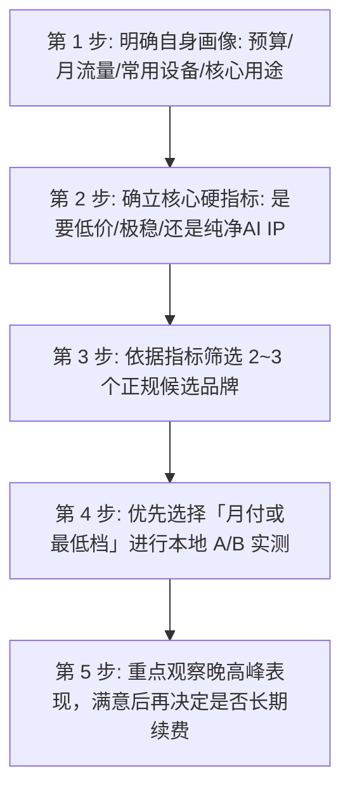
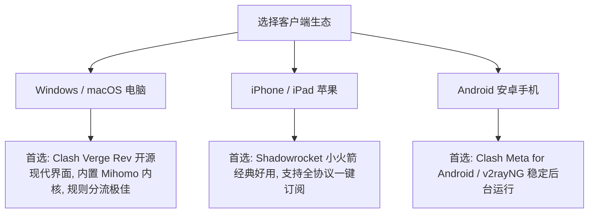

在中文互联网关于科学上网的搜索中，“**梯子哪个好用**”始终是搜索量最高、也最容易让人感到困惑的问题。

许多新手在挑选时，往往一上来就四处询问“哪家排名第一”或者“哪家速度最快”。但网络代理的实际体验是一个高度个性化的系统工程：**不同的家庭宽带运营商（电信/联通/移动）、不同的使用设备（Windows/Mac/iPhone/Android）、不同的月度流量预算，以及截然不同的核心场景（纯网页查资料、高频调用 ChatGPT、看 YouTube 4K、还是打外服游戏），对“好用”的定义完全不同**。

本文不搞虚假的“全网第一”打分排名，而是从**稳定性、晚高峰持续带宽、真实付费门槛、节点质量、客户端生态与风险控制**等维度，建立一套科学客观的选型决策框架，帮助你理清自身需求，筛选出最适合自己的候选方案。

---

## ⚡ 30 秒快速选型决策：梯子哪个好用？

如果希望快速对号入座，请参考以下核心决策链路：

```text
┌─────────────────────────┬───────────────────────────────────┬──────────────────────────────────────┐
│ 你的核心诉求            │ 最应该看的硬核指标                │ 方案方向与典型产品形态               │
├─────────────────────────┼───────────────────────────────────┼──────────────────────────────────────┤
│ 追求极致稳定、不掉线    │ 跨境物理专线 + 晚高峰丢包率 < 1%  │ 选老牌 IEPL / IPLC 专线 (如光速云)   │
│ 追求视频秒开、大吞吐    │ 晚高峰持续带宽 + 充足流量配额     │ 选 100G~200G 优质中转/专线月付包     │
│ 追求低成本、高性价比    │ 真实支付金额 + 年付折算月价       │ 选 ¥7~8/月平价小流量专线 (如微风/飞猫)│
│ 主要在 iPhone 上使用    │ 兼容 Shadowrocket / Stash 一键订阅│ 选节点命名规范、提供 iOS 教程的服务商│
│ 主要在 Windows 电脑使用 │ 兼容 Clash Verge Rev (Mihomo 内核)│ 选规则分流完善、支持 TUN 模式的机场  │
│ 核心用途是 ChatGPT/Claude│ 原生住宅 IP + 节点 IP 信誉度      │ 选美日新纯净节点，避开机房黑名单     │
│ 核心用途是 YouTube 4K   │ 节点负载低 + 晚高峰持续 50Mbps    │ 选大带宽专线，避开高倍率扣费节点     │
│ 核心用途是 Netflix 追剧 │ 原生流媒体解锁 + 地区识别准确     │ 选明确标注港台日美原生解锁的专线     │
│ 零基础小白新手          │ 客户端安装极简 + 售后工单响应快   │ 选提供一键导入或自研客户端的服务商   │
│ 防断网备用通道          │ 0 月租 / 不限时流量包 / 低起付门槛│ 选按量计费不过期流量包 (如星岛梦)    │
└─────────────────────────┴───────────────────────────────────┴──────────────────────────────────────┘
```

---

## 一、重新定义：一款梯子到底怎样才算“好用”？

“好用”绝不是一个单维度的速度测试数字，而是由以下 **10 大复合维度** 共同构成的整体体验：

| 评估维度 | 为什么它是“好用”的基石 | 核心判断依据 | 常见认知误区 |
| :--- | :--- | :--- | :--- |
| **1. 基础连通率** | 节点随时点开随时能连上，不频繁报连接超时 | 客户端测试节点存活率 $\ge 95\%$ | 误以为“买了一次就能永久不维护” |
| **2. 长期连接稳定性** | 连续办公、语音通话或视频长达数小时不频繁断流 | 丢包率 (Loss) $< 1\%$，Jitter 抖动低 | 误以为“Ping 延迟低就等于不掉线” |
| **3. 晚高峰可用性** | 每晚 20:00~23:00 全网骨干网拥塞时依然流畅 | 晚高峰 4K 视频持续播放不频繁降画质 | 误以为“白天测速快晚上就一定快” |
| **4. 常用节点质量** | 香港、日本、新加坡、美国等核心节点具备原生属性 | IP 未被 Google/Cloudflare 频繁验证码拦截 | 误以为“节点总数越多就越好” |
| **5. 流量配额匹配** | 每月流量能够从容覆盖实际用量，无暗扣与高倍率 | 节点倍率透明 (1.0x)，流量不过早耗尽 | 盲目贪图“超低价不限流量”陷阱 |
| **6. 客户端生态适配** | 与自己的 Windows、Mac、iPhone、Android 完美契合 | 订阅一键导入无报错，规则分流精准 | 误以为客户端是服务商自带的软件 |
| **7. 价格与预算契合** | 付费门槛合理，支持月付短周期，预付风险可控 | 真实支付单价合理，无强制多年绑定 | 误以为“月均折算越便宜越划算” |
| **8. 订阅维护便捷度** | 节点失效时后台能够及时动态切换 IP，订阅更新顺畅 | 订阅接口稳定，更新不频繁报 404/500 | 忽视服务商后端的长期运维能力 |
| **9. 场景解锁满足度** | 能稳定打开 ChatGPT、Claude，流媒体内容库识别正确 | 节点通过各大 AI 与流媒体平台风控 | 误以为“能打开 Google 就代表 AI 一定能用” |
| **10. 运营与资金安全** | 服务商运营历史悠久，售后渠道通畅，资金链稳健 | 运营 2~6 年以上老牌，不搞大额终身预付 | 贪图便宜轻信刚开业的小作坊 |

---

## 二、选型思维重构：为什么不要直接问“哪个品牌排名第一”？

在选购梯子时，最常见也是最致命的错误逻辑是：

```
[错误思维]：网上找一个“2026 梯子排行榜 TOP1” ➔ 直接掏钱买一年 ➔ 本地网络卡顿/不适配 ➔ 维权无门
```

**正确的选型漏斗应当是**：



不同用户的宽带运营商差异极大：**例如上海电信走某个日本节点延迟仅 35ms，而北方联通可能需要 70ms；广州移动访问新加坡极快，访问美国则可能丢包**。任何未经本地真实网络环境验证的“全网第一”，对你而言都没有绝对参考价值。

---

## 三、稳定性深度剖析：梯子哪个稳定？为什么稳定不等于 Ping 低？

在各大社区中，关于“梯子哪个稳定”、“哪个不容易掉线”的讨论最为热烈。

### 1. 为什么“低延迟（Low Ping）”不等于“稳定”？
许多用户在客户端中点击延迟测试，看到香港节点显示 **25ms（绿色）**，就认为这个节点最好用。但实际情况往往是：

```text
节点 A (普通公网中转香港): Ping = 25ms, 但晚高峰丢包率 = 8%, Jitter = 45ms ➔ 频繁网页卡死、TCP 重传、视频转圈
节点 B (物理专线日本/新加坡): Ping = 55ms, 晚高峰丢包率 = 0%, Jitter = 2ms  ➔ 点击秒响应、视频极速加载、办公数小时不掉线
```

对于日常网页浏览、远程办公、视频会议与 ChatGPT 对话，**0 丢包与低抖动（Jitter）的节点 B 体验远胜于经常丢包的节点 A**。

### 2. 稳定性科学评估指标对照表：

| 网络指标 | 正常/优秀状态应该怎么看 | 异常现象意味着什么 | 对实际使用的影响 |
| :--- | :--- | :--- | :--- |
| **延迟 (Ping)** | 香港 25~50ms，日韩 40~70ms，美欧 130~180ms | 突然飙升到 300ms 以上 | 影响点击链接后的瞬间响应感 |
| **抖动 (Jitter)** | 抖动 $< 5\text{ms}$，延迟曲线平直 | 抖动 $> 30\text{ms}$，延迟忽高忽低 | 导致语音通话断续、视频频繁重缓冲 |
| **丢包率 (Packet Loss)** | **物理专线应保持 0%**，公网中转 $< 1\%$ | 丢包率 $\ge 3\%$ | **杀伤力最大！** 导致网页打不开、SSH 频繁断开 |
| **晚高峰抗压** | 20:00~23:00 期间速度与白天无明显差异 | 晚高峰断流、测速直接变红超时 | 说明服务商带宽超售严重或采用劣质公网直连 |
| **节点长期可用率** | 核心节点长期在线，维护有提前公告 | 经常有一半节点红线超时、IP 频繁被封 | 说明服务商资金链紧张或缺乏防封锁运维能力 |

详细排障与原理解析推荐阅读：[《为什么机场节点延迟低但速度慢？解析延迟与带宽的真实关系》](/issues/low-ping-slow-speed-reasons/)。

---

## 四、速度深度剖析：梯子哪个速度最快？

讨论“梯子哪个速度快”时，必须分清**“峰值速度（Peak Speed）”**与**“持续下行吞吐（Sustained Throughput）”**的区别。

### 1. 为什么单次 Speedtest 跑分容易误导？
单次测速只能证明**在这一秒钟内、连接该测速服务器的瞬间带宽**。很多劣质服务商会对测速节点进行单点 QoS 优先级加速，跑分看似能达到 500Mbps，但当你打开 YouTube 观看 4K 视频时，持续下载速度却被限流在 5Mbps。

### 2. 香港 vs 日本：真实选路速度对比
- **香港节点**：物理距离最近，网页首字加载（TTFB）最快；但由于所有用户默认挤在香港节点，晚高峰出口负载最高，容易出现拥塞；
- **日本 / 新加坡节点**：物理延迟稍高 20~30ms（人体几乎无感），但机房国际带宽储备极其充沛，晚高峰看 4K/8K 视频往往比香港更丝滑。

### 3. 科学的 A/B 速度测试标准流程（10 步法）：

```text
Step 1: 断开代理 ➔ 测试本地宽带裸网是否正常 (Speedtest 测本地基准)
Step 2: 连接节点 A ➔ 在客户端中测试 Ping / Jitter
Step 3: 使用浏览器无痕模式 ➔ 打开 Fast.com 或 Speedtest 测试真实下行吞吐
Step 4: 打开 YouTube ➔ 搜索 4K 60fps 视频 ➔ 开启「详细统计信息 (Stats for nerds)」
Step 5: 观察「Connection Speed」是否稳定维持在 45,000 Kbps (45Mbps) 以上
Step 6: 打开 ChatGPT ➔ 发送长文本提示词 ➔ 观察文字输出是否平稳无卡顿
Step 7: 重点在 20:30 (晚高峰) 重复上述测试 ➔ 记录是否出现断流
Step 8: 切换至节点 B ➔ 重复上述流程对比
Step 9: 记录对比结果表格
Step 10: 筛选出本地网络下综合体验最好的节点作为日常默认
```

---

## 五、价格深度剖析：梯子哪个便宜？什么才叫真正的性价比？

在挑选便宜梯子时，最核心的原则是：**“算清真实支付总成本，警惕虚假月均陷阱”**。

### 1. 真实月付 vs 年付折算大比拼：

| 方案类别 | 标称月均宣传 | 实际结算周期 | 首次支付金额 | 预付风险评级 | 真实适用人群 |
| :--- | :--- | :--- | :---: | :---: | :--- |
| **真实低价月付档** | ¥14.9 / 月 | **按月支付 (1个月)** | **¥14.9** | 🟢 **极低** | 不想一次性掏太多钱、希望随用随买的用户 |
| **平价专线年付档** | 约 ¥7~8 / 月 | **按年支付 (12个月)** | **¥80~90** | 🟢 **可控** | 预算百元内、追求低价 IEPL 专线且希望长期省心的轻度用户 |
| **按量计费不限时档** | 0 月租 (按量扣费) | **一次性购买流量包** | **¥30~60** | 🟢 **极低** | 用量极少、仅作为备用第二线路、防止主力断网的用户 |
| **超长周期诱导档** | 宣称 ¥2.9 / 月 | **强制 3 年付 (36月)** | **¥108~150** | 🔴 **极高** | **坚决不推荐！** 小作坊跑路重灾区，资金安全性极差 |

> 💡 **真正的性价比定义**：
> 性价比不是“价格 $\div$ 标称流量”的数学游戏。**一款每月 8 元但能在晚高峰稳定秒开 4K、不掉线的专线梯子，其性价比远高于每月 3 元却经常连不上、晚高峰网页转圈的劣质直连梯子**。

---

## 六、节点深度剖析：梯子哪个节点多？节点越多越好吗？

很多广告常常宣称“拥有全球 100+ 国家、1000+ 节点”。但真实的使用情况是：**95% 的国内用户日常 99% 的流量只集中在 4 个核心地区**：

```text
┌──────────────┬────────────────────────────────────────────────────────────────────────┐
│ 常用核心地区 │ 核心优势与适用场景                                                     │
├──────────────┼────────────────────────────────────────────────────────────────────────┤
│ 🇭🇰 中国香港  │ 物理距离最近 (20~40ms)，查资料、刷推、网页响应极快，但不原生支持 TikTok│
│ 🇯🇵 日本      │ 亚太网络枢纽，国际带宽大，全解锁流媒体与 AI，晚高峰极度稳定            │
│ 🇸🇬 新加坡    │ 东南亚枢纽，中文内容识别好，原生解锁 ChatGPT / Claude / Netflix        │
│ 🇺🇸 美国      │ 原生美区 IP 资源最丰富，适合美区 PayPal、美区 Apple ID 与冷门 AI 工具  │
│ 🇹🇼 中国台湾  │ 原生支持动画疯 (Baha)、繁体中文流媒体与部分港台限定版权视频            │
└──────────────┴────────────────────────────────────────────────────────────────────────┘
```

> ⚠️ **核心结论**：**常用核心地区节点的质量与原生纯净度，远比拥有几十个非洲、南美洲冷门节点重要得多**。冷门节点通常为公网低速解析，日常极少使用，盲目追求节点总数没有实际意义。

---

## 七、线路与协议深度辨析：IEPL 一定最好吗？协议越新越快吗？

### 1. 线路质量梯队：
1. **IPLC / IEPL 物理专线**（企业级内网，不过公网出口，敏感时期抗封锁能力最强，晚高峰 0 丢包）；
2. **优质 BGP 优化中转**（国内多线 BGP 入口中转出海，性价比较高）；
3. **公网普通直连**（成本极低，极易受骨干网波动和晚高峰拥塞干扰）。

> ⚠️ **理性看待 IEPL**：IEPL 专线代表跨境传输不过公网审查，但如果服务商超售严重、后端落地机房带宽不足，专线一样会出现拥堵。因此**专线是基础保障，但仍需结合服务商的带宽冗余水平综合判断**。

### 2. 协议现代化：
- **VLESS (Reality)**：当前最推荐的现代化协议，免域名证书，伪装能力顶级；
- **Shadowsocks (SS)**：经典稳定，几乎所有老旧客户端与路由器固件通吃；
- **Hysteria 2 (歇斯底里 2)**：基于 UDP 的高速加速协议，适合本地网络丢包严重的恶劣宽带环境。

---

## 八、客户端对“好用”的决定性影响

一款梯子在服务端线路再好，如果客户端经常闪退、分流规则混乱或配置极其繁琐，用户依然会觉得“不好用”。



### 多端客户端选型注意要点：
- **Windows / Mac 用户**：强烈推荐使用 **Clash Verge Rev**，自带规则分流（访问百度走直连，访问 Google 走代理），不需要手动频繁开关代理；
- **iPhone 用户**：需要在海外 App Store 下载 **Shadowrocket（小火箭）** 或 Stash，购买机场后直接点击“一键导入 Shadowrocket”即可自动同步全部节点；
- **小白新手**：如果完全不想折腾第三方客户端，可以优先选择提供**自研一键登录 App** 的服务商。

实操教程参考：[《Clash Verge Rev 下载安装与配置完整教程》](/tutorials/clash-verge-rev/) 与 [《Shadowrocket 小火箭订阅配置教程》](/tutorials/shadowrocket/longmao-cloud/)。

---

## 九、按使用场景选型推荐矩阵（真实品牌分组候选）

> 声明：以下推荐基于各品牌的真实客观定位，杜绝无意义的“全能吹捧”，每个品牌均有其最适合的人群与需要注意的事项。

```text
┌────────────────────────────────────────────────────────────────────────────────────────┐
│                             2026 场景化梯子候选选型矩阵                                │
├──────────┬──────────────────────────┬──────────────┬──────────────┬────────────────────┤
│ 场景类别 │ 推荐品牌候选             │ 实际起付价格 │ 核心线路架构 │ 优选核心理由       │
├──────────┼──────────────────────────┼──────────────┼──────────────┼────────────────────┤
│ 极稳旗舰 │ 光速云 (GuangSuYun)      │ 约 ¥7.5/月起 │ IEPL / IPLC  │ 6年老牌物理专线    │
│ 超低预算 │ 微风网络 (BreezeNet)     │ 约 ¥7/月起   │ IEPL 专线    │ 平价小流量高性价比 │
│ 轻量备用 │ 飞猫云 (FlyCat)          │ 约 ¥7/月起   │ IEPL 专线    │ 百元内低成本备用   │
│ 长期不过期│ 星岛梦 (XingDaoMeng)     │ 约 ¥8/月起   │ 企业内网专线 │ 0月租不限时流量包  │
│ 纯单月付 │ 唯兔云 (V2Yun)           │ ¥14.9/月     │ 三网优化 BGP │ 拒绝年付绑定/100G  │
│ 月付大流量│ 灵猫网络 (CivetNet)      │ ¥19/月       │ 企业内网专线 │ 19元得150G大流量   │
│ AI / 影音│ 速界 (SpeedWorld)        │ ¥25/月       │ 高带宽 IEPL  │ 原生 IP / AI 专精  │
└──────────┴──────────────────────────┴──────────────┴──────────────┴────────────────────┘
```

### 1. 追求极致稳定与跨境办公生产力：[光速云](/reviews/guangsu-cloud/)
- **核心定位**：2020 年运营的老牌高端旗舰，主打企业级 IEPL 与全球物理 IPLC 专线；
- **真实价格**：年付折算约 ¥7.5~8 / 月起（使用 8 折优惠码 `AMM`）；
- **适合人群**：重度依赖海外网络、跨境电商、外贸办公、远程开会、对晚高峰 0 丢包有严苛要求的用户；
- **需要注意**：入门低价套餐需要年付折算，单月付档位单价相对较高。

### 2. 预算百元内、学生党轻度查资料：[微风网络](/reviews/weifeng-cloud/)
- **核心定位**：2023 年运营的平价轻量专线，专注于小流量低成本市场；
- **真实价格**：年付折算约 ¥7 / 月（50GB/月，使用 9 折优惠码 `flat888`）；
- **适合人群**：平时主要查网页、查文献、轻度使用 ChatGPT、偶尔看 1080P 视频的用户；
- **需要注意**：每月 50GB 流量不适合重度 4K 追剧与大文件下载。

### 3. 拒绝年付绑定、希望按单月弹性付费：[唯兔云](/recommend/best-airports/)
- **核心定位**：2023 年运营的主流性价比月付机场，拥有 60+ 多地区优化节点；
- **真实价格**：真实月付 ¥14.9 / 月（100GB/月，使用优惠码 `rabbit`）；
- **适合人群**：不希望一次性预付一年、希望按月灵活付费、喜欢切换不同地区节点的用户；
- **需要注意**：采用 BGP 优化中转集群，极端敏感时期的抗封锁能力略逊于独立物理专线。

---

## 十、避坑指南：15 个关于“梯子哪个好”的常见致命误区

```text
❌ 误区 1：节点数量越多越好 ➔ 事实：95% 的人只用港/日/新/美，节点多往往伴随滥竽充数。
❌ 误区 2：Ping 延迟越低速度越快 ➔ 事实：低 Ping 遇上高丢包，体验比高 Ping 稳定节点差十倍。
❌ 误区 3：标了 IEPL 就永远不卡 ➔ 事实：专线如果带宽超售严重，晚高峰一样会拥塞。
❌ 误区 4：协议越新速度越快 ➔ 事实：协议决定加密与抗封锁特征，物理带宽才是速度决定因素。
❌ 误区 5：月均折算单价越低越划算 ➔ 事实：强制预付 3 年的小作坊跑路率高达 80%。
❌ 误区 6：越贵的服务商越稳定 ➔ 事实：部分昂贵品牌存在严重营销溢价，需结合真实线路判断。
❌ 误区 7：只要是美国节点就能用 ChatGPT ➔ 事实：机房劣质共享 IP 几乎 100% 会被 OpenAI 风控拦截。
❌ 误区 8：能打开 Google 就代表 Netflix 一定能看 ➔ 事实：流媒体版权需要专门的原生 IP DNS 解锁。
❌ 误区 9：服务商提供了自研 App 就一定安全 ➔ 事实：闭源自研 App 无法审计，第三方开源客户端更透明。
❌ 误区 10：免费梯子完全不能用 ➔ 事实：大厂官方正规试用包可应急，但长期免费服务隐形成本极高。
❌ 误区 11：付费梯子就 100% 绝对安全 ➔ 事实：HTTPS 端到端加密保护内容，但仍需防范劣质服务商记录 DNS。
❌ 误区 12：年付一定比月付好 ➔ 事实：新用户首次使用坚守月付，只有稳定使用数月的老牌才考虑长周期。
❌ 误区 13：开启 TUN 模式能让网速变快 ➔ 事实：TUN 模式是接管全局虚拟网卡，用于游戏与命令行，不增加带宽。
❌ 误区 14：Clash 软件本身自带网络节点 ➔ 事实：Clash 只是开源客户端空壳，必须搭配机场订阅使用。
❌ 误区 15：单次测速跑分能代表长期体验 ➔ 事实：必须结合晚高峰 20:00~23:00 的持续下行吞吐与丢包率。
```

---

## 十一、高频常见问题解答（FAQ · 25 问）

### Q1：2026 年梯子哪个好用？
**答**：没有绝对的第一名，取决于具体需求：追求**极致稳定与生产力**首选 [光速云](/reviews/guangsu-cloud/)；追求**百元内平价轻度用网**首选 [微风网络](/reviews/weifeng-cloud/)；追求**真实单月付费**首选 [唯兔云](/recommend/best-airports/)。

### Q2：梯子哪个最稳定不容易掉线？
**答**：跨境稳定性主要由**线路质量**决定。采用 **IEPL / IPLC 企业内网专线** 的服务商在晚高峰和敏感时期丢包率最低，远比普通公网直连更稳定。

### Q3：梯子哪个速度最快？
**答**：在低丢包专线环境下，支持 **VLESS-Reality** 或 **Hysteria 2** 协议的节点吞吐能力最强，可跑满千兆宽带，实现 YouTube 4K 秒开。

### Q4：梯子哪个便宜好用？
**答**：推荐关注真实年付折算在 ¥7~8 / 月左右的小流量专线（如微风网络、飞猫云），既保证了专线质量，又将总成本控制在百元以内。

### Q5：手机梯子哪个好用？
**答**：iPhone 用户首选搭配 **Shadowrocket（小火箭）** 的专线服务；Android 用户推荐搭配 **Clash Meta for Android**。

### Q6：电脑梯子哪个好用？
**答**：Windows 与 Mac 电脑目前首选 **Clash Verge Rev**（内置开源 Mihomo 内核），规则分流完善，支持智能分流与 TUN 全局模式。

### Q7：ChatGPT 用哪个梯子好？
**答**：ChatGPT 核心看**出口 IP 的信誉度与原生性**。推荐使用具备原生日本、新加坡或美国纯净节点的专线服务（如光速云、速界）。

### Q8：YouTube 哪个梯子好用？
**答**：需选择具备**充足持续带宽且晚高峰不限速**的服务商，确保在晚上 9 点仍能稳定输出 45Mbps 以上下行速率。

### Q9：Netflix 流媒体哪个梯子好用？
**答**：选择在节点列表中明确标明“原生解锁”或“全解锁”的节点，能够正常识别港台日美当地版权内容库。

### Q10：外服游戏用哪个梯子好？
**答**：游戏核心看 **Ping 延迟与 Jitter 抖动**。需开启客户端的 **TUN 模式** 并支持 UDP 转发，建议选用物理专线游戏加速节点。

### Q11：新手小白应该选什么样的梯子？
**答**：新手优先选择**教程完整、节点命名清晰（如标注香港01/日本02）、支持一键导入配置且有客服渠道**的正规品牌。

### Q12：备用梯子怎么选？
**答**：备用梯子应优先选择**0 月租、不限时按量计费流量包**（如星岛梦），或者起付门槛极低的平价小流量包，作为主力断网时的应急通道。

### Q13：主力梯子和备用梯子可以用同一个吗？
**答**：建议主力与备用选择**不同机房、不同线路**的服务商，形成真正的容灾备份，避免单一服务商维护时同时失联。

### Q14：梯子节点越多越好吗？
**答**：不是。95% 的用户只用港、日、新、美 4 个地区，常用核心节点的晚高峰带宽与原生纯净度远比几十个冷门节点重要。

### Q15：为什么延迟很低但网页打开依然很慢？
**答**：因为遭遇了**高丢包率或出口带宽拥塞**。Ping 只代表单程握手时间，不代表数据传输吞吐能力。

### Q16：IEPL 专线一定比普通中转好吗？
**答**：在同等带宽冗余下，IEPL 专线由于不过公网审查，稳定性与抗封锁能力显著优于普通公网中转。

### Q17：免费梯子和付费梯子哪个好用？
**答**：免费梯子仅适合临时应急几分钟；长期工作、学习或娱乐，付费专线在速度、稳定性与隐私安全上具有压倒性优势。

### Q18：第一次买梯子选月付还是年付？
**答**：**强烈建议首选月付或季度付。** 在本地网络实测 1~2 周满意后，再决定是否按年续费。

### Q19：Clash 和 Shadowrocket 是梯子吗？
**答**：它们是开源/付费的**客户端软件工具**，本身不提供节点，必须导入服务商提供的订阅链接才能使用。

### Q20：订阅链接泄露了有危险吗？
**答**：泄露后他人可使用你的流量配额。一旦怀疑泄露，请立即登录服务商后台点击“重置订阅 Token”。

### Q21：使用梯子能实现完全匿名吗？
**答**：不能。梯子仅改变了出口 IP，目标网站依然可通过账号登录状态、Cookie 与浏览器指纹识别用户。

### Q22：为什么白天速度快晚上特别卡？
**答**：因为遭遇了晚高峰（20:00~23:00）国际骨干网拥堵，说明当前节点为普通公网直连，建议切换至物理专线节点。

### Q23：梯子突然连不上了先排查什么？
**答**：1. 检查客户端系统代理开关；2. 电脑系统设置同步北京时间；3. 切换手机 5G 热点排除宽带 DNS 污染。

### Q24：什么时候应该考虑更换服务商？
**答**：当连续数周出现多地区节点大面积红线、晚高峰频繁断流且客服长期无回应时，才建议更换；单节点临时维护无需慌张。

### Q25：如何防止梯子服务商跑路损失？
**答**：坚守“月付或短期预付”原则，单次预付金额控制在百元以内，并优先选择运营 2 年以上的老牌服务商。

---

## 🏁 终极结论：如何挑选最适合你的梯子？

回到最初的问题：**梯子哪个好用？** 最终的答案是：

```text
1. 想要极致稳定与生产力 ➔ 看【光速云】这类老牌 IEPL/IPLC 物理专线
2. 想要低成本轻度用网 ➔ 看【微风网络】这类 ¥7~8/月的小流量专线
3. 想要灵活单月结算 ➔ 看【唯兔云】这类 ¥14.9/月的主流月付方案
4. 想要防断网备用 ➔ 看【星岛梦】这类 0 月租不限时按量计费流量包
5. 想要 ChatGPT / 4K 影音专精 ➔ 看【速界】这类原生 IP 专线
```

**最理性的行动方案**：挑选 2 个符合自身预算与画像的候选方案，**先购买单月或最低档进行晚高峰实测**，确认在你的宽带和设备上足够丝滑后，再做长期决定！

---

### 📚 关联深度专栏导航
- 🏆 **全景超级大榜**：[《2026梯子推荐：稳定、速度、价格、安全与不同使用场景怎么选》](/recommend/best-tizi/)
- ⚡ **旗舰专线评测**：[《光速云深度评测：2020老牌IEPL专线、晚高峰跑分与解锁实测》](/reviews/guangsu-cloud/)
- 🍃 **平价轻量专线**：[《微风网络评测：小流量套餐值不值得买？价格与线路分析》](/reviews/weifeng-cloud/)
- 🛠️ **电脑客户端配置**：[《Clash Verge Rev 下载与安装配置完整教程》](/tutorials/clash-verge-rev/)
- 🚨 **排障实战手册**：[《Clash 有节点但无法上网怎么办？7 步系统排查与修复指南》](/issues/clash-connected-no-internet/)
- ⚠️ **防坑避险预警**：[《机场跑路前有哪些风险信号？10 个预警与防坑避险指南》](/risk/airport-running-away-warning-signs/)
