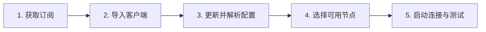
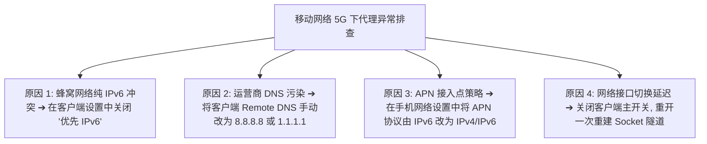

在 Android（安卓）开放的系统生态中，科学上网拥有极高的自由度和丰富多元的客户端选择。但这种开放性也带来了碎片化的认知门槛：**为什么在 GitHub 下载了客户端却连不上网？为什么状态栏显示了 VPN 图标却打不开网页？为什么手机一锁屏代理就自动断开？为什么连上 Wi-Fi 正常，切换到 5G 就彻底转圈？**

**“安卓梯子”并不是某一个单独的 App 软件，而是由「节点服务商（机场）」、「远程配置（订阅链接）」与「Android 代理客户端」三者共同构成的网络访问体系。**

本文专注于 Android 移动设备，深度拆解主流客户端生态（Mihomo、sing-box、v2rayNG）、系统 VPNService 底层原理、订阅与节点选型、各家手机厂商（小米/华为/vivo/OPPO/三星/Pixel）后台防杀保活配置，以及最全面的网络故障排查树，帮助安卓用户彻底实现跨境网络自由。

---

## ⚡ 30 秒快速选型：Android 梯子怎么配最省心？

```text
┌─────────────────────────┬───────────────────────────────────┬──────────────────────────────────────┐
│ 你的 Android 使用场景   │ 核心建议与考量维度                │ 推荐客户端与方案形态                 │
├─────────────────────────┼───────────────────────────────────┼──────────────────────────────────────┤
│ 🤖 安卓纯新手 / 怕麻烦  │ 界面现代、一键导入订阅、自动化测速│ 优先选用 Flclash 或 机场定制一键客户端│
│ 🛠️ 技术极客 / 规则深度  │ 追求最新协议支持、低内存占用与分流│ 选用 sing-box 官方版 或 Mihomo 核心GUI│
│ 📱 老旧机型 / 备用机    │ 追求极简、单节点手动管理与稳定性  │ 选用经典轻量 v2rayNG 客户端          │
│ 🤖 手机 ChatGPT 生产力  │ 避免被 OpenAI 拦截报 403 阻断     │ 搭配具备美区/日区原生纯净 IP 的专线  │
│ 📺 手机 YouTube 4K 追剧 │ 追求高持续带宽、晚高峰 0 丢包     │ 搭配 IEPL 物理专线套餐 (如光速云)    │
│ 🔋 锁屏断线 / 掉后台    │ 系统激进省电策略杀死了后台进程    │ 开启后台常驻、电池优化设为「无限制」 │
│ 🚨 移动端防断网应急备用 │ 0 月租、流量长期不过期、即开即用  │ 手机备用星岛梦不限时按量流量包       │
└─────────────────────────┴───────────────────────────────────┴──────────────────────────────────────┘
```

> 💡 **核心概念速记**：
> 1. **客户端（如 Flclash / v2rayNG）** 只是安装在手机上的“空壳解析器”，本身不提供任何免费网络；
> 2. **订阅（Subscription URL）** 是服务商提供给你的“节点提货单”，包含一组境外服务器的连接参数；
> 3. **节点（Node）** 是数据最终转发的出口服务器（如香港、日本、美国节点）。

---

## 一、Android 梯子全景数据流转架构

理解 Android 代理数据如何在手机内部流转，是解决所有断网、分流与延迟问题的基石：

```mermaid
graph TD
    UserApp[手机 App: Chrome / Twitter / ChatGPT App] --> NetStack[Android 系统网络栈]
    
    NetStack -->|由系统 VPNService 虚拟网卡全量接管| ClientCore[Android 代理客户端核心 (Mihomo / sing-box)]
    
    ClientCore --> RuleEngine{内置分流规则引擎}
    
    RuleEngine -->|国内域名/IP: 微信/淘宝/抖音| DirectRoute[DIRECT: 走本地 Wi-Fi / 5G 直连]
    RuleEngine -->|海外域名/IP: Google/YouTube| ProxyRoute[PROXY: 加密打包走代理]
    
    ProxyRoute --> CryptoTunnel[TLS 加密协议隧道 (VLESS / Shadowsocks / Hysteria 2)]
    CryptoTunnel --> BaseStation[基站 / 家用光纤网络]
    BaseStation --> BorderRelay[国内入口服务器 / IEPL 物理专线]
    BorderRelay --> ExitNode[海外出口节点 (香港/日本/美国)]
    ExitNode --> TargetServer[目标网站: OpenAI / Google / Netflix]
```

---

## 二、Android 为什么需要 VPN 权限？VPN 图标到底代表什么？

当你首次打开代理客户端并点击连接时，Android 系统会弹出一个提示框：**“应用想要设置一个 VPN 连接，以便监控网络流量。只有在您信任此来源时才允许。”**

```text
┌────────────────────────────────────────────────────────────────────────┐
│                   Android VPNService 核心机制与误区辨析                │
├────────────────────┬───────────────────────────────────────────────────┤
│ 技术机理           │ 客户端调用 Android 原生 API `VPNService` 创建名为   │
│                    │ `tun0` 的虚拟网卡，将手机全部或部分 App 流量导入客户端│
├────────────────────┼───────────────────────────────────────────────────┤
│ 为什么不是传统VPN? │ 传统 VPN 采用 IPSec/OpenVPN 全局加密；而代理客户端仅 │
│                    │ 借用该接口实现**本地流量拦截与智能规则分流**     │
├────────────────────┼───────────────────────────────────────────────────┤
│ ⚠️ 致命认知误区     │ **状态栏出现 VPN 钥匙图标 $\neq$ 节点能够正常上网！** │
│                    │ 图标只证明本地虚拟网卡已启动，若节点超时仍会无法联网  │
└────────────────────┴───────────────────────────────────────────────────┘
```

---

## 三、2026 Android 客户端生态全景对比

不要轻信所谓“十大翻墙软件排行榜”，在 2026 年，Android 客户端已形成清晰的技术流派：

| 客户端分类与代表 | 核心架构与底层 | 界面友好度 | 规则与分流能力 | 内存与功耗表现 | 适合人群画像 | 官方安全获取渠道 |
| :--- | :--- | :---: | :---: | :---: | :--- | :--- |
| **Mihomo / Clash 生态**<br>(如 Flclash / Clash Meta) | 基于 Mihomo (Clash Meta) 现代内核 | 🟢 极高 (现代 UI) | 🟢 极强 (支持复杂 Rule-Set) | 🟡 中等 | 追求界面美观、自动化分流与测速的主流用户 | GitHub 官方 Release 页面 |
| **sing-box 官方生态**<br>(sing-box for Android) | 基于 sing-box 独立通用核心 | 🟡 极简极客风 | 🟢 极强 (原生规则集) | 🟢 极低 (轻量省电) | 追求最新协议、低功耗与极致性能的技术玩家 | GitHub / Google Play |
| **V2Ray 经典生态**<br>(v2rayNG) | 基于 Xray / V2Ray 核心 | 🟡 传统列表式 | 🟡 基础分流 | 🟢 极低 | 备用机、老旧系统、单节点手动测试与备份 | GitHub 官方 Release 页面 |
| **机场定制自研 App** | 服务商专有封装客户端 | 🟢 极高 (一键登录) | 🔴 仅限预设规则 | 🟡 因厂商优化而异 | 完全不愿学习订阅配置的纯小白新手 | 服务商官方后台下载 |

> 🛑 **APK 安全防线**：
> 坚决不要在不明第三方下载站、百度网盘或 Telegram 杂牌频道下载所谓的“破解版”、“免翻直接用版”APK。**官方开源客户端本身 100% 免费，不需要任何破解**；第三方篡改包常被植入恶意广告 SDK、挖矿代码甚至键盘记录器。

---

## 四、Android 手机导入订阅与节点配置全流程（How-To）

无论你使用哪款现代 Android 客户端，其配置逻辑均遵循标准 5 步闭环：



### 步骤 1：获取兼容格式的订阅链接
登录机场官网后台（如 [光速云](/reviews/guangsu-cloud/) 或 [微风网络](/reviews/weifeng-cloud/)），找到“便捷导入 / 订阅中心”，复制「Clash / Mihomo 订阅」或「通用聚合订阅」。

### 步骤 2：添加配置并拉取远程节点
打开客户端（以现代 GUI 客户端为例）：
1. 进入「Profiles / 配置」界面，点击右上角「+」或「添加」；
2. 选择「从 URL 导入（Import from URL）」；
3. 为该订阅起一个备注名称（如“光速云主力”），将复制的 URL 粘贴至链接栏；
4. 点击「保存（Save）」并点击「下载/更新（Download）」，等待系统提示成功拉取。

### 步骤 3：选择路由规则模式
在主界面将路由模式设置为**「Rule / 规则模式」**（千万不要选 Direct，亦不建议长期保持 Global 全局，规则模式能确保国内淘宝、微信不走代理直连加速）。

### 步骤 4：节点健康度测速与选择
进入「Proxies / 代理节点」列表，点击测速图标（⚡ 或环形箭头），系统会自动对所有节点发送 HTTP 测试请求：
- 🟢 **绿色数字（如 35ms / 68ms）**：代表握手通畅，可放心选择；
- 🔴 **红色 Timeout / 空白**：代表该节点当前离线或无法连通。

### 步骤 5：开启主开关并授权
返回首页点击顶部大开关，系统弹出 VPNService 授权弹窗时点击「确定 / 允许」，即可开启全设备代理。

---

## 五、彻底解决 Android 锁屏断线与杀后台：四大国产 ROM 实战设置

由于 Android 系统的碎片化与厂商定制 ROM 激进的省电优化，**“锁屏 5 分钟后自动断网”**是安卓用户最常见的痛点。请根据你的手机品牌完成以下防杀配置：

```text
┌────────────────────────────────────────────────────────────────────────┐
│                   主流 Android 手机后台防杀保活设置清单                │
├──────────────┬─────────────────────────────────────────────────────────┤
│ 手机厂商品牌 │ 核心必改系统路径                                        │
├──────────────┼─────────────────────────────────────────────────────────┤
│ 📱 小米 / 红米│ 1. 多任务卡片下拉加锁 🔒                                │
│ (HyperOS/MIUI)│ 2. 设置 ➔ 应用管理 ➔ 找到客户端 ➔ 省电策略 ➔ 改为「无限制」│
│              │ 3. 应用信息 ➔ 开启「自启动」与「关联启动」               │
├──────────────┼─────────────────────────────────────────────────────────┤
│ 📱 华为 / 荣耀│ 1. 设置 ➔ 电池 ➔ 应用耗电管理 ➔ 找到客户端 ➔ 改为「手动管理」│
│ (HarmonyOS/Magic) 允许自启动、允许关联启动、允许后台活动               │
│              │ 2. 多任务界面下拉锁定卡片                               │
├──────────────┼─────────────────────────────────────────────────────────┤
│ 📱 vivo / iQOO│ 1. 设置 ➔ 电池 ➔ 后台高耗电 ➔ 勾选允许当前客户端持续运行│
│ (OriginOS)   │ 2. 设置 ➔ 应用与权限 ➔ 权限管理 ➔ 自启动 ➔ 开启权限     │
├──────────────┼─────────────────────────────────────────────────────────┤
│ 📱 OPPO / 一加│ 1. 设置 ➔ 电池 ➔ 应用耗电管理 ➔ 允许完全后台行为         │
│ (ColorOS)    │ 2. 应用信息 ➔ 耗电详情 ➔ 开启「允许唤醒前台」与「自启动」│
├──────────────┼─────────────────────────────────────────────────────────┤
│ 📱 三星 Galaxy│ 设置 ➔ 电池 ➔ 后台使用限制 ➔ 「从不休眠的应用程序」➔ 添加客户端│
│ (OneUI)      │                                                         │
└──────────────┴─────────────────────────────────────────────────────────┘
```

---

## 六、为什么 Wi-Fi 与 5G 移动网络表现不同？跨网络诊断矩阵

很多用户疑惑：“**为什么在家里连 Wi-Fi 刷 YouTube 4K 飞快，一出门用 5G 就连 Google 都打不开？**”



### 跨网络交叉测试诊断表：
| 测试组合 | 表现结果 | 故障定位判断 |
| :--- | :--- | :--- |
| **Wi-Fi 通畅 + 5G 通畅** | 🟢 一切正常 | 服务商节点与本地双网络均处于最佳状态 |
| **Wi-Fi 通畅 + 5G 超时** | 🔴 移动基站 DNS 污染或纯 IPv6 冲突 | 调整客户端 DNS 为 DoH (DNS over HTTPS) 并关闭 IPv6 |
| **Wi-Fi 超时 + 5G 通畅** | 🔴 家用宽带路由器防火墙阻断端口 | 路由器存在 DNS 劫持或特定端口阻断，尝试切换节点端口 |
| **Wi-Fi 超时 + 5G 超时** | 🔴 节点本身失效、订阅过期或机房维护 | 登录机场后台核查套餐状态，更新订阅链接 |

---

## 七、节点地区深度选型：香港、日本、新加坡与美国怎么选？

| 节点地区 | 物理往返延迟 (Ping) | 适用核心场景 | 优势与潜在限制 |
| :--- | :---: | :--- | :--- |
| **🇭🇰 香港 (Hong Kong)** | **20ms ~ 45ms** (极低) | 网页急速浏览、实时游戏、日常社交刷推 | 物理距离最近，响应极快；但部分 AI 工具（如 Claude）不开放香港 IP |
| **🇯🇵 日本 (Japan)** | **45ms ~ 75ms** (低) | ChatGPT 对话、YouTube 4K 追剧、DMM | 亚洲网络核心枢纽，对各大国际服务兼容性极高，晚高峰极其稳定 |
| **🇸🇬 新加坡 (Singapore)** | **50ms ~ 80ms** (低) | 东南亚服游戏、TikTok、备用亚洲节点 | 适合中国南方与沿海宽带用户，流媒体版权解锁丰富 |
| **🇺🇸 美国 (United States)** | **130ms ~ 180ms** (一般) | OpenAI 深度开发者、Claude 3.5、美区流媒体 | 虽物理延迟略高，但所有美区 AI 与云原生服务均优先适配 |

> 📌 **延迟与带宽原则**：
> 不要单纯迷信“Ping 越低越好”。香港节点虽然 Ping 只有 25ms，但若晚高峰超售丢包，其实际体验远不如 Ping 60ms 但独享带宽零丢包的日本 IEPL 专线。详细原理可参考：[《为什么机场节点延迟低但速度慢？》](/issues/low-ping-slow-speed-reasons/)。

---

## 八、Android 梯子终极排障手册（诊断排查链）

遇到网络故障时，请严格按照以下**9 级递进排查链**进行定位，切忌第一时间盲目卸载重装：

```text
[1. 裸网测试] ➔ 关闭代理，确认手机能否正常访问国内百度/微信？(排除本地断网)
      ↓ 正常
[2. 检查订阅] ➔ 登录服务商后台，确认流量配额是否耗尽？套餐是否到期？
      ↓ 正常
[3. 节点测速] ➔ 在客户端内批量测速，是单节点 Timeout 还是全红？(单红换节点，全红看订阅)
      ↓ 全红
[4. 更新订阅] ➔ 在配置界面点击「Update 刷新」，看能否拉取最新节点？
      ↓ 更新失败
[5. 跨网切换] ➔ 切换手机 5G 热点与 Wi-Fi，排除移动运营商本地 DNS 污染。
      ↓ 仍异常
[6. 路由检查] ➔ 检查路由模式是否被误设为「Direct 直连」或「Global 全局」规则冲突？
      ↓ 仍异常
[7. DNS 与 TUN] ➔ 将客户端 DNS 设为 1.1.1.1，尝试开启/关闭 TUN 虚拟网卡接管。
      ↓ 仍异常
[8. IPv6 开关] ➔ 在客户端网络设置中彻底关闭「IPv6 路由」。
      ↓ 仍异常
[9. 日志诊断] ➔ 打开客户端日志（Logs），搜索是否有 `connection refused` 或 `TLS error`。
```

---

## 九、Android 场景化专线服务推荐矩阵

针对 Android 手机高频移动用网、小火箭与 Mihomo 生态兼容性，精选以下真实稳定方案：

```text
┌────────────────────────────────────────────────────────────────────────────────────────┐
│                             2026 安卓梯子精选方案候选矩阵                              │
├──────────┬──────────────────────────┬──────────────┬──────────────┬────────────────────┤
│ 场景需求 │ 推荐品牌候选             │ 实际起付门槛 │ 每月流量配额 │ Android 适配优势   │
├──────────┼──────────────────────────┼──────────────┼──────────────┼────────────────────┤
│ 极稳主力 │ 光速云 (GuangSuYun)      │ 约 ¥7.5/月起 │ 59G~238G /月 │ 6年老牌物理专线，4K极速，Android零断流 │
│ 手机轻量 │ 微风网络 (BreezeNet)     │ 约 ¥7/月起   │ 50GB / 月    │ 专为手机查资料优化，百元内极低负担 │
│ 弹性月付 │ 唯兔云 (V2Yun)           │ ¥14.9/月     │ 100GB / 月   │ 15元单月付，60+节点备用，随用随买  │
│ 长期备用 │ 星岛梦 (XingDaoMeng)     │ 约 ¥8/月起   │ 60G/不限时包 │ 0月租不限时包，手机防断网首选备用  │
│ AI/4K专精│ 速界 (SpeedWorld)        │ ¥25/月       │ 150GB / 月   │ 原生纯净住宅 IP，ChatGPT App 秒进  │
└──────────┴──────────────────────────┴──────────────┴──────────────┴────────────────────┘
```

- 🏆 **全能旗舰首选**：[光速云](/reviews/guangsu-cloud/) —— 全线 IEPL 专线，Android 客户端订阅一键同步，每晚 20:00 晚高峰 4K 零卡顿；
- 🍃 **超低预算轻量**：[微风网络](/reviews/weifeng-cloud/) —— 针对手机端文字 AI 与网页优化的 50GB 小流量专线，年付折算仅约 ¥7/月；
- 💳 **灵活单月结算**：[唯兔云](/recommend/best-airports/) —— ¥14.9 纯月付，100GB 充沛流量，节点覆盖广。

---

## 十、Android 梯子使用 18 项安全与配置自查清单

```text
┌────────────────────────────────────────────────────────────────────────┐
│                   Android 梯子 18 项配置与安全通关清单                 │
├────────────────────────────────────────────────────────────────────────┤
│ □ 1. 客户端 APK 是否直接下载自 GitHub 官方 Release，绝非第三方修改版  │
│ □ 2. 客户端安装时没有索要通讯录、相册、麦克风等无关敏感权限           │
│ □ 3. 手机操作系统没有被安装任何来历不明的未知 CA 根证书               │
│ □ 4. 机场订阅链接已成功导入客户端，且能正常显示绿色低延迟数值         │
│ □ 5. 客户端分流模式已确认为「Rule / 规则模式」，国内 App 走高速直连   │
│ □ 6. 手机已在多任务界面对客户端进行「加锁 🔒」操作                    │
│ □ 7. 手机系统设置中已将客户端电池优化调整为「无限制 / 允许后台高耗电」 │
│ □ 8. 手机已开启客户端的「自启动」与「关联启动」权限                   │
│ □ 9. 节点在家庭 Wi-Fi 环境下测试 Google 与 YouTube 能秒开加载         │
│ □ 10. 手机断开 Wi-Fi 切换至 5G 移动蜂窝网络后，依然能够顺畅访问海外    │
│ □ 11. ChatGPT 官方 Android App 能够正常登录并顺利发送 Prompt           │
│ □ 12. 客户端内已配置 DoH / DoT 加密 DNS，避免移动运营商 DNS 污染      │
│ □ 13. 在遇到 5G 无法上网时，已尝试在客户端关闭「优先 IPv6」开关       │
│ □ 14. 我确认绝不将自己的专属订阅链接公开粘贴到微信群或论坛中          │
│ □ 15. 遇到偶发红线超时，我已掌握在客户端内一键「Update 刷新订阅」     │
│ □ 16. 手机已常备第二个备用服务商的节点或不限时流量包                  │
│ □ 17. 当开启手机热点给电脑使用时，已在设置中勾选「允许局域网连接」    │
│ □ 18. 我已了解开启梯子并不等于完全匿名，并承诺文明合规用网           │
└────────────────────────────────────────────────────────────────────────┘
```

---

## 十一、避坑指南：20 个关于“安卓梯子”的致命误区

```text
❌ 误区 1：在 GitHub 下载了 Clash 就等于拥有了翻墙能力 ➔ 事实：客户端是空壳，必须购买并导入机场订阅。
❌ 误区 2：状态栏亮起 VPN 钥匙图标就代表网络通畅 ➔ 事实：钥匙只代表本地网卡已接管，节点离线仍无法上网。
❌ 误区 3：Mihomo / sing-box 是一家卖梯子的公司 ➔ 事实：它们是开源网络核心项目，不售卖任何节点套餐。
❌ 误区 4：安卓梯子一定要常年开启“全局模式 (Global)” ➔ 事实：全局会导致国内 App 卡顿且浪费套餐流量。
❌ 误区 5：测速 Ping 越低，下载速度就越快 ➔ 事实：低 Ping 遇上带宽超售丢包，实际速度远不如稳定专线。
❌ 误区 6：节点列表里节点数量越多越好 ➔ 事实：有效节点只需港/日/美 3~5 个，滥竽充数的节点只会拖慢更新。
❌ 误区 7：只要是美国节点就一定能登 ChatGPT ➔ 事实：机房共享脏 IP 会被 OpenAI 直接报 403 拦截。
❌ 误区 8：开启 TUN 模式网速就会自动翻倍 ➔ 事实：TUN 扩大了流量接管范围，对物理带宽无加速作用。
❌ 误区 9：5G 网络测速跑几百兆，看视频就绝不卡 ➔ 事实：长视频依赖持续吞吐，瞬间测速峰值不代表稳定。
❌ 误区 10：锁屏断线一定是机场节点坏了 ➔ 事实：90% 是国产手机系统的激进省电策略杀死了后台客户端。
❌ 误区 11：第三方便宜的破解版 VPN APK 更划算 ➔ 事实：破解版常捆绑恶意挖矿与信息窃取脚本，风险极高。
❌ 误区 12：Wi-Fi 能用 5G 不能用就是机场服务器故障 ➔ 事实：多为移动运营商 DNS 污染或纯 IPv6 漫游冲突。
❌ 误区 13：免费安卓节点虽然慢但一定安全 ➔ 事实：公开节点运营者可能记录未加密的明文 DNS 与访问元数据。
❌ 误区 14：只要花钱买了付费机场就绝对不会出问题 ➔ 事实：依然需要掌握刷新订阅、切换节点等基础维护技能。
❌ 误区 15：自研 App 一定比开源客户端更专业 ➔ 事实：开源客户端代码公开透明，规则配置与分流更灵活。
❌ 误区 16：遇到网络问题第一步必须卸载重装 ➔ 事实：应按“裸网 -> 订阅 -> 换节点 -> 调DNS”排查，重装往往无效。
❌ 误区 17：全部节点 Timeout 红色代表机场跑路 ➔ 事实：多为订阅链接失效、流量用尽或本地网络临时受阻。
❌ 误区 18：安卓手机必须 Root 才能顺畅科学上网 ➔ 事实：系统原生 VPNService 完全免 Root，普通手机即可畅连。
❌ 误区 19：只要能打开 Google 搜索就代表 Netflix 完整解锁 ➔ 事实：需具备原生家庭 IP 才能看当地全部版权剧。
❌ 误区 20：订阅更新显示 404 代表服务商跑路 ➔ 事实：通常是服务商更换了订阅域名或更新了用户 Token 路径。
```

---

## 十二、常见问题深度解答（FAQ · 35 问）

### Q1：安卓梯子怎么选？
**答**：安卓选型分两步：**第一步选择 2 年以上老牌、支持 IEPL 专线的服务商（如光速云/微风网络）；第二步从 GitHub 官方下载 Flclash 或 v2rayNG 等开源客户端导入订阅**。

### Q2：Android 梯子和传统商业 VPN 有什么区别？
**答**：传统商业 VPN 多为全局接管且协议特征明显易被干扰；安卓代理客户端配合专线机场，**支持毫秒级规则分流（国内直连/国外代理），速度更快且针对晚高峰有物理专线保障**。

### Q3：Android 梯子软件和机场到底是什么关系？
**答**：软件（如 Flclash、v2rayNG）是**车辆**，机场服务商是**汽油**。光下载软件没有节点无法上网，必须导入机场订阅才能工作。

### Q4：Clash 可以在 Android 上使用吗？
**答**：可以。当前安卓端主流推荐使用基于最新 **Mihomo（Clash Meta）内核** 开发的现代客户端（如 Flclash），体验更稳定且功能更完善。

### Q5：Mihomo 是什么？它是梯子吗？
**答**：Mihomo 是一个开源的代理核心程序，负责处理加密、路由分流、DNS 解析与网络接管。**它本身不是梯子服务商，不出售任何网络节点**。

### Q6：sing-box 是什么？
**答**：sing-box 是下一代通用网络代理核心，具有内存占用极小、原生支持规则集与多协议的特点，深受进阶玩家喜爱。

### Q7：Android 客户端自带免费节点吗？
**答**：**不自带。** 官方正规开源客户端均为纯粹的工具空壳，必须由用户自行购买或配置节点订阅。

### Q8：机场订阅链接是什么？
**答**：是一串由服务商生成的专属 URL 地址，客户端通过访问该地址能自动下载包含几千个节点参数与分流规则的配置文件。

### Q9：订阅和节点有什么区别？
**答**：订阅是**配置文件的远程拉取入口**；节点是该文件中包含的**具体某一台海外服务器（如香港 01、日本 02）**。

### Q10：Android 节点应该怎么选？
**答**：日常查资料和低延迟操作首选**香港/日本节点**；使用 ChatGPT/Claude 建议首选**日本/美国原生节点**；看流媒体需选标有“解锁”字样的节点。

### Q11：为什么测速显示 Ping 很低，但实际看视频很慢？
**答**：Ping 只代表本地到服务器的连接握手延迟，不代表带宽容量；若节点遭遇带宽拥堵或丢包严重，实际下载速率依然会很慢。

### Q12：Android 节点全部显示 Timeout 红色怎么办？
**答**：先确认手机裸网正常，再检查机场后台流量是否耗尽或套餐是否过期，最后在客户端内点击「Update」重新拉取订阅。

### Q13：为什么状态栏显示了 VPN 钥匙标，但打不开任何网页？
**答**：说明本地虚拟网卡已启动，但数据无法通过节点转发。排查所选节点是否超时、分流规则是否被误设为 Direct、或本地 DNS 是否发生污染。

### Q14：Android 梯子为什么在晚上 8~10 点特别卡？
**答**：遭遇了**晚高峰国际骨干网拥堵**。建议切换至企业级 **IEPL / IPLC 物理专线节点**，专线不走公网骨干网，晚高峰零丢包。

### Q15：为什么手机一锁屏梯子就自动断开？
**答**：因为国产 ROM 的激进省电机制在锁屏后强制杀死了后台客户端。需在系统设置中将客户端电池优化设为「无限制」并在多任务栏加锁。

### Q16：Android 梯子为什么耗电会增加？
**答**：VPNService 持续进行数据流解密与转发，若开启了高频定时测速或频繁断线重连会导致 CPU 无法休眠。关闭多余日志与定时测速可显著降低功耗。

### Q17：为什么 Wi-Fi 能用，切换到 4G/5G 却不能用？
**答**：5G 移动网络下运营商下发了有污染的本地 DNS 或启用了纯 IPv6 冲突。在客户端设置中将 Remote DNS 改为 `8.8.8.8` 并关闭 IPv6 即可秒解。

### Q18：为什么 5G 能用，连接公司或家中 Wi-Fi 却失效？
**答**：通常是因为 Wi-Fi 路由器开启了防火墙端口拦截，或公司内网禁止了代理端口。可尝试切换其他协议端口的节点。

### Q19：Android 客户端需要开启 TUN 模式吗？
**答**：大多数安卓客户端默认通过系统 VPNService 接管全局流量，无需额外配置；仅当部分特殊 App 绕过代理时，才需在高级设置中开启 TUN 强化接管。

### Q20：Rule 规则模式和 Global 全局模式有什么区别？
**答**：**Rule 模式**会自动识别国内外流量，国内 App 直连不耗流量，国外走代理；**Global 模式**强行将所有流量导向代理，会导致国内 App 变慢。

### Q21：Android 客户端出现 DNS 错误怎么解决？
**答**：在客户端 DNS 设置中启用 **DNS over HTTPS (DoH)**，并将主解析服务器填入 `https://1.1.1.1/dns-query` 或 `https://dns.google/dns-query`。

### Q22：Android 手机用 ChatGPT 官方 App 打不开怎么办？
**答**：选用美区/日区原生纯净专线节点；在系统设置中清除 ChatGPT App 缓存与数据；确保手机系统语言与时区非异常状态。

### Q23：Android 手机用 Claude 经常被封号是什么原因？
**答**：Claude 对出口 IP 的机房属性审查极严。必须使用高信誉的原生住宅 IP 节点，避免频繁切换不同国家的节点。

### Q24：Android 手机看 YouTube 1080P/4K 需要多少流量？
**答**：看 1080P 视频每小时约消耗 1.5GB~2.5GB 流量；看 4K 超高清每小时约消耗 7GB~12GB 流量。

### Q25：Android 免费梯子安全吗？
**答**：存在较大安全隐患。许多免注册免费 App 靠广告 SDK 或转售用户 DNS 查询记录变现，甚至索取通讯录权限，建议远离。

### Q26：开源的 Android 客户端会不会偷看我的银行密码？
**答**：不会。访问正规 HTTPS 网站时，通信内容经过 TLS 高强度加密，代理客户端只能看到你访问的域名，无法解密明文密码。

### Q27：订阅更新显示 404 错误是什么原因？
**答**：通常是因为服务商更换了订阅域名，或者你的个人订阅 Token 被系统重置，需登录官网重新复制最新订阅链接。

### Q28：订阅更新显示 403 错误是什么原因？
**答**：说明该请求被服务商防火墙拦截，通常是因为套餐已过期、欠费，或者短时间内高频刷新触发了防刷机制。

### Q29：节点列表突然全部消失为空白是怎么回事？
**答**：通常是上一次订阅更新失败导致旧配置被清空，或套餐到期服务商返回了空列表。重新手动更新订阅即可。

### Q30：Android 手机开启热点，电脑能直接翻墙吗？
**答**：默认不能。热点流量直接走物理网卡。需在客户端设置中勾选「允许来自局域网的连接」，并在电脑端配置局域网代理。

### Q31：手机梯子应该选月付还是年付？
**答**：**新用户首次接触某个品牌坚守月付**（¥15 左右），在手机上实测 Wi-Fi/5G 与晚高峰稳定后，再考虑年付享受折算优惠。

### Q32：Android 客户端闪退无法打开怎么办？
**答**：通常是系统版本不兼容或安装了错误架构的 APK（如 32 位装到了 64 位系统）。从 GitHub 下载 `universal` 或 `arm64-v8a` 正式版重装。

### Q33：如何查看 Android 客户端的运行日志？
**答**：进入客户端「Logs / 日志」界面，筛选 `Error` 或 `Warning`，搜索 `timeout`、`refused` 等关键字即可快速定位故障。

### Q34：多台 Android 设备可以共用一个订阅吗？
**答**：取决于服务商套餐规则。大多数正规机场支持 2~5 台设备同时在线，但请勿将订阅链接公开分享给他人。

### Q35：什么时候需要彻底重装客户端？
**答**：只有当配置文件发生无法修复的底层冲突导致 App 持续崩溃时才需要重装；日常节点连不上只需更新订阅或排查 DNS。

---

## 🏁 总结：Android 科学上网终极配置法则

要在 Android 手机上获得极致稳定、省电且无缝的上网体验，请牢记以下**四步法**：

```text
Step 1: 客户端选开源 ➔ 认准 GitHub 官方 Release (Flclash / sing-box / v2rayNG)，拒绝破解版
Step 2: 节点选老牌专线 ➔ 首选 2 年以上 IEPL 专线服务商，香港/日本节点优先，晚高峰 0 丢包
Step 3: 模式选规则分流 ➔ 坚守「Rule 模式」，国内应用极速直连，不浪费宝贵套餐流量
Step 4: 系统做防杀保活 ➔ 锁定多任务后台，电池优化设为「无限制」，彻底告别锁屏断连
```

---

### 📚 延伸进阶阅读与选型专栏
- 📱 **移动设备总入口**：[《手机梯子哪个好？Android、iPhone梯子工具与新手使用指南》](/recommend/mobile-tizi/)
- 🏆 **2026 全景大榜**：[《2026梯子推荐：稳定、速度、价格、安全与不同使用场景怎么选》](/recommend/best-tizi/)
- 🎯 **深度决策指南**：[《梯子哪个好用？稳定性、速度、价格、节点与客户端完整选择指南》](/recommend/which-tizi-is-best/)
- 💳 **付费购买指南**：[《付费梯子哪个好？月付、年付、低价与高性价比方案怎么选》](/recommend/paid-tizi/)
- 📖 **基础概念认知**：[《梯子是什么？梯子工具、VPN、机场、代理到底有什么区别？》](/wiki/what-is-tizi/)
- ⚡ **老牌旗舰专线**：[《光速云深度评测：2020老牌IEPL专线与解锁实测》](/reviews/guangsu-cloud/)
- 🍃 **平价轻量专线**：[《微风网络深度评测：小流量套餐值不值得买？》](/reviews/weifeng-cloud/)
- 🛠️ **电脑客户端配置**：[《Clash Verge Rev 下载与安装配置完整教程》](/tutorials/clash-verge-rev/)
- 🚨 **排障实战手册**：[《Clash 有节点但无法上网怎么办？7 步系统排查与修复指南》](/issues/clash-connected-no-internet/)
