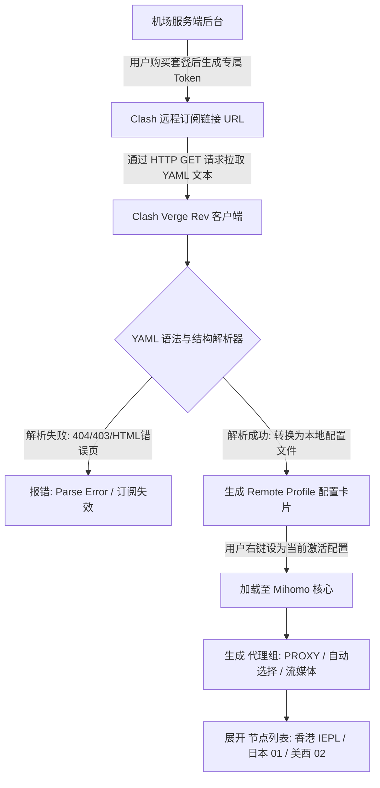
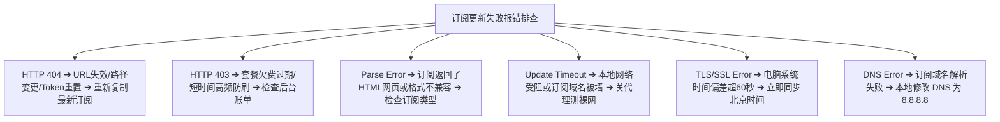

在 Clash / Mihomo 客户端的使用过程中，**“订阅（Subscription）”与“配置文件（Profile）”**是连接本地客户端与海外服务器节点的最核心纽带。然而，很多新手在导入订阅时经常遇到各种棘手的报错与异常：

**“为什么把订阅链接粘贴进 Clash Verge Rev，点击导入却提示 Parse Error 或 404/403？”**  
**“为什么界面上明明显示订阅导入成功，但打开代理列表里面却空空如也，一个节点都没有？”**  
**“为什么旧节点还能正常翻墙，但点击刷新订阅却一直提示 Timeout 无法更新？”**  
**“在浏览器里可以直接下载订阅内容，为什么客户端更新却频频报错？”**

**Clash 订阅并不是一个普通网页，而是一条由服务商动态生成的远程结构化配置接口。将订阅成功保存到客户端（添加 Remote Profile），并不等同于已经完成配置更新与生效启用。**

本文专注于 **Clash 订阅生命周期**，深度拆解从订阅获取、安全导入、Profile 激活、节点刷新，到各种订阅报错（404/403/Timeout/TLS/Parse Error/节点为空）的系统级排错方案，帮助你彻底扫清订阅使用过程中的所有障碍。

---

## ⚡ 30 秒极简流程：Clash 订阅导入与更新速查

```text
┌────────────────────────────────────────────────────────────────────────┐
│                   Clash 订阅标准 6 步导入与验证流程                    │
├────────────────────────────────────────────────────────────────────────┤
│ ① 登录机场后台 ➔ 复制专属「Clash / Mihomo 兼容订阅链接」               │
│        ↓                                                               │
│ ② 打开 Clash Verge Rev ➔ 进入左侧「订阅 (Profiles)」菜单               │
│        ↓                                                               │
│ ③ 在顶部 URL 栏粘贴链接 ➔ 自定义备注名称 (如“主力专线”) ➔ 点击「导入」 │
│        ↓                                                               │
│ ④ 右键刚导入的 Profile 配置卡片 ➔ 点击「使用 (Use)」激活生效          │
│        ↓                                                               │
│ ⑤ 进入左侧「代理 (Proxies)」➔ 确认节点出现 ➔ 测速并选中绿色低延迟节点 │
│        ↓                                                               │
│ ⑥ 进入左侧「设置 (Settings)」➔ 开启「系统代理 (System Proxy)」或 TUN   │
└────────────────────────────────────────────────────────────────────────┘
```

> 💡 **核心生命周期认知**：
> - **添加订阅成功 $\neq$ 更新成功**：添加只是保存了 URL 地址，客户端必须成功下载并解析 YAML 配置才算更新完成；
> - **更新成功 $\neq$ 已经启用**：多配置用户必须明确右键选中当前 Profile 为 Active（使用状态）；
> - **启用成功 $\neq$ 节点可用**：节点列表展开仅证明配置格式合法，节点能否联网仍需进行网络握手测试。

---

## 一、Clash 订阅底层原理：订阅、Profile 与节点的真实关系

搞清三者的技术层级分工，是解决所有“节点为空”、“更新失败”问题的基石：



### 核心名词概念拆解：
- **订阅链接（Subscription URL）**：服务商提供的一串加密接口地址，类似于“动态提货单”；
- **配置文件（Profile）**：客户端本地保存并加载的一份完整 YAML 配置（包含节点、规则与 DNS 参数）；
- **节点（Node / Proxy）**：Profile 中包含的具体某一台海外出口服务器连接参数（如 IP、端口、协议与密码）。

---

## 二、Profile 深度对比：Remote Profile 与 Local Profile

在 Clash Verge Rev 中，Profile 分为**远程订阅配置**与**本地静态配置**两种主要形态：

| 对比维度 | 远程配置 (Remote Profile) | 本地配置 (Local Profile) |
| :--- | :--- | :--- |
| **数据来源** | 远程服务器 URL 实时拉取 | 本地硬盘存储的静态 `.yaml` 文件 |
| **节点自动更新** | 🟢 **支持**（机场机房变更 IP 时，一键 Update 即同步） | 🔴 **不支持**（节点下线或变动后必须手动修改代码） |
| **修改保存方式** | ⚠️ **不建议直接修改**（下次 Update 时修改内容会被覆盖） | 🟢 适合极客完全自定义规则与自建节点 |
| **新手友好度** | 🟢 **极高**（直接粘贴 URL 即可，推荐 99% 普通用户） | 🔴 较低（需具备 YAML 语法与规则编写基础） |
| **典型适用场景** | 商业专线机场日常订阅、备用机场订阅 | 复杂多源分流合并、本地私有 VPS 节点调试 |

---

## 三、订阅更新的本质：App 更新、核心更新与订阅更新的三维区分

很多初学者经常混淆更新的概念，必须清晰界定三者的独立边界：

```text
┌────────────────────────────────────────────────────────────────────────┐
│                   Clash 三种截然不同的“更新”机制对比                   │
├──────────────┬────────────────────────┬────────────────────────────────┤
│ 更新类型     │ 更新的对象是什么       │ 是否会自动改变机场节点列表？   │
├──────────────┼────────────────────────┼────────────────────────────────┤
│ **App 更新** │ 客户端软件 (GUI 界面)  │ ❌ **不会**。仅修复软件界面与交互 Bug │
├──────────────┼────────────────────────┼────────────────────────────────┤
│ **Core 更新**│ 代理内核 (Mihomo 引擎) │ ❌ **不会**。仅升级协议支持与底层性能 │
├──────────────┼────────────────────────┼────────────────────────────────┤
│ **订阅更新** │ 远程 Profile (节点列表)│ ✅ **会**。从机场服务器拉取最新节点与规则│
└──────────────┴────────────────────────┴────────────────────────────────┘
```

> 📌 **订阅多久更新一次最合理？**
> 订阅更新并不是测速工具，**不需要每隔几分钟频繁刷新**。正常情况下，**每周手动刷新一次**，或在遇到大面积节点连不上、机场发布节点调整公告时手动更新即可。

---

## 四、两层故障模型：精准区分“订阅层故障”与“节点层故障”

遇到问题时，首先要明确故障发生在哪个层级，切忌病急乱投医：

```text
┌────────────────────────────────────────────────────────────────────────┐
│                   Clash 科学上网两层故障模型诊断表                     │
├────────────────────┬───────────────────────────────────────────────────┤
│ **第一层：订阅层** │ 表现：Update 报错、404、403、Parse Error、节点为空│
│ (配置拉取阶段)     │ 核心：客户端未能成功从远程服务器下载并解析出节点  │
│                    │ 解决方向：检查订阅 URL、Token、网络、套餐状态     │
├────────────────────┼───────────────────────────────────────────────────┤
│ **第二层：节点层** │ 表现：节点全部红线 Timeout、有节点但打不开网页、卡顿│
│ (代理通信阶段)     │ 核心：配置解析正常且节点存在，但数据转发受阻      │
│                    │ 解决方向：排查系统代理、TUN 模式、DNS、裸网、换节点│
└────────────────────┴───────────────────────────────────────────────────┘
```

---

## 五、Clash 订阅更新失败全场景排查手册（9 大错误类型根因分析）

如果在点击「Update」时遇到红色报错弹窗，请对照以下错误代码进行针对性修复：



### 常见订阅错误代码深度排障表：
| 错误类型 | 现象与报错信息 | 核心根本原因 | 正确的第一步排查与解决动作 |
| :--- | :--- | :--- | :--- |
| **HTTP 404** | `Request failed with status code 404` | 订阅 URL 地址已不存在，服务商调整了接口路径或重置了 Token | 登录机场后台重新复制最新订阅链接并覆盖导入 |
| **HTTP 403** | `Request failed with status code 403` | 服务器拒绝访问，通常因为套餐已过期、欠费或触发了防刷墙 | 检查用户中心套餐有效期与流量余额；稍等 5 分钟再试 |
| **HTTP 401** | `Unauthorized / 401` | 订阅鉴权密钥（Token）验证失败 | 账户 Token 发生变动，重新从后台获取最新链接 |
| **Parse Error** | `Invalid YAML / Format Error` | **订阅链接返回了 HTML 登录页或错误提示页**，客户端无法按 YAML 解析 | 在浏览器中打开订阅 URL 检查返回内容是否为纯文本配置 |
| **Update Timeout** | `Client network timeout` | 客户端在规定时间内无法连通订阅服务器（订阅域名被本地阻断） | 关闭代理确认本地裸网正常；尝试切换手机热点网络重试 |
| **TLS Error** | `Certificate has expired / TLS handshake` | **电脑系统时间不精准**，导致 SSL/TLS 证书时间戳验证失败 | 进入 Windows 设置 ➔ 时间和语言 ➔ 点击**「立即同步」** |
| **DNS Error** | `Failed to resolve host` | 本地运营商 DNS 无法解析订阅域名 | 在本地网卡设置中将 DNS 手动修改为 `1.1.1.1` 或 `8.8.8.8` |
| **No Proxies** | 订阅更新成功但节点列表为 0 | 服务商返回了空配置，或使用了与当前客户端不兼容的协议 | 确认购买的套餐是否生效；检查是否开启了节点过滤规则 |
| **URL Invalid** | `Invalid URL / Malformed` | 复制订阅链接时漏掉了字符、误加入了前后空格或回车符 | 清空输入框，重新完整复制并粘贴标准的 `https://...` 链接 |

---

## 六、为什么“浏览器能打开订阅，但 Clash 客户端更新失败”？

这是极具迷惑性的高频故障，核心原因通常有以下三点：

1. **User-Agent（UA）校验差异**：部分机场服务器会校验请求头中的 UA。如果客户端未正确声明为 Clash/Mihomo，服务器会拦截请求或返回 403，而浏览器发送的是标准浏览器 UA；
2. **本地系统代理死锁**：如果上次关机导致本地代理残留（指向 `127.0.0.1:7897`），而此时客户端尚未正常建立连接，Clash 在更新订阅时流量陷入本地网络死循环；
3. **客户端 TLS 严格证书校验**：浏览器可能忽略了部分中间证书链瑕疵，而 Go 语言编写的代理核心对 TLS 证书格式要求极严。

---

## 七、订阅安全与 Token 隐私防线：保护你的专属链接

机场订阅链接中包含用于身份鉴权的唯一 **Token** 或 **UUID**，相当于你账户的免密提货密码：

```text
┌────────────────────────────────────────────────────────────────────────┐
│                   Clash 订阅安全 5 大绝不能碰的红线                    │
├────────────────────────────────────────────────────────────────────────┤
│ ❌ 绝对不要将包含真实 Token 的订阅链接截图发布到论坛、群聊或社交媒体  │
│ ❌ 绝对不要将本地 `config.yaml` 或订阅 URL 提交到公开的 GitHub 仓库中  │
│ ❌ 绝对不要把私人订阅随意粘贴到不明第三方“免费在线订阅转换”网站中      │
│ ❌ 绝对不要在公共网吧或他人电脑上直接导入自己的私人长期订阅链接       │
│ ❌ 发现流量异常暴涨或提示设备超限时，应立刻在机场后台「重置订阅 Token」│
└────────────────────────────────────────────────────────────────────────┘
```

> 🛑 **GitHub 提交惨剧提醒**：
> 开发者常不小心把 Clash 配置提交到公共 GitHub 仓库。请注意：**仅仅在仓库中删除文件是不够的，Git 历史提交记录中依然包含明文！** 一旦泄露，必须立刻前往机场后台点击「重置订阅信息 / 重置 Token」彻底注销旧链接。

---

## 八、多机场订阅管理与自定义规则覆盖（Override）

对于同时持有主力专线与备用不限时套餐的成熟用户，建议采取以下管理范式：

```mermaid
graph TD
    Sub1[主力专线订阅: 光速云 IEPL] --> Prof1[Profile 1: 命名 '01-主力专线']
    Sub2[平价备用订阅: 微风网络] --> Prof2[Profile 2: 命名 '02-轻量备用']
    Sub3[不限时流量包: 星岛梦] --> Prof3[Profile 3: 命名 '03-应急不限时']
    
    Prof1 -.->|右键选择 Use 激活| ActiveProfile[当前生效配置]
    
    ActiveProfile --> OverrideLayer[客户端扩展覆写层 (Override / Script)]
    OverrideLayer --> FinalCore[最终加载生效的 Mihomo 核心]
```

### 避免配置被覆盖的最佳实践：
不要直接在 Remote Profile 生成的 YAML 文件中手动改写分流规则，因为下一次点击「Update」时所有手动修改都会被云端配置覆盖。**正确的做法是在 Clash Verge Rev 中使用「扩展配置 (Script / Merge)」功能进行局部参数覆盖**。

---

## 九、Clash 高适配性专线品牌推荐矩阵

针对 Clash Verge Rev 订阅一键同步、Profile 兼容性与晚高峰抗压，精选以下真实稳定方案：

```text
┌────────────────────────────────────────────────────────────────────────────────────────┐
│                             2026 Clash 订阅精选服务商候选矩阵                          │
├──────────┬──────────────────────────┬──────────────┬──────────────┬────────────────────┤
│ 适配场景 │ 推荐品牌候选             │ 实际起付门槛 │ 每月流量配额 │ Clash 订阅核心优势 │
├──────────┼──────────────────────────┼──────────────┼──────────────┼────────────────────┤
│ 全能主力 │ 光速云 (GuangSuYun)      │ 约 ¥7.5/月起 │ 59G~238G /月 │ 6年老牌物理专线，Clash一键导入，4K极速秒开│
│ 平价轻量 │ 微风网络 (BreezeNet)     │ 约 ¥7/月起   │ 50GB / 月    │ 专为网页查资料与AI优化，年付百元内极低负担│
│ 弹性月付 │ 唯兔云 (V2Yun)           │ ¥14.9/月     │ 100GB / 月   │ 15元单月付，60+节点备用，随用随买  │
│ 应急备用 │ 星岛梦 (XingDaoMeng)     │ 约 ¥8/月起   │ 60G/不限时包 │ 0月租不限时包，电脑防断网首选备用通道 │
│ AI/开发  │ 速界 (SpeedWorld)        │ ¥25/月       │ 150GB / 月   │ 原生纯净住宅 IP，ChatGPT/API 秒响应 │
└──────────┴──────────────────────────┴──────────────┴──────────────┴────────────────────┘
```

- 🏆 **全能旗舰首选**：[光速云](/reviews/guangsu-cloud/) —— 全线 IEPL 企业专线，Clash 订阅格式完美兼容，晚高峰 20:00 4K 零卡顿；
- 🍃 **超低预算轻量**：[微风网络](/reviews/weifeng-cloud/) —— 针对电脑轻度查资料与文字 AI 优化的 50GB 小流量专线，年付折算仅约 ¥7/月；
- 💳 **拒绝绑定的单月付**：[唯兔云](/recommend/best-airports/) —— ¥14.9 纯单月付，100GB 充沛流量，节点丰富。

---

## 十、Clash 订阅导入 18 项安全与操作自查清单

```text
┌────────────────────────────────────────────────────────────────────────┐
│                   Clash 订阅导入 18 项通关自查清单                     │
├────────────────────────────────────────────────────────────────────────┤
│ □ 1. 订阅链接直接复制自正规机场官网后台，绝非第三方转发分享           │
│ □ 2. 复制时确认链接以 `https://` 开头，未夹带前后多余空格或换行符     │
│ □ 3. 在 Profiles 界面导入成功后，已在配置卡片上右键选择「使用 (Use)」  │
│ □ 4. Profile 配置卡片已成功显示最后更新时间戳与绿色正常状态           │
│ □ 5. 进入 Proxies 界面后，已能完整展示香港、日本、美国等代理节点列表  │
│ □ 6. 批量测速后，所选节点显示为绿色具体延迟数值 (如 35ms / 60ms)       │
│ □ 7. 客户端路由模式已确认为「规则 (Rule)」智能分流模式                 │
│ □ 8. 在 Settings 中已正确开启「系统代理 (System Proxy)」开关           │
│ □ 9. 电脑系统时间已与国家授时中心精准同步 (防止 TLS 握手证书报错)      │
│ □ 10. 若订阅报错 404，已登录后台确认是否生成了新链接或重置了 Token     │
│ □ 11. 若订阅报错 403，已核对账户是否欠费或套餐流量是否耗尽            │
│ □ 12. 若提示 Parse Error，已确认返回的内容是 YAML 配置而非 HTML 网页   │
│ □ 13. 我确认绝不将自己的订阅 URL 公开截图或发送至未授权的技术群组     │
│ □ 14. 若需要编写自定义规则，已知晓使用 Override 机制而非直接改动配置   │
│ □ 15. 电脑中已常备第二个备用服务商的订阅配置以防突发单点故障          │
│ □ 16. 未在同一台电脑上开启多个互相冲突的代理客户端或虚拟网卡          │
│ □ 17. 已了解订阅更新不需要每隔几分钟频繁刷新，正常每周刷新一次即可     │
│ □ 18. 遇到节点连不上时，已掌握「区分订阅层故障与节点层故障」排障法     │
└────────────────────────────────────────────────────────────────────────┘
```

---

## 十一、避坑指南：20 个关于“Clash 订阅”的致命认知误区

```text
❌ 误区 1：订阅链接就是单个节点 ➔ 事实：订阅是一串动态配置接口，内含几十个服务器节点。
❌ 误区 2：在 Profiles 里添加了订阅就等于已经开启翻墙 ➔ 事实：必须右键选择 Use 激活并开启系统代理。
❌ 误区 3：订阅 Update 成功就代表所有节点一定能连通 ➔ 事实：Update 仅代表配置下载成功，节点需进一步测速。
❌ 误区 4：节点列表展开了就代表网络已经通畅 ➔ 事实：还需看系统代理是否开启、规则是否匹配。
❌ 误区 5：订阅更新提示 404 代表机场彻底跑路 ➔ 事实：多为服务商更换了订阅域名或更新了用户 Token。
❌ 误区 6：订阅更新提示 403 一定是因为流量耗尽 ➔ 事实：也可能是短时间内高频刷新触发了服务商防火墙。
❌ 误区 7：提示 Parse Error 一定是客户端代码损坏 ➔ 事实：常因订阅 URL 实际上返回了登录页等 HTML 错误网页。
❌ 误区 8：节点列表为空代表服务商跑路 ➔ 事实：多为套餐过期、订阅格式不兼容或本地规则过滤导致。
❌ 误区 9：订阅更新失败只要重装 Clash 就能解决 ➔ 事实：重装无法解决 URL 失效或套餐过期问题，多为徒劳。
❌ 误区 10：客户端 App 更新等于订阅更新 ➔ 事实：App 更新是升级软件界面，更新节点必须刷新 Profile。
❌ 误区 11：Mihomo 内核更新等于订阅更新 ➔ 事实：内核更新是升级底层引擎，与节点数据源无关。
❌ 误区 12：每隔 5 分钟刷新一次订阅能让网速更快 ➔ 事实：频繁 Update 毫无加速效果，反而增加服务器负担。
❌ 误区 13：订阅链接可以随意发给微信好友使用 ➔ 事实：订阅包含个人密钥，分享会导致流量被盗刷甚至封号。
❌ 误区 14：在 GitHub 提交了订阅只要把文件删除就安全了 ➔ 事实：Git 历史记录依然留存明文，必须去后台重置 Token。
❌ 误区 15：任意 V2Ray/SS 订阅链接都能直接导入 Clash ➔ 事实：Clash 需要标准 YAML 格式，需使用兼容订阅。
❌ 误区 16：第三方在线订阅转换网站 100% 安全 ➔ 事实：部分未知转换站可能截获并记录用户的订阅 Token。
❌ 误区 17：可以随时在 Remote Profile 文件里直接修改规则 ➔ 事实：下次点击 Update 时手动修改的内容会被全量覆盖。
❌ 误区 18：导入了多个 Profile 它们会同时叠加生效 ➔ 事实：客户端同一时刻只能激活使用一份 Profile。
❌ 误区 19：官网打不开代表订阅一定无法更新 ➔ 事实：官网前台与后端订阅通常部署在不同服务器集群。
❌ 误区 20：订阅链接必须常年保持不变 ➔ 事实：出于安全防护考虑，服务商可能会定期轮换订阅接入点域名。
```

---

## 十二、常见问题深度解答（FAQ · 35 问）

### Q1：Clash 订阅是什么？
**答**：Clash 订阅是服务商提供的一条专属远程配置 URL，Clash Verge Rev 通过该链接可一键自动下载并解析包含几十个节点与分流规则的完整 Profile。

### Q2：Clash 订阅和节点有什么区别？
**答**：**订阅**是包含所有节点信息的“远程提货单”；**节点**是提货单中具体的某一台境外代理服务器（如香港 IEPL 01、日本 IEPL 02）。

### Q3：Clash Verge Rev 怎么导入订阅？
**答**：进入「订阅 (Profiles)」页面，在顶部粘贴订阅链接并点击「导入」，完成后右键选中该配置卡片点击「使用 (Use)」即可。

### Q4：Clash Profile 是什么？
**答**：Profile 是 Clash 本地加载的完整配置文件，包含了节点服务器参数、代理组策略、分流规则集与 DNS 设置。

### Q5：Remote Profile 和 Local Profile 有什么区别？
**答**：**Remote Profile** 通过远程 URL 获取并支持一键更新同步；**Local Profile** 保存在本地硬盘，适合高级用户编写固定自定义规则。

### Q6：Clash 订阅怎么更新？
**答**：进入 Profiles 界面，找到对应的配置卡片，向右滑动或右键点击，选择 **「更新 (Update)」** 即可重新向服务器拉取最新节点。

### Q7：为什么 Clash 订阅更新后节点没有变化？
**答**：通常是因为服务商服务器端的节点列表本身并未改动，或者当前客户端启用的是另一份 Profile 配置。

### Q8：为什么 Clash 订阅导入成功但节点列表为空？
**答**：可能返回的配置本身为空、套餐已过期、订阅格式与当前客户端不兼容，或者代理组设置了过滤规则导致节点被隐藏。

### Q9：Clash 订阅更新显示 404 怎么办？
**答**：说明该订阅链接地址已失效，通常是因为服务商更换了订阅域名或重置了个人 Token，需登录官网后台重新复制最新链接。

### Q10：Clash 订阅更新显示 403 怎么办？
**答**：说明请求被服务器拒绝，通常是因为套餐已欠费过期，或者短时间内高频刷新触发了防刷机制，稍等 5 分钟后再试。

### Q11：Clash 订阅更新显示 401 是什么意思？
**答**：401 代表鉴权失败，说明你的订阅 Token 已被重置或失效，需登录机场后台重新获取最新订阅 URL。

### Q12：Clash 订阅更新提示 Timeout 怎么办？
**答**：说明本地网络无法连通订阅服务器。先关代理确认裸网正常，尝试切换手机 5G 热点网络重新更新。

### Q13：提示 TLS Error 怎么解决？
**答**：进入系统设置点击「立即同步时间」，确保电脑系统时间与标准北京时间一致，防止 SSL 证书校验失败。

### Q14：提示 DNS Error 怎么解决？
**答**：说明本地 DNS 无法解析订阅域名。在本地网络连接设置中将 DNS 手动修改为 `8.8.8.8` 或 `1.1.1.1`。

### Q15：提示 Parse Error 是什么原因？
**答**：通常是因为订阅 URL 实际返回了 HTML 登录页、Cloudflare 验证页或错误提示页，客户端无法将其作为标准 YAML 解析。

### Q16：为什么浏览器能打开订阅内容，但 Clash 更新失败？
**答**：多为客户端 User-Agent 限制、本地代理端口残留导致网络死锁，或客户端严格的 TLS 证书校验机制所致。

### Q17：为什么一个客户端能导入，另一个客户端不能？
**答**：不同客户端采用的核心引擎不同（如原版 Clash 核心不支持 VLESS-Reality 或 Hysteria 2 协议，而 Mihomo 核心支持）。

### Q18：订阅地址变了怎么办？
**答**：在 Profiles 界面右键旧配置选择编辑，将 URL 替换为新地址并保存更新；或直接添加新的 Remote Profile。

### Q19：套餐过期会影响订阅更新吗？
**答**：会。多数服务商在套餐过期后会返回 403 错误或下发空节点列表。

### Q20：流量耗尽会导致订阅更新失败吗？
**答**：取决于服务商策略。部分服务商仍允许更新但节点无法通信，部分服务商直接暂停订阅接口下发。

### Q21：订阅更新后节点全部变红 Timeout 怎么办？
**答**：说明订阅已成功解析，问题进入节点通信层。检查本地裸网、更换其他地区节点或核查套餐剩余流量。

### Q22：节点突然比以前变少是怎么回事？
**答**：服务商可能对部分低效节点进行了下线维护，或根据你的套餐等级动态调整了可访问的节点范围。

### Q23：为什么旧节点还能用，但订阅不能更新？
**答**：因为旧节点参数已缓存在本地 Profile 中；但若远端服务器 IP 发生变动，旧配置将逐步失效，应尽快修复订阅链接。

### Q24：Clash 订阅多久更新一次最合适？
**答**：正常情况下每周手动刷新一次即可；无需高频定时刷新，避免触发服务商防刷限制。

### Q25：Clash 可以设置自动更新订阅吗？
**答**：可以。在 Profile 设置中可配置定时更新间隔（如 24 小时或 72 小时）。

### Q26：App 软件更新和订阅更新有什么区别？
**答**：App 更新是升级客户端界面程序，订阅更新是向机场服务器拉取最新的节点服务器列表，两者完全不同。

### Q27：Mihomo 内核更新和订阅更新有什么区别？
**答**：内核更新是升级底层的网络代理引擎，与节点服务器列表无关。

### Q28：Clash 订阅链接安全吗？
**答**：订阅链接属于高敏感资产，内含专属鉴权 Token，切勿公开泄露。

### Q29：订阅链接可以分享给微信好友吗？
**答**：**坚决不能。** 分享会导致他人消耗你的月度流量配额，甚至因多 IP 异常登录导致账号被封。

### Q30：订阅链接泄露了怎么办？
**答**：立刻登录机场官网后台，找到订阅管理页面，点击「重置订阅 Token / 重置链接」，使旧链接彻底作废。

### Q31：一个订阅可以同时在手机和电脑上使用吗？
**答**：取决于服务商套餐规则。大多数正规机场支持 2~5 台设备同时在线，可将同一订阅分别导入多端设备。

### Q32：免费的 Clash 订阅安全吗？
**答**：公开分享的免费订阅极易失效，且存在抓包记录用户未加密流量的风险，建议仅作为临时应急备用。

### Q33：在线订阅转换网站安全吗？
**答**：存在潜在风险。部分未知转换站可能会截获并记录用户的订阅链接，建议优先使用服务商官方下发的兼容订阅。

### Q34：删除 Profile 前需要做什么？
**答**：先在后台确认能正常获取订阅 URL，并备份好个人的自定义规则，避免误删本地重要配置。

### Q35：什么时候才需要彻底重装 Clash？
**答**：日常订阅报错只需检查 URL 与网络，只有当客户端程序文件损坏或内核持续闪退崩溃时才需重装。

---

## 🏁 总结：Clash 订阅管理终极实操法则

要在 Clash 中获得长期稳定、零报错的节点管理体验，请牢记以下**核心闭环**：

```text
1. 认清生命周期 ➔ 获取订阅 ➔ 保存 Profile ➔ Update 刷新 ➔ 右键 Use 启用 ➔ 确认节点出现
2. 精准定位故障 ➔ 404查链接与Token，403查套餐账单，Parse Error查HTML错误页，Timeout测本地裸网
3. 筑牢安全底线 ➔ 私人订阅链接等同密码，严禁公开分享，一旦泄露立刻在后台重置 Token
```

---

### 📚 延伸进阶阅读与选型专栏
- 🛠️ **Clash 生态总指南**：[《Clash梯子怎么用？Clash Verge Rev、Mihomo、订阅与节点完整教程》](/tutorials/clash-tizi/)
- 💻 **电脑端总指南**：[《电脑梯子哪个好？Windows 10/11、Mac梯子工具与客户端完整指南》](/recommend/pc-tizi/)
- 🚨 **排障实战手册**：[《Clash 有节点但无法上网怎么办？7 步系统排查与修复指南》](/issues/clash-connected-no-internet/)
- ⚙️ **客户端安装实操**：[《Clash Verge Rev 下载与安装配置完整教程》](/tutorials/clash-verge-rev/)
- 📖 **核心机制解析**：[《Mihomo 与 Clash 到底有什么区别？》](/wiki/mihomo-vs-clash/)
- ⚡ **老牌旗舰专线**：[《光速云深度评测：2020老牌IEPL专线与解锁实测》](/reviews/guangsu-cloud/)
- 🍃 **平价轻量专线**：[《微风网络深度评测：小流量套餐值不值得买？》](/reviews/weifeng-cloud/)
- 🏆 **2026 全景大榜**：[《2026梯子推荐：稳定、速度、价格、安全与不同使用场景怎么选》](/recommend/best-tizi/)
